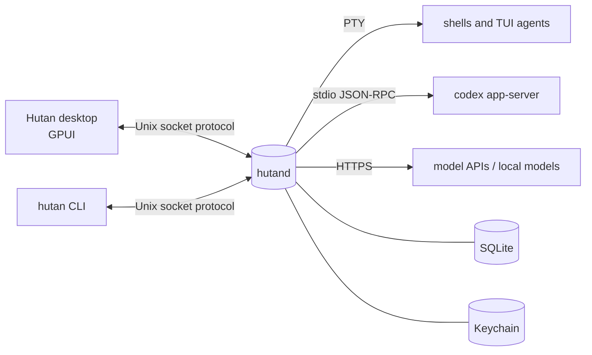

<p align="center">
  
</p>

# Hutan

**A native macOS agentic development environment in Rust.** *Code from the canopy.* A real terminal emulator and an AI-agent workspace in one GPUI app. It runs on a separate daemon (`hutand`) that keeps your shells, coding agents and chats alive when the window is closed. *Hutan* is Malay and Indonesian for "forest", as in *orang-hutan*, "person of the forest", which is our mascot.

> **Status: pre-alpha, macOS only, not released.** The first vertical slice is built: terminals and shell blocks, the desktop workbench, agent chat and monitor, worktrees with tasks and review, restart recovery, and `Hutan.app` with native notifications, start at login, the menu bar item and the Dock badge. Several surfaces have had only a quick visual review, and expect breaking protocol changes. See [`docs/status.md`](docs/status.md) and [`docs/roadmap.md`](docs/roadmap.md).

## Why

- **The daemon is the source of truth.** If the UI crashes or you close it, work keeps going. The desktop app, the `hutan` CLI and any future remote client all speak the same protocol over a Unix socket.
- **Terminal-first.** Shells and TUI agents (Claude Code, Codex, OMP, OpenCode) run unmodified in a real PTY. Structured agent chat is added on top of terminals, not instead of them.
- **Native and light.** No Electron and no webview for the core UI, and performance budgets are measured (`just bench`).
- **Permissions are enforced in the daemon.** UI dialogs only collect decisions, and API keys live in the macOS Keychain.

## What works today

| Area | What you get |
|---|---|
| Terminals | PTY sessions owned by the daemon, compact bounded scrollback, detach/reattach, several clients attached at once, restore after a daemon restart (respawned in the last cwd) |
| Shell blocks | zsh/bash/fish integration injected automatically (OSC 133/7): commands become blocks with exit code and duration that you can jump to, copy, collapse or send to an agent |
| Workbench | GPUI desktop with docks (toggle buttons in the status bar), split panes, zoom, presets (default/focus/overview), ⌘⇧P palette, settings in TOML with hot reload, Zed or Hutan default keys plus a keymap file |
| Projects and workspaces | **Projects** appear by themselves from the folders you work in (a repository with all its worktrees, or a plain folder); your own **workspaces** group projects, and a permanent **Home** holds the rest. ⌘O to open, ⌘P to jump; sort modes, pins and a layout per workspace or project |
| Agent chat | Codex through `codex app-server`, OMP and Claude Code through their ACP harnesses: streaming, tool cards, diffs, plans, questions, approvals enforced in the daemon; the same conversation is visible from the CLI |
| Agent monitor | Live state (working/blocked/idle) of agents and subagents from Codex, Claude Code hooks and the OMP extension |
| Direct model chat | OpenAI-compatible, Anthropic and Ollama/LM Studio providers; switch models mid-conversation; keys in Keychain |
| Assistant | Palette → Assistant opens a quick chat (optional system-wide shortcut), global or per workspace; context (shell output, agent transcript, file, search) is attached explicitly as chips, then redacted and bounded |
| History search | Opt-in local SQLite FTS5 index over Hutan sessions and Claude Code, Codex and OMP transcripts, with one-click **Resume**, Reveal File and Open Block |
| Notifications | The daemon raises intents (approval needed, agent blocked/finished, non-zero exit, reply ready). `Hutan.app` posts them as macOS notifications: **Allow once** on the banner answers the agent's approval; `hutan notify watch` prints them anywhere |
| Worktrees | `hutan wt new/ls/rm`, `hutan new --worktree <branch>`; every session shows `main` or `wt <branch>`, with a warning when two agents work in one checkout |
| Session environment | New terminals start from your login environment, like Terminal.app; commands you run directly get the `PATH` your login shell builds |
| App bundle | `just bundle` builds an ad-hoc signed `Hutan.app` (desktop, daemon, CLI) with the orangutan icon |

## The mascot

One orangutan, many moods: each state of the interface has its face.

<p align="center">
  
  
  
  
  
  
  
  
</p>

Icons, logos, angles, animated SVGs and the scripts that generate them live in [`assets/brand/`](assets/brand/README.md); `just icon` renders the app icon from `assets/brand/05-mascot/svg/icon-dark.svg`.

## Architecture



Crates live in `crates/` (`core`, `protocol`, `daemon`, `client`, `cli`, `terminal`, `terminal_view`, `desktop`, `agents`, `gateway`, `storage`, `index`, `settings`, `chat_view`). Details are in [`docs/architecture.md`](docs/architecture.md), and the decisions behind them in [`docs/adr/`](docs/adr).

## Install

Apple Silicon, macOS 13 (Ventura) or later. Once the first release and tap are
published, choose **one** (both provide the `hutan` command):

```sh
brew install --cask robertt3kuk/hutan/hutan # Hutan.app, bundled daemon and CLI
# OR, without the desktop:
brew install robertt3kuk/hutan/hutan        # CLI + daemon, built from source
```

The app is ad-hoc signed, **not notarized**. Homebrew retains quarantine; macOS
may refuse the first open because Apple cannot verify the developer or check the
app for malicious software. If you trust the release, attempt to open it, then
use **System Settings → Privacy & Security → Open Anyway**, authenticate if
asked, and confirm **Open**. Do not disable Gatekeeper or remove quarantine.
The formula does not include native notifications or login-item registration.
See [packaging and release instructions](docs/packaging.md#homebrew).

## Requirements

- macOS 13 or later; developed on Apple Silicon.
- [rustup](https://rustup.rs). The toolchain (Rust 1.98.0) is pinned in `rust-toolchain.toml` and installs itself on the first build.
- Xcode or the Command Line Tools (`xcode-select --install`). The separate Metal toolchain is **not** needed because GPUI is built with `runtime_shaders`.
- For the quality gate: `brew install just cargo-nextest cargo-deny`.
- Optional:
  - `codex` ≥ 0.160 for Codex agent chat;
  - [Ollama](https://ollama.com) or LM Studio for local models;
  - an API key for OpenAI-compatible or Anthropic providers.

## Quick start

The first build fetches and compiles GPUI, which takes a few minutes.

```sh
git clone https://github.com/robertt3kuk/hutan.git
cd hutan
cargo build --workspace --bins --locked
```

Keep experiments away from your real data: `HUTAN_HOME` puts the socket, database, logs and the Home folder into one directory.

```sh
export HUTAN_HOME="$(mktemp -d)"
```

### Desktop app

```sh
cargo run -p hutan-desktop
```

The app starts `hutand` itself, using the copy built next to it. On quit it stops the daemon if no session is running; otherwise it asks.

Default keys follow Zed's macOS keymap (`keymap.base = "zed"`); set `keymap.base = "hutan"` in Settings for Hutan's original keys. Your own bindings go into `keymap.toml` and merge on top of either. The status bar has three small buttons at its right end that toggle the left, bottom and right dock (the tooltip shows the key).

| Zed base | Hutan base | Action |
|---|---|---|
| ⌘T / ⌘⇧T / ⌘⌥T | same | New terminal / new agent chat / new model chat |
| ⌘⇧[ / ⌘⇧] | same | Previous / next tab |
| ⌘⇧P | ⌘K | Command palette |
| ⌘D / ⌘⇧D, ⌘K ←→↑↓ | ⌘D / ⌘⇧D | Split right / down; split in a direction (Zed base: ⌘K ⌘←→↑↓ focuses the neighbor pane) |
| ⌘O / ⌘P | ⌘O / ⌘J | Open project / jump to a workspace or session |
| ⌘⇧O | same | Overview of all sessions |
| ⌘B / ⌘R / ⌘J | ⌘B / ⌘⌥B / ⌘⌥J | Toggle left / right / bottom dock (Zed base: ⌘⌥Y closes all docks) |
| ⌘= / ⌘- / ⌘0 | — | Terminal font size larger / smaller / reset |
| ⌘⇧J | same | Jump to the next session that needs you |
| ⌘, | same | Settings |

### CLI

```sh
alias hutan="$PWD/target/debug/hutan"

hutan daemon start
hutan new --title demo -- /bin/sh -c 'echo hello; exec $SHELL'
hutan ls
hutan attach demo           # detach with ctrl+\ then d
hutan history demo          # scrollback as plain text
hutan recovery              # what the last hutand restart did to each session
hutan ws ls                 # workspaces (Home is always there)
hutan notify watch          # notification intents as they happen
hutan daemon stop --stop-sessions
```

Other useful commands (each takes `--help`, and every command takes `--json`):

```sh
hutan provider discover                      # find local Ollama / LM Studio
hutan provider add ollama --name Local       # provider id is made from the name
hutan chat new --direct --provider local     # chat with a model
hutan ask "what does this error mean?" --attach file:src/main.rs   # needs [assistant] provider = "local" in daemon.toml
hutan chat new                               # Codex agent chat (needs codex >= 0.160)
hutan approvals && hutan approve <id> accept
hutan index enable && hutan search "cargo test -p daemon"
hutan history sessions --filter repo:hutan   # every agent session on this machine, newest first
hutan integration status claude              # agent hooks; install only when you want them
```

### App bundle

```sh
just bundle                  # target/bundle/Hutan.app, ad-hoc signed
just bundle --release
```

Running the bundle is safe to try. Native notifications and **Start the daemon when you log in** (Settings → General) work from `Hutan.app` only: macOS asks for permission the first time, and a plain `cargo run` build does neither.

## Development

```sh
just check     # fmt + clippy -D warnings + nextest (over 2,000 tests) + cargo-deny; must be green before a merge
just bench     # performance budgets B1–B6 (docs/perf.md)
just fmt
```

- Process and conventions: [`AGENTS.md`](AGENTS.md), [`docs/process.md`](docs/process.md)
- Wire protocol: [`docs/protocol.md`](docs/protocol.md)
- UI design: [`docs/design.md`](docs/design.md)
- Vision and target scope: [`docs/vision.md`](docs/vision.md)

## Where data lives

| | Default | With `HUTAN_HOME` |
|---|---|---|
| Socket, database (`hutan.db`), daemon settings (`daemon.toml`) | `~/Library/Application Support/Hutan` | `$HUTAN_HOME` |
| Logs | `~/Library/Logs/Hutan` | `$HUTAN_HOME/logs` |
| Home workspace folder | `~/Hutan` | `$HUTAN_HOME/Hutan` |
| API keys | macOS Keychain, service `dev.hutan.provider` | same |

## License

Licensed under either of

- Apache License, Version 2.0 ([LICENSE-APACHE](LICENSE-APACHE))
- MIT license ([LICENSE-MIT](LICENSE-MIT))

at your option.

Unless you explicitly state otherwise, any contribution intentionally submitted for inclusion in Hutan by you, as defined in the Apache-2.0 license, shall be dual licensed as above, without any additional terms or conditions.

Hutan links no GPL code: Zed's GPL editor crates are not used, and cargo-deny checks the dependency licenses on every gate. The embedded editor (M11) is built on permissively licensed parts ([ADR 0012](docs/adr/0012-embedded-editor.md)).
