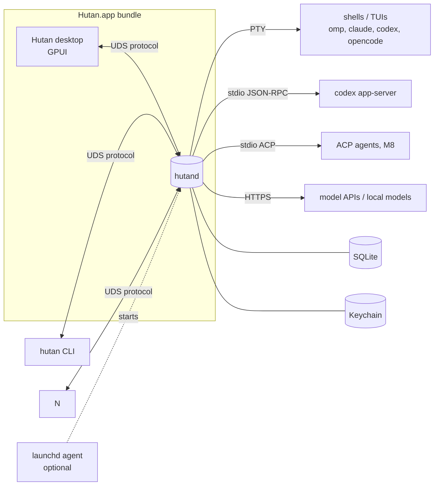
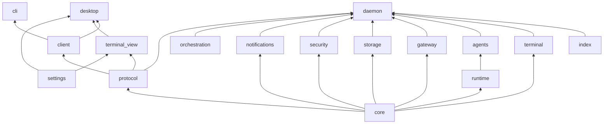
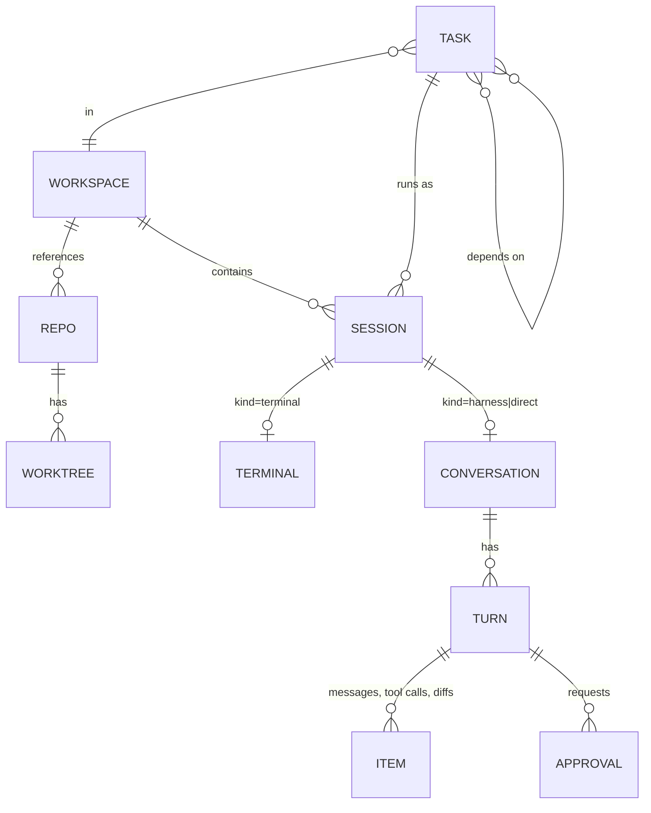
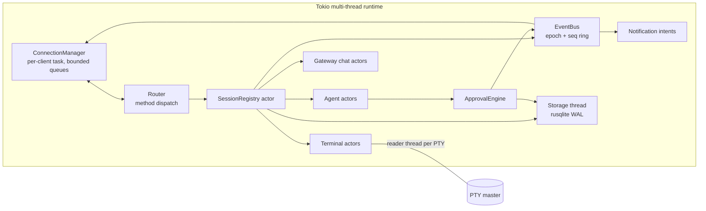
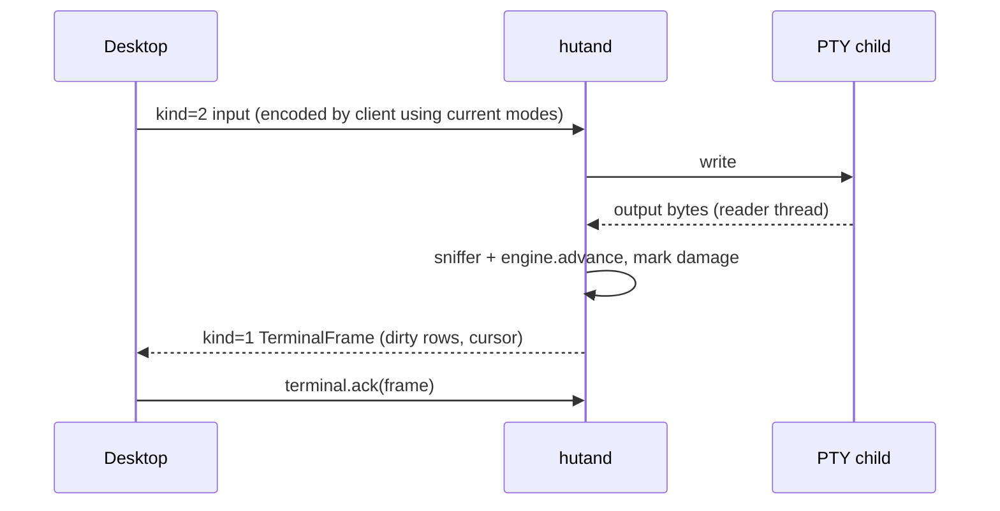
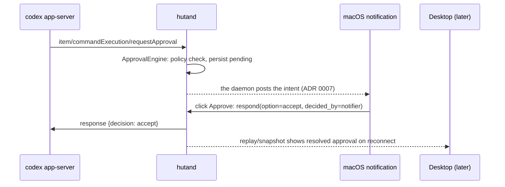

# Architecture

Rule: **daemon = execution, persistence, orchestration, security; clients = visualization and interaction; protocol = the only boundary.** Decisions behind this document live in `docs/adr/`.

## Process topology (ADR 0001, 0007)



- `hutand` is started on demand by any client (spawn, wait for socket) or by launchd when "start at login" is enabled (M6). By default the daemon follows the desktop: the desktop starts it, and quitting stops it (silently when no session is live, after a confirmation otherwise); `app.keep_running` leaves it running after quit and `app.start_at_login` hands its lifetime to launchd (design.md § Daemon lifecycle). The CLI controls the same daemon at any time.
- All clients are equal protocol peers; the desktop has no private channel.

## Crates

Crates are created when their first milestone starts (no empty placeholders); package names are `hutan-<dir>`. Present now: `core`, `protocol`, `daemon` (`hutand` + lib), `client`, `terminal`, `agents` (Codex chat, `docs/agents.md`), `gateway` (direct model chat, `docs/gateway.md`).

```text
crates/
  core/           domain types: IDs, Session/Workspace/Task models, AgentEvent, state machines (no I/O)
  protocol/       frames, envelope, handshake, commands/queries/events, render DTOs, JSON Schema gen
  client/         async protocol client: connect/spawn daemon, reconnect, replay/snapshot reconciliation
  daemon/         hutand binary: lifecycle, connections, event bus, wiring of services below
  terminal/       PTY spawn (portable-pty), alacritty_terminal engine, OSC sniffer, shell-integration scripts + injection (`docs/shell-integration.md`), render snapshot/frames
  runtime/        stdio subprocess supervision for agent adapters (spawn, restart policy, stderr capture)
  agents/         AgentAdapter trait; codex app-server adapter (M4), ACP v1 adapter (M8)
  gateway/        direct model chat: provider trait, OpenAI-compatible, Anthropic, local endpoints (M5)
  orchestration/  tasks, dependencies, worktrees, scheduling of parallel agents (M7)
  storage/        SQLite actor, migrations, repositories
  index/          opt-in session history index: SQLite FTS5 over Hutan blocks and agent transcripts, incremental scanner, FSEvents watcher, redaction (`docs/history-index.md`)
  security/       Keychain, permission policy evaluation, redaction
  notifications/  notification intents from domain events (daemon side)
  cli/            hutan binary
  settings/       layered TOML settings store, schema registry, watcher, keymap, color packs and their registry (`themes/`, ADR 0018; no GPUI; ADR 0010)
  terminal_view/  GPUI terminal element/view over render DTOs, input encoding (UI crate)
  desktop/        Hutan GPUI app: workbench (docks, pane tree, panels, presets), wiring (UI crate)
xtask/            bundle, sign, schema export, corpus recording
```



Arrows point from dependency to dependent. Forbidden: anything depending on `daemon`; UI crates or `cli` depending on service crates; GPUI in any non-UI crate (UI crates: `desktop`, `terminal_view`, later `chat_view`).

## Domain model



- **Session kinds**: `terminal` (PTY), `harness` (structured agent over Codex app-server/ACP), `direct` (gateway chat). One lifecycle: `starting → running → (waiting_approval) → idle | exited(code) | failed(reason) | stopped`.
- **Agent attention state** (rolled up to workspace): `idle | working | blocked | done(unread)`; harness sessions derive it from events, TUI agents from integration hooks then screen manifests (M7).
- Workspace membership is daemon state (needed by CLI, restore, orchestration). Tabs, splits, docks, presets, focus, scroll, and theme are desktop state (ADR 0010).

## Desktop wiring (M2)

- The desktop owns one `client::Connection` (autostarting `hutand` next to its binary, else from `PATH`). A `SessionsStore` entity bridges the connection's `state()` watch and `notices()` broadcast onto GPUI's executor and tracks attention: a live→ended transition to `failed` (exit ≠ 0, signal, spawn failure) or `done` (exit 0, or a terminal notification) is *unread* until the session's view is focused; what was already over when the desktop connected, and notifications replayed after a reconnect, are not news.
- **One terminal model per terminal, many views.** A `TerminalSession` entity owns the `TerminalHandle` (one attachment per terminal per connection) and a `terminal_view::SharedTerminal` (the `TerminalModel` plus ack and status). Pane tabs (interactive `TerminalView`s) draw from it. The newest frame is acked after the first view that shows it has painted it, so a hidden terminal is paced at zero cost and catches up when shown. A restarted session re-binds the same tab to its new terminal; `EpochChanged`, `NotFound` and ended sessions show as `ViewStatus::Ended` with Restart / Close.
- **Settings.** One `SettingsStore` per app with namespaces `appearance`, `terminal`, `layout`, `panels.sessions`, `panels.inspector`, `workspaces`, `agents`; file changes hot-reload density, terminal font/theme (plus `terminal.set_colors` for every attached terminal), panel options, status-bar items, preset definitions and the keymap. The first root of the *active* workspace layers its `.hutan/settings.toml` over the user settings (M12-B); each workspace keeps its own pane tree and docks in `desktop-state.json`. The settings sheet (⌘,) is generated from the store's schemas and writes through `write_user`, which keeps `settings.toml`'s comments.

## Session environment (B-1)

A terminal session's process starts the way a tab of Terminal.app, iTerm2 or Ghostty does: from the user's login environment, not from whatever environment started `hutand` (a shell with virtualenv exports, or the bare GUI environment when the desktop or launchd did). Code: `crates/terminal/src/env.rs` (assembly, system facts), `command()` in `crates/terminal/src/terminal.rs`; setting: `daemon.toml` `[terminal] env_inherit`.

- **`env_inherit = "login"`** (default). The child starts from an **empty** environment plus: `HOME`, `USER`, `LOGNAME`, `SHELL` from the account database (`getpwuid_r`); `TMPDIR` from `confstr(_CS_DARWIN_USER_TEMP_DIR)`; `LANG`, `LC_*` and `__CF_USER_TEXT_ENCODING` copied from the daemon only when it has them (otherwise `LANG` is the user's locale, `defaults read -g AppleLocale` as `<language>_<REGION>.UTF-8`, falling back to `<language>_US.UTF-8`, then `en_US.UTF-8`, when the locale is not installed); `PATH` from `/usr/libexec/path_helper -s` (parsed, never evaluated; fallback `/usr/bin:/bin:/usr/sbin:/sbin`); `SSH_AUTH_SOCK` from `launchctl getenv SSH_AUTH_SOCK`. The login shell (`-l`) builds the rest from the user's startup files, as in a terminal emulator. The tools run from an empty environment; their results are cached for the life of the daemon and gathered on a background thread at start. Only `SSH_AUTH_SOCK` is asked again, when the socket it named has vanished.
- **`env_inherit = "daemon"`**: the child inherits `hutand`'s environment (the behavior before B-1).
- **Precedence**, lowest to highest: the base above < `TerminalSpec.env` from the client (the desktop puts `terminal.shell` and `terminal.env` there) < terminal and integration variables (`TERM`, `COLORTERM`, `TERM_PROGRAM`, the shell-integration variables of `docs/shell-integration.md`) < the daemon-managed `HUTAN_*` variables (`docs/protocol.md` § Agent reporting). An explicit `SHELL` in `TerminalSpec.env` still selects the shell that runs when `command` is empty.
- **Sessions with an explicit command** (`hutan new -- omp`, resumed agents) run that program directly, so there is no login shell to build their `PATH` (agents usually live in `~/.local/bin`, Homebrew, mise/nvm shims that the user's shell configuration sets up). They start from the base **plus the login shell's own environment** (`crates/terminal/src/login_env.rs`, the "resolve login shell environment" pattern of Zed and VS Code): the daemon runs `<shell> -l -c '/usr/bin/env -0'` once from the base environment (stdin `/dev/null`, no shell integration, the account's home as working directory, 5 s timeout after which the shell and its process group are killed), parses the NUL-separated `KEY=VALUE` output and keeps it, minus `PWD`, `OLDPWD`, `SHLVL`, `_`, `TERM`, `TERM_PROGRAM*`, `COLORTERM`, every `HUTAN_*` variable and names that are not plain identifiers (exported bash functions). It works the same for zsh, bash and fish. The shell is the one a session would run: `SHELL` in the session's `env` (desktop `terminal.shell`), else the account's login shell. Sessions that run a login shell (empty `command`) start from the base only; the shell builds its own environment. Precedence for explicit commands: base < login shell < client `env` < terminal/integration variables < `HUTAN_*`.
  - **Caching.** One capture per shell path, started on a background thread at daemon start (login mode) and when a session first needs it. A capture older than 10 minutes is redone in the background when a session starts; a spawn never waits for a refresh and uses the last good capture. Only the very first capture of a shell is waited for, for at most 2 s; a session that starts before it is done runs from the base environment alone, later ones get the capture.
  - **Failure** (shell missing, non-zero exit, timeout, no variables in the output) means the base environment and a `warn!` naming the shell and the reason. The shell's output is never logged or put into an error: its values may be secrets. A failed refresh keeps the last good capture.
  - **Limits.** `-l -c` runs a login, non-interactive shell: zsh reads `.zshenv` and `.zprofile` but not `.zshrc`, so a `PATH` that is only set in `.zshrc` is not seen (fish and bash `.bash_profile` are). A startup file that prints to stdout or hangs costs at most the timeout. The environment is a snapshot: a change to the user's shell configuration is picked up within ten minutes, for the next session.
- Restore does not change: `persistable_spec` still drops secret-looking variable names, and a respawned session gets a fresh base environment. Agent sessions the daemon starts itself (Codex app-server, gateway chats) are not affected.
- Desktop settings: `terminal.shell` and `terminal.env` (`docs/design.md` § Settings). Never `launchctl setenv`, never the user's shell configuration.

## Daemon internals



- Every long-lived thing is an actor owning its state, talking through **bounded** `mpsc` channels; damage/state signals use `watch`/`Notify` (coalescing, never queue growth).
- Terminal actor: blocking reader thread → OSC sniffer → `alacritty_terminal::Term` (behind a mutex) → damage notify; per-client render tasks build `TerminalFrame`s on ack (ADR 0004). Engine replies (DA/DSR) go back through the PTY writer.
- Agent actor: owns the adapter subprocess (via `runtime`), maps provider messages to `AgentEvent`, writes the journal, registers approvals with `ApprovalEngine`; resolves approvals only with provider-offered options (ADR 0005).
- Worktrees (`worktree.*`, `docs/orchestration.md`) are a service beside the registry: it runs git (`worktree list|add|remove`) off the registry's mailbox, remembers the worktrees Hutan created in SQLite, and asks the registry to derive every session's `placement` again when one changes. The registry derives placement itself from the session's directory by reading `.git` and `HEAD` (no git process) and keeps `shared_with` (other live agents in the same checkout) current.
- Task panics are contained per actor; the registry marks the session `failed` and keeps the daemon alive.

## Key flows

### Keystroke to glyph


### Approval while UI is closed


### Client reconnect
Subscribe → `welcome.resume = replayed` (seq in ring) or `snapshot_required` → `session.snapshot` (carries `seq`) → apply events with `seq > snapshot.seq` → re-attach visible terminals (fresh render snapshots). Epoch change ⇒ treat all live state as possibly restarted.

Implemented by `hutan_client::Connection` (M2.2): one `hutan-client` thread with a current-thread Tokio runtime owns the connection task, so UIs on any executor use it through `watch` (`StoreState`), `broadcast` (`Notice`) and channel-backed handles. The task reconnects with 100 ms→5 s backoff (±20 % jitter), resumes with the last applied `(epoch, seq)`, uses `events.subscribe` as the replay barrier, falls back to subscribe → snapshot when the ring no longer has the gap or the event receiver lags, and re-attaches every `TerminalHandle` (new render snapshot) after a reconnect in the same epoch. A new epoch publishes `Notice::DaemonRestarted` and ends handles with `Gone(EpochChanged)`; a session restart (new `terminal_id` for the session that owned an attached terminal) ends the handle with `Gone(SessionRestarted)`.

## State ownership

| State | Owner | Persistence |
|---|---|---|
| Processes, PTYs, canonical terminal grid | daemon | memory (scrollback bounded, not persisted by default) |
| Workspaces, sessions, cwd, resume refs | daemon | SQLite |
| Conversations, turns, items, approvals, decisions | daemon | SQLite (Hutan journal is authoritative; ADR 0005) |
| Tasks, worktrees, dependencies | daemon | SQLite |
| Provider config | daemon | SQLite; secrets in Keychain (ADR 0008) |
| Event log | daemon | in-memory ring per epoch |
| Workbench layout (docks, pane tree, open items, sizes), focus, scroll, selection, window frames | desktop | `desktop-state.json` per window |
| Settings, presets, keymap, themes | desktop | `settings.toml`, `keymap.toml`, `<repo>/.hutan/settings.toml` (ADR 0010) |
| Notification presentation | daemon (native, from `Hutan.app`) / desktop | none |

## Persistence and restore (ADR 0006, 0009)
- SQLite at `~/Library/Application Support/Hutan/hutan.db`, single writer thread, WAL, forward-only migrations with pre-migration backup.
- Daemon restart: respawn terminals in saved cwd; resume agents via recorded native resume refs; otherwise sessions come back `stopped` with a restart action. Live fd handoff for upgrades is M9.
- Implemented (M3-A): the registry writes workspaces and sessions through to the `storage` actor (`hutan-storage`); start loads them back, respawns live sessions as new terminals with the same ids, and lists ended ones as `restored`. `$HUTAN_HOME/daemon.toml` `[daemon] restore_sessions = "respawn" | "stopped"`; `[workspaces] home_folder` (the Home workspace's folder, default `~/Hutan`; M12-A); `hutan daemon stop --stop-sessions --forget` leaves them out of the restore set. Semantics: `docs/protocol.md` § Persistence and restore.
- Implemented (M17-A): the session history index lives in its own `index.sqlite` beside `hutan.db` (separate so Clear is a file delete), written by one low-priority indexer thread of `hutan-index`; off unless `daemon.toml` `[history] enabled`. The same reading folds a per-session summary (title, first prompt, latest turns, counts) that `history.sessions` serves as the session catalog, attributed to projects by the daemon (`crates/daemon/src/history_catalog.rs`). Details and privacy: `docs/history-index.md`.
- Implemented (RR-1, protocol 0.26): the start says what it did to each session (`SessionInfo.recovery`: shell respawned, agent resumed, chat resumed with its last turn completed or interrupted, not restarted, ended before). The facts are the epoch history (`app_meta.epoch_history`, each run noting its own clean stop at shutdown; a run without that note was killed or crashed), the approvals that expired, the journal's turn rows, and the command of the last running terminal block (`app_meta` `recovery.running_commands`, written with the dirty sessions, at most about a second old, redacted). Clients show a summary once per restart and chips until the user acknowledges (`session.recovery_ack`) or acts in the session. Semantics: `docs/protocol.md` § Recovery.
- Implemented (ST-1, protocol 0.28): the daemon owns `daemon.toml` and offers it as a list of settings (`daemon.settings.get` / `.set`, `crates/daemon/src/daemon_settings.rs`): one table in code says for every option its kind, default, range or choices and whether the running daemon takes a change at once (notify, history, assistant permissions and defaults, `[control]` policy and timeout, task parallelism, gateway context limit) or after a restart. An edit goes through `toml_edit` (comments and unknown keys stay) into a temporary file that is renamed over the original; clients (`hutan config`, the desktop's Settings) never write the file themselves. The services that read a setting per request hold it behind a swappable cell, so a change is in use when `set` answers; `pending_restart` compares the file with what the services hold. Changing a setting is user-only: an agent-originated connection (ADR 0016) is refused whatever `[control] agents` says, so an agent cannot widen its own permissions. Semantics: `docs/protocol.md` § Daemon settings.
## Security
- Socket dir `0700`, socket `0600`, peer UID check; no TCP listener until a remote transport ADR.
- Permission policy evaluated in daemon (`security`): per workspace/session rules (allow/ask/deny by command prefix, path scope, network); UI only collects decisions; all decisions audited.
- Secrets: Keychain only, redaction layer on logs/events.
- Spawned processes get a controlled env: user login env + `HUTAN_SOCKET`, `HUTAN_SESSION_ID`, `HUTAN_WORKSPACE_ID`, `TERM=xterm-256color`, `COLORTERM=truecolor`.

## Paths

| What | Path |
|---|---|
| Socket, lock | `~/Library/Application Support/Hutan/hutand.sock`, `hutand.lock` |
| Database | `~/Library/Application Support/Hutan/hutan.db` |
| Desktop UI state | `~/Library/Application Support/Hutan/desktop-state.json` |
| Logs | `~/Library/Logs/Hutan/hutand.log`, `desktop.log` |
| Override for dev/tests | `HUTAN_HOME` (all of the above under one dir) |

## Extensibility path
- External clients use the published JSON Schema (`protocol` → `xtask schema`).
- Agents: ACP config entries (M8); Hutan also exposes its control surface as an MCP server so agents can create sessions/tasks (M8).
- Plugins: manifest actions + event hooks over the same protocol (M9).
- Remote: TLS/WebSocket transport wrapping the same frames (M9); render-delta terminals keep mobile clients thin.
