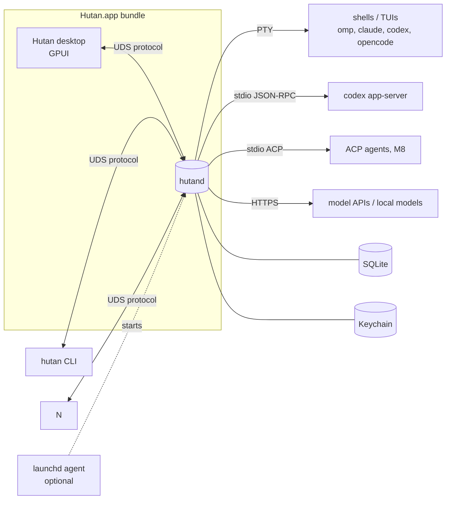
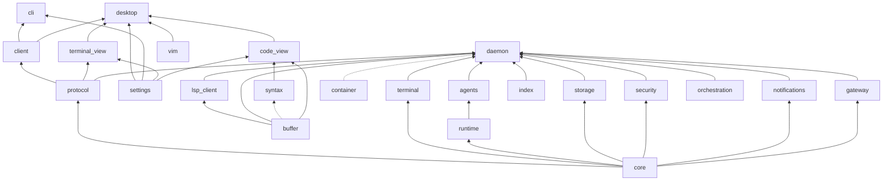
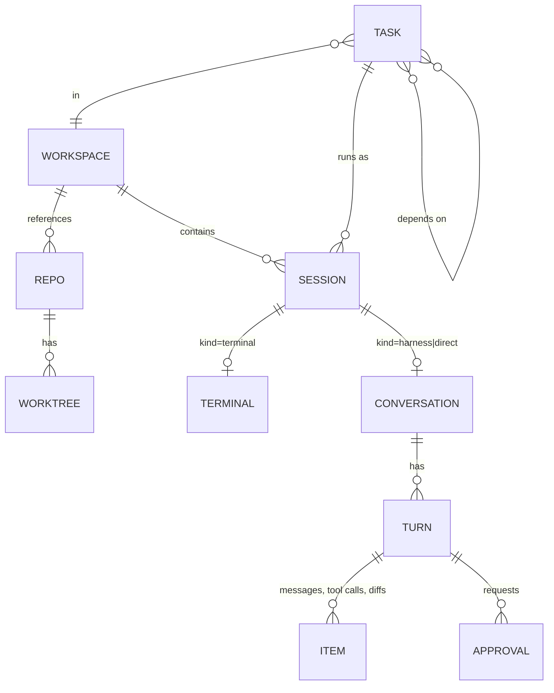
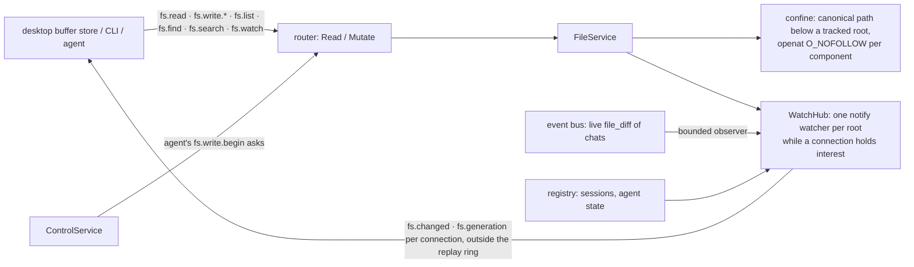
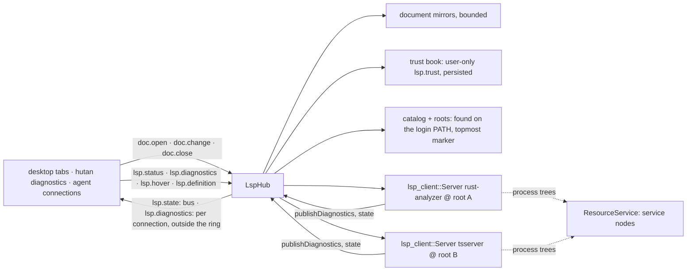
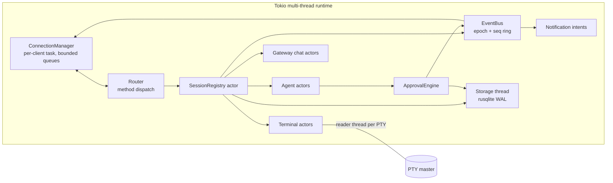
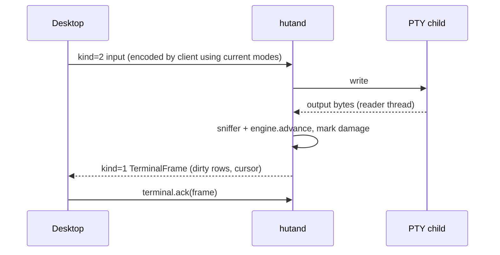
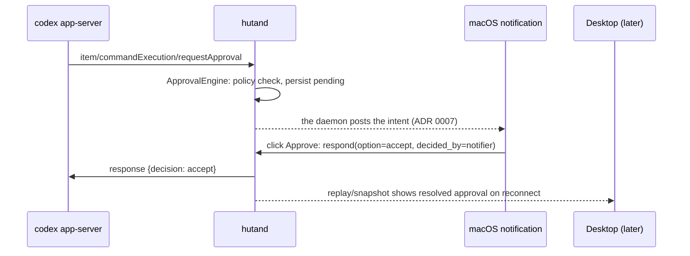

# Architecture

Rule: **daemon = execution, persistence, orchestration, security; clients = visualization and interaction; protocol = the only boundary.** Decisions behind this document live in `docs/adr/`.

## Process topology (ADR 0001, 0007)



- `hutand` is started on demand by any client (spawn, wait for socket) or by launchd when "start at login" is enabled (M6). By default the daemon follows the desktop: the desktop starts it, and quitting stops it (silently when no session is live, after a confirmation otherwise); `app.keep_running` leaves it running after quit and `app.start_at_login` hands its lifetime to launchd (design.md § Daemon lifecycle). The CLI controls the same daemon at any time. Which binary, a daemon of another build, and a stop asked for elsewhere: § Daemon lifecycle.
- All clients are equal protocol peers; the desktop has no private channel.

## Crates

Crates are created when their first milestone starts (no empty placeholders); package names are `hutan-<dir>`. Present now: `core`, `protocol`, `daemon` (`hutand` + lib), `client`, `terminal`, `agents` (Codex chat, `docs/agents.md`), `gateway` (direct model chat, `docs/gateway.md`), `buffer` (the editor's text model, ADR 0012), `syntax` (the editor's tree-sitter layer), `vim` (the editor's Vim layer), `lsp_client` (the LSP client the daemon's language servers will run on, ADR 0012).

```text
crates/
  core/           domain types: IDs, Session/Workspace/Task models, AgentEvent, state machines (no I/O)
  protocol/       frames, envelope, handshake, commands/queries/events, render DTOs, JSON Schema gen
  client/         async protocol client: connect/spawn daemon, reconnect, replay/snapshot reconciliation
  daemon/         hutand binary: lifecycle, connections, event bus, wiring of services below
  terminal/       PTY spawn (portable-pty), alacritty_terminal engine, OSC sniffer, shell-integration scripts + injection (`docs/shell-integration.md`), render snapshot/frames
  runtime/        stdio subprocess supervision for agent adapters (spawn, restart policy, stderr capture)
  agents/         AgentAdapter trait; codex app-server adapter (M4), ACP v1 adapter (M8)
  gateway/        direct model chat: provider trait, OpenAI-compatible, Anthropic, local endpoints (M5)
  orchestration/  tasks, dependencies, worktrees, scheduling of parallel agents (M7)
  storage/        SQLite actor, migrations, repositories
  index/          opt-in session history index: SQLite FTS5 over Hutan blocks and agent transcripts, incremental scanner, FSEvents watcher, redaction (`docs/history-index.md`)
  security/       Keychain, permission policy evaluation, redaction
  notifications/  notification intents from domain events (daemon side)
  cli/            hutan binary (`hutan theme` reads and writes pack files through `settings`, never the daemon; `hutan proxy`, `--host` and `hutan host …` for daemons on other machines over SSH, `docs/remote.md`)
  buffer/         editor text model (E-1, ADR 0012): `crop` rope with byte offsets, atomic transactions, undo tree with groups, multi-cursor selections, anchors, UTF-16/LSP coordinates, `apply_external` (minimal diff), search; no GPUI, no I/O, no Hutan dependencies
  syntax/         editor syntax (E-2, ADR 0012): tree-sitter parsing that follows edits on a worker thread (a newer version cancels the parse in flight; reads never wait), highlights reduced to the `syntax.*` token table, node/expand/shrink selection, folds, bracket match, indent levels; up to 15 grammars behind cargo features, vendored query data with attribution (`crates/syntax/queries/NOTICE.md`); optional `buffer` feature for `hutan_buffer::Text`; no GPUI, no I/O
  vim/            Vim modal layer (E-7a, ADR 0012), extracted from the desktop's V-1: `Vim<H: VimHost>` (modes, counts, motions, operators, text objects, unnamed register, `.` repeat) over a host that answers byte-offset reads (char at, line of, slice) and applies `Transaction`s with undo groups; the desktop's `TextInput` is one host (every text field), a rope host over `hutan_buffer::Buffer` is the editor's (E-8); no dependencies, no GPUI, no I/O
  lsp_client/     LSP client (E-11a, ADR 0012; the daemon's `LspHub`, E-11b, owns one `Server` per (server, root), `docs/lsp.md`): one supervised language server per `Server` — `Content-Length` framing with a frame cap, request correlation with timeouts and `$/cancelRequest`, bounded outgoing/incoming paths (documented overflow policy), answers to server requests, `initialize`…`shutdown`/`exit` with a kill fallback, `positionEncoding` negotiation (UTF-8 preferred, UTF-16 via `buffer`), state machine `starting → indexing ⇄ ready → failed | stopped` from `$/progress`, restarts with exponential backoff, coalescing document sync (one `didChange` per burst), typed request subset over `ls-types`, process group killed on drop; `hutan-fake-lsp` scripted test server; no GPUI, no daemon types
  container/      container runtime layer (C-1, ADR 0021 decision 7, `docs/spikes/2026-10-26-containers/`; **not wired into the daemon yet, wiring is C-2**): validated `ContainerSpec`/`ExecSpec` value types (same-absolute-path mounts, named volumes, network `none|open`, `hutan.*` labels, plain env that refuses credential-looking names), pure argv builders for Apple `container` and Docker/Podman CLIs (`Cli` → `Launch`), read-only detection through an injected `HostProbe` (Apple `container system status --format json`; Docker Engine API `/_ping`, `/version`, `/info` per product; `podman machine inspect`; app bundles; `SystemProbe` is the real, bounded, std-only probe), `RuntimeCaps` per runtime and the fail-closed `ContainerPolicy::plan` (a policy the runtime cannot honour, or a runtime that is not running, is a typed error naming what is missing), and the `ContainerRuntime` trait the adapters implement; no GPUI, no daemon types, no async runtime
  settings/       layered TOML settings store, schema registry, watcher, keymap, color packs and their registry (`themes/`, ADR 0018; no GPUI; ADR 0010)
  terminal_view/  GPUI terminal element/view over render DTOs, input encoding (UI crate)
  code_view/      GPUI code view (E-5, ADR 0012, UI crate): `FileBuffer` (one file's text, load state, a `syntax` tree only while shown), `CodeView` and its element (shapes only the lines in view, `syntax.*` colors of the pack, mouse selection), find in file; read-only until E-6 (`docs/editor.md`)
  desktop/        Hutan GPUI app: workbench (docks, pane tree, panels, presets), wiring (UI crate)
xtask/            bundle, sign, schema export, corpus recording
```



Arrows point from dependency to dependent. Forbidden: anything depending on `daemon`; UI crates or `cli` depending on service crates; GPUI in any non-UI crate (UI crates: `desktop`, `terminal_view`, `code_view`, later `chat_view`). The desktop's buffer store (`workbench/files.rs`) reads files only through the daemon (`fs.stat`, `fs.read`).

## Contain: Hutan's Seatbelt boundary (SANDBOX-2, ADR 0021 decisions 3 and 8)

`crates/daemon/src/contain.rs` is the one place that knows `sandbox-exec`. A typed `Policy {write_roots, write_deny, read_deny, read_keep, socket_deny, network}` renders the profile (`(deny default)` + `system.sb`, snapshot-tested); `Sandbox::plan(cwd, &Contain, &Fragment)` derives the policy from the session's checkout (git top level, the repository's common git directory without `hooks` and `config`, temp folders, `[sandbox]`, the harness fragment) and returns a `Plan` whose `containment` is what the session will report. `Sandbox::available` runs a self-test once and the answer fails every plan closed. There are two choke points, both fed by the plan: the terminal's spawn (`TerminalConfig.wrap`, an argv prefix placed after the shell-integration injection, set by `SessionRegistry::start_terminal`, so a restart and a daemon restart plan again) and the harness's launch (`AcpConfig` program and arguments rewritten in `ChatManager::start_harness`; OMP only). `SessionInfo.containment` is written by the registry from the plan that was applied (`applied: false` plus a reason when a restart failed closed). Nothing outside the daemon runs a profile: clients only send `contain` and render `containment` (the Start sheet's Contain row, the terminal chip, the chat header chip, `hutan new --contain`). `sandbox-exec` execs in place, so the process keeps its pid and the resource manager and signals are unchanged. Not here: the per-session restricted socket (SANDBOX-2B) and containers (`hutan-container`, below).

## Container runtimes (C-1; not wired yet)

`crates/container` (`hutan-container`, spike `docs/spikes/2026-10-26-containers/`, ADR 0021 decision 7): a container is a *placement* for terminals and agents. The crate holds everything that needs no runtime installed; the daemon does not link it until C-2, so nothing here can start, pull or run anything on a user's machine today.

- **Specs and argv.** `ContainerSpec` (image, name, `hutan.*` labels, mounts, network `none|open`, user, workdir, plain env, limits, `--read-only`, `--cap-drop ALL`, `--init`) and `ExecSpec` are built from value types that cannot hold an argument that would be misread: names never start with `-`, paths are absolute, canonical-by-contract and free of `,` and `"` (the `--mount` syntax), images are fully qualified and pinned (never pulled implicitly), environment names that look like credentials are refused, and a bind mount is always the **same absolute path** on both sides (`Mount::Bind` has one path). `argv::*` and `Cli` turn them into `container …` / `docker …` / `podman …` argument lists (`--mount type=…` instead of `-v`, parents mounted before children, `--uid/--gid` vs `--user`, `delete` vs `rm`, `exec -it` for the daemon's PTY and `exec -i` for stdio peers, `DOCKER_HOST`/`CONTAINER_HOST` so Hutan drives the engine it detected) and a `Launch` (program, args, cwd, env — the shape of `hutan_agents::jsonrpc::Launch`).
- **Detection** (`detect_all`, on demand, never at daemon start, never launching an app, starting a service, selecting a context, pulling or running): through a `HostProbe` (`stat`, `readlink`, query commands, `GET` over a unix socket; each bounded). Apple: `sw_vers` (macOS ≥ 26) and `container system status --format json` (states `unregistered`, `not running`, `running`; exits 1 with JSON when down) with a version floor. Docker family: known socket paths and `DOCKER_HOST`, `GET /_ping`, `/version`, `/info`; the product is decided by what the engine says (`Server: Libpod/`, `Operating System: Docker Desktop`, an `-orbstack` kernel, `Name: colima…`) before the path; Podman's socket comes from `podman machine inspect`; `/Applications/*.app` and `colima` mark "installed, not running" with a hint the user acts on. Tests feed recorded vendor output (`crates/container/tests/fixtures/SOURCES.md` cites each) through a scripted probe that panics on any command outside a read-only allow-list.
- **Capabilities and policy.** `RuntimeCaps::for_kind` records what each runtime honours (`boundary` VM-per-container or shared VM, `network_none`, `named_volumes`, `nested_mounts`, `single_file_mount`, …); what the sources do not settle is recorded closed until C-2 tests it on a real runtime. `ContainerPolicy::plan(&RuntimeReport)` returns a `ContainerSpec` only for a **running** runtime whose caps honour every part of the policy (`--network none`, volumes, a read-only `hooks/` inside the repo mount, a required boundary), else a typed `PolicyError` naming what is missing; a contained session never runs as root. Nothing is degraded silently (ADR 0021 decision 3).
- **Seam.** `ContainerRuntime` (`detect`, `caps`, `ensure`, `inspect`, `volume_ensure`, `stop`, `remove`, `list_hutan`, `exec_pty`, `exec_stdio`) is the trait the Apple (C-2) and Docker-compatible (C-5) adapters implement; the daemon will dispatch over an `enum`, not `dyn` async.

## Domain model



- **Session kinds**: `terminal` (PTY), `harness` (structured agent over Codex app-server/ACP), `direct` (gateway chat). One lifecycle: `starting → running → (waiting_approval) → idle | exited(code) | failed(reason) | stopped`.
- **Agent attention state** (rolled up to workspace): `idle | working | blocked | done(unread)`; harness sessions derive it from events, TUI agents from integration hooks then screen manifests (M7).
- Workspace membership is daemon state (needed by CLI, restore, orchestration). Tabs, splits, docks, presets, focus, scroll, and theme are desktop state (ADR 0010).

## Desktop wiring (M2)

- The desktop owns one `client::Connection` (autostarting `hutand` next to its binary, else from `PATH`). A `SessionsStore` entity bridges the connection's `state()` watch and `notices()` broadcast onto GPUI's executor and tracks attention: a live→ended transition to `failed` (exit ≠ 0, signal, spawn failure) or `done` (exit 0, or a terminal notification) is *unread* until the session's view is focused; what was already over when the desktop connected, and notifications replayed after a reconnect, are not news.
- **One terminal model per terminal, many views.** A `TerminalSession` entity owns the `TerminalHandle` (one attachment per terminal per connection) and a `terminal_view::SharedTerminal` (the `TerminalModel` plus ack and status). Pane tabs (interactive `TerminalView`s) draw from it. The newest frame is acked after the first view that shows it has painted it, so a hidden terminal is paced at zero cost and catches up when shown. A restarted session re-binds the same tab to its new terminal; `EpochChanged`, `NotFound` and ended sessions show as `ViewStatus::Ended` with Restart / Close.
- **Settings.** One `SettingsStore` per app with namespaces `appearance`, `terminal`, `layout`, `panels.sessions`, `panels.inspector`, `workspaces`, `agents`; file changes hot-reload density, terminal font/theme (plus `terminal.set_colors` for every attached terminal), panel options, status-bar items, preset definitions and the keymap. The first root of the *active* workspace layers its `.hutan/settings.toml` over the user settings (M12-B); each workspace keeps its own pane tree and docks in `desktop-state.json`. The settings sheet (⌘,) is generated from the store's schemas and writes through `write_user`, which keeps `settings.toml`'s comments.

## File service (E-3, ADR 0012 amendment 2026-10-21, protocol 0.33)

Files are read and written by the daemon, never by a client: it is the one place permissions are enforced, agents and `hutan fs` need the same access as the editor, and a remote client (M9) has no local disk. `crates/daemon/src/files/` (`docs/protocol.md` § Files):



- **Roots** are the folders of the daemon's workspaces and projects and the git checkouts its sessions work in; `picked` (a file the user chose) reaches further, an agent's never does. Reads open from the root descriptor without following links; a write goes to a temporary file in the target's directory, is flushed and `renameat`ed over it, with the target's mode, after a version check (`conflict` with the current version).
- **Bounded everywhere**: 1 MiB chunks under the 4 MiB frame, 64 MiB per file, 8 uploads (30 s idle expiry), 4 searches per connection, finder indexes of 200 000 paths (8 roots kept), 256 watched paths per connection, 500 changes per `fs.changed`, a bounded channel from each platform watcher; no unbounded channel (a test greps for it). A full connection queue drops an `fs.changed` and the next one says `overflow`; it never closes the connection.
- **Watchers** exist only while a client has interest; the desktop's `BufferStore` (E-5) will hold open documents and expanded folders as interest and reconcile on `fs.changed`, treating its own `write_id` as no news.
- **`fs.search`** runs on a task of its own per request (the connection goes on reading, so `fs.search.cancel` arrives); everything else is answered in order.

## Language servers (E-11b, ADR 0012 amendment 2026-10-21, protocol 0.39)

`crates/daemon/src/lsp/` (`docs/lsp.md`, `docs/protocol.md` § LSP): the daemon owns the language servers; clients mirror their open documents into it and read what the servers know.



- **One server per (server, root)**, shared by every client; started by the first `doc.open` of a language in a trusted folder, stopped when idle or to make room (`max_servers`), restarted with backoff by E-11a's supervisor, killed with the daemon. A slot says why it has no process: `untrusted`, `not_installed`, `stopped`.
- **Trust** is decided per folder by the user alone (`Access::UserOnly`) and stored in SQLite (`lsp_trust`); an untrusted folder never spawns.
- The hub depends on `hutan-lsp-client` and `hutan-buffer` only for positions and mirrors; nothing in it links GPUI. All queues are bounded.

## Session environment (B-1)

A terminal session's process starts the way a tab of Terminal.app, iTerm2 or Ghostty does: from the user's login environment, not from whatever environment started `hutand` (a shell with virtualenv exports, or the bare GUI environment when the desktop or launchd did). Code: `crates/terminal/src/env.rs` (assembly, system facts), `command()` in `crates/terminal/src/terminal.rs`; setting: `daemon.toml` `[terminal] env_inherit`.

- **`env_inherit = "login"`** (default). The child starts from an **empty** environment plus: `HOME`, `USER`, `LOGNAME`, `SHELL` from the account database (`getpwuid_r`); `TMPDIR` from `confstr(_CS_DARWIN_USER_TEMP_DIR)`; `LANG`, `LC_*` and `__CF_USER_TEXT_ENCODING` copied from the daemon only when it has them (otherwise `LANG` is the user's locale, `defaults read -g AppleLocale` as `<language>_<REGION>.UTF-8`, falling back to `<language>_US.UTF-8`, then `en_US.UTF-8`, when the locale is not installed); `PATH` from `/usr/libexec/path_helper -s` (parsed, never evaluated; fallback `/usr/bin:/bin:/usr/sbin:/sbin`); `SSH_AUTH_SOCK` from `launchctl getenv SSH_AUTH_SOCK`. The login shell (`-l`) builds the rest from the user's startup files, as in a terminal emulator. The tools run from an empty environment; their results are cached for the life of the daemon and gathered on a background thread at start. Only `SSH_AUTH_SOCK` is asked again, when the socket it named has vanished.
- **`env_inherit = "daemon"`**: the child inherits `hutand`'s environment (the behavior before B-1).
- **Precedence**, lowest to highest: the base above < `TerminalSpec.env` from the client (the desktop puts `terminal.shell` and `terminal.env` there) < terminal and integration variables (`TERM`, `COLORTERM`, `TERM_PROGRAM`, the shell-integration variables of `docs/shell-integration.md`) < the daemon-managed `HUTAN_*` variables (`docs/protocol.md` § Agent reporting). An explicit `SHELL` in `TerminalSpec.env` still selects the shell that runs when `command` is empty.
- **Sessions with an explicit command** (`hutan new -- omp`, resumed agents) run that program directly, so there is no login shell to build their `PATH` (agents usually live in `~/.local/bin`, Homebrew, mise/nvm shims that the user's shell configuration sets up). They start from the base **plus the login shell's own environment** (`crates/terminal/src/login_env.rs`, the "resolve login shell environment" pattern of Zed and VS Code): the daemon runs `<shell> -l -c '/usr/bin/env -0'` once from the base environment (stdin `/dev/null`, no shell integration, the account's home as working directory, 5 s timeout after which the shell and its process group are killed), parses the NUL-separated `KEY=VALUE` output and keeps it, minus `PWD`, `OLDPWD`, `SHLVL`, `_`, `TERM`, `TERM_PROGRAM*`, `COLORTERM`, every `HUTAN_*` variable and names that are not plain identifiers (exported bash functions). It works the same for zsh, bash and fish. The shell is the one a session would run: `SHELL` in the session's `env` (desktop `terminal.shell`), else the account's login shell. Sessions that run a login shell (empty `command`) start from the base only; the shell builds its own environment. Precedence for explicit commands: base < login shell < client `env` < terminal/integration variables < `HUTAN_*`.
  - **Caching.** One capture per shell path, started on a background thread at daemon start (login mode) and when a session first needs it. A capture older than 10 minutes is redone in the background when a session starts; a spawn never waits for a refresh and uses the last good capture. Only the very first capture of a shell is waited for, for at most 2 s; a session that starts before it is done runs from the base environment alone, later ones get the capture.
  - **Failure** (shell missing, non-zero exit, timeout, no variables in the output) means the base environment and a `warn!` naming the shell and the reason. The shell's output is never logged or put into an error: its values may be secrets. A failed refresh keeps the last good capture.
  - **Limits.** `-l -c` runs a login, non-interactive shell: zsh reads `.zshenv` and `.zprofile` but not `.zshrc`, so a `PATH` that is only set in `.zshrc` is not seen (fish and bash `.bash_profile` are). A startup file that prints to stdout or hangs costs at most the timeout. The environment is a snapshot: a change to the user's shell configuration is picked up within ten minutes, for the next session.
- Restore does not change: `persistable_spec` still drops secret-looking variable names, and a respawned session gets a fresh base environment. Agent sessions the daemon starts itself (Codex app-server, gateway chats) are not affected.
- Desktop settings: `terminal.shell` and `terminal.env` (`docs/design.md` § Settings). Never `launchctl setenv`, never the user's shell configuration.

## Daemon internals



- Every long-lived thing is an actor owning its state, talking through **bounded** `mpsc` channels; damage/state signals use `watch`/`Notify` (coalescing, never queue growth).
- Terminal actor: blocking reader thread → OSC sniffer → `alacritty_terminal::Term` (behind a mutex) → damage notify; per-client render tasks build `TerminalFrame`s on ack (ADR 0004). Engine replies (DA/DSR) go back through the PTY writer.
- Agent actor: owns the adapter subprocess (via `runtime`), maps provider messages to `AgentEvent`, writes the journal, registers approvals with `ApprovalEngine`; resolves approvals only with provider-offered options (ADR 0005).
- Worktrees (`worktree.*`, `docs/orchestration.md`) are a service beside the registry: it runs git (`worktree list|add|remove`) off the registry's mailbox, remembers the worktrees Hutan created in SQLite, and asks the registry to derive every session's `placement` again when one changes. The registry derives placement itself from the session's directory by reading `.git` and `HEAD` (no git process) and keeps `shared_with` (other live agents in the same checkout) current.
- Checkpoints (`checkpoints/`, ADR 0019; engine CK-1, turns CK-2) snapshot a git checkout's working tree into a tree commit under a hidden ref of the user's repository: `refs/hutan/checkpoints/<session>/<checkpoint>-start` while a turn runs, then one ref per turn, `refs/hutan/checkpoints/<session>/<turn>`, the end commit whose parent is the start commit. Every git call runs on Hutan's own index (`checkpoints/<repo>/<worktree>.index` under `HUTAN_HOME`, seeded once by copying the user's index, or from `HEAD` when that has conflicts) with plumbing only, hooks, fsmonitor, signing, reflogs and automatic gc off, optional locks off and no lazy fetch, so the user's index, HEAD, branches, stash, reflogs and working tree are never written. `git.rs` is the runner (reads time out after 60 s; writes are never killed), `caps.rs` the bounds and `lstat` filters, `snapshot.rs` the steps: stat check (`diff-files`, then `update-index --refresh` with attributes off), candidates (changed entries and `ls-files -o --exclude-standard`; entries Hutan captured that became ignored leave the private index before anything reads them, so ignored files are never read), filters (secret names, size, non-regular, readability, `filter=` attributes, the snapshot's byte and file budget, largest first) before `hash-object -w --no-filters` writes anything, then `update-index --index-info`, `write-tree`, `commit-tree`, `update-ref` (no commit and no ref for a warm-up, or for an end whose tree equals its start's). Every skipped path comes back with its reason and is left out of the tree (gitlinks and nested repositories too). Snapshots of one checkout hold a per-checkout lock and run on their own task, so a caller that stops waiting never cancels a write. Three failures in a row or less than 2 GiB free switch the checkout's checkpoints off until switched on. Cost on a 10 000-file repository: `docs/perf.md` § Checkpoints.
- Turn checkpoints (`checkpoints/turns.rs`, CK-2) are owned by `ChatManager`: an agent chat's start warms its checkout up in the background; `chat.send` / `chat.retry` take the start snapshot before the prompt reaches the agent and wait for it at most 5 s (then the prompt goes and the turn is `late`); the pump's turn end — completed, failed, interrupted, the agent exiting, the daemon stopping (shutdown waits up to 10 s for these) — takes the end snapshot in the background, and the next turn's start waits for it. Each turn is a row of the `checkpoints` table (schema v14: state `running|ok|late|unchanged|failed|off|unsupported`, reason, checkout and repository, ref, commits, files and lines changed, bytes written, the first 200 skipped paths); a row is written before its first ref and stops naming a ref before the ref is deleted. At start the daemon reconciles the rows of earlier runs with the refs (`refs.rs`: listed with their `Hutan-*` trailers): an unfinished turn adopts its end ref or becomes `failed`, a row whose ref is gone is dropped, an unknown ref is adopted from its trailers or deleted when it is a start. Retention (`retention.rs`; after each turn, at start, daily) drops the oldest checkpoints past `[checkpoints] keep_turns` per session, `keep_days` without activity, `max_repo_bytes` and `max_repo_refs` per repository (turns before restores), deletes their refs in one `update-ref --stdin` and packs `refs/hutan/*` past 200 loose refs; Hutan never runs `gc` or `prune`. Mawas conversations and direct chats have no checkpoints.
- Task panics are contained per actor; the registry marks the session `failed` and keeps the daemon alive.

## Transport seam (R-1, ADR 0022)

The protocol runs over any ordered, reliable byte stream, so the connection code does not know which kind it has:

- **Daemon** (`crates/daemon/src/conn.rs`): `conn::serve(stream, peer, ctx)` is generic over `AsyncRead + AsyncWrite + Unpin + Send`; `conn::serve_local` is the same for a `UnixStream` using its lock-free split halves (the local path costs what it did before the seam). `serve` never decides who the peer is: it requires an **`AuthenticatedPeer`** (`crates/daemon/src/peer.rs`), a value with a private field that only an acceptor can make. The one acceptor is **`LocalAcceptor`**, the daemon's Unix socket: it reads the kernel's peer credentials and passes only a peer running as the daemon's own user; any other peer, and a peer whose credentials are unavailable, is logged and closed **before a byte is read**. `AuthenticatedPeer::unchecked_for_tests` exists only under tests and the `test-support` feature (`RunningDaemon::serve_stream` serves a duplex or socket pair in tests); the `hutand` binary has no such path. There is **no other acceptor and no TCP/UDP listener** anywhere in `daemon`, `client`, `cli` or `protocol` (`tests/it/transport.rs::no_network_listener_exists` fails on one). A future remote acceptor (ADR 0022: R-4 device keys, a loopback web listener) has to produce an `AuthenticatedPeer` by its own means before a stream reaches `serve`.
- **Client** (`crates/client`): `Client::connect_stream(stream, client_info, resume)` handshakes over any such stream, with the same `hello`, welcome, replay-or-snapshot and request/response behaviour as a local connection (R-2's supervised `ssh` hands it its stdio). `ConnectOptions.endpoint` is a typed `Endpoint`: `Endpoint::Local(socket path)` (default: `HUTAN_SOCKET`, else `$HUTAN_HOME/hutand.sock`, else the standard location). and `Endpoint::Ssh(SshHost)` (R-2, below). **Autostart is local-only**: spawning `hutand` happens inside the `Endpoint::Local` arm of the dialer, so no other endpoint kind can reach it, and `connect_stream` never starts a daemon or reconnects. `Connection` (the reconnecting layer) takes the same endpoint; `Connection::socket_path` is `Some` only for a local one.
- Both ends close the write side of their stream when their writer ends (a Unix socket half does that on drop, the halves of a generic stream do not), so dropping a client ends the daemon's connection task and a stopping daemon ends the client's reader.
- **SSH hosts (R-2, `docs/remote.md`).** `Endpoint::Ssh(SshHost)` (`crates/client/src/ssh.rs`) is dialed by spawning the system `ssh -T -a -x -o BatchMode=yes -o ClearAllForwardings=yes … -- DESTINATION 'hutan proxy'` (no PTY, no prompt; the program is `ssh` or `$HUTAN_SSH`) and handshaking over its stdin/stdout as one stream (`connect_stream`'s `establish`, a 30 s handshake budget for the connection setup). Dropping the stream closes `ssh`'s stdin (the proxy sees end of input and ends) and kills `ssh`; its standard error is kept to 4 KiB and, with the first bytes of its output, turns a failed handshake into the message the user can act on (a shell banner on stdout, `Permission denied`, `command not found: hutan`; the daemon's own refusals pass unchanged). The reconnecting `Connection` dials it like a local socket, so a vanished `ssh` is reconnected with `hello.resume`. The bridge on the host is `hutan proxy` (`crates/cli/src/proxy.rs`): two copy loops of one 64 KiB buffer each between standard input/output and the local socket, flushed after every read, ending when either side closes, printing nothing on standard output; the host's daemon is started by it as by any client there. The CLI resolves `--host NAME` from the `[[host]]` profiles of the user's `settings.toml` (`hutan_settings::hosts`, not a settings namespace; user layer only) into an `SshHost`.
- Tested over `tokio::io::duplex`, a socketpair, a duplex that moves 3 bytes at a time (every frame split at arbitrary places), and a `hello` written byte by byte; the full handshake, requests, events and a terminal's snapshot, frames and input run through each (`crates/daemon/tests/it/transport.rs`).

## Key flows

### Keystroke to glyph


### Approval while UI is closed


### Client reconnect
Subscribe → `welcome.resume = replayed` (seq in ring) or `snapshot_required` → `session.snapshot` (carries `seq`) → apply events with `seq > snapshot.seq` → re-attach visible terminals (fresh render snapshots). Epoch change ⇒ treat all live state as possibly restarted.

Implemented by `hutan_client::Connection` (M2.2): one `hutan-client` thread with a current-thread Tokio runtime owns the connection task, so UIs on any executor use it through `watch` (`StoreState`), `broadcast` (`Notice`) and channel-backed handles. The task reconnects with 100 ms→5 s backoff (±20 % jitter), resumes with the last applied `(epoch, seq)`, uses `events.subscribe` as the replay barrier, falls back to subscribe → snapshot when the ring no longer has the gap or the event receiver lags, and re-attaches every `TerminalHandle` (new render snapshot) after a reconnect in the same epoch. A new epoch publishes `Notice::DaemonRestarted` and ends handles with `Gone(EpochChanged)`; a session restart (new `terminal_id` for the session that owned an attached terminal) ends the handle with `Gone(SessionRestarted)`.

## State ownership

| State | Owner | Persistence |
|---|---|---|
| Processes, PTYs, canonical terminal grid | daemon | memory (scrollback bounded, not persisted by default) |
| Workspaces, sessions, cwd, resume refs | daemon | SQLite |
| Conversations, turns, items, approvals, decisions | daemon | SQLite (Hutan journal is authoritative; ADR 0005) |
| Tasks, worktrees, dependencies | daemon | SQLite |
| Checkpoints of chat turns (ADR 0019) | daemon | rows in SQLite (`checkpoints`); the snapshots are commits under `refs/hutan/checkpoints/*` in the user's repository; private indexes under `HUTAN_HOME/checkpoints` |
| Provider config | daemon | SQLite; secrets in Keychain (ADR 0008) |
| Event log | daemon | in-memory ring per epoch |
| Workbench layout (docks, pane tree, open items, sizes), focus, scroll, selection, window frames | desktop | `desktop-state.json` per window |
| Settings, presets, keymap, themes | desktop | `settings.toml`, `keymap.toml`, `<repo>/.hutan/settings.toml` (ADR 0010) |
| Files on disk: reading, atomic writes, finder index, search, change watching and the origin of each change | daemon (`files`, protocol 0.33) | none of its own: the files; the finder's index is in memory |
| Notification presentation | daemon (native, from `Hutan.app`) / desktop | none |

## Persistence and restore (ADR 0006, 0009)
- SQLite at `~/Library/Application Support/Hutan/hutan.db`, single writer thread, WAL, forward-only migrations with pre-migration backup.
- Daemon restart: respawn terminals in saved cwd; resume agents via recorded native resume refs; otherwise sessions come back `stopped` with a restart action. Live fd handoff for upgrades is M9.
- Implemented (M3-A): the registry writes workspaces and sessions through to the `storage` actor (`hutan-storage`); start loads them back, respawns live sessions as new terminals with the same ids, and lists ended ones as `restored`. `$HUTAN_HOME/daemon.toml` `[daemon] restore_sessions = "respawn" | "stopped"`; `[workspaces] home_folder` (the Home workspace's folder, default `~/Hutan`; M12-A); `hutan daemon stop --stop-sessions --forget` leaves them out of the restore set. Semantics: `docs/protocol.md` § Persistence and restore.
- Implemented (M17-A): the session history index lives in its own `index.sqlite` beside `hutan.db` (separate so Clear is a file delete), written by one low-priority indexer thread of `hutan-index`; off unless `daemon.toml` `[history] enabled`. The same reading folds a per-session summary (title, first prompt, latest turns, counts) that `history.sessions` serves as the session catalog, attributed to projects by the daemon (`crates/daemon/src/history_catalog.rs`). Details and privacy: `docs/history-index.md`.
- Implemented (RR-1, protocol 0.26): the start says what it did to each session (`SessionInfo.recovery`: shell respawned, agent resumed, chat resumed with its last turn completed or interrupted, not restarted, ended before). The facts are the epoch history (`app_meta.epoch_history`, each run noting its own clean stop at shutdown; a run without that note was killed or crashed), the approvals that expired, the journal's turn rows, and the command of the last running terminal block (`app_meta` `recovery.running_commands`, written with the dirty sessions, at most about a second old, redacted). Clients show a summary once per restart and chips until the user acknowledges (`session.recovery_ack`) or acts in the session. Semantics: `docs/protocol.md` § Recovery.
- Implemented (ST-1, protocol 0.28): the daemon owns `daemon.toml` and offers it as a list of settings (`daemon.settings.get` / `.set`, `crates/daemon/src/daemon_settings.rs`): one table in code says for every option its kind, default, range or choices and whether the running daemon takes a change at once (notify, history, assistant permissions and defaults, `[control]` policy and timeout, task parallelism, gateway context limit) or after a restart. An edit goes through `toml_edit` (comments and unknown keys stay) into a temporary file that is renamed over the original; clients (`hutan config`, the desktop's Settings) never write the file themselves. The services that read a setting per request hold it behind a swappable cell, so a change is in use when `set` answers; `pending_restart` compares the file with what the services hold. Changing a setting is user-only: an agent-originated connection (ADR 0016) is refused whatever `[control] agents` says, so an agent cannot widen its own permissions. Semantics: `docs/protocol.md` § Daemon settings.
## Security
- Socket dir `0700`, socket `0600`, peer UID check in the local acceptor (§ Transport seam); no TCP listener until a remote transport ADR (hosts over SSH, R-2, add none: `sshd` is the only door, `docs/remote.md` § Security).
- Permission policy evaluated in daemon (`security`): per workspace/session rules (allow/ask/deny by command prefix, path scope, network); UI only collects decisions; all decisions audited.
- Secrets: Keychain only, redaction layer on logs/events.
- Spawned processes get a controlled env: user login env + `HUTAN_SOCKET`, `HUTAN_SESSION_ID`, `HUTAN_WORKSPACE_ID`, `TERM=xterm-256color`, `COLORTERM=truecolor`.

## Paths

| What | Path |
|---|---|
| Socket, lock | `~/Library/Application Support/Hutan/hutand.sock`, `hutand.lock` |
| Start-error record | `hutand-start-error.json` next to the socket (§ Start errors) |
| Database | `~/Library/Application Support/Hutan/hutan.db` (moved-aside data in `backups/`) |
| Desktop UI state | `~/Library/Application Support/Hutan/desktop-state.json` |
| Logs | `~/Library/Logs/Hutan/hutand.log`, `desktop.log`, `hutand-start.log` (stderr of the last autostart) |
| Checkpoint private indexes | `~/Library/Application Support/Hutan/checkpoints/<repo>/<worktree>.index` (the snapshots themselves are refs and objects in the user's repository) |
| Override for dev/tests | `HUTAN_HOME` (all of the above under one dir; logs in `logs/`) |

## Start errors

A daemon that cannot start has no protocol to say why in, so it says it outside (FX-DAEMON-START):

- **`hutand`** (`crates/daemon/src/main.rs`, `start_error.rs`) writes every startup error to stderr, to `hutand.log` (`error!` with the whole chain) and to `hutand-start-error.json` next to the socket, atomically: `{at_ms, pid, version, kind, message}` with `kind` = `schema_too_new` (+ `found`, `supported`, `db`), `already_running` (+ `holder_pid` from the lock file, `lock`) or `other`. A successful start removes it, and so does a normal stop (a record written meanwhile came from a start that found this daemon's lock). Errors after the start are logged, not recorded. Log lines go to stderr only while starting; once serving, a stderr that is not a terminal gets nothing, and never more than 64 KiB.
- **Autostart** (`hutan-client`, `client.rs` `dial`) points the child's stderr at `hutand-start.log` (in the log directory: `~/Library/Logs/Hutan` for the standard socket, `logs/` next to any other; truncated per start) and keeps the child: exiting with a failure ends the wait at once; exit 0 or 2 (another daemon holds the lock) keeps waiting for the socket. A child that fails, or a wait that times out (15 s), returns `ClientError::DaemonStart(StartFailure)`: the record if this child wrote it (`at_ms` not before the spawn), else the stderr tail, and the outcome. `StartFailure` (`start_failure.rs`) is the one type every client uses; `sentence()` is the one sentence they show.
- **`Connection`** publishes it as `StoreState::daemon_start`: an autostart's failure as is; on any other unreachable dial (held autostart, launchd's daemon, the wait between autostarts) the record on disk. Cleared on connect. `Connection::start_daemon_now` starts again without waiting (§ Daemon lifecycle).
- **Clients.** The desktop shows the sentence under the title bar, in the daemon popover and the *Daemon* menu, with the action of its kind (`workbench/start_failure.rs`); the CLI prints it from every autostart (exit 3), and `hutan daemon status` / `hutan daemon why` read the record.
- **Start with empty data** (`move_data_aside`, user-only: the app's confirmed action or `hutan daemon reset-data --yes`): under the daemon's lock (so it refuses while a daemon runs and none can start halfway) the database the record names, with its `-wal`/`-shm`, moves to `backups/hutan-<ms>-v<found>-newer.db` (else `hutan-<ms>-reset.db`); nothing is deleted and migration-backup pruning ignores these names. Downgrade migrations do not exist.

## Daemon lifecycle

Which `hutand` runs, who starts and stops it, and what a client does when the one that answers is not its own (FX-DAEMON-LIFECYCLE, protocol 0.42; code: `crates/client/src/identity.rs`, `client.rs` autostart, `crates/desktop/src/workbench/lifecycle.rs`, `daemon.rs`, `mac.rs`).

**Who starts it, which binary.**

| Starter | Binary | When |
|---|---|---|
| Desktop | `hutand` beside its own executable (`Hutan.app/Contents/MacOS/hutand`), else `PATH` | on launch and whenever its connection finds no daemon, unless it was stopped on request (below) |
| CLI | `hutand` beside `hutan` (symlinks resolved), else `PATH` | `hutan daemon start`/`restart` and the commands that need one |
| launchd | `Contents/MacOS/hutand` of the bundle that registered the login item | at login and on registration, while *Start at login* is on (`docs/packaging.md` § Start at login); the desktop then dials for 4 s before starting one itself |

Exactly one daemon runs per data folder (`hutand.lock`); a second one exits 2. Every client reuses whatever answers on the socket, so it checks who that is.

**Identity.** `Welcome.daemon_build {version, git_sha, exe_path, started_at_ms}` (capability `daemon.identity`) names the build that answers. The git commit is compiled into the client and the daemon by the same build script (`crates/client/build.rs`, included by the daemon's), so the two halves of one build agree. `DaemonIdentity::own(path)` is the `hutand` a client would start; `identity::compare(own, running)` says how the running one differs:

- the same executable and build → nothing;
- another executable (`Foreign`): another install (a formula's, an older bundle elsewhere) or a development build — whatever its version;
- the same executable, an older version or the same version from another commit (`Different`);
- a newer version (`Newer`): the client is the one that is out of date.

**Mismatch rules (desktop).** Compared once per daemon epoch, never while the app itself starts, stops or quits:

| Running daemon | Live sessions | The app |
|---|---|---|
| `Different` | none | restarts it onto its own `hutand` at once (graceful `daemon.shutdown {restart}`, wait for the socket to go, start), notice *Updated the background service to x.y.z*; if that daemon still reports another build (the `hutand` beside the app is not the app's build, as in a checkout), it is kept for the rest of the run instead of being restarted again |
| `Different` | some | line under the title bar: *The background service still runs Hutan a.b.c (from …). Restart it with x.y.z? Running terminals are restored; agent turns in progress are interrupted.* — *Restart Now* / *Later* (asked again at the next launch or the next daemon) |
| `Newer` | any | *… newer than this app: update the app.* — *Copy Update Command* / *Later*; never restarted |
| `Foreign` | any | *Connected to a Hutan service from <path>.* — *Use This App's Service* (restart as above) / *Keep* |

The app never signals a process to switch daemons: every restart is the daemon's own shutdown. The CLI only reports: `hutan daemon status` prints build and binary, and how they differ from the `hutand` beside it (`--json`: `build`, `mismatch`); `hutan daemon restart` starts the one beside the CLI.

**Bounded autostart.** A connection that finds no daemon starts one at most every second; after a failed start it waits 1 s, doubling up to 60 s, and after `AUTOSTART_GIVE_UP` (3) failures of the same kind in a row it stops starting (`StoreState::autostart_halted`) and keeps dialing quietly. The desktop's start-error line then offers *Retry* (`Connection::start_daemon_now`, which also clears the halt); a connect resets the count. An autostart that meets a daemon still on its way out (exit 2, the lock held) starts again once the lock is free (up to 5 times).

**Stop semantics.** A stop someone asked for is announced by the daemon before it closes connections: `daemon.stopping {by, restart}` (capability `daemon.stopping`), with `by` = `desktop`, `cli` or `menu_bar` and `restart` set when `daemon.shutdown {restart: true}` asked for one (the CLI's and the app's *Restart*).

- A stop (`restart: false`) — from the app, `hutan daemon stop`, or *Stop daemon…* of the daemon's menu bar item — turns every connected client's autostart off and records `StoreState::stopped_by`. The desktop shows "Stopped by you · Start" in the status item and the popover ("hutand stopped by you" in its own menu bar item), and starts nothing by itself, the launchd-grace fallback included, until the user presses *Start* (or another client starts a daemon, which the window follows).
- A restart is not a stop: clients reconnect to the new daemon as after any restart.
- The stopped state is not persisted: a relaunched app starts the daemon, because it needs one.
- A daemon that just went away (crash, signal) is no stop: the connection brings one back.
- Quitting the app stops an idle daemon it owns, asks with live sessions, and leaves it to launchd or `app.keep_running` otherwise (`docs/design.md` § Daemon lifecycle).

**Login item path.** The login item belongs to the bundle that registered it; a registration records that bundle's path (`docs/packaging.md` § Start at login). A window that opens with start at login on and the agent registered from another path (the app was moved or reinstalled elsewhere) unregisters it and registers it again from the running bundle, once, and logs both paths.

## Extensibility path
- External clients use the published JSON Schema (`protocol` → `xtask schema`).
- Agents: ACP config entries (M8); Hutan also exposes its control surface as an MCP server so agents can create sessions/tasks (M8).
- Plugins: manifest actions over the same protocol (M9). User event hooks (`[[hooks]]` of `daemon.toml`: commands the daemon runs on events, `docs/integrations.md` § User hooks) are the first piece and already exist.
- Remote: TLS/WebSocket transport wrapping the same frames (M9); render-delta terminals keep mobile clients thin.
