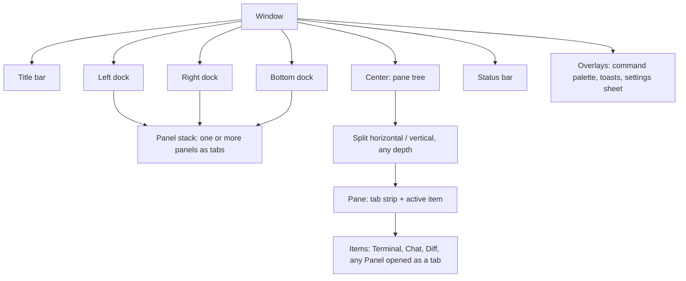
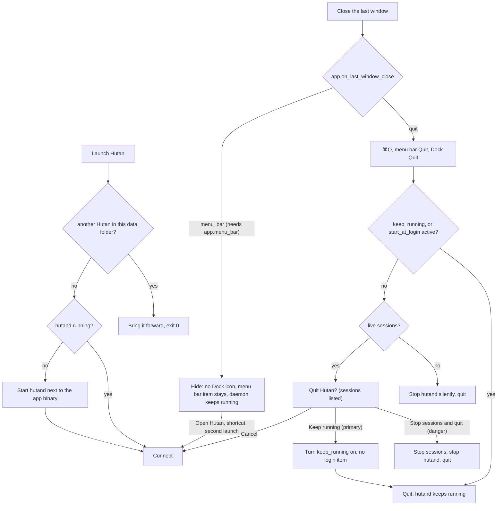

# Hutan Design

Decisions taken with the user (2026-10-14):

| Topic | Decision |
|---|---|
| Layout | **A + B-overview + palette**: sidebar + panes + inspector by default; Agents overview (the Agents page as a focus layout, ⌘⇧O); command palette ⌘⇧P (and ⌘K, except with the keyboard in a terminal; the `hutan` keymap base binds ⌘K everywhere) |
| Configurability | **Everything is a movable component.** Any panel can live in any dock or as a center tab; every component has its own settings section; layouts are saved as presets |
| Style | **Native macOS chrome + own terminal themes**: transparent titlebar, vibrancy sidebar, SF Pro UI, system accent, light/dark follows the system; terminal and chat use Hutan themes |
| Density | Setting: `compact` (default) / `comfortable` |
| Agents with TUI and protocol | **One session, view switch Chat / Terminal** in the pane header (M4) |

Architecture of the layout system: ADR 0010.

## Principles

1. **Attention first.** The user always sees who needs them (blocked, approval, done-unread) without hunting.
2. **The terminal is sacred.** Chrome never steals keys from a focused terminal except the documented global shortcuts. Every chrome element can be hidden.
3. **Nothing is fixed.** Placement, visibility, size, and per-component behavior come from layout + settings, not code paths.
4. **Closing UI never kills work silently.** Closing a tab, pane, or window detaches. Stopping a session is an explicit, labelled action. Quitting the app asks what to do with live sessions (see § Daemon lifecycle).
5. **Native feel, calm surface.** System chrome, restrained color; color carries state, not decoration.

## Workbench model



- **Panel**: a registered component with an id, title, icon, default dock, and a typed settings section. Panels: `sessions` (Projects), `tasks`, `agents-dashboard` (the Agents page, a tab of the center and the center item of the `overview` preset), `assistant` (titled *Mawas*: Mawas Home, a tab of the center), `history`, `changes`, `inspector` (titled *Requests*), `agents`, `resources`, `instructions` (the files the agents read, § Instructions panel), `notifications`, later `worktrees`, `providers`. Mawas Home is described in `docs/assistant.md` § Desktop; **Memory** (`mawas-memory`, protocol 0.32) is its sibling page, but a **body of the left sidebar** (default dock Left; never a center tab, one instance), opened from ⌘K → *Mawas: Memory*, the *Memory* nav row under Mawas or the Today rail.
- **Dock**: left, right, bottom. A dock hosts a stack of panels. The left dock is the **left sidebar** (its panels are *pages* chosen from a nav list), the right dock the **right sidebar** (its panels are tabs of an icon rail), the bottom dock keeps a strip of text tabs. Docks resize, can be emptied, and **collapse on demand** (§ Docks): the left sidebar is Expanded, Compact (a 44 px icon rail) or Hidden, the right side is its panel body next to a 40 px rail (open, rail only, or hidden), the bottom dock is open or hidden; collapsing never stops a session, closes a tab or dismisses an approval. Mawas Home (`assistant`) is a **page of the center**: it opens as a tab of the active pane (`WorkbenchState::open_panel_in_center`, the nav row, ⌘K, the global shortcut), never in a preset, and the user may still move it like any panel.
- **Center**: a binary split tree of panes; each pane has its own tab strip. Items are session views (terminal/chat), diffs, or any panel opened as a tab. A terminal tab is itself a tree: **terminal splits** (§ Terminal splits) put several terminals in one tab, as Ghostty and iTerm do; pane splits are for mixing kinds.
- **Status bar**: an ordered list of status items left and right; each is configurable per preset (`layout.presets.<name>.status_bar`). The built-in presets say where the daemon is, where you work and what waits (FX-STATUSBAR, user decision 2026-10-22: *where is the daemon status — and why is the bottom empty?*; CL-CHROME had taken these items out): left `connection`, **always**, in every daemon state — connected: a small `state.ok` dot and `hutand` in `muted`, the tooltip with the version, protocol, pid, uptime, sessions and clients; connecting, starting, stopping, restarting or reconnecting: a filled dot and the state word in its state colour (`● Reconnecting…`, `● Starting…`); stopped by you (the app, the CLI, the menu bar item): a hollow dot and `○ Stopped · Start` — the click on it starts the daemon (no popover to click again in; the popover, opened from the Daemon menu, has the one *Start daemon*), and the stop is said once: the terminals and the sidebar do not repeat it with banners of their own, and the restart summary does not come up for a start the user made after a stop that cut nothing off (it is acknowledged quietly; a crash, an interrupted turn or a session that did not come back still show it); the daemon cannot start: a triangle and `▲ Can't start · Details`, the tooltip saying why — a click opens the daemon popover (§ Daemon controls) — then `workspace` (the project you work in and its branch, `api · ⎇ main`: the branch of the project's main checkout as the daemon lists it (`worktree.list`), or of the focused session's worktree; a click opens the jump palette) and `attention` (`▲ 1 request`, `▲ 3 requests`, `99+ requests` at most: the sessions with a request waiting — an approval, a question or a plan — never finished work or a failure; the glyph in `warning`, the words `fg`; nothing while no request waits, the bar stays); right the editor's items while a file tab has focus, `working` (`◌ 2 working`: the agent sessions of the Agents page's *Working* group, the glyph in the accent; nothing at 0; a click opens the Agents page); the palette's key `palette_hint` (`⌘⇧P`) is **not** in the built-in bar any more (FX-DOCK-TOGGLES, user decision 2026-10-28: the palette has ⌘K and the menu) and stays a registered item — *Command palette key* in the bar's checklist (right click) shows it, and a preset that names it keeps it. The styling stays quiet: muted text, one accent at most, items separated by space (no dividers), 24 px. **Narrow window**: below 900 px `workspace` shows only the branch (the name while the project has none); below 700 px only `connection` and `attention` stay on the built-in bar — `connection` as its dot alone while the daemon is up, a daemon that is not up keeping its word because the word is the state — and `workspace`, `working` and the editor's items (and `palette_hint` where a preset shows it) give way. The other items stay registered for presets that name them: `sessions`, `approvals`, `density`, `theme`, `palette_hint`, and the dock buttons `dock_left`, `dock_bottom`, `dock_right` (a small window glyph with the dock's side filled, pressed — an `accent_soft` fill, the glyph `fg` — while the dock shows; a click toggles the dock, the tooltip names the key of the active keymap base, and a hidden dock without panels shows a dimmed, inert button). A status notice (a one-off message such as "No approvals are waiting") is `fg` text, never accent.
- **Title bar**: transparent with traffic lights; the two dock buttons (each side's only toggle; they hide and show the side) and the project's name (`muted`; empty while there is none — never the active tab's title, CL-POLISH-3), nothing else (CL-CHROME). Layout presets are in View → Layout Preset (the current one checked), the palette (*Layout: Apply Preset …*) and ⌘⇧1…9; the Agents overview in View → Overview, the palette and ⌘⇧O.
- **Presets**: named layouts (`default`, `focus`, `overview`, `explorer-left`, user-defined). Switching a preset swaps docks/center arrangement without closing sessions.

### Moving things

| Action | Mouse | Keyboard (default) |
|---|---|---|
| Split the terminal right / down (the new terminal starts in the focused terminal's cwd, inside the same tab) | terminal context menu *Split Right* / *Split Down* | ⌘D / ⌘⇧D with the keyboard in a terminal (§ Terminal splits) |
| Split the pane right / down (a new pane with its own tab strip, for mixing kinds; it starts a new terminal in the focused terminal's cwd) | pane tab strip menu, tab menu | palette → *Layout: Split Right / Down* (also *Split Left / Up*); Zed base ⌘\\; ⌘D / ⌘⇧D outside a terminal |
| Move tab to split | drag tab to a pane edge (drop zones); a terminal tab dropped on the edge of another terminal merges into it as a terminal split (⌥ at the drop makes a pane split instead) | palette → "Move tab to new split…" |
| Move panel to another dock | drag panel tab to dock, or panel menu "Move to ▸" | palette → "Move panel…" |
| Open panel as center tab | panel menu "Open as tab" | palette |
| Resize | drag splitter / dock edge / terminal divider | ⌃⌘←→↑↓ (the focused terminal's divider; a tab without splits resizes its pane) |
| Focus neighbour | click | ⌘⌥←→↑↓ (the neighbouring terminal split, then the neighbouring pane) |
| Zoom pane | double-click tab | ⌘⇧↩ (Zed base: also ⇧⎋); with the keyboard in a terminal tab that has splits ⌘⇧↩ zooms the split instead |
| Toggle docks | the titlebar button of each side (the only one on the window's chrome; hides and shows it), the status bar's dock items where a preset shows them | ⌘B left sidebar, ⌘L right sidebar (both bases; also ⌘⌥B, and ⌘R in the Zed base), Zed base ⌘J / ⌃\` bottom, ⌘⌥Y close all; Hutan base ⌘⌥J bottom |
| Switch preset / Overview | View → Layout Preset, View → Overview | ⌘⇧O overview, ⌘⇧1…9 presets |
| Save current layout as preset | View → Save Layout as Preset… | palette → "Save layout as preset…" |
| Close tab (detach) | × on tab | ⌘W |
| Stop session | session menu (confirm if running) | ⌘⇧W |

### Customizing the workbench (WIDGET-CONFIG)

User, 2026-10-22: *each widget configurable*. Placement and per-widget options are changed **where the widget is**, without editing `settings.toml` (which stays the file they land in).

- **Panel menu.** A **⋯** in every panel's header (the right panel's header, the left sidebar's back row for a page, the bottom dock's tab strip, the strip of a pane showing a panel as a tab; the Projects header's ⋯ has the same entries after its own) and a right click on its rail icon, nav row or dock tab: *Move to ▸ Left · Right · Bottom · Center tab* (the current place checked), *Hide* (closes it; ⌘K *Panel: Open …* and the checklists bring it back), and *Panel settings…* for a panel that has options. Memory has no placement (a body of the left sidebar). *Panel settings…* opens an inline popover under the ⋯ with the panel's own namespace — `panels.sessions`, `panels.inspector`, `panels.files`, `panels.problems`, `panels.search`; Tasks, History, Resources, Agents and Mawas use the page they always had; Changes has no options, so its menu is placement only — drawn by **the same rows as the Settings sheet** (the popover is the sheet in a compact mode: provenance chips, Reset, dropdowns), with *Open in Settings* turning it into the full sheet on that page. An edit writes the key and the panel updates live.
- **Rail and docks.** A right click on the right rail's empty room, the bottom dock's tab strip or the left sidebar's nav opens a **checklist** of the available panels for that dock (a clear accent ✓ while shown there; the dock's own panels first, in the order it draws them, then the others; checking one that is open elsewhere moves it, one that is closed shows it at the end without taking the keyboard) and *Reset to built-in layout* (the built-in preset again; from your own Custom preset, the Default layout). The list stays open so several can be switched in a row. Dragging a rail icon (or a bottom tab) reorders it, dropping a panel in another dock moves it.
- **Status bar.** A right click on the bar opens the checklist of its items: the left group, the right group and *Not shown*, with *Reset status bar* (the preset follows the built-in bar again). A right click on an item has its own options — `workspace`: *Show branch* (`status.workspace.show_branch`), `connection`: *Show version* (`status.connection.show_version`, `hutand 0.2.0` while the daemon is up) — then *Move to the other side*, *Move earlier*, *Move later*, *Hide* and the checklist. Items are dragged to reorder them or to the other side.
- **Sidebar sections.** The left sidebar's nav rows (Agents, Mawas, Memory, Tasks) and its projects list are hidden and moved from the same right-click menu (nav, compact rail) and from the Projects header's ⋯ → *Sidebar sections*: `sidebar.nav_rows` (the shown rows, in order; the row of the page you are on shows anyway) and `sidebar.show_projects`. *Reset to built-in layout* brings the docks of the built-in layout and the sections back.
- **Where it is kept.** Every change is live and written through the layered settings writer into the **current layout preset** (`layout.presets.<name>`: docks, `more`, `status_bar`), provenance *You*. A **built-in preset is never edited in place**: the first change made while `default`, `focus` or `overview` is current creates the user preset **Custom** (`custom`, `custom-2`, …), makes it current (`layout.preset`) and the toast says so in one line (*Default is built in: saved in your Custom preset.*). A bar equal to the built-in one is not written, so a preset that never chose its bar keeps following the built-in one. Option keys (`status.*`, `sidebar.*`) go to the user's file directly.
- **Undo.** Each change shows a toast (*Moved Files to the left · Undo*) for **10 s**; the button or **⌘Z** (bound only while the toast shows, so a text field or a code view keeps its own ⌘Z) restores the settings keys as they were — a Custom preset created by the change disappears — and the panels it moved. One undo is kept: the newest change.
- **Parity.** The panel tab menu's *Move to Left/Right/Bottom Dock*, *Open as Tab* and *Close* became *Move to ▸ …*, *Center tab* and *Hide*; nothing is lost. Placement made through the palette's *Move panel* and the keys is unchanged and not written into the preset.

## Layout (Orca-style, 2026-10-18)

Hutan is laid out like Orca (stablyai/orca, MIT; studied in `docs/spikes/2026-10-18-orca-layout.md`): three columns, a 36 px title bar row and a 24 px status bar. Ideas ported, nothing copied. The chrome is quiet (CL-CHROME, `docs/spikes/2026-10-21-clean-aesthetic.md` §3.4): two tones (`sidebar` for both sidebars, the title bar, the tab strips and the status bar; `bg` for the panes and the active tab), one hairline per boundary, no accent on the chrome.

```text
┌──────────────────────┬──────────────────────────────────────────────────┬────┐
│ ● ● ●  ▯             │ git                                            ▯ │    │ 36
│ ⊞ Agents         2   ├────┬────┬──────────────────────────┬──────────────┤ ⑂  │ Changes
│ ✦ Mawas              │api │git │ web                      │ acme-api     │ ◉  │ Agents
│ Projects        ＋ ⋯ ├────┘    └──────────────────────────┴──────────────┤ ⟲  │ History
│ ⌕ Filter             │ ❯ git status                                      │ ✋1 │ Requests, while one waits
│ ▸ acme-api           │ …                                                 │ ⋯  │ Requests, Resources
│   ❯ git              │  terminals · chats · diffs (split panes)          │    │
│ ＋ Start         ⚙   │                                                   │    │
├──────────────────────┴──────────────────────────────────────────────────┴────┤
│ ▲ 1 request                                                         ⌘⇧P    │ 24
└──────────────────────────────────────────────────────────────────────────────┘
   left sidebar 280 px                 center                          rail 40
```

**Left sidebar** (280 px expanded, resizable 220–500 or what leaves the center 480 px; ⌘B; 44 px compact, see § Docks). From the top: the inset under the traffic lights, the **nav list**, the **page**, a bottom toolbar.

- Nav rows (Orca's metrics: 8 px outer padding, 2 px gap, rows padded 8 × 6 px around a 16 px icon and an 18 px line of 13 px medium label — **30 px rows**; muted icon and label when inactive, `fg` and a `sidebar_accent` fill when selected, an 8 % `fg` fill on hover): **the rows**: **Agents** (opens the Agents page, below; a pill counts the sessions with a request waiting) and **Mawas** (only while `assistant.enabled`; opens Mawas Home as a center tab, selected while that tab shows; see below) and, just under it, **Memory** (the same condition; it swaps the sidebar's body in place for Mawas's memory — a *‹ Projects* back row appears — and is selected while it shows, a second click goes back; see *Memory in the sidebar* below), plus a row for every other panel the user keeps in the left dock. **Tasks** (the Tasks panel as a page) follows them only from the first task on — it reveals itself while the daemon lists any task (queued, running or done) and goes when the last is deleted, but never while its page is the one showing — and the **Search** row is gone: jumping is the Projects filter field and ⌘P / ⌘J "Jump to…". Before the first task the page is one palette command away (⌘K *Tasks: Show Panel*, *Tasks: New Task…*) and the Start sheet's *Queue as task*. A page row toggles its page; right-click gives the panel menu. Choosing another row leaves the Agents page where it is (it is a tab of the center). At most one nav row is selected (CL-POLISH-3): the center page on screen (Agents, Mawas Home) wins, a sidebar page (Memory, Tasks, Files, Search) marks its own row only while no center page does; and the project row of the selected session has no fill (it keeps its text), so a list has one selected fill.
- The default page is **Projects** (`sessions`): a 32 px section header (12 px semibold, muted) with two quiet controls, **＋** (New workspace…, Open folder…, Open folder into workspace) and **⋯** (sort, filters, organize and *Projects Sidebar Settings…*; the header has no ⚙, no Start and no sort label of its own), the filter, and the project / workspace / session tree (13 px titles; the rows are described under § Projects and workspaces; hover and selected fills from `sidebar_accent`, no outline). The project row's ▷ (the Start sheet for that project) shows on hover only, in `muted` — no accent anywhere in the tree. Any other page replaces the list and shows a **‹ Projects** back row.
- Bottom toolbar: **＋ Start** (opens the Start sheet, ⌘⇧T; a plain terminal is still ⌘T) and **Settings**, with icons.

**Memory in the sidebar (MEM-SIDEBAR).** Mawas's memory is a body of the left sidebar, the way Orca swaps its `sidebarBody` in place (`docs/spikes/2026-10-22-ui-polish/orca-sidebar.md` Part 3): the *Memory* nav row under Mawas, ⌘K → *Mawas: Memory* / *Panel: Open Memory* and the *Memory ›* link of Today replace the Projects body with it (the compact rail expands for it) and show the *‹ Projects* row; a second click on the row or the back row returns to Projects. It is never a tab of the center and never the window's title; its *Open as Tab* entry is gone from the panel's context menu, and an open from anywhere moves it back to the left dock. The scope filter follows the workspace the window shows (the active container of the sidebar, once the Projects body is attached to one: SB-ATTACH). Its body, keys and the 240 / 480 px layout are described under *Accounts and the assistant* below and in `docs/assistant.md` § Memory; `memory_gpui` checks the laid-out bounds of every control at both widths.

**Usage (USAGE-LIMITS, protocol 0.45; STATUS-METERS).** The status bar's **`usage.meters`** item is in the built-in bar (right side, before `working`) and draws **nothing until a harness has reported a limit**; from then on it shows **one small ring per harness** that has a running window: the harness's glyph (`harness.omp`, `harness.claude`, `harness.codex`) in a ring 20 px square (2 px line: 16 px inside it; FX-UI-B, it was 18 and grey) whose track is `muted` at 40 % and whose arc is the share used of that harness's **tightest window** — across all its windows and managed accounts — starting at twelve o'clock and running clockwise. The arc is `fg` while calm (3:1 against the bar in both built-in packs, a unit test), `warning` from 80 % and `danger` from 95 %, and from 80 % **the number stands beside the ring** in the same colour (`92%`), so the colour is never the only signal; a calm ring is the ring alone. **Hover** a ring: the harness's card (`workbench/usage_card.rs`, a tooltip view that goes stale like every tooltip) — the harness as a group label, one row per running window (`5-hour · Work`, `weekly (anthropic)` for OMP's providers) with its share, a 4 px bar and `resets in 3h`, a hairline, then `Today:` and `This week:` tokens and cost (`≈ $0.42 (estimate)`, only when turns ran) and `Click for the Agents page`. **Click**: the Agents page, whose **Usage** section is the first thing under the filter band. Windows that have reset do not count, a harness with no running window has no ring, and the item gives way below 700 px like the other optional items. **Settings → Status bar → *Usage limits*** (`status.usage.style`): *Rings* (default), *Words* (the old `usage` item — the tightest limit of all as text, `Codex 72% · resets 3h`, amber from 80 %, red from 95 %, tooltip with every window — stands where the rings stood) or *Not shown*; the bar's right-click checklist hides and moves *Usage rings* like any item, and a preset that names `usage` still gets the words. The Agents page has a **Usage** section under the filter band: one row per harness with a 96 px bar per limit window (percent, `resets in 3h`), `Today:` and `This week:` tokens and cost — a cost is always `≈ $0.42 (estimate)` — and a Refresh button; a harness with no limit says so. A toast warns when a window passes 80 % and 95 %, once per window, not for what was high at startup (`notifications.usage_warnings`). Words and rules: `sessions/usage.rs` (`meters`, `MeterView`, `CardView`), the ring: `ui/ring.rs`; details `docs/agents.md` § Usage.

**Agents page.** The *Agents* nav row (and the compact rail's Agents icon, the right panel's *All agents*, Today's *State unavailable* link, ⌘K → *Agents: Open Page*) opens or focuses **one** registered center tab, `agents-dashboard`; clicking again only focuses it and never closes anything. It is an attention-first ledger over the one **agent presentation** (`sessions/presentation.rs`): one record per agent session joined from the session, its report, its chat and its observation tree; eligible are sessions with a tree, a report or a chat (Mawas included, role **Assistant**; plain shells excluded, they stay in Projects and the global attention). Reducer precedence: pending approvals/questions (the real objects), blocked agents, unread failure, review and unread completion are *reasons*; the highest one puts the session in a group of attention: **Requests** (approval, question, plan, a blocked main agent: the only group that blocks an agent), **Failed** (an unseen failure; seen, it stays listed until a new run or *Mark as read*) or **Ready for review** (a session that ended and was not seen, review work not seen (a turn that changed files), a mark) — `Permission: run cargo test +1`, `3 requests`; an ended session or a finished main agent is **Finished** (folded by default); an active managed chat turn is **Working**, else the report or root says Working/Blocked/Idle (the newer wins, the conflict is disclosed in the details), a chat the daemon knows exactly with no turn is **Idle**; nothing known is **Unconfirmed** ("State unavailable", never Idle or Done, never `?`); offline keeps the last records with "Offline · last confirmed …". Counts say `5 agent sessions · 3 subagents`; the Agents badge counts unique agent sessions with a request waiting.

**Header** (44 pt): `Agents` (15 medium, the prose step: no semibold, no icon, the tab already names the page), the totals in muted text (`1 agent session · All workspaces`) and **Start agent…** as a ghost button. **Toolbar** (36 pt, a hairline below): the scope as a ghost menu (`All workspaces ▾`: every workspace, project and Home), the search (hairline field, placeholder `Search…` in `muted`; title, harness, model, project, branch, activity), a chip while a state filter is on, and **⋯** (*Group by workspace* — nests the same groups under workspace headings, `agents.page_group_by_workspace` — and *Show finished*, `agents.page_show_finished`, each checked while on). Below 640 pt of page width (scaled by the UI size) the toolbar **folds**: the scope joins ⋯ (`Scope: All workspaces`, `Scope: <workspace>`, the one shown checked) and only the search stays beside it, so nothing clips or wraps. **Section labels** (11 medium, `muted`, sentence case, no hairline): `Requests · 1`, `Failed · 1`, `Ready for review · 2`, `Working · 1`, `Unconfirmed · 1`, `Idle · 2`, `Finished · 3 ▸` (folded by default).

Rows are 64 pt (80 comfortable), a hairline between rows inset to the 16 px spine the lanes start at (the selected row is an `accent_soft` fill, never an outline; the keyboard ring shows only for keyboard focus): the **lane of the sidebar's card** in 16 px (FX-UI-A 3, 7: the agent's harness monogram — a π, an asterisk, a chevron, the bubble of a direct chat, Mawas's sparkle — with the state's **badge** on it, `ui::row_lane`, `agents_text::lane_state`: a turning arc while it works, a `warning` disc with `!` for a request of any kind, a `danger` disc with `×` for a failure, a `success` disc with `✓` for work to review, a hollow ring once it ended, none while idle; never colour alone; the working arc is the only accent mark on the page besides the selection), the title in the **sidebar's name weight** (13 regular, semibold while something waits for a look, `faint` once the session ended, without the emoji an agent's title begins with) with **one state word** beside it (12), the reason or status line under it (muted), location (`hutan / Chrome cleanup`, `Home / Mawas`), checkout (`Worktree: chrome-v3`, `Main checkout: master`), harness and model (omitted when not reported), `Running 3m 05s` / `Updated 12s ago` (a missing start is `—` with "Start time not reported"; never the session's age), the main action (secondary) and **More**. Columns fold at 900 and 640 pt (scaled by the UI size). **One state word per record, attention wins** (reducer precedence made visible): a session in a group of attention says one word — `Approval`, `Question` or `Plan to approve` (Requests), `Failed`, `Ready for review` (a mark says `Marked unread`) — and is never also drawn `Working`, in a *Working* group or in a word; its second line is the reason without the kind the word says (`edit: src/lib.rs +1 · 2 requests`; every reason, who reported it and when are in its tooltip). Every other record says its state. The word is `state.warning` / `state.error` / `state.success` text, `muted` for working and idle (the accent is spent on the badge), and `fg` on the selected row, where the state colors are not AA in the light pack: only the badge keeps its color. The page draws the lane with `panels/common.rs` `agent_lane`; the page, the Agents panel and Today draw the one identity line (`agent_title_line`) with the words of `sessions/agents_text.rs` (`state_word`, `reason_detail`, `lead`). The list is virtualized, its order freezes while the pointer rests on an action, a menu is open or a request is being read, and the selection is a domain id that survives updates. A hidden page does no work when the store changes; a once-a-second timer refreshes durations only while it is drawn.

**Review request** expands the exact request with its option buttons under the row; only a click on an option sends the existing approval decision (no row-wide approve, no bulk approve, no first-option default; the row shows "Sending your answer…" until the daemon confirms). **Answer question** opens the session's question card; **Show changes** opens the checkout's diff. **More**: Open session, Reveal session, Open worktree, Show changes, Open transcript, Copy session ID, Interrupt turn (only a turn the daemon runs; an agent in a terminal says why it is disabled), Stop session… (confirmed). Stopping one subagent is disabled with the harness limitation, never done by stopping its parent. Keyboard: Tab through toolbar → scope/search → one roving list stop; ↑ ↓ Home End PageUp PageDown move, ← → fold subagents and details, Space expands details, Return opens the session, Shift-F10 opens the menu, ⌘F searches while the page has focus, Escape closes the expanded request, then the details, then subagents, then the filters, and never the page. Empty states: connecting (skeleton rows, no false zero), **Your agents will appear here** (Start agent… / Agent integrations…), **No agent sessions match this view** (Clear filters / Show all workspaces); a daemon without `agent.tree` says it does not expose subagents.

**Agents overview (⌘⇧O)** is a reversible focus layout: it shows the same page entity as the only center item and stashes the layout it replaced; ⌘⇧O again (or opening a session from the page) restores it. The right **Agents** panel is the compact projection of the same records (Workspace / Session / All scope chips, *All agents* opens the page; its child tree shows the subagents); Mawas **Today** reads the same predicates (Working is only confirmed-working sessions; unknown ones show *State unavailable · N*).

**Right sidebar** (a 350 px body, 240–480, next to a 40 px **activity rail** outside it; ⌘L). The rail runs from the title bar row to the status bar, there while the right side is shown (open or on its rail) and gone with it when the titlebar button hides the side, with 32 px icon targets and tooltips; it carries icons only, the one open/close control of the right side being the titlebar button. The clean default (CL-CHROME, Files added by SB-ATTACH) has four icons: **Files** (the project's tree, below), **Changes** (the panel the body opens on: the changed files of the checkout you work in, or, with *All in workspace*, of every checkout of the workspace grouped by checkout; a click on a file or a header opens the full Changes view as a tab — § Changes panel), **Agents** (the observation tree / monitor), **History** (the Agent Session History); and a **⋯** More menu with **Requests** (the inspector: approvals and block requests) and **Resources**. A dock lists such panels in `more` (saved with the layout, `layout.presets.<name>.right.more` in a preset): one of them is an icon only while it is the panel the body shows, or while it has a badge — **Requests comes onto the rail with the number of waiting requests while one waits** (also while the body is collapsed) and leaves when none does; a request never opens the body by itself. Icons that do not fit the height move into ⋯ too (the active one always stays visible). Icons are `muted`, the active one `fg` (on the `right_sidebar_accent` fill while the body shows); the rail spends no accent. Icons drag to reorder or to another dock. The body has a 36 px header with the panel's name (13 px medium). A **new layout** (first run; a project or workspace seen for the first time) starts with this sidebar down to its rail, so the first thing in the window is not an opt-in feature's card; ⌘L (or a rail icon) opens the body on the first tab. Layouts already saved keep what they had (§ Layout migration: *Layout: Use New Default*), and the `default` preset (⌘⇧1) still shows the body. See § Docks for what the icons and ⌘L do.

**Files in the right dock** (SB-ATTACH, user 2026-10-22: Orca puts the explorer on the right). The built-in presets (`default`, `focus`, `overview`) list `files` first on the right rail, before Changes, so the rail is **Files · Changes · Agents · History** (+ ⋯); **a fresh layout's body opens on Files** (EX-1, decision 2026-10-27: Changes is empty on a new project and keeps its count badge; a saved layout keeps the panel it left open). The built-in **Explorer left** preset (`explorer-left`, ⌘⇧4, View → Layout Preset) puts Files in the left sidebar as the shown page — the left nav keeps its *Files* row while the page is in that dock — and leaves it off the right rail, whose body opens on Changes. The left dock keeps Projects and Tasks. ⌘⇧E, ⌘K *Files: Show Files Panel*, the `files` panel's registration and *Reveal Active File* open it there. A saved layout whose left dock is exactly the built-in one (`sessions`, `tasks`, `files`) is moved once when it is read (saved layout version 8; logged `saved layout: Files moved from the left sidebar to the right dock`, in the live layout, the overview stash and every parked workspace); a Files panel the user placed elsewhere, or in a left dock they arranged, stays.

**Files sections and marks (EX-5).** Above the Files tree sit two optional sections, each a 22 px header that folds it: **Open Editors** (the files open in tabs below the root, an unsaved dot, a close button; *auto*: two or more) and **Changed by agents** (the E-10 ledger's files, newest first, `◆ name  Codex · 3 hunks`). A row carries, at its right, its diagnostics count (errors, else warnings, in `danger` / `warning`, rolled up to the folders), the agent ◆ and the git letter; the name takes the colour of the worst diagnostic. The right rail's **Changes** icon shows the count of uncommitted files of the checkout as a small accent badge (the Requests icon's badge stays the warning colour), and every scope chip shows a muted dot while an agent works in its checkout. Mechanics and tests: `docs/editor.md` § Files panel: decorations and sections (EX-5).

**Files roots and Finder import (EX-8).** The Files header's scope chip carries a small chevron and opens the **root switcher**: the project's checkouts (*Main checkout · master*, *Worktree · feature/x*, a ` · working` suffix while an agent runs a turn there), then — under a hairline — the workspace's other projects, then *Follow active container* (check mark while the panel follows the window). A pick shows that folder in the panel only: the chip names it with the worktree or repository glyph and its fill is `sidebar_accent` while it is not the window's own folder (the same fill as a selected row); the sidebar and the window's container do not move; a change of the window's own folder ends the pick. With `panels.files.roots = workspace` (the header's ⋯ *Show the Whole Workspace*, Settings → Files *Folders shown*) the tree stacks **one root row per project** of the workspace: the folder name in semibold on the row's own height, a chevron that folds it, a hairline (`border`) above every root but the first, the git dot and diagnostics / agent roll-ups of what is below it at its right; the entries sit one level in (12 px). The chip then names the workspace. Files dragged in from Finder light the folder under them (`accent` at 18 %, like a dragged row), open a closed one after 0.7 s and are copied in as one batch; a daemon on another Mac refuses with a one-line notice. Dark and light screenshots: `~/hutan-scratch/ex8/shots/` (switcher, a worktree pick, the stacked roots, the stack folded, the filter across roots).

**Mawas.** `assistant.enabled` is **on** by default (decision D-P4, PR-FIRST-RUN: Mawas stays a headline feature with its nav row and page, the first run no longer asks for it, and nothing is written to `settings.toml` for it; an explicit `assistant.enabled = false` is the user's own choice and is kept). When on, *Mawas* appears in the left nav and **Mawas Home** opens as **one tab of the center** (a registered panel like the others, so it can be closed, reopened and moved; no preset places it): ⌘K → *Mawas: Open*, *Mawas: New chat*, *Panel: Open Mawas*, the nav row, the menu bar item and the global shortcut all show it (`OpenAssistant` needs the setting on); turning the setting off closes it. The page is a **header** (scope dropdown, state dot, backend·model chip, **mode chip** *Ask before acting ▾* / *Advisor ▾*, **New chat**, **Stop**, **Today** toggle), the conversation (the ordinary chat view, centered, at most 46 rem wide) and the collapsible **Today** rail (300 px, left border): *Requests*, *Failed*, *Ready for review*, *Working*, *Upcoming* ("No schedules yet"); no link to a service that does not exist. Mawas's own approvals are cards above the conversation and the first rows of *Requests*. A page that is not the active tab does no work (no re-render on store changes, no timer). Text is cut with "…" at the room it has; `docs/assistant.md` § Desktop has the behavior.

**Icons (TH-2).** All in-window product artwork resolves through typed semantic ids in `hutan-settings::themes::icons::IconId`; authors map those ids in `icon-theme.toml`, independently selected by `appearance.icon_theme` (default `phosphor`). Agents is Robot, Changes GitDiff, Requests HandPalm; branches appear only for VCS placement. The embedded Phosphor pack is pinned official MIT artwork, Regular at 16 px and above and Bold at 14 px and below (the optional `[small]` table, STYLE-TOKENS); sparse user packs fall back per id. Common controls, nav, panel registrations, state/harness/session indicators and docks use this same interface, never vendor filenames or text-glyph fallbacks. Safe normalized currentColor SVG bytes feed a content-addressed, bounded renderer; the TH-1 watcher and Settings Problems path handle live edits and errors. See `docs/themes.md` for authoring, the generated full semantic catalog, security bounds and fixed native-brand exemptions. Labels, tooltips, keyboard behavior and hit targets do not come from packs.

**No clipped text in the sidebars.** A name, a chip or a button in either sidebar is cut with "…" at the room it has (Projects tree titles and subtitles, the Tasks chips and detail lines, the Changes rows, the Requests rows and tabs, the Mawas header, the History titles and group labels, the nav labels and the toolbar); a row of chips wraps instead of overflowing. A pill (`ui::pill`) is at most 140 px wide.

**Window title.** The title bar row and the window title name **where** — the project (else the named workspace) the window shows, muted, and `Hutan` while there is none — never the active tab's title, which the tab strip right under it already says (CL-POLISH-3, `Workbench::window_label`; the native title is `<project> — Hutan`). The page a sidebar shows never changes it.

**Tokens.** Chrome follows Orca's structure in Hutan's warm hues (see § Visual system) with two tones: `sidebar` (both sidebars, the title bar, the tab strips, the status bar; `right_sidebar` has the same value in the built-ins) and `bg` (the panes and the active tab, which is connected to its pane); selected rows step away from the sidebar (`sidebar_accent`, `right_sidebar_accent`), the dark hairline is white at 7 %, the title bar and the right strip are 36 px, the status bar 24 px in both densities.

**Hairlines.** One per boundary, owned by one side: the left sidebar's right edge, the right body's and the rail's left edges, the status bar's top, each tab strip's bottom (broken under the active tab, whose `bg` fill reaches the pane), a pane header's bottom, and between two split panes (owned by the second). The title bar and the tab strips below it share the `sidebar` tone with no line between them.

### Docks: collapse on demand, always recoverable (DK-1)

Design: `docs/spikes/2026-10-20-chrome-v3.md` § 4 and its mockup. What the user chose lives in the saved layout; the window may show less for a while (below), never more.

| Dock | Expanded | Compact | Hidden |
|---|---|---|---|
| **Left sidebar** | 280 px (220–500), the nav, the page, the toolbar | a **44 px icon rail**: Tasks (once a task exists), Agents, Mawas (when enabled), any other page, Projects; Start and Settings at the bottom; 32 px targets, a tooltip on every icon, the Agents count stays as a badge. Agents, Mawas and Start work as they do expanded and do not widen the rail; Tasks and Projects are pages of the sidebar and expand it | 0 px, no hitboxes, no focus stop |
| **Right side** | the panel body (350 px, 240–480) next to the 40 px rail | the **rail alone** (Files, Changes, Context, Agents, History, Requests while one waits, ⋯ with Requests and Resources) | 0 px, no rail, no hitboxes, no focus stop: the titlebar button (the only control left) brings it back |
| **Bottom** | the body with its tab strip | — (it has no rail) | 0 px |

- **⌘B** toggles the left sidebar between Expanded and Compact; from Hidden it comes back in the mode it was hidden from. **⌘L** toggles the right body between open and rail only; from Hidden it opens. **⌘⌥J** / **⌘J** (per keymap base) toggles the bottom dock, tab strip included. The status bar's dock buttons dispatch the same toggles. No existing default key changed.
- **One titlebar button per side, the same for both** (FX-DOCK-TOGGLES, user 2026-10-28: the left side closed all the way, the right one stopped at a rail, and the right rail carried a second open/close button of its own). A **titlebar button** sits next to the traffic lights for the left sidebar (after the 80 px they take when the sidebar does not cover them) and at the right end for the right side; it is **the only button** for its side — the right rail has no collapse button at its foot any more, and the status bar's dock items stay out of the built-in bar. A click **hides** the side completely, the right rail with it (the center takes the whole width), or brings it back in the mode it was hidden from; while a peek is open it closes the peek. Where a window too narrow for the body shows the right rail, the same click hides it, and bringing it back shows the rail again (a rail icon peeks the panel), never the body pushed in beside a squeezed center. A right click lists the states (*Expanded* · *Compact (icons)* · *Hidden*; *Panel open* · *Rail only* · *Hidden*) with the current one checked. *View: Hide Left Sidebar* and *View: Hide Right Rail* (palette) hide completely; the titlebar buttons stay. Tooltips say what the click does (*Hide sidebar (⌘B)*, *Show right panel (⌘L)*).
- **What closing the right panel leaves** (`layout.right_rail`, Settings → Layout *Right side when its panel is closed*, FX-DOCK-TOGGLES): **`auto`** (default) is the left sidebar's rule — ⌘L, the open panel's icon and the drag past the minimum close the panel to the **icon rail**, the titlebar button hides or shows the whole side, and the rail-only state is one of the three states; **`always`** keeps the rail whatever you do (the pre-FX-DOCK-TOGGLES behaviour: *Hide Right Rail* and ⌘⌥Y leave the rail, the titlebar button goes between the panel and the rail like ⌘L, a saved Hidden side is drawn as its rail); **`never`** has no rail-only state — closing the panel by ⌘L, its icon or the drag hides the rail with it, the titlebar button, ⌘L or the status item open it again, the menu lists *Panel open* and *Hidden*, and a saved rail-only side is read as Hidden. In every value a window too narrow for the body still draws the rail (the responsive collapse and the rail peek below are about the window, not about this choice). The setting is applied live; a saved layout is read through it, never rewritten until something changes.
- **The right rail.** Clicking the icon of the panel the body shows collapses the body to the rail; the rail stays and remembers the panel and the width. Clicking any icon while collapsed opens that panel, the remembered one included; clicking another icon while open switches panel. The icon of the remembered panel of a collapsed body looks selected (`fg`), not pressed. A new permission request never expands a body the user collapsed, never changes the panel it remembers and never takes the keyboard: the Requests icon comes onto the rail with its badge while the request waits, and the status bar's `▲ 1 request` says it (CL-CHROME: no second sentence in the status bar). With the body open, `panels.inspector.reveal_on_approval` switches it to Requests as before.
- **Drag to collapse.** The edge of an expanded side dock tracks the pointer down to its minimum (220 / 240 px) and stops. 24 px further, a translucent **preview** of the rail appears at the window edge; releasing the mouse collapses the dock to its rail, Escape cancels (the dock keeps the size it had, nothing collapses on release). A collapsed dock reopens at the width it had before the drag; nothing in between is saved. The compact rail has no edge to drag. The dock edge also stops where the center would get narrower than 480 px.
- **Responsive collapse** (`layout.auto_collapse`, default on; Settings → Layout *Collapse sidebars in a narrow window*). Below **1180 px** of window width the right body collapses to its rail; below **900 px** the left sidebar goes Compact; the center keeps at least **480 px** (a dock the center cannot afford collapses at any width, the right one first). A collapsed dock comes back only **80 px** above its threshold, and only when the center fits with it open. This is temporary: it is not saved and never overwrites what the user chose, a dock the user hid or collapsed is never auto-restored, and a dock the user opens in a narrow window (⌘B, a rail icon, a command) stays open until the window has grown past the same margin — unless its body would leave the center under 480 px, in which case it opens as a peek (next bullet). At 1280 / 1180 / 900 / 640 px: both open · both open · right on its rail · both on their rails.
- **Rail peek** (EX-2, `layout.rail_peek`, default on; Settings → Layout *Open side panels over a narrow window*; desktop only, no protocol). Where a body opened from its rail would leave the center under 480 px, it opens as a **peek**: a layer floating over the center's edge, beside the dock's rail and under the title bar, at the dock's own width (at most 300 px in a window under 900 px, and never so wide that under 120 px of the center stays uncovered). Nothing shifts: the dock stays on its rail, its mode is not changed or saved (only the panel it remembers is the one clicked), and the center keeps its size. It applies to every right-dock panel (Files, Changes, Agents, History…, whether reached by a rail icon, the `⋯` list, ⌘L, ⌘⇧E or a panel command) and to a page of the left sidebar that is not the sidebar itself — Files when the user moved it left (the compact rail keeps a Files icon for it). Projects and Tasks are the sidebar's own pages and expand it as before; so does an explicit *Panel open* / *Expanded* from the titlebar menu. The decision is `Responsive::open_as`: **peek** when `window − the other dock as shown − this body (+ its rail) < 480`, else **push** (a window under the dock's threshold that still leaves the center its room pushes and keeps the dock open, as above). At 1440 / 1280 / 1180 px the right body is pushed (centers 770 / 610 / 510); at 1100 / 900 / 640 px the rail alone shows and a click peeks (centers 780 / 580 / 556). It closes on **Esc** (when nothing deeper takes the key), a **click outside** it (that click only closes: it does not reach what was under it), the **icon of the panel it shows** (another icon switches it), ⌘L or the titlebar button (which only closes it), **opening a file** (a preview with Space or a click in the Files tree leaves it open), another place taking the focus (a new tab, another dock), the setting turned off, or a window wide enough to push. While it is open the keyboard is in it (⌘⇧E puts it in the Files tree), and when it closes the keyboard goes back to the last active center item.
- **Focus.** A dock that stops being drawn as a body (user or window) hands the keyboard to the last active center item; a hidden element never keeps focus or a hitbox. Collapsing never stops a session, closes a tab or dismisses an approval.
- **Saved** per layout (`desktop-state.json` version 7, see *Layout migration*): each dock's `visible` and `collapsed`, its width and active panel, per saved workspace layout; and per layout preset the modes and widths the user left, which come back when the preset is applied again (applying the current preset again starts over from its own docks). The Agents page keeps its filters in the `agents` settings and its selection while the window lives.
- **Icons.** Titlebar, rail and status controls resolve `dock.left` / `dock.right` / `dock.bottom`; compact Projects uses `nav.projects`. The built-in right-side SVG has its mirror baked into geometry; a user asset is never mirrored at render time.

### Presets shipped

| Preset | Left sidebar pages | Center | Right sidebar rail | Bottom dock | Use |
|---|---|---|---|---|---|
| `default` | sessions (Projects), tasks | pane tree | files, changes, context, agents, history; inspector (Requests) and resources under ⋯ | empty, hidden | daily work |
| `focus` | same, hidden | pane tree, zoomed active pane | same, hidden | empty, hidden | deep terminal work (layout C) |
| `overview` (Agents overview) | sessions, tasks | the Agents page (`agents-dashboard`) as the only center item | same as `default` | empty, hidden | many agents at once (layout B) |
| `explorer-left` (Explorer left) | sessions, tasks, files (Files shown) | pane tree | changes, context, agents, history; inspector (Requests) and resources under ⋯ (no files) | empty, hidden | the explorer where VS Code, Zed and JetBrains have it (EX-1) |

All four show the built-in status bar (`connection`, `workspace`, `attention` / the editor's items, `working`; § Workbench model). Mawas Home is in no preset; it is a center tab, so a preset that replaces the center takes it with the rest of the center.

### Layout migration

**The clean default (CL-CHROME, absorbing PR-CLEAN-DEFAULT).** A new installation starts with the `default` preset above. A layout saved before it (its right dock lists nothing in `more` and its docks hold other panels than the default's) is read as it is — no field of `desktop-state.json` is rewritten, the version stays 6, and `more` is only written for a dock that has it — and gets one line under the title bar, once: *A quieter default layout is available…* with **Use new default** (the default preset's panels in every dock; the dock modes, the widths and the center stay) and **Keep mine**. Either answer turns `layout.offer_new_default` off. View → Use New Default Layout and the palette's *Layout: Use New Default* do the same at any time; *Layout: Reset Layout* stays. A preset in `settings.toml` may list `more` per dock (`[layout.presets.mine.right] more = ["resources"]`).

**The status bar (FX-STATUSBAR, 2026-10-22).** The built-in status bar changed (`connection` always, `workspace`, `working`). It lives in `settings.toml`, not in `desktop-state.json`, so a layout is not rewritten; what could be is a preset saved while the CL-CHROME bar was the built-in one — *Save Layout as Preset* writes the bar with the docks, and a preset that has it did not choose it. At launch, a `layout.presets.<name>.status_bar` whose left side is exactly `attention`, `connection` and whose right side is exactly the CL-CHROME one (`editor.diagnostics`, `editor.mode`, `editor.position`, `editor.language`, `palette_hint`; a side the table does not name counts as that) is removed from the user's `settings.toml`, so the preset follows the built-in bar from then on, and the move is logged (`layout.presets.<name>.status_bar was the CL-CHROME default…`). It runs once: the key is gone afterwards. A status bar that differs in any item or in their order was edited by the user and is never touched; a side a preset leaves out takes the built-in bar's side, which now includes `working`.

The saved layout (`desktop-state.json`) is version 7. Version 7 (MEM-SIDEBAR) made Mawas's Memory a body of the left sidebar: a layout older than 7 that holds the `mawas-memory` page as a center tab — the live layout, the Agents overview stash, a parked workspace layout — is read once with the tab removed and the page in the left dock instead (the dock shows it when the tab was the one on screen; it is logged, and nothing moves twice). Version 6 (AG-1) replaced the `overview` panel (the old board of terminal previews) with the Agents page: every layout older than 6 — a center tab, the Agents overview preset with its stash, a dock's panel, a parked workspace — is read with `overview` renamed to `agents-dashboard` once, so no tab or dock entry is lost; user presets in `settings.toml` that list `overview` in a dock are mapped the same way, and the `overview` preset keeps its name. Version 5 (DK-1) gave the side docks a rail: a dock now has `collapsed` next to `visible` (visible and collapsed is the 44 pt left icon rail, or the right activity rail alone; hidden keeps the mode the dock comes back in), the layout keeps what the user left the docks at in each preset (`dock_memory`, per saved layout and per parked workspace layout), and the side widths are clamped to 220–500 (left) and 240–480 (right body). A version 4 file needs no rewrite: `visible: true` is Expanded and `false` is Hidden (the choice is kept), `collapsed` defaults to off, panels and widths stay, and the widths are clamped like every loaded layout; the next save writes the current version. Version 4 (MW-1) turned the Assistant from a left page into Mawas Home, a center tab: a version 3 file (and an older one, migrated first) loses the `assistant` panel from every dock, once, in the live layout, the overview stash and every parked workspace layout; a Home tab already in the center stays. Version 3 (OL-4) turned *Agents* from a left page into the dashboard drawer: a version 2 file (and a migrated version 1 file) loses the `overview` panel from its left dock, once, in the live layout, the overview stash and every parked workspace layout; an `overview` the user put in another dock or a center tab stays. A version 1 file is migrated once when it is read, for the live layout, the overview stash and every workspace's parked layout: History moves to the front of the right dock and becomes its active tab; Changes joins the right dock after it; Resources moves there from a hidden bottom dock; Tasks moves from the right dock to the left sidebar behind Projects; the Assistant leaves every dock and the center (its conversations stay in the daemon; the nav opens it again); Projects becomes the left page; a dock still at the old default width (240 / 300 px) takes the new one (280 / 350 px). Center tabs, splits, zoom, focus, the preset name, user-changed widths and a visible bottom dock are kept.

**Version 10 (CONTEXT-PANEL) adds the Context panel to the right rail.** A layout older than 10 — the live layout, the Agents overview stash and every parked workspace layout — whose right dock lists `changes` and has `context` in no dock and no center tab is read once with `context` inserted right after Changes (`migrate_v9`, logged `saved layout: the Context panel joined the right rail after Changes`). Nothing moves or goes: the user's order stays, a Context panel they put in another dock or in the center stays there, a right dock without Changes is left as it is, and a layout saved at version 10 without it is a layout where it was closed, so it stays closed. No note is shown (nothing was taken away); *Layout: Use New Default* and *Reset Layout* give the built-in rail.

**Parity record** (`docs/process.md` § Definition of Done, from 2026-10-21): removed or moved affordances and their replacements.

| Slice | Removed / moved | Replacement |
|---|---|---|
| AG-1 | `overview` panel (board of terminal previews), in every saved layout, preset and dock | the Agents page (`agents-dashboard`); layouts older than v6 are migrated once, the `overview` preset keeps its name and ⌘⇧O |
| AG-1 | the Agents dashboard drawer (OL-4) | the Agents page: ↩ opens a row, Space shows its details, ⇧F10 its menu (§ Keyboard) |
| DK-1 | fixed-width side docks | Expanded / Compact / Hidden left sidebar (⌘B), right body + activity rail (⌘L), titlebar recovery buttons; nothing removed |
| FX-DOCK-TOGGLES | the right rail's own open/close button at its foot; the right titlebar button that stopped at the rail | one titlebar button per side that hides and shows the whole side (the rail with it); `layout.right_rail` keeps the old rail-only behaviour (`always`) or drops it (`never`) |
| CL-CHROME | title bar *Layout: Default ▾* switcher (with the current preset checked) | View → Layout Preset (current one checked), View → Save Layout as Preset…, palette *Layout: Apply Preset …*, ⌘⇧1…9 |
| CL-CHROME | title bar *Agents overview ⌘⇧O* toggle | View → Overview, palette *View: Agents Overview*, ⌘⇧O, the Agents nav row |
| CL-CHROME | Requests and Resources icons on the default right rail | the rail's ⋯ menu; Requests comes back on the rail with its count while a request waits; *Panel: Open Requests* / *Panel: Open Resources* in the palette; layouts saved before keep their icons until *Use new default* |
| CL-CHROME | status items `workspace`, `sessions`, `approvals`, `density`, `theme`, `dock_left`, `dock_bottom`, `dock_right` in the built-in presets; `connection` while connected; "nothing needs you" | `workspace` and `connection` are **back** in the built-in bar by user decision 2026-10-22 (FX-STATUSBAR: the daemon's state is always visible, the project and branch with it), with a new `working` count; `sessions`, `approvals`, `density`, `theme` and the dock buttons stay registered: a preset's `status_bar` that names them shows them; approvals in the attention item, the Requests badge and the Agents page; density in View → Density and the palette, the theme in Settings → Appearance; docks in View, ⌘B / ⌘L / ⌘⌥J and the title bar buttons; daemon controls in the Daemon menu, *Daemon: Status* and the popover of the `connection` item |
| CL-CHROME | the status bar sentence "A permission request is waiting: open Requests to answer it", and Requests becoming the remembered panel of a collapsed rail on a new request | the `▲ 1 request` status item and the Requests icon with its badge on the rail |
| CL-CHROME | the chat pane header's kind icon and title, and its "1 approval" count | the tab and the window title name the session; the state word carries the reason (`blocked · approval`) |
| CL-SIDEBAR | nav row **Search** (and the compact rail's Search icon) | the Projects filter field, ⌘P / ⌘J *Jump to…*, the palette |
| E-13a | Zed base ⌘P = the jump palette (workspaces, projects, sessions) | ⌘P quick open: its **Sessions** section is the same list (with `?` history search), below the project's **Files**; the jump palette alone stays in the Workspace menu, the palette (*Workspace: Jump to Workspace or Session…*), the status bar's workspace item and the Hutan base's ⌘J. Projects that never had a session (stale) leave both lists; ⌘O still lists them |
| E-13a | *File: Open File…* opening where the last Open panel was | it starts in the active project's folder; ⌘P and the Files panel (⌘⇧E) open files by name |
| CL-SIDEBAR | nav row **Tasks** (and its compact icon) before any task exists | it appears with the first task, below the other nav rows (nothing above it moves); the page is ⌘K *Tasks: Show Panel*, and *Tasks: New Task…* / the Start sheet's *Queue as task* make the first one |
| CL-SIDEBAR | Projects header controls **▷ Start**, the sort button with its label, and the ⚙ | the toolbar's **＋ Start** (the same Start sheet) and the project row's ▷; **⋯** holds sort, filters, organize and *Projects Sidebar Settings…*; **＋** keeps New workspace… / Open folder… |
| CL-SIDEBAR | toolbar **New session** (an immediate terminal) | **＋ Start** opens the Start sheet (*Plain terminal* is its What choice); ⌘T still opens a terminal at once |
| CL-SIDEBAR | the session row's second line (`proj/api · main`), the idle hollow circle, the `blocked · approval` text under a Needs you row, the `Needs you · 2` count, the `⚠ 2` on a project row while the Needs you group is on | one-line rows; the state lane's glyph (its tooltip says the state and detail), the Agents page and the chat for the reason, the Agents nav pill and the status item for the count; a session's folder in its title's tooltip |
| CL-SIDEBAR | the *respawned / resumed / interrupted / not restarted* word on a row | a muted glyph (`action.recover`, a warning for the ones that need a look) with the word and sentence in its tooltip, always; the summary card has one `state_label` per row |
| CL-POLISH-4 | the Zed base's ⌘K chords: ⌘K ←→↑↓ (split), ⌘K ⌘←→↑↓ (focus a neighbor pane), ⌘K ⌘I (hover) | ⌘K opens the palette at once (it was a prefix that did nothing alone); focus is ⌘⌥←→↑↓, splits are ⌘D / ⌘⇧D / ⌘\\ and palette → *Layout: Split Left / Up*, hover is ⌘⌥I; a `keymap.toml` chord that starts with ⌘K makes ⌘K wait for its second stroke again |
| CL-CHAT | the chat header's **Switch model…** button | the status line's model menu (`OMP · opus-4-6 ▾`, the same dialog, between turns); ⌘K *Chat: Switch Model…* unchanged |
| CL-CHAT | *reject once* as a primary approval button | *Reject* is a secondary button with its key; `1`–`4` unchanged |
| CL-CHAT | the per-option "Always" paragraphs under an approval's buttons | each *Always* button's tooltip (the same words) and one muted sentence under the buttons |
| CL-CHAT | the question, path and title of an answered approval; the `✓ done · 2 m 53 s` footer of a turn that completed without usage figures | one line `✓ Allowed once · from this window` (the request is in `hutan chat log` and the Agents page); the tool card's `done · <duration>` and the status line's `idle` |
| CL-AGENTS | the Agents page's filter-band chips **Group: State / Workspace** and **Finished hidden / shown**, and its scope button below 640 pt | **⋯** on the toolbar: *Group by workspace*, *Show finished* (checked while on), and below 640 pt `Scope: …` entries; the scope button stays beside the search above 640 pt |
| CL-AGENTS | the row's second state word `Working` beside a *Needs you* row, and the reason in accent text (`Permission: edit: src/lib.rs`) | the one word `Approval` (`Question`, `Plan to approve`, `Failed`, `Ready for review`), the reason without its kind on the second line, the full reasons in its tooltip; the group heading's `1 session · 1 request` is `Requests · 1` (the count is of sessions) |
| CL-AGENTS | the right Agents panel's own `Agents` header with its ⚙, the `Finished` / `Blocked only` / scope-cycling / `All agents` chips, and the `workspace › title` heading with `Needs you · Permission: …` | the dock's title only; the scope as a segmented control (*Workspace · Session · All*); **⋯**: *Show finished*, *Blocked only*, *All agents*, *Agents settings…* (the ⚙); each session is the Agents page's row (glyph, title, one state word, reason or workspace) |
| CL-AGENTS | Mawas Home's header buttons **New chat**, **Stop** and **Hide Today** and the full-width backend·model chip, below 640 pt | **⋯** (*New chat*, *Stop Mawas*, *Today*, *Backend: …*); above 640 pt New chat and the backend label stay in the header and ⋯ has *Hide Today* / *Show Today*; **Stop** stays in the header (error-colored text) whenever there is something to stop; the mode and scope menus are unchanged |
| CL-AGENTS | the Today column beside the conversation below 640 pt | ⋯ → *Today* shows Today as the page instead of the conversation (and back); above 640 pt the column and *Hide Today* are unchanged |
| CL-AGENTS | Mawas's empty-state buttons **Ask a question** and **Review what needs you** and the sentence about `@` tokens | the composer holds the keyboard (placeholder `Ask Mawas…`) under one sentence and a muted line on what is sent to the model; *Review requests* is a link row in Today's *Requests* section, ⌘⇧J and the Agents page |
| CL-AGENTS | Today's empty sections (`Nothing needs you.`, `No agents are working.`, the Memory sentence, `No schedules yet.`), the section count pills and the **Open Memory** button | only sections with content (`Requests · 2`, `Failed · 1`, `Ready for review · 1`, `Working · 1`), else one line `No requests · nothing working · no schedules`; **Memory ›** is a link row that opens the Memory page |
| STATUS-METERS | `agents.usage_in_status_bar` (Settings → Agents *Show the tightest limit in the status bar*), which added the `usage` text item to the bar | the `usage.meters` rings are in the built-in bar by default once a harness reported a limit; *Words* in Settings → Status bar → *Usage limits* (`status.usage.style = "text"`) puts the old text item where the rings stand, *Not shown* hides both; a `settings.toml` that still has the old key loads as before (unknown keys are ignored) and the key does nothing |

## Closing and reopening sessions (CL-1)

Every session row of the sidebar (project tree, Home, the groups of attention) has a hover **×**; "Close session…" is also in the row's and the tab's context menus and in the palette. `session.close` removes the session from the lists but keeps its journal and history. A session nothing runs in closes at once and a toast says "Closed <title> · Undo" for 5 s (Undo = `session.reopen`); when something runs (a foreground command, a working agent, a chat turn) the daemon refuses and a dialog names it — "Close <title>?", **Stop and close** / Cancel (Escape cancels; focus returns to what had it). Closing removes the session's tabs and selects its neighbour in the project. History shows **Reopen** for closed Hutan sessions; older daemons without `session.close` show no ×.

**The tab's × closes the session too (TABS-FILES; user, 2026-10-30: "when you close the tab at the top it should close on the left too").** For every kind of session — terminals, terminal agents and chats — and every split of a tab of splits, the × of the tab, ⌘W, a middle click and *Close* in the tab's menu follow `tabs.close_session` (Settings → Appearance → Tabs; workspaces may choose their own):

| Value | What closing the tab does |
|---|---|
| `when_idle` (default) | Closes the session when nothing runs in it (the *Closed … · Undo* toast restores it, tab and all). When something runs the question is "Close <title>?" with "<what runs>. Closing stops it." and two ways forward: **Keep running in background** (the default; closes the tab only, the session stays in the sidebar) and **Close** (the danger option: stops it and closes it). Escape changes nothing. A tab of splits asks once, for every split where something runs. |
| `always` | Closes the session and stops what runs in it, without asking; the Undo toast reopens it. |
| `never` | The tab closes, the session keeps running in the sidebar (what the × did before). |

The tab's menu keeps **Close Tab, Keep Running** (where the setting closes sessions; it closes the tab alone), **Close session…** (always asks first when something runs, whatever the setting) and **Close**. The quick terminal's ⌘W follows the same setting (a session where something runs is kept, with a notice, under `when_idle`). `terminal.tab_close` is the older name: it still counts while `tabs.close_session` is set in no layer (`detach` reads as `never`, `close_session` as `when_idle`), and the sheet keeps its row, marked as the older setting; the new key wins where both are set. Sessions the daemon cannot close (older than protocol 0.30) only lose their tab.

## Session pane header

A **status line**, not a second title (CL-CHROME, D-C5): the tab and the window title name the session, so the header starts with its state.

`[state glyph] state words   harness · model ▾   [mode] [context]   …   ⋯`

- State: `ui::state_label`. What waits for a decision is said as such — `Approval`, `Question`, `Plan to approve`, `Approval · 2 approvals` — with the glyph in `warning` and the words `fg`; any other state is its word in its color (`idle`, `working` with only the glyph in the accent); finished work and a failure say so in their own color (`Ready for review · turn finished`, `Failed · exit 1`). A waiting approval is not counted a second time here (CL-CHAT; `chat::view::status_words`).
- Harness and model (`OMP · Claude Haiku 5.5`), muted: the catalog's display name, remembered between runs (`model-names.json`, `docs/agents.md` § The desktop chat view), the id only when no catalog named it, and the id in its tooltip. For a harness or direct chat it is a ghost menu (▾, hover fill) that opens the *Switch model* dialog between turns and is plain words with a tooltip while a turn runs; it replaced the *Switch model…* button (CL-CHAT). A Codex chat shows its agent, model, approval policy and sandbox as plain muted words.
- **Model pickers** (the Start sheet's model menu, *Switch model*, Mawas's *Switch model…* and backend chooser): grouped by provider, then by family — Opus, Sonnet, Haiku, others — newest first, the default first in its family and an alias before its dated ids; the model in use has a ✓ and is the selected row (the dialog's cursor starts there), the *default* tag stays; a dated twin of a name shows its date muted after it (`Claude Haiku 4.5 (20251001)`); the filter matches names and ids.
- The mode and context chips are neutral counters (`muted` on `surface_hover`) with their tooltips; a mode that approves everything is a warning glyph and its words in `warning`.
- `⋯` at the right opens the session's menu (the sidebar row's: Open in split, Rename, Restart, Stop, Copy ID, …).
- The tab strip is always drawn, so the title never has to come back into the header. A terminal pane has no header. Not built: a `[Chat | Terminal]` view switch — a harness chat has no terminal view to switch to.

## Center tabs (CL-CHROME)

- The tab strip is chrome: the `sidebar` tone under the title bar, one hairline at its bottom. The **active tab** of a pane is a `bg` fill with 6 px top corners that reaches the strip's bottom, so it is connected to its pane (the hairline is broken under it); the other tabs have no fill and a `sidebar_hover` fill on hover. A strip with more tabs than fit scrolls sideways, and every activation or new tab scrolls the active tab into view (a strip the user scrolled by hand stays put until the next one, or until the strip's width changes: the chevron below takes room from it); a title is cut with an ellipsis at 180 px and its tooltip has it whole (FX-E2E2-C).
- **Overflow (FX-UI-A 7).** Where tabs are out of sight the strip **fades** into the chrome's tone over 28 px at that edge (left, right or both), a tab cut by an edge keeps no ✕ of its own (a lone ✕ is no tab), and a **chevron** at the strip's end lists every tab of the pane in a menu: choosing one activates it and scrolls it into view. A strip that fits has neither (`Region::TabFade`, `Region::TabOverflow`).
- **Forks read apart (FX-UI-A 2).** A fork nobody renamed wears its parent's name and a **mark that never gives way to the ellipsis**, in the sidebar's row and in its tab: `⑂ 2` (it parted after the parent's turn 2) or `⑂ <branch>` (a fork into a new worktree: the branch without `fork/`, middle-cut at 12 characters); a fork of a fork carries its parent's mark in front of its own. The parent, its fork and its worktree fork therefore never read the same (`sessions::fork::title_parts`; the name the daemon stores stays `<parent> (fork)`, `hutan ls` shows it). A name the user gave is theirs, whatever it ends with.
- **Focus is the tab's weight**: the focused pane's active tab is `fg` medium; the active tab of every other pane is `muted` regular like the inactive tabs, and its terminal's cursor is hollow. Nothing else changes with focus: no outline on the pane or the tab, no accent (`TabLook`). Zooming a pane (double-click a tab, ⌘⇧↩) keeps its strip.
- **Terminal agents on the tab and the row (AGENT-TERM-1; FX-UI-A 3–5).** A terminal with a coding agent in it is that agent, not a plain terminal: its tab and its sidebar row wear the harness glyph (`harness.omp` a π, `harness.claude` an asterisk, `harness.codex` a prompt chevron; any other harness `harness.unknown`) instead of the terminal glyph. So does an agent **chat** (a Codex chat the chevron, an OMP chat the π, a direct chat the bubble — never the generic robot) and a session that has **ended**: the daemon forgets which agent ran in it, so the window remembers it (`SessionsStore::remembered_agent`; a terminal started as `omp`, `claude` or `codex` has it from the start). The session's name (§ Projects and workspaces → Session names) is the agent's own title **without the emoji or pictographs it begins with** (`➖ SUB: …` is drawn `SUB: …`: the interface font draws them as flat grey shapes; the daemon keeps the title whole, and a name the user gave keeps whatever it begins with). The tab's glyph carries the **same state badge as the sidebar's lane** (`ui::row_lane`, § Style tokens): a turning arc while a turn runs, a `✓` disc when a turn ended and nobody looked, a `×` disc when it failed, a hollow ring once the session ended (the strongest state of a tab of splits). A trailing **bell** (`state.bell`) says that the agent waits for an answer (a request) or that the terminal rang BEL or sent a notification (OSC 9 / 777) while the tab was out of sight; the badge does not say it twice. A bell for a request goes when it is answered; the other marks go when the tab is shown (the same unread state that marks a finished chat turn: `Unread::Turn`, `Unread::Bell`; no second mechanism; a bell is a mark, never a group of the sidebar). The row's lane draws the same badge, and a waiting or failed agent has a **second line** under its title — the question it asks or the message of its error, one muted line that starts at the name (the only second line a row has; the agent's own title under a name the user chose is the other). One attention mark per tab: the bell, else the badge on the glyph; × to close.
- Two panes of a split are separated by one hairline owned by the second pane.

## Attention model

| State | Color token | Indicator | Meaning |
|---|---|---|---|
| **Requests**: `approval`, `question`, `plan` | `--warning` (system orange) | filled glyph of its own (hand, `?`, checklist), pulses once on entry | an approval, a question or a plan waits for an answer: the only group that blocks an agent |
| **Ready for review** | `--accent` | filled eye glyph until viewed | finished work not looked at (a session that ended, a task awaiting review because its turn changed files, a mark); never counted in the status bar, the menu bar or the Dock |
| `working` | `--accent` (system accent) | dot with subtle activity ring | running a turn / output active |
| `idle` | `--muted` | hollow dot (optional) | alive, waiting |
| **Failed** / exited ≠ 0 | `--error` (system red) | `✗` glyph + code in subtitle; hollow once seen | a run or session failed: stays listed until a new run or *Mark as read* |

Rollups: session → workspace header (requests only) → sidebar groups (*Requests*, *Failed*, *Ready for review*) → status bar `attention` item (requests only) → menu bar item and Dock badge (M6-C, § macOS integration) → notification (M6-B).

**Three groups, not one (UX-ATTN-2, 2026-10-22; evidence `docs/spikes/2026-10-22-ui-polish/attention.md`).** *Requests* is the word the right rail's *Requests* panel already uses for approvals, so one name means one thing everywhere, and the group holds only what blocks an agent: a permission request, a question or a plan to approve (a question titled `Approve plan …`), a main agent that reports it is blocked or whose tree root is blocked. A turn that ends is never a request, and neither is a subagent's wait (the row's `▲` badge and `AgentAttentionChanged` say it; the daemon's roll-up `blocked_sub` is read the same way). *Failed* is a run or session that failed, in its own group with its own word; *Ready for review* is finished work not seen yet: a session that exited 0, a terminal notification, a task awaiting review (FX-REVIEW's rule: the turn changed files, and its seen rule clears it) or a mark. A chat turn that ends gets the group only through that rule; a turn that changed nothing gets no group, only an unseen mark on its row (the dot and the title's weight, never colour alone; Mawas's own turns excluded; a new turn or a look clears it) and is never counted. Each row says one word with a glyph of its own — `Approval` (hand), `Question` (`?`), `Plan to approve` (checklist, `state.plan`), `Failed` (`✗`), `Ready for review` (eye) — and the groups are headed `Requests · N`, `Failed · N`, `Ready for review · N`. The status bar counts requests only (`▲ 3 requests`, `99+ requests` at most) and says nothing for review or failure; the menu bar item and the Dock badge count requests and unseen failures, never finished work; ⌘⇧J goes request first, then an unseen failure, then work to review. **Clear on view:** opening a session (its chat or terminal on screen in the active window) marks finished work and a mark seen — it leaves *Ready for review* — and sees a failure: the failure stays in *Failed*, hollow and no longer a badge, until a new run starts or *Mark as read* dismisses it.

**Notifications that respect the screen (UX-NOTIFY-CONTROL, protocol 0.34).** The daemon raises no notification at all — no banner, no sound — for a session the user is looking at (focused in the active window: its card is on screen), whatever the kind, and focusing a session withdraws the banners it has in the notification centre. *Mark as read* acknowledges what the session raised, so those banners go too, and an approval answered anywhere withdraws its own. **Mute notifications** / **Unmute notifications** in the session context menu (sidebar, tab) and the Agents row `More` menu silences one session for good (`notify.mute`, kept by the daemon across restarts; `hutan notify mute|unmute`): a muted session still counts in its group, the status bar, the menu bar item and the Dock badge — only the banners and sounds stop. Settings → Notifications has **Sound** (`notify.sound`: the system's sound, or none).

**How Hutan calls you (UX-ATTN-3, 2026-10-22; evidence `docs/spikes/2026-10-22-ui-polish/attention.md` § Sound and notification behavior).** One rule: the louder the call, the more it blocks someone. *Requests* and *Failed* call; *Ready for review* never makes a sound and never counts. The daemon owns the decision whether something calls (`crates/daemon/src/notify.rs`, protocol § Notification intents); the desktop decides how its own window says so.

| | Request (approval, question, plan, blocked agent) | Failed (exit ≠ 0, failed task) | Ready for review (turn, task finished) |
|---|---|---|---|
| Dock badge (`notifications.dock_badge`, default on) | the count, `99+` above 99 | no | no |
| System notification (the daemon posts it from `Hutan.app`; `notify.native`) | yes, unless some Hutan window is looking at the session | yes, same condition | yes, if `notify.finished` (default on): at most once per session per 90 s, one per turn |
| Sound (`notify.sound`, default the system's; the system's Focus / Do Not Disturb still decide whether you hear it) | yes | yes | never |
| Toast in the window, bottom right | yes, when the window is in front and the session is not on screen | no | no |
| Tab bell | yes, until the session is looked at or the request answered | no (the tab's failure glyph and its row say so) | no |

- **Not looking.** The window reports the session in its focused tab to the daemon (`client.focus`, none while the window is not the active one): the daemon raises nothing — no banner, no sound — for a session some client looks at, and nothing for a session muted with *Mute notifications*. So a system notification means *the window is behind other windows, or the session is not the one shown*. One notification per turn per session, across windows: the daemon dedups by `(kind, session, turn)` and raises once, whoever is connected. Clicking it (or *Open*) shows the session; an approval's own buttons answer it from the notification.
- **Toasts.** Every toast (these, *Closed … · Undo* and *Restored … · Undo*) stacks in one column at the bottom right of the center — 16 px above the status bar and left of the right dock, at most 360 px wide, never over the sidebar's *＋ Start* — on `surface` with the light packs' hairline and an 18 % shadow; *Undo* is a `Link` button. An Undo toast is always as high as its two-line form (a layout change on a built-in preset adds the note *Default is built in: …*), and a long label is cut, never wrapped, so the next toast does not jump and *Undo* stays under the pointer. A toast's words never change once it appeared (a second call of the same session keeps it). A request that arrives for a session that is not the active item of any pane, while the window is the active one, shows `Claude Code asks to edit src/lib.rs` (the agent's name, then the request's own title: `Run `rm -rf build`?` → `asks to run `rm -rf build``; a question: `asks: <title>`; a blocked agent: `is waiting for you: <what for>`) with **Review** (⌘⇧R) and ×. At most two at a time — a third replaces the oldest, a second request of one session replaces that session's toast —, each stays 5 s, the time stops while the pointer is over a toast and goes on with what was left when it leaves. Escape dismisses the toasts only while keyboard focus is on them (Tab or a click puts it there; the toasts' container carries the `AttentionToast` key context): there is no window-level Escape binding, so Escape is never taken from a terminal, the composer, a file tab or any text field (Vim users press it constantly); otherwise a toast leaves by itself or with its ×. A toast goes at once when the session is looked at or the request is answered. They are not queued, repeat nothing and do not blink; the rules are `sessions::calls::ToastStack`, tested with explicit times.
- **Tab bell.** The tab of that session gets a bell (`state.bell`, tooltip *Asked for you*; *Waiting for you* while the session is on screen), whether or not the toast showed, until the session is shown or marked read — or its request is answered. It takes the place of the tab's attention dot and the badge's ▲ (one mark per tab). A request raised while the window is behind others puts the bell on the tab and shows no toast; the system's notification is for that. A muted session raises no call, so no toast and no bell, though its request still waits in *Requests*. The same bell rings (*The terminal rang*, accent) when a terminal sends BEL or a notification (OSC 9 / 777) while its tab is out of sight, until the tab is shown.
- **Settings → Notifications** shows the desktop's `notifications.dock_badge` and the daemon's `notify.*` (`daemon.toml`): *Notifications* (`notify.enabled`), *Show in the macOS notification centre* (`notify.native`), *Sound* (`notify.sound`), *Tell me when work is finished* (`notify.finished`), *What to be told about* (`notify.kinds`), the shortest turn that counts as finished and how long an unanswered notification lasts. The sound and the finished-work switch are the daemon's, because the daemon posts the notification even when no window is open.

**Attention controls (UX-ATTENTION-CONTROLS).** What the user does to the queue is client read state, kept by the desktop in `desktop-state.json` under `attention` (`unread`: session ids, `snoozed`: session id → the attention it was snoozed at); the daemon knows nothing of it. The Agents row `More` menu and the session context menu (sidebar, tab) have **Mark as unread** / **Mark as read** and **Snooze until it changes** / **Unsnooze** (disabled, with its reason in the label, for a session that needs nobody). A marked session is a quiet *Ready for review* item (accent, `marked unread`, reason `Marked unread`): it never counts in the Dock badge or menu bar item, it survives restarts and daemon epochs, and it ends when the session is looked at again (marking the session you are looking at holds until focus has been elsewhere). A snoozed session leaves its group, the counts and ⌘⇧J and is listed in its own **Snoozed** group (between *Idle* and *Finished*, reason prefixed `Snoozed ·`); the snooze lapses by itself as soon as the session's attention is not what it was (another request or question, another blocked agent, a different state, a failure, a finished turn) or the session is gone. **⌘⇧J** visits sessions by urgency — a request or question that waits, a blocked agent, a failure, work awaiting review, then what is only done or marked unread — and in list order within one urgency, wrapping. The reason line of an Agents row has a tooltip with every reason, who said so and when: `Permission: run cargo test · reported by claude-hooks · 2m ago` (a chat the daemon runs says `known to the daemon, which runs this chat`). **Agent not recognised:** the daemon only counts a terminal as an agent once an integration reported there, so an agent started by hand is invisible. The desktop looks at the process trees (`resources.list`: when it connects, when a session appears, when a command that starts `claude`/`codex`/`omp` runs, when the window comes back, and with every Resources panel sample); a terminal that has not reported and whose tree has such a program (by executable name, or by the script of a `node`/`bun`/`deno`/`python3` launcher) gets a quiet strip at its foot, *Agent not recognised · looks like claude but never reported to Hutan*, with **Track as claude**. That sends `agent.report` (source `hutan-desktop`, the pid, no state): the session becomes an agent session, shown as *State unavailable* (never idle) until a hook or extension reports, and a blocked report puts it in *Requests*. A name match is evidence, not proof, which is why the strip says *looks like*.

**Recoverable provider errors (UX-RETRY).** The failed footer of a chat turn that may pass — `rate limited`, `the provider failed`, `could not connect`, a timeout, a broken stream; never a refused key or an unknown model, which keep *Set key…* / *Pick another model…* — has a row under it: one sentence naming what to do next, `Retry available in N s` (warning colour, redrawn each second) when the provider sent a `retry-after`, which disappears once the window has passed, and **Retry now**, always available, which sends the last message again like *Retry last message* of a restarted turn. Only the newest failure offers it, while no turn runs and the user has not sent anything since. With a daemon that has `chat.retry` (protocol 0.34) both send it, so the conversation keeps the user's message once however often it is retried; an older daemon journals the resend as another user message (`docs/gateway.md` § Desktop).

**Mode chip (UX-MODE-CHIP, protocol 0.34).** The header of an OMP or Claude Code chat shows the mode the harness reports: `Mode: Default`, `Mode: Plan`, in the warning colour with `· approves everything` for a mode that acts without asking, `Mode unknown` when the harness reports none. The chip has no action: Hutan never changes the mode (decision D4); the tooltip says to change it in the agent's own settings.

## Visual system (v2, 2026-10-15)

**Style, not layout.** Hutan stays terminal-first with its workbench (docks, panes, presets). What changes is how everything looks: calm, crisp and warm, in the spirit of Claude Desktop — generous spacing, soft borders instead of boxes, one clear accent, readable prose. Brand colors come from `assets/brand/README.md` (orangutan orange `#E0692E`, gold `#F5B53D`).

- **Typography**
  - UI: system sans (SF Pro), 13 px body / 12 px secondary (comfortable) and 12 / 11 (compact); weights regular, medium and (group labels only) semibold. **Group labels** are the one place where capitals are used (STYLE-TOKENS, user decision 2026-10-28, reversing the earlier "sentence case, no all-caps" rule): the headings of *system* groups and panel sections (`Requests`, `Projects`, `No workspace`, the Files panel's `Open editors` and `Changed by agents`, the Settings page groups) are drawn 10 px semibold, `muted`, in capitals tracked 0.075 em (`ui::group_label`, tokens `text.group.size` and `text.group.tracking`), with the count muted at the far end (`ui::group_header`). The string stays sentence case in code, tooltips and tests and the renderer capitalises it, so translations keep their own case rules. Names of the user's things (projects, workspaces, sessions, files, branches) never use it; every other section label (cards, dialogs, settings sections) stays 11 px medium sentence case (`ui::section_label`, `ui::section_head`). A chip of monospace text (a model name) is `ui::chip_mono`: `surface_hover`, radius 4, `text.chip.size` 9.5.
  - Prose (assistant/agent messages, markdown in chat, notification and empty-state copy): the same system sans as the UI, 15 px, line height 1.6; headings in prose use it at medium weight. **One family app-wide but code** (FX-E2E4: the serif prose against a sans UI read as two products in the real-window pass; nothing in the design needs the contrast). A pack may still name another `[fonts] prose` family (`docs/themes.md`); the built-in packs do not.
  - Code and terminals: monospace (`terminal.font_family`, default Menlo; JetBrains Mono / SF Mono when installed), 13 px.
  - Numbers in counters and durations use tabular figures.
- **Palette** (the built-in packs `hutan-light` / `hutan-dark`; the first column is the field of `Theme`, each is a token of `docs/themes.md`, `bg` is `ui.background`, `fg` is `ui.foreground`, `danger` is `state.error`, and so on):

| Token | Light | Dark | Use |
|---|---|---|---|
| `bg` | `#FAF9F5` | `#262624` | window and center panes |
| `sidebar` | `#F3F1EA` | `#1F1E1D` | both sidebars, titlebar strip, status bar: the chrome has two tones, `bg` and this one (CL-TOKENS, D-C2) |
| `sidebar_accent` | `#E9E6DC` | `#2E2D2B` | selected nav row and active project card of the left sidebar (Orca's `worktree-sidebar-accent`) |
| `right_sidebar` | `#F3F1EA` | `#1F1E1D` | the right sidebar and its strip: the same value as `sidebar`; the tokens (`ui.sidebar-right.*`) stay so a pack can split them again |
| `right_sidebar_accent` | `#E9E6DC` | `#2E2D2B` | active strip icon and hover rows of the right sidebar |
| `surface` | `#FFFFFF` | `#30302E` | cards, composer, popovers, palette |
| `surface_hover` | `#F0EEE6` | `#3A3936` | row and button hover |
| `border` | `#E6E3D9` | white at 7 % | hairlines (1 px; dark follows Orca's `--border`) at dock edges, the tab strip, a pane header, around inputs and secondary buttons; a boundary, not a contrast element (1.22:1 / 1.24:1) |
| `fg` | `#1F1E1D` | `#F5F4EF` | primary text |
| `muted` | `#66645D` | `#AEACA4` | secondary text, icons, placeholders; AA on every ground it is drawn on (4.74:1 on the light selected row, 5.08:1 on the dark hover fill) |
| `faint` | `#A8A59C` | `#6F6D66` | disabled text only (exempt from the contrast rule; placeholders use `muted`) |
| `accent` | `#E0692E` | `#EA7A43` | the brand orange: primary buttons, the round send button, the working glyph, links (see `link`); never a border, a state word or a count |
| `on_accent` | `#1F1E1D` | `#1F1E1D` | text on an accent fill: dark ink, 4.94:1 light / 5.84:1 dark (white was 3.37:1 / 2.85:1) |
| `accent_soft` | `#FBE9DF` | `#3E2C23` | selected row and chips |
| `link` (`markdown.link`) | `#B04818` | `#EA7A43` (= `accent`) | links, the only accent text; 5.26:1 on `bg` in light |
| `focus` (`ui.focus`, optional) | the macOS keyboard focus indicator color | same | the 2 px keyboard focus ring, drawn only while focus came from the keyboard; a pack may set a hex |
| `success` / `warning` / `danger` | `#2F7A48` / `#8A6300` / `#B93A26` | `#6BBF85` / `#E2AE45` / `#F08C7A` | states; the light values are the terminal's own green, yellow and red, and every state word is AA on `bg`, `surface`, `sidebar` and hover (on a selected row the word is `fg` and the glyph keeps the color) |

  The terminal section of a pack has its own palette (`terminal.*` tokens); in the built-ins its background matches `bg` so panes do not look like holes. Nothing in the desktop or the terminal view holds a color literal: every value above lives in `assets/themes/<id>/theme.toml` and reaches the views as a resolved token (`docs/themes.md`). The dark hairline is `#ffffff12` (alpha 18/255 = 0.0706) and the dark and light shadow and scrim are 8-bit alphas of black (0.40, 0.12 and 0.50, 0.28 become 0.40, 0.1216 and 0.5020, 0.2784): the only places where the packs are not bit-for-bit the old literals.
- **Shape and depth**: one shape scale in both densities (density changes space, not shape; D-C4): radius 6 px (controls, rows), 10 px (cards, composer, popovers, palette), 999 px (pills, badges); no drop shadows inside the window except popovers/palette (one soft shadow, 0 8 24 rgba(0,0,0,.12) light / .4 dark); separators are 1 px `border` hairlines, used sparingly.
- **Components** (the kit is `crates/desktop/src/workbench/ui.rs`; CL-PRIMITIVES):
  - *Drawing rules*: borders mean containment, fills mean selection. A card (tool call, user bubble, approval, Today, memory proposal) is a `surface` fill; on a **light** pack, where `surface` is 1.05:1 against `bg`, it also has a 1 px hairline of black at 6 % (`Theme::card_edge`, `ui::card()`; popovers have none, toasts have it with an 18 % shadow); a 1 px `border` hairline outlines only text inputs and secondary buttons (`outlined()`); a selected row or chip is an `accent_soft` fill without an outline. The accent is never a border, a pane outline or a tab outline: the only accent edges are drag-over targets (tab strip, panes, dock edges, project headers, the chat's file drop), and a test (`ui::tests::the_accent_is_a_border_only_on_drag_targets`) fails on any other.
  - *Keyboard focus ring*: 2 px in `focus` (`ui.focus`, else the macOS keyboard focus indicator color read at startup, drawn opaque; else `accent` in tests) 1 px outside the control, only while focus came from the keyboard: Tab, an arrow, Home/End/Page keys or a keystroke that moved focus turn it on, any mouse press turns it off. Typing in a field you clicked shows no ring; the caret is the focus there. Inputs, the settings sheet's category list, search box and rows, the launcher's stops, the Agents page row and the theme picker's filter carry it; the composer does not.
  - *Focused pane*: its active tab's text is `fg` medium; the active tab of a pane without focus is `muted` regular, and its terminal's cursor is hollow. The active tab is a `bg` fill connected to its pane on the `sidebar`-toned strip (§ Center tabs). No outline on the pane or the tab (they were accent before CL-PRIMITIVES).
  - *Sidebar rows* (the Projects tree; the left nav uses Orca's 8 × 6 px rows, 13 px medium): 30 px (comfortable), inset 8 px from the sidebar's edge (`sidebar.inset`) and rounded 8 px (`radius.row`) on hover and selected, 16 px per nesting level (`sidebar.indent`), a 16 px lead lane (`sidebar.lane`), the name 13 px (`text.row.size`) (`surface_hover` / `sidebar_accent`; a project picked for a bulk action is `accent_soft`), icon 16 px `muted`, title `fg`, second line or right side `muted`; counters as small pills.
  - *Buttons*: `ui::Button` and `ui::IconButton`, five kinds (primary, secondary, ghost, destructive, link) at 28 px or compact 24 px, with states and keyboard rules: § Buttons below. *Choices* (`choice`) are outlined with `muted` text, the selected one an `accent_soft` fill; a *segmented control* (`segmented` + `segment`) is one outlined strip whose selected segment is the fill.
  - *Pills and states*: a pill is neutral (`fg` on `surface_hover`); a state is `state_label(glyph, word, tone, on_selected)`: the glyph in the state color and the word too, except on a selected row (the word is `fg`) and for the accent (only the glyph). Install, login, process, delivery, review-comment and recovery states use it; plans, places, counts and the Vim mode are pills.
  - *Chat* (CL-CHAT): no bubbles for agent messages (prose in the UI face on `bg`, max width 720 px centered in the pane); the user's message is a neutral bubble aligned right (`surface`, 10 px radius, at most 70 % of the column, `fg` sans; the accent is not spent on the user's words). A tool call is a quiet collapsible card (`surface` fill, 10 px radius, no border): a mono summary line with the tool's glyph in `muted` and, at the right, what it did as muted words (`running…`, `done · 2 m 53 s`, `exit 0 · 4 s`) — a state label in its color only when it ended badly (failed, non-zero exit, declined); no status dot, no pill. A request waiting on the tool is the **approval group** inside its card, under the card's only hairline and indented 16 px: the question (`Apply these changes?`, 13 px medium), where and what it touches (mono 12 px `muted`), the offered options as one row of buttons in the agent's order (they wrap only when the column is too narrow) with each one's key `1`–`4` inside it (11 px), and one muted sentence when a standing option is offered (*Always sets a standing rule for “edit: src/lib.rs” that Hutan cannot show or revoke.*; what each *Always* option sets, in full, is its button's tooltip). Only *allow once* is primary (`ui::approval_button_kind`); reject, the *Always* options, cancel and the agent's own kinds are secondary; no key but a deliberate click or `1`–`4` answers. A request without a tool in the transcript is the same group on a card of its own, naming the tool in mono. Answered or expired, the group collapses to **one line**: the decision's glyph in its color (`success` allowed, `danger` denied, `muted` otherwise) and the words `muted` (`✓ Allowed once · from this window`). A turn's result is drawn once: a completed turn's footer appears only with usage figures (`done · 2 m 53 s · 12k tokens`), a failed or interrupted turn always has its line (and Retry where it applies). A question card has one primary (*Submit*); a picked answer and *Yes* are choice fills (`accent_soft`), its fields are outlined inputs, and its outcome is one line like an approval's. The Requests panel (inspector) draws each pending request as the same approval group, on a card under a link to its session.
  - *Composer*: a `surface` card with 10 px radius and a hairline border (never accent, focused or not) at the bottom of the chat, multi-line field with its placeholder in `muted` (`Message the agent…`; every text field's placeholder is `muted`), a row below with attach (+), context chips and the send-key hint (`⌘. interrupts the turn` while a turn runs), and a round send button (`accent`, the composer's one accent fill, a ↑ arrow; a neutral `surface_hover` disc with a `muted` arrow while there is nothing to send) that turns into stop (a solid ■) while a turn runs.
  - *Palette, popovers, menus*: `surface`, 10 px radius, soft shadow, 6 px inner padding, no border, rows like sidebar rows.
  - *Empty states* (`EmptyState`, `empty_state`): one sentence that teaches, at most one action, optionally one muted hint line. A center surface leads with the mascot (`assets/brand/05-mascot`) at 96 px and a sentence in prose type; a sidebar or panel says it as one muted line of text with a ghost button.
- **Density tokens**:

| Token | compact | comfortable |
|---|---|---|
| sidebar row | 26 px | 30 px |
| tab height | 30 px | 34 px |
| pane header | 30 px | 36 px |
| status bar | 24 px | 24 px (the old 22 / 26 table in `hutan-settings` was never drawn and is gone) |
| base spacing | 4 px | 6 px |
| control radius | 6 px | 6 px |
| card radius | 10 px | 10 px |
| terminal padding (all sides) | 8 px | 12 px |
| block gutter bar | 3 px | 4 px |

- **Chrome**: transparent titlebar with inset traffic lights over the `sidebar` color; light/dark follows macOS unless pinned (`appearance = "system" | "light" | "dark"`). The accent is the brand orange, not the system accent.
- **Themes** (ADR 0018, `docs/themes.md`): a color pack is a data-only TOML file (`theme.toml`) that drives chrome tokens, the terminal palette, state and diff roles, the code editor (`editor.*` surface roles and the 22 `syntax.*` token colors, all derived when a pack omits them; E-4), fonts, density and effects; the built-in `hutan-light` and `hutan-dark` are packs parsed by the same loader as the user's own in `<data dir>/themes/`. `appearance.appearance` keeps choosing light or dark; `appearance.light_theme` / `appearance.dark_theme` choose the pack of each. The desktop reports the active terminal colors to the daemon so OSC 10/11 replies match what the user sees, once per committed theme change.
- **Motion**: smooth, short, never in the way (§ Motion): 100 / 150 / 200 ms tokens, ease-out, no motion on terminal content, typing or keyboard actions; Reduce Motion is live.

## Style tokens, icon weights and the lead lane (STYLE-TOKENS)

The Superset-like foundation (spike `docs/spikes/2026-10-28-best-of/README.md` §1.5): every value is a pack token (`docs/themes.md`, no literal in a view), and the pieces that use them are in `ui`.

| Token | compact | comfortable | Used for |
|---|---|---|---|
| `sidebar.row-height` | 26 | 30 | a row (pitch 28 / 32 with its 2 px gap); unchanged |
| `sidebar.card-height` | 42 | 48 | a row with a news line (SIDEBAR-CARDS) |
| `sidebar.inset` | 8 | 8 | space between a row's fill and the sidebar's edge (was `spacing × 1.5` = 6 / 9) |
| `sidebar.indent` | 16 | 16 | one nesting level; a worktree is two levels in, so 32 (was 12) |
| `radius.row` | 8 | 8 | a row's hover and selected fill (was `radius.control + 4` = 10) |
| `text.row.size` | 13 | 13 | a row's name (was the constant `CARD_TITLE`) |
| `text.group.size` | 10 | 10 | group labels |
| `text.chip.size` | 9.5 | 9.5 | mono chips |
| `sidebar.lane` (metric) | 16 | 16 | the lead lane (was the constant `STATUS_LANE`) |
| `text.group.tracking` (metric) | 0.075 em | | group labels |
| `icon.row.size` / `icon.badge.size` (metrics) | 14 / 8 | | a row's glyph and a state badge; the nav icon stays `nav.icon.size` (16) |

No colour is new: `fg`, `muted`, `faint`, `sidebar_accent`, `surface_hover`, `accent`, `warning`, `danger`, `success`.

- **Three fills, no outline**: *row* (no fill until hover or selected; selected is `sidebar_accent`, never an accent edge), *card* (`surface`, radius 10: worktree card, popovers, tool calls, panel blocks) and *chip* (`surface_hover`, radius 4 mono or 999 pill).
- **Icon weight by size**: the built-in Phosphor pack draws Regular at 16 px and above and **Bold at 14 px and below** (`[small]` of `icon-theme.toml`, `docs/themes.md` § Weight by size; `icons::icon` picks by the size it is asked for). Bold's 1.12–1.31 px strokes read as crisp at 12–14 px as a 2/24 stroke does; Regular at 13 px is 0.81 px and looks faint on a dark ground. A pack without `[small]` draws its regular file at every size.
- **The lead lane** (`ui::row_lane`): one harness glyph (14 px, `muted`; `fg` on the selected row; `faint` once ended) in a 16 px box, and in its top-right corner the **state badge** (`ui::state_badge`, 8 pt in a 1 px ring of the row's ground). Shape and colour both, never colour alone: *working* an accent arc that turns (still under Reduce Motion), *request* (an approval, a question or a plan waits: the Requests group) a `warning` disc with `!`, *failed* a `danger` disc with `×`, *done and unread* a `success` disc with `✓`, *ended* a hollow ring, *idle or read* no badge. The mark's ink is the near-black or white that reads better on the disc (`ink_on`, at least 3:1 on every disc of both built-in packs), so a user pack's state colours stay legible. The badge floats: the lane stays exactly `sidebar.lane` wide, so titles align to it. The pieces are in the kit (`ui::row_lane`, `ui::state_badge`, `ui::chip_mono`, measured in `style_tokens_gpui`); the session rows and tabs take them over in SIDEBAR-CARDS, so until then a row still draws its state glyph and kind icon as before.
- **Harness monograms** are our own artwork behind the `harness.*` icon ids (vendor marks are trademarks): π for OMP, an eight-spoke asterisk for Claude Code, a prompt chevron with a cursor bar for Codex; a shell is Phosphor's terminal window. A user's icon pack replaces any of them per id.

## Buttons (UX-BUTTONS)

Every button of the desktop is a `ui::Button` (text, optional leading icon and shortcut hint) or a `ui::IconButton` (an icon alone, tooltip required); nothing else is allowed to look or act like a button. Evidence and numbers: `docs/spikes/2026-10-22-ui-polish/buttons.md`; the list of elements it replaced: `docs/spikes/2026-10-22-ui-polish/buttons-audit.md`; the tokens (`button.*`, `control.height`, `button.height-compact`): `docs/themes.md`.

- **Hierarchy**: one primary per surface and it is the default commit of that surface; everything else is secondary or ghost. The primary goes last (trailing) in a row of buttons, Cancel first. Return runs the default, Escape the cancel; a **destructive** confirm is never the default (Return cancels it) and never accent-colored.
- **Sizes**: default 28 px (`control.height`: forms, dialogs, empty states, page headers) and compact 24 px (`button.height-compact`: bars, panel headers, rows, cards). An icon button's hit region is 28 px (24 compact) around a 16 px glyph; `.round()` makes the composer's circles.
- **States**: rest, hover and pressed fills (`button.*` tokens; the fill fades over 100 ms, `motion::hover_fade`, and under Reduce Motion stays a fade of at most that), keyboard focus ring (only after the keyboard moved focus, instant; a `Button` with a focus handle is a Tab stop and Return or Space click it), disabled (opacity 0.45, default cursor, no hover, no click: a disabled button explains itself in its tooltip when it can), loading (a spinner replaces the leading icon, the width does not change, no click). `selected` / `toggled` is the `accent_soft` fill of the chosen one of a group (a filter, a dock shown).
- **Labels**: verb first, sentence case, no "OK" (`Start agent…`, `Copy command`, `Keep mine (overwrite)`); an ellipsis when the click opens something that asks for more. The native menu bar and the command palette keep Title Case, as macOS does.

| Variant | Look | Where |
|---|---|---|
| Primary | `accent` fill, `on_accent` ink | the default commit: Start (sheet, empty states), Finish, Send to agent, Save, Trust, Install hooks, a dialog's confirm; *Allow once* in an approval (never a standing rule) |
| Secondary | `surface` fill, 1 px `border` | the other actions of a bar, form or card: Reload, Replace all, Accept, Request changes, Close, Restart, Copy command, the approval's other options |
| Ghost | text, hover fill; `selected` = `accent_soft` | Cancel and dismissals, Refresh, Show diff, the Aa / .* toggles, the filter chips (Done, This workspace, With uncommitted, Push, the strategies), menu openers with a chevron (scope, mode, sort, model), the sidebar's Start and Settings |
| Destructive | `state.error` text and outline, `state.error` tint on hover | Delete, Remove worktree, Clear index, Delete them too, Stop session, Mawas's Stop, every stop / reset / remove confirm; never the default |
| Link | `markdown.link` text, underline on hover | navigation inside the text: Settings ›, an inspector's `in omp · api →` |
| Icon button | ghost; `toggled` = `accent_soft` | `⋯` menus, refresh, close ×, the panel ⚙, send / stop / attach (round), the dock buttons of the status bar and the title bar, the hover × of a session row |

- **Not buttons**: rows (sessions, files, results, problems, processes), tabs and segments, menu and palette entries, disclosure headers, checkboxes, choice cards and fields keep their own hover and selected fills. Each file that still holds a hand-built pointer cursor is listed with its reason in `workbench::ui::button::audit`, and that test fails on a new one: a new button is a `ui::Button`, a new exception is a line in that list. The terminal's own overlays (block actions, the jump pill, the paste confirmation) are drawn in the terminal's palette by `hutan-terminal-view`, which cannot depend on the desktop's button.
- **Tests**: `tests/it/buttons_gpui.rs` (click, disabled and loading do not click, loading keeps its width, Return and Space on a focused button, the ring only after the keyboard), `close_gpui` (Return confirms a primary dialog, Escape cancels it, Return on a destructive confirm cancels it) and the sheets' own Escape tests (Start, Settings, Setup, Rewind), and the audit above.

## Spacing scale and dialogs (UI-RHYTHM)

Evidence and measurements: `docs/spikes/2026-10-28-ui-study/` (§2.3, §2.4, gaps G6 and G7, mocks `mock-settings.svg`, `mock-quit.svg`). The code is `workbench/ui/rhythm.rs`, re-exported by `ui`.

- **Spacing scale.** Sheets and dialogs use six distances, in points, and no other: **4** (`space::XS`: icon to label, inside a chip) · **8** (`SM`: between lines of a block, between stacked buttons, a row's inner padding) · **12** (`MD`: between the buttons of a row, between a label and its control, a page-list row's padding) · **16** (`LG`: a card's inner padding, between the blocks of a dialog, the window margin) · **24** (`XL`: a dialog's padding, the space above a section label) · **32** (`XXL`: a page's side padding). The compact and comfortable densities keep scaling the dense surfaces (sidebar rows, tabs, the status bar) through the pack's `spacing` token; the scale is fixed for the surfaces that are read, not scanned.
- **Shared pieces.** `ui::sheet(width, …)` (a popover surface, padded 24, its blocks 16 apart), `ui::dialog_footer()` (the buttons, right-aligned, 12 apart; wraps onto a second line instead of overflowing) and `ui::dialog_footer_stacked()`; `ui::row_fixed`, `ui::section_head`, `ui::card_section` and `ui::group_sections` for the settings pages (§ Settings sheet look).
- **Dialogs** (`workbench/modal.rs`: confirm, prompt, the quit sheet, every dialog with a second choice). The card is **480 pt** wide and never wider than the window less a 16 pt margin on each side. The title is the body size + 2 pt (14 compact, 15 comfortable) semibold over a muted message; an optional list of rows (the sessions a quit would stop) is a recessed block (`ui.background`, radius 10) of 28 pt lines; the buttons are one row at the foot, right-aligned: Cancel, the second choice, the confirm **last**. Where the card is narrower than 480 pt (a window under 512 pt wide) the buttons **stack**, the confirm on top, Cancel at the bottom, each as wide as the card's content, so no button ever leaves the card. A dialog whose confirm destroys something draws it destructive and Return cancels; a dialog with two ways forward makes the safe one the primary and the other the danger option (the quit sheet: *Keep running* / *Stop sessions and quit*).
- **Tests**: `tests/it/rhythm_gpui.rs` (the quit sheet at 400, 600 and 900 pt: inside its card and the window, one right-aligned row or a stack, the primary last or first; the list and its “and N more”), `settings_clean_gpui` (52 pt rows, one control column, the page header, the icons and the frozen page ids) and the unit tests of `rhythm.rs` (the scale, the sheet width, the grouping of a page into cards).

## Settings

- Files (TOML, comments allowed):
  - user: `~/Library/Application Support/Hutan/settings.toml`
  - keymap: `~/Library/Application Support/Hutan/keymap.toml`
  - workspace overrides: `<first project root>/.hutan/settings.toml` of the workspace shown (Home: its folder)
  - project overrides: `<project root>/.hutan/settings.toml` of the project you work in (only keys marked workspace-overridable, in both files)
- Precedence: built-in defaults < user < workspace < project < runtime toggles (e.g. density switch writes back to user file). A project outside any workspace layers only its own file; the project layer is left out when it would read the file the workspace layer reads.
- Every component owns one namespace with a typed, documented schema; unknown keys warn, invalid values fall back to defaults with a visible error in the settings UI. Files hot-reload.
- Settings UI (⌘,): generated from the schemas, searchable; each panel's gear (⚙) opens its own section. It is where Hutan is managed, not only configured: see *Settings sheet* below for layers, Reset, validated choices, and the pages that manage the history index, the agents' hooks, remembered choices, the data folder and the keymap.
- `terminal` namespace, session start (B-1): `shell` (string; empty = the account's login shell) and `env` (table of strings, extra variables) are overridable per workspace and per project; `terminal.env` of the workspace's first project and then of the project overrides the user's per variable. They are resolved for the project a new terminal starts in (which need not be the one on screen; a project outside any workspace: its own file alone) and sent in `session.create` as `TerminalSpec.env` (`shell` as `SHELL`). Values are passed to the daemon and never logged or shown. Where the rest of the environment comes from: `daemon.toml` `[terminal] env_inherit` (`docs/architecture.md` § Session environment).
- Layout geometry the user drags (sizes, open tabs, split ratios) is **state**, saved in `desktop-state.json`; it becomes a **preset** in settings only when the user saves it.

```toml
[app]
keep_running = false          # leave the daemon running after Hutan quits (no login item)
start_at_login = false        # start the daemon at login: registers the launch agent (Hutan.app only)
setup_done = false            # the first run is over: a folder opened or a terminal started from the first screen, or the walk-through finished or skipped
ask_notifications = true      # offer notifications once, when something first wants you while Hutan is behind other windows; false after you answered
ask_hooks = true              # offer an agent's hooks once, on the Track as strip of a terminal; false after you answered
on_last_window_close = "quit" # quit | menu_bar (keep Hutan in the menu bar; needs menu_bar = true)
menu_bar = true               # menu bar item: daemon state, count, sessions with a request waiting or an unseen failure

[notifications]
dock_badge = true             # number of sessions with a request waiting on the Dock icon (`99+` above 99); requests only

[assistant]
global_shortcut = ""          # system-wide shortcut that opens Mawas, e.g. "alt-space"; "" (default) is off

[keymap]
base = "zed"                  # zed | hutan: the default key table (keymap.toml is merged on top)

[appearance]
density = "compact"            # compact | comfortable
appearance = "system"          # system | light | dark (pre-v2 files call this key `chrome`; still read)
light_theme = "hutan-light"    # color pack of light windows (docs/themes.md)
dark_theme = "hutan-dark"      # color pack of dark windows
icon_theme = "phosphor"        # independent monochrome icon pack (docs/themes.md § Icon packs)
reduce_motion = "system"       # system | on | off: system follows macOS Reduce Motion live (§ Motion)
scrollbars = "system"          # system | always | scrolling: system follows macOS "Show scroll bars" live (§ Scrolling)

[terminal]
font_family = "Menlo"
font_size = 13
theme = "auto"                 # auto (the active pack's terminal colors) | hutan-dark | hutan-light | <pack id>
cursor = { style = "block", blink = true }
option_as_meta = "left"        # none | left | right | both
copy_on_select = false
blocks = true                  # prompt blocks over the terminal (see Terminal blocks)
open_files_with = "system"     # system | editor — what ⌘-click on a file path in output opens (see Terminal links)
confirm_multiline_paste = true # ask before a multi-line paste into a program without bracketed paste (see Terminal drops and pastes)
paste_images = true            # ⌘V of an image saves it as a file and pastes its path (see Terminal drops and pastes)
dim_unfocused_splits = true    # a terminal tab with splits dims the splits that do not have the keyboard by 8 % (see Terminal splits)
quick_terminal = true          # the quick terminal's shortcut is registered (see Quick terminal)
quick_hotkey = "ctrl-shift-grave" # system-wide shortcut that drops the quick terminal from the top of the screen; "" is off
quick_height = 40              # percent of the screen's height (20–90)
quick_start_in = "home"        # home | project — where the quick terminal's first session starts
quick_escape_hides = true      # Escape hides the quick terminal (a program on the alternate screen keeps its Escape)

[layout]
preset = "default"
auto_collapse = true           # a narrow window shows the right panel as its rail below 1180 pt, the left sidebar as its icons below 900 pt (Layout § Docks)
rail_peek = true              # in a window too narrow for the center to keep 480 pt, a rail icon opens the panel as a peek over the center instead of pushing it in (Layout § Docks, Rail peek)
offer_new_default = true       # a layout saved before the clean default is offered it once (Layout migration); off after you answer
files_hint = true              # one card at the right rail's Files icon while the rail is all there is of the right side (First run); off after it was used

[tabs]
close_session = "when_idle"   # always | when_idle | never — what closing the tab of a session (terminal, terminal agent, chat) does to the session: always closes it and stops what runs, when_idle closes it when nothing runs and asks (Keep running in background / Close) otherwise, never closes the tab only (older `terminal.tab_close`: detach = never, close_session = when_idle; TABS-FILES)

# A preset of your own: every rail icon shown, and the status bar of before CL-CHROME.
[layout.presets.busy]
left   = { panels = ["sessions", "tasks"], size = 280, visible = true }
right  = { panels = ["history", "changes", "inspector", "agents", "resources"], size = 350, visible = true, more = [] }
bottom = { panels = [], size = 200, visible = false }
status_bar = { left = ["connection", "workspace", "sessions", "attention", "approvals"], right = ["density", "theme", "palette_hint", "dock_left", "dock_bottom", "dock_right"] }

[sidebar]
organize = "workspaces"        # workspaces | projects (see Projects and workspaces)

[panels.sessions]
group_by = "workspace"         # workspace | state | none
needs_you = true
row = ["state", "kind", "title", "folder", "placement", "age"]   # state and kind are one lane (harness glyph + state badge); folder is in the title's tooltip, placement is text after the name; a second line only with news
show_diffstat = false         # +N −M on the project and worktree rows
hooks_hint = true             # one ⓘ on the first agent row no hook speaks for (what hooks add; opens Agent integrations); off after it was used

[panels.changes]
show_diffstat = false          # +N −M beside the files and the checkout's summary, panel and view

[panels.inspector]
tabs = ["approvals", "changes", "info"]
reveal_on_approval = true

[agents]
scope = "active_workspace"     # panel: active_workspace | session | all
page_group_by_workspace = false # page: workspace headings with the state groups inside
page_show_finished = false     # page: unfold the Finished group

[workspaces]
sort = "manual"                # manual | recent | attention | name (applies within each level)
hide_empty = true              # hide projects without sessions
hide_sleeping = false          # hide projects without a live session
hide_cli_created = false       # hide projects the CLI or an agent created
always_show_active = true      # the project and workspace you are in stay listed whatever the filters say

[history]
sources = []                   # default source chips: hutan | claude | codex | omp (empty = all)
roles = []                     # default role chips: user | assistant | tool | command | output
range = "all"                  # 24h | 7d | 30d | all
project = "all"                # workspace | all
show_snippets = true

[agents]
show_finished = false          # list finished agents (dimmed, their subtree folded into one row)
only_blocked = false           # list only blocked agents (and the ones above them)
scope = "active_workspace"     # active_workspace | all

[editor]
vim_mode = false               # Vim's Normal / Insert / Visual in text inputs (see Vim mode); ⌘K → Toggle Vim Mode
vim_use_system_clipboard = true  # yanks and deletes also go to the system clipboard; p pastes from it
vim_timeout_ms = 1000            # how long a held key waits for the rest of a mapping (Vim's timeoutlen)
# vim_mappings.insert = { jk = "<Esc>" }   # also .normal and .visual; keys as in Vim, non-recursive (see Vim mode)
font_size = 13.0              # code in file tabs (the pack's monospace family)
line_height = 1.45            # code line height, a multiple of the font size
large_file_bytes = 16777216   # above this a file asks first, then opens read-only without syntax (see File tabs)
soft_wrap = "auto"            # auto (Markdown and plain text wrap at the window's edge, code scrolls sideways) | off | viewport | column; View → Toggle Soft Wrap (⌥Z) flips one tab
wrap_column = 100             # for soft_wrap = "column": cells per row, 20–1000 (a narrower window wraps at its own edge)
preview_tabs = false          # true: a single click on a file in the Files tree shows it in an italic preview tab the next click replaces (Workability fixes, FX-WORK-2); false (default since TABS-FILES): every opened file keeps its own tab
open_beside_agent = true      # a file opened while an agent (chat or terminal agent) has the center opens in a split to its right instead of replacing it; the split is reused (TABS-FILES)

[languages.rust]              # per language, by name (markdown, rust, toml, …; plaintext for files without one); no page in the sheet
soft_wrap = "viewport"        # overrides editor.soft_wrap for this language
```

### Settings sheet (ST-2)

Every control shows the truth and can be undone.

- **Layers and provenance.** A value that a file sets carries a **chip** after its label: *You* (`settings.toml`; the layer is called *You* elsewhere), *Workspace NAME* or *Project NAME* (the `.hutan/settings.toml` of the container shown / the project worked in). The file is the chip's hover, and so is where a change goes when that is not the layer the value comes from (`· editing <layer>`). A value at its built-in default has no chip. A control edits the layer its value comes from when that is a workspace or project file, otherwise the user's file (a namespace a workspace may not override is always the user's), so a value never seems not to take. When a workspace or project layer exists for the container and the page has overridable namespaces, the header offers **Edit in: You · Workspace · Project** (only the layers that exist, a segmented control); a choice moves every control of the page to that layer, and the chip's hover then says `· editing <layer>` where the value comes from another one. `SettingsStore::layers`, `source_of`, `layer_value`, `write(layer, …)` and `remove(layer, namespace, key)` are the store side.
- **Reset removes, it does not write.** A field's ghost **↺** (before its control, shown while the file it edits sets the key; hover *Reset to default*) removes the key from that file, so the value falls back to the layer below, or to the default; comments elsewhere stay and a table the removal empties goes unless a comment is attached to it. *Reset page…* (a ghost button in the page header) removes every key of the page from the file it is edited in, after a confirmation that lists them with their layer. Saved layout presets (they have their own Delete) and the two fields that mirror the daemon's lifetime and the login item (`app.keep_running`, `app.start_at_login`) are left out.
- **Validated choices and ranges.** Where the app knows the set, the sheet offers it: `terminal.theme` (Automatic and the installed themes), `layout.preset` (the built-in presets and the ones saved), `panels.sessions.row` (the six row parts) and `panels.inspector.tabs` (approvals, changes, info) are picked from a menu, each once; a value in the file that the app does not offer is shown as *(not available)*. Numbers show their range and are clamped when typed, with a notice: `terminal.font_size` 4–72, `terminal.line_height` 0.8–3, `resources.interval_ms` 1000–60000. `hutan ui set` refuses what the sheet would not offer.
- **Maps.** `terminal.env` is a list of `NAME` = value rows: add with `NAME=value`, click a value to edit it, × removes the row from the layer being edited; it warns that the values stay in `settings.toml` in plain text. `layout.presets` lists the built-in and the saved presets with *Rename…* and *Delete…* (the preset in use cannot be deleted; deleting one that replaces a built-in restores the built-in) and *Save current layout as…*, which also makes the saved preset `layout.preset`.
- **Pages the app draws itself.** *History*: an On/Off for indexing (`history.set_enabled`) with the sources, rows and size from `history.status`; the History panel's scan strip opens **Disable** next to Clear and Rebuild (disabling keeps `index.sqlite`). *Agent Integrations*: per agent (OMP, Claude Code, Codex) the hook status — installed, outdated or incomplete, not installed — with *Install hooks…*, *Repair hooks…* and *Uninstall hooks…* (`hutan integration`), each confirming with the files it changes; `auto_install` stays, and the page says that turning it off does not uninstall. *Start Sheet*: the remembered “Don't ask again” agent/model choices with *Revoke* and *Revoke all*; turning *Ask before an agent chat sends its prompt* on while some are remembered asks whether to forget them. *Models*: *Clear key* asks first. *Data & logs* (after General): the data folder, `settings.toml`, `keymap.toml`, `daemon.toml` and the logs folder with *Reveal in Finder* and *Open* (Hutan's own `settings.toml` and `keymap.toml` are created with a comment when missing; `daemon.toml` is the daemon's and is never created), the size of `hutan.db` and of the history index, the daemon's version, pid and uptime, and *Restart daemon…* / *Stop daemon…*, which are the Daemon menu's flows with their confirmations. *Keyboard*: the bindings of `keymap.toml` (keys, action, context) read-only, with *Open keymap.toml* and *Reload*; the search finds the page by a key or an action and narrows the list. A full binding editor is not part of the sheet.
- **Search** matches a page's title, key, fields (title, help, choice labels), the words of its custom controls (Models and Accounts: API key, endpoint, base URL, model, provider, login, logout, account; Data & logs: Reveal in Finder, restart daemon, …) and the bindings of the Keyboard page.
- **Experimental (R-2).** The *Experimental* page of the *Advanced* group of the page list (folded until it holds the selected page or a search is on) holds the *Experimental features* section: the `experimental` namespace (user layer only, never a workspace's or project's), every feature off by default. *Remote hosts over SSH (experimental)* (`experimental.remote_hosts`) switches on `hutan --host` and `hutan host …`; under the row, a disclaimer (may change or break between releases; anyone who can SSH into that host's account has the same control as this Mac's user; use at your own risk) and a button to `docs/remote.md`. While off, the CLI refuses those commands with exit 2, naming the setting (`docs/remote.md`).
- **Catalog.** `settings_schema::catalog()` is the list of pages in order; an entry names its `page` when it is a section of another page (`sidebar` shows on *Projects Sidebar*), and pages without a namespace (`data`, `accounts`, `models`) are drawn by the app. A page for the daemon's own settings is added there.

### Settings sheet look (CL-SETTINGS)

The visual spec of the sheet (`workbench/settings_{sheet,rows,pages,layers,labels,themes,daemon,mcp,assistant}.rs`, `workbench/ui/rhythm.rs`; the page list's grouping is the only change to the pages, and no page moved to another). Tokens only: nothing in it names a color, every gap and padding is on the spacing scale (§ Spacing scale), and the accent is spent on nothing at rest (the keyboard focus ring is `ui.focus`, drawn only while the keyboard is on a control).

- **The sheet.** `ui.scrim` over the window; a card (elevation 3: `surface`, the one shadow, radius 10) 880 × 620 pt: the body (page list left, page right) and, only while there is something to say, a 36 pt footer. The page list is 224 pt on the `sidebar` tone. The page is padded 32 pt: a header with the **title** (20 pt semibold) over a one-line **description** of what the page is for (13 pt `muted`, `settings_labels::page_description`, 80 characters at most, none for the search's *No matches*), at its right the ghost **Reset page…** (with the **Edit in** segmented control before it while a workspace or project layer exists; it covers every section of the page, and its confirmation lists each key), then the cards. No key, deep link, ⌘K entry or `hutan ui set` path changed: the 34 pages of the sheet are the *sections* of 14 pages (§ Settings in five groups).
- **The page list.** The 14 pages are grouped under 11 pt `muted` labels: **General** (Appearance, General, Terminal, Editing & keys), **Agents** (Mawas, Agents & chat, Accounts & models, Integrations & hooks), **Workspace** (Projects & sessions, Files & changes), **Data** (History, Data & logs) and **Advanced ▸** (Tools & security, Experimental). `settings_schema::PAGES` lists them in this order (the id of a page is the id of its first section; `NavGroup` names the group) so Up/Down/Home/End walk the list in the order it is drawn. *Advanced* is closed until its header is clicked, and open while it holds the selected page or a search is on (a search finds pages in a closed group, and the header then shows ▾ without a click to give). Every page has a **16 pt icon** before its name: the catalog id `settings.<page>` (`IconId::for_settings_page`; `settings.panels.sessions`, `settings.sessions-restore`; Phosphor Regular like the rest, so an icon pack replaces them one by one, and a page the catalog does not know gets `action.settings`). A row is 28 pt, 12 pt between icon and name; the selected page is the `ui.sidebar.selected` fill with its name in `fg` medium, the others are `muted`; the keyboard on the list is the focus ring.
- **Cards and rows.** The rows of a page stand in **cards**: `ui.background` on the sheet's `surface`, radius 10, no border, every row inset 16 pt from the card's edge (so its hairline is too; the last row has none). A section label (12 pt semibold `muted`, 24 pt above, 8 below, with an optional line of help) opens each card of a page that has sections (`ui::section_head`; `ui::group_sections` cuts the page's elements into cards at every label; the elements before the first label are a card without one); the Models and Accounts pages draw their own layout. A row (`ui::row_fixed`, `settings_rows::SheetRow`) is **52 pt** in both densities, a hairline under it: the **label** (13 pt medium) with its **chip**, **one line** of help (12 pt `muted`, cut with “…”; a help that does not fit is also the tooltip), and at the right the ghost **↺** and the **control**. Every control sits in one column, `ui::CONTROL_WIDTH` = 168 pt wide at least and right-aligned, so the dropdowns and boxes of a page share their left and right edges (the ↺ stands to its left and moves nothing); a boolean is the switch at the column's right edge, a list its chips. A row says more only when it has something to say that the help does not: a warning (the variables' plain-text note, a pack that is not installed), the daemon's refusal in red, a range under a number; such a row, and one whose control is taller than a line (a list, a table), grows (`min_h` 52, the label at the top for the tall ones). The daemon's rows have the same shape: the chip *You* while `daemon.toml` sets the key, and next to it the muted *after restart* (the warning-colored *restart to apply* once such a change was saved).
- **Popovers.** A selection, the *+ add* menu of a list of choices, a daemon choice and the model of Mawas open a **popover** (elevation 2) that hangs from the right edge of the control, in front of the page (it never pushes a row), with a ✓ on the current option and the arrow-key cursor as a fill. Return picks the option the cursor is on, Escape or a click outside closes it (a click on the control itself closes it too), and either way the keyboard is on the row the popover was opened from, with the pointer as with the keys. The theme and icon pickers are popovers of the same kind (see *Theme and icon pickers*).
- **The Problems footer.** One muted line, 36 pt whatever it holds, there only while there is something to say: *Problems · 3 ▸* (in the danger color while one of them is an error) or *No matches*. Clicking the counted line opens the list in front of the page, above the footer, scrolling past 220 pt: the page keeps its size and place. A line is *severity · `folder/file.toml` · `key` · reason*: the file is its last two path parts (the whole path is the hover), the key and every token id in the reason (`diff.hunk.foreground`) are mono. Escape closes the list before it closes the sheet, and changing the page closes it.
- **Parity.** Replaced, with what stands for it: the *Default* / *Set by you* line under each help → the chip, absent at the default (the file is its hover); the *Reset* button of a changed row → the ghost ↺ (same ids `reset-<key>`, same behavior); the *On / Off* buttons → the switch; the inline option buttons under a selection → the popover; the footer that grew into the page → the one-line footer and the list over the page; the license line of a pack in its row → the pack card in the picker; a flat list of 34 pages → 14 pages in five groups, each old page a section of its page (§ Settings in five groups; *Advanced* opens with a click, a search or a selection).

### Settings in five groups (SETTINGS-IA)

User 2026-10-28: "nicer settings". The 34 pages of the sheet (one per namespace) became **14 pages in five groups**; each old page is now a **section** (a card, or a few) of a page, under a head, and keeps its id as a deep link. Evidence: `docs/spikes/2026-10-28-ui-study/README.md` §2.3 (Orca, Linear, macOS System Settings have 8–12 panes), `docs/spikes/2026-10-20-settings-v2.md` §7 (thirteen pages by intent, `@modified` and `@restart` filters).

| Group | Page (id) | Sections: the old pages, each still a deep link |
|---|---|---|
| General | **Appearance** (`appearance`) | Appearance · Layout (`layout`) · Status bar (`status`) |
| | **General** (`app`) | General (`app`) · Notifications (`notifications`) · Sessions & restore (`sessions_restore`) · Updates (`updates`) |
| | **Terminal** (`terminal`) | Terminal |
| | **Editing & keys** (`editor`) | Editing (`editor`) · Keyboard (`keymap`) |
| Agents | **Mawas** (`assistant`) | Mawas |
| | **Agents & chat** (`agents`) | Agents (`agents`) · Chat (`chat`) · Start Sheet (`launcher`) · Requests (`panels.inspector`) |
| | **Accounts & models** (`accounts`) | Accounts (`accounts`) · Models (`models`) |
| | **Integrations & hooks** (`integrations`) | Agent Integrations (`integrations`) · Automation (`automation`) |
| Workspace | **Projects & sessions** (`panels.sessions`) | Projects Sidebar (`panels.sessions`; `sidebar` is a part of it) · Workspaces (`workspaces`) · Tasks (`tasks`) |
| | **Files & changes** (`panels.files`) | Files (`panels.files`) · Changes (`changes`; `panels.changes` is a part of it) · Search (`panels.search`) · Problems (`panels.problems`) · Instructions (`panels.instructions`) |
| Data | **History** (`history`) | History |
| | **Data & logs** (`data`) | Data & logs |
| Advanced | **Tools & security** (`agents_tools`) | Agents & tools (`agents_tools`) · Agent control & security (`control`) · Resources (`resources`) |
| | **Experimental** (`experimental`) | Experimental features |

- **One id, one place.** The id of a page is the id of its first section, and every old page id (all 34, `sidebar` and `panels.changes` included) opens its page **scrolled to its section** (`OpenSettingsFor`, ⌘K *Accounts…*, a panel's gear and *Open in Settings*, the links of the app, the search): the head of the section comes to the top of the page, and the page keeps scrolling there while what is above it is still being filled in (the daemon's settings). `SettingsSheet::page()` is the page, `namespace()` the section the sheet is at. `hutan ui set` and every key of `settings.toml` are unchanged.
- **Heads.** A page of several sections puts a head over each one (15 pt semibold with its one line, a hairline under it, `ui::page_section_head`); the first section has none (the page's title and line say it), nor has a page of one section. A panel's settings popover shows one section.
- **Search** looks in every section of every page: the list keeps the pages with a match, and the page opens at the first section that matched (a page's own title finds it too, *Projects & sessions*). Every key is found on its page (`settings_ia_gpui`).
- **Filters.** `@modified` leaves the settings a settings file sets (what the ↺ takes back: a value you changed, the layer chips say where) and the daemon settings `daemon.toml` sets; `@restart` leaves the daemon settings that count only after the daemon restarts (the *after restart* chip; the app's own settings apply at once and never match). They are words of the search box, typed (`font @modified`) or switched on by the two **chips under the box** (a click adds or takes away the word and keeps the others); with a filter on, the list keeps the pages that have a row left, a page shows only those rows (what the sheet draws itself — providers, hooks, the keybindings — is not a setting and is left out) and a section with none is not drawn. With a daemon that cannot be asked, `@restart` and a daemon's `@modified` have nothing to show. **Both chips on** show the settings that are either (FX-UI-B: they were ANDed and left almost nothing); each chip switches off by itself and keeps the other. A page's description wraps beside the scope switch instead of being cut.
- **Daemon notes.** What stands in for the daemon's settings (*not running*, *update the daemon*, a `daemon.toml` that cannot be read, with **Open daemon.toml**) is said once per page, over the daemon section the sheet is at (else the first), and the Problems footer counts a broken file once.
- **Keyboard.** Tab into the controls lands on the first row of the section the sheet is at; the rows of the page, in the order the sections are drawn, are the ones ↑ ↓ walk, and the page scrolls to the row.
- **Parity (what moved where).** The table above: no key, deep link, command or `hutan ui set` path was renamed or removed; the *Experimental* group of the list is now the *Experimental* page of *Advanced*; *Resources* is on *Tools & security* (it shares the key `sort` with *Workspaces*, and a page addresses its rows by the key inside the namespace, which `settings_schema` tests); the *Models page* / *Keyboard page* of the wording are now sections. The icons are the ones of each page's first section (`settings.<id>`); the icons of the other old pages stay in the catalog, unused by the list.

### Daemon settings in the sheet (ST-3)

The daemon's own options (`daemon.toml`, protocol 0.28, capability `daemon.settings`) are managed in the same sheet, drawn from `daemon.settings.get` with the generic controls (`workbench/settings_daemon.rs`): a toggle, a range-checked number box, a choice, a path with **Choose…** (the system's open panel: a file for `bin` / `cli`, a folder otherwise) and **Use default**, a list of text (chips; the order of arguments counts, so they have ↑ ↓) or of choices (a menu of the ones not in the list), a table of variables (`NAME=value`, with the warning that daemon.toml is plain text), and the MCP servers (`workbench/settings_mcp.rs`): a row per server with **Edit** and **Remove…** (which asks first) and **Add server…**, a form with the name, *A program on this Mac* (program and arguments, one line with quotes for arguments that hold spaces) or *A remote server* (address and HTTP/SSE); a missing field or the daemon's refusal shows inside the form, a saved server closes it, and the change counts after the daemon restarts (the sheet's banner) Nothing is cached: a change is sent with `daemon.settings.set` and the answer replaces the list.

- **Sections.** *Notifications* (`notify.*`: master switch, system notifications, which events, shortest turn, expiry; there is no test notification in the daemon, so no such button), *Sessions & restore* (`daemon.restore_sessions`, `workspaces.home_folder`, `terminal.env_inherit`, `projects.auto`), *Agent control & security* (`control.*`: *Ask me / Allow / Read only* with a plain explanation of what an agent may do to Hutan), *Agents & tools* (OMP, Claude Code, Codex programs, arguments, environment and CLI; the MCP servers, added, edited and removed in the page; the gateway's conversation length; parallel tasks), and parts of two other sections: *History* (the sources, how far back, the transcript folders, under ST-2's On/Off) and *Assistant* (below). Each key has plain wording in `settings_labels.rs`; the permissions say what they let the assistant read.
- **Chips and ↺.** A daemon row has the chip *You* while `daemon.toml` sets the key (its hover: *Set in daemon.toml (default: X)*), and when a change does not count at once the muted chip *after restart*, or *restart to apply* in the warning color once it was saved (the hovers: *applies after the daemon restarts* / *saved, applies after the daemon restarts*). The ghost ↺ (hover **Use default** for a path) removes the key from daemon.toml.
- **Restart banner.** While any option's file value is not what the running daemon uses (`restart_pending`), every page of the sheet starts with *Some changes apply after the daemon restarts.* and **Restart now**, which is the daemon restart flow (its confirmation while sessions are live, which says what the new daemon will do by `daemon.restore_sessions`: *restores them* for respawn, *lists them stopped (your setting “Leave them stopped”); start each again from its Restart action* for stopped, and no promise while the setting is not known yet; sessions are restored by `daemon.restore_sessions`). The banner goes when the new daemon answers.
- **Errors.** A refusal of the daemon (validation: range, choice, a path that is not there) shows in the daemon's words under its field, and the number or text that was refused stays in its box (red) until it is corrected or given up with Escape; the range line under a number says the real rule where the daemon's minimum and maximum do not (*0 (never) or at least 60* for the assistant's idle sleep). The footer's **Problems · N** counts these refusals, a `daemon.toml` that cannot be read and the provider error of the Models page next to the problems of the settings files, and lists them. A `daemon.toml` the daemon cannot read (`invalid_state`, with file, line and column) is a banner on the page with **Open daemon.toml** and **Check again**. An agent-originated connection is always refused by the daemon (ADR 0016); the desktop is never one. A daemon without the capability: the pages say *Update the daemon to manage these settings here.*, with the path of the file and **Open daemon.toml**.
- **Variables and provider errors.** The warning under a table of variables names the file that keeps them: *daemon.toml* for the daemon's (harness environments), *settings.toml* for `terminal.env`. A provider that fails (the Models page, the Start sheet, the model picker of a direct chat) is explained by the kind of failure — could not connect (*Could not connect to r4-local at http://127.0.0.1:9. Check that the server is running and the address is right.*), no answer in time, the key refused or missing (401 / 403), model or address not found (404), anything else — with what the daemon said (attempts, the connection error) behind a **Details** toggle; the mapping is `provider_failure` in `workbench/providers.rs`.
- **Search** covers the wording of the daemon fields and their keys.
- **Mawas page** (`assistant`). Under the app's own fields (*Use Mawas*, shortcut): **What Mawas may do** (*Mode*: *Ask before acting* / *Advisor*; *Changes per turn before every one asks*), **What you allowed Mawas to do without asking** (the grants: tool, where it applies — a chat, or always in a workspace — and **Revoke**; **Revoke all**; destructive changes always ask whatever is granted), then **Backend and model** for *Global (Home)* and for the workspace or project shown. Each has **Inherit** (`assistant.reset`; the line under it says what it inherits and from where: the parent workspace, then Global, then daemon.toml, then Automatic), **OMP · Claude Code · Codex · Provider** (a provider is then picked from the list) and a **Model** (*Automatic*, which stores no model, or one of the backend's catalog). A line says what the default Mawas of the place runs on now (`assistant.list`); when nothing was chosen it begins *Automatic · backend · model*, the same words as the page's header. Then the file's own *Backend / Provider / Model when nothing is chosen*, **what Mawas may read in projects** (`assistant.context.*`), **what Mawas may read at Home** (`assistant.global_context.*`, files off by default), **what Mawas may read in this workspace** (the overrides `assistant.workspaces.<id>.*`: *Inherit · Allow · Deny*, Inherit removes the key) and the attachment size. The daemon has no read of the stored per-place choice, so the sheet shows what it stored or reset since the window started; a choice made before is not known (the *runs on* line is the truth).
- **Keyboard.** **Tab** and **Shift-Tab** move between the search box, the list of pages and the controls of the page. In the list **↑ ↓ Home End** select pages; in the controls **↑ ↓** move between rows and **Return** or **Space** acts (turns a toggle over, opens a choice, starts a text box, asks for a path). An open choice (desktop and daemon pages alike, however it was opened) is moved through with **↑ ↓**, **Return** picks the option and **Escape** closes it without changing the value; only a second Escape closes the sheet. Typing anywhere goes back to the search box. A click inside the sheet puts the keyboard back in it, and a confirmation that opens over it (*Clear key*, *Install / Repair / Uninstall hooks*, *Reset page*, *Revoke all*, *Stop / Restart daemon*, *Remove provider*, …) hands the keyboard back to what had it — the search box or the control — whether it was confirmed or cancelled (`modal.rs` remembers the focus when a dialog opens and restores it when it closes; with nothing to restore it goes to the sheet while it is open, else to the focused pane).
- **Empty search.** A search that matches no page shows *No settings match “…”* in place of a page, with a hint and **Clear search**; the footer says *No matches* rather than *Problems · none*.

### Theme and icon pickers (TH-3)

The Appearance page's *Light theme*, *Dark theme* and *Icon theme* and the Terminal page's *Color theme* are pickers of the installed packs (`workbench/settings_themes.rs`; the user guide is `docs/themes.md` § Picking a pack in Settings). They replace the free-text id boxes (and the terminal's three-item list): you no longer type an id in the sheet, you pick a pack; `settings.toml` still accepts any id, and a request that is not installed keeps showing in the head as *not available* with its Problem.

- **A row** is the field's title, one line of help, the chip and ↺ of every row, and the head, a button with the pack's name; the authors, license and version are in the picker, and the row says more only when the pack asked for is not installed (*… is not installed or is invalid: the embedded … is used until it works*). The head (or **Return** on the focused row) opens the picker as a popover hanging from it.
- **The open picker** is a popover (elevation 2, 620 pt wide, at most 460 pt high) with the search box and, at its right, a **⋯** button on top; **⋯** opens a menu of the four pack actions (*Open pack folder*, *Validate / Reload*, *Duplicate as new pack*, *Reset to embedded default*). Under it two columns: the list on the left (six lines, following the cursor: name with ✓ *Current*, id and origin chip, and for a disabled pack its errors as file · key: reason), the highlighted pack as a fill; and the preview on the right, under its title the pack card (authors · license · version), then colors (sample chrome, state chips, a diff, a terminal row with the 16 ANSI colors and the pack's warnings) or icons (navigation, action, state and dock icons marked *this pack* / *Phosphor*, and a fallback callout). The keys are written at the bottom.
- **Keys.** ↑ ↓ move the cursor (and with it the preview) through the packs that can be selected, typing searches, Backspace edits the search, Return applies, Escape closes the **⋯** menu while it is open, else the picker (and Escape once more closes Settings); the keyboard is on the picker's row afterwards. **Pointer.** Pointing at a pack previews it; a click applies it; a click outside the popover cancels, a click on the head closes it.
- **State.** The preview is derived from the open picker and its cursor (`SettingsSheet`: `dropdown`, `cursor`, `pack_filter`, `pack_preview`), per window, with no global: see `docs/themes.md`.
- **Parity.** Replaced: the free-text boxes of the three theme fields and the terminal list of three (by the pickers), the generic Reset of these rows (kept: the ghost ↺ beside the head, and *Reset to embedded default* in the **⋯** menu). The picker opening inline below its row → the popover; the four pack-action buttons above the list → the **⋯** menu; *Cancel* and *Apply* → Escape or a click outside, and Return or a click on a pack (the keys are written under the list). New and independent of what is drawn: *View ▸ Reset Theme and Icons to Default* and the palette command of the same name.

### Settings wording

The sheet speaks to users, not to people editing `settings.toml`: the schemas' doc comments name keys, types and files, so the sheet shows the wording of `crates/desktop/src/workbench/settings_labels.rs` instead (which this section mirrors; a test fails for any field or choice of a built-in namespace that has no entry there, and for any title, help or choice label that contains a code span, `::` or a snake_case key name).

- **Pages and sections** are titled in `settings_labels` (`PAGE_TEXTS`: title and one line for each of the 14 pages; `NAMESPACES` and `NAMESPACE_DESCRIPTIONS`: the title and line of each section, the old page's). Automation (`automation`) is the user's `[[hooks]]` with last run, *Run test* and the log, drawn from `hooks.list|log|test`, no settings behind it; `sidebar` is *Organize the sidebar* inside Projects Sidebar. The key stays what `settings.toml` and `hutan ui set` use, and a search finds a namespace or field by its key as well as by its title, help or the label of a choice.
- **A field** has a title in sentence case that says what it controls (“Keep the daemon running after Hutan quits”, “Cursor shape”), and one or two sentences of help in plain words: what it does and what happens when it is off. No key names, types or file paths of the source tree; a user-facing file such as `settings.toml`, `keymap.toml` or a command such as `hutan daemon stop` may be named.
- **A choice** shows a label per value (“Zed keys” / “Hutan keys”, “Keep in the menu bar”, “Last 24 hours”). The value written to the file is unchanged.
- Everything the sheet says besides fields (buttons, questions, notes of the pages above) is in `settings_labels::words` and read by the same tests; the sheet itself says where a value comes from instead of a generic “can be set per workspace” line.

## Time

One convention for every time a person reads, in the desktop and in the CLI (`hutan_client::time`):

- **Relative first.** Lists and headlines say how long ago: `3 min ago`, `2 h ago`, `yesterday`, `5 days ago`, `just now`; dense rows (the sidebar, history hits) use the compact form `now`, `3m`, `2h`, `4d`.
- **Restart marks (UX-C, CL-SIDEBAR).** A sidebar row's *respawned / resumed / interrupted / not restarted* mark is always a small icon (`action.recover`, muted; `state.warning` for the ones that need a look) whose tooltip has the word and the sentence — never a pill that pushes the title out. The summary card lists one `state_label` per session; from 30 sessions on the card is one row (*39 sessions recovered — …* with *Review* and *Dismiss all*) and *Review* opens the full list. Tabs and chat headers keep the word.
- **Absolute on demand, always local with its zone.** A tooltip on every relative time in the desktop shows `2026-10-17 14:31:07 +0500`: the date, the time to the second, the offset from UTC. Where there is no hover (the CLI, a one-line summary in a notification) a time that is stored is written absolute with the offset — `hutan search` and `hutan index status` (`2026-10-17 14:31 +0500`), `hutan recovery` (`hutand restarted at 2026-10-17 14:31 +0500, 3 min ago`), `hutan task show` (`ended 3m 5s ago (2026-10-17 14:31 +0500)`) — and the inspector's *Created* row gives both.
- Never UTC without saying so, never a clock time that leaves out the day. Durations (`ran 1m 5s`, an agent's elapsed time) are not times and stay as they are. The daemon's own timestamps (`created_at_ms`, `--json`) are Unix milliseconds; formatting is the client's job.
- Where it applies: the recovery summary (headline relative, tooltip absolute), the history panel and `hutan search`, `hutan task` (the Tasks panel shows durations, not times), the sidebar rows, the inspector, the review batches of the Changes tray.

## Projects and workspaces (M12-B, rewritten by M18-B)

The daemon owns three kinds of container (ADR 0014, `docs/orchestration.md` § Projects and workspaces, protocol 0.19): **projects** (a repository with all its worktrees, or a folder — made by the daemon from the folders sessions start in), the user's own **workspaces** (a name, a pin, an order; they contain projects), and **Home**. The desktop decides how to show them. The sidebar is the `sessions` panel, titled **Projects**.

**The active container (SB-ATTACH, user decision 2026-10-22: the sidebar is attached to the workspace or folder you work in, as in Orca; evidence `docs/spikes/2026-10-22-ui-polish/orca-sidebar.md`).** One container is **active** at a time — a workspace, a project (a repository or a folder), or Home — and the project of a workspace you work in is its *active project*. The sidebar shows it, the center shows its tabs (one layout per container, below), and every scoped panel follows it **and names it**:

- **The container list.** The Projects page is that list: workspaces → their projects → (for a repository) its linked **worktrees**, each row with its name, its **branch** (`⎇ main` on a repository row, muted; a folder outside git never shows a branch, never an empty one), and what waits or works inside it. The active container's row has the selected fill; **only the active container is expanded by default** — the workspace, the project in it, a project of no workspace, or Home — with its sessions directly under it (terminals, agent chats, tasks: the one-line rows and the state lane as before). Every other container is collapsed and keeps its **counts**: `▲ n` sessions with a request waiting and `● n` working (a turn runs), then the session count; a workspace counts its projects too. The chevron opens or closes any one container (the choice stays until you change it); a search expands everything it matches. `sidebar.show_all_sessions` (default off; the header's ⋯ menu *Show All Sessions*) restores the earlier tree with every container expanded. Clicking another container switches to it (`switch_workspace`: the center swaps to that container's tabs, the sessions of the container you left keep running, the list keeps its scroll position); the groups of attention on top still list sessions of every container.
- **Folder, repository, worktree.** A folder is `nav.project.folder` and has no branch. A repository is `nav.project.repository` with the branch of its main checkout (`worktree.list`, asked once for every repository and again after `worktree.changed` or when a session works in a worktree the list does not know). Its **worktrees** are rows under the expanded project (`vcs.worktree` glyph, the branch as the label, the folder in the tooltip), each followed by the sessions that work in it (placement); the sessions of the main checkout stay directly under the project. Clicking a worktree row shows its project and **picks the worktree**: Files and Search follow its folder and their chip names it (`api · feature/x`); clicking the project row goes back to the project's own folder. The center keeps the project's layout (the daemon has one project per repository, worktrees included; a worktree is a place inside the container, not a layout of its own).
- **Scoped panels say their scope.** Files, Changes, Search, Problems and the Agents rail (while its scope is *Workspace*) show a small **scope chip** in their header — the container's kind glyph and name (home, stack for a workspace, branch glyph for a repository, folder glyph, worktree glyph and `name · branch` for a picked worktree): Files and Search name the project or worktree they list, Changes, Problems and the Agents rail the container. Problems now reads only the language servers that serve the active container (`lsp.diagnostics {workspace_id}`). A switch never flashes: Files keeps drawing the old tree until the new root's first listing arrives, Changes, Search and Problems keep their list until the new answer. History keeps its own *Workspace / Project* scope control; the status bar's `workspace` item names the container, as before.
- **Keyboard.** **⌃⌥↓ / ⌃⌥↑** (both keymap bases; ⌘K *Workspace: Next Container* / *Previous Container*; ⌃Tab and ⌘⌥↑/↓ already cycle tabs and move the pane focus) switch to the next / previous container in the sidebar's order — a workspace's projects, then the projects of no workspace, then Home, wrapping — and never close a session. The jump palette (⌘J, ⌘P's *Sessions*) lists workspaces, projects and sessions and switches containers too.

- **Organize** (`sidebar.organize`, header menu `⇅`, ⌘K "Sidebar: Organize by …"): `workspaces` (default) lists the user's workspaces (`▾ ★ NAME ·· ● 2  3`: chevron folds, `★` a pin, `● n` sessions with a request waiting, the session count — only while the row is folded, `live/total` when they differ, explained by its tooltip) with their projects indented below (`◧` repository / `▭` folder, name, the same counts) and the sessions under each project; then a **No workspace** label with the projects that belong to none, then Home (`⌂`) with its sessions. `projects` is a flat list of projects (pinned first) with their sessions, Home last; a session started straight into a workspace sits under that workspace's own row there. The groups of attention (*Requests*, *Failed*, *Ready for review*) stay on top in both. A search or filter that names a workspace lists everything in it.
- **Session rows and agent cards** (CL-SIDEBAR, SIDEBAR-CARDS; spike `2026-10-28-best-of` §1.5). A row has **one lane** (`sidebar.lane`, 16 px): the session's harness glyph (`harness.omp`, `harness.claude`, `harness.codex` — for a terminal agent **and for an agent chat** —, `session.direct`, `session.terminal` for a shell; Phosphor Bold at 14 px) in `muted` (`fg` on the selected row, `faint` once the session ended) and in its top-right corner the **state badge** of 8 pt (`ui::row_lane`, `ui::state_badge`): a turning `accent` arc while it works, a `warning` disc with `!` while a request waits, a `danger` disc with `×` when it failed, a `success` disc with `✓` for finished work nobody has read (a turn, a terminal notification of an agent, *Ready for review*, *Mark as unread*), a hollow ring once the session ended, **no badge** while it is idle or read — the room stays, it is the spine the names align to. Shape and colour both, the state word and detail in the tooltip. After the lane comes the **name**: the first and the only strongly inked text of the row (`fg` regular at `text.row.size`, semibold while unread, `faint` once ended, cut with “…”, never wrapped; an agent's own title without its leading emoji; a fork's mark after it, which is never cut; the prompt behind a short name and the live folder are its tooltip, which leads with the whole name), then the muted extras (the container on a row away from its project row, the placement badge `wt <branch>` for a linked worktree only where the row is not under its worktree row (a group of attention, a flat list) — under it the worktree row says the branch —, the agent badge, a restart glyph `action.recover`, the *Changes to review* link, the muted marker `state.muted`), and on the right the **age** (11 px, `faint`, since the session's last activity): the pointer swaps it for **×** (close; ⑂ fork joins it with CHAT-FORK-B); the room for them is held, so a name never runs under them without its “…”. The selected row is the `sidebar_accent` fill without an outline. `panels.sessions.row` picks and orders the fields (`state` and `kind` are one lane, drawn once where the first of them stands; `title`, `folder`, `placement`, `age`).
- **The news line.** A plain shell is **one line**, whatever happens in it. A coding agent (a chat, a terminal that reported or said it is one) grows a second line of `text.meta.size`, `sidebar.card-height` in all (42 pt compact), **only when something is going on**, by this precedence (`sessions/card.rs`): a request — the question, the permission or the plan, in `warning` (the selected row keeps `fg`), starting at the name's own x, not at the lane's edge; a failure — the error's message, in `danger`; the tool it runs now (`AgentNode.activity`: from hooks or the harness), muted; the first line of the **reply nobody has read** (a chat; the store reads it once from the journal when the turn ends and forgets it with the unread mark), muted; the agent's own title under a name the user gave the session, muted. **A measurement is no news** (FX-UI-A 1): *Measure context* (`/context`, `hutan_core::insight::is_measure_message`) is a turn for the harness and none for the user, so when it ends it leaves no unseen mark, no ✓ on the tab and no line — the store reads the journal once, finds the measurement and takes the mark back; the next real turn is news as before. The model sits at the line's end as a `chip_mono`, only where the line exists. Idle and read agents stay one line (28 pt pitch). **The hooks hint is not a line** (FX-UI-A 5): the first live terminal agent no hook speaks for (known by OSC 7501 or its program's name, no hook report) wears a small **ⓘ** on its title line; its tooltip says what installing the hooks adds, and a click opens *Agent integrations…* (Settings → Agent Integrations) and ends the hint for good (`panels.sessions.hooks_hint`, on by default, turned off by that click; Settings → Projects Sidebar). A terminal agent's last-turn summary is not shown: no channel carries it (`AgentNode.summary` was not added).
- **Ended, clean, and a shell's bell** (FX-UI-A 4). A session that **ended** is a hollow ring on its own harness glyph (the window remembers which agent ran in the terminal) with its name `faint`. One that ended with **exit 0 and left nothing uncommitted** in its checkout has nothing to review: it is only ended, never *Ready for review* and never a ✓ (`SessionsStore::unread`: the mark is hidden, not lost, so uncommitted files counted later bring it back); one that left files behind is *Ready for review* as before. A **plain shell** (no coding agent known in it) that rang BEL or sent a notification while out of sight gets only a **bell**: on its tab (`state.bell`) and a small bell on its row (`Region::SessionBell`) — no bold name, no ✓, no group; an agent's notification is finished work as before (`sessions::bell_only`).
- **The shared-checkout warning is said once.** Another live agent in the same checkout (`placement.shared_with`; F-12) is one 16 pt chip — the `vcs.shared-warning` glyph on a quiet `warning` fill, no word: the name keeps the room — on the **project row** (the main checkout) or the **worktree row** of that checkout; the tooltip text is the placement's (who and where). The session rows below it do not repeat it and keep their height.
- **No `+/−` counts by default; one calm project row** (FX-UI-A 6). The sidebar's project row is the name, **one** branch chip and the counters that say something: a counter with the **Changes glyph** (`panel.changes`, git's diff) for the files uncommitted in the project — never the ring that says an agent works; its tooltip says `3 uncommitted files in this project` — and, while the row is **folded**, the sessions it holds (`3`, or `5/7` when only some run; its tooltip says `5 of 7 sessions running`; open, the rows below are the sessions and the count is gone). `panels.sessions.show_diffstat` (off) adds `+N −M` there. `panels.changes.show_diffstat` (off) does the same for the Changes panel and the Changes view (the checkout's summary, the files, the folders); with it off, a file row is its name and status and a binary file says *binary*. Both are on Settings → Projects Sidebar and → Changes.
- **Tooltips sit past what they point at** (FX-UI-A 7). A tooltip's card starts 10 pt right and 22 pt below the pointer (`style::TOOLTIP_OFFSET`; GPUI places the tooltip's box 1 pt from the pointer, so the card is moved inside that box by transparent margins, and the tooltip stays while the pointer rests), so it never covers the row or the button it describes, and after GPUI's 500 ms show delay.
- **Groups of attention.** **Requests**, **Failed** and **Ready for review** are labeled groups (a `group_label`: 10 px tracked capitals with a muted count, `REQUESTS · 2`, starting at the same x as the panel header's `PROJECTS`; a session is in at most one, in that order) of these same rows, each naming its project after its name; the project row repeats nothing of it (its `⚠ n` shows only while the group is turned off, `panels.sessions.needs_you`). Workspace headers and the *No workspace* label exist only while the user has a workspace (D-P5); without one the tree is projects and Home.
- **Session names** (UX-SESSION-NAMES; `crates/daemon/src/session_names.rs`): the daemon names every terminal the user did not name, so the tab strip, the sidebar, ⌘P / ⌘J, Resources, notifications and `hutan ls` agree. A name the user chose (at creation or by rename) is kept as typed and survives a restart. Any other terminal is called **folder name** (`~` for the home folder, `/` for the root; the program's name while the folder is unknown), then ` (branch)` only when another session in the same folder is on a different branch, then ` · command` while a command runs in the foreground (needs shell integration; cut at 32 characters, secrets removed). A title the program sets (OSC 0/2) is used **only when it says more than a path**: `~`, `~/h/u/proj`, `/usr/lib` and `user@host:~/proj` (what fish and zsh print) are never the name, and neither is the program's own name; `vim main.rs` is, and then no folder or command is added. **A terminal with a coding agent in it** (`SessionInfo.terminal_agent`, `docs/integrations.md` § Agents that report in the terminal) is called by the agent's own title — the terminal title without its mark and spinner (OMP `π ⠋ Fix the build` → `Fix the build`) — and never by the raw title, whose spinner changes every frame; an agent without a title of its own leaves the name to the folder and command rules. A name the user chose stays, and the agent's title is shown under it. The title goes with the agent when it leaves. Sessions of one workspace that would read the same are numbered in creation order (`proj-demo`, `proj-demo 2`, `proj-demo 3`; the number goes before the command, a closed session gives its number back, a named session counts as a namesake). The tab and the sidebar title carry the full folder in their tooltip, and a ⌘P row says how long ago the session started (`Home › proj · proj-demo · main · 3m`). **Rename** (the row's menu, ⌘K *Session: Rename…*, the app menu) edits the title **in the sidebar row** when it is on screen, like a workspace's name (Return confirms, Escape cancels, focus elsewhere confirms); without a row it opens the prompt. The tab's double-click still zooms the pane. A per-session colour is deferred.
- **Sort** (header button `⇅ Manual ▾`, ⌘K, `workspaces.sort`) applies within each level — workspaces among themselves, projects inside a workspace, the projects in no workspace: `manual` (drag order) · `recent` (last activity) · `attention` (most sessions with a request waiting, then activity) · `name`. Pinned rows come first in every mode and level; ties keep the daemon's order. Sessions keep creation order.
- **Drag** a row onto a row of the same level to reorder (manual only): it takes that row's slot within its group (pinned or not); the desktop sends `workspace.move`. **Drag a project onto a workspace** (or onto a project of another workspace) to put it there (`workspace.assign`); **drag it onto the "No workspace" label** — or onto a project in no workspace — to take it out. Home does not move and takes no drops. When the dragged project is part of a multi-selection, the whole selection moves.
- **Filters** (`workspaces.*`, the same header menu, ⌘K): hide empty / sleeping / CLI-created **projects** (workspaces and their members always show, as in `hutan ws ls`). Home, pinned projects and (`always_show_active`) the one you are in are never hidden, and a session in a group of attention stays visible in it whatever the filters say. The filter box matches workspace and project names and folders, session titles, commands, folders and badges (any word order); a workspace or project that matches lists all its sessions. Hidden projects stay reachable through ⌘J.
- **Managing** (every change is a protocol 0.19 request): the header's **＋** menu — *New Workspace…* (a name; **Create**, or **Choose Folders…** to start with the projects of some folders: `workspace.create {name, paths?}`), *Open Folder…* (system panel → `workspace.open`, the project is shown), *Open Folder into Workspace ▸* (the same, then `workspace.assign`), *Add Folder to This Workspace…* (SESSION-DIRS-B: inside a workspace `workspace.add_root`; inside a project in no workspace it first makes a workspace around the project and the folder, `workspace.create {name: "<project> + <folder>", project_ids, paths}`, and the window's layout moves into it as it does when a project joins one; greyed at Home, which has one folder) and *Add Folder to the Focused Session…* (the session in the active tab, see § Folders in a session). **⌘-click** toggles a project in the selection and **⇧-click** selects the range from the last one clicked (neither opens it); right-click on a selected project → *New Workspace from Selection…* (`workspace.create {project_ids}`), *Move Selection to Workspace ▸*, *Remove Selection from Workspace*. **Workspace menu**: Pin/Unpin, Rename (inline: the name becomes a field, Enter or leaving it confirms, Escape cancels), Add Folder… (`workspace.add_root`), *Delete Workspace…* (asks, says that its projects and their sessions are kept and move to "No workspace"; `workspace.delete`), Reveal in Finder. **Project menu**: Rename (inline), Pin/Unpin, *Move to Workspace ▸* (the workspaces, or a new one), *Remove from Workspace*, Reveal in Finder, Close (greyed with the reason while sessions are live; asks first; the project stays in ⌘O). **Home menu**: Pin, Rename, Reveal; Home has one folder, set in `daemon.toml`.
- **⌘O** lists "Open Folder…" and the recent projects (`workspace.recent`, ▣ open · ▢ closed) with a fuzzy filter; Enter runs `workspace.open` and shows the project (inside its workspace when it has one). **⌘J** (the jump palette; in the Zed base the Sessions section of ⌘P) lists every workspace, project (hidden ones included, stale ones — never a session, not pinned, in no workspace, not active — left out) and session in the sidebar's order — a project shows `workspace › folder`, a session `workspace › project · folder · badge · command`; Enter shows the container or the session's tab. **⌘P** (both bases) is quick open: the active project's **Files** first, then those rows as **Sessions** (`docs/editor.md` § Finding and opening files).
- **One layout per container** (`desktop-state.json`: `active_workspace` + `parked`): the center pane tree, docks, zoom, focus and preset belong to the container you switch to — the workspace when the project is inside one, else the project, else Home — and every project of a workspace shares it. Switching parks the layout and brings the other one back exactly. A container seen for the first time starts with a single pane under your dock arrangement. Opening a session of another container (sidebar, ⌘J, attention, a restored tab) switches first. A project that joins a workspace hands its layout over (the workspace's own wins when it has one); one that leaves keeps the workspace's. Terminals of parked layouts are **detached**, so nothing outside the window renders or is acked; coming back re-attaches with a daemon snapshot (two terminals ≈ 70 ms in the GPUI test, polling included), which is why attached-but-hidden was not chosen. A layout saved before workspaces existed belongs to the container of its first session (else Home); a container that vanishes hands the window to Home and its layout is dropped.
- **Settings**: user < workspace < project. The workspace layer is `<first project root>/.hutan/settings.toml` (Home: its folder), the project layer `<project root>/.hutan/settings.toml` of the **active project** — the project of the focused session, else the one last chosen in the sidebar (a workspace keeps the project chosen in it) — and a project in no workspace layers only its own. Both are hot-reloaded while they stay active, whether or not a session has focus (`crates/settings`: `set_workspace_root`, `set_project_root`, `get_for_roots`). Only workspace-overridable namespaces are read from either file (`terminal` today); the settings UI reports the rest.
- **New sessions** (⌘T, splits of a pane without a session) start in the active project, else the first project of the active workspace, else in Home; they get the `terminal.shell` / `terminal.env` of that project's layers.
- **Status bar**: the `workspace` item shows the active container; click opens the jump palette.

### Files at Home and Mawas's folder (MAWAS-FILES)

- **Home has files.** With Home the active container, Files, Search and Problems show the Home folder (`~/Hutan`) and their scope chip says `Home`; before, they were empty there.
- **Mawas focused.** While Mawas Home is the focused center tab Files, Search, Problems and Changes (FX-E2E5) follow **her scope**, not the active container: *Mawas · Global* → the Home folder (Changes: the Home checkout, when the folder is tracked), *Mawas · <workspace>* → that workspace's active project; the chip reads `Mawas · Global` / `Mawas · <workspace>`. Any other tab brings the container back. The store keeps this as desktop state (`MawasFocus`), synced after layout, session and panel changes (GPUI drops store notifications made while drawing). ⌘P is unchanged.
- **Mawas ⋯** ends with a greyed-out *Where Mawas works: ~/…* line, *Show Folder in Files*, *Open Folder in Finder*, *Open Terminal Here* and — Global scope, Home folder not a repository, daemon with `project.git_init` — *Track changes in this folder…*.
- **Track changes** is also the primary button of the Changes panel at Home while its list is empty ("The Home folder does not track its changes yet"). Both open the confirm sheet *Track changes in this folder?* (git init, `.gitignore` with Hutan's scratch files, an initial commit with your git identity, nothing leaves this machine; **Track Changes** / Cancel). Afterwards Changes lists the folder and a notice says how many files the first commit holds; a refusal shows the daemon's words. Palette: *Changes: Track Changes in the Home Folder…*.

## Agent Session History panel (M17-B, rebuilt by OL-3)

The `history` panel is Orca's *Agent Session History* over the opt-in session history index (`docs/history-index.md`): a browsable catalog of the sessions on this machine — Hutan's own terminals and chats and the transcripts of Claude Code, Codex and OMP — from `history.sessions` (protocol 0.29), with full-text search (`history.search`) when a query is typed. It is the first (default) tab of the right sidebar's strip in every built-in preset, designed for its 350 px default width, and moves like any panel; ⌘K → "Panel: Open History" reveals it. The header says **Agent Session History** over *Indexed history* (below 300 px wide: **History**) and has the buttons *group by*, *sources*, *refresh* and ⚙ (the `history` settings).

- **Off** (`history.status.enabled = false`, the default; UX-HISTORY-CONSENT): a **short card**, *Search your agent sessions* — *Off until you choose sources.* — and one quiet button, **Set up history…**. Nothing else: no form, no ticked box. The button shows the form: what indexing reads, a checkbox per source (Hutan, Claude Code, Codex, OMP — the `history.hutan|claude|codex|omp` options of `daemon.toml`), **all unticked whatever `daemon.toml` says**, with the folder each one reads (`~/.claude/projects`, `~/.codex/sessions`, `~/.omp/agent/sessions`), one line on privacy (nothing leaves the machine; the index is one local file with secrets masked as far as possible; Clear deletes it), **Enable** (off while no source is ticked), **Not now** (back to the short card, the ticks stay) and a link to the `history` settings. Enable writes the ticked and unticked sources to `daemon.toml` (`daemon.settings.set`, all four while the daemon's values are unknown; only the ones that differ otherwise), then `history.set_enabled`. Nothing is requested, read or listed while indexing is off. The setup wizard has an optional step for the same choice (§ First-run setup).
- **Scope**: a segmented **Workspace / Project / All** control (`HistoryScope`), its chosen segment on the neutral `right_sidebar_accent` surface like Orca's (orange is for the focus ring of the search field only). Workspace is the container the window shows (a workspace with its projects, a project, or Home); Project is the project the user is working in and is disabled while none is known; All has no restriction. Switching the shown workspace or project asks again by itself. The `history.project` setting (`workspace` | `all`) is where the control starts.
- **Search field** (32 px): typing narrows the catalog at once (`history.sessions` `filter`: case-insensitive words, all required, over title, first prompt, latest turns, agent, model, branch, directory and session id; `repo:` the project's name or folder; `path:` the directory or transcript path). A query that is not a `repo:` / `path:` filter is also searched in the transcripts after 250 ms of quiet, or at once on Return (`history.search`, 50 sessions): the ranked sessions replace the list, ungrouped, each with its best matching text and the matching words **emphasised** (the index's `«…»` markers are parsed, never drawn); the list bar says `N results`. Escape clears the field. The `history` settings `sources`, `roles` and `range` still narrow the transcript search (the sources menu changes the sources of both lists).
- **Scan strip**: `✓ Scanned 986 files · Just now` (the daemon's last complete scan; `Scanning 12 / 986…` while it runs, the panel asking again every 0.7 s). Click it for the per-source files, rows and last-indexed time, the index size and unreadable lines, and the index controls: **Clear…** and **Rebuild…** (both ask first; Clear deletes `index.sqlite`, Hutan's own records cannot come back) and **Disable** (`history.set_enabled` off: nothing new is read, the index stays; the off card returns).
- **List bar**: `2 of 250 sessions` (matches of the scope and filter, out of the sessions the catalog holds; when more match than rows were asked for: `250 of 1203 shown · 4000 sessions` and a **Show more** row asks for 250 more, up to 1000) and the sort dropdown, **Last updated** or **Created**.
- **List**: virtualized, grouped by project (the Hutan project or workspace the daemon attributed the session's directory to, else its folder), folder (last two path segments) or agent, in the order the daemon sorted the rows; a group header has its count and folds. A row: title (the source's own title, else the first prompt's first line; one line, "…" when it does not fit), the latest turn with its role — *You:* / *Agent:* / *Tool:* (a Hutan terminal: *Command:* / *Output:*) — clamped to two lines with "…" at the cut, and a meta line `glyph agent · N msgs · 3m ago · model` (the age's tooltip is the absolute time); at least 98 px high with 12 px of padding on both sides (text never touches the panel's edge), a hover fill, `⋯` and a chevron. A row that is open or selected has the subtle `right_sidebar_accent` fill, never the orange tint. During a full-text search the matching text replaces the latest turn and the meta says `N hits` and the folder.
- **Row details** (click the row; click again to fold): **Resume**, then **Copy Resume Command**, **Open Log**, **Reveal Log**, **Open Working Directory**, **Copy Session ID**; a card with the **first prompt**; the **latest** turns (up to three); the folder and branch. `⋯` and right-click open the same actions as a menu (plus **Copy Log Path**). There is no delete.
- **Actions**: **Resume** opens a new terminal tab running the session's `resume_argv` (OMP resumes by its absolute transcript path), greyed with the reason when the index has none (ids the resume rules refuse). It starts in the active workspace when one of its folders holds the session's directory, otherwise `workspace.open` finds or creates the workspace that contains it and the window switches there (Home is a catch-all and only counts for its own folder). A directory that no longer exists falls back to the active workspace's first folder, and a notice says so. **Copy Resume Command** puts the shell-quoted line on the clipboard. **Open Log** opens the transcript with the system, **Reveal Log** shows it in Finder. **Open Working Directory** shows the workspace that holds the folder (the most specific one; `workspace.open` makes one when none does). A **Hutan** row has **Open Session** instead of Resume (and no log): it shows the terminal or chat, and for a full-text hit on a terminal block scrolls the terminal to the block the hit names (`terminal_id` + `block_id`, exact: no time matching) while the session still has that terminal and the block; otherwise a notice says it is gone. ↑ ↓ select a row (group headers are skipped), ↩ runs its main action (Resume or Open Session; while a typed query has no transcript results yet, ↩ runs the search).
- **Live**: while the panel is visible it asks for the catalog again every 30 s and after the daemon's index status changes (it reads `history.status` twice a second while the index fills after Enable, Rebuild or Clear, until the row count stays put for 2 s, 10 s while empty, 60 s at most); a panel nobody sees asks nothing. The refresh button sends `refresh: true` (the daemon reads the changed transcript files before it answers) and, during a transcript search, searches again. A new answer keeps the list where it was: the view stays on the same row or group header even when rows come in above it.
- **Older daemon** (no `history.sessions`, protocol before 0.29): the panel is the search alone — the field, the scope control and the ranked results — under a note to restart the daemon; no catalog is requested.
- **⌘K**: "History: Search History…" reveals the panel and focuses its field. **⌘J**: a query that starts with `?` searches the history inline (top 8 sessions, the `history` settings' filters); ↩ resumes the hit when it can be resumed, else shows it in the panel with the field filled in and the row opened.
- **Settings** (`history`): `sources` / `roles` (default filters, empty = all), `range` (`24h` | `7d` | `30d` | `all`), `project` (`workspace` | `all`, where the scope control starts), `show_snippets` (the matching text under a transcript result) are the desktop's defaults; where the transcripts are belongs to `daemon.toml`. The page also has the On/Off of indexing itself (`history.set_enabled`, recorded in `daemon.toml`) with the indexed sources and the size, the same switch as Enable and Disable in the panel.

## Agent monitor (M13-B)

The `agents` panel (default: fourth tab of the right sidebar's strip in `default`, `focus` (hidden) and `overview`; movable like every panel) is the compact, scoped projection of the Agents page: it lists the same agent records (`sessions/presentation.rs`), in the page's order, and draws each one's observation tree (`agent.tree`, `agent.tree_updated`, `docs/protocol.md` § Agent observation tree). The daemon owns the tree; the panel only filters and draws.

- **Top** (CL-AGENTS; the dock draws the panel's title, the panel adds none and no ⚙): the **scope** as a segmented control — *Workspace* (the active workspace), *Session* (the focused session: the one in the focused pane, never the panel's own focus) and *All* — `agents.scope`; under it the page's totals (`5 agent sessions · 3 subagents`) and **⋯**: *Show finished* and *Blocked only* (checked while on; `agents.show_finished`, `agents.only_blocked`), *All agents* (opens the page) and *Agents settings…*.
- **Sections**: one per agent session of the scope — the same records as the page, in its order (*Requests* first) — each headed by the page's row: the state glyph, the title (medium), the one state word (`Approval` while it waits for a decision, never also `Working`; else its state), and under it the reason without its kind (`edit: src/lib.rs +1`) or, without one, the workspace (a session the daemon reports no tree for shows its model, usage and activity there and its duration on the right). Click focuses the session. Under it the tree, indented: main agent first, siblings in the order they started (then by id, so rows never jump when a node changes). A session the daemon reports no tree for (a chat, a report) is that one head and nothing under it. Empty: *Your agents will appear here.*; nothing in scope: *No agent sessions match this view.*
- **Row**: state glyph, name (else agent type, else the agent program or node id), the agent type when it is not the name, model, duration, and a second line with usage and the current activity (one line, 80 characters). Glyphs are never color alone: `●` working (accent, pulses once a second; steady under Reduce Motion), `▲` blocked (warning), `○` idle, `◌` state unavailable (muted; no evidence of what the agent does, e.g. the main agent after a daemon restart until it reports), and for finished agents their outcome: `✓` completed (success), `✗` failed (error), `⊘` interrupted, `⏹` disconnected (muted). Finished rows are dimmed.
- **Duration** runs from `started_at_ms` (to `ended_at_ms` once finished). It refreshes once a second only while the panel is drawn and a listed agent works or waits for the user; a hidden panel, or a tree with nothing running, wakes nothing.
- **Usage** is labelled by `usage.kind`, never zero-filled: `1.5k tok · context` (`claude.context`: the latest context, `3.2k/200k` with a window), `3.2k tok · total · $0.31` (`codex.total`), `800 tok · excl. cache` (`omp.tokens` leaves cache reads out). A kind this build does not know shows as the source sent it.
- **Finished subtrees** (a finished agent whose descendants all finished) are hidden unless `agents.show_finished`, and then folded into their head row (`▸ +3`; the chevron unfolds). A finished agent with a live descendant stays, so the tree stays connected. **Blocked agents are always listed**, with the agents above them.
- **Settings**: the segments and ⋯ write `agents.show_finished`, `agents.only_blocked` and `agents.scope` (this workspace · focused session · all workspaces) in `settings.toml`. ⌘K: *Agents: Show Monitor*, *Agents: Show Only Blocked*.
- **Click** a row to focus its session (its terminal or chat tab). **Right-click**: Open Session, *Open Transcript* (only for nodes that reported a `transcript_path`; reveals it in Finder), Copy Node ID.
- **Badges**: a session's row in the sidebar, and its tab show `↳2` (subagents working or waiting for you) and `▲` (any node blocked); the tooltip says `2 subagents running` / `Blocked: reviewer`. Nothing is drawn while there is nothing to say.
- **Attention**: a live session whose main agent is blocked always has a request waiting (a blocked subagent alone is no request: the row's `▲` and the event say it) (`SessionsStore::presentation` folds the tree over the session summary), so the sidebar's *Requests*, ⌘⇧J, the workspace counts and the status bar's `attention` item include it. `SessionsStore` emits `AgentAttentionChanged { session_id, blocked_nodes }` when a node becomes blocked (not for what was already blocked when the window connected, not when one is resolved); M6 turns it into a macOS notification.

## Resources panel (M13-D)

The `resources` panel (default: the last tab of the right sidebar's strip in every preset, the bottom dock stays empty and hidden; ⌘K *Resources: Show Panel*, ⌥⌘R toggles it; movable like every panel) is the Activity Monitor of Hutan: what each live session runs and what it costs, over the resource manager of `docs/resources.md`. The daemon samples; the panel draws and sends the actions.

- **Subscription**: `resources.subscribe` (`resources.interval_ms`, default 2000, at least 1000) on the window's shared connection (`Connection::resources_subscribe`; it remembers the subscription and renews it after a reconnect, announcing samples as `Notice::ResourcesUpdated`). Every draw marks the panel as seen; a 500 ms watcher unsubscribes at the first look that finds it was not drawn (hidden dock, another tab, closed) and the next draw subscribes again, so a hidden panel costs the daemon nothing (it stops sampling with its last subscriber). The link retries with backoff when the daemon goes away (the panel says so) and says so when the daemon is older than protocol 0.18.
- **Table**: a `hutand` row first, then one block per session that has a process: fold chevron, title, folder, placement badge (`main` / `wt <branch>`), and its totals in the same columns (processes, CPU, memory). Under it the process tree, indented by depth: name, PID, CPU % (a thin `accent_soft` bar, 100 % = full, more is clipped), memory (MB, GB from 10 000 MB), threads, command (one line, the full text in the tooltip). A process that an agent reported with `--pid` carries an `accent` dot and the node's label; agent nodes without a process of their own (a Codex subagent thread, an agent that reported no pid) are listed under the tree. A stopped or zombie process says so in a pill. Narrower than 520 px the threads and command columns are left out, and under 360 px the PID, CPU and memory columns are narrower too (a session's process count shows as a bare number). **Columns never overlap** (FX-TABS-RES): every column but the name is a fixed width and right-aligned (PID, CPU, memory, threads, ⋯), the name column takes the rest and cuts its text at its edge, each run of text in it (name, folder, placement badge, agent label, the `Hutan daemon` description) shrinks with an ellipsis, the deepest tree levels share one indent step, a session row names the session by its title (a few characters of its id only while the store does not know it) and the full title, id, workspace and folder are in its tooltip, as is the full name and command of a process. The panel has **no title row of its own** (the dock, the rail or the tab names it): its top row is the totals and the ⚙. A harness assistant that is open but has no agent running (Mawas before its first message, or after it slept) has no process to list: a muted line `Mawas · idle, no process` follows the table (UX-MAWAS-LAZY; the filter matches it by its title or `idle`).
- **Sort and filter**: the CPU, Memory and Name headers sort (`resources.sort`, default `cpu`: busiest first); a second click on the active header flips the order. Sessions are ordered by their totals (or title) and siblings inside a tree by the same key, so the tree stays a tree. The filter box matches names, command lines, pids, agent labels and the session's title, workspace and folder, case-insensitively: matches keep their ancestors, a session match keeps its whole tree; folds are ignored while filtering.
- **Actions** (⋯ on a row, or right-click; the menu starts with *Open Session*): per process *Interrupt (SIGINT)*, *Terminate (SIGTERM)*, *Kill (SIGKILL)…*, *Stop (SIGSTOP)* (*Continue (SIGCONT)* while it is stopped); per session *Stop Session…* and *Kill Session…*; per agent node *Interrupt Agent* (the main agent: a chat's turn, or ^C in a terminal; a subagent that is a process: SIGINT, with *Interrupt Agent, Then Terminate* for SIGTERM two seconds later), greyed out with the reason for a subagent the harness cannot stop on its own (no process, and not a Codex thread). `…` asks first: Kill names the process and the descendants that keep running, Kill Session lists what dies (up to 12 names), Stop Session says SIGHUP then SIGKILL after 3 s; the rest go at once. The daemon's refusals (`forbidden`, `invalid_state`, `not_found`) appear on the row (`forbidden: …`; click to dismiss). A few hundred milliseconds after an action the panel asks for a fresh sample instead of waiting for the next one.
- **Show in Resources**: an entry of the session context menu (sidebar, tab) reveals the panel, clears the filter, unfolds the session, highlights it (`accent_soft`) and scrolls to it; a session without a process says so.
- **Empty states** (the mascot): nothing running (sleep), reading (thinking), no match for the filter, daemon too old (error), daemon unreachable (sleep).
- **Settings** (`resources`): `interval_ms`, `sort`. Visual tokens only: `ui.rs` components, `accent`, `accent_soft`, `warning`, `danger`, `muted`.
## Tasks panel (M7-C)

The `tasks` panel (default: the Tasks page of the left sidebar in `default`, `focus` (hidden) and `overview`; movable like every panel) draws the daemon's tasks (`docs/orchestration.md` § Tasks) as a dependency tree. The daemon owns tasks; the panel sends `task.*` requests and draws what `task.updated` / `task.removed` say.

- **Tree**: every task once, under the dependency it waits for last (the others read `also after …`), dependencies before dependants, roots oldest first. Row: state glyph and color from the theme — `○` todo (muted), `◎` ready (accent), `▶` running (accent, pulses once a second; steady under Reduce Motion), `◆` blocked (warning), `✓` done (success), `✗` failed (error), `⊘` cancelled (muted) — the title, the state name, and a second line with the placement badge (`main` / `wt <branch>`), the run (`shell`, `$ command`, `codex chat`, `omp chat`), `auto`, the elapsed time (running time, or how long it took; ticks once a second only while the panel is drawn and a listed task runs) and the outcome (`(exited 3)`). Done and cancelled rows are dimmed.
- **Click** a row: select it and focus its last session's tab. The selected row shows its actions, exactly the ones the daemon accepts in that state: *Start* (ready), *Done* (everything but done and cancelled), *Cancel* (todo, ready, running, blocked), *Reset* (failed, done, cancelled), *Delete* (not while running); *Changes* opens the Changes view (`docs/orchestration.md` § Review and merge) of the checkout it ran in. Deleting a task others wait for asks first: the daemon's refusal names them, *Delete them too* repeats it with `cascade`.
- **+ New task** (header, or ⌘K *Tasks: New Task…*): opens the **Start…** sheet on *Queue as task* (below); the panel has no form of its own. Row actions, the *Changes* button and the dependency tree are unchanged.
- **Filters**: chips at the top toggle `tasks.show_done` (done and cancelled rows; failed ones always stay, and tasks that waited for a hidden one move up as roots) and `tasks.scope` (`workspace` — the window's — or `all`).
- **Empty state**: the mascot, a sentence and *+ New task* (the Start… sheet); "Nothing matches the filters." with the success mascot when only the filters hide tasks; a note when disconnected or when the daemon predates tasks.
- **Commands** (⌘K): *Tasks: New Task…*, *Tasks: Show Panel*, *Worktree: Review Changes…* (a picker of the checkouts of the workspace's repositories, main checkouts included).

### Changes panel

**One panel for every repository of a workspace (CHANGES-MULTI).** The right sidebar's Changes body is a list of **groups**, one per checkout. A header is `⌄ repo · branch` with `4 files` at its right (`4 files · +4 −0` with `panels.changes.show_diffstat`) and `~/path · main checkout · uncommitted changes · 2 live` under it; a checkout with changes on a branch also has a compact **Finish…** button there. Under the header, each changed file is a row: status letter (A/M/D/R in the diff colours), name, its folder muted, `+n −m` with `panels.changes.show_diffstat` (`binary` for a binary file always); more than 40 files end in "N more files…". Clicking a file opens that checkout's Changes view with the file selected, clicking the header opens the view, clicking the chevron folds the group to its header (the chevron is a dot while the checkout has no changes), and **Finish…** opens the view with its Finish form (§ Changes view; the form and its steps are unchanged).

A **scope switch** — a segmented control *This checkout · All in workspace* — sits under the panel's header, next to nothing else, **only while** the workspace has two or more repositories or a worktree with changes; otherwise the panel is the one group of the checkout. *This checkout* is the worktree picked in the sidebar, else the main checkout of the active project; *All in workspace* lists every checkout of the workspace, the dirty ones first. The panel opens on `changes.default_scope` (`checkout`, the default, or `workspace`; Settings → Changes → *Changes panel lists*); the switch changes it for the open window and does not write the setting. Fresh and polling rules are the Changes view's (§ Changes view *Fresh*): the panel lists again when the window comes back, when an agent's turn or a command ends in a checkout, after 15 s while drawn and from ↻; a frame never asks the daemon anything.

**Badges on the Projects tree.** A project row the window is not working in shows the dirty-checkout ring and `n` before its session count when its checkouts have `n` uncommitted files (tooltip *n changed files in this project*); the active project's row shows none (the Changes panel says it). The numbers are the sessions store's (`worktree.diff` file lists of the dirty checkouts, at most 16, read after each checkout listing), so rendering only looks them up.

### Changes view

**Narrow centers (UX-C).** Below about 720 px of center width the file list sits above the diff under a one-row strip (*4 changed files*; click it to fold the list into the selected file, `n of m` and its counts, and again to unfold it; it starts unfolded and choosing a file leaves it as it is, so every changed file is a row at first sight, FX-E2E2-C), the diff has the whole width and long lines scroll sideways inside it, and the scope card's *Commit all…* wraps under its sentence instead of leaving the pane.

**Setup and cleanup (WORKTREE-SETUP, protocol 0.49, `docs/orchestration.md` § Setup and cleanup).** A worktree's row in the Changes panel carries one more line under its path while its setup is not simply done (such a row stays in the list under *This checkout* too, even for a clean worktree, until the setup is done): **Setting up…** (accent) with the link *Show output* (opens the *Setup* terminal session, whose commands and output are live), **Setup failed** (warning) with *Show output* — or *Run again* when no session was left — and **Setup waits for your confirmation** (warning) with *Review…*. *Review…* opens the confirm sheet *Run setup commands from this repository?*: the exact `setup` and `teardown` commands, a line saying anyone who can push to the repository can change them, and **Trust and Run** / Cancel; only the user's click confirms (Return cancels; the daemon refuses an agent). ⌘K *Worktree: Clean Up…* asks the daemon for the worktrees the `worktrees.cleanup` policy offers and shows them in a destructive sheet — *Clean up N worktrees?* with each branch, path, reason (merged / idle N d) and teardown — **Remove** removes exactly those, Cancel nothing; with the policy *Never* a notice points to Settings → Sessions → Worktrees instead of a sheet. Regions: `ChangesSetup(i)`, `ChangesSetupAction(i)`.

**Fresh (UX-CHANGES-FRESH).** The view and the Changes panel read the checkout again without being asked when the window becomes the active window, when an agent's turn ends in that checkout (a chat turn, or a terminal agent that reported it stopped; the daemon's session state is the source), and when a command finishes in a terminal there (`terminal.block` with the block finished, `OSC 133;D`, matched by the session's placement, its folder or the directory the shell reported). Triggers that arrive while a read is in flight coalesce into one more read afterwards, so a burst of finished commands is at most two reads. The panel also lists again every 15 s while it is drawn. Until the daemon watches files (`E-3`, `fs.watch`) these triggers, the 15 s poll and *Refresh* are what keeps the list current. A refresh keeps what the user was doing: the selected file (while it is still changed), the shown diff until its replacement arrives (it never blanks, so the scroll stays), folded hunks, the line selection and an open comment box, which follow their lines to where those are in the new patch (a box whose lines are gone keeps its text and says the comment will be saved as outdated; the selection of vanished lines is dropped). The header has a chip before *Refresh*: `updated just now` / `updated 3 s ago` / `updated 3 min ago` (it redraws every second for the first minute, then every 30 s, while the view is drawn) with the absolute time of the last read in its tooltip; when a refresh fails the list and the diff stay, the chip turns warning-colored and says `couldn't refresh · showing changes from 3 min ago`, and its tooltip has the reason. The panel says `Couldn't refresh · showing the list from 3 min ago` under its header in the same case and keeps its rows.

A center tab per checkout (title `Changes · <branch>`): the header names the branch and what it is compared against (`against main (merge base 5b1c0f3)`), the file and line totals, *With uncommitted* (toggles `include_uncommitted`), *Refresh* and **Finish…** (PR-FINISH: commit, merge a worktree, push; one line per step, failures with their reason). Left, the file list: status letter (A/M/D/R, colored), the file name with its folder muted after it (`old.md → new.md` for a rename; § Large changesets), `+n −m` or `binary`; right, the selected file's unified diff in the mono font, drawn with the chat's diff rows (`hutan_chat_view::diff` parsing, theme colors), one collapsible block per hunk (`▾`/`▸`, a folded hunk says how many lines it hides), 500 lines per file at most, a note when a patch was cut at 2 MiB. Read-only. *Merge into main…* (worktrees with a branch only) opens a card: strategy (Merge commit / Squash / Rebase), the commit message (not for rebase), Merge / Cancel. A refusal stays in the card — the daemon's reason, and for a conflict the files with `⚠` — and changes nothing; success shows a toast (`Merged feature/x into main (9d8c7b6)`) and a card offering *Remove worktree and branch* (`worktree.remove` with `delete_branch`, forced only when the worktree still has uncommitted changes that were not merged, as the button says) or *Keep*; removing closes the tab.

**Large changesets (FX-CHANGES-VIEW, user report 2026-10-27: 88 new Markdown files, +6124 lines, long Cyrillic lines and tables; "scrolling does not work correctly at all").** The cause: GPUI turns the vertical wheel of an element that scrolls only sideways into a sideways scroll, and the diff block (sideways) sat inside the pane (down), so a wheel over the diff moved both — the code drifted left under a fixed-width tint with no gutter. Every diff block now says `restrict_scroll_to_axis` (the wheel and the trackpad move an element along the axis they are on only), as do the list and the panel's list.
- **Scrolling.** The file list and the diff are two scroll areas that never move each other; both reach their last row and line at any window size (checked at 1280 × 800, 1440 × 900 and a full screen by `changes_view_gpui.rs`) with the wheel, the trackpad, the keys and the scrollbar. A **scrollbar** (`hutan_ui::Scrollbar`: a thin thumb at the edge, only while there is more than room, dragged, a click on the track pages) sits on the list, the diff pane, the code along its lines (at the bottom of what is visible, so it is reachable however far the pane is scrolled) and the right dock's Changes list. Keys act on what the last click was in: after a click in the diff ↑ ↓ scroll a line, ← → 40 px, Page Up/Down a page, Home/End the ends; after a click on a file row ↑ ↓ choose the file above or below, the page keys and Home/End scroll the list. A file switch starts the diff at the top left.
- **The code and its gutter.** A line is the old and new number and the sign (a gutter, `chat::diff_row_flow`) and the code. Sideways scrolling moves the code under the gutter, which stays at the left edge (the gutter is opaque and follows the offset); the added/removed/hunk tint spans the whole scrolled width, because every row of a block is as wide as its widest; comment cards hang at the left edge and are as wide as the pane.
- **Wrap lines.** The diff header has a **Wrap lines** toggle (for this view; it does not write the setting). `changes.wrap_lines` is `auto` (the default: prose — Markdown, text, reStructuredText, AsciiDoc, Org, TeX, README/LICENSE-like names — wraps and has no sideways scroll; code scrolls sideways), `on` or `off` (Settings → Changes). It is decided per file by name (a suffix list, no content sniffing), so a diff that mixes nothing costs nothing.
- **The file list.** A row is the status letter, the **file name** (never shortened), then its folder muted and shortened in the middle when there is not room (`PRJ-3814/…/deep`), `+n −m`, and on hover *Open* and *Show in Files*; the tooltip has the full path (and where a renamed file came from). `changes.list = flat | tree` (default `flat`; the toggle at the top of the list changes it for the view): the tree groups by folder (folders first, then files, a chain of single-child folders as one row `notes/deep`), a folder row has a chevron, its name, how many files it holds and their `+n −m`, and folds with a click. The list's top row says `88 files` (flat) or `By folder`.
- **Fit to the window.** The divider between the list and the diff drags (a double click gives the default back); the list takes 34 font-sizes at most 40 % of the view by default, never leaves the diff less than 260 px, and is clamped again whenever the window or a dock is resized (the view lays itself out again when its width changed, not only when it crossed 720 px). Nothing in the view has a fixed width that can overflow it. Below 720 px, where the list is a strip over the diff, the list takes all its rows' height up to 45 % of the view (never less than room for eight rows), scrolls inside that with its scrollbar, and has its own divider under it that drags the same way (the usertester saw an eight-row list with no scrollbar for 1 567 files, `docs/spikes/2026-10-27-workability.md` F-03); the header's controls start at its left edge and wrap among themselves, and the scope control wraps onto a second line, so none runs off the pane (F-04).
- **Files beside Changes.** *Show in Files* (the diff header, a hover button on every row of the list) puts the Files panel in this view's checkout — the worktree is picked in the sidebar, the main checkout is the project's own folder, a checkout of another project of the workspace shows that project first — with the file selected. While a Changes tab is the focused one, Files follows its checkout (inside the project the window works in).  Every linked worktree of a project's repository is browsable through the daemon's file service whether or not a session works in it (`docs/protocol.md` § Files).
- **Why Files could be missing, and the migration (saved layout version 9).** The first release's left dock was Projects and Tasks and its right rail History · Changes · Requests · Agents · Resources: it had no Files panel, a saved layout wins over the presets, and the version 8 move (`migrate_v7`) acted only on a left dock of exactly `sessions`, `tasks`, `files` — so such a layout never got Files anywhere. Reading a layout older than 9 (the live layout, the overview stash and every parked workspace layout) that has `files` in no dock and no center tab puts `files` at the front of its right dock (`migrate_v8`, logged `saved layout: Files was in no dock; it is on the right rail now`) and shows one toast, once — *Files is on the right rail: your saved layout had none*, with Undo (hides it again; the layout is saved at once, as version 9, so the note is not told again and a Files panel hidden in a version 9 layout stays hidden). A layout of version 8 that Files was closed in on purpose gets it back once: before 9 a closed panel and a missing one are the same. A Files panel anywhere — the left dock the user arranged, a center tab — is never moved. *Reset to built-in layout* and the palette's *Panel: Open Files* restore it at any time.
- **Tests.** `crates/desktop/tests/it/changes_view_gpui.rs` (a 90-file repository of the report's shape: wheel scroll of the list and the diff to the last row at three window sizes and independently of each other, the sideways scroll with a fixed gutter and one row width, the offset reset on a file switch, scrollbar drags, Wrap lines, keys, the divider and the window shrinking, the tree, the right dock's list, *Show in Files* and Files following the tab); `layout_gpui.rs::the_files_note_is_told_once_and_files_hidden_afterwards_stays_hidden` and `model/tests.rs::a_layout_without_files_anywhere_gets_it_on_the_right_rail_once_with_a_note` (the migration).

**History (GIT-HISTORY, protocol 0.47).** A fifth segment of the scope control, **History**, replaces the file list and the diff with the checkout's recent commits (`git.log` of the checkout, 100 at a time, *Older commits*): left, a row per commit (subject, relative time, author, short hash); right, the selected commit's subject, hash, author and local time, its message, its files (status letter, name or `old → new`, counts; click one) and the diff of the selected file in the diff block of the file history tab. The newest commit is selected when the segment opens; below 720 px the list is a strip above the detail. A merge commit shows against its first parent and says so. It is read-only like the other segments; Refresh and a window that comes back read the list again, and the other segments bring the file list back.

**Staged and unstaged (UX-CHANGES-INDEX, protocol 0.34, read-only).** With *With uncommitted* on, each file row carries `staged`, `unstaged` (a neutral pill, never a warning colour; untracked files too) or `both`, and the header has **Staged · Unstaged · All**, which only filters the list. Since STAGING (protocol 0.53, user decision: yes to partial commits, revising D2) a row has a staging checkbox (✓ staged, – staged and changed again, empty unstaged), the toolbar has *Stage all* / *Unstage all* and, while something is staged, *Commit staged…*; Finish offers *Commit staged only*. *Commit all…* of the delivery card is unchanged.

**Stage pane (STAGING).** Above the diff, *Review · Stage* switches the pane for the selected file (shown with *With uncommitted* on, a daemon with `worktree.stage` and a file that has uncommitted changes). *Review* is the branch diff, where review comments hang; *Stage* lists the file's hunks against the index (`worktree.hunks`): **Unstaged** first, then **Staged**, each hunk a card with its `@@` header, its lines and *Stage hunk* `s` · *Discard hunk…* `x` (unstaged) or *Unstage hunk* `u` (staged); the focused hunk has the accent outline. The keyboard (the view has it): `j` / `k` (or ↓ ↑) move between hunks, `s` stages, `u` unstages, `x` asks to discard the focused hunk. The bar above also has *Stage file* / *Unstage file* and *Discard file…*. **Discard always asks first** (a card with *Cancel* ⎋ and *Discard* ↩, saying Undo follows) and afterwards a card offers **Undo** (the discard's checkpoint, `checkpoint.restore`) until dismissed; a stale hunk id (the index moved) is refused by the daemon and the hunks are read again. Hunks are never edited here, and the working tree is touched only by Discard.

**Delivery (DL-1, protocol 0.25).** A task row carries a delivery pill after its title — `Awaiting review` (accent), `Accepted` / `Merged` (success), `Changes requested` (warning, with the note under it), `Discarded` (muted) — and a done task that waits for review is neither dimmed nor hidden by *Show done*. The session of a task awaiting review is a soft *Ready for review* item (label `review`, accent, filled dot; no Dock or menu bar badge). The Changes view header shows the pill of its task, then *Accept*, *Request changes…* (a note form) and **Finish…**; under it a card says what a merge takes (*Committed on <branch>*: commits and files) and what it does not (*Uncommitted in the worktree*, with *Commit all…*); after a merge that left uncommitted changes the cleanup card makes *Keep* the primary button. Behaviour and tests: `docs/orchestration.md` § Delivery.

## Terminal scrollback and the jump-to-latest pill (UX-JUMP-LATEST, terminal half)

The wheel and ⇧PageUp / ⇧PageDown / ⇧Home scroll a primary-screen terminal back into the daemon's history (`terminal.history`, pages of 200 lines, `docs/protocol.md`); the alternate screen has no history and keeps sending the wheel to the application. While the view is scrolled back it **keeps the same lines on screen** when output arrives: it moves back by exactly the lines that entered history.

- **Pill**: when output arrived below a scrolled-back view, a pill at the bottom edge says **`N new lines ↓`** (`1 new line ↓`), in the theme's `terminal.cursor` on `terminal.cursor.foreground` (no color literals). It counts the lines that entered history since the reader left the live screen; scrolling down counts the lines passed as seen (the number never exceeds the lines still below) and scrolling up again does not bring them back. A scrolled-back view with no new output shows no pill. The pill is per view: two views of one terminal each count for themselves.
- **Back to the live screen**: click the pill, ⇧End, ⌘↓ past the newest prompt, typing (`terminal.scroll_to_bottom_on_input`, default on) or scrolling down to the bottom; the pill goes with it.
- **Scrollbar** (SCROLLBARS, § Scrolling): a thumb over the scrollback in lines on a primary screen that has history: the end of the track is the live screen, the top the oldest line; dragging it or clicking the track scrolls the same viewport the wheel does (asking the daemon for the history pages it shows). None on the alternate screen.
- **A width change keeps the reading place.** A resize reflows the daemon's grid and the view discards its cache of absolute lines, which used to drop a scrolled-back reader onto the live screen. The view now anchors on the daemon's line number of the row at the top of the view: the daemon keeps its line numbers through a resize (scrollback older than the 256-row hot margin is never reflowed, and rows that do not wrap keep theirs). That exact line comes back when it does not wrap or is older than the margin; a wrapped line inside the margin can land a few rows off, because the view cannot map a wrapped row to its new rows (the daemon can, and does so for the block overlay). A line the daemon no longer retains lands on the oldest retained one; one that is now on the live screen returns the view to it. A view at the live screen stays there.

### Resize and reflow (UX-TERM-RESIZE, phases A and B)

A width change reflows the soft-wrapped rows of the daemon's grid (scrollback, output) and the PTY gets the new size (SIGWINCH) after the view's 50 ms debounce. **While a shell sits at its prompt** (between `OSC 133;A` and `C`: fish 4, and zsh, bash, fish started by the daemon with the injected integration) the prompt is *not* reflowed: the rows from its first row down are erased, the cursor keeps its distance from the prompt's first row, and the shell repaints the prompt for the new width. Reflowing it made fish's repaint, which moves up the rows it believes the old prompt took, land inside the reflowed rows and leave stacked fragments or eat earlier output (audit F2; evidence and decision in `docs/spikes/2026-10-21-term-resize.md`). A shell without marks keeps the plain reflow. ⌘K **Terminal: Redraw** (`workbench::RedrawTerminal`) asks the focused terminal's program to repaint at the current size: one row less is reported, then the real size 150 ms later (a column would reflow); it cannot repair rows that are already garbled.

Phase B (wave 2) pinned and finished what phase A left open (`docs/spikes/2026-10-21-term-resize.md` § Phase B):

- **Blank rows are not content.** While there is no scrollback behind the screen, the blank rows below the cursor are dropped before a width change reflows the screen and given back afterwards, so narrowing no longer pushes the top rows of a short screen into scrollback while there is room: the screen after any run of width changes is the same rows as a fresh render at the final width (`reflow` tests compare the rows, the scrollback length and the cursor). With scrollback behind the screen the engine's own rule stays (it pulls older lines into view when rows unwrap, which makes a narrow-and-widen round trip return the same screen; dropping the blank rows there would pull old output into view instead).
- **Two-line prompts and right prompts** (starship-style, `RPROMPT`, `fish_right_prompt`) go through the same rule: a scripted shell with a long first line, a second line and a right prompt ends every one of the audit's nine width changes with exactly a fresh render's prompt rows, and real zsh (with the injected marks) and fish 4 streams are in the corpus (`zsh_two_line_resize`, `fish_two_line_resize`).
- **Blocks follow the reflow.** A block's first row, and the first row of its output, stay on the first row of their logical line through every width change; recorded zsh and fish streams check, after every resize, that no chip's row is a wrap row and that each output starts on its own first line. (The index remaps block lines by logical line, `Emulator::resize`; the view draws chips from those lines, so they sit on the command rows.) Right prompts of *finished* prompts keep the column they were drawn at, like every terminal's reflow.
- **Not done, and why.** A mark flag for a shell that announces prompts but does not repaint (`OSC 133;A;redraw=0`, kitty and Ghostty) is not read: fish, zsh and bash all repaint on SIGWINCH, no shell was found that sends the flag, and carrying it needs a new `PromptMark` shape that the daemon matches on. A shell that sends no marks still reflows (use *Terminal: Redraw*).

### Terminal links (UX-LINKS)

Hold **⌘** over terminal text: a URL or a file path that is really there is underlined and the pointer becomes a hand; **⌘-click** opens it. Without ⌘ nothing changes (a plain click selects, and the application keeps its mouse reports). The rule, which is also what the Settings sheet says under *Open files from terminal output with*:

- **What is found.** An OSC 8 hyperlink (`http`, `https`, `mailto`; any other scheme is ignored as before), a plain `http://` or `https://` URL, and `path[:line[:col]]` (`src/lib.rs:42:7`, `(foo.rs:12)`, `Foo.cs(12,5)`, Python's `File "x.py", line 7`). Sentence punctuation after a URL (`.`, `,`, `;`, `:`, `!`, `?`) and a closing bracket without an opening one inside it (`(https://example.com/x)`, but not `…/Rust_(language)`) are not part of it.
- **Paths must exist.** A path is a link only when the file or folder is on disk, so `e.g.`, `1.5` and `localhost:3000` are never underlined. `~/x` uses the home folder; an absolute path is taken as written; a relative path is resolved against the folder the command ran in (the working directory the shell reported for the block that owns the line, `OSC 7`), else the shell's current folder (`SessionInfo.folder`, else its start folder); with neither, a relative path is not a link.
- **Wrapped lines.** A URL or path that the terminal soft-wrapped onto the next row is one link and is underlined on both rows; a hard line break never joins two rows.
- **Cost.** Nothing is scanned per frame: the logical line under the pointer is read once when the pointer enters a new cell with ⌘ held (and once more on the click), at most 16 wrapped rows on each side, and one `stat` for a path. New output drops the underline until the pointer moves.
- **Where it opens** (`terminal.open_files_with`, default `system`). A URL opens in the browser. A file opens with its default application (`system`, like a double click in Finder) or in a file tab of Hutan's own viewer at the clicked line and column (`editor`, E-5; see File tabs). A file that is gone by the time of the click says so in a notice. One method, `Workbench::open_terminal_link` (`workbench/open_link.rs`), decides; the terminal view only emits `TerminalViewEvent::OpenLink(LinkTarget)`.

Parity: OSC 8 ⌘-click kept (it now goes through the same event and opener); nothing removed. E-5: `editor` used to mean the system's default text editor (`open -t`); it now means the built-in viewer, at the line. `system` stays the default.

### Terminal drops and pastes (UX-TERM-DROP-PASTE)

- **Drop files on a terminal.** While files are dragged over a terminal that takes input, the whole view shows an accent outline and **Drop to insert path** (the chat's overlay pattern: invisible until a drag of files is over it, in the theme's `terminal.cursor` colors, no literals); the drop types each path at the cursor, shell-quoted only where a shell would care (`'/tmp/my dir/it'\''s.txt'`), separated and followed by one space, inside the bracketed-paste markers when the program turned that on. Nothing is run. A path that is not UTF-8 or holds a control character is left out (a shell's line editor would act on it). A terminal whose session ended takes no drops and shows no overlay. ⌘V of files copied in Finder does the same.
- **Image paste (TERM-IMAGE-PASTE).** `terminal.paste_images` (default on; `docs/integrations.md` § Pasting images says what each agent does with the path). A program in a terminal takes text, but the coding agents (Claude Code, Codex, OMP) read the **path** of an image pasted into their prompt. So ⌘V of a clipboard that holds an image and no text and no files (a screenshot, *Copy Image* in a browser) saves it as a PNG (a PNG as it is; JPEG, GIF — its first frame — WebP, TIFF and BMP are converted) in the session's scratch folder `$HUTAN_HOME/scratch/<session id>/paste-<n>.png` (`n` one more than the largest in the folder; folder `0700`, files `0600`) and pastes the path of the file like a drop does: followed by one space, inside the bracketed-paste markers when the program turned that on, nothing run. The path is **shell-quoted** where a shell would care; when the session's terminal runs a known agent (`SessionInfo.agent` reports `claude`, `codex` or `omp`) it is **backslash-escaped** instead (`/Users/me/Library/Application\ Support/Hutan/…`), the form those prompts read back as one path. A one-line toast (bottom right with the other toasts, eight seconds) says **Image saved to …/scratch/<session>/paste-1.png** with **Reveal** (Finder) and a dismiss ×. Limits: one image is at most 20 MiB (the bytes on the clipboard and the PNG written), one session's images together at most 200 MiB; over a limit, or a clipboard that does not hold a readable image (SVG, ICO, garbage), types nothing and the workbench says why in a notice. The file is written off the UI thread and the path typed when it is there. Text on the clipboard always wins over an image; files win over text (Finder puts the file name there too). A terminal whose session ended types nothing. **Pruning:** the folder belongs to the session: the daemon removes it when the session is closed (`session.close`, also when its workspace or project is closed or deleted) and at start removes the folders of sessions it no longer has; a session that merely ended keeps them until it is closed, and reopening a closed session does not bring them back. With `terminal.paste_images = false` — or a view whose owner has no data folder — an image on the clipboard is refused as before: **Images can't be pasted into a terminal — attach them in a chat** (`TerminalViewEvent::Notice`).
- **Dropping images.** Dropping image *files* pastes their paths as above (in the agent's form when the terminal runs one). Dropping image *data* — an image dragged out of a browser page that carries no file — cannot be received: GPUI at the pinned revision registers the window for file names only (`NSFilenamesPboardType`, `gpui_macos/src/window.rs`), so macOS never offers the window anything else; *Copy Image* and ⌘V is the way, and it saves exactly as above.
- **Multi-line paste.** `terminal.confirm_multiline_paste` (default on). When the program did **not** enable bracketed paste (a plain shell: a pasted newline is an Enter, so each line would run at once) and the text has a line break that is not just its last character, ⌘V opens a card over the terminal: *Paste N lines into the terminal?*, the first six lines, **Cancel** (Esc), **Paste** (⌘↩, as it is) and **Paste as one line** (↩, the default: line breaks and the blanks around them become one space, so nothing runs until the user presses Enter). While the card is open no key reaches the program (⌘ shortcuts of the app still work) and the mouse does not click through. A single line with its trailing newline is typed at once; a bracketed-paste program (editors, agent TUIs) is never asked about and gets the text inside the markers as before. The card closes when the session ends. Daemon-driven pastes (*Send to agent*, `session.send_text`) are not the user's clipboard and are not asked about.

Parity: ⌘V of a multi-line text into a plain shell used to run it at once; it now asks (turn off with `terminal.confirm_multiline_paste = false`). Nothing is removed.

Parity: an image on the clipboard used to be refused in a terminal; it is now saved and its path pasted (`terminal.paste_images = false` restores the refusal). A dropped or Finder-copied file's path is typed in the agent's backslash form instead of single quotes when the terminal runs a known agent. Nothing is removed.

### Find in a terminal (TERM-FIND)

The most-asked terminal feature of Ghostty, Warp and cmux (`docs/spikes/2026-10-25-user-needs/terminals.md`). The daemon holds the scrollback, so it searches (`terminal.search`, protocol 0.43, `docs/protocol.md` § Terminal search); the view only draws what the daemon found.

- **Open and close.** ⌘F with the keyboard in a terminal opens a bar at the top right of that terminal (the file find bar's look: the field, **`3 of 41`**, **`Aa`** match case, **`.*`** regular expression, ↑ ↓, ×; *Terminal: Find…* in ⌘K). A one-line selection in the terminal becomes the query, otherwise the last query of the previous bar comes back, selected. Escape (or ×) closes the bar, removes the highlights and gives the keyboard back to the terminal. ⌘F never reaches the shell (no ⌘ chord does), and under Vim mode the terminal is unaffected: Vim's keys apply to the find field, as to every text field, never to the terminal.
- **Matches.** Every match in the visible rows is tinted (the pack's `editor.search-match`), the current one stronger (`editor.search-match.active`); a match that continues onto the next row of a soft-wrapped line is tinted on both rows. Typing searches at once (a newer query cancels the older search in the daemon); the text is matched per logical line, case-insensitively unless `Aa`, literally unless `.*`; an invalid pattern says so in the counter. The bar keeps up to 10 000 matches and then counts `10000+`.
- **Moving.** Return / ⌘G go to the next match (towards newer output), ⇧Return / ⌘⇧G to the previous one; both wrap, and ⌘G / ⌘⇧G work from the field and from the terminal while the bar is open. The first current match is the newest. Going to a match above the loaded rows scrolls the terminal to put it in the middle and asks the daemon for those rows (`terminal.history`), so a match anywhere in the scrollback is reachable; a match already on screen does not move the view.
- **Output keeps coming.** The matches are absolute rows, so they stay on their text while output scrolls the screen. While the bar is open, new output searches again at most four times a second (the current match is kept by position) and the count follows; a bar that is closed costs nothing: no entity, no subscription, no per-frame work (the paint pass reads one `Option`).
- **Block.** With a block selected (⌘⇧↑ ⌘⇧↓ highlight one), the bar offers **Block**: *Only in this block's output* (`terminal.search` with `block_id`); the toggle stays on that block until it is switched off.
- **CLI.** `hutan terminal search SESSION QUERY [--regex] [--case] [--limit N] [--from ROW] [--block ID] [--json]` prints `row: line` per row with a match (rows count from the first line the terminal ever scrolled away, as in `terminal.blocks`); when the limit or the two-second budget cut it short, stderr says which `--from` continues. No MCP tool: an agent has `hutan terminal search`.
- **Tests.** `crates/terminal/src/search_tests.rs` (rows and columns across wraps, wide characters, blocks, the alternate screen), `crates/daemon/tests/it/terminal_search.rs` (wrapped rows, old scrollback, regex, case, limits and paging, the time bound, cancel and supersede), `crates/terminal_view/tests/it/find.rs` (what is painted, scrolling to old rows), `crates/desktop/tests/it/term_find_gpui.rs` (⌘F, typing, next/previous wrap, the old match, new output, Escape and focus, Vim, a closed bar), `crates/cli/tests/it/terminal_search.rs`.

Parity: nothing removed. ⌘F, ⌘G and ⌘⇧G used to do nothing in a terminal (no ⌘ chord is sent to the shell); they are bound only in the terminal's and the find bar's key contexts, so the file editor's find is untouched.

## Terminal splits (TERM-SPLITS)

The user (2026-10-22): "terminal splits please". Terminal users expect the Ghostty / iTerm2 / Warp / WezTerm model: **one tab holds a tree of terminals**, with no tab strip per split, and the tab closes with its last split. Hutan does that for terminals; **pane splits** (a new pane with its own tab strip) stay for mixing kinds (a file and a terminal, a chat and a terminal).

- **Model.** A tab with one terminal is `ItemRef::Terminal` as before. Splitting it makes it `ItemRef::TerminalSplit`: a `TermSplit` (`workbench/model/term_split.rs`) whose tree reuses the pane tree's geometry (flat same-axis splits, ratios that sum to 1, neighbours by rectangle) with a terminal item per leaf, the focused leaf and whether it is zoomed. **Every leaf is its own daemon session**: nothing in the protocol or the daemon changed, and each split is listed in the sidebar under the container of its tab's terminal, attaches, closes and recovers like any session. The tab of splits goes back to a plain terminal tab when one split is left. The tree is saved with the layout (`desktop-state.json`, kind `terminal_split`); layouts from before load unchanged, and a binary from before splits reads a tab of splits as a placeholder (the sessions stay in the daemon and in the sidebar).
- **Keys** (both keymap bases, in the terminal's key context, so they apply only with the keyboard in a terminal): ⌘D split right, ⌘⇧D split down (the new terminal starts in the focused split's current folder, which follows OSC 7: `docs/shell-integration.md`), ⌘⌥←→↑↓ focus the neighbouring split (at the edge of the tab's splits the key goes on to the neighbouring pane or dock), ⌃⌘←→↑↓ move the focused split's divider, ⌘⇧↩ zoom the focused split (again puts it back), ⌘W close the focused split, ⌘⇧W close the whole tab. In a tab without splits the same keys do what they do everywhere (⌘D / ⌘⇧D then split the tab, ⌘⌥ arrows and ⌃⌘ arrows move between and resize panes, ⌘⇧↩ zooms the pane, ⌘W detaches the tab, ⌘⇧W stops the session). Outside a terminal ⌘D keeps its meaning: a pane split, and in a file tab *select next occurrence*. Palette: *Terminal: Split Right / Down*, *Close Split*, *Close Tab (All Splits)*, *Move Split to New Tab*, *Toggle Zoom Split*, *Equalize Splits*, *Focus Split Left / Right / Up / Down*. The pane splits keep *Layout: Split Right / Down / Left / Up* and, in the Zed base, ⌘K ←→↑↓ and ⌘\\.
- **Closing.** ⌘W (and *Close Split*) on a split ends its session under `tabs.close_session`: by default it asks when something runs in it ("… Closing stops it." with *Keep running in background* / *Close*), and the *Closed … · Undo* toast brings it back — into the split it left, in its place and with its share when that tab still has the splits it had, else as a tab of its own — with no restart card (a daemon that cannot close sessions only takes the split out of the tab, and the session keeps running; so does `never`, where *Close Split* only takes the split out of the tab). ⌘⇧W (*Close Tab (All Splits)*) closes the whole tab the way its × does, by the same setting, and asks once for every split where something runs. The last split is the tab: ⌘W then closes it like any terminal tab (and its session with it, by default).
- **Look.** One 1 px hairline (`border`) between splits. The focused split has a 2 px top edge in `accent` at low opacity (stronger while its pane has the keyboard), and — not colour alone — the text of the others dims by 8 % (`terminal.dim_unfocused_splits`, default on). Drag a divider to resize (a split keeps 6 columns / 3 rows of its text), double-click it to share the space equally (*Terminal: Equalize Splits* does it for the whole tab). The tab's title and icon are the focused split's; a small `⊞ 3` after the title counts the splits (`⊞ 3 · zoomed` in the accent while ⌘⇧↩ shows one of them: the count stays, the others are hidden, not gone). The attention of any split shows on the tab: the attention dot, and for a request that called while the tab is out of sight the toast and the accent dot (looking at the tab, every split it shows is seen).
- **Mouse and menus.** A right-click on a terminal (not on a program that reports the mouse; ⇧ takes the click back) opens *Split Right*, *Split Down* and, in a tab of splits, *Move Split to New Tab* and *Close Split*. Dragging a terminal tab onto the edge of another terminal's tab (or of one of its splits) merges it as a split there; ⌥ at the drop makes a pane split as before, and any other kind of tab still makes a pane split. *Move Split to New Tab* gives the split a tab of its own, right after the tab it left.
- **After a daemon restart** every split shows its own recovery card (`docs/design.md` § Attention model, `session.recovery`) with its Restart / Close buttons; a split whose session is gone says so and *Close* removes it from the tab.

Parity: ⌘D / ⌘⇧D with the keyboard in a terminal used to split the pane (a new pane with its own tab strip); they now split inside the tab. Nothing is removed: the pane splits are *Layout: Split Right / Down* in the palette, the tab strip's menu, the tab's *Split Right / Down* entries, ⌘\\ in the Zed base, and dropping a terminal tab with ⌥ held. ⌘⌥ arrows, ⌃⌘ arrows, ⌘⇧↩, ⌘W and ⌘⇧W in a terminal behave as before until the tab has a split.

## File tabs (E-5, editing E-6)

A file opens in a center tab (`ItemRef::File`, `ui.layout` kind `file`, file icon `item.file`, titled with the file name, the full path as tooltip): editable (read-only in large-file mode), drawn by `hutan-code-view` (`docs/editor.md`). Ways in: ⌘K **File: Open File…** (a Finder dialog), **Open File…** in a session's and a project's context menu, ⌘-click on a path in a terminal with `terminal.open_files_with = "editor"`, `hutan open path[:line[:col]]`, and `ui.run workbench::OpenFile {path, line?, column?}` (only below the workspace roots: an agent may ask for it). Opening a file that has a tab focuses that tab.

- **The view.** Line numbers in a gutter (the current line's number brighter), code in the pack's monospace family with the `syntax.*` colors of the pack (E-4); long lines scroll sideways, or wrap where soft wrap is on (below). The caret is a 2 px bar in `editor.cursor`, steady (no blink, so an idle editor draws nothing); the caret's line is tinted `editor.current-line` while there is one caret, and the bracket that matches the one at the caret is filled `editor.bracket-match`. An input method's composition is underlined in place, and its candidate window opens under it.
- **Mouse.** Click places the caret, drag selects, double-click a word, triple-click a line, ⇧-click extends; **⌥-click adds a caret** (⌥-clicking a caret removes it), **⌥⇧-drag selects a block of columns** (one selection per line).
- **Keys (`CodeView` context, E-6).** ← → ↑ ↓ (↑ ↓ keep the column), ⌥← ⌥→ words, ⌘← ⌘→ / Home End / ⌃A ⌃E the line (⌘← goes to the first non-blank character, again to the line's start), ⌘↑ ⌘↓ the file, Page Up / Page Down; with ⇧ they extend the selection. ⌘A all, **⌘D** the word under the caret and then the next occurrence (whole words when it started from a word), ⌘⇧L every occurrence, Escape back to one caret. Return breaks the line and indents it (from the syntax tree when it is current, else one level after an opening bracket; between `{}` the closer gets a line of its own), Tab indents (selected lines, or a level at the caret), ⇧Tab / ⌘[ outdent, ⌘] indent, ⌫ (an empty bracket pair goes as one; in leading spaces back to the previous stop), ⌦, ⌥⌫ ⌥⌦ words, ⌘⌫ ⌘⌦ / ⌃K to the line's start or end, ⌘⇧K deletes the lines, ⌥↑ ⌥↓ move them, ⌥⇧↑ ⌥⇧↓ copy them, ⌘/ toggles line comments, ⌘X ⌘C ⌘V (without a selection: whole lines; a multi-caret copy pastes one piece per caret), ⌘Z / ⌘⇧Z undo and redo by steps (a typed run, one command, one multi-caret edit, one Replace All). Brackets and quotes pair as typed (not `'` in Rust), a typed closer steps over the one that is there, a bracket typed over a selection surrounds it, a closing bracket typed on a blank line outdents it. Return and Escape during a composition only end it.
- **Saving.** ⌘S (`FileView` context) writes through the daemon expecting the version the file was read as. A dot in the tab (text color, tooltip *Unsaved changes*) marks unsaved changes. Closing the last tab of a changed file asks *Save changes to x?* with **Save**, **Don't Save** and Cancel. `editor.autosave`: `off` (default), `on_focus_change` (when the code loses the keyboard or the window is left), `after_delay` (`editor.autosave_delay_ms`, 1000, after the last change). The file keeps its line endings and byte-order mark.
- **Changes on disk.** A clean file takes a change on disk by itself (one undo step; carets in unchanged text stay). A changed one gets a non-modal bar above the code (`--warning` border and tint, never a dialog): *x changed on disk, and your changes are not saved.* **Reload** (take the disk's text; ⌘Z brings yours back) · **Keep Mine (Overwrite)** · **Show Diff** (the disk's text − against yours +, drawn like chat diffs). A deleted file says so with **Keep Mine (Save Again)**. A save refused because the file changed shows the same bar; nothing is ever overwritten silently. Our own save is not a change.
- **Find and replace in file.** ⌘F opens a bar over the code (the selection, if it is one line, becomes the query): the field, `n of m`, **Aa** (match case), **.\*** (regular expression), **⇄** (replace), previous / next, ×. ⌥⌘F (or ⇄) adds a second row: the replacement, **Replace** (Return: the current match, then the next one) and **Replace All** (⌘Return: every match, one undo step); the replacement is literal text. The current match is selected. Return / ⇧Return and ⌘G / ⌘⇧G step through the matches (wrapping), Escape closes and gives the keyboard back to the code. Matches are tinted with `editor.search-match`, the current one with `editor.search-match.active`; at most 10 000 are kept (`10000+`).
- **Two panes, one file.** ⌘K **File: Open in Split Right / Down** (also in a file tab's menu, and `workbench::OpenFileInSplitRight` / `…Down` for `ui.run`) shows the focused file tab's file in a new split: a second view of the same buffer, each with its own scroll, selection and find. The tab menu also has **Copy Path**. Outside a file's code ⌘D still splits with a new terminal; inside it ⌘D is *select next occurrence* (E-6).
- **States.** *Opening x…* while it loads; above `editor.large_file_bytes` (16 MiB) a card says how large it is and offers **Open Read-Only** (large-file mode: no syntax highlighting, a banner says so) or **Open with System**; a binary or non-UTF-8 file, one over the daemon's 64 MiB, one that is gone or outside what the window may read says so, with **Open with System** where that can help.
- **Status bar.** `editor.position` (`Ln 12, Col 5`: the primary caret) and `editor.language` (`Rust`, `Plain Text · large file`) show while a file tab has focus; `editor.diagnostics` (below) too, when the file has a language server. `editor.wrap` (muted `Wrap`, before `editor.language`) shows while the tab wraps long lines: a click or ⌥Z turns it off for that tab; tooltip *Long lines wrap at the edge of the view (editor.soft_wrap)*.
- **Soft wrap (EDITOR-WRAP; behaviour: `docs/editor.md` § Soft wrap).** Markdown and plain text wrap at the edge of the view by default, code scrolls sideways (`editor.soft_wrap`, `editor.wrap_column`, `languages.<name>.soft_wrap`). A long line is drawn as several rows of the same height; only the first row has the line's number in the gutter (and its blame, its diagnostic glyph and the `removed` mark), the rows after it are indented by the line's own indentation, the agent's tint, the current-line tint and the selection run across them, the caret, find matches and underlines sit on the row they belong to, and a line's end-of-line message follows its last row. There is no horizontal scroll while wrapping. **View → Toggle Soft Wrap** (⌥Z, ⌘K *Editor: Toggle Soft Wrap*) flips it for the focused tab; the choice is kept for the tab until settings are changed to what it chose.
- **Persistence.** File tabs are saved with the layout; a binary from before file tabs restores them as placeholders titled with the file name (`model/types.rs`).
- **Language servers (E-12a; under the hood: `docs/editor.md` § Language servers in file tabs).** No server is ever started, installed or trusted by the editor itself; it shows what the daemon's servers say.
  - **Diagnostics: no colour-only cue** (`docs/spikes/2026-10-21-editor.md` §2.5). Each severity has an underline *style* under its text — **error wavy, warning dotted, information and hint a thin straight line** — and a gutter glyph of its own *shape* in the column left of the numbers (which is always there, so the text never moves when one comes): **error ● disc, warning ▲ triangle, information ◆ diamond, hint ○ ring**, the most serious of the line; colours `editor.diagnostic.error|warning|info|hint` come on top. The same glyphs mark severities in the status item, the Problems panel and the hover popover. Messages are never drawn over the code on every line (Helix #1462): only the **caret's line** shows its most serious message as one quiet hint after the line's end (muted, its glyph first; inline errors where you are, Zed #4901); the rest is on hover. Diagnostics stay on their text while you type, until the server publishes again.
  - **Moving.** `]d` / `[d` (Vim Normal) and **F8 / ⇧F8** go to the next / previous diagnostic, wrapping around; ⌘K *Editor: Next Problem* / *Previous Problem*.
  - **Hover.** Resting the pointer 500 ms on a word, `K` (Vim) or ⌘⌥I (both bases; ⌘K *Editor: Show Hover*) opens a popover under it (the gutter's fill, a faint border, 6 px corners, a soft shadow, at most 72 columns wide and 16 lines tall, scrolling): the diagnostics there (glyph, message, source), then the server's text — its markdown as plain styled text, headings semibold, code blocks in the editor's monospace family. Moving off the word, Escape, moving the caret or typing closes it.
  - **Go to definition.** **⌘-click**, `gd` (Vim) or **F12** opens the definition in this tab or in another file's tab (opened or focused, caret there). `⌃O` comes back (Vim's jumplist in the same file; across files the window's list, also *Editor: Go Back*).
  - **Completion popup (E-12b).** Opens under the start of the word being typed after one of the server's trigger characters (`.`, `:` …), after a short pause (20 ms) in a word, or on **⌃Space** (*Show Completions*; ⌃N / ⌃P in Vim's Insert mode). One surface: the gutter's fill, a hairline border, 6 px corners, no shadow; at most 10 rows of one line each: a **kind glyph** (a distinct character per kind in a small outlined square — `m` method, `ƒ` function, `S` struct, `v` variable, `k` keyword, `s` snippet … — coloured like that kind's syntax token, so the shape tells it without colour), the label with the matched characters **bold**, the first line of the detail muted on the right; deprecated items struck through; the selected row has the selection fill. To its right a second panel of the same surface (44 columns, as tall as the list) shows the selected item's detail in the monospace family and its documentation as markdown blocks, once the server resolved it. Typing filters in place (ranked by the server's order, then how well the typed characters match); a character that is neither a word character nor a trigger, a caret that leaves the word, or Escape closes it. **↑ ↓ / ⌃P ⌃N** move (wrapping), **Return / Tab** accept, a click accepts the row. An accepted item and its import are one undo step; a snippet selects its first placeholder and **Tab / ⇧Tab** go through the others to its end. Escape order (TI-1): an input method's composition ends first, then the popups close, and only then does Vim leave Insert.
  - **Signature help (E-12b).** After `(` or `,` (the server's signature triggers) a one-line popover of the same surface sits just above the caret: the signature in the monospace family with the **active parameter bold and underlined** (never colour alone), under it the parameter's (else the signature's) first paragraph of documentation, muted. It follows typing, closes on Escape or when the caret leaves the line, and sits above the completion popup's line, so the two never overlap.
  - **Trust bar.** Trust is per folder: trusting it lets every language server below it start. When the file's server waits for its folder, a quiet one-line bar above the code (the agent bar's look: `sidebar` fill, hairline under it, ⚠ in `warning`) names every server known to wait there, the file's own first, and what each may run: *rust-analyzer (Rust) and taplo (TOML) start in ~/src/acme-api. rust-analyzer can run build scripts and procedural macros. Trust this folder?*, or for one server *taplo starts in ~/src/acme-api for TOML and only reads the files. Trust this folder?* (a server of your own: *runs the program you set for it in daemon.toml*; the wording is `workbench/lsp_bar.rs::trust_text`), with **Trust** (secondary; the daemon starts them; tooltip: what trusting allows, and `hutan lsp trust`) and **Not now** (ghost; decides nothing; one answer for the folder: no bar asks about it, or a folder below it, again in this window, whatever the language of the next file). **One bar per window for a folder**, in the first pane that needs it; a server that is not installed gets the install hint, not this bar. The status item `editor.diagnostics` reads `untrusted` while the server waits and a click on it (tooltip: *click to choose whether to trust this folder*) shows the bar again, after *Not now* or a denial.
  - **Install bar.** A server that is not installed: *gopls is not installed. Install it with: go install …* with **Copy Command** and **Dismiss**; the tooltip says Hutan never installs anything and which `daemon.toml` key names a server elsewhere. Once closed it stays closed in that window.
  - **Status item `editor.diagnostics`** (default on the right, before `editor.mode`): `● 2  ▲ 1` (information and hints as `◆ n` only when there are some), each glyph in its severity's colour when its count is not 0, then the server's state while it is not ready (`starting`, `indexing`, `failed`, `not installed`, `untrusted`); the tooltip names the server, its state, the counts and a failure's reason. A click opens the Problems panel.
- **Git change marks (EDITOR-POLISH; behaviour: `docs/editor.md` § Git change marks).** A 3 px bar at the right edge of the gutter, beside the numbers, in `editor.diff-gutter.added` for added lines and `.modified` for changed ones, on every row of a wrapped line; removed lines are a short `.removed` wedge on the edge above the line that followed them. Clicking a mark opens the **peek**, a popup in the gutter's fill with a hairline border and 6 px corners under the change: a 3 px bar in the kind's color and the title (*Added 3 lines*, *Changed 2 lines*, *Removed 1 line*) with *against the index · 2 of 5* muted under it; the buttons **Stage hunk** and **Revert hunk** (bordered, compact) and ✕ on the right; below, the lines the base had, in the editor's mono family on a faint `.removed` tint, `- ` before each, twelve at most and `… n more`. ⌥F5 / ⇧⌥F5 (Vim `]c` / `[c`) step and open it; Escape closes it. The agent's own bar keeps the gutter's left edge, so a line can have both. `editor.git_gutter = false` draws and computes nothing.
- **Scrolling.** A file tab scrolls until its last line is half a screen above the bottom (`editor.scroll_beyond_last_line`, 0 to 1 of the view's height), never to a blank view.
- **An agent's changes (E-10).** Lines the current agent turn changed are tinted `editor.agent-changed` with a 3 px gutter bar (`editor.diff-gutter.added` / `.modified`; removed lines a `.removed` mark on the edge). A bar above the code (`sidebar` fill, hairline under it, agents icon in `accent`) says *Codex changed 3 places in this file, on disk* and has ↑ ↓ (⌘⌥[ ⌘⌥]), **Reject** (secondary; ⌘⌥Z; acts on the change at the caret, dim with a tooltip when the caret is in none; one undo step, saves a file without other unsaved changes), **Accept All** (ghost) and a **Follow** switch (per tab, off: scrolls to the agent's newest change at each write). The conflict bar sits above it. Chat file rows and Changes rows / hunk headers have a muted **Open** that goes to the first change. `editor.agent_highlight = false` hides all of it. ⌘K: *Editor: Next / Previous Agent Change*, *Reject Agent Change at Caret*, *Accept Agent Changes in File*, *Toggle Follow Agent*.

## Git blame and file history (GIT-HISTORY)

Behaviour is in `docs/editor.md` § Git blame and file history; how it looks:

- **Blame column.** As wide as its text needs: 14 to 32 cells, never more than 30 % of the view, left out of a view too narrow for 10; in the gutter between the marks and the line numbers; text in `editor.gutter-foreground` at the editor's font size, the short form `Ada · 3d · subject` on the first row of a run and the fainter `Ada · 3d` on the others, so no row is blank (a name over 14 characters is `Robert T.`, else its initials, dates `now` `5m` `3h` `2d` `3w` `4mo` `2y`), cut with `…` to the column and never wrapped; lines of the same run are blank, except the first line in view, which repeats its run's text when the run began above the view. The first line of a run is the only one that answers hover (a popover below the line, the gutter's background, 6 px radius: *1a2b3c4 · subject* in semibold, then *Author <email> · date* muted) and click. Uncommitted lines say `Uncommitted`. The text never moves while the column is off (`text_left` only grows by the column).
- **Inline blame.** The same text, three spaces after the end of the caret line, muted; a diagnostic's message on that line is shown instead.
- **File history tab** (`History · name`, `PanelHistory` icon). Header: file name, its path muted, `n commits` (`n+` while there are more), Refresh. Left column (34 font-sizes wide, hairline right): a row per commit — subject (medium when selected), then relative time (absolute in the tooltip), author, short hash, muted and small; selected row `accent-soft`; *Older commits* (ghost, compact) closes the list while more exist. Right: the commit's subject (medium), `hash · author <email> · local time` muted, `Renamed from …` muted when it renamed the file, the message body, **Open at this revision** (secondary, compact) and **Copy hash** (ghost), and under them the patch of the file in a bordered block of diff rows (line numbers, sign, text; the Changes view's colors) that scrolls sideways inside itself. Empty: *No commit has changed this file yet.*; an error: the error mascot and the reason.
- **Revision tab** (`name @ 1a2b3c4`, file icon): a bar (`sidebar` fill, hairline under it) saying `<path> at commit 1a2b3c4 · read-only`, then the code view; the text cannot be edited.
- **Compare tab** (`Compare · a.txt ↔ b.txt`, `Compare · a.txt ↔ HEAD`, file icon; EX-4): a bar (`sidebar` fill, hairline under it) saying `a.txt ↔ b.txt · read-only` (the paths as `~/…` when the names are alike) or `~/…/a.txt · HEAD ↔ working copy · read-only`, the counts (`+2 −1`) and a ghost *Refresh* button, then the unified diff in the history tab's rows (a bordered block under hunk headers, scrolling sideways inside itself, `+` / `−` lines in the diff colors); a message in `muted` instead while it reads, when the texts are identical or when a side cannot be read.
- **Menus.** The file tab's menu has *Toggle Blame* and *Show File History* after *Reveal in Files Panel*; a Files panel row's context menu (right click, EX-4 and EX-7) is grouped under hairlines and shows the key of every entry that has one at its right (faint, `secondary_font_size`): *Open* ↩ · *Open to the Side* ⌥↩ · *Reveal in Finder* — *Select for Compare* · *Compare with Selected* · *Compare with HEAD* (*Compare Selected* for two files) — *Open in Terminal* · *Attach to Chat* · *Find in Folder* · *Show File History* · *Collapse Folder* ← — *Copy Path* ⌥⌘C · *Copy Relative Path* ⌥⌘⇧C — *New File* ⌘N · *New Folder* ⌥⌘N · *Rename* F2 · *Duplicate* ⌘D · *Cut* ⌘X · *Copy* ⌘C · *Paste* ⌘V · *Move to Trash* ⌘⌫; a folder has no *Open*, compare or history, and with several rows selected only the entries that take every row are shown (`docs/editor.md` § Files panel: selection, row menu, compare, drops). ⌘K has *Editor: Toggle Blame* and *Git: Show File History*, and *Files: New File · New Folder · Rename · Duplicate · Move to Trash · Copy · Cut · Paste · Undo · Redo · Copy Path · Copy Relative Path · Reveal in Finder · Open in Terminal · Attach to Chat · Find in Folder · Select for Compare · Compare with Selected · Compare with HEAD*.

## Problems panel (E-12a)

The `problems` panel (settings `panels.problems`; default dock: bottom; ⌘⇧M in both keymap bases, ⌘K *Problems: Show Problems Panel*, a click on `editor.diagnostics`) lists what the language servers found — the same items `hutan diagnostics` prints — grouped by file.

- **Header.** *Problems*, then the filter (*All* / *Errors and warnings* / *Errors*; a click cycles; it is `panels.problems.severity`, also in Settings), Refresh, ⚙. Under it a muted summary: *2 errors, 1 warning in 2 files*; a faint line *Some language servers are still starting: the list may be incomplete* only while one is starting or indexing (never for one that failed or stopped), or when only the first 5 000 are listed.
- **Servers** (a footer under the list, hairline above it, secondary size): one line per language server the list comes from, by language: *Rust · failed: <reason>* with a ghost **Restart** (`lsp.restart`; *Restarting…* while it goes), *Plain Text · ready*, *Go · not installed: go install …*, *Python · folder not trusted*, *starting*, *indexing*, *stopped: <reason>*. The state is in words; failed is `danger`, not installed and untrusted `warning`, the rest muted. The tooltip names the server and its folder. Restart shows for a failed or stopped server.
- **Rows** (all 24 px, a uniform list): a file row (its name semibold, its folder muted with `~`, its counts with glyphs), then one row per diagnostic, indented: the severity's glyph in its colour, the message's first line, the source faint, `line:col` muted; the whole message in the tooltip.
- **Keyboard and mouse.** Opening it puts the keyboard in the list on the first diagnostic; ↑ ↓ move (the selected row is filled `sidebar_accent` while the list has the keyboard), **Return** or a **click** opens the file in the focused pane with the caret on the diagnostic and gives it the keyboard.
- **Empty states, text only.** *No problems* (with what the filter hides), *Reading problems…*, *Not connected*, *No language servers* (an older hutand), *Cannot read the problems* with the daemon's words.

## Search panel (E-13b)

The `search` panel (settings `panels.search`; a page of the left sidebar, its nav row shown only while it is the page; ⌘⇧F / ⌘⇧H in both keymap bases, ⌘K *Search: Find in Files* / *Search: Replace in Files*, View → Search) finds text in the active project's files through the daemon (the same search as `hutan fs search`) and replaces it. Under the hood: `docs/editor.md` § Searching and replacing across files.

- **Header.** *Search*, then **⇄ Replace** (shows or hides the replace field; bold while shown), ⚙.
- **Fields.** The query (a search glyph before it) with three toggles at its right end — **Aa** *Match case* (off is smart case), **ab** *Whole word*, **.\*** *Regular expression* — each filled with `accent_soft`, with a hairline border and bold while on (not colour alone; the tooltip says on or off; they are `panels.search.case_sensitive|whole_word|regex`). Under it, when shown, the replacement with **Replace All** (secondary) at its right; then *Files to include* and *Files to exclude* (comma-separated globs relative to the project, `src/**/*.rs, *.md`). ⌘⇧F with a one-line selection in the focused file tab puts it in the query; the query's text is selected, so typing replaces it.
- **Status line** (muted, secondary size): *Searching… 12 400 files looked at, 37 lines so far* while the daemon searches; *42 matches in 7 files* once it answered, followed by *· stopped at 1 000 results* when the search reached `panels.search.max_results`; *No results in 3 120 files*; a failure in `danger` with ✕ and the daemon's words (an invalid regular expression says why).
- **Rows** (all 22 px, a uniform list): a file row — its name semibold, its folder muted, its match count in a muted pill, and after a *Replace All* that left it alone ⚠ *skipped: changed since the search* in `warning` — then one row per match, indented: the line number faint, the line from its first non-blank (or "…" and the 24 characters before a match far into it) with the match **semibold, underlined, on `accent_soft`**. While the replace field holds text, each match row previews the change: the match struck through, muted, on the removed tint, and the new text semibold and underlined on the added tint.
- **Checkboxes** (while replacing): every match and every file has one (the completed / to-do circle glyphs; a file with some matches unticked shows the working ring); a file's toggles all its matches. A line whose matches lie past the 512 characters shown is listed without a checkbox and is never replaced.
- **Replace All** asks first, in a strip under the fields (`accent_soft` with a hairline border): **Replace 42 matches in 7 files?** — *Each file changes in one step: ⌘Z in its tab takes it back. Unsaved files change in their tab only.* — **Replace** (primary) and **Cancel**; Return answers yes, Escape no. Files without a tab open in one behind the active tab. Afterwards a card under the fields says *Replaced 40 matches in 6 files (1 unsaved) · skipped 1 file: src/a.rs* and lists the skipped files with ⚠ and the reason (*changed since the search*, *changed on disk while saving: see its tab*, *cannot be read: …*); a click opens one. The replaced matches leave the list.
- **Keyboard and mouse.** In any field ↑ ↓ move between matches (file rows are skipped), **Return** in the query opens the selected match in the focused pane with the caret on it (a search still waiting for the pause starts at once instead), Return in the replacement asks *Replace All*; **Tab** / ⇧Tab go query → replacement → include → exclude → list. In the list (a focus line at its top while it has the keyboard): ↑ ↓, and `n` / `N` under Vim mode, move; Return opens; Space ticks the selected match while replacing; Escape goes back to the query. A **click** opens the match and leaves the keyboard in the panel, a double click gives it to the file.
- **Empty states, text only.** *Type to search the project's files. ⌘⇧H replaces.*; *Open a project (⌘O) to search its files.*; *Searching needs a connected hutand with the file service.*

## Instructions panel (AGENT-INSTRUCTIONS)

The `instructions` panel (settings `panels.instructions`; default dock: right, not on the default rail — ⌘K *Instructions: Show Instruction Files*, *Panel: Open Instructions*, the right strip's ⋯) lists the files Codex, Claude Code and OMP read. What each agent reads, and the share flow: `docs/agents.md` § Instruction files.

- **Header.** Refresh and ⚙ (`panels.instructions.show_user_files`). Under it, while `AGENTS.md` is not shared through an import or link in `CLAUDE.md`: the compact secondary button **Share one file with every agent…** (a project is open and was read). While every agent already reads `AGENTS.md` as it is (Claude Code 2.1.277 and later) the same button says **Optional — for older Claude Code versions**, so it never contradicts the row's *Read by … Claude Code*.
- **Groups.** *This project* then *Your user files* (section titles semibold muted; the second says *Read-only here. Edit them in Finder.*, or *None found in ~/.codex, ~/.claude or ~/.omp/agent.*). One 40 px row per file: its path (project-relative, `~`-relative for the user's) over a muted line in words — *Read by Codex, OMP · Claude Code reads CLAUDE.md instead · 1.2 KiB* — and at its right a glyph per agent that reads it (the harness glyphs: Codex, Claude Code, OMP): full colour when it reads the file, `muted` on demand, `faint` when another file wins; each has a tooltip. A user file ends in *Show in Finder*.
- **Mouse and keyboard.** A click, or Return on the selected row (↑ ↓ move; the row is filled `sidebar_accent` while the panel has the keyboard), opens a project file in the focused pane as an ordinary file tab; for a user file it shows it in Finder instead — the panel never edits them.
- **Empty and failed states, text only.** *No project* (user files still list), *Not connected*, *Reading…*, *Cannot read the instruction files* with the daemon's words. A project without any instruction file: *No instruction file in this project*, what each agent reads, and the primary button **Create AGENTS.md**.
- **Share sheet and toast.** The sheet is the ordinary confirm dialog (*Share* / Cancel); its text is the list of writes. The bottom-right toast *Shared one file with every agent · AGENTS.md and CLAUDE.md* (or *Created AGENTS.md*) has **Undo** and goes after ten seconds.
- **Live.** The panel watches the project folder, `.claude/` and `.omp/` and reads again on `fs.changed`; nothing polls.

## Context panel (CONTEXT-PANEL)

The `context` panel (settings `panels.context`; default dock: right, on the rail after Files and Changes — ⌘K *Panel: Open Context*; icon `panel.context`, Phosphor *chart-donut*) shows how the context of the agent session **in view** is filled, what each turn used and where to fork it. It reads `agent.insight` (protocol 0.59, `docs/agents.md` § Insight) and draws nothing the daemon did not report. Spike: `docs/spikes/2026-10-28-best-of/README.md` § 4 and `mock-context.svg`.

- **It follows the session in view** — the active tab of the active pane, also while the panel itself has the keyboard. A tab that is no session (a file, the Changes view) leaves the panel on the session it showed; a session that goes away empties it. A chat is read once the daemon has acknowledged that this window looks at it (`client.focus`, sent while the panel is on screen in the active window), then kept current by `agent.insight_updated` (at most once a second, sent only to connections that look at the session); a new connection reads again. The panel does nothing while it is not on screen.
- **Blocks**, in this order, each with a group label (`ui::group_header`) and a muted count; blocks are fills and text, no boxes, mono only for chips and paths. *Identity* — the harness glyph with the session's state badge (the lane of the sidebar rows), the title, the model as a mono chip and `OMP · turn 6 · working · 14 min ago`. *Context* — the meter (`82k / 200k · 41 %`, `≈` before a figure the harness estimated, `82k tokens` without a window), the fill bar with a tick where the harness compacts by itself, and **Measure context** where the harness can (OMP, Claude Code): it sends `/context` (a turn that costs no tokens, so only this button sends it; disabled while a turn runs; the chat view leaves the exchange out — no `/context` bubble, no table, no turn footer — though the journal keeps it) and the answer becomes the breakdown — a stacked bar over the window and one line per category with a colour swatch, its words, tokens and share (*System prompt · Tools · Project context · Skills · Messages* and the reserved buffer and free space; a category Hutan does not know shows under the harness's own label), *as of /context at 14:02* and, when Claude Code rounded the figures, *estimated by the harness*. *Fill by turn* — the context after each of the newest 40 turns as bars with the peak (`panels.context.show_fill_chart`). *Turns* — the timeline, below. *Tools* — calls per tool, failures and the time where the harness reported it (Codex does). *Files* — the files the agent changed, a row per file (name over its folder, `edited · +12 −3`), a click opens the file in a tab, **Diff** opens the Changes view of the session's checkout with the file selected (only inside a git checkout); eight rows, then *Show N more*. *Tokens, cost and time* — input, output, cache read and write, cache hit rate, the cost, wall and working time. *Sources* — which block came from the chat's own report and which from `/context` (`panels.context.show_sources`). Below 320 pt the fill chart and the sources fold away first.
- **Turns are the fork and rewind timeline.** One row per turn, newest first, in a virtualised list (a frame builds the rows in view): `T6`, the first line of the prompt (read from the transcript the window holds; `Turn 6` where it holds none), a state word for a running, failed or stopped turn, and a muted line `+9.8k context · 3 tool calls, 1 failed · 2 files changed · 38 s · $0.21 · 3 min ago` (the context a turn added; its own input and output where there is no context before it; an absent figure is left out, never written as 0; the tooltip has every figure). The row under the pointer shows **Fork…**, which opens the fork popover at that turn (`actions::ForkChat`, CHAT-FORK-B: the same popover the turn footer opens), and **Rewind…**, which opens the restore preview of that turn's checkpoint (`actions::RewindCheckpoint`), or **Undo restore** while the turn stands restored. The buttons follow the chat's own gates: Fork is absent for an assistant, a chat that cannot be forked and a daemon without `chat.fork`, and greyed with its reason while a turn runs; Rewind is absent where the footer has none (no checkpoint, `unsupported`, `late`, off, a turn that changed no file), so such a row offers Fork only.
- **Honest per harness.** A block nobody reported is absent. What a harness never reports is named, once under the blocks and where the number would be: *Codex does not report the context by category or cost.*, the cost line *not reported by Codex*, no Measure button and no breakdown for a harness without `/context` (Codex, direct chats). A chat nothing has reported on yet says *Nothing reported yet*. A terminal with an agent shows the agent's state and says what Hutan does not see of it (tokens, tools, files, cost; the Agent integrations… button where it has no hooks); a shell says *Not an agent session*; with no session in view the panel says what it is for. Costs are the harness's own estimate and are written `≈ $1.42 est.`; Hutan computes no price.
- **Tests.** `crates/desktop/tests/it/context_gpui.rs`: over real daemons whose OMP and Claude Code replay `insight-omp.jsonl` / `insight-claude.jsonl` through the ACP fixture agent and whose Codex replays `plain-turn` — the numbers of each fixture in the meter, totals, rows, tools and files; pushes without a refresh; the measure-context flow (`/context` in the chat, the breakdown, the estimate for Claude Code); Codex's missing cost and breakdown; Fork… opening the popover at that turn and Rewind… the preview on a held-turn Codex chat in a git repository; following the session in view and the empty states; a file row opening its tab; the rail's place. `context_model/tests.rs` (the text and shapes) and `workbench/model/tests.rs` (the layout migration) are unit tests.

## Terminal blocks (M10-C)

The daemon indexes OSC 133 marks into blocks (protocol 0.5); the desktop draws them **over the single grid** — the grid, its columns and the PTY size never change, and `terminal.blocks = false` makes the terminal look exactly as without blocks (hot-reloaded).

- **Gutter**: a thin bar at the left edge, inside the terminal padding (width = the `block gutter bar` density token), one per block from its prompt to the end of its output. `--success` after exit 0, `--error` after a failure, neutral (`--muted`) while the command runs and when no exit code is known; the bar of a running block pulses slowly (steady under Reduce Motion, read from macOS; `HUTAN_REDUCE_MOTION=0|1` overrides). The open prompt has no bar.
- **Separator** above every prompt but the first row, and a right-aligned **chip** on the prompt line: `✓ 1.2 s`, `✗ 2 3 m` (exit status, duration). A chip never covers text the prompt line shows: when the line is too full for it, it is left out.
- **Hover** a block: a faint tint and an actions bar at the right of its first visible row — Copy command, Copy output (both through `terminal.block_text`, so they work beyond the loaded scrollback), Collapse / Expand, Rerun (types the command and Enter into the session; off while a command runs), Send to agent (a chip in the composer of the last-focused chat, `docs/agents.md`).
- **Collapse** folds a finished block's output rows into one summary row (`… 241 lines, exit 0`) *in the view only*: nothing changes in the PTY, the scrollback or what other clients see, and older lines move down to fill the freed rows (the view stays anchored at its bottom). Folds apply to the pane; they are saved per terminal in `desktop-state.json` (`collapsed_blocks`, terminal id → block ids) so they survive a desktop restart, and are forgotten with the terminal.
- **Keyboard**: ⌘⇧↑ / ⌘⇧↓ move the highlight to the previous / next prompt and scroll to it (past the newest block ⌘⇧↓ returns to the live screen; typing clears the highlight); ⌘⇧A selects the current block's output, ⌘⇧C copies it. The *current* block is the highlighted one, else the newest command with output. Every action is also in ⌘K under `Block:`. ⌘↑ / ⌘↓ are not block keys: they scroll the terminal to the top / bottom of its scrollback (§ Workability fixes, FX-WORK-1; the prompt jumps used them before).
- The Agents page shows no terminal previews: a session's terminal is its tab. The inspector's Info tab lists the last 20 commands of the focused terminal (command, exit, duration, cwd); a click scrolls that terminal to the block.

## Accounts and the assistant (M8-B)

- **Accounts** (Settings sheet → `accounts`, ⌘K "Accounts…"): one card per harness (OMP, Claude Code, Codex): name, a detection pill (installed / not found with the daemon's install hint), **Log in** and **Log out** buttons, then the accounts it reports (label, provider, plan pill, status pill; OMP has a Log out per provider). The login runs in a terminal session which the window shows (the sheet closes); `instructions` (OMP logs out inside its interface) appear as a notice. No token or address is ever shown. Empty state: the mascot when no harness is installed. **Accounts of a harness** (protocol 0.50): under the harness's own logins a muted line (*New chats use Work.*), a row per account Hutan created — label, name, plan pill, `default` pill, status, **Log in**, **Set as default** (or **Clear default**), **Remove…** (a destructive confirmation) — and **Add account…**, which opens an inline form (Name, Label; Return moves on, the last box or **Add and log in** adds the account and shows its login terminal). The Start sheet's **Account** row (choices *Default · …*, *Harness login*, each account) appears for a harness chat only when the harness has an account; the chat header reads `Claude Code (Work) · model`; Usage bars and toasts name the account of each window.
- **Start…** (S-1; ⌘⇧T in both keymap bases, ⌘K *Start Agent or Task…*, the ▷ of a project row (on hover) and the sidebar toolbar's *＋ Start*, the Tasks panel's *+ New task*, the empty pane/project): one sheet for every start. Fields in Tab order: *Project* (fuzzy picker, shows its folder and branch), *What* (Agent chat · Terminal agent · Plain terminal · Command), *Agent* (OMP / Claude Code / Codex / direct providers; the choices keep their order and place whatever the harnesses report; one that is not installed or logged in is dimmed and cannot be started, and clicking it says why on a line *below* the row with *Install…* / *Log in…* for that agent only), *Model* (the harness's list; default the harness's own), *Prompt* (multi-line, Vim mode when on), *Where* (Main checkout · New worktree with branch `hutan/<slug of the title>` from the current branch · an existing worktree; a warning when another live agent already works in the chosen checkout), *Title* (the prompt's first clause, at most 40 characters, cut at a word; the prompt in full is the row's and the tab's tooltip), *More* (After; the system prompt of a direct chat), *Start now* / *Queue as task*. ⌘↩ starts, ⌥⌘↩ (*Start & new*) starts and keeps the sheet with project, what and where for fan-out. Every start is `task.create` (+ `task.start` for Start now) so it shows in the Tasks panel and the monitor; only a direct model chat, which tasks cannot run, uses `chat.create`. A model picked for a harness chat is applied with `chat.set_model` after the first message (tasks carry no model); a queued task starts on the harness's default. *Switch model…* of a running chat is its own small dialog.
  **Safety row (SANDBOX-1, protocol 0.51).** Under Agent (and Account) for an *Agent chat* and a *Terminal agent* with a harness, never for a direct model, a command or a plain terminal: **Ask · Contained · Read-only · Full access** as `ui::choice` segments, *Full access* in the warning colour; the row starts on `[launcher] safety` (`off` = the harness's own settings, shown on *Ask* with the line *The agent's own approval and sandbox settings apply; Hutan changes none.*). A preset the harness cannot honour is dimmed at 55 %; clicking it does not pick it and the line below the row says why in the warning colour (*Contained is not available: OMP has no OS sandbox, so Contained would only be an approval prompt; it needs Contain (SANDBOX-2).*). The line under a chosen preset names the boundary and its holes (*Claude Code's Bash sandbox: writes stay in this folder, no unsandboxed retry. File edits are accepted; file tools and MCP servers run outside the sandbox.*; *No boundary and no questions: the agent can do what you can.* as a warning); for a terminal agent it adds that the preset goes as command-line flags. The chat header shows the **effective** state in place of the mode chip (`Contained · workspace-write · network off`, `Contained · Accept Edits · sandbox requested`, `Ask · requested`, warnings: `Full access · no boundary`, `Contained · not applied`); never a bare "secure", never only what Hutan asked (ADR 0021 decision 6). Parity: nothing was removed; a chat without a preset looks and starts as before. The row is a mouse control (no Tab stop), like Account.
  **Contain row (SANDBOX-2, protocol 0.52).** Below *Where*, for a *Plain terminal*, a *Command*, and an *Agent chat* or *Terminal agent* with OMP (never Codex or Claude Code, whose own sandbox Seatbelt cannot nest in, and never a direct model), when the daemon has capability `sandbox`: **Off · Contained** as `ui::choice` segments, and once it is on **Network on · Network off**; the line under it says the same words as the session's chip afterwards — *Writes limited to this worktree · can read your files · network on.* (off: *No boundary: the session can write wherever you can.*). OMP's *Contained* safety preset is this boundary: the row is on and *Off* is dimmed at 55 % while that preset is chosen; on a daemon without `sandbox` the preset is dimmed with *this hutand cannot contain a session (it predates protocol 0.52…)*. A contained plain terminal starts as `$SHELL -l` in the boundary (the sheet's task run has an argv for it). **Chip.** A contained terminal wears a quiet chip at the foot of its pane (bottom left, `surface` with the one border): *writes limited to this worktree · can read your files · network off*, tooltip naming the folders and "Operation not permitted"; a boundary that was asked for and is not there is a warning (*not contained: <reason>*). A chat's header shows the same words in its safety chip (*Contained · writes limited to this worktree · …*), or as its only chip when the chat has no preset. Never a bare "secure". **Settings.** Settings → Agent control & security → *Contain* (`sandbox.network`, `sandbox.extra_write`, `sandbox.read_deny`, `sandbox.bin`; they apply after the daemon restarts). Parity: nothing was removed; a session started without the row looks as before.
  **Safe Start (UX-B).** The sheet opens on what was started last (What, Agent, Model, Where; kept in `desktop-state.json`), and, before there was a first start, on **Agent chat** when a harness is ready (one found ready a moment after the sheet opened counts, until the user picks a kind) and on **Plain terminal** otherwise (FX-E2E2-C); a preset about an agent (a prompt, *Queue*, a direct chat) opens on *Agent chat*. The footer says what Start will do in one line (*Start OMP · Claude Opus 4.5 chat in hutan (main)*, *Open a terminal in hutan (main)*, *Run “cargo test” in hutan (main)*) and the Start button names the agent. An agent chat that sends its prompt at once asks first, once per agent and model: *This sends your prompt to OMP · Claude Opus 4.5 now* with *Start* (↩), *Cancel* (Esc) and *Don't ask again for this model* (unticked until the user ticks it; Space toggles); `launcher.confirm_agent_start = false` turns the question off. Plain terminals, commands and queued chats never ask. Keyboard: Tab / Shift-Tab move between rows and the focused row is tinted with an accent border; on the choice rows (What, Agent, Model, Where, Start now / Queue) ↩ or Space opens the choices, ← → ↑ ↓ change the value only while they are open, Esc or Tab closes them, and ⌘↩ does not start while they are open. Only the chosen agent says why it cannot start; choosing another agent clears the previous one's error. **Command** is shell text: the sheet runs `$SHELL -lc "<text>"` (`/bin/zsh` without `$SHELL`) in a session with the login environment, so `;`, `&&`, pipes, quotes and globs work (the field says *Runs in your shell*); `hutan task add … -- <argv>` stays an explicit argv. The Changes view header wraps its actions under the title when the pane is narrow, so *Merge into …* is never cut off. Rename (session, project, workspace) opens with the whole old name selected: typing or pasting replaces it.
- **Mawas Home**: the scope dropdown, a backend row (`harness · model ▾`) opening the backend and model chooser, and — when nothing is configured and no harness or provider is ready — the first-run card (mascot, *Use OMP* when OMP is installed and logged in, *Add a provider…*); otherwise the daemon's automatic backend and model open it (`docs/assistant.md` § Backends). `assistant.enabled = false` (the user's choice; on is the default) removes the page, its nav row, its commands and the system-wide shortcut; on, Mawas Home is a center tab opened from the *Mawas* nav row (§ Layout).
- **Memory** (MW-2, MEM-SIDEBAR; a body of the left sidebar, not a center tab, see *Memory in the sidebar* under § Layout and `docs/assistant.md` § Memory): one column for 240–480 px — the sidebar's 32 px header with **Add**, the scope filter (*All* / *Global* / the shown workspace's name, cut with "…") and *Show archived* as chips that wrap, *Waiting for you* — one compact `surface` card per memory proposal (what Mawas proposes and where, the text, "Now: …" for a change, **Reject** / **Edit** / **Approve**, all `ui::Button`s, compact) —, then the entries grouped under *Profile*, *Facts*, *Notes* as one-line rows (the text cut with "…", whole in a tooltip). A selected entry (a `sidebar_accent` fill) shows its whole text, a pill with where it applies, the revision (`r2`), an **inferred** pill while a model wrote it and the user has not confirmed it, the provenance in plain words, and the actions *Confirm* (inferred), *Edit*, *Archive* (asks first: *Cancel* / *Archive*, never by one key, Return cancels) / *Restore*, *History* (the revisions open under the row); a click also opens the editor under the row (a multi-line field, "At most 2 KiB; not a secret store…", **Cancel** / **Save**, ⌘↵ saves, Esc cancels) and **Add** opens one at the top (scope and category chips for a new entry). An empty memory says what it is for in one sentence; a failure shows in the daemon's words in the `danger` tone above the list. No timer: the page lists when it is shown and when the daemon sends `memory.changed`.

## First-run setup (D-2)

## First run (PR-FIRST-RUN, D-P3)

A first run that ends at the first value, in two steps and without a modal: **see which agents are ready, then open a folder**. Code: `workbench/first_run.rs`; the setup flow (`workbench/setup.rs`) stays as *Run Setup Again…*, below. Nothing here is written to `settings.toml` unless the user chooses; `app.setup_done` keeps its meaning (the first run is over) and is written when a folder is opened or a terminal is started from the first screen, or the walk-through is finished or skipped.

1. **The first screen** (the *Welcome* pane of the centre while `app.setup_done` is unset, no project exists and nothing else is open; not a sheet, so the sidebars, the palette and every shortcut work). A mascot, the line *Code from the canopy*, one sentence, **a row of the detected agents** — OMP, Claude Code, Codex, each a glyph and a word (`ready` with the check, `not logged in` with **Log in…**, `not found` with **Install…** (or **Install guide** without a package runner), `checking…`), the same readiness the Start sheet shows —, the one primary button **Open a folder ⌘O** (its panel starts at `~`) and the secondary **New terminal**, and the line *Local only — no account*. **Log in…** runs the harness's own login in a terminal tab (the window re-reads the logins when it comes back to the front); **Install…** is the confirmed install of § Accounts and the assistant.
2. **The start composer.** Once a folder is opened (the button, ⌘O, the sidebar, the first screen's dialog) and the centre of its project holds only the *Welcome* pane, that pane becomes the **start composer of the project** — the Start sheet's own rows and state (`launcher.rs`, `LauncherPreset { inline: true }`), drawn in the centre instead of over the window: the project's name, root and branch, the **Prompt** (⌘↩ or the send key starts), the **Agent** choices with their readiness line (*Install…* / *Log in…*), and **Options** folded (*project, where, model, title, queue*: What, Model, Where, Branch, From, Title, More, Start now / Queue). The primary button is the sheet's *Start …*; there is no *Cancel* and no *Start & new*. Tab walks Prompt → Agent → Options (then the unfolded rows); Escape gives the keyboard back to the window and keeps the composer; it goes away when something else opens in the centre. The first chat on an agent still asks once before it sends (`launcher.confirm_agent_start`).

**What moved** (the asks the old steps made up front, each now asked where it matters, once, with nothing pre-ticked):

| Old step / control | Where it is now |
|---|---|
| Welcome | the first screen |
| Look (appearance, density) | not asked: *System* appearance and *Compact* are the defaults, both in Settings → Appearance |
| Agents: detect, log in, install | the first screen's agent row, and the Start sheet and composer |
| Agents: *Install hooks for …* | **Install hooks…** on the *Track as* strip of a terminal where a known agent runs without having reported: it names what it writes and where, then **Install hooks for <agent>** / **No thanks**; asked once (`app.ask_hooks`, off after either answer); with the hooks installed it is not offered |
| Agents: *Keep hooks installed on every start* | Settings → Agent Integrations (`integrations.auto_install`, still off) |
| Agents: Mawas switch and backend | Mawas is on by default (`assistant.enabled`); Settings → Mawas holds the switch and the backend |
| Agents: *Send messages with* | one line above the first composer — the start composer's or a chat's — **Which key sends a message?** (⌘Return / Return / ×; `chat.ask_send_key`) |
| History | History panel's own *Set up history…* card (sources unticked) |
| Background: *Keep the daemon running…* | the quit dialog asks when it matters; Settings → General |
| Background: *Start Hutan's daemon when you log in*, global shortcut | Settings → General / Mawas only |
| Quick terminal (`terminal.quick_hotkey`) | not asked: on by default (⌃⇧`), Settings → Terminal |
| Background: *Allow notifications* | **one line under the title bar the first time something wants you** (an approval, a finished run) **while Hutan is not the frontmost app** — *Notify me when an agent needs me?* **Notify me** / **No thanks**; the system's permission prompt appears only on **Notify me**; the answer is shown; asked once (`app.ask_notifications`, off after either answer); not offered outside `Hutan.app`, where there is nothing to ask |
| Command line (`hutan` on the PATH) | *Run Setup Again…*; the palette's and the Daemon popover's install command |
| Done | the first screen itself |

## Reinstall and update (FX-REINSTALL-SETUP)

`app.setup_done` lives in the data folder, which a normal `brew uninstall --cask` keeps, so a reinstall would open straight into the old state and the first screen would never show. The desktop therefore remembers which *install* it last ran from and says something only when that changes. Code: `install.rs` (the identity and the decision), `workbench/reinstall.rs` (the card and the notice).

- **Install identity.** On launch the desktop records `{version, bundle_path, install_id}` in `desktop-state.json` (`install`). The install id is the app bundle's creation time plus the inode of `Contents/Info.plist`: it changes on every reinstall (also of the same version) and stays across launches. A development build outside an `.app` bundle records nothing, keeps what an earlier bundle recorded, and never offers anything.
- **First launch of a bundle** (no record): nothing is offered; the normal first screen shows while `app.setup_done` is unset.

| What the launch finds | What the window does |
|---|---|
| Same install id | nothing |
| Another install id, same or lower version, `app.setup_done` set | **The reinstall card**: a quiet, one-time card at the top of the centre (not a modal): *Hutan was reinstalled. Run setup again? Your projects, sessions and settings stay.* **Run setup** opens the setup flow (§ Run Setup Again…) with every answer at today's value, nothing reset; **Not now** dismisses it. Either answer settles this install id; until one is given the card comes back at the next launch. |
| Another install id, `app.setup_done` unset | nothing: the first screen is the offer |
| Higher version | no setup offer; **Updated to 0.2.0 · What's new** in the status bar for the session; clicking opens the bundled `CHANGELOG.md` (`Contents/Resources/CHANGELOG.md`, copied by `xtask bundle`) in a file tab at that version's `## ` heading (else `## Unreleased`), and the notice goes away. A file inside the running bundle opens **read-only** (`FileBuffer::set_read_only`: no edits) and is never sent to a language server (no `doc.open`, no trust bar) |

The first screen also has a ghost **Set up Hutan…** button that opens the same flow.

## Updates (UPDATES-1)

User 2026-10-29: "how can we update it and check for updates — through brew, asking to update?" ADR 0024; protocol 0.60 (`docs/protocol.md` § Updates); what is contacted and how to turn it off: `docs/packaging.md` § Updates. Code: `sessions/update.rs` (the words, pure), `workbench/update.rs` (the model, the sheet, Relaunch), `panels/status.rs` (the item). **Nothing ever updates by itself**: every step is a button.

- **The status item** `update` (right side of the built-in bar, after *working*; it gives way below 700 px like the other right-hand items): **Update to 0.3.2** in the accent colour while a newer release waits, **Updating to 0.3.2…** (muted) while Homebrew runs, **Relaunch for 0.3.2** (success colour) once it succeeded, **Update failed** (danger) when it did not. Nothing to say, nothing drawn. A click opens the sheet. The bar's checklist (right click) lists it as *Update available*.
- **Check for Updates…**: the Hutan menu (below *About Hutan*) and ⌘K *Hutan: Check for Updates…*. It asks the daemon now (`update.check`, whatever `updates.check` says): a release opens the sheet — also one the user skipped —, *Hutan 0.3.1 is up to date* or *Could not check for updates: …* is said in the status bar.
- **The sheet** (a card above the status bar on the right, 540 pt, no focus trap; *Later* closes it): the title *Update to Hutan 0.3.2*; *You have 0.3.1 · pre-release · published 2026-10-29*; the **release notes** as rendered Markdown (the release body, bounded to 32 KiB by the daemon, scrolling after 240 pt) with *Read on GitHub*; **what will happen** in a few muted sentences — the command Homebrew runs, that macOS may ask to approve the new Hutan, that running sessions keep running while Homebrew works, that nothing changes until Relaunch, and what the build-mismatch flow then does (an idle service moves onto the new build by itself; with sessions running it asks first, *Restart now* or *Later*: terminals are restored, agent turns in progress are interrupted); then the buttons **Skip this version** (ghost, left), **Later**, and the primary one: **Update now** (a Homebrew install; the daemon opens a terminal session running Homebrew and the window shows it as a tab, *Show terminal* in the sheet), **Updating…** (disabled) while it runs, **Relaunch** after it succeeded (quits the app without asking and without stopping the daemon, then opens the installed bundle again), **Try again** after a failure (with *Homebrew exited with 3. Its terminal shows why.*). For an install Hutan cannot update itself (a hand-copied bundle until UPDATES-2, a development build) the primary button is **Open release page** and the sheet shows the Homebrew command with *Copy command*.
- **Skip this version** writes `updates.skip_version` to `daemon.toml`: the item goes until a higher version comes; *Check for Updates…* still shows it.
- **Settings → General → Updates** (section `updates`): *Check for updates* (Automatically · Only when I ask), *Releases that count* (All releases · Stable releases only), *Skipped version* (empty by default; clear it to be told again). The first-run setup's Background step has the first as a switch with what is contacted.
- **A bundle copied by hand** (UPDATES-2; `docs/packaging.md` § A bundle copied by hand): the sheet offers **Update now** like a Homebrew install. The daemon downloads and checks the release and the sheet shows, above the buttons, *✓ Download · ● Verify · ○ Ready* with one muted line of what is happening (*Downloading Hutan 0.3.2 · 9.2 MB of 36.7 MB* with a 4 pt bar, *Checking the download against GitHub's checksum and the tap's…*, *Unpacking the app…*, *Checking the app's signature…*, *Hutan 0.3.2 is downloaded and verified.*); the main button is the disabled *Updating…* until the app is ready, then **Quit and Install**. The status item follows: *Downloading 0.3.2 · 25%* and *Checking 0.3.2…* (muted), **Quit and Install 0.3.2** (success colour), *Installing 0.3.2…*; *Update failed* (danger) when the daemon refused — the sheet then says why in danger colour (a digest that does not match, a signature macOS rejects, …) and the main button is *Try again*. A folder Hutan cannot write shows the command to run by hand with *Copy command* and *Open release page* instead of *Quit and Install*. *Quit and Install* asks the daemon to replace the app after this process has exited and quits at once (never asking; the daemon and its sessions keep running); the daemon moves the old app to the Trash, puts the new one in place and opens it, and if that fails it opens the old one again with the reason in the sheet. Once the new app is in place there is no item.
- **Parity.** The old text *Update Hutan: `brew upgrade --cask hutan`* of the start-failure messages is now the full command `brew update && brew upgrade --cask robertt3kuk/hutan/hutan`; nothing else was removed.

## Run Setup Again… (D-2, the setup flow)

One setup flow, re-runnable at any time and not only on the first run (FX-REINSTALL-SETUP): a centered sheet in the v2 style (surface card, 10 px radius, headline, body, a mascot image per step, step dots, Back / Continue / **Skip this step** / Skip setup). **Run Setup Again…** opens it from the Hutan menu (Hutan ▸), ⌘K **Hutan: Run Setup Again…**, Settings → General, the first screen's **Set up Hutan…**, the reinstall card's **Run setup** and `hutan setup` (CLI: `ui.run workbench::RunSetup` when a desktop is connected; without one it prints that the setup opens in the desktop). **Every answer starts at today's value** (appearance and density, Vim mode, send key, what Mawas and its backend are, the hooks and the history sources as they are now, keep-running, start at login, the shortcut) and **nothing is reset**: a step is written when it is left and only what differs from the settings (`editor.vim_mode`, `chat.send_key`, … each its own key), so a setup that is clicked through unchanged writes nothing but `app.setup_done`. **Skip this step** drops what the step offered (the Look preview goes back) and shows the next one; the first and last step have no such button. Code: `workbench/setup.rs`; the controls are `ui.rs` components on theme tokens. Its Mawas switch starts at its current state and is written only when changed; the backend is configured only when picked or when Mawas was turned on here.

1. **Welcome** — mascot (`angle-front`), "Code from the canopy".
2. **Look** — appearance System / Light / Dark (a mini preview of each) and density Compact / Comfortable; the window previews the pending choice live and returns to the settings when the setup is skipped.
3. **Editing** — **Vim mode** (a switch, `editor.vim_mode`: modal editing in file tabs and text fields) and **Send messages with** (⌘Return / Return, `chat.send_key`, § Send key). Both start at today's value and are written when the step is left.
4. **Agents** — OMP, Claude Code, Codex with detection and logins from `account.list`; **Log in…** starts the harness's own login (the setup pauses behind the terminal; ⌘K **Hutan: Run Setup Again…** continues it); a missing harness offers **Install…** (a secondary button: the step's one primary is *Continue*; below) and an install guide link. Hooks are opt-in (UX-B): one unticked **Install hooks for OMP / Claude Code / Codex** checkbox per installed agent, each saying what it writes and where (`~/.omp/agent/extensions/hutan-agent-state.ts`, `~/.claude/hooks/…` + `settings.json`, `~/.codex/…` + `hooks.json`; with a custom `HUTAN_HOME` the step says the hooks still go into the agents' real configuration folders); leaving the step installs the ticked ones and nothing else. *Keep hooks installed on every start* (`integrations.auto_install`, default **off**; Codex asks once to trust new hooks) and per-harness **Uninstall hooks**. The assistant: the Mawas switch (on by default, written only when changed) and the backend (default OMP when it is logged in, else none; `assistant.configure`, global scope, sent only when picked or when Mawas was turned on here).
5. **History** (optional, UX-HISTORY-CONSENT) — *Search your agent sessions*: one row per source (Hutan, Claude Code, Codex, OMP), **unticked**, each naming what it reads (`~/.claude/projects`, `~/.codex/sessions`, `~/.omp/agent/sessions`; Hutan's own terminals and chats), and a note that nothing is read unless ticked, into one local index file with secrets masked, and that the History panel can set it up later. Leaving the step with nothing ticked changes nothing; with some ticked it writes `history.<source>` for all four and turns indexing on (`history.set_enabled`).
6. **Background** — *Keep the daemon running after Hutan quits* and *Start Hutan's daemon when you log in* (both off; "Like Orca and Paseo, the daemon runs while the app runs"), **Allow notifications** (the permission is asked for only when the button is pressed, in the app's identity which the daemon shares, and the answer is shown) and the optional global Mawas shortcut (off, ⌥ Space or ⌘⇧ Space).
7. **Command line** — *Add `hutan` to your PATH*: a symlink `~/.local/bin/hutan` → `Contents/MacOS/hutan` of the running bundle, off by default, made only when the folder exists and the name is free or already this link (`cli_link.rs`); otherwise the command is shown with Copy. A note says shell integration needs nothing in the rc files.
8. **Done** — mascot (`state-success`), *Open a folder* (⌘O) and *New terminal*.

Every choice is written when its step is left (Continue or Back) and only when it differs from today's value; Skip setup writes `app.setup_done` and leaves what was not written as it is (the walk-through's Finish and Skip end the first run the same way as opening a folder). Not part of any test: the real `SMAppService`, notification permission, `~/.local/bin`, `~/.omp` / `~/.claude` / `~/.codex` and npm — each is behind a fake (`crate::macos`, `cli_link`, `integrations`, `harness_install`).

The Editing step carries the line **Send messages with** (⌘Return / Return, `chat.send_key`, § Send key): it is saved when the step is left, and leaving the step counts as having been asked (`chat.ask_send_key` goes off). A setup that was skipped, or finished before the question existed, gets the same question once, in one line above the first composer that gets the keyboard (no modal; ⌘Return / Return / ×).

**Agent integrations never install by themselves** (`integrations.auto_install`, default **off**; a setup that never chose is off too): only after the user turned it on, once the daemon answers, off the main thread, the desktop runs `hutan integration install <harness>` (the CLI beside the app) for each harness the Accounts page detects whose `status` is not `installed`. Results go to the log; failures show one notice with the commands. Off stops future installs; it never uninstalls.

**Install… for a missing harness** (setup, Accounts page, new-agent dialog, the assistant's failure card for "was not found"): the package is checked against a fixed table (`harness_install.rs`: Claude Code → `@agentclientprotocol/claude-agent-acp`, OMP → `@oh-my-pi/pi-coding-agent` with `bun`, Codex → `@openai/codex`) with `npm view <pkg>@latest name version repository.url bin dist.integrity --json`; the name, repository and executable must match, else nothing is offered. A confirmation shows the version, repository and integrity; on confirm a terminal tab runs `npm install -g <pkg>@<version>` (`bun install -g` for OMP) and when it exits 0 the detection asks again (the failed assistant offers Retry). Without npm the command and the source link are shown. Nothing is downloaded without a click and `npx` is never used.

## Daemon lifecycle

**The daemon follows the app**, unless the user asks it to outlive it. The app starts `hutand` when none is running; it keeps it for as long as Hutan runs (a window is open, or Hutan sits in the menu bar); quitting stops it. Two separate, opt-in choices change that (both default off, like Orca and Paseo where the daemon runs while the app runs and nothing starts at login): `app.keep_running` ("Keep the daemon running after Hutan quits": quitting leaves `hutand`, no login item) and `app.start_at_login` ("Start Hutan's daemon when you log in": the bundled launch agent, `SMAppService`). A `settings.toml` from before D-2 with `keep_running = true` (it meant the login item) is migrated once to both keys and a settings diagnostic says so.

**A daemon that outlives the app is never invisible** (M6-D): inside `Hutan.app`, `hutand` puts its own icon on the menu bar whenever no desktop is connected and takes it off the moment one connects, so the menu bar shows exactly one Hutan icon, the desktop's while the app runs and the daemon's while only the daemon does (§ macOS integration → *The daemon's menu bar item*). It is not optional and is not affected by `app.menu_bar`.



- **Closing the last window** (`app.on_last_window_close`, default `quit`): `quit` is ⌘Q (the window stays until the flow has decided). `menu_bar` keeps Hutan alive in the menu bar: the window is hidden, not destroyed (it holds the connection, the sessions and the layout the menu bar item serves), the activation policy becomes *accessory* (no Dock icon, no application menu), and the daemon keeps running until Quit. Opening Hutan from the menu bar item, the global shortcut, a notification, a second launch or the Dock brings back the window and the Dock icon. `menu_bar` needs `app.menu_bar = true` (nothing would be left to reopen Hutan from): without it closing the last window quits, and the settings show a diagnostic for `app.on_last_window_close`. Turning the menu bar item off while Hutan is hidden shows the window again. Closing any other window just closes it; closing a tab or pane only detaches.
- **Quit** is the same flow from ⌘Q, the app menu, the menu bar item and (best effort) the Dock. From the menu bar item or the Dock the window comes forward with the question (it may be hidden, minimised or behind other apps), so the click never looks like it did nothing; a second Quit while the first is still ending the process asks the platform again. With *keep running* off the daemon stops with Hutan: silently when no session is live, after the confirmation when some are. The sheet (UI-RHYTHM, § Dialogs) is **Quit Hutan?** with one sentence and the live sessions listed, one line each — a small filled **state dot** (the state's color, muted while idle; never a hollow circle, which reads as a radio button), the session's own **icon** (`panels::common::session_icon`, as in tabs and the sidebar), the name, and the state in words (*waiting for you* first, then *working*, *finished, unread*, the rest; at most six lines, the others counted as “and N more”). The sentence says what each button does (*Keep running leaves them going in the background; Stop sessions and quit ends them.*; no setting is named). **Keep running** is the primary button and Return's default: it turns on `app.keep_running` only (nothing is registered with the system, so it works outside Hutan.app too) and quits, leaving the daemon; it stops when you stop it (Daemon menu, `hutan daemon stop`) or at logout. **Stop sessions and quit** is the danger option: it stops the sessions and the daemon and quits, and Return never picks it. **Cancel** and Escape change nothing. With `keep_running` on, or with `start_at_login` *active* (registered and approved), nothing is asked and nothing is stopped, even with no live session.
- **The Dock's Quit, logout and shutdown** reach the app as a platform termination with no window to ask in, so the app cannot ask: an idle daemon is stopped as with ⌘Q, one with live sessions is left running with them (as after a signal). [The Dock's Quit could be routed through the confirmation by taking over `applicationShouldTerminate:` from GPUI's delegate; that is not done because the same hook decides whether logout may proceed.]
- **SIGTERM / SIGINT / SIGHUP** quit cleanly without touching the daemon, never asking (unchanged): layout saved, connection closed, exit code 0.
- **Single instance.** One Hutan desktop per data folder (`HUTAN_HOME`, else `~/Library/Application Support/Hutan`). `LSMultipleInstancesProhibited` makes Launch Services reactivate the running app for the Dock and Finder; the executable enforces it itself too (running the binary directly, `open -n`): it takes an exclusive `flock` on `desktop.lock` in the data folder before any window opens, and a second desktop that finds it held connects to `desktop.sock` (owned by the first, `0600`, peers of another user dropped), sends `{"cmd":"activate"}` and exits 0 at once. The first one brings its window forward (from the menu bar, from behind other apps), or opens a new one if there is none. A lock or socket left by a crashed desktop is harmless: the lock goes with the process and the lock holder replaces a stale socket file. Code: `crates/desktop/src/instance.rs`.
- **Daemon controls** — the same set in three places: the `Daemon` menu (menu bar), a popover opened by clicking the `connection` status item, and ⌘K commands:
  - status: connected/reconnecting, daemon version + protocol, pid, uptime, sessions (live / total), clients, socket path, log path;
  - actions: Restart Daemon, Stop Daemon (both confirm when sessions are live: they stop; the app stays open and shows "daemon stopped" with a Start button), Start Daemon (when stopped), Open Logs;
  - the two switches **Keep daemon running after Hutan quits** (`app.keep_running`) and **Start daemon at login** (`app.start_at_login`, with the system's status when it is not plain `enabled`), and *Open Login Items* (enabled while the status is `requires approval`).
- **The `Daemon` menu** (FX-MENU-LOGIN): *Status…*; while the daemon could not start, its reason (*Not Running: Data From a Newer Hutan*, *… Another hutand Is Stuck*, *… Start Failed*; never enabled); *Restart Daemon*, *Stop Daemon*, *Start Daemon*, *Open Logs*; the recovery items; *Keep Daemon Running After Hutan Quits*, *Start Daemon at Login*, *Open Login Items*.
  - **Enabled exactly when the item can act**, whatever holds the keyboard (a file tab, a terminal, a chat, the sidebar, nothing) and also while no Hutan window is active: *Status…*, *Open Logs* and *Keep running* always; *Restart* and *Stop* while the daemon is connected and no stop, start or restart is under way; *Start* while it is not connected and nothing is under way; *Start Daemon at Login* when the app runs from Hutan.app and its launch agent is in it; *Open Login Items* while the agent `requires approval`. AppKit asks GPUI whether an item's action is available (`App::is_action_available`: the focused element's dispatch path in the active window, or app-wide) and ignores the item's own `disabled` flag, so the daemon actions are handled app-wide (`workbench::daemon::register_app_actions`) and an item that cannot act carries an action nothing handles (`daemon::Unavailable`). *Status…*, *Restart*, *Stop* and the recovery actions that ask first ask for the window to come forward when it was not active, since they show something in it (macOS may keep another app in front when the request comes from outside Hutan, as an accessibility client's does).
  - **Recovery items only while their failure is current**, hidden (not disabled) otherwise, and the same in ⌘K: *Copy Update Command* and *Start with Empty Data…* for data from a newer Hutan (*Copy Update Command* also while the line under the title bar says the daemon is newer than the app); *Stop the Stuck Daemon…* (and ⌘K *Daemon: Show the Stuck Daemon*) while another `hutand` holds the lock without answering; *Copy Start Error Details* for any start failure. None while a stop, start or restart is under way. ⌘K *Daemon: Use This App's Service* only while the line says the daemon is another build or from elsewhere. `DaemonMenu::offers` (`app.rs`) is the one rule for the menu and the palette.
- The CLI (`hutan daemon start|status|stop|restart`) controls the same daemon; the app reflects CLI-initiated stops/restarts through its reconnect state. The *stopped* state that **Stop Daemon** sets (it keeps the connection from starting a daemon) ends whenever a daemon of another epoch connects, whoever started it (the CLI, autostart, another client), and also when **Start Daemon** finds the daemon running: terminals accept input again without a restart.
- Quitting is always clean: layout saved, connection closed, exit code 0; the daemon is stopped through `daemon.shutdown`, never killed. A desktop panic writes message + backtrace to `desktop.log` before exiting.
- A `settings.toml` from before this model may still have `app.on_quit`: the key is gone, so it is ignored with the settings' "unknown key (ignored)" warning, not an error.

## macOS integration (M6-C)

Code: `crates/desktop/src/macos/` (the four system APIs, each behind a trait with a fake) and `workbench/mac.rs` (the workbench side). `MacServices::system()` builds the real ones and only `app::run` calls it; every GPUI test uses the fakes, so no test touches `SMAppService`, `NSStatusBar`, the Dock tile or the hotkey API.

- **Start daemon at login** (`app.start_at_login`, Settings → `app`, the `Daemon` menu, the daemon popover and the menu bar menu; it was `app.keep_running` before D-2). On → `SMAppService.agent(plistName: "dev.hutan.daemon.plist").register()`; off → `unregister()`; the file is the truth, so editing `settings.toml` does the same and a window opened with the setting on registers the agent. The status sits next to the toggle: `enabled`, `requires approval` (button *Open Login Items* → `SMAppService.openSystemSettingsLoginItems()`), `not registered`, `missing from Hutan.app`. The system answers `notFound` both for an agent never registered and for a plist that is not in the bundle, so the app looks at the file: with `Contents/Library/LaunchAgents/dev.hutan.daemon.plist` there it is `not registered` (the toggle works and the menu says plain *Start Daemon at Login*), without it `missing from Hutan.app` (the toggle is disabled, and Setup's *Background* step says the launch agent is missing and to install Hutan again; `docs/packaging.md` § Start at login). A registration the system refuses, that finds the plist missing, or that leaves the agent unregistered is reported and the setting goes back to off. It is re-read when the window becomes active, so approving in System Settings is picked up. Only available when the executable is `*.app/Contents/MacOS/*` **and** the main bundle is `dev.hutan.Hutan`; elsewhere the toggle is disabled with "available in Hutan.app" and nothing is registered.
  - *Active* means registered **and** approved (`enabled`). While active: quitting never asks and never stops the daemon (a daemon without live sessions would otherwise stop with the app), and at start the desktop does **not** spawn `hutand`: its connection is `Connection::start_held`, which only dials. If no daemon answered after 4 s (the user stopped it, or the login item has not run yet) the connection may start one as before (`launchd_grace_over`), unless the user stopped the daemon from the app.
  - Turning it off while sessions run: the app unregisters the agent and the daemon is whatever launchd leaves running; from the next quit on, the daemon follows the app again (§ Daemon lifecycle). [INFERENCE: whether `unregister()` also ends the running agent is not documented by Apple; the integrator's demo checks it, `docs/packaging.md` § Keep running.]
- **Menu bar item** (`app.menu_bar`, default on): the orangutan glyph (`assets/macos/MenuBarIcon.png` 18 px and `@2x` 36 px, black template image tinted by the system, rendered from `assets/brand/05-mascot/svg/favicon.svg` by `just menubar-icon`) and, while a request waits or something failed, its count. Menu: the daemon state (`hutand connected` / `stopped` / `reconnecting…`, or the operation in progress), `N need attention` with one item per session (title — blocked / approval / failed: detail; at most 10, then "…and N more"; a click brings the window forward and shows the session, a Mawas conversation on Mawas Home), *Open Hutan*, *New Terminal*, *Keep Daemon Running After Hutan Quits* (checkbox, same rules as above), *Quit Hutan* (the usual quit flow, with the window shown first when it has to ask). The item is created when the setting is on and removed when it goes off; hot reload, no restart. `StatusItemModel` is pure data (count, menu rows) derived from the attention model.
- **The daemon's menu bar item** (M6-D; `crates/daemon/src/menu_bar.rs`): so that a daemon that outlives the app (*keep running*, *start at login*) is never invisible, `hutand` shows an item of its own whenever **no desktop is connected** (a `hello` with `client.kind = desktop` counts from the handshake until the connection closes), and only when it runs from `Hutan.app` (a `cargo run` daemon or a test shows none and touches no Cocoa). **One Hutan icon at a time**: "a desktop" is a desktop *process*, not only a connection: before it shows its item the daemon also looks at the desktop's single-instance socket (`desktop.sock` in the data folder) and, while a desktop listens there (reconnecting after a daemon restart or a dropped connection), looks again every second instead of showing a second icon. A connected desktop shows its own item (above; richer: the toggles, *New Terminal*, the unread failures it knows) and the daemon's goes away at once; when the last desktop goes, the daemon's item appears after 750 ms, so that a desktop that is starting (it started the daemon) or reconnecting after a dropped connection never meets a second icon. `app.menu_bar = false` hides the desktop's item only; the daemon's is **not optional** (you asked to always see that the daemon is on) and has no setting. Same template glyph; a small dot (`•`) next to it while something wants attention. Menu: `Hutan daemon — running · N sessions`; `N need attention` with one item per session (title — approval / blocked / failed: detail, at most 10, as above); *Open Hutan*; *Stop daemon…* (straight away with no live session, otherwise the alert *Stop the Hutan daemon?* with *Stop Sessions* and *Cancel*); *Start at login* (a checkmark that shows `app.start_at_login` read from `settings.toml`; read-only, a click opens Hutan's settings). What needs attention is what the daemon knows, one entry per session, strongest first: a pending permission request (`approval.list`), a blocked agent (the session's agent report), and a session that exited with an error since the last desktop went away (a pending `session_exited_with_error` intent: the desktop knows what you have seen, the daemon only what happened while you were away, so this one follows `[notify]`). *Open Hutan* and the entries launch the app (`open -n Hutan.app`, with the daemon's `HUTAN_HOME` / `HUTAN_SOCKET` passed on; the desktop's own `desktop.lock` makes a second desktop bring the first one forward and exit) and, once a desktop window has published (`ui.publish`: it is synchronised), ask it for the session (`ui.open`; the intent is acknowledged) or the settings (`ui.run` of `workbench::OpenSettings`), at most 30 s after the click. Stopping from this item is the same orderly stop as `hutan daemon stop --stop-sessions`. Details and the main-thread loop: `docs/packaging.md` § The daemon's menu bar item.
- **Dock badge** (`notifications.dock_badge`, default on; it was `app.dock_badge`, and a file that turned it off is migrated): `NSApp.dockTile.badgeLabel` is the number of sessions in *Requests* — a permission request, a question, a plan or a blocked main agent waits — empty at zero and `99+` above 99 (`SessionsStore::requests`). Only requests count (UX-ATTN-3): a failure is in the menu bar item and the *Failed* group, finished work in *Ready for review*, and neither is in the badge, because a badge says "go and decide". A session counts once however many requests it has. Answering the request, or the agent going on, drops the count; looking at a session does not (a request is not read by being seen).
- **Global shortcut** (`assistant.global_shortcut`, empty by default = off; e.g. `alt-space`): a Carbon hot key (`RegisterEventHotKey`), so no Accessibility permission is needed and it works while any app is in front. Pressing it brings the app forward and runs `OpenAssistant` (the same code as ⌘K → Mawas: Open). Syntax: GPUI keystrokes (`alt-space`, `cmd-shift-k`, `ctrl-f12`); at least one of `cmd`, `ctrl`, `alt` is required so a bare key can never swallow typing everywhere. When registration fails (another app owns it) the window says so **once** and the setting is left as is; changing the setting tries again, other settings reloading does not. An invalid value gets its own notice. The in-app keybinding (`keymap.toml`) is independent of this setting.
- **Events** (a menu choice, the shortcut) travel from the main-thread callbacks to the workbench over one bounded channel (`MacEvent`), drained in a GPUI task; a full queue drops the newest. Nothing is polled.

## Quick terminal (QUICK-TERMINAL)

A terminal that drops down from the top of the screen on a system-wide shortcut, from any app and over full-screen apps (the cluster Ghostty#2384, #4624 and cmux#2758 ask for, `docs/spikes/2026-10-25-user-needs/terminals.md`). Code: `workbench/quick_terminal.rs` (the model, the panel's view, the workbench side) and `macos/quick_panel.rs` (the system side behind a trait with a fake, like every macOS API, § macOS integration); tests `quick_terminal_gpui.rs`.

- **Shortcut** (`terminal.quick_hotkey`, default **⌃⇧`** (`ctrl-shift-grave`); `terminal.quick_terminal = false` or an empty value turns it off): a second Carbon hot key beside Mawas's (`MacEvent::QuickHotkey`; each `SystemHotkey` has its own registration id and answers only its own presses), written like Mawas's (`alt-space`, `cmd-shift-k`; `grave` or `` ` `` is the key under Escape; at least one of `cmd`, `ctrl`, `alt`). Why not ⌃`: Warp and Ghostty's examples use it, but a system-wide hot key beats the app's own keymap and ⌃` is Hutan's own *Toggle bottom dock* (Zed base), so the quick terminal would have eaten it in every Hutan window (a test keeps the default off every key the default keymaps bind). ⌃⇧` is bound by neither macOS nor Hutan. Combinations macOS or a launcher already uses (⌘Space Spotlight, ⌥⌘Space Finder search, ⌃Space input source, ⌥Space Raycast and Alfred, ⌘Tab, ⌘`) are registered but the window says so once (`Shortcut::known_conflict`). The same combination as Mawas's shortcut is refused with a notice and Mawas keeps it. A refused registration (another app owns it) and an invalid value are told **once** and the setting is left as is, exactly as for Mawas's. The palette's *Terminal: Toggle Quick Terminal* always works.
- **The panel** is a borderless GPUI pop-up window (`WindowKind::PopUp`: a non-activating `NSPanel` at pop-up level that joins every Space and full-screen Space), as wide as the screen the **pointer** is on and `terminal.quick_height` percent (default 40, kept within 20–90) of what the menu bar leaves, starting right under the menu bar. It slides down from the top in the `Toast` motion (Reduce Motion: a fade; it plays also when the shortcut — a key — shows it) and slides away when hidden, and the window is closed when that ends. A tab strip (tabs, **+**, **Move to the main window**, a × per tab) sits over the terminal.
- **The terminal** is an ordinary Hutan session (the sidebar lists it, History and the daemon know it). The first one starts in the Home folder or, with `terminal.quick_start_in = "project"`, in the first root of the project active in the main window; later tabs (⌘T) start next to the tab you are in. **Hiding never kills it**: the model holds one attachment per tab, so the terminal stays live (`TerminalSession`) and the daemon keeps the process; the next show draws the same screen and scrollback. When a shell exits its tab goes, and the panel hides when none is left (the next show starts a new session).
- **Keys inside the panel** (key context `QuickTerminal`): ⌘T new tab, ⌘W (and ⌘⇧W) close the tab (`terminal.tab_close` decides what happens to the session as for any tab: kept running, or closed when nothing runs in it; the last tab hides the panel), ⌘⇧[ ⌘⇧] ⌘{ ⌘} walk the tabs, **⎋** hides the panel (`terminal.quick_escape_hides`; **not** while the program in the terminal has the alternate screen — vim, less, most TUIs keep their Escape — and with the setting off the shortcut is the only way), **⌘⇧↩** moves the active tab into the main window as a tab (it takes the key from *Zoom split*, which the panel has no use for), brings Hutan forward and hides the panel; the session is held by the main window before the panel lets go of it, so it is never detached in between. ⌘-click on a link opens it as in the main window.
- **Focus.** The panel is a non-activating key window: showing it takes the keyboard without making Hutan the active app, so whatever was in front stays in front. The app that had the keyboard is remembered when the panel shows (`QuickPanelHost::remember_front_app`; Hutan itself in front remembers nothing) and given it back when the panel hides (`restore_front_app`) — not when the tab moves to the main window, where Hutan is about to come forward. **Secure input**: while another app has secure keyboard input on (a password field has the keyboard, or Secure Keyboard Entry is on; `IsSecureEventInputEnabled`) the shortcut shows nothing: taking the keyboard then would steal it from that app. Hutan's own text fields never turn it on.
- **Full-screen apps.** The panel joins full-screen Spaces (`canJoinAllSpaces` + `fullScreenAuxiliary`, what `WindowKind::PopUp` sets) so it opens over another app's full-screen window. Checked by hand on 2026-10-25 (macOS, Cua Driver, TextEdit in full screen, the hotkey sent through the driver's foreground HID path): the panel appeared on the full-screen Space (`space_ids` = every Space), TextEdit stayed the frontmost app, and the panel's session was the one from the earlier show. The gate does not cover this (no test can create a full-screen Space). With the menu bar hidden in full screen the panel still starts where the menu bar would be, a menu-bar-high gap above it. Typing reached the panel while another app was frontmost; Cua's own foreground actions (which front the target and restore the previous app) take the panel's key status away, an artifact of that tool.

## Text input (TI-1)

Every Hutan text field (composer, palette and pickers, prompt dialogs, settings sheet, Start sheet, sidebar filter and rename, History and Resources filters, merge/commit/comment forms, question cards, attach form) is one element, `workbench/text_field.rs` (`EditableText`), over `TextInput` or a `FieldEdit` that mirrors a `String`. While its owner's focus handle has the keyboard it registers the platform text input handler: **text only arrives through `replace_text_in_range`** (plain keys, input methods, dictation, press-and-hold accents, the emoji picker, synthesized text such as accessibility tools), in UTF-16 ranges. `replace_and_mark_text_in_range` underlines the composing text and the commit replaces it in one undo step; `bounds_for_range` returns the caret rectangle, so candidate and accent popups appear at the caret. `on_key_down` keeps the editing keys (`edit_keys`): arrows, ⌫, Return in multi-line fields, ⌘A/C/X/V/Z, ⌥←/→/⌫, ⌘←/→/⌫, ⌃A/E/B/F/U and their Shift variants (selection). ⌘V pastes all of a multi-line field and the first line of a single-line one; the composer still looks for files and images first (R-1). Mouse: click places the caret, drag selects, double click selects a word, triple click a line, Shift-click extends. Under Vim mode the handler drops text while the field is in Normal or Visual mode; a one-line field scrolls sideways to keep the caret in view; a secret is drawn as dots and the element keeps only character offsets. The sidebar rename opens with the old name selected.

## Vim mode (V-1)

`editor.vim_mode` (default off, live; ⌘K → **Editor: Toggle Vim Mode**) gives Hutan's text inputs Vim's modal editing: the chat composer, the palette filter, prompt dialogs (not secrets), the ⌘O / ⌘J picker, the new-agent model filter, the settings sheet's search and value boxes (as the setting was when the sheet opened, so turning Vim on in the sheet leaves its search plain and the next Escape closes it), the sidebar filter and rename, the History and Resources filters, the Tasks form, the merge message and the attach form. Terminals are not text inputs: programs there keep every key.

- **Modes.** Fields open in **Insert** (typing as ever). Escape goes to **Normal** (the caret steps back onto the last character); in Normal mode Escape does what it always did (close the palette or dialog, clear the filter), so the second Escape behaves as without Vim. `v` starts a charwise **Visual** selection; Escape or `v` returns to Normal. A mode pill (`NORMAL` / `INSERT` / `VISUAL`) sits in the composer footer and at the right of a focused single-line field; the caret is a bar in Insert and a block over the character in Normal and Visual.
- **Normal.** Motions `h j k l`, `w b e`, `W B E`, `0 ^ $`, `gg G` (`3G` / `3gg` go to a line), `f t F T ; ,`, counts (`3w`). Operators `d c y` with motions, text objects `iw aw iW aW`, and doubled for lines (`dd cc yy`); `x X D C s S Y`, `r<c>`, `~`, `i a I A o O`, `p P`, `u` / `⌃R` (undo, redo), `.` (repeats the last change, typed text included). Words are runs of letters, digits and `_` (Unicode-aware: Cyrillic text works) or of other punctuation; `W B E` split on blanks only.
- **Visual.** Motions extend; `d x y c s ~` act on the selection; `o` swaps its ends; `iw` selects a word. Changes made in Visual mode are not repeated by `.`.
- **Registers.** One unnamed register. With `editor.vim_use_system_clipboard` (default on, as Zed's `use_system_clipboard = "always"`; Vim itself keeps the unnamed register apart) yanks and deletes also write the system clipboard (a line with its newline) and `p` / `P` paste from it, lines staying lines; off, the register is private to the field.
- **Single-line fields.** `j k` do nothing, `dd` / `cc` take the whole text, `o` / `O` are `A` / `I`; pasted newlines become spaces. Enter in Normal mode is the field's confirm.
- **The composer.** Return and ⌘Return follow the send key (`chat.send_key`, § Send key) in Insert; in Normal mode Return is never a newline and sends only when the send key is `enter`; ⌘Return sends from any mode. A sent composer is back in Insert.
- **Undo** is a step per typed run and per Normal command (a `cw` with its typing is one step). ⌘Z / ⌘⇧Z work in the composer and the forms with or without Vim; the Vim-less path is unchanged otherwise.
- **E-7b** adds linewise and blockwise Visual (`V`, `⌃V`; the pill says `VISUAL LINE` / `VISUAL BLOCK`), counts on `i a o`, named and numbered registers, marks and `⌃O`/`⌃I`, macros (`q`, `@`), `n N * #`, `%`, sentence, paragraph, quote and bracket objects, `gu gU g~ g? J gJ > < =` to text fields. `:`, `/` and `?` need a line to be typed in, so a field answers them "Not supported here" (file tabs have them). The full list is `docs/editor.md` § Vim command matrix.
- **Code.** The state machine is the `hutan-vim` crate (E-7a: GPUI-free, generic over a `VimHost`, so the editor's rope can be a host too); `workbench/chat/vim.rs` is the adapter that lets it edit a `TextInput`, and `workbench/vim_ui.rs` the GPUI side.
- **File tabs (E-8, FX-VIM-1).** With `editor.vim_mode` on, a file tab opens in **Normal** (block caret; with Vim off it types at once, as before) and keeps its own mode per pane. Insert types through the editor (auto-pairs, auto-indent, input methods); in Normal and Visual no key ever inserts text, with or without an input method, and keys are matched by the character they produce, or by their place on the keyboard when that character is not ASCII (a Russian layout's `в` key is `d`; the character itself after `f t r` and on the `/` line). In Insert, Escape first ends an input method's composition, the next one goes to Normal. A Normal-mode click past the end of a line lands on its last character. The status bar shows `editor.mode` (the mode pill and the keys of a command in progress, `2d`) beside `editor.position`, both following every key. `:` opens the command line under the code (`'<,'>` after a Visual selection; ↑ ↓ history; Escape or Backspace on an empty line closes it); its answer or error stays on that line until the next key; `/` and `?` show their line there while it is typed. Commands: `:w :q :wq :x :e :sp :vs :b :ls :s :g :v :normal :noh :set :N :term` (full list in `docs/editor.md` § Vim); anything else answers *Not supported: :…*. `:sp` / `:vs` split the pane with a second view of the same buffer at the same caret line, which takes the keyboard; `:term` opens a terminal in the file's folder below; `:w` saves with the conflict rules of § File tabs. In Normal and Visual the editor's unmodified arrows, Home/End, Return, Tab, Backspace/Delete, ⇧/⌥ motions, ⌥↑/↓, ⌥⇧↑/↓ and ⌃K are Vim's and Escape is Vim's; ⌃A/⌃E (line start / end) are bound only with Vim off and are Vim's in every mode; ⌘ shortcuts keep their meaning in every mode.
- **User mappings (FX-VIM-2).** `editor.vim_mappings.insert` / `.normal` / `.visual` map a key sequence to another (`jk = "<Esc>"`, written as in Vim, non-recursive like `inoremap`) in every field that carries `vim_mode`; a sequence that begins a longer one waits `editor.vim_timeout_ms` (default 1000, Vim's `timeoutlen`) and then goes through as typed. A bad entry is a Problems entry under `editor.vim_mappings.<mode>`; the Settings Keyboard page lists the mappings and Vim's built-in keys. Details: `docs/editor.md` § Vim's control keys.

## Send key (SK-1)

`chat.send_key` (`cmd-enter` default, or `enter`; Settings → Chat → *Send messages with*; the earlier boolean `chat.send_on_enter = true` still reads as `enter`, writes go to `send_key`) is the one rule for every place a *message* is written, read live by each of them:

- **Message composers**: the chat composer (harness chats, direct chats, Mawas Home), the Start sheet's prompt, the review comment box and "send review" in the Changes tray, and free-text answers in question cards.
- **`cmd-enter`**: Return adds a line, ⌘Return sends. **`enter`**: Return sends; ⇧Return and ⌥Return add a line; ⌘Return still sends (never a dead key). A Return that commits an input method's marked text never sends. In a question card, under `enter` Return submits from a multi-line field and from the last field, and moves on from any other one-line field.
- **Forms that are not messages keep their keys**: the merge and delivery commit messages (⌘Return confirms, Return is a newline), the memory editor (⌘Return saves), one-line fields (Return confirms or starts), the palette and pickers, and every settings field.
- **Quick switch in place**: the composer hint (`⌘↩ send · ↩ newline`, or `↩ send · ⇧↩ newline`) and the hint under the Start sheet's prompt are small controls; clicking one opens a menu of the two choices (⌘Return (Return adds a line) / Return (⇧Return adds a line)) that writes `chat.send_key`, and every open composer and hint updates at once. ⌘K **Chat: Toggle Send Key** flips it and shows "Return now sends" / "⌘Return now sends".
- **First-run choice**: § First-run setup (one line above the first composer — the start composer or a chat's —, or the walk-through's Agents step *Send messages with* line; `chat.ask_send_key`).

## Queue while the agent works (UX-QUEUE-STEER)

While a turn runs the composer stays usable and the send key (`chat.send_key`) **queues** the draft (decision D1): it appears as a chip above the composer (`Queued · N`, one line per message) and goes when the turn ends. Each chip has **Edit** (its text opens in the composer, the send key saves it, Escape or *Cancel* keeps it as it was and the earlier draft comes back), **Send now** (or **Interrupt & send** for an agent that takes nothing mid-turn) and ✕; the strip has **Clear** and says why a holding queue waits. **⌃↩ Send now** sends the draft without waiting; its button and the footer hint (`⌘↩ queues · ⌃↩ interrupts and sends · ⌘. stops`) name what it does for this agent. **Stop** (the round button, ⌘.) ends the turn and drops the queue; with messages queued the button opens a menu: *Stop and clear the queue (N)* / *Stop, keep the queue*. Until the turn has ended the footer says *Stopping…* and the button is disabled. Queued messages are text only: a draft with attachments waits for the turn to end. Parity: the send key while a turn runs did nothing before (Send became Interrupt); Interrupt stays the same round button and ⌘.; nothing was removed. ⌃↩ was unbound.

## Folders in a session (SESSION-DIRS-B)

Protocol 0.57 (capability `session.dirs`, ADR 0023 decision 4, `docs/agents.md` § Folders in a session; the spike's `mock-folders.svg`). A session works in its own folder and may hold up to 8 more; a session folder is **not a project** (the sidebar gets no row) and only the user adds one (`chat.add_dir` is user-only), so this window is the one place that does. Code: `crates/desktop/src/workbench/folders.rs` (chip, popover, menus), `sessions/folders.rs` (which sessions hold folders, the words, the harness line; unit-tested), `sessions/store.rs` (`add_session_dir`, `remove_session_dir`, `shown_session_dirs`), `crates/desktop/tests/it/session_folders_gpui.rs`.

- **The chip.** A harness chat's header (after the mode, before the context figures) and a **strip under the cell grid** of a terminal pane that runs a coding agent (or already holds folders; FX-UI-B: the chip used to sit over the last row and hid the start of OMP's own footer — the strip is part of the layout, the grid above it is smaller by its height and the view reports that to the PTY, and the Contain chip sits beside it in the same strip; the *Track as* strip's corner is unchanged) show a ghost button: the folder glyph, the working folder's name and, when there are extra ones, a `+N` counter (`ui::counter`); the glyph turns `warning` while a folder waits for something the user does. The tooltip lists every folder with its state. In a header narrower than the model's threshold (460 px) the name is left to the tooltip. A plain shell has no chip (a terminal without an agent shows one only once it holds a folder); direct chats and the assistant have none (no tools). `Region::Folders("chip")` / `("terminal-chip")`.
- **The popover** (*Folders in this session*, 440 px, hangs under the chip — above it for the chip at the foot of a terminal; Escape or a click outside closes it): one row per folder — glyph, name, `~/path`, then for an extra folder how far the agent has taken it, in words, and a × that removes it (`chat.remove_dir`); the working directory is a row of its own with a *working directory* pill and no ×. The words come from `ChatDir.applied`, never from what was asked: *applied now* · *applies from the next turn* (Codex) · *needs a restart* (a running Claude Code chat, a contained OMP or shell) · *given when the session starts* (the agent is not running) · *typed at the prompt: press Return there to confirm* (terminal agent) · *this agent cannot use it* · for an agent started by hand in a shell: *read when the agent starts: start it again with --add-dir*. Below the rows: **Add Folder…** (the system's folder panel, starting beside the session's own folder → `chat.add_dir`; a refusal of the daemon — not a directory, the session's own folder, already there, read-deny — is said in the popover in `danger`), **Restart with this folder** (*…these folders*; primary) while a running session holds a folder only a restart gives it, and last the line that says how this harness takes a folder (*Claude Code takes folders when its session opens…*, *OMP is given /add-dir, a local command…*, *Codex gets the folders with its next turn…*, *Hutan types /add-dir <folder> at the prompt…*, *Contain fixes its boundary when the process starts…*).
- **What an add does next.** A terminal agent that was typed `/add-dir <path>` (OMP, Claude Code at their prompt; the daemon types it, never presses Return) closes the popover, brings that terminal forward and says in the status line *Typed /add-dir … at the prompt: press Return in the terminal to confirm*. A running session that only a restart gives the folder to opens the dialog *Restart with this folder?* — *“title” is running. Claude Code takes this folder (“docs”) only when it starts, so Hutan stops it and starts it again. The conversation stays; a turn in progress ends.* (a terminal: *What the terminal shows now is gone.*); **Restart** runs `session.stop`, then `session.restart`; *Cancel* leaves the folder saying *needs a restart* and the button in the popover. Anything else only says *Added <name> to this session*.
- **Menus and ⌘K.** The ＋ menu's *Add Folder to the Focused Session…* (greyed with the reason: no chat or terminal in view, a daemon older than 0.57, a session without tools) and ⌘K *Session: Add Folder to the Focused Session…* pick a folder for the session in the active tab (focused or not: the click on ＋ took the keyboard away). A session's ⋯ menu has *Folders…* (*Folders… (+2)*) after *Rename…*, and the row menu of the Agents page has it before *Copy session ID* — for the sessions that show the chip (a plain shell gets neither until the ＋ menu gives it a folder).
- **Files.** While a session's tab is the active one, its extra folders are roots of the Files tree below the window's own root(s) (a grouped tree, like `panels.files.roots = workspace`); another tab, or taking the folder out, takes them away again, and each root's kept tree and fold state come back. A pinned root (the root switcher) shows only itself.

## Rewinding a turn's files (CK-5)

Checkpoints (ADR 0019, `docs/agents.md` § Checkpoints) in the chat, gated on the daemon's capabilities `checkpoint` (nothing at all without it) and `checkpoint.restore` (no buttons without it).

- **Turn footer.** A turn whose checkpoint changed files says `3 files changed · +41 −7 · Rewind…` in muted secondary text under its footer (also under a turn that simply completed, whose footer is otherwise empty); a turn that changed nothing says nothing. Once it is restored the line ends `Restored — Undo` until that restore is undone (an undo of the undo shows it again): the daemon's restore checkpoint says what it restored (`restores`, `restores_through`, protocol 0.40), so every window shows it, after a restart of the desktop or the daemon too, and for a restore made with the CLI (a chain restore marks each of its turns). A `late` checkpoint shows the counts without *Rewind…*. A chat whose checkpoints are `unsupported` says why once, as a greyed `Checkpoints: <reason>` in the chat header's ⋯ menu, never per turn; `off` shows nothing.
- **Preview sheet** (a centered sheet over a scrim, *Cancel* focused). Header facts: the harness, the turns covered, where (the project's name when the checkout is a project's folder, else the `~`-abbreviated folder; the full path in a tooltip), `Shared with …` (other agents in the checkout), and the honest label of the protocol (`restore_label`: files only, the agent still remembers, git history untouched; HEAD moved names the commits), which says "anything outside this checkout" with the full path in a tooltip (the CLI prints the path). Files by group: **Restored** (clean, ticked), **Edited after the turn** / **Edited between turns** / **You edited this too** (unticked, each group's warning in words with a glyph — never colour alone — e.g. "you or another agent changed this since the turn — restoring overwrites that change"), **Not captured** (greyed, with the reason, no box). Each row says what restoring does (*will be written back*, *will be deleted*). The selected file's diff `now → restored` (the Changes view's diff rows) is under the list. Buttons: *Cancel* (ghost), *Restore all, including edited-after* (secondary; only with conflicts; the first click arms it, *Click again to overwrite N edited*), *Restore N files* (the one primary, never focused by default). Keys: ↑↓ files, Space ticks, Tab walks the buttons, Return presses the focused button (nothing in the file list), Esc cancels. A turn running in the checkout: a warning line names the agent with *Interrupt it*, Restore is disabled, and the sheet asks again once the turn ended. A checkout that changed since the preview: nothing is written and the sheet shows the new plan with "The files changed since this preview: this is the new plan. Nothing was restored."; a file that became a conflict is unticked again. Unticking a clean file restores the others only (the plan is asked again for the ticked paths). A ticked *Put a note for <Harness> in the composer* (default on, not for an undo) leaves "Hutan restored these files to before the turn “…”: a.rs, b.rs. Disregard the changes of that turn." in the composer.
- **Result.** The toast `Restored N files · Undo` (5 s, like *Closed … · Undo*); its *Undo* restores the restore straight away when that plan is clean, else opens the sheet on it. Open file tabs reload through `fs.changed` (origin `restore`).
- **Elsewhere.** ⌘K *Chat: Rewind Files to Before This Turn…* opens the focused chat's **Checkpoints** list (time, the turn's prompt, files and +/−, files not captured, a state that is not `ok`, each with *Rewind…*; ↑↓, Return, Esc); the Agents page row ⋯ and the chat's ⋯ have *Checkpoints…*; ⌘K *Chat: Undo Last Restore* undoes the newest restore of the focused chat. Settings → Agents & tools → *Checkpoints* and *Checkpoints kept* show the `[checkpoints]` options of `daemon.toml` (mode, the snapshot bounds, retention), where a project's own overrides live, and the chats whose checkpoints are not on with their project and reason.

## Forking a chat from a turn (CHAT-FORK-B)

ADR 0023, `docs/agents.md` § Fork; gated on the daemon's capability `chat.fork` (nothing at all without it) and `chat.fork.worktree` (without it only *This folder* is offered, and no *Restore files* or *Archive*). Never for an assistant (Mawas) or a chat whose agent says it cannot be forked.

- **Where it is.** *Fork…* (branch glyph) at the end of every ended turn's footer, after the checkpoint line (`3 files changed · +41 −7 · Rewind… · Fork…`; a turn that changed nothing has *Fork…* alone), greyed with a tooltip while a turn runs in the chat. The hover bar of a user's message (copy · fork · rewind; *Rewind* only when that turn changed files) appears over the bubble's top corner under the pointer. The session row's hover **⑂** (before ×) forks the chat at its latest turn: at once, in this folder, when the harness cuts there and the remembered place is *This folder*; otherwise the popover opens by the row. The session menu has *Fork…* (always the popover). ⌘K *Chat: Fork from Here* opens it for the newest turn while the chat follows its end, else for the turn at the bottom of the window.
- **The popover** (460 pt, a popover over a backdrop, Esc / Return / click outside as the folders popover): title *Fork from turn N* with the turn's prompt quoted; **Where** (`This folder` | `New worktree`, remembered in `chat.fork_where`, written when a fork is made); for a worktree the branch field (placeholder `fork/<name>-tN (default)`: the daemon names it when empty), one sentence about the files the worktree gets (*No files changed by turn N…* when the turn changed none), and the paths the checkpoint left out with the reason; for this folder *Restore files to the end of turn N* (greyed with the reason for the latest turn, a turn with nothing after it that changed files, or a folder without checkpoints); *Archive the original*; and the cut.
- **The cut is never decided for the user.** When the harness cuts at the turn, one green line says so (`Exact fork · Codex keeps turns 1–4; the original is not changed`). When it cannot (OMP at an earlier turn: *Fork at the latest turn* or *Fork with a summary of turns 1–N*; an agent without `session/fork`: the summary only), the popover says why in the daemon's words, lists the choices, and **Fork stays disabled until one is picked**; its label then names the choice. A refusal of the daemon (`unsupported` with `data.alternatives`, e.g. a Claude Code chat into a worktree) turns the popover into the same choice. Any other refusal is said in the popover, in the daemon's words.
- **After.** The new chat opens in a tab; the status line says what was done (`Forked at turn 2 into worktree fork/try (1 path left out of the turn's files) · restored 3 files here, Undo is in the turn's footer · the original is archived`).
- **Lineage.** A fork's row hangs under its parent in the sidebar when both are in the same list (a fork in a worktree sits under the worktree's row; the chip links it to its parent); the chat header carries the chip *Forked from “Parent” · turn N* (the glyph, ghost, opens the parent; *a chat that is gone* and disabled once the original is archived or deleted).
- **Terminal agents.** *Fork Session* in the session menu of a terminal whose agent reported its session id (`hutan agent report --agent-session-id`) starts the harness's own CLI in a new terminal of the same workspace and folder: `omp --fork <id>`, `claude --resume <id> --fork-session`, `codex fork <id>` (head only). While the id is not known the entry says what supplies it — **Fork Session · install OMP hooks…**, a link that opens Agent integrations, its tooltip *Install OMP hooks in Agent integrations…: they tell Hutan OMP's session id, which Fork Session needs* (FX-UI-B) — and once the hooks are installed it is greyed with *no session id yet* until the agent's next event; no entry for a plain shell. What OMP exposes was checked in its binary (18.13): OSC 7501 carries `state`, `kind`, `app` and `msg` and the title the session's name, so neither has the id; `PI_SESSION_ID` and `PI_SESSION_FILE` are set for OMP's own bash tool only, not for the terminal around it; `/session` would have to be typed and read back. The hooks stay the one source.

## Workability fixes (FX-WORK-1)

From the workability evaluation of 0.3.0 (`docs/spikes/2026-10-27-workability.md`, user 2026-10-27). One row per behaviour; the tests are `fx_work1_gpui.rs` and the ones named.

| Finding | Behaviour now |
|---|---|
| F-08 palette scrolling | The palette's list scrolls with the wheel and the trackpad, and shows as many rows as the window holds: its height is the window's, less the 80 px above the panel, the field and a 24 px margin (it was 12 rows). It builds only the rows in view (`uniform_list`), so the 300 commands cost nothing; ↑ ↓ keep the highlighted row in view and a new query starts at the top. |
| F-08 events under an overlay | A popover, sheet, dialog, picker or the palette **takes the wheel and the pointer** over the whole window (`ui::scroll::ScrollExt::shield_behind` on its backdrop, and on a context menu): a wheel notch over it never scrolls the editor, the terminal or the list under it, and a click on the backdrop reaches nothing behind it. A leaving overlay (its fade) does not occlude. Every full-window overlay uses the one helper, so a new one gets the rule by calling it. |
| F-15 nested scroll chains | A scrolling list inside another scrolling surface (the Start sheet's project, Model, worktree and *After* lists inside the sheet's form) keeps the wheel **while it has room to scroll, also at its first and last row**: the notch that arrives at the end stops there and does not scroll the sheet (`ui::scroll::ScrollAreaExt::scroll_y_contained`). A list that fits lets the wheel through, so the sheet moves. The app-wide rule for nested lists. |
| F-13 ⌘P with spaces | Words separated by spaces are AND-matched, in any order: `searcher glue` finds `crates/searcher/src/searcher/glue.rs`. Each word is a fuzzy subsequence of the path with its own smart case; the scores add up and the matched characters of every word are marked (`fs.find`, so `hutan fs find` too). One word behaves as before. |
| F-12 shared checkout | "Another live agent works in this checkout" counts only a live session whose agent **runs a turn or waits for the user** (a terminal agent that reports `working` or `blocked`; a chat with a turn running or a question or permission pending). An idle terminal, a terminal agent between turns, a chat between turns, an empty Mawas session and a direct model chat do not. One rule (`hutan_daemon::placement::works_in_checkout`) decides the `shared_with` of a placement (row glyph, badge, tooltip, `hutan ls`) and the warning a task start returns; the Start sheet applies the same rule to the sessions it knows (`sessions::works_in_checkout`). |
| F-14 chat line breaks | A single newline in a chat message (the assistant's, yours, a reasoning summary, a question's prompt) is a line break, as GitHub's Markdown "breaks" mode: "print 1 to 120, one per line" is 120 lines. Blank lines still start paragraphs; fenced code and tables are unchanged (`markdown::parse_breaks`). |
| F-16 terminal keys | With the keyboard in a terminal, **⌘↑ / ⌘↓ scroll to the top / bottom of its scrollback** (Terminal.app, iTerm) and nothing reaches the shell. They were the prompt jumps of the blocks; those moved to **⌘⇧↑ / ⌘⇧↓** (and stay in ⌘K as *Block: Previous Prompt* / *Next Prompt*; ⌘K also lists *Terminal: Scroll to Top* / *Scroll to Bottom*). ⇧PageUp / ⇧PageDown / ⇧Home / ⇧End are unchanged. |
| F-17 project replace | After *Replace All*, the card *Replaced 40 matches in 6 files …* and the replacement text clear when the query changes, so one more click on *Replace All* cannot apply the last replacement to the next search's matches. Editing the replacement alone keeps both. |

Parity: the only moved key is the terminal's prompt jump (⌘↑ / ⌘↓ → ⌘⇧↑ / ⌘⇧↓); nothing else was removed.

## Workability fixes (FX-WORK-2)

From the second evaluation (`docs/spikes/2026-10-28-workability-2.md`, user 2026-10-27). One row per behaviour; the tests are `fx_work2_gpui.rs` and the ones named.

| Finding | Behaviour now |
|---|---|
| N-01 first run | A fresh layout is the `default` preset as it is: the right side opens **on Files** (before, the very first launch put the right dock on its rail). Where the window is too narrow for the body (below 1180 pt, or the center under 480 pt) the dock shows its rail and the rail points at Files **once**: a small card left of the Files icon, *Your project's files · Show Files · ×* (`workbench/rail_hint.rs`, `layout.files_hint`). *Show Files* opens Files (a peek where the center has no room); it, ×, or Files being shown while the card was up turn the setting off. A window that opened on Files at once never drew the card and writes nothing. Every rail icon has a hover label (its panel's title, with the count for Changes). `hutan ui layout` on a fresh home reads `right visible files*`. |
| N-03 preview tab | A single click on a file in the Files tree (and Space on its row) shows it in a **preview tab**: italic title, the next such click replaces it (one preview per window, in the pane it opened in), so browsing does not add a tab or an *Open Editors* row per click. A double click on the row or the tab, an edit, *Keep Open* in the tab's menu, and opening the file any other way (Return, ⌘P, an agent's card, a split, a click on its *Open Editors* row) make it a regular tab. ⇧- and ⌘-clicks only select. The preview is view state (not saved; after a restart every tab is regular). `editor.preview_tabs = false` turns it off. |
| N-03 / N-13 Open Editors | The section lists the preview once (italic), shows at most **six rows** and scrolls inside itself past them (a wheel over it never scrolls the tree), and scrolls the active file's row into view whenever the focused tab changes; the active row keeps its fill. |
| N-02 / N-12 relevance | The Files filter and ⌘P order results by **how well the path answers the words** (`workbench/relevance.rs`): 0 the file's own name or its name without the extension (`glue` → `glue.rs`), 1 the start of the name, 2 inside the name, 3 the start of the path or of a folder (`src/ch04` → `src/ch04-01.md`), 4 inside the path, 5 only scattered letters; the worst word decides. ⌘P then keeps the daemon's score (a recent file gains up to the recency bonus inside its class), then the shorter path. The filter's tree shows what holds the better results first — a folder or file with a class-0 match above one with only scattered letters — and keeps folders-first natural order within a class. `src/…` is now above `second-edition/src/…` for a query starting with `src`. |
| F-05 root row | The tree starts with a **root row** under the sections: the folder's icon and name (medium), its path in the tooltip, and the folder menu (right click, or the ⋯ at its end: New File, New Folder, Reveal in Finder, Open in Terminal, Find in Folder, Copy Path…). It is not a row of the tree (a workspace tree has one such row per project itself, EX-8), so keys and counts are unchanged; the muted name line that stood under a chip-less header is gone. The Files ⋯ menu has **Explorer Left** (checked while the *Explorer left* preset is on; again moves it back to *Default*), as View → Layout Preset and ⌘⇧4 do. |
| N-09 narrow headers | The Changes diff header (*Show in Files*, *Wrap lines*) folds into one **⋯** menu when the diff side is under 560 px (it was clipped at 325); the chat header keeps its model in the session ⋯ menu (*Switch Model… (Claude Haiku 5.5)*) when the header is under 460 px. |
| N-04 left dock handle | The left dock's resize handle covers its edge and reaches 4 px into the center (a press a pixel outside the dock used to land in the editor); both side handles are at least 6 pt wide. |
| N-05 Refresh, Collapse all | Both scroll the tree to its first row. |
| N-06 rename collision | The reason (*"main.rs" already exists in this folder*) hangs under the edited row, over the rows below it, not in a strip at the bottom of the panel. |
| N-07 tooltips | A tooltip draws nothing once the wheel moved or a sheet, menu, palette or picker opened after it appeared (`style::TooltipGate`: an epoch each tooltip remembers). A tooltip of the overlay's own buttons is born after the bump and shows. |
| N-08 LSP bar | Dismissing the language-server bar gives its room back at once: the text moves up with the view and no blank band stays above the first line. Only a bar the user acts on in the text — an agent's, a conflict's — still holds the text in place when it goes (*Accept All* must not move the line you look at). |
| N-10 counts | The project rows' and the Changes icon's uncommitted counts are read again 300 ms after the first `fs.changed` of a burst and at most every 1.5 s while it lasts, not only on the daemon's next worktree notice or the window coming back. |
| N-11 wheel | A wheel-mouse notch (a line delta) moves a Files tree or a Search results list **three rows** (`ui::scroll::row_wheel`, `WHEEL_ROWS`); a trackpad's pixel deltas are untouched. The Search summary wraps instead of being cut (*1 000 results in 309 files · stopped at 1000 results*). |
| F-09 blame | The column names the author (whole up to 14 characters, else `Robert T.`, else the initials) and **no row of a run is blank**: the first row of a run says `author · date · subject`, the others `author · date` fainter. |

## Chat header, terminal chrome, fork popover, polish (FX-UI-B)

User 2026-10-28: "a normal, pleasant UI". Evidence: `docs/spikes/2026-10-29-ui-wave-test.md` (P2-2, P2-4, P2-5, P3-13 … P3-22, P4). Code: `workbench/chat/view.rs` (`header_fit`), `workbench/terminals.rs` (`render_terminal_strip`, `tidy_session_menu`), `workbench/fork.rs`, `crates/terminal/src/{sniffer,emulator}.rs`, `crates/client/src/client.rs` (`terminal_history_anchored`), `crates/terminal_view/src/model.rs` (`apply_history_at`).

- **Terminal chips never sit over output.** The folders chip and the Contain chip live in a **strip under the cell grid** (`Region::Terminal("strip")`; the grid is `Region::Terminal("grid")`), drawn only when the terminal has one of them; the view's grid is the height that is left and the PTY follows (`terminal.resize`). Test: `session_folders_gpui::a_plain_shell_has_no_chip_or_menu_entry_until_the_plus_menu_gives_it_a_folder` (the chip is below the grid, the grid and its rows got smaller).
- **The chat header always shows the model.** The header measures what each part takes with all its words (last frame in which it was drawn so: `HeaderWidths`, probes `Chat("state" | "model" | "mode" | "forked-from" | "context")`, `Folders("chip")`) and, against its own width, draws one of three things (`HeaderFit`): **Full**; **Icons** — the lineage chip and the folders chip are their glyph (and the folders' `+N`), the words in the tooltip; **Folded** — only the state, the model and ⋯ stay, and the lineage, mode and context go to the ⋯ menu as rows (*Forked from “…” · turn N*, which opens the parent; the mode; the context figures), the folders chip being *Folders…* there already. The model is never cut to nothing and nothing is clipped at the right. A width change repaints the header once with its new width (`probe_width`). Tests: `header_fit_tests` (the thresholds), `fork_gpui::a_codex_chat_forks_from_a_footer_here_into_a_worktree_and_with_its_files_restored` (nothing clipped at six window widths, the chip folded and its menu row).
- **Fork Session** for a terminal agent says what supplies the session id (see *Forking a chat from a turn*).
- **Terminal programs hear whether the terminal is light or dark (P3-13 .. P3-14).** The daemon already answered OSC 10/11/12 with the colours the desktop reports for the active terminal theme. It now also speaks the colour-scheme protocol OMP (and Ghostty, kitty, contour) use: `CSI ? 996 n` is answered `CSI ? 997 ; 1 n` (dark) or `; 2 n` (light) from the background it reports, `CSI ? 2031 $ p` says the mode is known (`CSI ? 2031 ; 2 $ y`, `; 1` once set), and a program that turned `CSI ? 2031 h` on is told `CSI ? 997 ; n n` when the theme changes while it runs (`Emulator::set_default_colors`), so OMP in a light terminal changes its palette at once and no longer keeps the dark one it chose at start. Tests: `crates/terminal/tests/it/emulator.rs` (the three behaviours, split over reads), `sniffer.rs` (`colour_scheme_sequences_are_found_whole_and_split`).
- **Scrollback pages land on their own lines (P3-13, "✓ 0 ms" lines at wrong rows).** Cause, reproduced with a program that keeps drawing: `terminal.history` counts `from_line` from the viewport *as the daemon has it when it answers*, while the client numbered the rows by the viewport it had applied; with the output going on, lines landed 8 or more lines off (82 of 889 cached lines in `daemon::history_pages_that_arrive_while_the_output_goes_on_land_on_their_own_lines`), which shows as old or foreign rows — a tool's status line from another moment — in the scrollback of an agent TUI. No protocol change: `Client::terminal_history_anchored` brackets the page with two `terminal.blocks` probes (`limit` 0, which answer `viewport_top`), uses the top when both agree (a few attempts), and `TerminalModel::apply_history_at(top, …)` puts each row on `top − 1 − from_line − i`; without `terminal.blocks` the old behaviour stays. A live OMP session recorded under the corpus recorder (a bash, a read/write/edit/grep run, 100×30 and 100×24) replayed with no soft-wrapped or stale row on the screen, so the engine's grid was not the cause.
- **Dividers, ring, menus.** A hovered divider draws a **2 px accent line** in the middle of its 6 px hit area (`HANDLE_LINE`; was a tinted 6 px bar); the usage ring is 20 px square with a 16 px circle inside its 2 px line, its track `muted` at 40 % and its calm arc `fg` (3:1 against the status bar in both built-in packs). The session menu has **groups under a line** (open · the queue · rename, folders, fork · restart, stop, close · resources, files, copy) and a greyed entry says why in **a few words** with the rest in its tooltip (`MenuEntry::tip`; *Snooze until it changes*, tooltip *Nothing waits for you here.*).
- **Fork popover.** The cut comes first (what the new chat will know), then *Where*, the branch, the files and *Archive*; a harness's limit (*omp forks only at its newest turn*) is information in the muted tone, not the amber; each radio is a box as tall as a line of the text beside it and centred in it, so it is level with the title.
- **Start sheet.** The Model row's *Loading the models…* is the same bordered box as the model control (no 6 px jump when the list arrives).
- **Quit sheet** sentence: *N sessions are running. Keep running leaves them going in the background; Stop sessions and quit ends them.* **⌘K**: a name that has the typed word (starts with it, or a word of it does) ranks above one that only has its letters one after another (*fork* → *Chat: Fork from Here* before *Add Folder to Active Workspace…*). **Context panel**: the block is *Files touched*, and is there when the turns counted changed files although the agent named none (OMP's edit events carry no path): a count and a line that says so.

## Keyboard defaults

`keymap.base` (Settings → `keymap`, default `zed`) picks the table the keymap starts from; `keymap.toml` (`[[binding]]` entries, `action = "none"` unbinds) is merged on top of either. Changing the base rebinds at once. The palette rows, the status bar tooltips and the empty-state hints show the keys of the base in effect.

The **Zed** base follows Zed's published macOS keymap (`default-macos.json`) wherever Hutan has the matching action, and keeps Hutan-only actions on keys Zed leaves free. The **Hutan** base is the table Hutan shipped before (kept for those who learned it).

| Action | Zed base | Hutan base |
|---|---|---|
| Command palette | ⌘⇧P, and ⌘K except with the keyboard in a terminal (CL-POLISH-4: Zed's ⌘K chords are gone, so ⌘K is no prefix that waits for a second stroke) | ⌘K |
| Quick open: the active project's files (`path:line:col`), then every workspace, project and session; `?` + words searches the session history | ⌘P (Zed's quick open) | ⌘P |
| Jump to any workspace, project or session only | ⌘P's Sessions section; palette | ⌘J |
| Files panel (the project's tree, the focused tab's file selected; from the tree, back to the focused tab) | ⌘⇧E | ⌘⇧E |
| Files tree operations, only with the keyboard in the tree itself (its key context `FilesPanel`; never in an editor tab, a terminal or the tree's own name field): new file / new folder · rename · duplicate · move to Trash (asks) · copy / cut / paste · undo / redo | ⌘N / ⌥⌘N · F2 · ⌘D · ⌘⌫ · ⌘C / ⌘X / ⌘V · ⌘Z / ⇧⌘Z | same (⌘D splits the pane everywhere else) |
| Files tree selection and opening, with the keyboard in the tree: extend the selection · open the file to the side · open every selected file | ⇧↑ ⇧↓ ⇧Home ⇧End ⇧PgUp ⇧PgDn (⇧- and ⌘-click with the mouse) · ⌥↩ or ⌘↩ · ↩ | same |
| Files tree: copy path · copy relative path, only with the keyboard in the tree | ⌥⌘C · ⌥⇧⌘C | same |
| Filter the Files tree as you type (the field above the tree; with the keyboard in the tree, a printable character starts it too; ↓ moves into the results, Return opens the first file, Esc clears and brings the tree back; ⌘K *Files: Filter in Folder* looks in the selected folder only) | ⌘F in the tree · typing | same |
| Problems panel (the language servers' diagnostics, the keyboard in its list) | ⌘⇧M | ⌘⇧M |
| Go to definition / back · next / previous diagnostic · hover (file tabs) | F12 / ⌃O · F8 / ⇧F8 · ⌘⌥I (Vim Normal: `gd` / `⌃O` · `]d` / `[d` · `K`) | F12 / ⌃O · F8 / ⇧F8 · ⌘⌥I (Vim the same) |
| Open a folder as a project (recent projects, Open Folder…) | ⌘O | ⌘O |
| Settings | ⌘, | ⌘, |
| New workspace | ⌘⇧N | — |
| Search the session history | ⌘Y (Safari's history key; ⌘⇧F was it before E-13b) | palette |
| Find / replace in the project's files (the Search panel) | ⌘⇧F / ⌘⇧H (Zed's project search) | ⌘⇧F / ⌘⇧H |
| New session (terminal) / new agent / new chat | ⌘T / ⌘⇧T / ⌘⌥T (Zed's ⌘⇧T reopens a closed tab, an action Hutan does not have) | same |
| Quick terminal: show / hide (system-wide) · in the panel: new tab, close tab, move to the main window, hide | `terminal.quick_hotkey` (⌃⇧` by default; not a keymap key) · ⌘T, ⌘W, ⌘⇧↩, ⎋ (§ Quick terminal) | same |
| Open / focus Mawas Home (a center tab; needs `assistant.enabled`) | none by default (palette → Mawas: Open; bind it in `keymap.toml` or set `assistant.global_shortcut`) | same |
| Previous / next tab (the focused dock's panels, else the active pane's tabs; wraps) | ⌘⇧[ / ⌘⇧] (also ⌃⇧Tab / ⌃Tab) | same |
| Tabs 1–9 in pane | ⌘1…⌘9 | same |
| Jump to next attention (a request, then a failure, then work to review) | ⌘⇧J | ⌘⇧J |
| Review the request that called (the newest toast's session, else the request that has waited longest) | ⌘⇧R | ⌘⇧R |
| Toggle the Resources panel | ⌘⌥R (Zed's ⌘⌥R reruns a task; Hutan has no such action) | ⌘⌥R |
| Toggle left / right / bottom dock | ⌘B (Expanded ↔ Compact, a hidden sidebar comes back) / ⌘L (right panel open ↔ rail only) / ⌘J (also ⌃\`) | ⌘B / ⌘L / ⌘⌥J (the bottom dock has no rail: it opens or hides, tab strip and all); ⌘R and ⌘⌥B also toggle the right side in the Zed base, ⌘⌥B in the Hutan base |
| Hide the left sidebar / the right rail completely | palette → *View: Hide Left Sidebar* / *View: Hide Right Rail*, or the titlebar buttons' menus (the buttons stay and bring them back) | palette (no default key) |
| Close all docks | ⌘⌥Y | palette |
| Split the terminal right / down (a new terminal in the same tab, in the focused one's cwd) | ⌘D / ⌘⇧D with the keyboard in a terminal | same |
| Split the pane right / down | ⌘D / ⌘⇧D outside a terminal (a file tab keeps ⌘D = select next occurrence), ⌘\\ (right) | ⌘D / ⌘⇧D |
| Split a pane in a direction | ⌘K ←→↑↓ | palette |
| Focus the neighbor pane | ⌘K ⌘←→↑↓, ⌘⌥←→↑↓ | ⌘⌥←→↑↓ |
| Focus the neighbouring terminal split (at the edge of the tab's splits the key moves on to the neighbouring pane or dock) | ⌘⌥←→↑↓ in a terminal | same |
| Resize the pane / the focused terminal's divider | ⌃⌘←→↑↓ | same |
| Zoom the pane / the split | ⌘⇧↩, ⇧⎋ (pane) / ⌘⇧↩ in a terminal with splits (the split) | ⌘⇧↩ |
| Terminal font size larger / smaller / reset (writes `terminal.font_size`) | ⌘= (or ⌘+) / ⌘- / ⌘0 | palette |
| Close tab (detach) / stop session | ⌘W / ⌘⇧W (Zed's ⌘⇧W closes the window; Hutan keeps stop) | same |
| Close the focused terminal split (its session ends under the rules of every close) / close the whole tab of splits | ⌘W / ⌘⇧W in a terminal tab that has splits | same |
| Agents overview (the Agents page as a focus layout; again restores the layout) | ⌘⇧O | ⌘⇧O |
| Agents page: move / open / details / menu / search / close the innermost | ↑↓ Home End PageUp PageDown / ↩ / Space / ⇧F10 / ⌘F (page focused) / ⎋ | same |
| Previous / next prompt (highlights the block) | ⌘⇧↑ / ⌘⇧↓ | same |
| Scroll the terminal to the top / bottom of its scrollback | ⌘↑ / ⌘↓ (keyboard in a terminal) | same |
| Select / copy the current block's output | ⌘⇧A / ⌘⇧C | same |
| Answer the oldest approval | `1`–`4` = the nth option the agent offered (composer empty, chat focused); no key approves by default | same |
| Send a message (chat, Start sheet prompt, review comment, question answer) | ⌘↩, or ↩ with `chat.send_key = "enter"` (⇧↩ / ⌥↩ then add a line) | same |

The block keys apply while the primary screen shows (a program on the alternate screen — vim, htop — hides blocks and gets every key). Inside a focused terminal every other key goes to the PTY; Option-as-Meta follows `terminal.option_as_meta`. Global keys (docks, palette, splits) work while a terminal has focus.

Chords (`keys = "cmd-k right"`) are GPUI multi-stroke bindings. A `keymap.toml` binding that is the prefix of another binding in the same context is reported as a conflict when both share a context. The Zed base has no chords of its own since CL-POLISH-4: ⌘K opens the palette at once instead of waiting for a second stroke; a chord of your own that starts with `cmd-k` brings the wait back.

Elsewhere in the docs "⌘K" names the command palette (⌘K → "…"); both bases bind it, the Zed base also has ⌘⇧P, and with the keyboard in a terminal ⌘K does nothing there.

### Vim's keys and the keymap (FX-VIM-2)

With `editor.vim_mode` on, every field Vim runs in carries its mode in its key context, as a file tab does: `vim_mode = normal | insert | visual` beside `CodeView`, `HutanChat` (the composer), `Launcher` (the Start sheet), `Palette`, `Picker`, `AgentPicker`, `Modal` and `SettingsSheet`. Vim's own keys (Escape and `⌃[`, the ⌃ keys of `docs/editor.md` § Vim's control keys, the user's `editor.vim_mappings`) are read by the focused field before the window's other keys; the base keymaps bind no ⌃ key where Vim would read it, except where noted. With Vim off nothing changes.

| Key | What it did before | With Vim on | To get it back |
|---|---|---|---|
| `⌃A` / `⌃E` in a file tab | line start / end (both bases) | Vim's in every mode: Insert `⌃A` inserts the last insert, `⌃E` copies the character below; Normal `⌃A` increments, `⌃E` scrolls | `keys = "ctrl-a"`, `action = "code_view::MoveLineStart"`, `context = "CodeView && vim_mode == insert"` (`ctrl-e`: `code_view::MoveLineEnd`) |
| `⌃A` `⌃E` `⌃U` in a text field (composer, palette, Start sheet, forms) | macOS's line start, line end, delete to line start | Vim's Insert keys: `⌃A` inserts the last insert, `⌃E` copies the character below, `⌃U` deletes back to where the insert began (then to the line start); `⌃B` `⌃F` keep moving the caret | ⌘← / ⌘→ / ⌘⌫ do the same in every mode |
| `⌃N` / `⌃P` in the palette and pickers | next / previous row | unchanged: the list keeps them (Vim's `⌃N` `⌃P` move lines, which a one-line field does not have) | — |
| `⌃N` / `⌃P` in a file tab's Insert mode | — | completion (E-12b), as in Vim | — |
| `⌃[` | nothing | Escape, in every field and the `:` `/` `?` lines (terminals still read it themselves) | — |

A binding in `keymap.toml` wins over Vim on its key: that is how to give a ⌃ key to an action again, everywhere (no `context`) or only in one mode (`context = "… && vim_mode == insert"`). `editor.vim_mappings` changes what keys Vim reads; it never reaches past Vim to the window's bindings.

## Scrolling (SCROLLBARS)

The user (2026-10-27): "scroll down must work correctly". The workability report (`docs/spikes/2026-10-27-workability.md` F-07) found no scrollbar on any surface: a 1 500-row tree, a 1 000-row result list, a 950-line file and the chat showed no thumb even right after scrolling. Every scroll surface now has one, one component, one behaviour. The code is `crates/ui` (`hutan-ui`, linked by `desktop`, `code_view` and `terminal_view`; no GPUI-free crate links it).

**Behaviour** (macOS-like). A thin thumb (7 px, 2 px from the edge, never shorter than 28 px) along the right edge of what scrolls, a horizontal one along the bottom where the content scrolls sideways, only while there is more content than room. The **wheel, the trackpad and the keys** keep working as they did (the wheel rules of § Workability fixes are unchanged: an overlay keeps the wheel, a scrolled list inside another keeps its own). **Dragging the thumb** scrolls in proportion (past either end of the track it stops at the first and the last row); **a click on the track beside it** scrolls a page (the viewport) towards the click and grabs nothing; a bar that is not drawn (faded, or content that fits) takes no clicks, and one under an overlay that occludes the pointer (the palette, a sheet) is not reached.

**When it shows** — `appearance.scrollbars = system | always | scrolling` (default `system`; Settings → Appearance → *Scroll bars*):

| Setting | Behaviour |
|---|---|
| `always` | Thumb on a faint track wherever there is more to scroll. |
| `scrolling` | An overlay thumb: it appears while the content scrolls (wheel, keys, a drag, a programmatic scroll) and while the pointer is within 16 px of the edge, stays 1 s after both stop, then fades out in 200 ms (150 ms under Reduce Motion: an opacity change is the one motion that stays). The track shows with it only while the pointer is near. A drag keeps it. |
| `system` | Follows macOS **Show scroll bars** live: `NSScroller.preferredScrollerStyle` is read at start and again on `NSPreferredScrollerStyleDidChangeNotification` (`macos/scrollers.rs`); the legacy style ("Always") is `always`, the overlay style ("When scrolling", "Automatically based on mouse or trackpad") is `scrolling`. A window that has no policy yet (a test window) shows the bars always. |

The fade runs on GPUI's clock (`BackgroundExecutor::now`), so the tests move it with `advance_clock`; a timer wakes the view when the hold is over and frames are asked for only while a thumb fades, so an idle window stays idle.

**Colors** are the pack's `ui.scrollbar.thumb`, `ui.scrollbar.thumb.active` (under the pointer or dragged) and `ui.scrollbar.track` (`docs/themes.md`); a theme change and a settings change reach every bar live (`hutan_ui::scrollbar::set_style` / `set_setting` / `set_system_always`, called by the workbench).

**One component, three kinds of scroller.** `Scrollbar` follows a `Scroller` (metrics: viewport, how far it can scroll, where it is; `set_offset`):
- a GPUI `ScrollHandle` (`Scrollbar::new`, `nested` for the diff's sideways bar inside the pane that scrolls down), a `uniform_list` handle (`for_uniform_list`);
- a `list`'s `ListState` (`for_list`; the chat, Sessions, Agents, History): rows nobody has drawn yet are counted as nothing by GPUI, so the source gives them an estimated height whenever the list laid itself out for a new width and the two ends of the track are the ends of the list (the first row, the tail);
- a view's own offsets: the editor's pixels and the terminal's scrollback in lines.

A bar is one more child of the scrolled element's `relative` parent (or, for an element built in a render helper that has no field to keep state in, `hutan_ui::scroll_y(id, area)`, which scrolls `area`, keeps the handle and the bar's interaction in the window's element state and adds the bar as `area`'s last child; the bar is absolutely placed, so the scroll extent is unchanged).

**The surfaces.** The editor, the terminal, the chat transcript, Search results, Problems, Sessions, Agents page, History (list and disabled page), Files tree, Changes (the panel's list, the view's file list and diff, commits, staging, the review list), the palette and ⌘P, the Start sheet (form, project, model, worktree and *After* lists), the Settings sheet (page, navigation, problems list, dropdown menus), the panel settings popover, Mawas (Today, the switcher, memory), Memory, Tasks, Resources, Instructions, the Inspector, the agent model picker, the attach form and a pasted text in the composer and the composer's own text, Rewind (files, diff) and Checkpoints, the recovery summary, file history and the conflict diff, the first-run setup, and the editor's hover and completion popups. Left without one on purpose: the pane tab strips, the history chips and the chat's code blocks, which scroll sideways by a few pixels and are short.

**The editor** (`code_view`): a vertical thumb over the **display rows** (a wrapped file counts its wrapped rows, so wrapping shortens the thumb; the room `editor.scroll_beyond_last_line` allows is part of the track), a horizontal thumb along the text area while the view does not wrap and a line is wider than it (the extent is the widest line drawn so far), the vertical track stops short of the corner the horizontal one takes. **Ticks on the vertical track** (a lite overview ruler, drawn while the bar is): diagnostics in their severity colors (the worse severity of a bucket wins), git changes (`editor.diff-gutter.*`, a hunk spans its rows) and find matches (`editor.search-match`, the current one in `.active`); positions are fractions of the document. They are computed when the text, the diagnostics, the git hunks, the find result, the wrapping or the colors change, never per frame (the view keeps the answer with the key it was computed for; at most 512 ticks per kind).

**The terminal**: a thumb over the scrollback in lines: the end of the track is the live screen, the top the oldest line the daemon still holds; dragging asks the daemon for the history pages it shows like the wheel does. The alternate screen (vim, htop, a pager) has no scrollback, so no bar there.

**Tests.** `crates/ui` (geometry, the setting mapping, the fade and Reduce Motion, and a probe element: the thumb at the top, in the middle and at the end, a drag to the last row and back, a page click, the overlay appearing, holding and fading on the test clock, `always`, the pointer near the edge, an occluded bar, `scroll_y` and a `list`), `macos/scrollers.rs` (the style mapping), `code_view/tests/it/scrollbars.rs`, `terminal_view` (`view.rs`, the scrollbar block), `chat_gpui.rs` (the transcript drag), `scrollbars_gpui.rs` (the palette, Search, the Settings page, the live setting), `settings` (the setting and the tokens).

## Motion (UX-MOTION)

The user asked for "animations — just smooth". Evidence and the limits of GPUI: `docs/spikes/2026-10-22-ui-polish/motion.md`. The code is `workbench::ui::motion` (`crates/desktop/src/workbench/ui/motion.rs`); views never spell a duration or a curve.

**Rules.** Motion explains a change of state and never delays input: nothing waits for it, a transition that is reversed mid-flight continues from the value on screen, and a settled transition requests no frames, so an idle window stays idle (`motion_gpui::motion_adds_frames_only_while_something_moves`). Exit is shorter than enter, every curve is an ease-out (no ease-in). GPUI has no transform: a slide is a margin offset of a floating surface, a collapse is a clipped height, a fade is `opacity`.

**Never animated:** keyboard-initiated changes (a shortcut that opens a sheet, Escape that closes it: while the last input was a key, popovers, sheets, groups and chips change instantly; toasts and the hover colour are exempt, `Kind::follows_keyboard`), typing, scrolling content, terminal output and the block gutter (apart from its existing pulse), theme switches, the keyboard focus ring, context menus opening, the Attach form above the composer (it is in the flow of the chat, not over it), and rows of busy virtualized lists: the sidebar's groups and the Finished group, the Agents list, and the chat's tool cards and their details. A list draws and measures the rows in view each frame and keeps the heights of the rest, so a row that changes height under the reader's scroll position moves what they are reading; a click on a tool card's details therefore changes the row at once. The one fold the chat does animate is an approval answered in front of you (below), which is a row at the end of the transcript that is always in view.

| Token | ms | Used by |
|---|---|---|
| `INSTANT` | 0 | keyboard actions, focus ring, context menus |
| `FAST` | 100 | hover and pressed colour, popover close, tab close |
| `BASE` | 150 | popover open, collapse, chips, sheet and toast close, chip and approval fold |
| `SLOW` | 200 | sheet and toast enter |
| `MAX` | 250 | ceiling, nothing uses it |

| What moves | Enter | Exit | Curve | Travel | Reduce Motion |
|---|---|---|---|---|---|
| Hover and pressed fill (`motion::hover_fade`; `ui::Button` fades its fill, `ui::IconButton` fades the fill of its face through `motion::track_pointer`; rows keep their instant `hover` fill) | 100 | 100 | ease | none | colour fade stays (100) |
| Popover, menu, picker, dropdown (`Kind::Popover`) | 150 | 100 | ease-out | 4 px | no slide, fade ≤ 150 |
| Sheet and its scrim, modal, Start sheet, Settings, Rewind, Checkpoints, Setup (`Kind::Sheet`) | 200 | 150 | drawer `cubic-bezier(0.32, 0.72, 0, 1)` in, ease-out out | 8 px (sinks back on exit) | no slide, fade ≤ 150 |
| Toast (`Kind::Toast`) — the close and restore toasts and each of the attention toasts, which leave one by one | 200 | 150 | ease-out | 8 px | no slide, fade ≤ 150 |
| Group that folds (`motion::expand`; the Start sheet's More rows, Settings' Advanced pages, the buttons of an answered approval) | 150 | 150 | ease-out | clipped height | instant |
| Queue chip (`Kind::Chip`): it fades in; when sent or removed it folds out (a clipped height that takes the gap above it, fading) so the chips under it rise with it and the strip does not jump at the end | 150 | 150 | ease-out | clipped height | fade ≤ 150 in place, then gone |
| Tab closed with the × (`Kind::TabClose`) | — | 100 | ease-out | none | fade ≤ 100 |

Exits need the owner to keep drawing what left, and there are three ways, by what the owner kept: `motion::Presences` (overlays whose state survives their closing: the daemon popover, the recovery summary, the Start sheet's More rows), `motion::Ghost` (a copy of a value that is cleared at dismissal: the toasts) and `motion::Leaving` (the state itself, for an overlay whose state is dropped when it closes and is not `Clone`; `workbench::overlay_exit`). A pointer-initiated close of the palette (⌘K), the pickers (⌘P, ⌘J, the model dialog), the Settings, Start, Setup, Rewind and Checkpoints sheets and the modal moves the state into a `Leaving` instead of dropping it; the overlay's render lends it back to its slot while it leaves (`motion::while_leaving`) and builds it with the same code at the value its `Transition` has reached, so a reopening mid-exit continues from where the exit was. What leaves is inert (`Transition::inert`: its hit boxes are clipped away, a click goes to what is under it), has no focus handle and no text field (the query is drawn as text; a modal's prompt is blanked when it closes so a secret is not kept), and the keyboard is back with its owner at the close, before the exit starts. The panels of Settings' dropdowns (theme, icon, model, scope, backend) are rebuilt by their rows from the same state for the exit (`Workbench::dropdown_drawn`); a chip that left is kept by the chat (`QueueSeen`) and the buttons of an answered approval by an `ApprovalsSeen` that remembers which approvals it saw waiting. `Workbench::closing_tab` does the same for a closed tab.

**Reduce Motion.** `appearance.reduce_motion = system | on | off` (default `system`). `system` is `NSWorkspace.accessibilityDisplayShouldReduceMotion`, read at start and again on every `NSWorkspaceAccessibilityDisplayOptionsDidChangeNotification`, so toggling it in System Settings takes effect in the running app; `HUTAN_REDUCE_MOTION=0|1` stands in for the system flag. The effective value is mirrored into GPUI (`cx.set_reduce_motion`) and read by the helpers, the agent and task pulses and the terminal's block gutter. Reduced: nothing slides or changes height, fades stay at most 150 ms, pulses are steady.

**Tests.** `crates/desktop/tests/it/motion_gpui.rs` runs every motion on the test clock: it reaches its end state at the token duration, a reversal continues from the current value, Reduce Motion removes movement and caps fades, an exit is drawn for its duration and then not, a settled window adds no frames, typing lands while the sheet is still moving. For the exits: a closed overlay is drawn until its token (100 ms popover, 150 ms sheet) and then not, reopening mid-exit has no jump, a leaving overlay takes no click, a close from the keyboard leaves nothing, the keyboard is off the overlay at the close (the palette and Settings, in a workbench), Settings sinks 8 px and is gone at 150 ms, Advanced folds in 150 ms and is instant under Reduce Motion; `queue_gpui.rs` removes a chip with the pointer and measures the strip (it folds, then does not jump; under Reduce Motion it does not fold).

## Accessibility

- All chrome reachable by keyboard; visible focus rings (system style).
- State never conveyed by color alone: dot shape/fill + text subtitle.
- VoiceOver labels for panels, panes, session rows; terminal content exposed later (M6 a11y pass).
- Respect Reduce Motion (live, § Motion), Increase Contrast.

## Open design questions

1. ~~App icon and name~~ → Hutan, orangutan mascot (`assets/brand/`); app icon `assets/brand/05-mascot/svg/icon-dark.svg`, mascot UX states listed in `assets/brand/README.md`.
2. Where approvals appear when the inspector is hidden: toast + sidebar only (current proposal).
3. Multi-window: one workspace per window vs any (proposal: any; presets per window).
