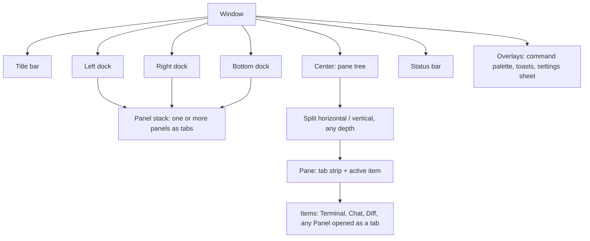
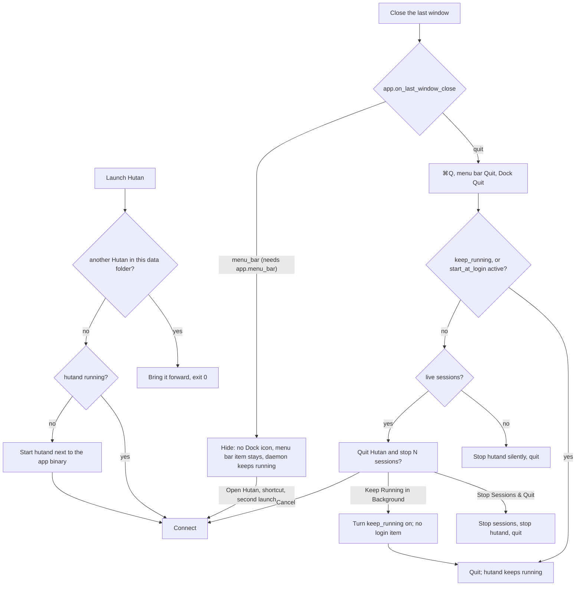

# Hutan Design

Decisions taken with the user (2026-10-14):

| Topic | Decision |
|---|---|
| Layout | **A + B-overview + palette**: sidebar + panes + inspector by default; Overview board as a preset (⌘⇧O); command palette ⌘⇧P (⌘K in the `hutan` keymap base) |
| Configurability | **Everything is a movable component.** Any panel can live in any dock or as a center tab; every component has its own settings section; layouts are saved as presets |
| Style | **Native macOS chrome + own terminal themes**: transparent titlebar, vibrancy sidebar, SF Pro UI, system accent, light/dark follows the system; terminal and chat use Hutan themes |
| Density | Setting: `compact` (default) / `comfortable` |
| Agents with TUI and protocol | **One session, view switch Chat / Terminal** in the pane header (M4) |

Architecture of the layout system: ADR 0010.

## Principles

1. **Attention first.** The user always sees who needs them (blocked, approval, done-unread) without hunting.
2. **The terminal is sacred.** Chrome never steals keys from a focused terminal except the documented global shortcuts. Every chrome element can be hidden.
3. **Nothing is fixed.** Placement, visibility, size, and per-component behavior come from layout + settings, not code paths.
4. **Closing UI never kills work silently.** Closing a tab, pane, or window detaches. Stopping a session is an explicit, labelled action. Quitting the app asks what to do with live sessions (see § Daemon lifecycle).
5. **Native feel, calm surface.** System chrome, restrained color; color carries state, not decoration.

## Workbench model



- **Panel**: a registered component with an id, title, icon, default dock, and a typed settings section. Panels: `sessions`, `history`, `inspector`, `overview`, `agents`, `assistant`, `notifications`, later `tasks`, `worktrees`, `providers`, `changes`. The `assistant` panel is described in `docs/assistant.md` § Desktop.
- **Dock**: left, right, bottom. A dock hosts a stack of panels (tabs inside the dock). Docks resize, collapse, and can be emptied.
- **Center**: a binary split tree of panes; each pane has its own tab strip. Items are session views (terminal/chat), diffs, or any panel opened as a tab.
- **Status bar**: an ordered list of status items (`connection`, `sessions`, `attention`, `density`, `theme`, `palette_hint`, the dock buttons `dock_left`, `dock_bottom`, `dock_right`, …) left and right; each is configurable. The dock buttons sit at the right end, like Zed's: a small window glyph with the dock's side filled, drawn pressed (accent) while the dock shows. A click toggles the dock (the same action as its key), the tooltip names the key of the active keymap base, and a hidden dock without panels shows a dimmed, inert button. A preset that lists its own `status_bar.right` shows them only when it names them.
- **Title bar**: transparent with traffic lights; shows the active item title, preset switcher, Overview toggle. Can be hidden into a minimal mode.
- **Presets**: named layouts (`default`, `focus`, `overview`, user-defined). Switching a preset swaps docks/center arrangement without closing sessions.

### Moving things

| Action | Mouse | Keyboard (default) |
|---|---|---|
| Split right / down (new pane starts a new terminal in the focused terminal's cwd) | pane menu | ⌘D / ⌘⇧D |
| Move tab to split | drag tab to a pane edge (drop zones) | palette → "Move tab to new split…" |
| Move panel to another dock | drag panel tab to dock, or panel menu "Move to ▸" | palette → "Move panel…" |
| Open panel as center tab | panel menu "Open as tab" | palette |
| Resize | drag splitter / dock edge | ⌃⌘←→↑↓ |
| Focus neighbour | — | ⌘⌥←→↑↓ |
| Zoom pane | double-click tab | ⌘⇧↩ (Zed base: also ⇧⎋) |
| Toggle docks | status bar dock buttons | Zed base ⌘B left, ⌘R / ⌘⌥B right, ⌘J / ⌃\` bottom, ⌘⌥Y close all; Hutan base ⌘B, ⌘⌥B, ⌘⌥J |
| Switch preset / Overview | title bar menu | ⌘⇧O overview, ⌘⇧1…9 presets |
| Save current layout as preset | title bar menu | palette → "Save layout as preset…" |
| Close tab (detach) | × on tab | ⌘W |
| Stop session | session menu (confirm if running) | ⌘⇧W |

## Default layout

```svg
<svg viewBox="0 0 960 540" xmlns="http://www.w3.org/2000/svg" font-family="system-ui, -apple-system, sans-serif">
  <rect x="0.5" y="0.5" width="959" height="539" rx="10" fill="var(--surface)" stroke="var(--border)"/>
  <rect x="0.5" y="0.5" width="219" height="515" rx="10" fill="var(--border)" opacity="0.28"/>
  <circle cx="18" cy="18" r="6" fill="var(--error)" opacity="0.8"/><circle cx="36" cy="18" r="6" fill="var(--warning)" opacity="0.8"/><circle cx="54" cy="18" r="6" fill="var(--success)" opacity="0.8"/>
  <text x="420" y="22" font-size="12" fill="var(--muted)">M2 · claude — hutan</text>
  <rect x="742" y="9" width="96" height="20" rx="5" fill="none" stroke="var(--border)"/><text x="752" y="23" font-size="11" fill="var(--fg)">Layout: Default ▾</text>
  <rect x="846" y="9" width="104" height="20" rx="5" fill="none" stroke="var(--border)"/><text x="856" y="23" font-size="11" fill="var(--fg)">⊞ Overview ⌘⇧O</text>
  <line x1="220" y1="36" x2="960" y2="36" stroke="var(--border)"/>
  <rect x="10" y="44" width="200" height="24" rx="6" fill="var(--surface)" stroke="var(--border)"/><text x="20" y="60" font-size="11" fill="var(--muted)">⌕ Search sessions</text>
  <text x="12" y="88" font-size="10" fill="var(--warning)" font-weight="700">NEEDS YOU · 2</text>
  <circle cx="18" cy="104" r="4" fill="var(--warning)"/><text x="28" y="108" font-size="12" fill="var(--fg)">api · codex</text><text x="182" y="108" font-size="10" fill="var(--muted)">1m</text>
  <text x="28" y="121" font-size="10" fill="var(--muted)">approval · cargo test</text>
  <circle cx="18" cy="138" r="4" fill="var(--success)"/><text x="28" y="142" font-size="12" fill="var(--fg)">web · omp</text><text x="182" y="142" font-size="10" fill="var(--muted)">4m</text>
  <text x="28" y="155" font-size="10" fill="var(--muted)">done · 3 files changed</text>
  <text x="12" y="180" font-size="10" fill="var(--muted)" font-weight="700">HUTAN  ·  master</text>
  <rect x="8" y="188" width="204" height="24" rx="5" fill="var(--accent)" opacity="0.18"/>
  <text x="16" y="204" font-size="11" fill="var(--c3)">◆</text><text x="30" y="204" font-size="12" fill="var(--fg)">M2 · claude</text>
  <rect x="122" y="193" width="58" height="14" rx="3" fill="none" stroke="var(--border)"/><text x="127" y="203" font-size="9" fill="var(--muted)">wt m2-shell</text><circle cx="198" cy="200" r="4" fill="var(--accent)"/>
  <text x="16" y="228" font-size="11" fill="var(--muted)">❯</text><text x="30" y="228" font-size="12" fill="var(--fg)">tests</text>
  <rect x="142" y="217" width="38" height="14" rx="3" fill="none" stroke="var(--border)"/><text x="148" y="227" font-size="9" fill="var(--muted)">main</text><circle cx="198" cy="224" r="4" fill="var(--accent)"/>
  <text x="16" y="252" font-size="11" fill="var(--muted)">❯</text><text x="30" y="252" font-size="12" fill="var(--fg)">zsh</text><circle cx="198" cy="248" r="4" fill="var(--muted)"/>
  <text x="16" y="276" font-size="11" fill="var(--c5)">✦</text><text x="30" y="276" font-size="12" fill="var(--fg)">ask · sonnet</text><circle cx="198" cy="272" r="4" fill="var(--muted)"/>
  <text x="12" y="302" font-size="10" fill="var(--muted)" font-weight="700">▸ ZAMAN-API  ·  3</text>
  <text x="12" y="500" font-size="11" fill="var(--muted)">＋ New session   ⌘T</text>
  <line x1="220" y1="36" x2="220" y2="516" stroke="var(--border)"/>
  <rect x="220" y="36" width="270" height="28" fill="var(--border)" opacity="0.18"/>
  <text x="232" y="54" font-size="11" fill="var(--fg)">❯ omp</text><text x="276" y="54" font-size="11" fill="var(--muted)">×</text>
  <text x="296" y="54" font-size="11" fill="var(--muted)">❯ zsh</text>
  <line x1="220" y1="64" x2="490" y2="64" stroke="var(--border)"/>
  <g font-family="ui-monospace, Menlo, monospace" font-size="11">
    <text x="232" y="84" fill="var(--c4)">  ▄▀▀▄ █▀▄▀▄ █▀▀▄</text>
    <text x="232" y="98" fill="var(--c4)">  ▀▄▄▀ █ █ █ █▄▄▀  v18.10.3</text>
    <text x="232" y="122" fill="var(--muted)">Tip: ⌥P switches provider</text>
    <text x="232" y="146" fill="var(--fg)">● Reading crates/client/src…</text>
    <text x="232" y="160" fill="var(--fg)">● Editing connection.rs</text>
    <text x="232" y="174" fill="var(--success)">  + reconnect with backoff</text>
    <text x="232" y="188" fill="var(--error)">  - TODO resume</text>
    <text x="232" y="468" fill="var(--muted)">π › Opus 5.5 › hutan ▶ 12%</text>
    <text x="232" y="488" fill="var(--fg)">╰─ continue with M2.2</text>
  </g>
  <rect x="356" y="478" width="7" height="13" fill="var(--accent)"/>
  <line x1="490" y1="36" x2="490" y2="516" stroke="var(--border)"/>
  <rect x="491" y="36" width="209" height="28" fill="var(--border)" opacity="0.18"/>
  <text x="502" y="54" font-size="11" fill="var(--fg)">◆ api · codex</text>
  <rect x="600" y="43" width="92" height="16" rx="4" fill="none" stroke="var(--border)"/>
  <rect x="601" y="44" width="44" height="14" rx="3" fill="var(--accent)" opacity="0.25"/>
  <text x="608" y="55" font-size="9" fill="var(--fg)">Chat</text><text x="650" y="55" font-size="9" fill="var(--muted)">Terminal</text>
  <line x1="490" y1="64" x2="700" y2="64" stroke="var(--border)"/>
  <rect x="540" y="74" width="150" height="34" rx="8" fill="var(--accent)" opacity="0.16"/>
  <text x="550" y="95" font-size="11" fill="var(--fg)">Fix the flaky resume test</text>
  <text x="502" y="126" font-size="11" fill="var(--fg)">Found a race in replay_after.</text>
  <rect x="500" y="134" width="190" height="24" rx="5" fill="none" stroke="var(--c2)"/>
  <text x="510" y="150" font-size="10" fill="var(--c2)">⚙ read bus.rs  ·  ✓  ▸</text>
  <rect x="500" y="164" width="190" height="24" rx="5" fill="none" stroke="var(--c2)"/>
  <text x="510" y="180" font-size="10" fill="var(--c2)">✎ edit bus.rs  +12 −3  ▸</text>
  <rect x="500" y="196" width="190" height="62" rx="6" fill="none" stroke="var(--warning)" stroke-width="1.5"/>
  <text x="510" y="213" font-size="10" fill="var(--warning)" font-weight="700">Approval needed</text>
  <text x="510" y="229" font-size="11" fill="var(--fg)" font-family="ui-monospace, Menlo, monospace">cargo test -p daemon</text>
  <rect x="510" y="236" width="56" height="16" rx="4" fill="var(--accent)"/><text x="518" y="248" font-size="10" fill="var(--surface)">Allow ⌘↩</text>
  <rect x="572" y="236" width="52" height="16" rx="4" fill="none" stroke="var(--border)"/><text x="580" y="248" font-size="10" fill="var(--fg)">Always</text>
  <rect x="630" y="236" width="52" height="16" rx="4" fill="none" stroke="var(--border)"/><text x="640" y="248" font-size="10" fill="var(--fg)">Deny ⎋</text>
  <line x1="491" y1="290" x2="700" y2="290" stroke="var(--border)"/>
  <rect x="491" y="290" width="209" height="24" fill="var(--border)" opacity="0.18"/>
  <text x="502" y="306" font-size="11" fill="var(--fg)">❯ tests</text><text x="560" y="306" font-size="10" fill="var(--accent)">● running</text>
  <g font-family="ui-monospace, Menlo, monospace" font-size="10">
    <text x="502" y="330" fill="var(--muted)">running 203 tests</text>
    <text x="502" y="344" fill="var(--success)">test bus::replay … ok</text>
    <text x="502" y="358" fill="var(--success)">test conn::slow … ok</text>
  </g>
  <rect x="500" y="474" width="190" height="32" rx="7" fill="none" stroke="var(--border)"/>
  <text x="510" y="494" font-size="11" fill="var(--muted)">Message codex…   gpt-5.6-sol ▾</text>
  <line x1="700" y1="36" x2="700" y2="516" stroke="var(--border)"/>
  <text x="714" y="56" font-size="11" fill="var(--fg)" font-weight="600">Approvals</text>
  <text x="784" y="56" font-size="11" fill="var(--muted)">Changes</text><text x="846" y="56" font-size="11" fill="var(--muted)">Info</text>
  <text x="934" y="56" font-size="11" fill="var(--muted)">⚙</text>
  <line x1="700" y1="64" x2="960" y2="64" stroke="var(--border)"/>
  <rect x="712" y="76" width="236" height="80" rx="6" fill="none" stroke="var(--warning)"/>
  <text x="722" y="94" font-size="11" fill="var(--fg)">api · codex</text><text x="900" y="94" font-size="10" fill="var(--muted)">1m</text>
  <text x="722" y="112" font-size="11" fill="var(--fg)" font-family="ui-monospace, Menlo, monospace">cargo test -p daemon</text>
  <text x="722" y="128" font-size="10" fill="var(--muted)">cwd ~/proj/zaman-api (main)</text>
  <text x="722" y="146" font-size="10" fill="var(--accent)">Allow   ·   Always   ·   Deny</text>
  <text x="714" y="182" font-size="10" fill="var(--muted)" font-weight="700">CHANGES · web · omp</text>
  <text x="714" y="202" font-size="11" fill="var(--fg)">src/app.tsx</text><text x="900" y="202" font-size="10" fill="var(--success)">+42</text><text x="928" y="202" font-size="10" fill="var(--error)">−7</text>
  <text x="714" y="220" font-size="11" fill="var(--fg)">src/api.ts</text><text x="900" y="220" font-size="10" fill="var(--success)">+8</text><text x="928" y="220" font-size="10" fill="var(--error)">−2</text>
  <text x="714" y="238" font-size="11" fill="var(--fg)">README.md</text><text x="900" y="238" font-size="10" fill="var(--success)">+3</text>
  <line x1="0" y1="516" x2="960" y2="516" stroke="var(--border)"/>
  <circle cx="14" cy="528" r="3.5" fill="var(--success)"/><text x="24" y="532" font-size="10" fill="var(--muted)">hutand connected</text>
  <text x="140" y="532" font-size="10" fill="var(--muted)">7 sessions</text>
  <text x="214" y="532" font-size="10" fill="var(--warning)">● 2 need you</text>
  <text x="742" y="532" font-size="10" fill="var(--muted)">Compact · Hutan Dark · ⌘K</text>
</svg>
```

Left dock: `sessions` panel (vibrancy) with `history` as a second tab. Center: two-column split; right column split again (chat over terminal). Right dock: `inspector` panel. Status bar: `connection`, `sessions`, `attention` | `density`, `theme`, `palette_hint`, `dock_left`, `dock_bottom`, `dock_right`.

### Presets shipped

| Preset | Left dock | Center | Right dock | Bottom dock | Use |
|---|---|---|---|---|---|
| `default` | sessions, history | pane tree | inspector, agents, tasks | `resources`, hidden | daily work |
| `focus` | hidden | pane tree, zoomed active pane | hidden | `resources`, hidden | deep terminal work (layout C) |
| `overview` | sessions, history | `overview` panel as the only center item | inspector, agents, tasks | `resources`, hidden | many agents at once (layout B) |

## Session pane header

`[kind icon] title  [state chip]  [placement badge]  [Chat | Terminal]  … ⋯`

- Kind icon: `❯` terminal, `◆` coding agent, `✦` direct model chat.
- State chip: see attention model. Hidden for plain idle shells unless enabled.
- Placement badge: `main` (main checkout) or `wt <branch>` (worktree); click → reveal in Finder / copy path.
- View switch: only when the session has both a TUI and a structured protocol (M4).
- `⋯` menu: rename, restart, stop, move to split/dock, copy session id, open in new window.

## Attention model

| State | Color token | Indicator | Meaning |
|---|---|---|---|
| `blocked` / approval | `--warning` (system orange) | filled dot, pulses once on entry | needs a decision |
| `done` (unread) | `--success` (system green) | filled dot until viewed | finished, not looked at |
| `working` | `--accent` (system accent) | dot with subtle activity ring | running a turn / output active |
| `idle` | `--muted` | hollow dot (optional) | alive, waiting |
| `failed` / exited ≠ 0 | `--error` (system red) | dot + code in subtitle | needs a look |

Rollups: session → workspace header → sidebar "Needs you" → status bar `attention` item → menu bar item and Dock badge (M6-C, § macOS integration) → notification (M6-B).

## Visual system (v2, 2026-10-15)

**Style, not layout.** Hutan stays terminal-first with its workbench (docks, panes, presets). What changes is how everything looks: calm, crisp and warm, in the spirit of Claude Desktop — generous spacing, soft borders instead of boxes, one clear accent, readable prose. Brand colors come from `assets/brand/README.md` (orangutan orange `#E0692E`, gold `#F5B53D`).

- **Typography**
  - UI: system sans (SF Pro), 13 px body / 12 px secondary (comfortable) and 12 / 11 (compact); weights regular and medium only; section labels 11 px medium, sentence case (no all-caps, no letter-spacing tricks).
  - Prose (assistant/agent messages, markdown in chat, notification and empty-state copy): system serif **New York** (fallback Georgia), 15 px, line height 1.6; headings in prose use the sans at medium weight.
  - Code and terminals: monospace (`terminal.font_family`, default Menlo; JetBrains Mono / SF Mono when installed), 13 px.
  - Numbers in counters and durations use tabular figures.
- **Palette** (tokens in `Theme`, light / dark):

| Token | Light | Dark | Use |
|---|---|---|---|
| `bg` | `#FAF9F5` | `#262624` | window and center panes |
| `sidebar` | `#F3F1EA` | `#1F1E1D` | left dock, titlebar strip |
| `surface` | `#FFFFFF` | `#30302E` | cards, composer, popovers, palette |
| `surface_hover` | `#F0EEE6` | `#3A3936` | row and button hover |
| `border` | `#E6E3D9` | `#3D3C39` | hairlines (1 px), focus rings use `accent` |
| `fg` | `#1F1E1D` | `#F5F4EF` | primary text |
| `muted` | `#6F6D66` | `#A6A49C` | secondary text, icons |
| `faint` | `#A8A59C` | `#6F6D66` | placeholders, disabled |
| `accent` | `#E0692E` | `#EA7A43` | primary buttons, selection, focus, links |
| `accent_soft` | `#FBE9DF` | `#3E2C23` | selected row, chips, user message bubble |
| `success` / `warning` / `danger` | `#3F8F5A` / `#C98A12` / `#C8452F` | `#6BBF85` / `#E2AE45` / `#E87562` | states |

  The terminal keeps its own palette (themes `hutan-dark` / `hutan-light`); its background matches `bg` so panes do not look like holes.
- **Shape and depth**: radius 8 px (controls), 12 px (cards, composer, popovers, palette), 999 px (pills, badges); no drop shadows inside the window except popovers/palette (one soft shadow, 0 8 24 rgba(0,0,0,.12) light / .4 dark); separators are 1 px `border` hairlines, used sparingly.
- **Components**
  - *Sidebar rows*: 30 px (comfortable), 8 px horizontal padding, rounded 8 px hover/selected (`surface_hover` / `accent_soft`), icon 16 px `muted`, title `fg`, second line or right side `muted`; counters as small pills.
  - *Buttons*: primary = `accent` fill, white text; secondary = `surface` with `border`; ghost = text only with hover fill; all 28 px high, 8 px radius.
  - *Chat*: no bubbles for agent messages (prose in serif on `bg`, max width 720 px centered in the pane); user messages in an `accent_soft` rounded bubble aligned right; tool calls as quiet collapsible cards (`surface`, 12 px radius, mono summary line, status dot); approvals as a card with the offered options as buttons, the first option primary.
  - *Composer*: a `surface` card with 12 px radius and hairline border at the bottom of the chat, multi-line field, a row below with attach (+), context chips, model/harness picker, and a round send button (`accent`) that turns into stop while streaming.
  - *Palette, popovers, menus*: `surface`, 12 px radius, soft shadow, 6 px inner padding, rows like sidebar rows.
  - *Empty states*: the mascot state image (`assets/brand/05-mascot`) at 96 px, one serif sentence, one action button.
- **Density tokens**:

| Token | compact | comfortable |
|---|---|---|
| sidebar row | 26 px | 30 px |
| tab height | 30 px | 34 px |
| pane header | 30 px | 36 px |
| status bar | 22 px | 26 px |
| base spacing | 4 px | 6 px |
| control radius | 6 px | 8 px |
| card radius | 10 px | 12 px |
| terminal padding (all sides) | 8 px | 12 px |
| block gutter bar | 3 px | 4 px |

- **Chrome**: transparent titlebar with inset traffic lights over the `sidebar` color; light/dark follows macOS unless pinned (`appearance = "system" | "light" | "dark"`). The accent is the brand orange, not the system accent.
- **Themes**: one theme definition drives chrome tokens, terminal palette and (M11) syntax scopes; built-in `hutan-light` and `hutan-dark` per the table. The desktop reports the active terminal colors to the daemon so OSC 10/11 replies match what the user sees.
- **Motion**: ≤ 150 ms ease-out for hover, popovers and expanding cards; no motion on terminal content; respects Reduce Motion.

## Settings

- Files (TOML, comments allowed):
  - user: `~/Library/Application Support/Hutan/settings.toml`
  - keymap: `~/Library/Application Support/Hutan/keymap.toml`
  - workspace overrides: `<first project root>/.hutan/settings.toml` of the workspace shown (Home: its folder)
  - project overrides: `<project root>/.hutan/settings.toml` of the project you work in (only keys marked workspace-overridable, in both files)
- Precedence: built-in defaults < user < workspace < project < runtime toggles (e.g. density switch writes back to user file). A project outside any workspace layers only its own file; the project layer is left out when it would read the file the workspace layer reads.
- Every component owns one namespace with a typed, documented schema; unknown keys warn, invalid values fall back to defaults with a visible error in the settings UI. Files hot-reload.
- Settings UI (⌘,): generated from the schemas, searchable; each panel's gear (⚙) opens its own section. It is where Hutan is managed, not only configured: see *Settings sheet* below for layers, Reset, validated choices, and the pages that manage the history index, the agents' hooks, remembered choices, the data folder and the keymap.
- `terminal` namespace, session start (B-1): `shell` (string; empty = the account's login shell) and `env` (table of strings, extra variables) are overridable per workspace and per project; `terminal.env` of the workspace's first project and then of the project overrides the user's per variable. They are resolved for the project a new terminal starts in (which need not be the one on screen; a project outside any workspace: its own file alone) and sent in `session.create` as `TerminalSpec.env` (`shell` as `SHELL`). Values are passed to the daemon and never logged or shown. Where the rest of the environment comes from: `daemon.toml` `[terminal] env_inherit` (`docs/architecture.md` § Session environment).
- Layout geometry the user drags (sizes, open tabs, split ratios) is **state**, saved in `desktop-state.json`; it becomes a **preset** in settings only when the user saves it.

```toml
[app]
keep_running = false          # leave the daemon running after Hutan quits (no login item)
start_at_login = false        # start the daemon at login: registers the launch agent (Hutan.app only)
setup_done = false            # the first-run setup was completed or skipped
on_last_window_close = "quit" # quit | menu_bar (keep Hutan in the menu bar; needs menu_bar = true)
menu_bar = true               # menu bar item: daemon state, count, sessions that need you
dock_badge = true             # number of sessions that need you on the Dock icon

[assistant]
global_shortcut = ""          # system-wide shortcut that opens the Assistant, e.g. "alt-space"; "" (default) is off

[keymap]
base = "zed"                  # zed | hutan: the default key table (keymap.toml is merged on top)

[appearance]
density = "compact"            # compact | comfortable
appearance = "system"          # system | light | dark (pre-v2 files call this key `chrome`; still read)

[terminal]
font_family = "Menlo"
font_size = 13
theme = "auto"                 # auto | hutan-dark | hutan-light | <name>
cursor = { style = "block", blink = true }
option_as_meta = "left"        # none | left | right | both
copy_on_select = false
blocks = true                  # prompt blocks over the terminal (see Terminal blocks)

[layout]
preset = "default"

[layout.presets.default]
left   = { panels = ["sessions"],  size = 240, visible = true }
right  = { panels = ["inspector", "agents"], size = 300, visible = true }
bottom = { panels = ["resources"], size = 200, visible = false }
status_bar = { left = ["connection", "workspace", "sessions", "attention"], right = ["density", "theme", "palette_hint", "dock_left", "dock_bottom", "dock_right"] }

[sidebar]
organize = "workspaces"        # workspaces | projects (see Projects and workspaces)

[panels.sessions]
group_by = "workspace"         # workspace | state | none
needs_you = true
row = ["state", "kind", "title", "folder", "placement", "age"]   # folder + placement are the row's second line

[panels.inspector]
tabs = ["approvals", "changes", "info"]
reveal_on_approval = true

[panels.overview]
card_size = "medium"           # small | medium | large
preview = "live"               # live | static | off
sort = "attention"             # attention | recent | name

[workspaces]
sort = "manual"                # manual | recent | attention | name (applies within each level)
hide_empty = true              # hide projects without sessions
hide_sleeping = false          # hide projects without a live session
hide_cli_created = false       # hide projects the CLI or an agent created
always_show_active = true      # the project and workspace you are in stay listed whatever the filters say

[history]
sources = []                   # default source chips: hutan | claude | codex | omp (empty = all)
roles = []                     # default role chips: user | assistant | tool | command | output
range = "all"                  # 24h | 7d | 30d | all
project = "all"                # workspace | all
show_snippets = true

[agents]
show_finished = false          # list finished agents (dimmed, their subtree folded into one row)
only_blocked = false           # list only blocked agents (and the ones above them)
scope = "active_workspace"     # active_workspace | all

[editor]
vim_mode = false               # Vim's Normal / Insert / Visual in text inputs (see Vim mode); ⌘K → Toggle Vim Mode
vim_use_system_clipboard = true  # yanks and deletes also go to the system clipboard; p pastes from it
```

### Settings sheet (ST-2)

Every control shows the truth and can be undone.

- **Layers and provenance.** Under each field's help a line says where the effective value comes from: *Default*, *You* (`settings.toml`), *Workspace NAME* or *Project NAME* (the `.hutan/settings.toml` of the container shown / the project worked in); the file is the hover. A control edits the layer its value comes from when that is a workspace or project file, otherwise the user's file (a namespace a workspace may not override is always the user's), so a value never seems not to take. When a workspace or project layer exists for the container and the page has overridable namespaces, the header offers **Edit in: You · Workspace · Project** (only the layers that exist); a choice moves every control of the page to that layer, and the provenance line then says `· editing <layer>` where the value comes from another one. `SettingsStore::layers`, `source_of`, `layer_value`, `write(layer, …)` and `remove(layer, namespace, key)` are the store side.
- **Reset removes, it does not write.** A field's *Reset* (shown while the file it edits sets the key) removes the key from that file, so the value falls back to the layer below, or to the default; comments elsewhere stay and a table the removal empties goes unless a comment is attached to it. *Reset page…* removes every key of the page from the file it is edited in, after a confirmation that lists them with their layer. Saved layout presets (they have their own Delete) and the two fields that mirror the daemon's lifetime and the login item (`app.keep_running`, `app.start_at_login`) are left out.
- **Validated choices and ranges.** Where the app knows the set, the sheet offers it: `terminal.theme` (Automatic and the installed themes), `layout.preset` (the built-in presets and the ones saved), `panels.sessions.row` (the six row parts) and `panels.inspector.tabs` (approvals, changes, info) are picked from a menu, each once; a value in the file that the app does not offer is shown as *(not available)*. Numbers show their range and are clamped when typed, with a notice: `terminal.font_size` 4–72, `terminal.line_height` 0.8–3, `resources.interval_ms` 1000–60000. `hutan ui set` refuses what the sheet would not offer.
- **Maps.** `terminal.env` is a list of `NAME` = value rows: add with `NAME=value`, click a value to edit it, × removes the row from the layer being edited; it warns that the values stay in `settings.toml` in plain text. `layout.presets` lists the built-in and the saved presets with *Rename…* and *Delete…* (the preset in use cannot be deleted; deleting one that replaces a built-in restores the built-in) and *Save current layout as…*, which also makes the saved preset `layout.preset`.
- **Pages the app draws itself.** *History*: an On/Off for indexing (`history.set_enabled`) with the sources, rows and size from `history.status`; the History panel's footer has **Disable** next to Clear and Rebuild (disabling keeps `index.sqlite`). *Agent Integrations*: per agent (OMP, Claude Code, Codex) the hook status — installed, outdated or incomplete, not installed — with *Install hooks…*, *Repair hooks…* and *Uninstall hooks…* (`hutan integration`), each confirming with the files it changes; `auto_install` stays, and the page says that turning it off does not uninstall. *Start Sheet*: the remembered “Don't ask again” agent/model choices with *Revoke* and *Revoke all*; turning *Ask before an agent chat sends its prompt* on while some are remembered asks whether to forget them. *Models*: *Clear key* asks first. *Data & logs* (after General): the data folder, `settings.toml`, `keymap.toml`, `daemon.toml` and the logs folder with *Reveal in Finder* and *Open* (Hutan's own `settings.toml` and `keymap.toml` are created with a comment when missing; `daemon.toml` is the daemon's and is never created), the size of `hutan.db` and of the history index, the daemon's version, pid and uptime, and *Restart daemon…* / *Stop daemon…*, which are the Daemon menu's flows with their confirmations. *Keyboard*: the bindings of `keymap.toml` (keys, action, context) read-only, with *Open keymap.toml* and *Reload*; the search finds the page by a key or an action and narrows the list. A full binding editor is not part of the sheet.
- **Search** matches a page's title, key, fields (title, help, choice labels), the words of its custom controls (Models and Accounts: API key, endpoint, base URL, model, provider, login, logout, account; Data & logs: Reveal in Finder, restart daemon, …) and the bindings of the Keyboard page.
- **Catalog.** `settings_schema::catalog()` is the list of pages in order; an entry names its `page` when it is a section of another page (`sidebar` shows on *Projects Sidebar*), and pages without a namespace (`data`, `accounts`, `models`) are drawn by the app. A page for the daemon's own settings is added there.

### Daemon settings in the sheet (ST-3)

The daemon's own options (`daemon.toml`, protocol 0.28, capability `daemon.settings`) are managed in the same sheet, drawn from `daemon.settings.get` with the generic controls (`workbench/settings_daemon.rs`): a toggle, a range-checked number box, a choice, a path with **Choose…** (the system's open panel: a file for `bin` / `cli`, a folder otherwise) and **Use default**, a list of text (chips; the order of arguments counts, so they have ↑ ↓) or of choices (a menu of the ones not in the list), a table of variables (`NAME=value`, with the warning that daemon.toml is plain text), and the MCP servers (`workbench/settings_mcp.rs`): a row per server with **Edit** and **Remove…** (which asks first) and **Add server…**, a form with the name, *A program on this Mac* (program and arguments, one line with quotes for arguments that hold spaces) or *A remote server* (address and HTTP/SSE); a missing field or the daemon's refusal shows inside the form, a saved server closes it, and the change counts after the daemon restarts (the sheet's banner) Nothing is cached: a change is sent with `daemon.settings.set` and the answer replaces the list.

- **Pages.** *Notifications* (`notify.*`: master switch, system notifications, which events, shortest turn, expiry; there is no test notification in the daemon, so no such button), *Sessions & restore* (`daemon.restore_sessions`, `workspaces.home_folder`, `terminal.env_inherit`, `projects.auto`), *Agent control & security* (`control.*`: *Ask me / Allow / Read only* with a plain explanation of what an agent may do to Hutan), *Agents & tools* (OMP, Claude Code, Codex programs, arguments, environment and CLI; the MCP servers, added, edited and removed in the page; the gateway's conversation length; parallel tasks), and sections of two existing pages: *History* (the sources, how far back, the transcript folders, under ST-2's On/Off) and *Assistant* (below). Each key has plain wording in `settings_labels.rs`; the permissions say what they let the assistant read.
- **Default or set, and when it applies.** Under each field: *Default: X* or *Set in daemon.toml (default: X)*, then *applies at once* (live) or *applies after the daemon restarts*; once a restart field was changed the line says *saved, applies after the daemon restarts*. **Reset** (**Use default** for a path) removes the key from daemon.toml.
- **Restart banner.** While any option's file value is not what the running daemon uses (`restart_pending`), every page of the sheet starts with *Some changes apply after the daemon restarts.* and **Restart now**, which is the daemon restart flow (its confirmation while sessions are live; sessions are restored by `daemon.restore_sessions`). The banner goes when the new daemon answers.
- **Errors.** A refusal of the daemon (validation: range, choice, a path that is not there) shows in the daemon's words under its field. A `daemon.toml` the daemon cannot read (`invalid_state`, with file, line and column) is a banner on the page with **Open daemon.toml** and **Check again**. An agent-originated connection is always refused by the daemon (ADR 0016); the desktop is never one. A daemon without the capability: the pages say *Update the daemon to manage these settings here.*, with the path of the file and **Open daemon.toml**.
- **Search** covers the wording of the daemon fields and their keys.
- **Assistant page.** Under the app's own fields (*Use the assistant*, shortcut): **Backend and model** for *Global (Home)* and for the workspace or project shown. Each has **Inherit** (`assistant.reset`; the line under it says what it inherits and from where: the parent workspace, then Global, then daemon.toml, then Automatic), **OMP · Claude Code · Codex · Provider** (a provider is then picked from the list) and a **Model** (*Automatic*, which stores no model, or one of the backend's catalog). A line says what the default assistant of the place runs on now (`assistant.list`); when nothing was chosen it begins *Automatic · backend · model*, the same words as the panel's header. Then the file's own *Backend / Provider / Model when nothing is chosen*, **what assistants of projects may read** (`assistant.context.*`), **what the Home assistant may read** (`assistant.global_context.*`, files off by default), **what this workspace's assistant may read** (the overrides `assistant.workspaces.<id>.*`: *Inherit · Allow · Deny*, Inherit removes the key) and the attachment size. The daemon has no read of the stored per-place choice, so the sheet shows what it stored or reset since the window started; a choice made before is not known (the *runs on* line is the truth).
- **Keyboard.** **Tab** and **Shift-Tab** move between the search box, the list of pages and the controls of the page. In the list **↑ ↓ Home End** select pages; in the controls **↑ ↓** move between rows and **Return** or **Space** acts (turns a toggle over, opens a choice, starts a text box, asks for a path). An open choice is moved through with **↑ ↓**, **Return** picks the option and **Escape** closes it. Typing anywhere goes back to the search box.
- **Empty search.** A search that matches no page shows *No settings match “…”* in place of a page, with a hint and **Clear search**; the footer says *No matches* rather than *Problems · none*.

### Settings wording

The sheet speaks to users, not to people editing `settings.toml`: the schemas' doc comments name keys, types and files, so the sheet shows the wording of `crates/desktop/src/workbench/settings_labels.rs` instead (which this section mirrors; a test fails for any field or choice of a built-in namespace that has no entry there, and for any title, help or choice label that contains a code span, `::` or a snake_case key name).

- **Namespaces** are listed by title: Appearance, General (`app`), Data & logs, Keyboard (`keymap`), Terminal, Layout, Projects Sidebar (`panels.sessions`, with `sidebar` as *Organize the sidebar*), Inspector, Overview, Workspaces, History, Chat, Editing (`editor`), Agents, Resources, Tasks, Assistant, Agent Integrations (`integrations`), Start Sheet (`launcher`), Accounts, Models. The key stays what `settings.toml` and `hutan ui set` use, and a search finds a namespace or field by its key as well as by its title, help or the label of a choice.
- **A field** has a title in sentence case that says what it controls (“Keep the daemon running after Hutan quits”, “Cursor shape”), and one or two sentences of help in plain words: what it does and what happens when it is off. No key names, types or file paths of the source tree; a user-facing file such as `settings.toml`, `keymap.toml` or a command such as `hutan daemon stop` may be named.
- **A choice** shows a label per value (“Zed keys” / “Hutan keys”, “Keep in the menu bar”, “Last 24 hours”). The value written to the file is unchanged.
- Everything the sheet says besides fields (buttons, questions, notes of the pages above) is in `settings_labels::words` and read by the same tests; the sheet itself says where a value comes from instead of a generic “can be set per workspace” line.

## Time

One convention for every time a person reads, in the desktop and in the CLI (`hutan_client::time`):

- **Relative first.** Lists and headlines say how long ago: `3 min ago`, `2 h ago`, `yesterday`, `5 days ago`, `just now`; dense rows (the sidebar, overview cards, history hits) use the compact form `now`, `3m`, `2h`, `4d`.
- **Restart chips in a large sidebar (UX-C).** From 30 sessions on, a row's *respawned / resumed / interrupted / not restarted* chip is a small glyph (↻, ⚠ for the ones that need a look) whose tooltip has the word and the sentence, and the restart summary is one row (*39 sessions recovered — …* with *Review* and *Dismiss all*); *Review* opens the full list.
- **Absolute on demand, always local with its zone.** A tooltip on every relative time in the desktop shows `2026-10-17 14:31:07 +0500`: the date, the time to the second, the offset from UTC. Where there is no hover (the CLI, a one-line summary in a notification) a time that is stored is written absolute with the offset — `hutan search` and `hutan index status` (`2026-10-17 14:31 +0500`), `hutan recovery` (`hutand restarted at 2026-10-17 14:31 +0500, 3 min ago`), `hutan task show` (`ended 3m 5s ago (2026-10-17 14:31 +0500)`) — and the inspector's *Created* row gives both.
- Never UTC without saying so, never a clock time that leaves out the day. Durations (`ran 1m 5s`, an agent's elapsed time) are not times and stay as they are. The daemon's own timestamps (`created_at_ms`, `--json`) are Unix milliseconds; formatting is the client's job.
- Where it applies: the recovery summary (headline relative, tooltip absolute), the history panel and `hutan search`, `hutan task` (the Tasks panel shows durations, not times), the sidebar and overview rows, the inspector, the review batches of the Changes tray.

## Projects and workspaces (M12-B, rewritten by M18-B)

The daemon owns three kinds of container (ADR 0014, `docs/orchestration.md` § Projects and workspaces, protocol 0.19): **projects** (a repository with all its worktrees, or a folder — made by the daemon from the folders sessions start in), the user's own **workspaces** (a name, a pin, an order; they contain projects), and **Home**. The desktop decides how to show them. The sidebar is the `sessions` panel, titled **Projects**.

- **Organize** (`sidebar.organize`, header menu `⇅`, ⌘K "Sidebar: Organize by …"): `workspaces` (default) lists the user's workspaces (`▾ ★ NAME ·· ● 2  3`: chevron folds, `★` a pin, `● n` sessions that need you, the session count — `live/total` when they differ) with their projects indented below (`◧` repository / `▭` folder, name, the same counts) and the sessions under each project; then a **No workspace** label with the projects that belong to none, then Home (`⌂`) with its sessions. `projects` is a flat list of projects (pinned first) with their sessions, Home last; a session started straight into a workspace sits under that workspace's own row there. "Needs you" stays on top in both. A search or filter that names a workspace lists everything in it.
- **Session rows** take two lines: state dot, kind icon (`❯` terminal, `◆` agent, `✦` direct), title, agent badge, age; under them where the session is **now** (`SessionInfo.folder` — the shell's OSC 7 directory — else its start folder; the last two path parts, `muted`, the full path in the tooltip) and the **placement badge** (`main` or `wt <branch>`, a warning tint and `⚠` while another live agent works in the same checkout; the checkout's details in the tooltip). `panels.sessions.row` picks and orders the fields.
- **Sort** (header button `⇅ Manual ▾`, ⌘K, `workspaces.sort`) applies within each level — workspaces among themselves, projects inside a workspace, the projects in no workspace: `manual` (drag order) · `recent` (last activity) · `attention` (most sessions that need you, then activity) · `name`. Pinned rows come first in every mode and level; ties keep the daemon's order. Sessions keep creation order.
- **Drag** a row onto a row of the same level to reorder (manual only): it takes that row's slot within its group (pinned or not); the desktop sends `workspace.move`. **Drag a project onto a workspace** (or onto a project of another workspace) to put it there (`workspace.assign`); **drag it onto the "No workspace" label** — or onto a project in no workspace — to take it out. Home does not move and takes no drops. When the dragged project is part of a multi-selection, the whole selection moves.
- **Filters** (`workspaces.*`, the same header menu, ⌘K): hide empty / sleeping / CLI-created **projects** (workspaces and their members always show, as in `hutan ws ls`). Home, pinned projects and (`always_show_active`) the one you are in are never hidden, and a session that needs you stays visible in "Needs you" whatever the filters say. The filter box matches workspace and project names and folders, session titles, commands, folders and badges (any word order); a workspace or project that matches lists all its sessions. Hidden projects stay reachable through ⌘J.
- **Managing** (every change is a protocol 0.19 request): the header's **＋** menu — *New Workspace…* (a name; **Create**, or **Choose Folders…** to start with the projects of some folders: `workspace.create {name, paths?}`), *Open Folder…* (system panel → `workspace.open`, the project is shown), *Open Folder into Workspace ▸* (the same, then `workspace.assign`). **⌘-click** toggles a project in the selection and **⇧-click** selects the range from the last one clicked (neither opens it); right-click on a selected project → *New Workspace from Selection…* (`workspace.create {project_ids}`), *Move Selection to Workspace ▸*, *Remove Selection from Workspace*. **Workspace menu**: Pin/Unpin, Rename (inline: the name becomes a field, Enter or leaving it confirms, Escape cancels), Add Folder… (`workspace.add_root`), *Delete Workspace…* (asks, says that its projects and their sessions are kept and move to "No workspace"; `workspace.delete`), Reveal in Finder. **Project menu**: Rename (inline), Pin/Unpin, *Move to Workspace ▸* (the workspaces, or a new one), *Remove from Workspace*, Reveal in Finder, Close (greyed with the reason while sessions are live; asks first; the project stays in ⌘O). **Home menu**: Pin, Rename, Reveal; Home has one folder, set in `daemon.toml`.
- **⌘O** lists "Open Folder…" and the recent projects (`workspace.recent`, ▣ open · ▢ closed) with a fuzzy filter; Enter runs `workspace.open` and shows the project (inside its workspace when it has one). **⌘P** (Hutan base: ⌘J) lists every workspace, project (hidden ones included) and session in the sidebar's order — a project shows `workspace › folder`, a session `workspace › project · folder · badge · command`; Enter shows the container or the session's tab.
- **One layout per container** (`desktop-state.json`: `active_workspace` + `parked`): the center pane tree, docks, zoom, focus and preset belong to the container you switch to — the workspace when the project is inside one, else the project, else Home — and every project of a workspace shares it. Switching parks the layout and brings the other one back exactly. A container seen for the first time starts with a single pane under your dock arrangement. Opening a session of another container (sidebar, ⌘J, attention, a restored tab) switches first. A project that joins a workspace hands its layout over (the workspace's own wins when it has one); one that leaves keeps the workspace's. Terminals of parked layouts are **detached**, so nothing outside the window renders or is acked; coming back re-attaches with a daemon snapshot (two terminals ≈ 70 ms in the GPUI test, polling included), which is why attached-but-hidden was not chosen. A layout saved before workspaces existed belongs to the container of its first session (else Home); a container that vanishes hands the window to Home and its layout is dropped.
- **Settings**: user < workspace < project. The workspace layer is `<first project root>/.hutan/settings.toml` (Home: its folder), the project layer `<project root>/.hutan/settings.toml` of the **active project** — the project of the focused session, else the one last chosen in the sidebar (a workspace keeps the project chosen in it) — and a project in no workspace layers only its own. Both are hot-reloaded while they stay active, whether or not a session has focus (`crates/settings`: `set_workspace_root`, `set_project_root`, `get_for_roots`). Only workspace-overridable namespaces are read from either file (`terminal` today); the settings UI reports the rest.
- **New sessions** (⌘T, splits of a pane without a session) start in the active project, else the first project of the active workspace, else in Home; they get the `terminal.shell` / `terminal.env` of that project's layers.
- **Status bar**: the `workspace` item shows the active container; click opens the jump palette.

## History panel (M17-B)

The `history` panel searches the opt-in session history index (`docs/history-index.md`, protocol 0.8 `history.*`): Hutan terminal blocks and the transcripts of Claude Code, Codex and OMP. It lives in the left dock as a tab next to Sessions in every built-in preset and moves like any panel; ⌘K → "Panel: Open History" reveals it.

- **Disabled** (`history.status.enabled = false`, the default): the panel says what turning indexing on reads (the four sources and their default folders), that nothing leaves the machine and that Clear deletes the index, and offers **Enable indexing** (`history.set_enabled`) and a link to the `history` settings. No search is sent while indexing is off.
- **Search**: a field (debounced 150 ms, `history.search`, 50 sessions) under which filter chips narrow the same search — source (Hutan / Claude / Codex / OMP), role (user · assistant · tool · command · output), date (24h / 7d / 30d / all), project (this workspace = the first folder of the active workspace · all). Chips are toggles; none chosen means all. One row per session: source glyph, title, age, `source · role · folder · N hits`, and the best snippet with the matching words **emphasised** (the index's `«…»` markers are parsed, never drawn). ↑ ↓ select a row, ↩ runs its main action.
- **Row actions**: **Resume** opens a new terminal session running the hit's `resume_argv` (greyed with the reason when the index has none: Hutan records, ids the resume rules refuse). It starts in the active workspace when one of its folders holds the hit's directory, otherwise `workspace.open` finds or creates the workspace that contains it and the window switches there (Home is a catch-all and only counts for its own folder). A directory that no longer exists falls back to the active workspace's first folder, and a notice says so. **Copy command** puts the shell-quoted resume line on the clipboard. **Open Block** / **Open Session** (Hutan hits): shows the terminal session and scrolls it to the block the hit names (`terminal_id` + `block_id`, exact: no time matching) while the session still has that terminal and the block; otherwise a notice says it is gone. **Reveal File** (hits of Claude Code, Codex and OMP) shows the transcript file (`path`) in Finder. Transcript files are not revealed in Finder: a hit does not carry its path (and no block id) yet.
- **Footer**: rows, database size, unreadable lines, per-source last indexed time, **Clear…** and **Rebuild…** (both ask first; Clear deletes `index.sqlite`, Hutan's own records cannot come back) and **Disable** (`history.set_enabled` off: nothing new is read, the index stays). While the index fills (after Enable, Rebuild, Clear, or when the panel opens on an empty index) the panel reads the status twice a second and searches again when the row count changes, until it stays put for 2 s (10 s while empty, 60 s at most).
- **⌘K**: "History: Search History…" reveals the panel and focuses its field. **⌘J**: a query that starts with `?` searches the history inline (top 8 sessions, same filter defaults); ↩ resumes the hit when it can be resumed, else shows it in the panel with the field filled in and the row selected.
- **Settings** (`history`): `sources` / `roles` (default chips, empty = all), `range` (`24h` | `7d` | `30d` | `all`), `project` (`workspace` | `all`), `show_snippets` are the desktop's search defaults; where the transcripts are belongs to `daemon.toml`. The page also has the On/Off of indexing itself (`history.set_enabled`, recorded in `daemon.toml`) with the indexed sources and the size, the same switch as Enable and Disable in the panel.

## Agent monitor (M13-B)

The `agents` panel (default: second tab of the right dock in `default`, `focus` (hidden) and `overview`; movable like every panel) draws the daemon's observation tree (`agent.tree`, `agent.tree_updated`, `docs/protocol.md` § Agent observation tree) of every session that has one. The daemon owns the tree; the panel only filters and draws.

- **Sections**: one per session with agents, headed `workspace › session title` (click focuses the session), workspaces in the sidebar's manual order, sessions in creation order. Under it the tree, indented: main agent first, siblings in the order they started (then by id, so rows never jump when a node changes).
- **Row**: state glyph, name (else agent type, else the agent program or node id), the agent type when it is not the name, model, duration, and a second line with usage and the current activity (one line, 80 characters). Glyphs are never color alone: `●` working (accent, pulses once a second; steady under Reduce Motion), `▲` blocked (warning), `○` idle, `?` unknown (muted; the main agent after a daemon restart until it reports), and for finished agents their outcome: `✓` completed (success), `✗` failed (error), `⊘` interrupted, `⏹` disconnected (muted). Finished rows are dimmed.
- **Duration** runs from `started_at_ms` (to `ended_at_ms` once finished). It refreshes once a second only while the panel is drawn and a listed agent works or waits for the user; a hidden panel, or a tree with nothing running, wakes nothing.
- **Usage** is labelled by `usage.kind`, never zero-filled: `1.5k tok · context` (`claude.context`: the latest context, `3.2k/200k` with a window), `3.2k tok · total · $0.31` (`codex.total`), `800 tok · excl. cache` (`omp.tokens` leaves cache reads out). A kind this build does not know shows as the source sent it.
- **Finished subtrees** (a finished agent whose descendants all finished) are hidden unless `agents.show_finished`, and then folded into their head row (`▸ +3`; the chevron unfolds). A finished agent with a live descendant stays, so the tree stays connected. **Blocked agents are always listed**, with the agents above them.
- **Chips** at the top toggle `agents.show_finished`, `agents.only_blocked` and `agents.scope` (this workspace · all workspaces) in `settings.toml`. ⌘K: *Agents: Show Monitor*, *Agents: Show Only Blocked*.
- **Click** a row to focus its session (its terminal or chat tab). **Right-click**: Open Session, *Open Transcript* (only for nodes that reported a `transcript_path`; reveals it in Finder), Copy Node ID.
- **Badges**: a session's row in the sidebar, its tab and its overview card show `↳2` (subagents working or waiting for you) and `▲` (any node blocked); the tooltip says `2 subagents running` / `Blocked: reviewer`. Nothing is drawn while there is nothing to say.
- **Attention**: a live session with a blocked node always needs the user (`SessionsStore::presentation` folds the tree over the session summary), so the sidebar's *Needs you*, ⌘⇧J, the workspace counts and the status bar's `attention` item include it. `SessionsStore` emits `AgentAttentionChanged { session_id, blocked_nodes }` when a node becomes blocked (not for what was already blocked when the window connected, not when one is resolved); M6 turns it into a macOS notification.

## Resources panel (M13-D)

The `resources` panel (default: the bottom dock, hidden, in every preset; ⌘K *Resources: Show Panel*, ⌥⌘R toggles it; movable like every panel) is the Activity Monitor of Hutan: what each live session runs and what it costs, over the resource manager of `docs/resources.md`. The daemon samples; the panel draws and sends the actions.

- **Subscription**: `resources.subscribe` (`resources.interval_ms`, default 2000, at least 1000) on the window's shared connection (`Connection::resources_subscribe`; it remembers the subscription and renews it after a reconnect, announcing samples as `Notice::ResourcesUpdated`). Every draw marks the panel as seen; a 500 ms watcher unsubscribes at the first look that finds it was not drawn (hidden dock, another tab, closed) and the next draw subscribes again, so a hidden panel costs the daemon nothing (it stops sampling with its last subscriber). The link retries with backoff when the daemon goes away (the panel says so) and says so when the daemon is older than protocol 0.18.
- **Table**: a `hutand` row first, then one block per session that has a process: fold chevron, title, folder, placement badge (`main` / `wt <branch>`), and its totals in the same columns (processes, CPU, memory). Under it the process tree, indented by depth: name, PID, CPU % (a thin `accent_soft` bar, 100 % = full, more is clipped), memory (MB, GB from 10 000 MB), threads, command (one line, the full text in the tooltip). A process that an agent reported with `--pid` carries an `accent` dot and the node's label; agent nodes without a process of their own (a Codex subagent thread, an agent that reported no pid) are listed under the tree. A stopped or zombie process says so in a pill. Narrower than 520 px the threads and command columns are left out.
- **Sort and filter**: the CPU, Memory and Name headers sort (`resources.sort`, default `cpu`: busiest first); a second click on the active header flips the order. Sessions are ordered by their totals (or title) and siblings inside a tree by the same key, so the tree stays a tree. The filter box matches names, command lines, pids, agent labels and the session's title, workspace and folder, case-insensitively: matches keep their ancestors, a session match keeps its whole tree; folds are ignored while filtering.
- **Actions** (⋯ on a row, or right-click; the menu starts with *Open Session*): per process *Interrupt (SIGINT)*, *Terminate (SIGTERM)*, *Kill (SIGKILL)…*, *Stop (SIGSTOP)* (*Continue (SIGCONT)* while it is stopped); per session *Stop Session…* and *Kill Session…*; per agent node *Interrupt Agent* (the main agent: a chat's turn, or ^C in a terminal; a subagent that is a process: SIGINT, with *Interrupt Agent, Then Terminate* for SIGTERM two seconds later), greyed out with the reason for a subagent the harness cannot stop on its own (no process, and not a Codex thread). `…` asks first: Kill names the process and the descendants that keep running, Kill Session lists what dies (up to 12 names), Stop Session says SIGHUP then SIGKILL after 3 s; the rest go at once. The daemon's refusals (`forbidden`, `invalid_state`, `not_found`) appear on the row (`forbidden: …`; click to dismiss). A few hundred milliseconds after an action the panel asks for a fresh sample instead of waiting for the next one.
- **Show in Resources**: an entry of the session context menu (sidebar, overview card, tab) reveals the panel, clears the filter, unfolds the session, highlights it (`accent_soft`) and scrolls to it; a session without a process says so.
- **Empty states** (the mascot): nothing running (sleep), reading (thinking), no match for the filter, daemon too old (error), daemon unreachable (sleep).
- **Settings** (`resources`): `interval_ms`, `sort`. Visual tokens only: `ui.rs` components, `accent`, `accent_soft`, `warning`, `danger`, `muted`.
## Tasks panel (M7-C)

The `tasks` panel (default: third tab of the right dock in `default` and `overview`; movable like every panel) draws the daemon's tasks (`docs/orchestration.md` § Tasks) as a dependency tree. The daemon owns tasks; the panel sends `task.*` requests and draws what `task.updated` / `task.removed` say.

- **Tree**: every task once, under the dependency it waits for last (the others read `also after …`), dependencies before dependants, roots oldest first. Row: state glyph and color from the theme — `○` todo (muted), `◎` ready (accent), `▶` running (accent, pulses once a second; steady under Reduce Motion), `◆` blocked (warning), `✓` done (success), `✗` failed (error), `⊘` cancelled (muted) — the title, the state name, and a second line with the placement badge (`main` / `wt <branch>`), the run (`shell`, `$ command`, `codex chat`, `omp chat`), `auto`, the elapsed time (running time, or how long it took; ticks once a second only while the panel is drawn and a listed task runs) and the outcome (`(exited 3)`). Done and cancelled rows are dimmed.
- **Click** a row: select it and focus its last session's tab. The selected row shows its actions, exactly the ones the daemon accepts in that state: *Start* (ready), *Done* (everything but done and cancelled), *Cancel* (todo, ready, running, blocked), *Reset* (failed, done, cancelled), *Delete* (not while running); *Changes* opens the Changes view (`docs/orchestration.md` § Review and merge) of the checkout it ran in. Deleting a task others wait for asks first: the daemon's refusal names them, *Delete them too* repeats it with `cascade`.
- **+ New task** (header, or ⌘K *Tasks: New Task…*): opens the **Start…** sheet on *Queue as task* (below); the panel has no form of its own. Row actions, the *Changes* button and the dependency tree are unchanged.
- **Filters**: chips at the top toggle `tasks.show_done` (done and cancelled rows; failed ones always stay, and tasks that waited for a hidden one move up as roots) and `tasks.scope` (`workspace` — the window's — or `all`).
- **Empty state**: the mascot, a sentence and *+ New task* (the Start… sheet); "Nothing matches the filters." with the success mascot when only the filters hide tasks; a note when disconnected or when the daemon predates tasks.
- **Commands** (⌘K): *Tasks: New Task…*, *Tasks: Show Panel*, *Worktree: Review Changes…* (a picker of the checkouts of the workspace's repositories, main checkouts included).

### Changes view

**Narrow centers (UX-C).** Below about 720 px of center width the file list is a one-row strip above the diff (the selected file, `n of m`, counts; click it to unfold the list, choosing a file folds it again), the diff has the whole width and long lines scroll sideways inside it, and the scope card's *Commit all…* wraps under its sentence instead of leaving the pane.

A center tab per checkout (title `Changes · <branch>`): the header names the branch and what it is compared against (`against main (merge base 5b1c0f3)`), the file and line totals, *With uncommitted* (toggles `include_uncommitted`), *Refresh* and *Merge into main…*. Left, the file list: status letter (A/M/D/R, colored), path (`old → new` for a rename), `+n −m` or `binary`; right, the selected file's unified diff in the mono font, drawn with the chat's diff rows (`hutan_chat_view::diff` parsing, theme colors), one collapsible block per hunk (`▾`/`▸`, a folded hunk says how many lines it hides), 500 lines per file at most, a note when a patch was cut at 2 MiB. Read-only. *Merge into main…* (worktrees with a branch only) opens a card: strategy (Merge commit / Squash / Rebase), the commit message (not for rebase), Merge / Cancel. A refusal stays in the card — the daemon's reason, and for a conflict the files with `⚠` — and changes nothing; success shows a toast (`Merged feature/x into main (9d8c7b6)`) and a card offering *Remove worktree and branch* (`worktree.remove` with `delete_branch`, forced only when the worktree still has uncommitted changes that were not merged, as the button says) or *Keep*; removing closes the tab.

**Delivery (DL-1, protocol 0.25).** A task row carries a delivery pill after its title — `Awaiting review` (accent), `Accepted` / `Merged` (success), `Changes requested` (warning, with the note under it), `Discarded` (muted) — and a done task that waits for review is neither dimmed nor hidden by *Show done*. The session of a task awaiting review is a soft *Needs you* item (label `review`, accent, filled dot; no Dock or menu bar badge). The Changes view header shows the pill of its task, then *Accept*, *Request changes…* (a note form) and *Merge into …*; under it a card says what a merge takes (*Committed on <branch>*: commits and files) and what it does not (*Uncommitted in the worktree*, with *Commit all…*); after a merge that left uncommitted changes the cleanup card makes *Keep* the primary button. Behaviour and tests: `docs/orchestration.md` § Delivery.

## Terminal blocks (M10-C)

The daemon indexes OSC 133 marks into blocks (protocol 0.5); the desktop draws them **over the single grid** — the grid, its columns and the PTY size never change, and `terminal.blocks = false` makes the terminal look exactly as without blocks (hot-reloaded).

- **Gutter**: a thin bar at the left edge, inside the terminal padding (width = the `block gutter bar` density token), one per block from its prompt to the end of its output. `--success` after exit 0, `--error` after a failure, neutral (`--muted`) while the command runs and when no exit code is known; the bar of a running block pulses slowly (steady under Reduce Motion, read from macOS; `HUTAN_REDUCE_MOTION=0|1` overrides). The open prompt has no bar.
- **Separator** above every prompt but the first row, and a right-aligned **chip** on the prompt line: `✓ 1.2 s`, `✗ 2 3 m` (exit status, duration). A chip never covers text the prompt line shows: when the line is too full for it, it is left out.
- **Hover** a block: a faint tint and an actions bar at the right of its first visible row — Copy command, Copy output (both through `terminal.block_text`, so they work beyond the loaded scrollback), Collapse / Expand, Rerun (types the command and Enter into the session; off while a command runs), Send to agent (a chip in the composer of the last-focused chat, `docs/agents.md`).
- **Collapse** folds a finished block's output rows into one summary row (`… 241 lines, exit 0`) *in the view only*: nothing changes in the PTY, the scrollback or what other clients see, and older lines move down to fill the freed rows (the view stays anchored at its bottom). Folds apply to the pane, not to overview previews; they are saved per terminal in `desktop-state.json` (`collapsed_blocks`, terminal id → block ids) so they survive a desktop restart, and are forgotten with the terminal.
- **Keyboard**: ⌘↑ / ⌘↓ move the highlight to the previous / next prompt and scroll to it (past the newest block ⌘↓ returns to the live screen; typing clears the highlight); ⌘⇧A selects the current block's output, ⌘⇧C copies it. The *current* block is the highlighted one, else the newest command with output. Every action is also in ⌘K under `Block:`.
- **Overview previews** show the gutter colors only (no chips, separators or folds). The inspector's Info tab lists the last 20 commands of the focused terminal (command, exit, duration, cwd); a click scrolls that terminal to the block.

## Accounts and the assistant (M8-B)

- **Accounts** (Settings sheet → `accounts`, ⌘K "Accounts…"): one card per harness (OMP, Claude Code, Codex): name, a detection pill (installed / not found with the daemon's install hint), **Log in** and **Log out** buttons, then the accounts it reports (label, provider, plan pill, status pill; OMP has a Log out per provider). The login runs in a terminal session which the window shows (the sheet closes); `instructions` (OMP logs out inside its interface) appear as a notice. No token or address is ever shown. Empty state: the mascot when no harness is installed.
- **Start…** (S-1; ⌘⇧T in both keymap bases, ⌘K *Start Agent or Task…*, the ▶ of a project row and the sidebar header, the Tasks panel's *+ New task*, the empty pane/project): one sheet for every start. Fields in Tab order: *Project* (fuzzy picker, shows its folder and branch), *What* (Agent chat · Terminal agent · Plain terminal · Command), *Agent* (OMP / Claude Code / Codex / direct providers; the choices keep their order and place whatever the harnesses report; one that is not installed or logged in is dimmed and cannot be started, and clicking it says why on a line *below* the row with *Install…* / *Log in…* for that agent only), *Model* (the harness's list; default the harness's own), *Prompt* (multi-line, Vim mode when on), *Where* (Main checkout · New worktree with branch `hutan/<slug of the title>` from the current branch · an existing worktree; a warning when another live agent already works in the chosen checkout), *Title* (from the prompt), *More* (After; the system prompt of a direct chat), *Start now* / *Queue as task*. ⌘↩ starts, ⌥⌘↩ (*Start & new*) starts and keeps the sheet with project, what and where for fan-out. Every start is `task.create` (+ `task.start` for Start now) so it shows in the Tasks panel and the monitor; only a direct model chat, which tasks cannot run, uses `chat.create`. A model picked for a harness chat is applied with `chat.set_model` after the first message (tasks carry no model); a queued task starts on the harness's default. *Switch model…* of a running chat is its own small dialog.
  **Safe Start (UX-B).** The sheet opens on what was started last (What, Agent, Model, Where; kept in `desktop-state.json`), and on **Plain terminal** before there was a first start; a preset about an agent (a prompt, *Queue*, a direct chat) opens on *Agent chat*. The footer says what Start will do in one line (*Start OMP · Claude Opus 4.5 chat in hutan (main)*, *Open a terminal in hutan (main)*, *Run “cargo test” in hutan (main)*) and the Start button names the agent. An agent chat that sends its prompt at once asks first, once per agent and model: *This sends your prompt to OMP · Claude Opus 4.5 now* with *Start* (↩), *Cancel* (Esc) and *Don't ask again for this model* (unticked until the user ticks it; Space toggles); `launcher.confirm_agent_start = false` turns the question off. Plain terminals, commands and queued chats never ask. Keyboard: Tab / Shift-Tab move between rows and the focused row is tinted with an accent border; on the choice rows (What, Agent, Model, Where, Start now / Queue) ↩ or Space opens the choices, ← → ↑ ↓ change the value only while they are open, Esc or Tab closes them, and ⌘↩ does not start while they are open. Only the chosen agent says why it cannot start; choosing another agent clears the previous one's error. **Command** is shell text: the sheet runs `$SHELL -lc "<text>"` (`/bin/zsh` without `$SHELL`) in a session with the login environment, so `;`, `&&`, pipes, quotes and globs work (the field says *Runs in your shell*); `hutan task add … -- <argv>` stays an explicit argv. The Changes view header wraps its actions under the title when the pane is narrow, so *Merge into …* is never cut off. Rename (session, project, workspace) opens with the whole old name selected: typing or pasting replaces it.
- **Assistant panel**: the scope tabs, a backend row (`harness · model ▾`) opening the backend and model chooser, and — when nothing is configured and no harness or provider is ready — the first-run card (mascot, *Use OMP* when OMP is installed and logged in, *Add a provider…*); otherwise the daemon's automatic backend and model open it (`docs/assistant.md` § Backends). `assistant.enabled = false` removes the panel, its commands and the system-wide shortcut.

## First-run setup (D-2)

A centered sheet in the v2 style (surface card, 12 px radius, serif headline, sans body, a mascot image per step, step dots, Back / Continue / Skip setup) shown once, until `app.setup_done`; reopened from ⌘K **Hutan: Run Setup…** and Settings → app → **Run setup again**. Code: `workbench/setup.rs`; the controls are `ui.rs` components on theme tokens.

1. **Welcome** — mascot (`angle-front`), "Code from the canopy".
2. **Look** — appearance System / Light / Dark (a mini preview of each) and density Compact / Comfortable; the window previews the pending choice live and returns to the settings when the setup is skipped.
3. **Agents** — OMP, Claude Code, Codex with detection and logins from `account.list`; **Log in…** starts the harness's own login (the setup pauses behind the terminal; ⌘K **Hutan: Run Setup…** continues it); a missing harness offers **Install…** (below) and an install guide link. Hooks are opt-in (UX-B): one unticked **Install hooks for OMP / Claude Code / Codex** checkbox per installed agent, each saying what it writes and where (`~/.omp/agent/extensions/hutan-agent-state.ts`, `~/.claude/hooks/…` + `settings.json`, `~/.codex/…` + `hooks.json`; with a custom `HUTAN_HOME` the step says the hooks still go into the agents' real configuration folders); leaving the step installs the ticked ones and nothing else. *Keep hooks installed on every start* (`integrations.auto_install`, default **off**; Codex asks once to trust new hooks) and per-harness **Uninstall hooks**. The assistant: enable, and the backend (default OMP when it is logged in, else none; `assistant.configure`, global scope).
4. **Background** — *Keep the daemon running after Hutan quits* and *Start Hutan's daemon when you log in* (both off; "Like Orca and Paseo, the daemon runs while the app runs"), **Allow notifications** (the permission is asked for only when the button is pressed, in the app's identity which the daemon shares, and the answer is shown) and the optional global Assistant shortcut (off, ⌥ Space or ⌘⇧ Space).
5. **Command line** — *Add `hutan` to your PATH*: a symlink `~/.local/bin/hutan` → `Contents/MacOS/hutan` of the running bundle, off by default, made only when the folder exists and the name is free or already this link (`cli_link.rs`); otherwise the command is shown with Copy. A note says shell integration needs nothing in the rc files.
6. **Done** — mascot (`state-success`), *Open a folder* (⌘O) and *New terminal*.

Every choice is written when its step is left (Continue or Back); Skip writes `app.setup_done` and leaves what was not written at its default. Not part of any test: the real `SMAppService`, notification permission, `~/.local/bin`, `~/.omp` / `~/.claude` / `~/.codex` and npm — each is behind a fake (`crate::macos`, `cli_link`, `integrations`, `harness_install`).

**Agent integrations never install by themselves** (`integrations.auto_install`, default **off**; a setup that never chose is off too): only after the user turned it on, once the daemon answers, off the main thread, the desktop runs `hutan integration install <harness>` (the CLI beside the app) for each harness the Accounts page detects whose `status` is not `installed`. Results go to the log; failures show one notice with the commands. Off stops future installs; it never uninstalls.

**Install… for a missing harness** (setup, Accounts page, new-agent dialog, the assistant's failure card for "was not found"): the package is checked against a fixed table (`harness_install.rs`: Claude Code → `@agentclientprotocol/claude-agent-acp`, OMP → `@oh-my-pi/pi-coding-agent` with `bun`, Codex → `@openai/codex`) with `npm view <pkg>@latest name version repository.url bin dist.integrity --json`; the name, repository and executable must match, else nothing is offered. A confirmation shows the version, repository and integrity; on confirm a terminal tab runs `npm install -g <pkg>@<version>` (`bun install -g` for OMP) and when it exits 0 the detection asks again (the failed assistant offers Retry). Without npm the command and the source link are shown. Nothing is downloaded without a click and `npx` is never used.

## Daemon lifecycle

**The daemon follows the app**, unless the user asks it to outlive it. The app starts `hutand` when none is running; it keeps it for as long as Hutan runs (a window is open, or Hutan sits in the menu bar); quitting stops it. Two separate, opt-in choices change that (both default off, like Orca and Paseo where the daemon runs while the app runs and nothing starts at login): `app.keep_running` ("Keep the daemon running after Hutan quits": quitting leaves `hutand`, no login item) and `app.start_at_login` ("Start Hutan's daemon when you log in": the bundled launch agent, `SMAppService`). A `settings.toml` from before D-2 with `keep_running = true` (it meant the login item) is migrated once to both keys and a settings diagnostic says so.

**A daemon that outlives the app is never invisible** (M6-D): inside `Hutan.app`, `hutand` puts its own icon on the menu bar whenever no desktop is connected and takes it off the moment one connects, so the menu bar shows exactly one Hutan icon, the desktop's while the app runs and the daemon's while only the daemon does (§ macOS integration → *The daemon's menu bar item*). It is not optional and is not affected by `app.menu_bar`.



- **Closing the last window** (`app.on_last_window_close`, default `quit`): `quit` is ⌘Q (the window stays until the flow has decided). `menu_bar` keeps Hutan alive in the menu bar: the window is hidden, not destroyed (it holds the connection, the sessions and the layout the menu bar item serves), the activation policy becomes *accessory* (no Dock icon, no application menu), and the daemon keeps running until Quit. Opening Hutan from the menu bar item, the global shortcut, a notification, a second launch or the Dock brings back the window and the Dock icon. `menu_bar` needs `app.menu_bar = true` (nothing would be left to reopen Hutan from): without it closing the last window quits, and the settings show a diagnostic for `app.on_last_window_close`. Turning the menu bar item off while Hutan is hidden shows the window again. Closing any other window just closes it; closing a tab or pane only detaches.
- **Quit** is the same flow from ⌘Q, the app menu, the menu bar item and (best effort) the Dock. With *keep running* off the daemon stops with Hutan: silently when no session is live, after the confirmation when some are (the title counts them: "Quit Hutan and stop 1 live session?"). *Keep Running in Background* turns on `app.keep_running` only (nothing is registered with the system, so it works outside Hutan.app too) and quits, leaving the daemon; it stops when you stop it (Daemon menu, `hutan daemon stop`) or at logout. With `keep_running` on, or with `start_at_login` *active* (registered and approved), nothing is asked and nothing is stopped, even with no live session.
- **The Dock's Quit, logout and shutdown** reach the app as a platform termination with no window to ask in, so the app cannot ask: an idle daemon is stopped as with ⌘Q, one with live sessions is left running with them (as after a signal). [The Dock's Quit could be routed through the confirmation by taking over `applicationShouldTerminate:` from GPUI's delegate; that is not done because the same hook decides whether logout may proceed.]
- **SIGTERM / SIGINT / SIGHUP** quit cleanly without touching the daemon, never asking (unchanged): layout saved, connection closed, exit code 0.
- **Single instance.** One Hutan desktop per data folder (`HUTAN_HOME`, else `~/Library/Application Support/Hutan`). `LSMultipleInstancesProhibited` makes Launch Services reactivate the running app for the Dock and Finder; the executable enforces it itself too (running the binary directly, `open -n`): it takes an exclusive `flock` on `desktop.lock` in the data folder before any window opens, and a second desktop that finds it held connects to `desktop.sock` (owned by the first, `0600`, peers of another user dropped), sends `{"cmd":"activate"}` and exits 0 at once. The first one brings its window forward (from the menu bar, from behind other apps), or opens a new one if there is none. A lock or socket left by a crashed desktop is harmless: the lock goes with the process and the lock holder replaces a stale socket file. Code: `crates/desktop/src/instance.rs`.
- **Daemon controls** — the same set in three places: the `Daemon` menu (menu bar), a popover opened by clicking the `connection` status item, and ⌘K commands:
  - status: connected/reconnecting, daemon version + protocol, pid, uptime, sessions (live / total), clients, socket path, log path;
  - actions: Restart Daemon, Stop Daemon (both confirm when sessions are live: they stop; the app stays open and shows "daemon stopped" with a Start button), Start Daemon (when stopped), Open Logs;
  - the two switches **Keep daemon running after Hutan quits** (`app.keep_running`) and **Start daemon at login** (`app.start_at_login`, with the system's status when it is not plain `enabled`), and *Open Login Items* (enabled while the status is `requires approval`).
- The CLI (`hutan daemon start|status|stop|restart`) controls the same daemon; the app reflects CLI-initiated stops/restarts through its reconnect state.
- Quitting is always clean: layout saved, connection closed, exit code 0; the daemon is stopped through `daemon.shutdown`, never killed. A desktop panic writes message + backtrace to `desktop.log` before exiting.
- A `settings.toml` from before this model may still have `app.on_quit`: the key is gone, so it is ignored with the settings' "unknown key (ignored)" warning, not an error.

## macOS integration (M6-C)

Code: `crates/desktop/src/macos/` (the four system APIs, each behind a trait with a fake) and `workbench/mac.rs` (the workbench side). `MacServices::system()` builds the real ones and only `app::run` calls it; every GPUI test uses the fakes, so no test touches `SMAppService`, `NSStatusBar`, the Dock tile or the hotkey API.

- **Start daemon at login** (`app.start_at_login`, Settings → `app`, the `Daemon` menu, the daemon popover and the menu bar menu; it was `app.keep_running` before D-2). On → `SMAppService.agent(plistName: "dev.hutan.daemon.plist").register()`; off → `unregister()`; the file is the truth, so editing `settings.toml` does the same and a window opened with the setting on registers the agent. The status sits next to the toggle: `enabled`, `requires approval` (button *Open Login Items* → `SMAppService.openSystemSettingsLoginItems()`), `not registered`, `not found` (a registration that ends `not found`, or that the system refuses, is reported and the setting goes back to off). It is re-read when the window becomes active, so approving in System Settings is picked up. Only available when the executable is `*.app/Contents/MacOS/*` **and** the main bundle is `dev.hutan.Hutan`; elsewhere the toggle is disabled with "available in Hutan.app" and nothing is registered.
  - *Active* means registered **and** approved (`enabled`). While active: quitting never asks and never stops the daemon (a daemon without live sessions would otherwise stop with the app), and at start the desktop does **not** spawn `hutand`: its connection is `Connection::start_held`, which only dials. If no daemon answered after 4 s (the user stopped it, or the login item has not run yet) the connection may start one as before (`launchd_grace_over`), unless the user stopped the daemon from the app.
  - Turning it off while sessions run: the app unregisters the agent and the daemon is whatever launchd leaves running; from the next quit on, the daemon follows the app again (§ Daemon lifecycle). [INFERENCE: whether `unregister()` also ends the running agent is not documented by Apple; the integrator's demo checks it, `docs/packaging.md` § Keep running.]
- **Menu bar item** (`app.menu_bar`, default on): the orangutan glyph (`assets/macos/MenuBarIcon.png` 18 px and `@2x` 36 px, black template image tinted by the system, rendered from `assets/brand/05-mascot/svg/favicon.svg` by `just menubar-icon`) and, when something needs you, its count. Menu: the daemon state (`hutand connected` / `stopped` / `reconnecting…`, or the operation in progress), `N need you` with one item per session (title — blocked / approval / failed: detail; at most 10, then "…and N more"; a click brings the window forward and shows the session, an assistant conversation in the Assistant panel), *Open Hutan*, *New Terminal*, *Keep Daemon Running After Hutan Quits* (checkbox, same rules as above), *Quit Hutan* (the usual quit flow, with the window shown first when it has to ask). The item is created when the setting is on and removed when it goes off; hot reload, no restart. `StatusItemModel` is pure data (count, menu rows) derived from the attention model.
- **The daemon's menu bar item** (M6-D; `crates/daemon/src/menu_bar.rs`): so that a daemon that outlives the app (*keep running*, *start at login*) is never invisible, `hutand` shows an item of its own whenever **no desktop is connected** (a `hello` with `client.kind = desktop` counts from the handshake until the connection closes), and only when it runs from `Hutan.app` (a `cargo run` daemon or a test shows none and touches no Cocoa). **One Hutan icon at a time**: a connected desktop shows its own item (above; richer: the toggles, *New Terminal*, the unread failures it knows) and the daemon's goes away at once; when the last desktop goes, the daemon's item appears after 750 ms, so that a desktop that is starting (it started the daemon) or reconnecting after a dropped connection never meets a second icon. `app.menu_bar = false` hides the desktop's item only; the daemon's is **not optional** (you asked to always see that the daemon is on) and has no setting. Same template glyph; a small dot (`•`) next to it while something needs you. Menu: `Hutan daemon — running · N sessions`; `N need you` with one item per session (title — approval / blocked / failed: detail, at most 10, as above); *Open Hutan*; *Stop daemon…* (straight away with no live session, otherwise the alert *Stop the Hutan daemon?* with *Stop Sessions* and *Cancel*); *Start at login* (a checkmark that shows `app.start_at_login` read from `settings.toml`; read-only, a click opens Hutan's settings). What needs you is what the daemon knows, one entry per session, strongest first: a pending permission request (`approval.list`), a blocked agent (the session's agent report), and a session that exited with an error since the last desktop went away (a pending `session_exited_with_error` intent: the desktop knows what you have seen, the daemon only what happened while you were away, so this one follows `[notify]`). *Open Hutan* and the entries launch the app (`open -n Hutan.app`, with the daemon's `HUTAN_HOME` / `HUTAN_SOCKET` passed on; the desktop's own `desktop.lock` makes a second desktop bring the first one forward and exit) and, once a desktop window has published (`ui.publish`: it is synchronised), ask it for the session (`ui.open`; the intent is acknowledged) or the settings (`ui.run` of `workbench::OpenSettings`), at most 30 s after the click. Stopping from this item is the same orderly stop as `hutan daemon stop --stop-sessions`. Details and the main-thread loop: `docs/packaging.md` § The daemon's menu bar item.
- **Dock badge** (`app.dock_badge`, default on): `NSApp.dockTile.badgeLabel` is the number of sessions that need you, empty at zero. The same number as the menu bar item and the same rule: **blocked** (an agent in the session is blocked, or the session waits for an approval), **pending approvals** (a session with a permission request counts once, however many requests), and **unread failures** (exit ≠ 0, a signal or a spawn failure that the user has not looked at). A finished-and-unread session (`done`) is in the sidebar's *Needs you* but not in the badge: a badge says "go and decide" or "something broke". Opening the session marks a failure read; the count drops with it (`SessionsStore::attention_entries`, `attention::classify`).
- **Global shortcut** (`assistant.global_shortcut`, empty by default = off; e.g. `alt-space`): a Carbon hot key (`RegisterEventHotKey`), so no Accessibility permission is needed and it works while any app is in front. Pressing it brings the app forward and runs `OpenAssistant` (the same code as ⌘K → Assistant: Open / Focus). Syntax: GPUI keystrokes (`alt-space`, `cmd-shift-k`, `ctrl-f12`); at least one of `cmd`, `ctrl`, `alt` is required so a bare key can never swallow typing everywhere. When registration fails (another app owns it) the window says so **once** and the setting is left as is; changing the setting tries again, other settings reloading does not. An invalid value gets its own notice. The in-app keybinding (`keymap.toml`) is independent of this setting.
- **Events** (a menu choice, the shortcut) travel from the main-thread callbacks to the workbench over one bounded channel (`MacEvent`), drained in a GPUI task; a full queue drops the newest. Nothing is polled.

## Text input (TI-1)

Every Hutan text field (composer, palette and pickers, prompt dialogs, settings sheet, Start sheet, sidebar filter and rename, History and Resources filters, merge/commit/comment forms, question cards, attach form) is one element, `workbench/text_field.rs` (`EditableText`), over `TextInput` or a `FieldEdit` that mirrors a `String`. While its owner's focus handle has the keyboard it registers the platform text input handler: **text only arrives through `replace_text_in_range`** (plain keys, input methods, dictation, press-and-hold accents, the emoji picker, synthesized text such as accessibility tools), in UTF-16 ranges. `replace_and_mark_text_in_range` underlines the composing text and the commit replaces it in one undo step; `bounds_for_range` returns the caret rectangle, so candidate and accent popups appear at the caret. `on_key_down` keeps the editing keys (`edit_keys`): arrows, ⌫, Return in multi-line fields, ⌘A/C/X/V/Z, ⌥←/→/⌫, ⌘←/→/⌫, ⌃A/E/B/F/U and their Shift variants (selection). ⌘V pastes all of a multi-line field and the first line of a single-line one; the composer still looks for files and images first (R-1). Mouse: click places the caret, drag selects, double click selects a word, triple click a line, Shift-click extends. Under Vim mode the handler drops text while the field is in Normal or Visual mode; a one-line field scrolls sideways to keep the caret in view; a secret is drawn as dots and the element keeps only character offsets. The sidebar rename opens with the old name selected.

## Vim mode (V-1)

`editor.vim_mode` (default off, live; ⌘K → **Editor: Toggle Vim Mode**) gives Hutan's text inputs Vim's modal editing: the chat composer, the palette filter, prompt dialogs (not secrets), the ⌘O / ⌘J picker, the new-agent model filter, the settings sheet's search and value boxes, the sidebar filter and rename, the History and Resources filters, the Tasks form, the merge message and the attach form. Terminals are not text inputs: programs there keep every key.

- **Modes.** Fields open in **Insert** (typing as ever). Escape goes to **Normal** (the caret steps back onto the last character); in Normal mode Escape does what it always did (close the palette or dialog, clear the filter), so the second Escape behaves as without Vim. `v` starts a charwise **Visual** selection; Escape or `v` returns to Normal. A mode pill (`NORMAL` / `INSERT` / `VISUAL`) sits in the composer footer and at the right of a focused single-line field; the caret is a bar in Insert and a block over the character in Normal and Visual.
- **Normal.** Motions `h j k l`, `w b e`, `W B E`, `0 ^ $`, `gg G` (`3G` / `3gg` go to a line), `f t F T ; ,`, counts (`3w`). Operators `d c y` with motions, text objects `iw aw iW aW`, and doubled for lines (`dd cc yy`); `x X D C s S Y`, `r<c>`, `~`, `i a I A o O`, `p P`, `u` / `⌃R` (undo, redo), `.` (repeats the last change, typed text included). Words are runs of letters, digits and `_` (Unicode-aware: Cyrillic text works) or of other punctuation; `W B E` split on blanks only.
- **Visual.** Motions extend; `d x y c s ~` act on the selection; `o` swaps its ends; `iw` selects a word. Changes made in Visual mode are not repeated by `.`.
- **Registers.** One unnamed register. With `editor.vim_use_system_clipboard` (default on) yanks and deletes also write the system clipboard (a line with its newline) and `p` / `P` paste from it, lines staying lines; off, the register is private to the field.
- **Single-line fields.** `j k` do nothing, `dd` / `cc` take the whole text, `o` / `O` are `A` / `I`; pasted newlines become spaces. Enter in Normal mode is the field's confirm.
- **The composer.** Enter and ⌘Enter keep their rules in Insert; in Normal mode Enter is never a newline and sends only with `chat.send_on_enter`; ⌘Enter sends from any mode. A sent composer is back in Insert.
- **Undo** is a step per typed run and per Normal command (a `cw` with its typing is one step). ⌘Z / ⌘⇧Z work in the composer and the forms with or without Vim; the Vim-less path is unchanged otherwise.
- Not in scope: counts on `i`, marks, named registers, macros, `/` search, blockwise and linewise Visual.

## Keyboard defaults

`keymap.base` (Settings → `keymap`, default `zed`) picks the table the keymap starts from; `keymap.toml` (`[[binding]]` entries, `action = "none"` unbinds) is merged on top of either. Changing the base rebinds at once. The palette rows, the status bar tooltips and the empty-state hints show the keys of the base in effect.

The **Zed** base follows Zed's published macOS keymap (`default-macos.json`) wherever Hutan has the matching action, and keeps Hutan-only actions on keys Zed leaves free. The **Hutan** base is the table Hutan shipped before (kept for those who learned it).

| Action | Zed base | Hutan base |
|---|---|---|
| Command palette | ⌘⇧P (⌘K is Zed's chord prefix, not a palette key here) | ⌘K |
| Jump to any workspace, project or session, hidden ones included; `?` + words searches the session history | ⌘P (Zed's quick open) | ⌘J |
| Open a folder as a project (recent projects, Open Folder…) | ⌘O | ⌘O |
| Settings | ⌘, | ⌘, |
| New workspace | ⌘⇧N | — |
| Search the session history | ⌘⇧F | palette |
| New session (terminal) / new agent / new chat | ⌘T / ⌘⇧T / ⌘⌥T (Zed's ⌘⇧T reopens a closed tab, an action Hutan does not have) | same |
| Open / focus the Assistant panel | none by default (palette → Assistant: Open / Focus; bind it in `keymap.toml` or set `assistant.global_shortcut`) | same |
| Previous / next tab (the focused dock's panels, else the active pane's tabs; wraps) | ⌘⇧[ / ⌘⇧] (also ⌃⇧Tab / ⌃Tab) | same |
| Tabs 1–9 in pane | ⌘1…⌘9 | same |
| Jump to next "needs you" | ⌘⇧J | ⌘⇧J |
| Toggle the Resources panel | ⌘⌥R (Zed's ⌘⌥R reruns a task; Hutan has no such action) | ⌘⌥R |
| Toggle left / right / bottom dock | ⌘B / ⌘R (also ⌘⌥B) / ⌘J (also ⌃\`) | ⌘B / ⌘⌥B / ⌘⌥J |
| Close all docks | ⌘⌥Y | palette |
| Split right / down | ⌘D / ⌘⇧D, ⌘\\ (right) | ⌘D / ⌘⇧D |
| Split in a direction | ⌘K ←→↑↓ | palette |
| Focus the neighbor pane | ⌘K ⌘←→↑↓, ⌘⌥←→↑↓ | ⌘⌥←→↑↓ |
| Resize | ⌃⌘←→↑↓ | same |
| Zoom the pane | ⌘⇧↩, ⇧⎋ | ⌘⇧↩ |
| Terminal font size larger / smaller / reset (writes `terminal.font_size`) | ⌘= (or ⌘+) / ⌘- / ⌘0 | palette |
| Close tab (detach) / stop session | ⌘W / ⌘⇧W (Zed's ⌘⇧W closes the window; Hutan keeps stop) | same |
| Overview | ⌘⇧O | ⌘⇧O |
| Previous / next prompt (highlights the block) | ⌘↑ / ⌘↓ | same |
| Select / copy the current block's output | ⌘⇧A / ⌘⇧C | same |
| Approve / deny focused approval | ⌘↩ / ⎋ (only when the approval card has focus) | same |

The block keys apply while the primary screen shows (a program on the alternate screen — vim, htop — hides blocks and gets every key). Inside a focused terminal every other key goes to the PTY; Option-as-Meta follows `terminal.option_as_meta`. Global keys (docks, palette, splits) work while a terminal has focus.

Chords (`keys = "cmd-k right"`) are GPUI multi-stroke bindings. A `keymap.toml` binding that is the prefix of another binding in the same context (for example `cmd-k` in the Zed base) is reported as a conflict.

Elsewhere in the docs "⌘K" names the command palette as the Hutan base binds it (⌘K → "…"); in the Zed base the palette is ⌘⇧P.

## Accessibility

- All chrome reachable by keyboard; visible focus rings (system style).
- State never conveyed by color alone: dot shape/fill + text subtitle.
- VoiceOver labels for panels, panes, session rows; terminal content exposed later (M6 a11y pass).
- Respect Reduce Motion, Increase Contrast.

## Open design questions

1. ~~App icon and name~~ → Hutan, orangutan mascot (`assets/brand/`); app icon `assets/brand/05-mascot/svg/icon-dark.svg`, mascot UX states listed in `assets/brand/README.md`.
2. Where approvals appear when the inspector is hidden: toast + sidebar only (current proposal).
3. Multi-window: one workspace per window vs any (proposal: any; presets per window).
