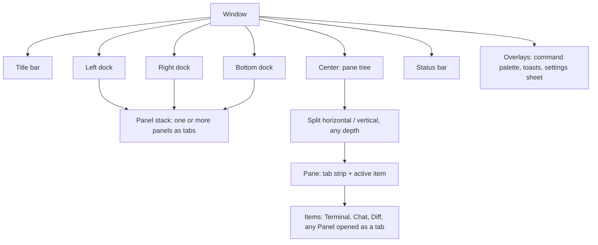
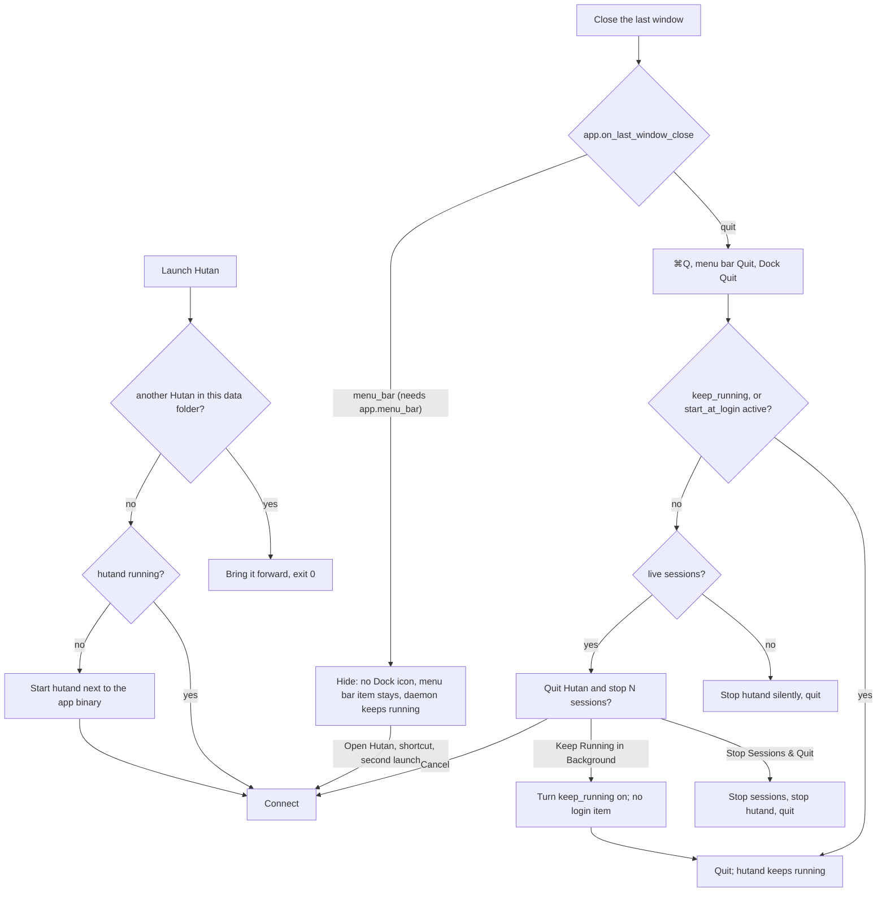

# Hutan Design

Decisions taken with the user (2026-10-14):

| Topic | Decision |
|---|---|
| Layout | **A + B-overview + palette**: sidebar + panes + inspector by default; Agents overview (the Agents page as a focus layout, ⌘⇧O); command palette ⌘⇧P (⌘K in the `hutan` keymap base) |
| Configurability | **Everything is a movable component.** Any panel can live in any dock or as a center tab; every component has its own settings section; layouts are saved as presets |
| Style | **Native macOS chrome + own terminal themes**: transparent titlebar, vibrancy sidebar, SF Pro UI, system accent, light/dark follows the system; terminal and chat use Hutan themes |
| Density | Setting: `compact` (default) / `comfortable` |
| Agents with TUI and protocol | **One session, view switch Chat / Terminal** in the pane header (M4) |

Architecture of the layout system: ADR 0010.

## Principles

1. **Attention first.** The user always sees who needs them (blocked, approval, done-unread) without hunting.
2. **The terminal is sacred.** Chrome never steals keys from a focused terminal except the documented global shortcuts. Every chrome element can be hidden.
3. **Nothing is fixed.** Placement, visibility, size, and per-component behavior come from layout + settings, not code paths.
4. **Closing UI never kills work silently.** Closing a tab, pane, or window detaches. Stopping a session is an explicit, labelled action. Quitting the app asks what to do with live sessions (see § Daemon lifecycle).
5. **Native feel, calm surface.** System chrome, restrained color; color carries state, not decoration.

## Workbench model



- **Panel**: a registered component with an id, title, icon, default dock, and a typed settings section. Panels: `sessions` (Projects), `tasks`, `agents-dashboard` (the Agents page, a tab of the center and the center item of the `overview` preset), `assistant` (titled *Mawas*: Mawas Home, a tab of the center), `history`, `changes`, `inspector` (titled *Requests*), `agents`, `resources`, `notifications`, later `worktrees`, `providers`. Mawas Home is described in `docs/assistant.md` § Desktop; **Memory** (`mawas-memory`, protocol 0.32) is its sibling page: one more center tab, one instance, opened from ⌘K → *Mawas: Memory* or the Today rail.
- **Dock**: left, right, bottom. A dock hosts a stack of panels. The left dock is the **left sidebar** (its panels are *pages* chosen from a nav list), the right dock the **right sidebar** (its panels are tabs of an icon rail), the bottom dock keeps a strip of text tabs. Docks resize, can be emptied, and **collapse on demand** (§ Docks): the left sidebar is Expanded, Compact (a 44 px icon rail) or Hidden, the right side is its panel body next to a 40 px rail (open, rail only, or hidden), the bottom dock is open or hidden; collapsing never stops a session, closes a tab or dismisses an approval. Mawas Home (`assistant`) is a **page of the center**: it opens as a tab of the active pane (`WorkbenchState::open_panel_in_center`, the nav row, ⌘K, the global shortcut), never in a preset, and the user may still move it like any panel.
- **Center**: a binary split tree of panes; each pane has its own tab strip. Items are session views (terminal/chat), diffs, or any panel opened as a tab.
- **Status bar**: an ordered list of status items left and right; each is configurable per preset (`layout.presets.<name>.status_bar`). The built-in presets show only what needs you and the way to every command (CL-CHROME): left `attention` (`▲ 1 needs you`: the glyph in `warning`, the words `fg`; nothing while nothing needs you, the bar stays) and `connection` (only while the daemon is not simply up: connecting, reconnecting, restarting, stopped), right the editor's items while a file tab has focus and `palette_hint` (`⌘⇧P`). The other items stay registered for presets that name them: `workspace`, `sessions`, `approvals`, `density`, `theme`, and the dock buttons `dock_left`, `dock_bottom`, `dock_right` (a small window glyph with the dock's side filled, pressed — an `accent_soft` fill, the glyph `fg` — while the dock shows; a click toggles the dock, the tooltip names the key of the active keymap base, and a hidden dock without panels shows a dimmed, inert button). A status notice (a one-off message such as "No approvals are waiting") is `fg` text, never accent.
- **Title bar**: transparent with traffic lights; the two dock recovery buttons and the active item's title (`fg`), nothing else (CL-CHROME). Layout presets are in View → Layout Preset (the current one checked), the palette (*Layout: Apply Preset …*) and ⌘⇧1…9; the Agents overview in View → Overview, the palette and ⌘⇧O.
- **Presets**: named layouts (`default`, `focus`, `overview`, user-defined). Switching a preset swaps docks/center arrangement without closing sessions.

### Moving things

| Action | Mouse | Keyboard (default) |
|---|---|---|
| Split right / down (new pane starts a new terminal in the focused terminal's cwd) | pane menu | ⌘D / ⌘⇧D |
| Move tab to split | drag tab to a pane edge (drop zones) | palette → "Move tab to new split…" |
| Move panel to another dock | drag panel tab to dock, or panel menu "Move to ▸" | palette → "Move panel…" |
| Open panel as center tab | panel menu "Open as tab" | palette |
| Resize | drag splitter / dock edge | ⌃⌘←→↑↓ |
| Focus neighbour | — | ⌘⌥←→↑↓ |
| Zoom pane | double-click tab | ⌘⇧↩ (Zed base: also ⇧⎋) |
| Toggle docks | status bar dock buttons | ⌘B left sidebar, ⌘L right sidebar (both bases; also ⌘⌥B, and ⌘R in the Zed base), Zed base ⌘J / ⌃\` bottom, ⌘⌥Y close all; Hutan base ⌘⌥J bottom |
| Switch preset / Overview | View → Layout Preset, View → Overview | ⌘⇧O overview, ⌘⇧1…9 presets |
| Save current layout as preset | View → Save Layout as Preset… | palette → "Save layout as preset…" |
| Close tab (detach) | × on tab | ⌘W |
| Stop session | session menu (confirm if running) | ⌘⇧W |

## Layout (Orca-style, 2026-10-18)

Hutan is laid out like Orca (stablyai/orca, MIT; studied in `docs/spikes/2026-10-18-orca-layout.md`): three columns, a 36 px title bar row and a 24 px status bar. Ideas ported, nothing copied. The chrome is quiet (CL-CHROME, `docs/spikes/2026-10-21-clean-aesthetic.md` §3.4): two tones (`sidebar` for both sidebars, the title bar, the tab strips and the status bar; `bg` for the panes and the active tab), one hairline per boundary, no accent on the chrome.

```text
┌──────────────────────┬──────────────────────────────────────────────────┬────┐
│ ● ● ●  ▯             │ git                                            ▯ │    │ 36
│ ⊞ Agents         2   ├────┬────┬──────────────────────────┬──────────────┤ ⑂  │ Changes
│ ✦ Mawas              │api │git │ web                      │ acme-api     │ ◉  │ Agents
│ Projects        ＋ ⋯ ├────┘    └──────────────────────────┴──────────────┤ ⟲  │ History
│ ⌕ Filter             │ ❯ git status                                      │ ✋1 │ Requests, while one waits
│ ▸ acme-api           │ …                                                 │ ⋯  │ Requests, Resources
│   ❯ git              │  terminals · chats · diffs (split panes)          │    │
│ ＋ Start         ⚙   │                                                   │    │
├──────────────────────┴──────────────────────────────────────────────────┴────┤
│ ▲ 1 needs you                                                       ⌘⇧P    │ 24
└──────────────────────────────────────────────────────────────────────────────┘
   left sidebar 280 px                 center                          rail 40
```

**Left sidebar** (280 px expanded, resizable 220–500 or what leaves the center 480 px; ⌘B; 44 px compact, see § Docks). From the top: the inset under the traffic lights, the **nav list**, the **page**, a bottom toolbar.

- Nav rows (Orca's metrics: 8 px outer padding, 2 px gap, rows padded 8 × 6 px around a 16 px icon and an 18 px line of 13 px medium label — **30 px rows**; muted icon and label when inactive, `fg` and a `sidebar_accent` fill when selected, an 8 % `fg` fill on hover): **two rows**: **Agents** (opens the Agents page, below; a pill counts the sessions that need you) and **Mawas** (only while `assistant.enabled`; opens Mawas Home as a center tab, selected while that tab shows; see below), plus a row for every other panel the user keeps in the left dock. **Tasks** (the Tasks panel as a page) is the third row only from the first task on — it reveals itself while the daemon lists any task (queued, running or done) and goes when the last is deleted, but never while its page is the one showing — and the **Search** row is gone: jumping is the Projects filter field and ⌘P / ⌘J "Jump to…". Before the first task the page is one palette command away (⌘K *Tasks: Show Panel*, *Tasks: New Task…*) and the Start sheet's *Queue as task*. A page row toggles its page; right-click gives the panel menu. Choosing another row leaves the Agents page where it is (it is a tab of the center).
- The default page is **Projects** (`sessions`): a 32 px section header (12 px semibold, muted) with two quiet controls, **＋** (New workspace…, Open folder…, Open folder into workspace) and **⋯** (sort, filters, organize and *Projects Sidebar Settings…*; the header has no ⚙, no Start and no sort label of its own), the filter, and the project / workspace / session tree (13 px titles; the rows are described under § Projects and workspaces; hover and selected fills from `sidebar_accent`, no outline). The project row's ▷ (the Start sheet for that project) shows on hover only, in `muted` — no accent anywhere in the tree. Any other page replaces the list and shows a **‹ Projects** back row.
- Bottom toolbar: **＋ Start** (opens the Start sheet, ⌘⇧T; a plain terminal is still ⌘T) and **Settings**, with icons.

**Agents page.** The *Agents* nav row (and the compact rail's Agents icon, the right panel's *All agents*, Today's *State unavailable* link, ⌘K → *Agents: Open Page*) opens or focuses **one** registered center tab, `agents-dashboard`; clicking again only focuses it and never closes anything. It is an attention-first ledger over the one **agent presentation** (`sessions/presentation.rs`): one record per agent session joined from the session, its report, its chat and its observation tree; eligible are sessions with a tree, a report or a chat (Mawas included, role **Assistant**; plain shells excluded, they stay in Projects and the global attention). Reducer precedence: pending approvals/questions (the real objects), blocked agents, unread failure, review and unread completion are *reasons* (**Needs you**, `Permission: run cargo test +1`, `3 requests`); an ended session or a finished main agent is **Finished** (folded by default); an active managed chat turn is **Working**, else the report or root says Working/Blocked/Idle (the newer wins, the conflict is disclosed in the details), a chat the daemon knows exactly with no turn is **Idle**; nothing known is **Unconfirmed** ("State unavailable", never Idle or Done, never `?`); offline keeps the last records with "Offline · last confirmed …". Counts say `5 agent sessions · 3 subagents`; the Agents badge counts unique agent sessions that need you.

**Header** (44 pt): `Agents` (15 medium, the prose step: no semibold, no icon, the tab already names the page), the totals in muted text (`1 agent session · All workspaces`) and **Start agent…** as a ghost button. **Toolbar** (36 pt, a hairline below): the scope as a ghost menu (`All workspaces ▾`: every workspace, project and Home), the search (hairline field, placeholder `Search…` in `muted`; title, harness, model, project, branch, activity), a chip while a state filter is on, and **⋯** (*Group by workspace* — nests the same groups under workspace headings, `agents.page_group_by_workspace` — and *Show finished*, `agents.page_show_finished`, each checked while on). Below 640 pt of page width (scaled by the UI size) the toolbar **folds**: the scope joins ⋯ (`Scope: All workspaces`, `Scope: <workspace>`, the one shown checked) and only the search stays beside it, so nothing clips or wraps. **Section labels** (11 medium, `muted`, sentence case, no hairline): `Needs you · 1`, `Working · 1`, `Unconfirmed · 1`, `Idle · 2`, `Finished · 3 ▸` (folded by default; a *Needs you* group with more requests than sessions adds `· 3 requests`).

Rows are 64 pt (80 comfortable), a hairline between rows inset to the 16 px spine the lanes start at (the selected row is an `accent_soft` fill, never an outline; the keyboard ring shows only for keyboard focus): the state glyph in a 16 px lane (`▲` for a decision, `✗` for a failure, else the state's own shape, in the state's color; the working glyph is the only accent mark on the page besides the selection), the title (13 medium) with **one state word** beside it (12), the reason or status line under it (muted), location (`hutan / Chrome cleanup`, `Home / Mawas`), checkout (`Worktree: chrome-v3`, `Main checkout: master`), harness and model (omitted when not reported), `Running 3m 05s` / `Updated 12s ago` (a missing start is `—` with "Start time not reported"; never the session's age), the main action (secondary) and **More**. Columns fold at 900 and 640 pt (scaled by the UI size). **One state word per record, attention wins** (reducer precedence made visible): a session that waits for a decision says `Needs you · approval` (`· question`, `· blocked`, `· failed`, `· review`) and is never also drawn `Working`, in a *Working* group or in a word; its second line is the reason without the kind the word says (`edit: src/lib.rs +1 · 2 requests`; every reason, who reported it and when are in its tooltip). Every other record says its state. The word is `state.warning` / `state.error` / `state.success` text, `muted` for working and idle (the accent is spent on the glyph), and `fg` on the selected row, where the state colors are not AA in the light pack: only the glyph keeps its color. The page, the Agents panel and Today draw the one identity line (`panels/common.rs` `agent_title_line`, `agent_lead_glyph`) with the words of `sessions/agents_text.rs` (`state_word`, `reason_detail`, `lead`). The list is virtualized, its order freezes while the pointer rests on an action, a menu is open or a request is being read, and the selection is a domain id that survives updates. A hidden page does no work when the store changes; a once-a-second timer refreshes durations only while it is drawn.

**Review request** expands the exact request with its option buttons under the row; only a click on an option sends the existing approval decision (no row-wide approve, no bulk approve, no first-option default; the row shows "Sending your answer…" until the daemon confirms). **Answer question** opens the session's question card; **Show changes** opens the checkout's diff. **More**: Open session, Reveal session, Open worktree, Show changes, Open transcript, Copy session ID, Interrupt turn (only a turn the daemon runs; an agent in a terminal says why it is disabled), Stop session… (confirmed). Stopping one subagent is disabled with the harness limitation, never done by stopping its parent. Keyboard: Tab through toolbar → scope/search → one roving list stop; ↑ ↓ Home End PageUp PageDown move, ← → fold subagents and details, Space expands details, Return opens the session, Shift-F10 opens the menu, ⌘F searches while the page has focus, Escape closes the expanded request, then the details, then subagents, then the filters, and never the page. Empty states: connecting (skeleton rows, no false zero), **Your agents will appear here** (Start agent… / Agent integrations…), **No agent sessions match this view** (Clear filters / Show all workspaces); a daemon without `agent.tree` says it does not expose subagents.

**Agents overview (⌘⇧O)** is a reversible focus layout: it shows the same page entity as the only center item and stashes the layout it replaced; ⌘⇧O again (or opening a session from the page) restores it. The right **Agents** panel is the compact projection of the same records (Workspace / Session / All scope chips, *All agents* opens the page; its child tree shows the subagents); Mawas **Today** reads the same predicates (Working is only confirmed-working sessions; unknown ones show *State unavailable · N*).

**Right sidebar** (a 350 px body, 240–480, next to a 40 px **activity rail** outside it; ⌘L). The rail runs from the title bar row to the status bar, always there unless the user hid it, with 32 px icon targets and tooltips. The clean default (CL-CHROME) has three icons: **Changes** (the first tab: the checkouts of the workspace, uncommitted ones first; a click opens the full Changes view as a tab), **Agents** (the observation tree / monitor), **History** (the Agent Session History); and a **⋯** More menu with **Requests** (the inspector: approvals and block requests) and **Resources**. A dock lists such panels in `more` (saved with the layout, `layout.presets.<name>.right.more` in a preset): one of them is an icon only while it is the panel the body shows, or while it has a badge — **Requests comes onto the rail with the number of waiting requests while one waits** (also while the body is collapsed) and leaves when none does; a request never opens the body by itself. Icons that do not fit the height move into ⋯ too (the active one always stays visible). Icons are `muted`, the active one `fg` (on the `right_sidebar_accent` fill while the body shows); the rail spends no accent. Icons drag to reorder or to another dock. The body has a 36 px header with the panel's name (13 px medium). A **new layout** (first run; a project or workspace seen for the first time) starts with this sidebar down to its rail, so the first thing in the window is not an opt-in feature's card; ⌘L (or a rail icon) opens the body on the first tab. Layouts already saved keep what they had (§ Layout migration: *Layout: Use New Default*), and the `default` preset (⌘⇧1) still shows the body. See § Docks for what the icons and ⌘L do.

**Mawas.** `assistant.enabled` is **on** by default (decision D-P4, PR-FIRST-RUN: Mawas stays a headline feature with its nav row and page, the first run no longer asks for it, and nothing is written to `settings.toml` for it; an explicit `assistant.enabled = false` is the user's own choice and is kept). When on, *Mawas* appears in the left nav and **Mawas Home** opens as **one tab of the center** (a registered panel like the others, so it can be closed, reopened and moved; no preset places it): ⌘K → *Mawas: Open*, *Mawas: New chat*, *Panel: Open Mawas*, the nav row, the menu bar item and the global shortcut all show it (`OpenAssistant` needs the setting on); turning the setting off closes it. The page is a **header** (scope dropdown, state dot, backend·model chip, **mode chip** *Ask before acting ▾* / *Advisor ▾*, **New chat**, **Stop**, **Today** toggle), the conversation (the ordinary chat view, centered, at most 46 rem wide) and the collapsible **Today** rail (300 px, left border): *Needs you*, *Working*, *Upcoming* ("No schedules yet"); no link to a service that does not exist. Mawas's own approvals are cards above the conversation and the first rows of *Needs you*. A page that is not the active tab does no work (no re-render on store changes, no timer). Text is cut with "…" at the room it has; `docs/assistant.md` § Desktop has the behavior.

**Icons (TH-2).** All in-window product artwork resolves through typed semantic ids in `hutan-settings::themes::icons::IconId`; authors map those ids in `icon-theme.toml`, independently selected by `appearance.icon_theme` (default `phosphor`). Agents is Robot, Changes GitDiff, Requests HandPalm; branches appear only for VCS placement. The embedded Phosphor Regular pack is pinned official MIT artwork; sparse user packs fall back per id. Common controls, nav, panel registrations, state/harness/session indicators and docks use this same interface, never vendor filenames or text-glyph fallbacks. Safe normalized currentColor SVG bytes feed a content-addressed, bounded renderer; the TH-1 watcher and Settings Problems path handle live edits and errors. See `docs/themes.md` for authoring, the generated full semantic catalog, security bounds and fixed native-brand exemptions. Labels, tooltips, keyboard behavior and hit targets do not come from packs.

**No clipped text in the sidebars.** A name, a chip or a button in either sidebar is cut with "…" at the room it has (Projects tree titles and subtitles, the Tasks chips and detail lines, the Changes rows, the Requests rows and tabs, the Mawas header, the History titles and group labels, the nav labels and the toolbar); a row of chips wraps instead of overflowing. A pill (`ui::pill`) is at most 140 px wide.

**Window title.** The title bar and the window title name the active item of the **center** (a session, a tab); the page a sidebar shows never becomes the title, so focusing History or Tasks leaves it as it was (Mawas Home, a center tab, is the title while it shows).

**Tokens.** Chrome follows Orca's structure in Hutan's warm hues (see § Visual system) with two tones: `sidebar` (both sidebars, the title bar, the tab strips, the status bar; `right_sidebar` has the same value in the built-ins) and `bg` (the panes and the active tab, which is connected to its pane); selected rows step away from the sidebar (`sidebar_accent`, `right_sidebar_accent`), the dark hairline is white at 7 %, the title bar and the right strip are 36 px, the status bar 24 px in both densities.

**Hairlines.** One per boundary, owned by one side: the left sidebar's right edge, the right body's and the rail's left edges, the status bar's top, each tab strip's bottom (broken under the active tab, whose `bg` fill reaches the pane), a pane header's bottom, and between two split panes (owned by the second). The title bar and the tab strips below it share the `sidebar` tone with no line between them.

### Docks: collapse on demand, always recoverable (DK-1)

Design: `docs/spikes/2026-10-20-chrome-v3.md` § 4 and its mockup. What the user chose lives in the saved layout; the window may show less for a while (below), never more.

| Dock | Expanded | Compact | Hidden |
|---|---|---|---|
| **Left sidebar** | 280 px (220–500), the nav, the page, the toolbar | a **44 px icon rail**: Tasks (once a task exists), Agents, Mawas (when enabled), any other page, Projects; Start and Settings at the bottom; 32 px targets, a tooltip on every icon, the Agents count stays as a badge. Agents, Mawas and Start work as they do expanded and do not widen the rail; Tasks and Projects are pages of the sidebar and expand it | 0 px, no hitboxes, no focus stop |
| **Right side** | the panel body (350 px, 240–480) next to the 40 px rail | the **rail alone** (Changes, Agents, History, Requests while one waits, ⋯ with Requests and Resources) | no rail (explicit *Hide Right Rail*) |
| **Bottom** | the body with its tab strip | — (it has no rail) | 0 px |

- **⌘B** toggles the left sidebar between Expanded and Compact; from Hidden it comes back in the mode it was hidden from. **⌘L** (the rail's bottom button, the titlebar's right-dock button) toggles the right body between open and rail only; from Hidden it opens. **⌘⌥J** / **⌘J** (per keymap base) toggles the bottom dock, tab strip included. The status bar's dock buttons dispatch the same toggles. No existing default key changed.
- **Always recoverable.** A **titlebar button** sits next to the traffic lights for the left sidebar (after the 80 px they take when the sidebar does not cover them) and at the right end for the right side. The left one hides the sidebar, or brings it back; the right one does what ⌘L does. A right click on either lists the states (*Expanded* · *Compact (icons)* · *Hidden*; *Panel open* · *Rail only* · *Hidden*) with the current one checked. *View: Hide Left Sidebar* and *View: Hide Right Rail* (palette) hide completely; the titlebar buttons stay.
- **The right rail.** Clicking the icon of the panel the body shows collapses the body to the rail; the rail stays and remembers the panel and the width. Clicking any icon while collapsed opens that panel, the remembered one included; clicking another icon while open switches panel. The icon of the remembered panel of a collapsed body looks selected (`fg`), not pressed. A new permission request never expands a body the user collapsed, never changes the panel it remembers and never takes the keyboard: the Requests icon comes onto the rail with its badge while the request waits, and the status bar's `▲ 1 needs you` says it (CL-CHROME: no second sentence in the status bar). With the body open, `panels.inspector.reveal_on_approval` switches it to Requests as before.
- **Drag to collapse.** The edge of an expanded side dock tracks the pointer down to its minimum (220 / 240 px) and stops. 24 px further, a translucent **preview** of the rail appears at the window edge; releasing the mouse collapses the dock to its rail, Escape cancels (the dock keeps the size it had, nothing collapses on release). A collapsed dock reopens at the width it had before the drag; nothing in between is saved. The compact rail has no edge to drag. The dock edge also stops where the center would get narrower than 480 px.
- **Responsive collapse** (`layout.auto_collapse`, default on; Settings → Layout *Collapse sidebars in a narrow window*). Below **1180 px** of window width the right body collapses to its rail; below **900 px** the left sidebar goes Compact; the center keeps at least **480 px** (a dock the center cannot afford collapses at any width, the right one first). A collapsed dock comes back only **80 px** above its threshold, and only when the center fits with it open. This is temporary: it is not saved and never overwrites what the user chose, a dock the user hid or collapsed is never auto-restored, and a dock the user opens in a narrow window (⌘B, a rail icon, a command) stays open until the window has grown past the same margin. At 1280 / 1180 / 900 / 640 px: both open · both open · right on its rail · both on their rails.
- **Focus.** A dock that stops being drawn as a body (user or window) hands the keyboard to the last active center item; a hidden element never keeps focus or a hitbox. Collapsing never stops a session, closes a tab or dismisses an approval.
- **Saved** per layout (`desktop-state.json` version 6, see *Layout migration*): each dock's `visible` and `collapsed`, its width and active panel, per saved workspace layout; and per layout preset the modes and widths the user left, which come back when the preset is applied again (applying the current preset again starts over from its own docks). The Agents page keeps its filters in the `agents` settings and its selection while the window lives.
- **Icons.** Titlebar, rail and status controls resolve `dock.left` / `dock.right` / `dock.bottom`; compact Projects uses `nav.projects`. The built-in right-side SVG has its mirror baked into geometry; a user asset is never mirrored at render time.

### Presets shipped

| Preset | Left sidebar pages | Center | Right sidebar rail | Bottom dock | Use |
|---|---|---|---|---|---|
| `default` | sessions (Projects), tasks | pane tree | changes, agents, history; inspector (Requests) and resources under ⋯ | empty, hidden | daily work |
| `focus` | same, hidden | pane tree, zoomed active pane | same, hidden | empty, hidden | deep terminal work (layout C) |
| `overview` (Agents overview) | sessions, tasks | the Agents page (`agents-dashboard`) as the only center item | same as `default` | empty, hidden | many agents at once (layout B) |

All three show the quiet status bar (`attention`, `connection` / the editor's items, `palette_hint`; § Workbench model). Mawas Home is in no preset; it is a center tab, so a preset that replaces the center takes it with the rest of the center.

### Layout migration

**The clean default (CL-CHROME, absorbing PR-CLEAN-DEFAULT).** A new installation starts with the `default` preset above. A layout saved before it (its right dock lists nothing in `more` and its docks hold other panels than the default's) is read as it is — no field of `desktop-state.json` is rewritten, the version stays 6, and `more` is only written for a dock that has it — and gets one line under the title bar, once: *A quieter default layout is available…* with **Use new default** (the default preset's panels in every dock; the dock modes, the widths and the center stay) and **Keep mine**. Either answer turns `layout.offer_new_default` off. View → Use New Default Layout and the palette's *Layout: Use New Default* do the same at any time; *Layout: Reset Layout* stays. A preset in `settings.toml` may list `more` per dock (`[layout.presets.mine.right] more = ["resources"]`).

The saved layout (`desktop-state.json`) is version 6. Version 6 (AG-1) replaced the `overview` panel (the old board of terminal previews) with the Agents page: every layout older than 6 — a center tab, the Agents overview preset with its stash, a dock's panel, a parked workspace — is read with `overview` renamed to `agents-dashboard` once, so no tab or dock entry is lost; user presets in `settings.toml` that list `overview` in a dock are mapped the same way, and the `overview` preset keeps its name. Version 5 (DK-1) gave the side docks a rail: a dock now has `collapsed` next to `visible` (visible and collapsed is the 44 pt left icon rail, or the right activity rail alone; hidden keeps the mode the dock comes back in), the layout keeps what the user left the docks at in each preset (`dock_memory`, per saved layout and per parked workspace layout), and the side widths are clamped to 220–500 (left) and 240–480 (right body). A version 4 file needs no rewrite: `visible: true` is Expanded and `false` is Hidden (the choice is kept), `collapsed` defaults to off, panels and widths stay, and the widths are clamped like every loaded layout; the next save writes version 6. Version 4 (MW-1) turned the Assistant from a left page into Mawas Home, a center tab: a version 3 file (and an older one, migrated first) loses the `assistant` panel from every dock, once, in the live layout, the overview stash and every parked workspace layout; a Home tab already in the center stays. Version 3 (OL-4) turned *Agents* from a left page into the dashboard drawer: a version 2 file (and a migrated version 1 file) loses the `overview` panel from its left dock, once, in the live layout, the overview stash and every parked workspace layout; an `overview` the user put in another dock or a center tab stays. A version 1 file is migrated once when it is read, for the live layout, the overview stash and every workspace's parked layout: History moves to the front of the right dock and becomes its active tab; Changes joins the right dock after it; Resources moves there from a hidden bottom dock; Tasks moves from the right dock to the left sidebar behind Projects; the Assistant leaves every dock and the center (its conversations stay in the daemon; the nav opens it again); Projects becomes the left page; a dock still at the old default width (240 / 300 px) takes the new one (280 / 350 px). Center tabs, splits, zoom, focus, the preset name, user-changed widths and a visible bottom dock are kept.

**Parity record** (`docs/process.md` § Definition of Done, from 2026-10-21): removed or moved affordances and their replacements.

| Slice | Removed / moved | Replacement |
|---|---|---|
| AG-1 | `overview` panel (board of terminal previews), in every saved layout, preset and dock | the Agents page (`agents-dashboard`); layouts older than v6 are migrated once, the `overview` preset keeps its name and ⌘⇧O |
| AG-1 | the Agents dashboard drawer (OL-4) | the Agents page: ↩ opens a row, Space shows its details, ⇧F10 its menu (§ Keyboard) |
| DK-1 | fixed-width side docks | Expanded / Compact / Hidden left sidebar (⌘B), right body + activity rail (⌘L), titlebar recovery buttons; nothing removed |
| CL-CHROME | title bar *Layout: Default ▾* switcher (with the current preset checked) | View → Layout Preset (current one checked), View → Save Layout as Preset…, palette *Layout: Apply Preset …*, ⌘⇧1…9 |
| CL-CHROME | title bar *Agents overview ⌘⇧O* toggle | View → Overview, palette *View: Agents Overview*, ⌘⇧O, the Agents nav row |
| CL-CHROME | Requests and Resources icons on the default right rail | the rail's ⋯ menu; Requests comes back on the rail with its count while a request waits; *Panel: Open Requests* / *Panel: Open Resources* in the palette; layouts saved before keep their icons until *Use new default* |
| CL-CHROME | status items `workspace`, `sessions`, `approvals`, `density`, `theme`, `dock_left`, `dock_bottom`, `dock_right` in the built-in presets; `connection` while connected; "nothing needs you" | still registered: a preset's `status_bar` that names them shows them; the active workspace in the Projects tree and the jump palette (⌘P); approvals in the attention item, the Requests badge and the Agents page; density in View → Density and the palette, the theme in Settings → Appearance; docks in View, ⌘B / ⌘L / ⌘⌥J and the title bar buttons; daemon controls in the Daemon menu and *Daemon: Status* |
| CL-CHROME | the status bar sentence "A permission request is waiting: open Requests to answer it", and Requests becoming the remembered panel of a collapsed rail on a new request | the `▲ 1 needs you` status item and the Requests icon with its badge on the rail |
| CL-CHROME | the chat pane header's kind icon and title, and its "1 approval" count | the tab and the window title name the session; the state word carries the reason (`blocked · approval`) |
| CL-SIDEBAR | nav row **Search** (and the compact rail's Search icon) | the Projects filter field, ⌘P / ⌘J *Jump to…*, the palette |
| E-13a | Zed base ⌘P = the jump palette (workspaces, projects, sessions) | ⌘P quick open: its **Sessions** section is the same list (with `?` history search), below the project's **Files**; the jump palette alone stays in the Workspace menu, the palette (*Workspace: Jump to Workspace or Session…*), the status bar's workspace item and the Hutan base's ⌘J. Projects that never had a session (stale) leave both lists; ⌘O still lists them |
| E-13a | *File: Open File…* opening where the last Open panel was | it starts in the active project's folder; ⌘P and the Files panel (⌘⇧E) open files by name |
| CL-SIDEBAR | nav row **Tasks** (and its compact icon) before any task exists | it appears with the first task, below the other nav rows (nothing above it moves); the page is ⌘K *Tasks: Show Panel*, and *Tasks: New Task…* / the Start sheet's *Queue as task* make the first one |
| CL-SIDEBAR | Projects header controls **▷ Start**, the sort button with its label, and the ⚙ | the toolbar's **＋ Start** (the same Start sheet) and the project row's ▷; **⋯** holds sort, filters, organize and *Projects Sidebar Settings…*; **＋** keeps New workspace… / Open folder… |
| CL-SIDEBAR | toolbar **New session** (an immediate terminal) | **＋ Start** opens the Start sheet (*Plain terminal* is its What choice); ⌘T still opens a terminal at once |
| CL-SIDEBAR | the session row's second line (`proj/api · main`), the idle hollow circle, the `blocked · approval` text under a Needs you row, the `Needs you · 2` count, the `⚠ 2` on a project row while the Needs you group is on | one-line rows; the state lane's glyph (its tooltip says the state and detail), the Agents page and the chat for the reason, the Agents nav pill and the status item for the count; a session's folder in its title's tooltip |
| CL-SIDEBAR | the *respawned / resumed / interrupted / not restarted* word on a row | a muted glyph (`action.recover`, a warning for the ones that need a look) with the word and sentence in its tooltip, always; the summary card has one `state_label` per row |
| CL-CHAT | the chat header's **Switch model…** button | the status line's model menu (`OMP · opus-4-6 ▾`, the same dialog, between turns); ⌘K *Chat: Switch Model…* unchanged |
| CL-CHAT | *reject once* as a primary approval button | *Reject* is a secondary button with its key; `1`–`4` unchanged |
| CL-CHAT | the per-option "Always" paragraphs under an approval's buttons | each *Always* button's tooltip (the same words) and one muted sentence under the buttons |
| CL-CHAT | the question, path and title of an answered approval; the `✓ done · 2 m 53 s` footer of a turn that completed without usage figures | one line `✓ Allowed once · from this window` (the request is in `hutan chat log` and the Agents page); the tool card's `done · <duration>` and the status line's `idle` |
| CL-AGENTS | the Agents page's filter-band chips **Group: State / Workspace** and **Finished hidden / shown**, and its scope button below 640 pt | **⋯** on the toolbar: *Group by workspace*, *Show finished* (checked while on), and below 640 pt `Scope: …` entries; the scope button stays beside the search above 640 pt |
| CL-AGENTS | the row's second state word `Working` beside a *Needs you* row, and the reason in accent text (`Permission: edit: src/lib.rs`) | the one word `Needs you · approval`, the reason without its kind on the second line, the full reasons in its tooltip; the group heading's `1 session · 1 request` is `Needs you · 1` (requests are added only when there are more than sessions) |
| CL-AGENTS | the right Agents panel's own `Agents` header with its ⚙, the `Finished` / `Blocked only` / scope-cycling / `All agents` chips, and the `workspace › title` heading with `Needs you · Permission: …` | the dock's title only; the scope as a segmented control (*Workspace · Session · All*); **⋯**: *Show finished*, *Blocked only*, *All agents*, *Agents settings…* (the ⚙); each session is the Agents page's row (glyph, title, one state word, reason or workspace) |
| CL-AGENTS | Mawas Home's header buttons **New chat**, **Stop** and **Hide Today** and the full-width backend·model chip, below 640 pt | **⋯** (*New chat*, *Stop Mawas*, *Today*, *Backend: …*); above 640 pt New chat and the backend label stay in the header and ⋯ has *Hide Today* / *Show Today*; **Stop** stays in the header (error-colored text) whenever there is something to stop; the mode and scope menus are unchanged |
| CL-AGENTS | the Today column beside the conversation below 640 pt | ⋯ → *Today* shows Today as the page instead of the conversation (and back); above 640 pt the column and *Hide Today* are unchanged |
| CL-AGENTS | Mawas's empty-state buttons **Ask a question** and **Review what needs you** and the sentence about `@` tokens | the composer holds the keyboard (placeholder `Ask Mawas…`) under one sentence and a muted line on what is sent to the model; *Review what needs you* is a link row in Today's *Needs you* section, ⌘⇧J and the Agents page |
| CL-AGENTS | Today's empty sections (`Nothing needs you.`, `No agents are working.`, the Memory sentence, `No schedules yet.`), the section count pills and the **Open Memory** button | only sections with content (`Needs you · 2`, `Working · 1`), else one line `Nothing needs you · nothing working · no schedules`; **Memory ›** is a link row that opens the Memory page |

## Closing and reopening sessions (CL-1)

Every session row of the sidebar (project tree, Home, Needs you) has a hover **×**; "Close session…" is also in the row's and the tab's context menus and in the palette. `session.close` removes the session from the lists but keeps its journal and history. A session nothing runs in closes at once and a toast says "Closed <title> · Undo" for 5 s (Undo = `session.reopen`); when something runs (a foreground command, a working agent, a chat turn) the daemon refuses and a dialog names it — "Close <title>?", **Stop and close** / Cancel (Escape cancels; focus returns to what had it). Closing removes the session's tabs and selects its neighbour in the project. A terminal tab's × still only detaches the tab; `terminal.tab_close = "close_session"` makes it close the session. History shows **Reopen** for closed Hutan sessions; older daemons without `session.close` show no ×.

## Session pane header

A **status line**, not a second title (CL-CHROME, D-C5): the tab and the window title name the session, so the header starts with its state.

`[state glyph] state words   harness · model ▾   [mode] [context]   …   ⋯`

- State: `ui::state_label`. What needs a decision is said as such — `▲ Needs you · approval` (`Needs you · question`, `Needs you · 2 approvals`) — with the glyph in `warning` and the words `fg`; any other state is its word in its color (`idle`, `working` with only the glyph in the accent, `failed · exit 1`). A waiting approval is not counted a second time here (CL-CHAT; `chat::view::status_words`).
- Harness and model (`OMP · opus-4-6`), muted. For a harness or direct chat it is a ghost menu (▾, hover fill) that opens the *Switch model* dialog between turns and is plain words with a tooltip while a turn runs; it replaced the *Switch model…* button (CL-CHAT). A Codex chat shows its agent, model, approval policy and sandbox as plain muted words.
- The mode and context chips are neutral counters (`muted` on `surface_hover`) with their tooltips; a mode that approves everything is a warning glyph and its words in `warning`.
- `⋯` at the right opens the session's menu (the sidebar row's: Open in split, Rename, Restart, Stop, Copy ID, …).
- The tab strip is always drawn, so the title never has to come back into the header. A terminal pane has no header. Not built: a `[Chat | Terminal]` view switch — a harness chat has no terminal view to switch to.

## Center tabs (CL-CHROME)

- The tab strip is chrome: the `sidebar` tone under the title bar, one hairline at its bottom. The **active tab** of a pane is a `bg` fill with 6 px top corners that reaches the strip's bottom, so it is connected to its pane (the hairline is broken under it); the other tabs have no fill and a `sidebar_hover` fill on hover.
- **Focus is the tab's weight**: the focused pane's active tab is `fg` medium; the active tab of every other pane is `muted` regular like the inactive tabs, and its terminal's cursor is hollow. Nothing else changes with focus: no outline on the pane or the tab, no accent (`TabLook`). Zooming a pane (double-click a tab, ⌘⇧↩) keeps its strip.
- One attention mark per tab: the agent badge's warning glyph when an agent is blocked, else the attention dot; × to close.
- Two panes of a split are separated by one hairline owned by the second pane.

## Attention model

| State | Color token | Indicator | Meaning |
|---|---|---|---|
| `blocked` / approval | `--warning` (system orange) | filled dot, pulses once on entry | needs a decision |
| `done` (unread) | `--success` (system green) | filled dot until viewed | finished, not looked at |
| `working` | `--accent` (system accent) | dot with subtle activity ring | running a turn / output active |
| `idle` | `--muted` | hollow dot (optional) | alive, waiting |
| `failed` / exited ≠ 0 | `--error` (system red) | dot + code in subtitle | needs a look |

Rollups: session → workspace header → sidebar "Needs you" → status bar `attention` item → menu bar item and Dock badge (M6-C, § macOS integration) → notification (M6-B).

**Notifications that respect the screen (UX-NOTIFY-CONTROL, protocol 0.34).** The daemon raises no notification at all — no banner, no sound — for a session the user is looking at (focused in the active window: its card is on screen), whatever the kind, and focusing a session withdraws the banners it has in the notification centre. *Mark as read* acknowledges what the session raised, so those banners go too, and an approval answered anywhere withdraws its own. **Mute notifications** / **Unmute notifications** in the session context menu (sidebar, tab) and the Agents row `More` menu silences one session for good (`notify.mute`, kept by the daemon across restarts; `hutan notify mute|unmute`): a muted session still counts in *Needs you*, the status bar, the menu bar item and the Dock badge — only the banners and sounds stop. Settings → Notifications has **Sound** (`notify.sound`: the system's sound, or none).

**Attention controls (UX-ATTENTION-CONTROLS).** What the user does to the queue is client read state, kept by the desktop in `desktop-state.json` under `attention` (`unread`: session ids, `snoozed`: session id → the attention it was snoozed at); the daemon knows nothing of it. The Agents row `More` menu and the session context menu (sidebar, tab) have **Mark as unread** / **Mark as read** and **Snooze until it changes** / **Unsnooze** (disabled, with its reason in the label, for a session that needs nobody). A marked session is a quiet *Needs you* item (accent, `marked unread`, reason `Marked unread`): it never counts in the Dock badge or menu bar item, it survives restarts and daemon epochs, and it ends when the session is looked at again (marking the session you are looking at holds until focus has been elsewhere). A snoozed session leaves *Needs you*, the counts and ⌘⇧J and is listed in its own **Snoozed** group (between *Idle* and *Finished*, reason prefixed `Snoozed ·`); the snooze lapses by itself as soon as the session's attention is not what it was (another request or question, another blocked agent, a different state, a failure, a finished turn) or the session is gone. **⌘⇧J** visits sessions by urgency — a request or question that waits, a blocked agent, a failure, work awaiting review, then what is only done or marked unread — and in list order within one urgency, wrapping. The reason line of an Agents row has a tooltip with every reason, who said so and when: `Permission: run cargo test · reported by claude-hooks · 2m ago` (a chat the daemon runs says `known to the daemon, which runs this chat`). **Agent not recognised:** the daemon only counts a terminal as an agent once an integration reported there, so an agent started by hand is invisible. The desktop looks at the process trees (`resources.list`: when it connects, when a session appears, when a command that starts `claude`/`codex`/`omp` runs, when the window comes back, and with every Resources panel sample); a terminal that has not reported and whose tree has such a program (by executable name, or by the script of a `node`/`bun`/`deno`/`python3` launcher) gets a quiet strip at its foot, *Agent not recognised · looks like claude but never reported to Hutan*, with **Track as claude**. That sends `agent.report` (source `hutan-desktop`, the pid, no state): the session becomes an agent session, shown as *State unavailable* (never idle) until a hook or extension reports, and a blocked report puts it in *Needs you*. A name match is evidence, not proof, which is why the strip says *looks like*.

**Recoverable provider errors (UX-RETRY).** The failed footer of a chat turn that may pass — `rate limited`, `the provider failed`, `could not connect`, a timeout, a broken stream; never a refused key or an unknown model, which keep *Set key…* / *Pick another model…* — has a row under it: one sentence naming what to do next, `Retry available in N s` (warning colour, redrawn each second) when the provider sent a `retry-after`, which disappears once the window has passed, and **Retry now**, always available, which sends the last message again like *Retry last message* of a restarted turn. Only the newest failure offers it, while no turn runs and the user has not sent anything since. With a daemon that has `chat.retry` (protocol 0.34) both send it, so the conversation keeps the user's message once however often it is retried; an older daemon journals the resend as another user message (`docs/gateway.md` § Desktop).

**Mode chip (UX-MODE-CHIP, protocol 0.34).** The header of an OMP or Claude Code chat shows the mode the harness reports: `Mode: Default`, `Mode: Plan`, in the warning colour with `· approves everything` for a mode that acts without asking, `Mode unknown` when the harness reports none. The chip has no action: Hutan never changes the mode (decision D4); the tooltip says to change it in the agent's own settings.

## Visual system (v2, 2026-10-15)

**Style, not layout.** Hutan stays terminal-first with its workbench (docks, panes, presets). What changes is how everything looks: calm, crisp and warm, in the spirit of Claude Desktop — generous spacing, soft borders instead of boxes, one clear accent, readable prose. Brand colors come from `assets/brand/README.md` (orangutan orange `#E0692E`, gold `#F5B53D`).

- **Typography**
  - UI: system sans (SF Pro), 13 px body / 12 px secondary (comfortable) and 12 / 11 (compact); weights regular and medium only; section labels 11 px medium, sentence case (no all-caps, no letter-spacing tricks).
  - Prose (assistant/agent messages, markdown in chat, notification and empty-state copy): system serif **New York** (fallback Georgia), 15 px, line height 1.6; headings in prose use the sans at medium weight.
  - Code and terminals: monospace (`terminal.font_family`, default Menlo; JetBrains Mono / SF Mono when installed), 13 px.
  - Numbers in counters and durations use tabular figures.
- **Palette** (the built-in packs `hutan-light` / `hutan-dark`; the first column is the field of `Theme`, each is a token of `docs/themes.md`, `bg` is `ui.background`, `fg` is `ui.foreground`, `danger` is `state.error`, and so on):

| Token | Light | Dark | Use |
|---|---|---|---|
| `bg` | `#FAF9F5` | `#262624` | window and center panes |
| `sidebar` | `#F3F1EA` | `#1F1E1D` | both sidebars, titlebar strip, status bar: the chrome has two tones, `bg` and this one (CL-TOKENS, D-C2) |
| `sidebar_accent` | `#E9E6DC` | `#2E2D2B` | selected nav row and active project card of the left sidebar (Orca's `worktree-sidebar-accent`) |
| `right_sidebar` | `#F3F1EA` | `#1F1E1D` | the right sidebar and its strip: the same value as `sidebar`; the tokens (`ui.sidebar-right.*`) stay so a pack can split them again |
| `right_sidebar_accent` | `#E9E6DC` | `#2E2D2B` | active strip icon and hover rows of the right sidebar |
| `surface` | `#FFFFFF` | `#30302E` | cards, composer, popovers, palette |
| `surface_hover` | `#F0EEE6` | `#3A3936` | row and button hover |
| `border` | `#E6E3D9` | white at 7 % | hairlines (1 px; dark follows Orca's `--border`) at dock edges, the tab strip, a pane header, around inputs and secondary buttons; a boundary, not a contrast element (1.22:1 / 1.24:1) |
| `fg` | `#1F1E1D` | `#F5F4EF` | primary text |
| `muted` | `#66645D` | `#AEACA4` | secondary text, icons, placeholders; AA on every ground it is drawn on (4.74:1 on the light selected row, 5.08:1 on the dark hover fill) |
| `faint` | `#A8A59C` | `#6F6D66` | disabled text only (exempt from the contrast rule; placeholders use `muted`) |
| `accent` | `#E0692E` | `#EA7A43` | the brand orange: primary buttons, the round send button, the working glyph, links (see `link`); never a border, a state word or a count |
| `on_accent` | `#1F1E1D` | `#1F1E1D` | text on an accent fill: dark ink, 4.94:1 light / 5.84:1 dark (white was 3.37:1 / 2.85:1) |
| `accent_soft` | `#FBE9DF` | `#3E2C23` | selected row and chips |
| `link` (`markdown.link`) | `#B04818` | `#EA7A43` (= `accent`) | links, the only accent text; 5.26:1 on `bg` in light |
| `focus` (`ui.focus`, optional) | the macOS keyboard focus indicator color | same | the 2 px keyboard focus ring, drawn only while focus came from the keyboard; a pack may set a hex |
| `success` / `warning` / `danger` | `#2F7A48` / `#8A6300` / `#B93A26` | `#6BBF85` / `#E2AE45` / `#F08C7A` | states; the light values are the terminal's own green, yellow and red, and every state word is AA on `bg`, `surface`, `sidebar` and hover (on a selected row the word is `fg` and the glyph keeps the color) |

  The terminal section of a pack has its own palette (`terminal.*` tokens); in the built-ins its background matches `bg` so panes do not look like holes. Nothing in the desktop or the terminal view holds a color literal: every value above lives in `assets/themes/<id>/theme.toml` and reaches the views as a resolved token (`docs/themes.md`). The dark hairline is `#ffffff12` (alpha 18/255 = 0.0706) and the dark and light shadow and scrim are 8-bit alphas of black (0.40, 0.12 and 0.50, 0.28 become 0.40, 0.1216 and 0.5020, 0.2784): the only places where the packs are not bit-for-bit the old literals.
- **Shape and depth**: one shape scale in both densities (density changes space, not shape; D-C4): radius 6 px (controls, rows), 10 px (cards, composer, popovers, palette), 999 px (pills, badges); no drop shadows inside the window except popovers/palette (one soft shadow, 0 8 24 rgba(0,0,0,.12) light / .4 dark); separators are 1 px `border` hairlines, used sparingly.
- **Components** (the kit is `crates/desktop/src/workbench/ui.rs`; CL-PRIMITIVES):
  - *Drawing rules*: borders mean containment, fills mean selection. A card (tool call, approval, Today, memory proposal) is a `surface` fill without a border; a 1 px `border` hairline outlines only text inputs and secondary buttons (`outlined()`); a selected row or chip is an `accent_soft` fill without an outline. The accent is never a border, a pane outline or a tab outline: the only accent edges are drag-over targets (tab strip, panes, dock edges, project headers, the chat's file drop), and a test (`ui::tests::the_accent_is_a_border_only_on_drag_targets`) fails on any other.
  - *Keyboard focus ring*: 2 px in `focus` (`ui.focus`, else the macOS keyboard focus indicator color read at startup, drawn opaque; else `accent` in tests) 1 px outside the control, only while focus came from the keyboard: Tab, an arrow, Home/End/Page keys or a keystroke that moved focus turn it on, any mouse press turns it off. Typing in a field you clicked shows no ring; the caret is the focus there. Inputs, the settings sheet's category list, search box and rows, the launcher's stops, the Agents page row and the theme picker's filter carry it; the composer does not.
  - *Focused pane*: its active tab's text is `fg` medium; the active tab of a pane without focus is `muted` regular, and its terminal's cursor is hollow. The active tab is a `bg` fill connected to its pane on the `sidebar`-toned strip (§ Center tabs). No outline on the pane or the tab (they were accent before CL-PRIMITIVES).
  - *Sidebar rows* (the Projects tree; the left nav uses Orca's 8 × 6 px rows, 13 px medium): 30 px (comfortable), 8 px horizontal padding, rounded 6 px hover/selected (`surface_hover` / `sidebar_accent`; a project picked for a bulk action is `accent_soft`), icon 16 px `muted`, title `fg`, second line or right side `muted`; counters as small pills.
  - *Buttons*: primary = `accent` fill, `on_accent` (dark ink) text, one per surface; secondary = `outlined()`; ghost = text only with hover fill; all at the control height, 6 px radius. *Choices* (`choice`) are outlined with `muted` text, the selected one an `accent_soft` fill; a *segmented control* (`segmented` + `segment`) is one outlined strip whose selected segment is the fill.
  - *Pills and states*: a pill is neutral (`fg` on `surface_hover`); a state is `state_label(glyph, word, tone, on_selected)`: the glyph in the state color and the word too, except on a selected row (the word is `fg`) and for the accent (only the glyph). Install, login, process, delivery, review-comment and recovery states use it; plans, places, counts and the Vim mode are pills.
  - *Chat* (CL-CHAT): no bubbles for agent messages (prose in serif on `bg`, max width 720 px centered in the pane); the user's message is a neutral bubble aligned right (`surface`, 10 px radius, at most 70 % of the column, `fg` sans; the accent is not spent on the user's words). A tool call is a quiet collapsible card (`surface` fill, 10 px radius, no border): a mono summary line with the tool's glyph in `muted` and, at the right, what it did as muted words (`running…`, `done · 2 m 53 s`, `exit 0 · 4 s`) — a state label in its color only when it ended badly (failed, non-zero exit, declined); no status dot, no pill. A request waiting on the tool is the **approval group** inside its card, under the card's only hairline and indented 16 px: the question (`Apply these changes?`, 13 px medium), where and what it touches (mono 12 px `muted`), the offered options as one row of buttons in the agent's order (they wrap only when the column is too narrow) with each one's key `1`–`4` inside it (11 px), and one muted sentence when a standing option is offered (*Always sets a standing rule for “edit: src/lib.rs” that Hutan cannot show or revoke.*; what each *Always* option sets, in full, is its button's tooltip). Only *allow once* is primary (`ui::approval_button_kind`); reject, the *Always* options, cancel and the agent's own kinds are secondary; no key but a deliberate click or `1`–`4` answers. A request without a tool in the transcript is the same group on a card of its own, naming the tool in mono. Answered or expired, the group collapses to **one line**: the decision's glyph in its color (`success` allowed, `danger` denied, `muted` otherwise) and the words `muted` (`✓ Allowed once · from this window`). A turn's result is drawn once: a completed turn's footer appears only with usage figures (`done · 2 m 53 s · 12k tokens`), a failed or interrupted turn always has its line (and Retry where it applies). A question card has one primary (*Submit*); a picked answer and *Yes* are choice fills (`accent_soft`), its fields are outlined inputs, and its outcome is one line like an approval's. The Requests panel (inspector) draws each pending request as the same approval group, on a card under a link to its session.
  - *Composer*: a `surface` card with 10 px radius and a hairline border (never accent, focused or not) at the bottom of the chat, multi-line field with its placeholder in `muted` (`Message the agent…`; every text field's placeholder is `muted`), a row below with attach (+), context chips and the send-key hint (`⌘. interrupts the turn` while a turn runs), and a round send button (`accent`, the composer's one accent fill) that turns into stop while a turn runs.
  - *Palette, popovers, menus*: `surface`, 10 px radius, soft shadow, 6 px inner padding, no border, rows like sidebar rows.
  - *Empty states* (`EmptyState`, `empty_state`): one sentence that teaches, at most one action, optionally one muted hint line. A center surface leads with the mascot (`assets/brand/05-mascot`) at 96 px and a serif sentence; a sidebar or panel says it as one muted line of text with a ghost button.
- **Density tokens**:

| Token | compact | comfortable |
|---|---|---|
| sidebar row | 26 px | 30 px |
| tab height | 30 px | 34 px |
| pane header | 30 px | 36 px |
| status bar | 24 px | 24 px (the old 22 / 26 table in `hutan-settings` was never drawn and is gone) |
| base spacing | 4 px | 6 px |
| control radius | 6 px | 6 px |
| card radius | 10 px | 10 px |
| terminal padding (all sides) | 8 px | 12 px |
| block gutter bar | 3 px | 4 px |

- **Chrome**: transparent titlebar with inset traffic lights over the `sidebar` color; light/dark follows macOS unless pinned (`appearance = "system" | "light" | "dark"`). The accent is the brand orange, not the system accent.
- **Themes** (ADR 0018, `docs/themes.md`): a color pack is a data-only TOML file (`theme.toml`) that drives chrome tokens, the terminal palette, state and diff roles, the code editor (`editor.*` surface roles and the 22 `syntax.*` token colors, all derived when a pack omits them; E-4), fonts, density and effects; the built-in `hutan-light` and `hutan-dark` are packs parsed by the same loader as the user's own in `<data dir>/themes/`. `appearance.appearance` keeps choosing light or dark; `appearance.light_theme` / `appearance.dark_theme` choose the pack of each. The desktop reports the active terminal colors to the daemon so OSC 10/11 replies match what the user sees, once per committed theme change.
- **Motion**: ≤ 150 ms ease-out for hover, popovers and expanding cards; no motion on terminal content; respects Reduce Motion.

## Settings

- Files (TOML, comments allowed):
  - user: `~/Library/Application Support/Hutan/settings.toml`
  - keymap: `~/Library/Application Support/Hutan/keymap.toml`
  - workspace overrides: `<first project root>/.hutan/settings.toml` of the workspace shown (Home: its folder)
  - project overrides: `<project root>/.hutan/settings.toml` of the project you work in (only keys marked workspace-overridable, in both files)
- Precedence: built-in defaults < user < workspace < project < runtime toggles (e.g. density switch writes back to user file). A project outside any workspace layers only its own file; the project layer is left out when it would read the file the workspace layer reads.
- Every component owns one namespace with a typed, documented schema; unknown keys warn, invalid values fall back to defaults with a visible error in the settings UI. Files hot-reload.
- Settings UI (⌘,): generated from the schemas, searchable; each panel's gear (⚙) opens its own section. It is where Hutan is managed, not only configured: see *Settings sheet* below for layers, Reset, validated choices, and the pages that manage the history index, the agents' hooks, remembered choices, the data folder and the keymap.
- `terminal` namespace, session start (B-1): `shell` (string; empty = the account's login shell) and `env` (table of strings, extra variables) are overridable per workspace and per project; `terminal.env` of the workspace's first project and then of the project overrides the user's per variable. They are resolved for the project a new terminal starts in (which need not be the one on screen; a project outside any workspace: its own file alone) and sent in `session.create` as `TerminalSpec.env` (`shell` as `SHELL`). Values are passed to the daemon and never logged or shown. Where the rest of the environment comes from: `daemon.toml` `[terminal] env_inherit` (`docs/architecture.md` § Session environment).
- Layout geometry the user drags (sizes, open tabs, split ratios) is **state**, saved in `desktop-state.json`; it becomes a **preset** in settings only when the user saves it.

```toml
[app]
keep_running = false          # leave the daemon running after Hutan quits (no login item)
start_at_login = false        # start the daemon at login: registers the launch agent (Hutan.app only)
setup_done = false            # the first run is over: a folder opened or a terminal started from the first screen, or the walk-through finished or skipped
ask_notifications = true      # offer notifications once, when something first needs you while Hutan is behind other windows; false after you answered
ask_hooks = true              # offer an agent's hooks once, on the Track as strip of a terminal; false after you answered
on_last_window_close = "quit" # quit | menu_bar (keep Hutan in the menu bar; needs menu_bar = true)
menu_bar = true               # menu bar item: daemon state, count, sessions that need you
dock_badge = true             # number of sessions that need you on the Dock icon

[assistant]
global_shortcut = ""          # system-wide shortcut that opens Mawas, e.g. "alt-space"; "" (default) is off

[keymap]
base = "zed"                  # zed | hutan: the default key table (keymap.toml is merged on top)

[appearance]
density = "compact"            # compact | comfortable
appearance = "system"          # system | light | dark (pre-v2 files call this key `chrome`; still read)
light_theme = "hutan-light"    # color pack of light windows (docs/themes.md)
dark_theme = "hutan-dark"      # color pack of dark windows
icon_theme = "phosphor"        # independent monochrome icon pack (docs/themes.md § Icon packs)

[terminal]
font_family = "Menlo"
font_size = 13
theme = "auto"                 # auto (the active pack's terminal colors) | hutan-dark | hutan-light | <pack id>
cursor = { style = "block", blink = true }
option_as_meta = "left"        # none | left | right | both
copy_on_select = false
blocks = true                  # prompt blocks over the terminal (see Terminal blocks)
open_files_with = "system"     # system | editor — what ⌘-click on a file path in output opens (see Terminal links)
confirm_multiline_paste = true # ask before a multi-line paste into a program without bracketed paste (see Terminal drops and pastes)

[layout]
preset = "default"
auto_collapse = true           # a narrow window shows the right panel as its rail below 1180 pt, the left sidebar as its icons below 900 pt (Layout § Docks)
offer_new_default = true       # a layout saved before the clean default is offered it once (Layout migration); off after you answer

# A preset of your own: every rail icon shown, and the status bar of before CL-CHROME.
[layout.presets.busy]
left   = { panels = ["sessions", "tasks"], size = 280, visible = true }
right  = { panels = ["history", "changes", "inspector", "agents", "resources"], size = 350, visible = true, more = [] }
bottom = { panels = [], size = 200, visible = false }
status_bar = { left = ["connection", "workspace", "sessions", "attention", "approvals"], right = ["density", "theme", "palette_hint", "dock_left", "dock_bottom", "dock_right"] }

[sidebar]
organize = "workspaces"        # workspaces | projects (see Projects and workspaces)

[panels.sessions]
group_by = "workspace"         # workspace | state | none
needs_you = true
row = ["state", "kind", "title", "folder", "placement", "age"]   # folder + placement are the row's second line

[panels.inspector]
tabs = ["approvals", "changes", "info"]
reveal_on_approval = true

[agents]
scope = "active_workspace"     # panel: active_workspace | session | all
page_group_by_workspace = false # page: workspace headings with the state groups inside
page_show_finished = false     # page: unfold the Finished group

[workspaces]
sort = "manual"                # manual | recent | attention | name (applies within each level)
hide_empty = true              # hide projects without sessions
hide_sleeping = false          # hide projects without a live session
hide_cli_created = false       # hide projects the CLI or an agent created
always_show_active = true      # the project and workspace you are in stay listed whatever the filters say

[history]
sources = []                   # default source chips: hutan | claude | codex | omp (empty = all)
roles = []                     # default role chips: user | assistant | tool | command | output
range = "all"                  # 24h | 7d | 30d | all
project = "all"                # workspace | all
show_snippets = true

[agents]
show_finished = false          # list finished agents (dimmed, their subtree folded into one row)
only_blocked = false           # list only blocked agents (and the ones above them)
scope = "active_workspace"     # active_workspace | all

[editor]
vim_mode = false               # Vim's Normal / Insert / Visual in text inputs (see Vim mode); ⌘K → Toggle Vim Mode
vim_use_system_clipboard = true  # yanks and deletes also go to the system clipboard; p pastes from it
font_size = 13.0              # code in file tabs (the pack's monospace family)
line_height = 1.45            # code line height, a multiple of the font size
large_file_bytes = 16777216   # above this a file asks first, then opens read-only without syntax (see File tabs)
```

### Settings sheet (ST-2)

Every control shows the truth and can be undone.

- **Layers and provenance.** A value that a file sets carries a **chip** after its label: *You* (`settings.toml`; the layer is called *You* elsewhere), *Workspace NAME* or *Project NAME* (the `.hutan/settings.toml` of the container shown / the project worked in). The file is the chip's hover, and so is where a change goes when that is not the layer the value comes from (`· editing <layer>`). A value at its built-in default has no chip. A control edits the layer its value comes from when that is a workspace or project file, otherwise the user's file (a namespace a workspace may not override is always the user's), so a value never seems not to take. When a workspace or project layer exists for the container and the page has overridable namespaces, the header offers **Edit in: You · Workspace · Project** (only the layers that exist, a segmented control); a choice moves every control of the page to that layer, and the chip's hover then says `· editing <layer>` where the value comes from another one. `SettingsStore::layers`, `source_of`, `layer_value`, `write(layer, …)` and `remove(layer, namespace, key)` are the store side.
- **Reset removes, it does not write.** A field's ghost **↺** (before its control, shown while the file it edits sets the key; hover *Reset to default*) removes the key from that file, so the value falls back to the layer below, or to the default; comments elsewhere stay and a table the removal empties goes unless a comment is attached to it. *Reset page…* (a ghost button in the page header) removes every key of the page from the file it is edited in, after a confirmation that lists them with their layer. Saved layout presets (they have their own Delete) and the two fields that mirror the daemon's lifetime and the login item (`app.keep_running`, `app.start_at_login`) are left out.
- **Validated choices and ranges.** Where the app knows the set, the sheet offers it: `terminal.theme` (Automatic and the installed themes), `layout.preset` (the built-in presets and the ones saved), `panels.sessions.row` (the six row parts) and `panels.inspector.tabs` (approvals, changes, info) are picked from a menu, each once; a value in the file that the app does not offer is shown as *(not available)*. Numbers show their range and are clamped when typed, with a notice: `terminal.font_size` 4–72, `terminal.line_height` 0.8–3, `resources.interval_ms` 1000–60000. `hutan ui set` refuses what the sheet would not offer.
- **Maps.** `terminal.env` is a list of `NAME` = value rows: add with `NAME=value`, click a value to edit it, × removes the row from the layer being edited; it warns that the values stay in `settings.toml` in plain text. `layout.presets` lists the built-in and the saved presets with *Rename…* and *Delete…* (the preset in use cannot be deleted; deleting one that replaces a built-in restores the built-in) and *Save current layout as…*, which also makes the saved preset `layout.preset`.
- **Pages the app draws itself.** *History*: an On/Off for indexing (`history.set_enabled`) with the sources, rows and size from `history.status`; the History panel's scan strip opens **Disable** next to Clear and Rebuild (disabling keeps `index.sqlite`). *Agent Integrations*: per agent (OMP, Claude Code, Codex) the hook status — installed, outdated or incomplete, not installed — with *Install hooks…*, *Repair hooks…* and *Uninstall hooks…* (`hutan integration`), each confirming with the files it changes; `auto_install` stays, and the page says that turning it off does not uninstall. *Start Sheet*: the remembered “Don't ask again” agent/model choices with *Revoke* and *Revoke all*; turning *Ask before an agent chat sends its prompt* on while some are remembered asks whether to forget them. *Models*: *Clear key* asks first. *Data & logs* (after General): the data folder, `settings.toml`, `keymap.toml`, `daemon.toml` and the logs folder with *Reveal in Finder* and *Open* (Hutan's own `settings.toml` and `keymap.toml` are created with a comment when missing; `daemon.toml` is the daemon's and is never created), the size of `hutan.db` and of the history index, the daemon's version, pid and uptime, and *Restart daemon…* / *Stop daemon…*, which are the Daemon menu's flows with their confirmations. *Keyboard*: the bindings of `keymap.toml` (keys, action, context) read-only, with *Open keymap.toml* and *Reload*; the search finds the page by a key or an action and narrows the list. A full binding editor is not part of the sheet.
- **Search** matches a page's title, key, fields (title, help, choice labels), the words of its custom controls (Models and Accounts: API key, endpoint, base URL, model, provider, login, logout, account; Data & logs: Reveal in Finder, restart daemon, …) and the bindings of the Keyboard page.
- **Catalog.** `settings_schema::catalog()` is the list of pages in order; an entry names its `page` when it is a section of another page (`sidebar` shows on *Projects Sidebar*), and pages without a namespace (`data`, `accounts`, `models`) are drawn by the app. A page for the daemon's own settings is added there.

### Settings sheet look (CL-SETTINGS)

The visual spec of the sheet (`workbench/settings_{sheet,rows,pages,layers,labels,themes,daemon,mcp,assistant}.rs`; the page list's grouping is the only change to the pages, and no page moved to another). Tokens only: nothing in it names a color, and the accent is spent on nothing at rest (the keyboard focus ring is `ui.focus`, drawn only while the keyboard is on a control).

- **The sheet.** `ui.scrim` over the window; a card (elevation 3: `surface`, the one shadow, radius 10) 880 × 600 pt, in three bands parted by hairlines: the body (page list left, page right), and a 32 pt footer. The page list is 200 pt on the `sidebar` tone; the page has a 48 pt header with the title (15 pt medium) and, at its right, the ghost **Reset page…** (with the **Edit in** segmented control before it while a workspace or project layer exists).
- **The page list.** Pages are grouped under 11 pt `muted` labels: **General** (Appearance, General, Keyboard, Terminal, Editing, Chat, Layout, Projects Sidebar, Requests, Files, Workspaces, Tasks, Notifications), **Agents** (Mawas, Agents, Agent Integrations, Start Sheet, Accounts, Models), **Data** (History, Data & logs, Sessions & restore) and **Advanced ▸** (Agents & tools, Agent control & security, Resources). `settings_schema::NavGroup` names the group of a page and `catalog()` lists the pages of a group together, so Up/Down/Home/End walk the list in the order it is drawn. *Advanced* is closed until its header is clicked, and open while it holds the selected page or a search is on (a search finds pages in a closed group, and the header then shows ▾ without a click to give). The selected page is the `ui.sidebar.selected` fill (30 pt rows, 26 compact; no outline); the keyboard on the list is the focus ring.
- **Rows.** 56 pt (52 compact; `settings_rows::row_height`), a hairline under each: the **label** (13 pt medium) with its **chip**, **one line** of help (12 pt `muted`, cut with “…”; the whole text is its tooltip, and shows in full while the keyboard is on the row), and at the right the ghost **↺** and the **control**: a selection is the secondary button with ▾, a boolean the switch, a number or text the outlined field, a list its chips. A row says more only when it has something to say that the help does not: a warning (the variables' plain-text note, a pack that is not installed), the daemon's refusal in red, a range under a number. The row's help never grows it (a control taller than a line, such as a list or a table, makes its row taller with the label at the top). The daemon's rows have the same shape: the chip *You* while `daemon.toml` sets the key, and next to it the muted *after restart* (the warning-colored *restart to apply* once such a change was saved).
- **Popovers.** A selection, the *+ add* menu of a list of choices, a daemon choice and the model of Mawas open a **popover** (elevation 2) that hangs from the right edge of the control, in front of the page (it never pushes a row), with a ✓ on the current option and the arrow-key cursor as a fill. Return picks the option the cursor is on, Escape or a click outside closes it (a click on the control itself closes it too), and either way the keyboard is on the row the popover was opened from, with the pointer as with the keys. The theme and icon pickers are popovers of the same kind (see *Theme and icon pickers*).
- **The Problems footer.** One muted line, 32 pt whatever it holds: *Problems · none*, *No matches*, or *Problems · 3 ▸* (in the danger color while one of them is an error). Clicking the counted line opens the list in front of the page, above the footer, scrolling past 220 pt: the page keeps its size and place. A line is *severity · `folder/file.toml` · `key` · reason*: the file is its last two path parts (the whole path is the hover), the key and every token id in the reason (`diff.hunk.foreground`) are mono. Escape closes the list before it closes the sheet, and changing the page closes it.
- **Parity.** Replaced, with what stands for it: the *Default* / *Set by you* line under each help → the chip, absent at the default (the file is its hover); the *Reset* button of a changed row → the ghost ↺ (same ids `reset-<key>`, same behavior); the *On / Off* buttons → the switch; the inline option buttons under a selection → the popover; the footer that grew into the page → the one-line footer and the list over the page; the license line of a pack in its row → the pack card in the picker; a flat list of pages → the groups (every page keeps its place in the list order within its group, and *Advanced* opens with a click, a search or a selection; the pages of Data & logs, History, Sessions & restore and Resources, Tasks, Notifications moved only in the list's order).

### Daemon settings in the sheet (ST-3)

The daemon's own options (`daemon.toml`, protocol 0.28, capability `daemon.settings`) are managed in the same sheet, drawn from `daemon.settings.get` with the generic controls (`workbench/settings_daemon.rs`): a toggle, a range-checked number box, a choice, a path with **Choose…** (the system's open panel: a file for `bin` / `cli`, a folder otherwise) and **Use default**, a list of text (chips; the order of arguments counts, so they have ↑ ↓) or of choices (a menu of the ones not in the list), a table of variables (`NAME=value`, with the warning that daemon.toml is plain text), and the MCP servers (`workbench/settings_mcp.rs`): a row per server with **Edit** and **Remove…** (which asks first) and **Add server…**, a form with the name, *A program on this Mac* (program and arguments, one line with quotes for arguments that hold spaces) or *A remote server* (address and HTTP/SSE); a missing field or the daemon's refusal shows inside the form, a saved server closes it, and the change counts after the daemon restarts (the sheet's banner) Nothing is cached: a change is sent with `daemon.settings.set` and the answer replaces the list.

- **Pages.** *Notifications* (`notify.*`: master switch, system notifications, which events, shortest turn, expiry; there is no test notification in the daemon, so no such button), *Sessions & restore* (`daemon.restore_sessions`, `workspaces.home_folder`, `terminal.env_inherit`, `projects.auto`), *Agent control & security* (`control.*`: *Ask me / Allow / Read only* with a plain explanation of what an agent may do to Hutan), *Agents & tools* (OMP, Claude Code, Codex programs, arguments, environment and CLI; the MCP servers, added, edited and removed in the page; the gateway's conversation length; parallel tasks), and sections of two existing pages: *History* (the sources, how far back, the transcript folders, under ST-2's On/Off) and *Assistant* (below). Each key has plain wording in `settings_labels.rs`; the permissions say what they let the assistant read.
- **Chips and ↺.** A daemon row has the chip *You* while `daemon.toml` sets the key (its hover: *Set in daemon.toml (default: X)*), and when a change does not count at once the muted chip *after restart*, or *restart to apply* in the warning color once it was saved (the hovers: *applies after the daemon restarts* / *saved, applies after the daemon restarts*). The ghost ↺ (hover **Use default** for a path) removes the key from daemon.toml.
- **Restart banner.** While any option's file value is not what the running daemon uses (`restart_pending`), every page of the sheet starts with *Some changes apply after the daemon restarts.* and **Restart now**, which is the daemon restart flow (its confirmation while sessions are live, which says what the new daemon will do by `daemon.restore_sessions`: *restores them* for respawn, *lists them stopped (your setting “Leave them stopped”); start each again from its Restart action* for stopped, and no promise while the setting is not known yet; sessions are restored by `daemon.restore_sessions`). The banner goes when the new daemon answers.
- **Errors.** A refusal of the daemon (validation: range, choice, a path that is not there) shows in the daemon's words under its field, and the number or text that was refused stays in its box (red) until it is corrected or given up with Escape; the range line under a number says the real rule where the daemon's minimum and maximum do not (*0 (never) or at least 60* for the assistant's idle sleep). The footer's **Problems · N** counts these refusals, a `daemon.toml` that cannot be read and the provider error of the Models page next to the problems of the settings files, and lists them. A `daemon.toml` the daemon cannot read (`invalid_state`, with file, line and column) is a banner on the page with **Open daemon.toml** and **Check again**. An agent-originated connection is always refused by the daemon (ADR 0016); the desktop is never one. A daemon without the capability: the pages say *Update the daemon to manage these settings here.*, with the path of the file and **Open daemon.toml**.
- **Variables and provider errors.** The warning under a table of variables names the file that keeps them: *daemon.toml* for the daemon's (harness environments), *settings.toml* for `terminal.env`. A provider that fails (the Models page, the Start sheet, the model picker of a direct chat) is explained by the kind of failure — could not connect (*Could not connect to r4-local at http://127.0.0.1:9. Check that the server is running and the address is right.*), no answer in time, the key refused or missing (401 / 403), model or address not found (404), anything else — with what the daemon said (attempts, the connection error) behind a **Details** toggle; the mapping is `provider_failure` in `workbench/providers.rs`.
- **Search** covers the wording of the daemon fields and their keys.
- **Mawas page** (`assistant`). Under the app's own fields (*Use Mawas*, shortcut): **What Mawas may do** (*Mode*: *Ask before acting* / *Advisor*; *Changes per turn before every one asks*), **What you allowed Mawas to do without asking** (the grants: tool, where it applies — a chat, or always in a workspace — and **Revoke**; **Revoke all**; destructive changes always ask whatever is granted), then **Backend and model** for *Global (Home)* and for the workspace or project shown. Each has **Inherit** (`assistant.reset`; the line under it says what it inherits and from where: the parent workspace, then Global, then daemon.toml, then Automatic), **OMP · Claude Code · Codex · Provider** (a provider is then picked from the list) and a **Model** (*Automatic*, which stores no model, or one of the backend's catalog). A line says what the default Mawas of the place runs on now (`assistant.list`); when nothing was chosen it begins *Automatic · backend · model*, the same words as the page's header. Then the file's own *Backend / Provider / Model when nothing is chosen*, **what Mawas may read in projects** (`assistant.context.*`), **what Mawas may read at Home** (`assistant.global_context.*`, files off by default), **what Mawas may read in this workspace** (the overrides `assistant.workspaces.<id>.*`: *Inherit · Allow · Deny*, Inherit removes the key) and the attachment size. The daemon has no read of the stored per-place choice, so the sheet shows what it stored or reset since the window started; a choice made before is not known (the *runs on* line is the truth).
- **Keyboard.** **Tab** and **Shift-Tab** move between the search box, the list of pages and the controls of the page. In the list **↑ ↓ Home End** select pages; in the controls **↑ ↓** move between rows and **Return** or **Space** acts (turns a toggle over, opens a choice, starts a text box, asks for a path). An open choice (desktop and daemon pages alike, however it was opened) is moved through with **↑ ↓**, **Return** picks the option and **Escape** closes it without changing the value; only a second Escape closes the sheet. Typing anywhere goes back to the search box. A click inside the sheet puts the keyboard back in it, and a confirmation that opens over it (*Clear key*, *Install / Repair / Uninstall hooks*, *Reset page*, *Revoke all*, *Stop / Restart daemon*, *Remove provider*, …) hands the keyboard back to what had it — the search box or the control — whether it was confirmed or cancelled (`modal.rs` remembers the focus when a dialog opens and restores it when it closes; with nothing to restore it goes to the sheet while it is open, else to the focused pane).
- **Empty search.** A search that matches no page shows *No settings match “…”* in place of a page, with a hint and **Clear search**; the footer says *No matches* rather than *Problems · none*.

### Theme and icon pickers (TH-3)

The Appearance page's *Light theme*, *Dark theme* and *Icon theme* and the Terminal page's *Color theme* are pickers of the installed packs (`workbench/settings_themes.rs`; the user guide is `docs/themes.md` § Picking a pack in Settings). They replace the free-text id boxes (and the terminal's three-item list): you no longer type an id in the sheet, you pick a pack; `settings.toml` still accepts any id, and a request that is not installed keeps showing in the head as *not available* with its Problem.

- **A row** is the field's title, one line of help, the chip and ↺ of every row, and the head, a button with the pack's name; the authors, license and version are in the picker, and the row says more only when the pack asked for is not installed (*… is not installed or is invalid: the embedded … is used until it works*). The head (or **Return** on the focused row) opens the picker as a popover hanging from it.
- **The open picker** is a popover (elevation 2, 620 pt wide, at most 460 pt high) with the search box and, at its right, a **⋯** button on top; **⋯** opens a menu of the four pack actions (*Open pack folder*, *Validate / Reload*, *Duplicate as new pack*, *Reset to embedded default*). Under it two columns: the list on the left (six lines, following the cursor: name with ✓ *Current*, id and origin chip, and for a disabled pack its errors as file · key: reason), the highlighted pack as a fill; and the preview on the right, under its title the pack card (authors · license · version), then colors (sample chrome, state chips, a diff, a terminal row with the 16 ANSI colors and the pack's warnings) or icons (navigation, action, state and dock icons marked *this pack* / *Phosphor*, and a fallback callout). The keys are written at the bottom.
- **Keys.** ↑ ↓ move the cursor (and with it the preview) through the packs that can be selected, typing searches, Backspace edits the search, Return applies, Escape closes the **⋯** menu while it is open, else the picker (and Escape once more closes Settings); the keyboard is on the picker's row afterwards. **Pointer.** Pointing at a pack previews it; a click applies it; a click outside the popover cancels, a click on the head closes it.
- **State.** The preview is derived from the open picker and its cursor (`SettingsSheet`: `dropdown`, `cursor`, `pack_filter`, `pack_preview`), per window, with no global: see `docs/themes.md`.
- **Parity.** Replaced: the free-text boxes of the three theme fields and the terminal list of three (by the pickers), the generic Reset of these rows (kept: the ghost ↺ beside the head, and *Reset to embedded default* in the **⋯** menu). The picker opening inline below its row → the popover; the four pack-action buttons above the list → the **⋯** menu; *Cancel* and *Apply* → Escape or a click outside, and Return or a click on a pack (the keys are written under the list). New and independent of what is drawn: *View ▸ Reset Theme and Icons to Default* and the palette command of the same name.

### Settings wording

The sheet speaks to users, not to people editing `settings.toml`: the schemas' doc comments name keys, types and files, so the sheet shows the wording of `crates/desktop/src/workbench/settings_labels.rs` instead (which this section mirrors; a test fails for any field or choice of a built-in namespace that has no entry there, and for any title, help or choice label that contains a code span, `::` or a snake_case key name).

- **Namespaces** are listed by title, in the groups of *Settings sheet look*: General (Appearance, General (`app`), Keyboard (`keymap`), Terminal, Editing (`editor`), Chat, Layout, Projects Sidebar (`panels.sessions`, with `sidebar` as *Organize the sidebar*), Requests (`panels.inspector`), Files, Workspaces, Tasks, Notifications), Agents (Mawas (`assistant`), Agents, Agent Integrations (`integrations`), Start Sheet (`launcher`), Accounts, Models), Data (History, Data & logs, Sessions & restore) and Advanced (Agents & tools, Agent control & security, Resources). The key stays what `settings.toml` and `hutan ui set` use, and a search finds a namespace or field by its key as well as by its title, help or the label of a choice.
- **A field** has a title in sentence case that says what it controls (“Keep the daemon running after Hutan quits”, “Cursor shape”), and one or two sentences of help in plain words: what it does and what happens when it is off. No key names, types or file paths of the source tree; a user-facing file such as `settings.toml`, `keymap.toml` or a command such as `hutan daemon stop` may be named.
- **A choice** shows a label per value (“Zed keys” / “Hutan keys”, “Keep in the menu bar”, “Last 24 hours”). The value written to the file is unchanged.
- Everything the sheet says besides fields (buttons, questions, notes of the pages above) is in `settings_labels::words` and read by the same tests; the sheet itself says where a value comes from instead of a generic “can be set per workspace” line.

## Time

One convention for every time a person reads, in the desktop and in the CLI (`hutan_client::time`):

- **Relative first.** Lists and headlines say how long ago: `3 min ago`, `2 h ago`, `yesterday`, `5 days ago`, `just now`; dense rows (the sidebar, history hits) use the compact form `now`, `3m`, `2h`, `4d`.
- **Restart marks (UX-C, CL-SIDEBAR).** A sidebar row's *respawned / resumed / interrupted / not restarted* mark is always a small icon (`action.recover`, muted; `state.warning` for the ones that need a look) whose tooltip has the word and the sentence — never a pill that pushes the title out. The summary card lists one `state_label` per session; from 30 sessions on the card is one row (*39 sessions recovered — …* with *Review* and *Dismiss all*) and *Review* opens the full list. Tabs and chat headers keep the word.
- **Absolute on demand, always local with its zone.** A tooltip on every relative time in the desktop shows `2026-10-17 14:31:07 +0500`: the date, the time to the second, the offset from UTC. Where there is no hover (the CLI, a one-line summary in a notification) a time that is stored is written absolute with the offset — `hutan search` and `hutan index status` (`2026-10-17 14:31 +0500`), `hutan recovery` (`hutand restarted at 2026-10-17 14:31 +0500, 3 min ago`), `hutan task show` (`ended 3m 5s ago (2026-10-17 14:31 +0500)`) — and the inspector's *Created* row gives both.
- Never UTC without saying so, never a clock time that leaves out the day. Durations (`ran 1m 5s`, an agent's elapsed time) are not times and stay as they are. The daemon's own timestamps (`created_at_ms`, `--json`) are Unix milliseconds; formatting is the client's job.
- Where it applies: the recovery summary (headline relative, tooltip absolute), the history panel and `hutan search`, `hutan task` (the Tasks panel shows durations, not times), the sidebar rows, the inspector, the review batches of the Changes tray.

## Projects and workspaces (M12-B, rewritten by M18-B)

The daemon owns three kinds of container (ADR 0014, `docs/orchestration.md` § Projects and workspaces, protocol 0.19): **projects** (a repository with all its worktrees, or a folder — made by the daemon from the folders sessions start in), the user's own **workspaces** (a name, a pin, an order; they contain projects), and **Home**. The desktop decides how to show them. The sidebar is the `sessions` panel, titled **Projects**.

- **Organize** (`sidebar.organize`, header menu `⇅`, ⌘K "Sidebar: Organize by …"): `workspaces` (default) lists the user's workspaces (`▾ ★ NAME ·· ● 2  3`: chevron folds, `★` a pin, `● n` sessions that need you, the session count — `live/total` when they differ) with their projects indented below (`◧` repository / `▭` folder, name, the same counts) and the sessions under each project; then a **No workspace** label with the projects that belong to none, then Home (`⌂`) with its sessions. `projects` is a flat list of projects (pinned first) with their sessions, Home last; a session started straight into a workspace sits under that workspace's own row there. "Needs you" stays on top in both. A search or filter that names a workspace lists everything in it.
- **Session rows** are one line (CL-SIDEBAR): a **16 px state lane** (the state's glyph in its tone — `state.working`, `state.warning`, `state.failed`, `state.completed`, … — with the word and detail in its tooltip; **nothing for an idle session**, the room stays as the alignment spine; an unread session adds an amber dot ringed in the sidebar color), the kind icon (`session.terminal`, `session.harness`, `session.direct`), the title (medium while unread), the agent badge, a restart glyph (`action.recover`; muted, or a warning for the ones that need a look; the sentence in its tooltip), the **muted marker** (`state.muted`, a bell with a slash, while the session's notifications are muted, `notify.mute`), the age in `muted` 11 px and the hover **×**. The selected row is the `sidebar_accent` fill without an outline. A muted 11 px **second line** exists only when it says something new: the **placement badge** (`wt <branch>`; a warning tint and the `vcs.shared-warning` icon while another live agent works in the same checkout) only when the session is **not in the main checkout** (or shares it: the shared-checkout warning stays visible on `main`), the **container** (the project or workspace) only on a row that is not under its project row (the Needs you group, the flat `group_by` lists), and the **live folder** (`SessionInfo.folder` — the shell's OSC 7 directory — else its start folder, last two path parts) only when the session has left the checkout it belongs to (its placement's root, else its project's root); the full path is the title's tooltip. `panels.sessions.row` picks and orders the fields (`state`, `kind`, `title`, `folder`, `placement`, `age`); `folder` and `placement` decide whether the second line may show those parts. **Needs you** is a labeled group (a muted `Needs you` label, no count) of these same rows, each naming its project on its second line; the project row repeats nothing of it (its `⚠ n` shows only while the group is turned off, `panels.sessions.needs_you`). Workspace headers and the *No workspace* label exist only while the user has a workspace (D-P5); without one the tree is projects and Home.
- **Session names** (UX-SESSION-NAMES; `crates/daemon/src/session_names.rs`): the daemon names every terminal the user did not name, so the tab strip, the sidebar, ⌘P / ⌘J, Resources, notifications and `hutan ls` agree. A name the user chose (at creation or by rename) is kept as typed and survives a restart. Any other terminal is called **folder name** (`~` for the home folder, `/` for the root; the program's name while the folder is unknown), then ` (branch)` only when another session in the same folder is on a different branch, then ` · command` while a command runs in the foreground (needs shell integration; cut at 32 characters, secrets removed). A title the program sets (OSC 0/2) is used **only when it says more than a path**: `~`, `~/h/u/proj`, `/usr/lib` and `user@host:~/proj` (what fish and zsh print) are never the name, and neither is the program's own name; `vim main.rs` is, and then no folder or command is added. Sessions of one workspace that would read the same are numbered in creation order (`proj-demo`, `proj-demo 2`, `proj-demo 3`; the number goes before the command, a closed session gives its number back, a named session counts as a namesake). The tab and the sidebar title carry the full folder in their tooltip, and a ⌘P row says how long ago the session started (`Home › proj · proj-demo · main · 3m`). **Rename** (the row's menu, ⌘K *Session: Rename…*, the app menu) edits the title **in the sidebar row** when it is on screen, like a workspace's name (Return confirms, Escape cancels, focus elsewhere confirms); without a row it opens the prompt. The tab's double-click still zooms the pane. A per-session colour is deferred.
- **Sort** (header button `⇅ Manual ▾`, ⌘K, `workspaces.sort`) applies within each level — workspaces among themselves, projects inside a workspace, the projects in no workspace: `manual` (drag order) · `recent` (last activity) · `attention` (most sessions that need you, then activity) · `name`. Pinned rows come first in every mode and level; ties keep the daemon's order. Sessions keep creation order.
- **Drag** a row onto a row of the same level to reorder (manual only): it takes that row's slot within its group (pinned or not); the desktop sends `workspace.move`. **Drag a project onto a workspace** (or onto a project of another workspace) to put it there (`workspace.assign`); **drag it onto the "No workspace" label** — or onto a project in no workspace — to take it out. Home does not move and takes no drops. When the dragged project is part of a multi-selection, the whole selection moves.
- **Filters** (`workspaces.*`, the same header menu, ⌘K): hide empty / sleeping / CLI-created **projects** (workspaces and their members always show, as in `hutan ws ls`). Home, pinned projects and (`always_show_active`) the one you are in are never hidden, and a session that needs you stays visible in "Needs you" whatever the filters say. The filter box matches workspace and project names and folders, session titles, commands, folders and badges (any word order); a workspace or project that matches lists all its sessions. Hidden projects stay reachable through ⌘J.
- **Managing** (every change is a protocol 0.19 request): the header's **＋** menu — *New Workspace…* (a name; **Create**, or **Choose Folders…** to start with the projects of some folders: `workspace.create {name, paths?}`), *Open Folder…* (system panel → `workspace.open`, the project is shown), *Open Folder into Workspace ▸* (the same, then `workspace.assign`). **⌘-click** toggles a project in the selection and **⇧-click** selects the range from the last one clicked (neither opens it); right-click on a selected project → *New Workspace from Selection…* (`workspace.create {project_ids}`), *Move Selection to Workspace ▸*, *Remove Selection from Workspace*. **Workspace menu**: Pin/Unpin, Rename (inline: the name becomes a field, Enter or leaving it confirms, Escape cancels), Add Folder… (`workspace.add_root`), *Delete Workspace…* (asks, says that its projects and their sessions are kept and move to "No workspace"; `workspace.delete`), Reveal in Finder. **Project menu**: Rename (inline), Pin/Unpin, *Move to Workspace ▸* (the workspaces, or a new one), *Remove from Workspace*, Reveal in Finder, Close (greyed with the reason while sessions are live; asks first; the project stays in ⌘O). **Home menu**: Pin, Rename, Reveal; Home has one folder, set in `daemon.toml`.
- **⌘O** lists "Open Folder…" and the recent projects (`workspace.recent`, ▣ open · ▢ closed) with a fuzzy filter; Enter runs `workspace.open` and shows the project (inside its workspace when it has one). **⌘J** (the jump palette; in the Zed base the Sessions section of ⌘P) lists every workspace, project (hidden ones included, stale ones — never a session, not pinned, in no workspace, not active — left out) and session in the sidebar's order — a project shows `workspace › folder`, a session `workspace › project · folder · badge · command`; Enter shows the container or the session's tab. **⌘P** (both bases) is quick open: the active project's **Files** first, then those rows as **Sessions** (`docs/editor.md` § Finding and opening files).
- **One layout per container** (`desktop-state.json`: `active_workspace` + `parked`): the center pane tree, docks, zoom, focus and preset belong to the container you switch to — the workspace when the project is inside one, else the project, else Home — and every project of a workspace shares it. Switching parks the layout and brings the other one back exactly. A container seen for the first time starts with a single pane under your dock arrangement. Opening a session of another container (sidebar, ⌘J, attention, a restored tab) switches first. A project that joins a workspace hands its layout over (the workspace's own wins when it has one); one that leaves keeps the workspace's. Terminals of parked layouts are **detached**, so nothing outside the window renders or is acked; coming back re-attaches with a daemon snapshot (two terminals ≈ 70 ms in the GPUI test, polling included), which is why attached-but-hidden was not chosen. A layout saved before workspaces existed belongs to the container of its first session (else Home); a container that vanishes hands the window to Home and its layout is dropped.
- **Settings**: user < workspace < project. The workspace layer is `<first project root>/.hutan/settings.toml` (Home: its folder), the project layer `<project root>/.hutan/settings.toml` of the **active project** — the project of the focused session, else the one last chosen in the sidebar (a workspace keeps the project chosen in it) — and a project in no workspace layers only its own. Both are hot-reloaded while they stay active, whether or not a session has focus (`crates/settings`: `set_workspace_root`, `set_project_root`, `get_for_roots`). Only workspace-overridable namespaces are read from either file (`terminal` today); the settings UI reports the rest.
- **New sessions** (⌘T, splits of a pane without a session) start in the active project, else the first project of the active workspace, else in Home; they get the `terminal.shell` / `terminal.env` of that project's layers.
- **Status bar**: the `workspace` item shows the active container; click opens the jump palette.

## Agent Session History panel (M17-B, rebuilt by OL-3)

The `history` panel is Orca's *Agent Session History* over the opt-in session history index (`docs/history-index.md`): a browsable catalog of the sessions on this machine — Hutan's own terminals and chats and the transcripts of Claude Code, Codex and OMP — from `history.sessions` (protocol 0.29), with full-text search (`history.search`) when a query is typed. It is the first (default) tab of the right sidebar's strip in every built-in preset, designed for its 350 px default width, and moves like any panel; ⌘K → "Panel: Open History" reveals it. The header says **Agent Session History** over *Indexed history* (below 300 px wide: **History**) and has the buttons *group by*, *sources*, *refresh* and ⚙ (the `history` settings).

- **Off** (`history.status.enabled = false`, the default; UX-HISTORY-CONSENT): a **short card**, *Search your agent sessions* — *Off until you choose sources.* — and one quiet button, **Set up history…**. Nothing else: no form, no ticked box. The button shows the form: what indexing reads, a checkbox per source (Hutan, Claude Code, Codex, OMP — the `history.hutan|claude|codex|omp` options of `daemon.toml`), **all unticked whatever `daemon.toml` says**, with the folder each one reads (`~/.claude/projects`, `~/.codex/sessions`, `~/.omp/agent/sessions`), one line on privacy (nothing leaves the machine; the index is one local file with secrets masked as far as possible; Clear deletes it), **Enable** (off while no source is ticked), **Not now** (back to the short card, the ticks stay) and a link to the `history` settings. Enable writes the ticked and unticked sources to `daemon.toml` (`daemon.settings.set`, all four while the daemon's values are unknown; only the ones that differ otherwise), then `history.set_enabled`. Nothing is requested, read or listed while indexing is off. The setup wizard has an optional step for the same choice (§ First-run setup).
- **Scope**: a segmented **Workspace / Project / All** control (`HistoryScope`), its chosen segment on the neutral `right_sidebar_accent` surface like Orca's (orange is for the focus ring of the search field only). Workspace is the container the window shows (a workspace with its projects, a project, or Home); Project is the project the user is working in and is disabled while none is known; All has no restriction. Switching the shown workspace or project asks again by itself. The `history.project` setting (`workspace` | `all`) is where the control starts.
- **Search field** (32 px): typing narrows the catalog at once (`history.sessions` `filter`: case-insensitive words, all required, over title, first prompt, latest turns, agent, model, branch, directory and session id; `repo:` the project's name or folder; `path:` the directory or transcript path). A query that is not a `repo:` / `path:` filter is also searched in the transcripts after 250 ms of quiet, or at once on Return (`history.search`, 50 sessions): the ranked sessions replace the list, ungrouped, each with its best matching text and the matching words **emphasised** (the index's `«…»` markers are parsed, never drawn); the list bar says `N results`. Escape clears the field. The `history` settings `sources`, `roles` and `range` still narrow the transcript search (the sources menu changes the sources of both lists).
- **Scan strip**: `✓ Scanned 986 files · Just now` (the daemon's last complete scan; `Scanning 12 / 986…` while it runs, the panel asking again every 0.7 s). Click it for the per-source files, rows and last-indexed time, the index size and unreadable lines, and the index controls: **Clear…** and **Rebuild…** (both ask first; Clear deletes `index.sqlite`, Hutan's own records cannot come back) and **Disable** (`history.set_enabled` off: nothing new is read, the index stays; the off card returns).
- **List bar**: `2 of 250 sessions` (matches of the scope and filter, out of the sessions the catalog holds; when more match than rows were asked for: `250 of 1203 shown · 4000 sessions` and a **Show more** row asks for 250 more, up to 1000) and the sort dropdown, **Last updated** or **Created**.
- **List**: virtualized, grouped by project (the Hutan project or workspace the daemon attributed the session's directory to, else its folder), folder (last two path segments) or agent, in the order the daemon sorted the rows; a group header has its count and folds. A row: title (the source's own title, else the first prompt's first line; one line, "…" when it does not fit), the latest turn with its role — *You:* / *Agent:* / *Tool:* (a Hutan terminal: *Command:* / *Output:*) — clamped to two lines with "…" at the cut, and a meta line `glyph agent · N msgs · 3m ago · model` (the age's tooltip is the absolute time); at least 98 px high with 12 px of padding on both sides (text never touches the panel's edge), a hover fill, `⋯` and a chevron. A row that is open or selected has the subtle `right_sidebar_accent` fill, never the orange tint. During a full-text search the matching text replaces the latest turn and the meta says `N hits` and the folder.
- **Row details** (click the row; click again to fold): **Resume**, then **Copy Resume Command**, **Open Log**, **Reveal Log**, **Open Working Directory**, **Copy Session ID**; a card with the **first prompt**; the **latest** turns (up to three); the folder and branch. `⋯` and right-click open the same actions as a menu (plus **Copy Log Path**). There is no delete.
- **Actions**: **Resume** opens a new terminal tab running the session's `resume_argv` (OMP resumes by its absolute transcript path), greyed with the reason when the index has none (ids the resume rules refuse). It starts in the active workspace when one of its folders holds the session's directory, otherwise `workspace.open` finds or creates the workspace that contains it and the window switches there (Home is a catch-all and only counts for its own folder). A directory that no longer exists falls back to the active workspace's first folder, and a notice says so. **Copy Resume Command** puts the shell-quoted line on the clipboard. **Open Log** opens the transcript with the system, **Reveal Log** shows it in Finder. **Open Working Directory** shows the workspace that holds the folder (the most specific one; `workspace.open` makes one when none does). A **Hutan** row has **Open Session** instead of Resume (and no log): it shows the terminal or chat, and for a full-text hit on a terminal block scrolls the terminal to the block the hit names (`terminal_id` + `block_id`, exact: no time matching) while the session still has that terminal and the block; otherwise a notice says it is gone. ↑ ↓ select a row (group headers are skipped), ↩ runs its main action (Resume or Open Session; while a typed query has no transcript results yet, ↩ runs the search).
- **Live**: while the panel is visible it asks for the catalog again every 30 s and after the daemon's index status changes (it reads `history.status` twice a second while the index fills after Enable, Rebuild or Clear, until the row count stays put for 2 s, 10 s while empty, 60 s at most); a panel nobody sees asks nothing. The refresh button sends `refresh: true` (the daemon reads the changed transcript files before it answers) and, during a transcript search, searches again. A new answer keeps the list where it was: the view stays on the same row or group header even when rows come in above it.
- **Older daemon** (no `history.sessions`, protocol before 0.29): the panel is the search alone — the field, the scope control and the ranked results — under a note to restart the daemon; no catalog is requested.
- **⌘K**: "History: Search History…" reveals the panel and focuses its field. **⌘J**: a query that starts with `?` searches the history inline (top 8 sessions, the `history` settings' filters); ↩ resumes the hit when it can be resumed, else shows it in the panel with the field filled in and the row opened.
- **Settings** (`history`): `sources` / `roles` (default filters, empty = all), `range` (`24h` | `7d` | `30d` | `all`), `project` (`workspace` | `all`, where the scope control starts), `show_snippets` (the matching text under a transcript result) are the desktop's defaults; where the transcripts are belongs to `daemon.toml`. The page also has the On/Off of indexing itself (`history.set_enabled`, recorded in `daemon.toml`) with the indexed sources and the size, the same switch as Enable and Disable in the panel.

## Agent monitor (M13-B)

The `agents` panel (default: fourth tab of the right sidebar's strip in `default`, `focus` (hidden) and `overview`; movable like every panel) is the compact, scoped projection of the Agents page: it lists the same agent records (`sessions/presentation.rs`), in the page's order, and draws each one's observation tree (`agent.tree`, `agent.tree_updated`, `docs/protocol.md` § Agent observation tree). The daemon owns the tree; the panel only filters and draws.

- **Top** (CL-AGENTS; the dock draws the panel's title, the panel adds none and no ⚙): the **scope** as a segmented control — *Workspace* (the active workspace), *Session* (the focused session: the one in the focused pane, never the panel's own focus) and *All* — `agents.scope`; under it the page's totals (`5 agent sessions · 3 subagents`) and **⋯**: *Show finished* and *Blocked only* (checked while on; `agents.show_finished`, `agents.only_blocked`), *All agents* (opens the page) and *Agents settings…*.
- **Sections**: one per agent session of the scope — the same records as the page, in its order (Needs you first) — each headed by the page's row: the state glyph, the title (medium), the one state word (`Needs you · approval` while it waits for a decision, never also `Working`; else its state), and under it the reason without its kind (`edit: src/lib.rs +1`) or, without one, the workspace (a session the daemon reports no tree for shows its model, usage and activity there and its duration on the right). Click focuses the session. Under it the tree, indented: main agent first, siblings in the order they started (then by id, so rows never jump when a node changes). A session the daemon reports no tree for (a chat, a report) is that one head and nothing under it. Empty: *Your agents will appear here.*; nothing in scope: *No agent sessions match this view.*
- **Row**: state glyph, name (else agent type, else the agent program or node id), the agent type when it is not the name, model, duration, and a second line with usage and the current activity (one line, 80 characters). Glyphs are never color alone: `●` working (accent, pulses once a second; steady under Reduce Motion), `▲` blocked (warning), `○` idle, `◌` state unavailable (muted; no evidence of what the agent does, e.g. the main agent after a daemon restart until it reports), and for finished agents their outcome: `✓` completed (success), `✗` failed (error), `⊘` interrupted, `⏹` disconnected (muted). Finished rows are dimmed.
- **Duration** runs from `started_at_ms` (to `ended_at_ms` once finished). It refreshes once a second only while the panel is drawn and a listed agent works or waits for the user; a hidden panel, or a tree with nothing running, wakes nothing.
- **Usage** is labelled by `usage.kind`, never zero-filled: `1.5k tok · context` (`claude.context`: the latest context, `3.2k/200k` with a window), `3.2k tok · total · $0.31` (`codex.total`), `800 tok · excl. cache` (`omp.tokens` leaves cache reads out). A kind this build does not know shows as the source sent it.
- **Finished subtrees** (a finished agent whose descendants all finished) are hidden unless `agents.show_finished`, and then folded into their head row (`▸ +3`; the chevron unfolds). A finished agent with a live descendant stays, so the tree stays connected. **Blocked agents are always listed**, with the agents above them.
- **Settings**: the segments and ⋯ write `agents.show_finished`, `agents.only_blocked` and `agents.scope` (this workspace · focused session · all workspaces) in `settings.toml`. ⌘K: *Agents: Show Monitor*, *Agents: Show Only Blocked*.
- **Click** a row to focus its session (its terminal or chat tab). **Right-click**: Open Session, *Open Transcript* (only for nodes that reported a `transcript_path`; reveals it in Finder), Copy Node ID.
- **Badges**: a session's row in the sidebar, and its tab show `↳2` (subagents working or waiting for you) and `▲` (any node blocked); the tooltip says `2 subagents running` / `Blocked: reviewer`. Nothing is drawn while there is nothing to say.
- **Attention**: a live session with a blocked node always needs the user (`SessionsStore::presentation` folds the tree over the session summary), so the sidebar's *Needs you*, ⌘⇧J, the workspace counts and the status bar's `attention` item include it. `SessionsStore` emits `AgentAttentionChanged { session_id, blocked_nodes }` when a node becomes blocked (not for what was already blocked when the window connected, not when one is resolved); M6 turns it into a macOS notification.

## Resources panel (M13-D)

The `resources` panel (default: the last tab of the right sidebar's strip in every preset, the bottom dock stays empty and hidden; ⌘K *Resources: Show Panel*, ⌥⌘R toggles it; movable like every panel) is the Activity Monitor of Hutan: what each live session runs and what it costs, over the resource manager of `docs/resources.md`. The daemon samples; the panel draws and sends the actions.

- **Subscription**: `resources.subscribe` (`resources.interval_ms`, default 2000, at least 1000) on the window's shared connection (`Connection::resources_subscribe`; it remembers the subscription and renews it after a reconnect, announcing samples as `Notice::ResourcesUpdated`). Every draw marks the panel as seen; a 500 ms watcher unsubscribes at the first look that finds it was not drawn (hidden dock, another tab, closed) and the next draw subscribes again, so a hidden panel costs the daemon nothing (it stops sampling with its last subscriber). The link retries with backoff when the daemon goes away (the panel says so) and says so when the daemon is older than protocol 0.18.
- **Table**: a `hutand` row first, then one block per session that has a process: fold chevron, title, folder, placement badge (`main` / `wt <branch>`), and its totals in the same columns (processes, CPU, memory). Under it the process tree, indented by depth: name, PID, CPU % (a thin `accent_soft` bar, 100 % = full, more is clipped), memory (MB, GB from 10 000 MB), threads, command (one line, the full text in the tooltip). A process that an agent reported with `--pid` carries an `accent` dot and the node's label; agent nodes without a process of their own (a Codex subagent thread, an agent that reported no pid) are listed under the tree. A stopped or zombie process says so in a pill. Narrower than 520 px the threads and command columns are left out. A harness assistant that is open but has no agent running (Mawas before its first message, or after it slept) has no process to list: a muted line `Mawas · idle, no process` follows the table (UX-MAWAS-LAZY; the filter matches it by its title or `idle`).
- **Sort and filter**: the CPU, Memory and Name headers sort (`resources.sort`, default `cpu`: busiest first); a second click on the active header flips the order. Sessions are ordered by their totals (or title) and siblings inside a tree by the same key, so the tree stays a tree. The filter box matches names, command lines, pids, agent labels and the session's title, workspace and folder, case-insensitively: matches keep their ancestors, a session match keeps its whole tree; folds are ignored while filtering.
- **Actions** (⋯ on a row, or right-click; the menu starts with *Open Session*): per process *Interrupt (SIGINT)*, *Terminate (SIGTERM)*, *Kill (SIGKILL)…*, *Stop (SIGSTOP)* (*Continue (SIGCONT)* while it is stopped); per session *Stop Session…* and *Kill Session…*; per agent node *Interrupt Agent* (the main agent: a chat's turn, or ^C in a terminal; a subagent that is a process: SIGINT, with *Interrupt Agent, Then Terminate* for SIGTERM two seconds later), greyed out with the reason for a subagent the harness cannot stop on its own (no process, and not a Codex thread). `…` asks first: Kill names the process and the descendants that keep running, Kill Session lists what dies (up to 12 names), Stop Session says SIGHUP then SIGKILL after 3 s; the rest go at once. The daemon's refusals (`forbidden`, `invalid_state`, `not_found`) appear on the row (`forbidden: …`; click to dismiss). A few hundred milliseconds after an action the panel asks for a fresh sample instead of waiting for the next one.
- **Show in Resources**: an entry of the session context menu (sidebar, tab) reveals the panel, clears the filter, unfolds the session, highlights it (`accent_soft`) and scrolls to it; a session without a process says so.
- **Empty states** (the mascot): nothing running (sleep), reading (thinking), no match for the filter, daemon too old (error), daemon unreachable (sleep).
- **Settings** (`resources`): `interval_ms`, `sort`. Visual tokens only: `ui.rs` components, `accent`, `accent_soft`, `warning`, `danger`, `muted`.
## Tasks panel (M7-C)

The `tasks` panel (default: the Tasks page of the left sidebar in `default`, `focus` (hidden) and `overview`; movable like every panel) draws the daemon's tasks (`docs/orchestration.md` § Tasks) as a dependency tree. The daemon owns tasks; the panel sends `task.*` requests and draws what `task.updated` / `task.removed` say.

- **Tree**: every task once, under the dependency it waits for last (the others read `also after …`), dependencies before dependants, roots oldest first. Row: state glyph and color from the theme — `○` todo (muted), `◎` ready (accent), `▶` running (accent, pulses once a second; steady under Reduce Motion), `◆` blocked (warning), `✓` done (success), `✗` failed (error), `⊘` cancelled (muted) — the title, the state name, and a second line with the placement badge (`main` / `wt <branch>`), the run (`shell`, `$ command`, `codex chat`, `omp chat`), `auto`, the elapsed time (running time, or how long it took; ticks once a second only while the panel is drawn and a listed task runs) and the outcome (`(exited 3)`). Done and cancelled rows are dimmed.
- **Click** a row: select it and focus its last session's tab. The selected row shows its actions, exactly the ones the daemon accepts in that state: *Start* (ready), *Done* (everything but done and cancelled), *Cancel* (todo, ready, running, blocked), *Reset* (failed, done, cancelled), *Delete* (not while running); *Changes* opens the Changes view (`docs/orchestration.md` § Review and merge) of the checkout it ran in. Deleting a task others wait for asks first: the daemon's refusal names them, *Delete them too* repeats it with `cascade`.
- **+ New task** (header, or ⌘K *Tasks: New Task…*): opens the **Start…** sheet on *Queue as task* (below); the panel has no form of its own. Row actions, the *Changes* button and the dependency tree are unchanged.
- **Filters**: chips at the top toggle `tasks.show_done` (done and cancelled rows; failed ones always stay, and tasks that waited for a hidden one move up as roots) and `tasks.scope` (`workspace` — the window's — or `all`).
- **Empty state**: the mascot, a sentence and *+ New task* (the Start… sheet); "Nothing matches the filters." with the success mascot when only the filters hide tasks; a note when disconnected or when the daemon predates tasks.
- **Commands** (⌘K): *Tasks: New Task…*, *Tasks: Show Panel*, *Worktree: Review Changes…* (a picker of the checkouts of the workspace's repositories, main checkouts included).

### Changes view

**Narrow centers (UX-C).** Below about 720 px of center width the file list is a one-row strip above the diff (the selected file, `n of m`, counts; click it to unfold the list, choosing a file folds it again), the diff has the whole width and long lines scroll sideways inside it, and the scope card's *Commit all…* wraps under its sentence instead of leaving the pane.

**Fresh (UX-CHANGES-FRESH).** The view and the Changes panel read the checkout again without being asked when the window becomes the active window, when an agent's turn ends in that checkout (a chat turn, or a terminal agent that reported it stopped; the daemon's session state is the source), and when a command finishes in a terminal there (`terminal.block` with the block finished, `OSC 133;D`, matched by the session's placement, its folder or the directory the shell reported). Triggers that arrive while a read is in flight coalesce into one more read afterwards, so a burst of finished commands is at most two reads. The panel also lists again every 15 s while it is drawn. Until the daemon watches files (`E-3`, `fs.watch`) these triggers, the 15 s poll and *Refresh* are what keeps the list current. A refresh keeps what the user was doing: the selected file (while it is still changed), the shown diff until its replacement arrives (it never blanks, so the scroll stays), folded hunks, the line selection and an open comment box, which follow their lines to where those are in the new patch (a box whose lines are gone keeps its text and says the comment will be saved as outdated; the selection of vanished lines is dropped). The header has a chip before *Refresh*: `updated just now` / `updated 3 s ago` / `updated 3 min ago` (it redraws every second for the first minute, then every 30 s, while the view is drawn) with the absolute time of the last read in its tooltip; when a refresh fails the list and the diff stay, the chip turns warning-colored and says `couldn't refresh · showing changes from 3 min ago`, and its tooltip has the reason. The panel says `Couldn't refresh · showing the list from 3 min ago` under its header in the same case and keeps its rows.

A center tab per checkout (title `Changes · <branch>`): the header names the branch and what it is compared against (`against main (merge base 5b1c0f3)`), the file and line totals, *With uncommitted* (toggles `include_uncommitted`), *Refresh* and **Finish…** (PR-FINISH: commit, merge a worktree, push; one line per step, failures with their reason). Left, the file list: status letter (A/M/D/R, colored), path (`old → new` for a rename), `+n −m` or `binary`; right, the selected file's unified diff in the mono font, drawn with the chat's diff rows (`hutan_chat_view::diff` parsing, theme colors), one collapsible block per hunk (`▾`/`▸`, a folded hunk says how many lines it hides), 500 lines per file at most, a note when a patch was cut at 2 MiB. Read-only. *Merge into main…* (worktrees with a branch only) opens a card: strategy (Merge commit / Squash / Rebase), the commit message (not for rebase), Merge / Cancel. A refusal stays in the card — the daemon's reason, and for a conflict the files with `⚠` — and changes nothing; success shows a toast (`Merged feature/x into main (9d8c7b6)`) and a card offering *Remove worktree and branch* (`worktree.remove` with `delete_branch`, forced only when the worktree still has uncommitted changes that were not merged, as the button says) or *Keep*; removing closes the tab.

**Staged and unstaged (UX-CHANGES-INDEX, protocol 0.34, read-only).** With *With uncommitted* on, each file row carries `staged`, `unstaged` (warning colour; untracked files too) or `both`, and the header has **Staged · Unstaged · All**, which only filters the list. There is no stage, unstage or commit-selected action (decision D2); *Commit all…* of the delivery card is unchanged.

**Delivery (DL-1, protocol 0.25).** A task row carries a delivery pill after its title — `Awaiting review` (accent), `Accepted` / `Merged` (success), `Changes requested` (warning, with the note under it), `Discarded` (muted) — and a done task that waits for review is neither dimmed nor hidden by *Show done*. The session of a task awaiting review is a soft *Needs you* item (label `review`, accent, filled dot; no Dock or menu bar badge). The Changes view header shows the pill of its task, then *Accept*, *Request changes…* (a note form) and **Finish…**; under it a card says what a merge takes (*Committed on <branch>*: commits and files) and what it does not (*Uncommitted in the worktree*, with *Commit all…*); after a merge that left uncommitted changes the cleanup card makes *Keep* the primary button. Behaviour and tests: `docs/orchestration.md` § Delivery.

## Terminal scrollback and the jump-to-latest pill (UX-JUMP-LATEST, terminal half)

The wheel and ⇧PageUp / ⇧PageDown / ⇧Home scroll a primary-screen terminal back into the daemon's history (`terminal.history`, pages of 200 lines, `docs/protocol.md`); the alternate screen has no history and keeps sending the wheel to the application. While the view is scrolled back it **keeps the same lines on screen** when output arrives: it moves back by exactly the lines that entered history.

- **Pill**: when output arrived below a scrolled-back view, a pill at the bottom edge says **`N new lines ↓`** (`1 new line ↓`), in the theme's `terminal.cursor` on `terminal.cursor.foreground` (no color literals). It counts the lines that entered history since the reader left the live screen; scrolling down counts the lines passed as seen (the number never exceeds the lines still below) and scrolling up again does not bring them back. A scrolled-back view with no new output shows no pill. The pill is per view: two views of one terminal each count for themselves.
- **Back to the live screen**: click the pill, ⇧End, ⌘↓ past the newest prompt, typing (`terminal.scroll_to_bottom_on_input`, default on) or scrolling down to the bottom; the pill goes with it.
- **A width change keeps the reading place.** A resize reflows the daemon's grid and the view discards its cache of absolute lines, which used to drop a scrolled-back reader onto the live screen. The view now anchors on the daemon's line number of the row at the top of the view: the daemon keeps its line numbers through a resize (scrollback older than the 256-row hot margin is never reflowed, and rows that do not wrap keep theirs). That exact line comes back when it does not wrap or is older than the margin; a wrapped line inside the margin can land a few rows off, because the view cannot map a wrapped row to its new rows (the daemon can, and does so for the block overlay). A line the daemon no longer retains lands on the oldest retained one; one that is now on the live screen returns the view to it. A view at the live screen stays there.

### Resize and reflow (UX-TERM-RESIZE, phases A and B)

A width change reflows the soft-wrapped rows of the daemon's grid (scrollback, output) and the PTY gets the new size (SIGWINCH) after the view's 50 ms debounce. **While a shell sits at its prompt** (between `OSC 133;A` and `C`: fish 4, and zsh, bash, fish started by the daemon with the injected integration) the prompt is *not* reflowed: the rows from its first row down are erased, the cursor keeps its distance from the prompt's first row, and the shell repaints the prompt for the new width. Reflowing it made fish's repaint, which moves up the rows it believes the old prompt took, land inside the reflowed rows and leave stacked fragments or eat earlier output (audit F2; evidence and decision in `docs/spikes/2026-10-21-term-resize.md`). A shell without marks keeps the plain reflow. ⌘K **Terminal: Redraw** (`workbench::RedrawTerminal`) asks the focused terminal's program to repaint at the current size: one row less is reported, then the real size 150 ms later (a column would reflow); it cannot repair rows that are already garbled.

Phase B (wave 2) pinned and finished what phase A left open (`docs/spikes/2026-10-21-term-resize.md` § Phase B):

- **Blank rows are not content.** While there is no scrollback behind the screen, the blank rows below the cursor are dropped before a width change reflows the screen and given back afterwards, so narrowing no longer pushes the top rows of a short screen into scrollback while there is room: the screen after any run of width changes is the same rows as a fresh render at the final width (`reflow` tests compare the rows, the scrollback length and the cursor). With scrollback behind the screen the engine's own rule stays (it pulls older lines into view when rows unwrap, which makes a narrow-and-widen round trip return the same screen; dropping the blank rows there would pull old output into view instead).
- **Two-line prompts and right prompts** (starship-style, `RPROMPT`, `fish_right_prompt`) go through the same rule: a scripted shell with a long first line, a second line and a right prompt ends every one of the audit's nine width changes with exactly a fresh render's prompt rows, and real zsh (with the injected marks) and fish 4 streams are in the corpus (`zsh_two_line_resize`, `fish_two_line_resize`).
- **Blocks follow the reflow.** A block's first row, and the first row of its output, stay on the first row of their logical line through every width change; recorded zsh and fish streams check, after every resize, that no chip's row is a wrap row and that each output starts on its own first line. (The index remaps block lines by logical line, `Emulator::resize`; the view draws chips from those lines, so they sit on the command rows.) Right prompts of *finished* prompts keep the column they were drawn at, like every terminal's reflow.
- **Not done, and why.** A mark flag for a shell that announces prompts but does not repaint (`OSC 133;A;redraw=0`, kitty and Ghostty) is not read: fish, zsh and bash all repaint on SIGWINCH, no shell was found that sends the flag, and carrying it needs a new `PromptMark` shape that the daemon matches on. A shell that sends no marks still reflows (use *Terminal: Redraw*).

### Terminal links (UX-LINKS)

Hold **⌘** over terminal text: a URL or a file path that is really there is underlined and the pointer becomes a hand; **⌘-click** opens it. Without ⌘ nothing changes (a plain click selects, and the application keeps its mouse reports). The rule, which is also what the Settings sheet says under *Open files from terminal output with*:

- **What is found.** An OSC 8 hyperlink (`http`, `https`, `mailto`; any other scheme is ignored as before), a plain `http://` or `https://` URL, and `path[:line[:col]]` (`src/lib.rs:42:7`, `(foo.rs:12)`, `Foo.cs(12,5)`, Python's `File "x.py", line 7`). Sentence punctuation after a URL (`.`, `,`, `;`, `:`, `!`, `?`) and a closing bracket without an opening one inside it (`(https://example.com/x)`, but not `…/Rust_(language)`) are not part of it.
- **Paths must exist.** A path is a link only when the file or folder is on disk, so `e.g.`, `1.5` and `localhost:3000` are never underlined. `~/x` uses the home folder; an absolute path is taken as written; a relative path is resolved against the folder the command ran in (the working directory the shell reported for the block that owns the line, `OSC 7`), else the shell's current folder (`SessionInfo.folder`, else its start folder); with neither, a relative path is not a link.
- **Wrapped lines.** A URL or path that the terminal soft-wrapped onto the next row is one link and is underlined on both rows; a hard line break never joins two rows.
- **Cost.** Nothing is scanned per frame: the logical line under the pointer is read once when the pointer enters a new cell with ⌘ held (and once more on the click), at most 16 wrapped rows on each side, and one `stat` for a path. New output drops the underline until the pointer moves.
- **Where it opens** (`terminal.open_files_with`, default `system`). A URL opens in the browser. A file opens with its default application (`system`, like a double click in Finder) or in a file tab of Hutan's own viewer at the clicked line and column (`editor`, E-5; see File tabs). A file that is gone by the time of the click says so in a notice. One method, `Workbench::open_terminal_link` (`workbench/open_link.rs`), decides; the terminal view only emits `TerminalViewEvent::OpenLink(LinkTarget)`.

Parity: OSC 8 ⌘-click kept (it now goes through the same event and opener); nothing removed. E-5: `editor` used to mean the system's default text editor (`open -t`); it now means the built-in viewer, at the line. `system` stays the default.

### Terminal drops and pastes (UX-TERM-DROP-PASTE)

- **Drop files on a terminal.** While files are dragged over a terminal that takes input, the whole view shows an accent outline and **Drop to insert path** (the chat's overlay pattern: invisible until a drag of files is over it, in the theme's `terminal.cursor` colors, no literals); the drop types each path at the cursor, shell-quoted only where a shell would care (`'/tmp/my dir/it'\''s.txt'`), separated and followed by one space, inside the bracketed-paste markers when the program turned that on. Nothing is run. A path that is not UTF-8 or holds a control character is left out (a shell's line editor would act on it). A terminal whose session ended takes no drops and shows no overlay. ⌘V of files copied in Finder does the same.
- **Image paste.** A clipboard that holds only an image types nothing and the workbench says **Images can't be pasted into a terminal — attach them in a chat** (a notice, `TerminalViewEvent::Notice`). Text on the clipboard always wins over an image; files win over text (Finder puts the file name there too).
- **Multi-line paste.** `terminal.confirm_multiline_paste` (default on). When the program did **not** enable bracketed paste (a plain shell: a pasted newline is an Enter, so each line would run at once) and the text has a line break that is not just its last character, ⌘V opens a card over the terminal: *Paste N lines into the terminal?*, the first six lines, **Cancel** (Esc), **Paste** (⌘↩, as it is) and **Paste as one line** (↩, the default: line breaks and the blanks around them become one space, so nothing runs until the user presses Enter). While the card is open no key reaches the program (⌘ shortcuts of the app still work) and the mouse does not click through. A single line with its trailing newline is typed at once; a bracketed-paste program (editors, agent TUIs) is never asked about and gets the text inside the markers as before. The card closes when the session ends. Daemon-driven pastes (*Send to agent*, `session.send_text`) are not the user's clipboard and are not asked about.

Parity: ⌘V of a multi-line text into a plain shell used to run it at once; it now asks (turn off with `terminal.confirm_multiline_paste = false`). Nothing is removed.

## File tabs (E-5, editing E-6)

A file opens in a center tab (`ItemRef::File`, `ui.layout` kind `file`, file icon `item.file`, titled with the file name, the full path as tooltip): editable (read-only in large-file mode), drawn by `hutan-code-view` (`docs/editor.md`). Ways in: ⌘K **File: Open File…** (a Finder dialog), **Open File…** in a session's and a project's context menu, ⌘-click on a path in a terminal with `terminal.open_files_with = "editor"`, `hutan open path[:line[:col]]`, and `ui.run workbench::OpenFile {path, line?, column?}` (only below the workspace roots: an agent may ask for it). Opening a file that has a tab focuses that tab.

- **The view.** Line numbers in a gutter (the current line's number brighter), code in the pack's monospace family with the `syntax.*` colors of the pack (E-4), no wrapping, horizontal scrolling for long lines. The caret is a 2 px bar in `editor.cursor`, steady (no blink, so an idle editor draws nothing); the caret's line is tinted `editor.current-line` while there is one caret, and the bracket that matches the one at the caret is filled `editor.bracket-match`. An input method's composition is underlined in place, and its candidate window opens under it.
- **Mouse.** Click places the caret, drag selects, double-click a word, triple-click a line, ⇧-click extends; **⌥-click adds a caret** (⌥-clicking a caret removes it), **⌥⇧-drag selects a block of columns** (one selection per line).
- **Keys (`CodeView` context, E-6).** ← → ↑ ↓ (↑ ↓ keep the column), ⌥← ⌥→ words, ⌘← ⌘→ / Home End / ⌃A ⌃E the line (⌘← goes to the first non-blank character, again to the line's start), ⌘↑ ⌘↓ the file, Page Up / Page Down; with ⇧ they extend the selection. ⌘A all, **⌘D** the word under the caret and then the next occurrence (whole words when it started from a word), ⌘⇧L every occurrence, Escape back to one caret. Return breaks the line and indents it (from the syntax tree when it is current, else one level after an opening bracket; between `{}` the closer gets a line of its own), Tab indents (selected lines, or a level at the caret), ⇧Tab / ⌘[ outdent, ⌘] indent, ⌫ (an empty bracket pair goes as one; in leading spaces back to the previous stop), ⌦, ⌥⌫ ⌥⌦ words, ⌘⌫ ⌘⌦ / ⌃K to the line's start or end, ⌘⇧K deletes the lines, ⌥↑ ⌥↓ move them, ⌥⇧↑ ⌥⇧↓ copy them, ⌘/ toggles line comments, ⌘X ⌘C ⌘V (without a selection: whole lines; a multi-caret copy pastes one piece per caret), ⌘Z / ⌘⇧Z undo and redo by steps (a typed run, one command, one multi-caret edit, one Replace All). Brackets and quotes pair as typed (not `'` in Rust), a typed closer steps over the one that is there, a bracket typed over a selection surrounds it, a closing bracket typed on a blank line outdents it. Return and Escape during a composition only end it.
- **Saving.** ⌘S (`FileView` context) writes through the daemon expecting the version the file was read as. A dot in the tab (text color, tooltip *Unsaved changes*) marks unsaved changes. Closing the last tab of a changed file asks *Save changes to x?* with **Save**, **Don't Save** and Cancel. `editor.autosave`: `off` (default), `on_focus_change` (when the code loses the keyboard or the window is left), `after_delay` (`editor.autosave_delay_ms`, 1000, after the last change). The file keeps its line endings and byte-order mark.
- **Changes on disk.** A clean file takes a change on disk by itself (one undo step; carets in unchanged text stay). A changed one gets a non-modal bar above the code (`--warning` border and tint, never a dialog): *x changed on disk, and your changes are not saved.* **Reload** (take the disk's text; ⌘Z brings yours back) · **Keep Mine (Overwrite)** · **Show Diff** (the disk's text − against yours +, drawn like chat diffs). A deleted file says so with **Keep Mine (Save Again)**. A save refused because the file changed shows the same bar; nothing is ever overwritten silently. Our own save is not a change.
- **Find and replace in file.** ⌘F opens a bar over the code (the selection, if it is one line, becomes the query): the field, `n of m`, **Aa** (match case), **.\*** (regular expression), **⇄** (replace), previous / next, ×. ⌥⌘F (or ⇄) adds a second row: the replacement, **Replace** (Return: the current match, then the next one) and **Replace All** (⌘Return: every match, one undo step); the replacement is literal text. The current match is selected. Return / ⇧Return and ⌘G / ⌘⇧G step through the matches (wrapping), Escape closes and gives the keyboard back to the code. Matches are tinted with `editor.search-match`, the current one with `editor.search-match.active`; at most 10 000 are kept (`10000+`).
- **Two panes, one file.** ⌘K **File: Open in Split Right / Down** (also in a file tab's menu, and `workbench::OpenFileInSplitRight` / `…Down` for `ui.run`) shows the focused file tab's file in a new split: a second view of the same buffer, each with its own scroll, selection and find. The tab menu also has **Copy Path**. Outside a file's code ⌘D still splits with a new terminal; inside it ⌘D is *select next occurrence* (E-6).
- **States.** *Opening x…* while it loads; above `editor.large_file_bytes` (16 MiB) a card says how large it is and offers **Open Read-Only** (large-file mode: no syntax highlighting, a banner says so) or **Open with System**; a binary or non-UTF-8 file, one over the daemon's 64 MiB, one that is gone or outside what the window may read says so, with **Open with System** where that can help.
- **Status bar.** `editor.position` (`Ln 12, Col 5`: the primary caret) and `editor.language` (`Rust`, `Plain Text · large file`) show while a file tab has focus; `editor.diagnostics` (below) too, when the file has a language server.
- **Persistence.** File tabs are saved with the layout; a binary from before file tabs restores them as placeholders titled with the file name (`model/types.rs`).
- **Language servers (E-12a; under the hood: `docs/editor.md` § Language servers in file tabs).** No server is ever started, installed or trusted by the editor itself; it shows what the daemon's servers say.
  - **Diagnostics: no colour-only cue** (`docs/spikes/2026-10-21-editor.md` §2.5). Each severity has an underline *style* under its text — **error wavy, warning dotted, information and hint a thin straight line** — and a gutter glyph of its own *shape* in the column left of the numbers (which is always there, so the text never moves when one comes): **error ● disc, warning ▲ triangle, information ◆ diamond, hint ○ ring**, the most serious of the line; colours `editor.diagnostic.error|warning|info|hint` come on top. The same glyphs mark severities in the status item, the Problems panel and the hover popover. Messages are never drawn over the code on every line (Helix #1462): only the **caret's line** shows its most serious message as one quiet hint after the line's end (muted, its glyph first; inline errors where you are, Zed #4901); the rest is on hover. Diagnostics stay on their text while you type, until the server publishes again.
  - **Moving.** `]d` / `[d` (Vim Normal) and **F8 / ⇧F8** go to the next / previous diagnostic, wrapping around; ⌘K *Editor: Next Problem* / *Previous Problem*.
  - **Hover.** Resting the pointer 500 ms on a word, `K` (Vim) or ⌘K ⌘I (Zed base; ⌘K *Editor: Show Hover*) opens a popover under it (the gutter's fill, a faint border, 6 px corners, a soft shadow, at most 72 columns wide and 16 lines tall, scrolling): the diagnostics there (glyph, message, source), then the server's text — its markdown as plain styled text, headings semibold, code blocks in the editor's monospace family. Moving off the word, Escape, moving the caret or typing closes it.
  - **Go to definition.** **⌘-click**, `gd` (Vim) or **F12** opens the definition in this tab or in another file's tab (opened or focused, caret there). `⌃O` comes back (Vim's jumplist in the same file; across files the window's list, also *Editor: Go Back*).
  - **Completion popup (E-12b).** Opens under the start of the word being typed after one of the server's trigger characters (`.`, `:` …), after a short pause (20 ms) in a word, or on **⌃Space** (*Show Completions*; ⌃N / ⌃P in Vim's Insert mode). One surface: the gutter's fill, a hairline border, 6 px corners, no shadow; at most 10 rows of one line each: a **kind glyph** (a distinct character per kind in a small outlined square — `m` method, `ƒ` function, `S` struct, `v` variable, `k` keyword, `s` snippet … — coloured like that kind's syntax token, so the shape tells it without colour), the label with the matched characters **bold**, the first line of the detail muted on the right; deprecated items struck through; the selected row has the selection fill. To its right a second panel of the same surface (44 columns, as tall as the list) shows the selected item's detail in the monospace family and its documentation as markdown blocks, once the server resolved it. Typing filters in place (ranked by the server's order, then how well the typed characters match); a character that is neither a word character nor a trigger, a caret that leaves the word, or Escape closes it. **↑ ↓ / ⌃P ⌃N** move (wrapping), **Return / Tab** accept, a click accepts the row. An accepted item and its import are one undo step; a snippet selects its first placeholder and **Tab / ⇧Tab** go through the others to its end. Escape order (TI-1): an input method's composition ends first, then the popups close, and only then does Vim leave Insert.
  - **Signature help (E-12b).** After `(` or `,` (the server's signature triggers) a one-line popover of the same surface sits just above the caret: the signature in the monospace family with the **active parameter bold and underlined** (never colour alone), under it the parameter's (else the signature's) first paragraph of documentation, muted. It follows typing, closes on Escape or when the caret leaves the line, and sits above the completion popup's line, so the two never overlap.
  - **Trust bar.** Trust is per folder: trusting it lets every language server below it start. When the file's server waits for its folder, a quiet one-line bar above the code (the agent bar's look: `sidebar` fill, hairline under it, ⚠ in `warning`) names every server known to wait there, the file's own first: *Language servers for Rust and Plain Text run code from this folder (build scripts, tools). Trust ~/src/acme-api?* (*Language server for Rust runs …* when it is one), with **Trust** (secondary; the daemon starts them; tooltip: what trusting allows, and `hutan lsp trust`) and **Not now** (ghost; decides nothing; one answer for the folder: no bar asks about it, or a folder below it, again in this window, whatever the language of the next file).
  - **Install bar.** A server that is not installed: *gopls is not installed. Install it with: go install …* with **Copy Command** and **Dismiss**; the tooltip says Hutan never installs anything and which `daemon.toml` key names a server elsewhere. Once closed it stays closed in that window.
  - **Status item `editor.diagnostics`** (default on the right, before `editor.mode`): `● 2  ▲ 1` (information and hints as `◆ n` only when there are some), each glyph in its severity's colour when its count is not 0, then the server's state while it is not ready (`starting`, `indexing`, `failed`, `not installed`, `untrusted`); the tooltip names the server, its state, the counts and a failure's reason. A click opens the Problems panel.
- **An agent's changes (E-10).** Lines the current agent turn changed are tinted `editor.agent-changed` with a 3 px gutter bar (`editor.diff-gutter.added` / `.modified`; removed lines a `.removed` mark on the edge). A bar above the code (`sidebar` fill, hairline under it, agents icon in `accent`) says *Codex changed 3 places in this file, on disk* and has ↑ ↓ (⌘⌥[ ⌘⌥]), **Reject** (secondary; ⌘⌥Z; acts on the change at the caret, dim with a tooltip when the caret is in none; one undo step, saves a file without other unsaved changes), **Accept All** (ghost) and a **Follow** switch (per tab, off: scrolls to the agent's newest change at each write). The conflict bar sits above it. Chat file rows and Changes rows / hunk headers have a muted **Open** that goes to the first change. `editor.agent_highlight = false` hides all of it. ⌘K: *Editor: Next / Previous Agent Change*, *Reject Agent Change at Caret*, *Accept Agent Changes in File*, *Toggle Follow Agent*.

## Problems panel (E-12a)

The `problems` panel (settings `panels.problems`; default dock: bottom; ⌘⇧M in both keymap bases, ⌘K *Problems: Show Problems Panel*, a click on `editor.diagnostics`) lists what the language servers found — the same items `hutan diagnostics` prints — grouped by file.

- **Header.** *Problems*, then the filter (*All* / *Errors and warnings* / *Errors*; a click cycles; it is `panels.problems.severity`, also in Settings), Refresh, ⚙. Under it a muted summary: *2 errors, 1 warning in 2 files*; a faint line when a server is still starting (*the list may be incomplete*) or when only the first 5 000 are listed.
- **Rows** (all 24 px, a uniform list): a file row (its name semibold, its folder muted with `~`, its counts with glyphs), then one row per diagnostic, indented: the severity's glyph in its colour, the message's first line, the source faint, `line:col` muted; the whole message in the tooltip.
- **Keyboard and mouse.** Opening it puts the keyboard in the list on the first diagnostic; ↑ ↓ move (the selected row is filled `sidebar_accent` while the list has the keyboard), **Return** or a **click** opens the file in the focused pane with the caret on the diagnostic and gives it the keyboard.
- **Empty states, text only.** *No problems* (with what the filter hides), *Reading problems…*, *Not connected*, *No language servers* (an older hutand), *Cannot read the problems* with the daemon's words.

## Search panel (E-13b)

The `search` panel (settings `panels.search`; a page of the left sidebar, its nav row shown only while it is the page; ⌘⇧F / ⌘⇧H in both keymap bases, ⌘K *Search: Find in Files* / *Search: Replace in Files*, View → Search) finds text in the active project's files through the daemon (the same search as `hutan fs search`) and replaces it. Under the hood: `docs/editor.md` § Searching and replacing across files.

- **Header.** *Search*, then **⇄ Replace** (shows or hides the replace field; bold while shown), ⚙.
- **Fields.** The query (a search glyph before it) with three toggles at its right end — **Aa** *Match case* (off is smart case), **ab** *Whole word*, **.\*** *Regular expression* — each filled with `accent_soft`, with a hairline border and bold while on (not colour alone; the tooltip says on or off; they are `panels.search.case_sensitive|whole_word|regex`). Under it, when shown, the replacement with **Replace All** (secondary) at its right; then *Files to include* and *Files to exclude* (comma-separated globs relative to the project, `src/**/*.rs, *.md`). ⌘⇧F with a one-line selection in the focused file tab puts it in the query; the query's text is selected, so typing replaces it.
- **Status line** (muted, secondary size): *Searching… 12 400 files looked at, 37 lines so far* while the daemon searches; *42 matches in 7 files* once it answered, followed by *· stopped at 1 000 results* when the search reached `panels.search.max_results`; *No results in 3 120 files*; a failure in `danger` with ✕ and the daemon's words (an invalid regular expression says why).
- **Rows** (all 22 px, a uniform list): a file row — its name semibold, its folder muted, its match count in a muted pill, and after a *Replace All* that left it alone ⚠ *skipped: changed since the search* in `warning` — then one row per match, indented: the line number faint, the line from its first non-blank (or "…" and the 24 characters before a match far into it) with the match **semibold, underlined, on `accent_soft`**. While the replace field holds text, each match row previews the change: the match struck through, muted, on the removed tint, and the new text semibold and underlined on the added tint.
- **Checkboxes** (while replacing): every match and every file has one (the completed / to-do circle glyphs; a file with some matches unticked shows the working ring); a file's toggles all its matches. A line whose matches lie past the 512 characters shown is listed without a checkbox and is never replaced.
- **Replace All** asks first, in a strip under the fields (`accent_soft` with a hairline border): **Replace 42 matches in 7 files?** — *Each file changes in one step: ⌘Z in its tab takes it back. Unsaved files change in their tab only.* — **Replace** (primary) and **Cancel**; Return answers yes, Escape no. Files without a tab open in one behind the active tab. Afterwards a card under the fields says *Replaced 40 matches in 6 files (1 unsaved) · skipped 1 file: src/a.rs* and lists the skipped files with ⚠ and the reason (*changed since the search*, *changed on disk while saving: see its tab*, *cannot be read: …*); a click opens one. The replaced matches leave the list.
- **Keyboard and mouse.** In any field ↑ ↓ move between matches (file rows are skipped), **Return** in the query opens the selected match in the focused pane with the caret on it (a search still waiting for the pause starts at once instead), Return in the replacement asks *Replace All*; **Tab** / ⇧Tab go query → replacement → include → exclude → list. In the list (a focus line at its top while it has the keyboard): ↑ ↓, and `n` / `N` under Vim mode, move; Return opens; Space ticks the selected match while replacing; Escape goes back to the query. A **click** opens the match and leaves the keyboard in the panel, a double click gives it to the file.
- **Empty states, text only.** *Type to search the project's files. ⌘⇧H replaces.*; *Open a project (⌘O) to search its files.*; *Searching needs a connected hutand with the file service.*

## Terminal blocks (M10-C)

The daemon indexes OSC 133 marks into blocks (protocol 0.5); the desktop draws them **over the single grid** — the grid, its columns and the PTY size never change, and `terminal.blocks = false` makes the terminal look exactly as without blocks (hot-reloaded).

- **Gutter**: a thin bar at the left edge, inside the terminal padding (width = the `block gutter bar` density token), one per block from its prompt to the end of its output. `--success` after exit 0, `--error` after a failure, neutral (`--muted`) while the command runs and when no exit code is known; the bar of a running block pulses slowly (steady under Reduce Motion, read from macOS; `HUTAN_REDUCE_MOTION=0|1` overrides). The open prompt has no bar.
- **Separator** above every prompt but the first row, and a right-aligned **chip** on the prompt line: `✓ 1.2 s`, `✗ 2 3 m` (exit status, duration). A chip never covers text the prompt line shows: when the line is too full for it, it is left out.
- **Hover** a block: a faint tint and an actions bar at the right of its first visible row — Copy command, Copy output (both through `terminal.block_text`, so they work beyond the loaded scrollback), Collapse / Expand, Rerun (types the command and Enter into the session; off while a command runs), Send to agent (a chip in the composer of the last-focused chat, `docs/agents.md`).
- **Collapse** folds a finished block's output rows into one summary row (`… 241 lines, exit 0`) *in the view only*: nothing changes in the PTY, the scrollback or what other clients see, and older lines move down to fill the freed rows (the view stays anchored at its bottom). Folds apply to the pane; they are saved per terminal in `desktop-state.json` (`collapsed_blocks`, terminal id → block ids) so they survive a desktop restart, and are forgotten with the terminal.
- **Keyboard**: ⌘↑ / ⌘↓ move the highlight to the previous / next prompt and scroll to it (past the newest block ⌘↓ returns to the live screen; typing clears the highlight); ⌘⇧A selects the current block's output, ⌘⇧C copies it. The *current* block is the highlighted one, else the newest command with output. Every action is also in ⌘K under `Block:`.
- The Agents page shows no terminal previews: a session's terminal is its tab. The inspector's Info tab lists the last 20 commands of the focused terminal (command, exit, duration, cwd); a click scrolls that terminal to the block.

## Accounts and the assistant (M8-B)

- **Accounts** (Settings sheet → `accounts`, ⌘K "Accounts…"): one card per harness (OMP, Claude Code, Codex): name, a detection pill (installed / not found with the daemon's install hint), **Log in** and **Log out** buttons, then the accounts it reports (label, provider, plan pill, status pill; OMP has a Log out per provider). The login runs in a terminal session which the window shows (the sheet closes); `instructions` (OMP logs out inside its interface) appear as a notice. No token or address is ever shown. Empty state: the mascot when no harness is installed.
- **Start…** (S-1; ⌘⇧T in both keymap bases, ⌘K *Start Agent or Task…*, the ▷ of a project row (on hover) and the sidebar toolbar's *＋ Start*, the Tasks panel's *+ New task*, the empty pane/project): one sheet for every start. Fields in Tab order: *Project* (fuzzy picker, shows its folder and branch), *What* (Agent chat · Terminal agent · Plain terminal · Command), *Agent* (OMP / Claude Code / Codex / direct providers; the choices keep their order and place whatever the harnesses report; one that is not installed or logged in is dimmed and cannot be started, and clicking it says why on a line *below* the row with *Install…* / *Log in…* for that agent only), *Model* (the harness's list; default the harness's own), *Prompt* (multi-line, Vim mode when on), *Where* (Main checkout · New worktree with branch `hutan/<slug of the title>` from the current branch · an existing worktree; a warning when another live agent already works in the chosen checkout), *Title* (from the prompt), *More* (After; the system prompt of a direct chat), *Start now* / *Queue as task*. ⌘↩ starts, ⌥⌘↩ (*Start & new*) starts and keeps the sheet with project, what and where for fan-out. Every start is `task.create` (+ `task.start` for Start now) so it shows in the Tasks panel and the monitor; only a direct model chat, which tasks cannot run, uses `chat.create`. A model picked for a harness chat is applied with `chat.set_model` after the first message (tasks carry no model); a queued task starts on the harness's default. *Switch model…* of a running chat is its own small dialog.
  **Safe Start (UX-B).** The sheet opens on what was started last (What, Agent, Model, Where; kept in `desktop-state.json`), and on **Plain terminal** before there was a first start; a preset about an agent (a prompt, *Queue*, a direct chat) opens on *Agent chat*. The footer says what Start will do in one line (*Start OMP · Claude Opus 4.5 chat in hutan (main)*, *Open a terminal in hutan (main)*, *Run “cargo test” in hutan (main)*) and the Start button names the agent. An agent chat that sends its prompt at once asks first, once per agent and model: *This sends your prompt to OMP · Claude Opus 4.5 now* with *Start* (↩), *Cancel* (Esc) and *Don't ask again for this model* (unticked until the user ticks it; Space toggles); `launcher.confirm_agent_start = false` turns the question off. Plain terminals, commands and queued chats never ask. Keyboard: Tab / Shift-Tab move between rows and the focused row is tinted with an accent border; on the choice rows (What, Agent, Model, Where, Start now / Queue) ↩ or Space opens the choices, ← → ↑ ↓ change the value only while they are open, Esc or Tab closes them, and ⌘↩ does not start while they are open. Only the chosen agent says why it cannot start; choosing another agent clears the previous one's error. **Command** is shell text: the sheet runs `$SHELL -lc "<text>"` (`/bin/zsh` without `$SHELL`) in a session with the login environment, so `;`, `&&`, pipes, quotes and globs work (the field says *Runs in your shell*); `hutan task add … -- <argv>` stays an explicit argv. The Changes view header wraps its actions under the title when the pane is narrow, so *Merge into …* is never cut off. Rename (session, project, workspace) opens with the whole old name selected: typing or pasting replaces it.
- **Mawas Home**: the scope dropdown, a backend row (`harness · model ▾`) opening the backend and model chooser, and — when nothing is configured and no harness or provider is ready — the first-run card (mascot, *Use OMP* when OMP is installed and logged in, *Add a provider…*); otherwise the daemon's automatic backend and model open it (`docs/assistant.md` § Backends). `assistant.enabled = false` (the user's choice; on is the default) removes the page, its nav row, its commands and the system-wide shortcut; on, Mawas Home is a center tab opened from the *Mawas* nav row (§ Layout).
- **Memory** (MW-2; a center tab like Mawas Home, `docs/assistant.md` § Memory): a header row with the title, the scope filter (*All* / *Global* / the shown workspace's name), *Show archived* and **Add**; below it a column about 46 rem wide: *Waiting for you* — one accent-bordered card per memory proposal (what Mawas proposes and where, the text, "Now: …" for a change, **Approve** / **Edit & approve** / **Reject**) —, the editor card while one is open (scope and category chips for a new entry, a multi-line field, "At most 2 KiB. Memory is not a secret store…", **Save** / **Cancel**, ⌘↵ saves, Esc cancels), then the entries grouped under *Profile*, *Facts*, *Notes*: the text, a pill with where it applies, the revision (`r2`), an **inferred** pill (warning tone) while a model wrote it and the user has not confirmed it, the provenance in plain words, and the actions *Confirm* (inferred), *Edit*, *Archive* / *Restore*, *History* (the revisions open under the row). An empty memory says what it is for; a failure shows in the daemon's words in the `danger` tone above the list. No timer: the page lists when it is shown and when the daemon sends `memory.changed`.

## First-run setup (D-2)

## First run (PR-FIRST-RUN, D-P3)

A first run that ends at the first value, in two steps and without a modal: **see which agents are ready, then open a folder**. Code: `workbench/first_run.rs`; the old seven-step walk-through (`workbench/setup.rs`) stays as *Run setup again*, below. Nothing here is written to `settings.toml` unless the user chooses; `app.setup_done` keeps its meaning (the first run is over) and is written when a folder is opened or a terminal is started from the first screen, or the walk-through is finished or skipped.

1. **The first screen** (the *Welcome* pane of the centre while `app.setup_done` is unset, no project exists and nothing else is open; not a sheet, so the sidebars, the palette and every shortcut work). A mascot, the serif line *Code from the canopy*, one sentence, **a row of the detected agents** — OMP, Claude Code, Codex, each a glyph and a word (`ready` with the check, `not logged in` with **Log in…**, `not found` with **Install…** (or **Install guide** without a package runner), `checking…`), the same readiness the Start sheet shows —, the one primary button **Open a folder ⌘O** and the secondary **New terminal**, and the line *Local only — no account*. **Log in…** runs the harness's own login in a terminal tab (the window re-reads the logins when it comes back to the front); **Install…** is the confirmed install of § Accounts and the assistant.
2. **The start composer.** Once a folder is opened (the button, ⌘O, the sidebar, the first screen's dialog) and the centre of its project holds only the *Welcome* pane, that pane becomes the **start composer of the project** — the Start sheet's own rows and state (`launcher.rs`, `LauncherPreset { inline: true }`), drawn in the centre instead of over the window: the project's name, root and branch, the **Prompt** (⌘↩ or the send key starts), the **Agent** choices with their readiness line (*Install…* / *Log in…*), and **Options** folded (*project, where, model, title, queue*: What, Model, Where, Branch, From, Title, More, Start now / Queue). The primary button is the sheet's *Start …*; there is no *Cancel* and no *Start & new*. Tab walks Prompt → Agent → Options (then the unfolded rows); Escape gives the keyboard back to the window and keeps the composer; it goes away when something else opens in the centre. The first chat on an agent still asks once before it sends (`launcher.confirm_agent_start`).

**What moved** (the asks the old steps made up front, each now asked where it matters, once, with nothing pre-ticked):

| Old step / control | Where it is now |
|---|---|
| Welcome | the first screen |
| Look (appearance, density) | not asked: *System* appearance and *Compact* are the defaults, both in Settings → Appearance |
| Agents: detect, log in, install | the first screen's agent row, and the Start sheet and composer |
| Agents: *Install hooks for …* | **Install hooks…** on the *Track as* strip of a terminal where a known agent runs without having reported: it names what it writes and where, then **Install hooks for <agent>** / **No thanks**; asked once (`app.ask_hooks`, off after either answer); with the hooks installed it is not offered |
| Agents: *Keep hooks installed on every start* | Settings → Agent Integrations (`integrations.auto_install`, still off) |
| Agents: Mawas switch and backend | Mawas is on by default (`assistant.enabled`); Settings → Mawas holds the switch and the backend |
| Agents: *Send messages with* | one line above the first composer — the start composer's or a chat's — **Which key sends a message?** (⌘Return / Return / ×; `chat.ask_send_key`) |
| History | History panel's own *Set up history…* card (sources unticked) |
| Background: *Keep the daemon running…* | the quit dialog asks when it matters; Settings → General |
| Background: *Start Hutan's daemon when you log in*, global shortcut | Settings → General / Mawas only |
| Background: *Allow notifications* | **one line under the title bar the first time something needs you** (an approval, a finished run) **while Hutan is not the frontmost app** — *Notify me when an agent needs me?* **Notify me** / **No thanks**; the system's permission prompt appears only on **Notify me**; the answer is shown; asked once (`app.ask_notifications`, off after either answer); not offered outside `Hutan.app`, where there is nothing to ask |
| Command line (`hutan` on the PATH) | *Run setup again*; the palette's and the Daemon popover's install command |
| Done | the first screen itself |

## Run setup again (D-2, the walk-through)

A centered sheet in the v2 style (surface card, 10 px radius, serif headline, sans body, a mascot image per step, step dots, Back / Continue / Skip setup), opened only from ⌘K **Hutan: Run Setup…** and Settings → General → **Run setup again** (the first launch no longer shows it). Code: `workbench/setup.rs`; the controls are `ui.rs` components on theme tokens. Its Mawas switch starts **on** and is written only when changed; the backend is configured only when picked or when Mawas was turned on here.

1. **Welcome** — mascot (`angle-front`), "Code from the canopy".
2. **Look** — appearance System / Light / Dark (a mini preview of each) and density Compact / Comfortable; the window previews the pending choice live and returns to the settings when the setup is skipped.
3. **Agents** — OMP, Claude Code, Codex with detection and logins from `account.list`; **Log in…** starts the harness's own login (the setup pauses behind the terminal; ⌘K **Hutan: Run Setup…** continues it); a missing harness offers **Install…** (below) and an install guide link. Hooks are opt-in (UX-B): one unticked **Install hooks for OMP / Claude Code / Codex** checkbox per installed agent, each saying what it writes and where (`~/.omp/agent/extensions/hutan-agent-state.ts`, `~/.claude/hooks/…` + `settings.json`, `~/.codex/…` + `hooks.json`; with a custom `HUTAN_HOME` the step says the hooks still go into the agents' real configuration folders); leaving the step installs the ticked ones and nothing else. *Keep hooks installed on every start* (`integrations.auto_install`, default **off**; Codex asks once to trust new hooks) and per-harness **Uninstall hooks**. The assistant: the Mawas switch (on by default, written only when changed) and the backend (default OMP when it is logged in, else none; `assistant.configure`, global scope, sent only when picked or when Mawas was turned on here).
4. **History** (optional, UX-HISTORY-CONSENT) — *Search your agent sessions*: one row per source (Hutan, Claude Code, Codex, OMP), **unticked**, each naming what it reads (`~/.claude/projects`, `~/.codex/sessions`, `~/.omp/agent/sessions`; Hutan's own terminals and chats), and a note that nothing is read unless ticked, into one local index file with secrets masked, and that the History panel can set it up later. Leaving the step with nothing ticked changes nothing; with some ticked it writes `history.<source>` for all four and turns indexing on (`history.set_enabled`).
5. **Background** — *Keep the daemon running after Hutan quits* and *Start Hutan's daemon when you log in* (both off; "Like Orca and Paseo, the daemon runs while the app runs"), **Allow notifications** (the permission is asked for only when the button is pressed, in the app's identity which the daemon shares, and the answer is shown) and the optional global Mawas shortcut (off, ⌥ Space or ⌘⇧ Space).
6. **Command line** — *Add `hutan` to your PATH*: a symlink `~/.local/bin/hutan` → `Contents/MacOS/hutan` of the running bundle, off by default, made only when the folder exists and the name is free or already this link (`cli_link.rs`); otherwise the command is shown with Copy. A note says shell integration needs nothing in the rc files.
7. **Done** — mascot (`state-success`), *Open a folder* (⌘O) and *New terminal*.

Every choice is written when its step is left (Continue or Back); Skip writes `app.setup_done` and leaves what was not written at its default (the walk-through's Finish and Skip end the first run the same way as opening a folder). Not part of any test: the real `SMAppService`, notification permission, `~/.local/bin`, `~/.omp` / `~/.claude` / `~/.codex` and npm — each is behind a fake (`crate::macos`, `cli_link`, `integrations`, `harness_install`).

The Agents step also carries one line, **Send messages with** (⌘Return / Return, `chat.send_key`, § Send key): it is saved when pressed, and leaving the step counts as having been asked (`chat.ask_send_key` goes off). A setup that was skipped, or finished before the question existed, gets the same question once, in one line above the first composer that gets the keyboard (no modal; ⌘Return / Return / ×).

**Agent integrations never install by themselves** (`integrations.auto_install`, default **off**; a setup that never chose is off too): only after the user turned it on, once the daemon answers, off the main thread, the desktop runs `hutan integration install <harness>` (the CLI beside the app) for each harness the Accounts page detects whose `status` is not `installed`. Results go to the log; failures show one notice with the commands. Off stops future installs; it never uninstalls.

**Install… for a missing harness** (setup, Accounts page, new-agent dialog, the assistant's failure card for "was not found"): the package is checked against a fixed table (`harness_install.rs`: Claude Code → `@agentclientprotocol/claude-agent-acp`, OMP → `@oh-my-pi/pi-coding-agent` with `bun`, Codex → `@openai/codex`) with `npm view <pkg>@latest name version repository.url bin dist.integrity --json`; the name, repository and executable must match, else nothing is offered. A confirmation shows the version, repository and integrity; on confirm a terminal tab runs `npm install -g <pkg>@<version>` (`bun install -g` for OMP) and when it exits 0 the detection asks again (the failed assistant offers Retry). Without npm the command and the source link are shown. Nothing is downloaded without a click and `npx` is never used.

## Daemon lifecycle

**The daemon follows the app**, unless the user asks it to outlive it. The app starts `hutand` when none is running; it keeps it for as long as Hutan runs (a window is open, or Hutan sits in the menu bar); quitting stops it. Two separate, opt-in choices change that (both default off, like Orca and Paseo where the daemon runs while the app runs and nothing starts at login): `app.keep_running` ("Keep the daemon running after Hutan quits": quitting leaves `hutand`, no login item) and `app.start_at_login` ("Start Hutan's daemon when you log in": the bundled launch agent, `SMAppService`). A `settings.toml` from before D-2 with `keep_running = true` (it meant the login item) is migrated once to both keys and a settings diagnostic says so.

**A daemon that outlives the app is never invisible** (M6-D): inside `Hutan.app`, `hutand` puts its own icon on the menu bar whenever no desktop is connected and takes it off the moment one connects, so the menu bar shows exactly one Hutan icon, the desktop's while the app runs and the daemon's while only the daemon does (§ macOS integration → *The daemon's menu bar item*). It is not optional and is not affected by `app.menu_bar`.



- **Closing the last window** (`app.on_last_window_close`, default `quit`): `quit` is ⌘Q (the window stays until the flow has decided). `menu_bar` keeps Hutan alive in the menu bar: the window is hidden, not destroyed (it holds the connection, the sessions and the layout the menu bar item serves), the activation policy becomes *accessory* (no Dock icon, no application menu), and the daemon keeps running until Quit. Opening Hutan from the menu bar item, the global shortcut, a notification, a second launch or the Dock brings back the window and the Dock icon. `menu_bar` needs `app.menu_bar = true` (nothing would be left to reopen Hutan from): without it closing the last window quits, and the settings show a diagnostic for `app.on_last_window_close`. Turning the menu bar item off while Hutan is hidden shows the window again. Closing any other window just closes it; closing a tab or pane only detaches.
- **Quit** is the same flow from ⌘Q, the app menu, the menu bar item and (best effort) the Dock. From the menu bar item or the Dock the window comes forward with the question (it may be hidden, minimised or behind other apps), so the click never looks like it did nothing; a second Quit while the first is still ending the process asks the platform again. With *keep running* off the daemon stops with Hutan: silently when no session is live, after the confirmation when some are (the title counts them: "Quit Hutan and stop 1 live session?"). *Keep Running in Background* turns on `app.keep_running` only (nothing is registered with the system, so it works outside Hutan.app too) and quits, leaving the daemon; it stops when you stop it (Daemon menu, `hutan daemon stop`) or at logout. With `keep_running` on, or with `start_at_login` *active* (registered and approved), nothing is asked and nothing is stopped, even with no live session.
- **The Dock's Quit, logout and shutdown** reach the app as a platform termination with no window to ask in, so the app cannot ask: an idle daemon is stopped as with ⌘Q, one with live sessions is left running with them (as after a signal). [The Dock's Quit could be routed through the confirmation by taking over `applicationShouldTerminate:` from GPUI's delegate; that is not done because the same hook decides whether logout may proceed.]
- **SIGTERM / SIGINT / SIGHUP** quit cleanly without touching the daemon, never asking (unchanged): layout saved, connection closed, exit code 0.
- **Single instance.** One Hutan desktop per data folder (`HUTAN_HOME`, else `~/Library/Application Support/Hutan`). `LSMultipleInstancesProhibited` makes Launch Services reactivate the running app for the Dock and Finder; the executable enforces it itself too (running the binary directly, `open -n`): it takes an exclusive `flock` on `desktop.lock` in the data folder before any window opens, and a second desktop that finds it held connects to `desktop.sock` (owned by the first, `0600`, peers of another user dropped), sends `{"cmd":"activate"}` and exits 0 at once. The first one brings its window forward (from the menu bar, from behind other apps), or opens a new one if there is none. A lock or socket left by a crashed desktop is harmless: the lock goes with the process and the lock holder replaces a stale socket file. Code: `crates/desktop/src/instance.rs`.
- **Daemon controls** — the same set in three places: the `Daemon` menu (menu bar), a popover opened by clicking the `connection` status item, and ⌘K commands:
  - status: connected/reconnecting, daemon version + protocol, pid, uptime, sessions (live / total), clients, socket path, log path;
  - actions: Restart Daemon, Stop Daemon (both confirm when sessions are live: they stop; the app stays open and shows "daemon stopped" with a Start button), Start Daemon (when stopped), Open Logs;
  - the two switches **Keep daemon running after Hutan quits** (`app.keep_running`) and **Start daemon at login** (`app.start_at_login`, with the system's status when it is not plain `enabled`), and *Open Login Items* (enabled while the status is `requires approval`).
- The CLI (`hutan daemon start|status|stop|restart`) controls the same daemon; the app reflects CLI-initiated stops/restarts through its reconnect state. The *stopped* state that **Stop Daemon** sets (it keeps the connection from starting a daemon) ends whenever a daemon of another epoch connects, whoever started it (the CLI, autostart, another client), and also when **Start Daemon** finds the daemon running: terminals accept input again without a restart.
- Quitting is always clean: layout saved, connection closed, exit code 0; the daemon is stopped through `daemon.shutdown`, never killed. A desktop panic writes message + backtrace to `desktop.log` before exiting.
- A `settings.toml` from before this model may still have `app.on_quit`: the key is gone, so it is ignored with the settings' "unknown key (ignored)" warning, not an error.

## macOS integration (M6-C)

Code: `crates/desktop/src/macos/` (the four system APIs, each behind a trait with a fake) and `workbench/mac.rs` (the workbench side). `MacServices::system()` builds the real ones and only `app::run` calls it; every GPUI test uses the fakes, so no test touches `SMAppService`, `NSStatusBar`, the Dock tile or the hotkey API.

- **Start daemon at login** (`app.start_at_login`, Settings → `app`, the `Daemon` menu, the daemon popover and the menu bar menu; it was `app.keep_running` before D-2). On → `SMAppService.agent(plistName: "dev.hutan.daemon.plist").register()`; off → `unregister()`; the file is the truth, so editing `settings.toml` does the same and a window opened with the setting on registers the agent. The status sits next to the toggle: `enabled`, `requires approval` (button *Open Login Items* → `SMAppService.openSystemSettingsLoginItems()`), `not registered`, `not found` (a registration that ends `not found`, or that the system refuses, is reported and the setting goes back to off). It is re-read when the window becomes active, so approving in System Settings is picked up. Only available when the executable is `*.app/Contents/MacOS/*` **and** the main bundle is `dev.hutan.Hutan`; elsewhere the toggle is disabled with "available in Hutan.app" and nothing is registered.
  - *Active* means registered **and** approved (`enabled`). While active: quitting never asks and never stops the daemon (a daemon without live sessions would otherwise stop with the app), and at start the desktop does **not** spawn `hutand`: its connection is `Connection::start_held`, which only dials. If no daemon answered after 4 s (the user stopped it, or the login item has not run yet) the connection may start one as before (`launchd_grace_over`), unless the user stopped the daemon from the app.
  - Turning it off while sessions run: the app unregisters the agent and the daemon is whatever launchd leaves running; from the next quit on, the daemon follows the app again (§ Daemon lifecycle). [INFERENCE: whether `unregister()` also ends the running agent is not documented by Apple; the integrator's demo checks it, `docs/packaging.md` § Keep running.]
- **Menu bar item** (`app.menu_bar`, default on): the orangutan glyph (`assets/macos/MenuBarIcon.png` 18 px and `@2x` 36 px, black template image tinted by the system, rendered from `assets/brand/05-mascot/svg/favicon.svg` by `just menubar-icon`) and, when something needs you, its count. Menu: the daemon state (`hutand connected` / `stopped` / `reconnecting…`, or the operation in progress), `N need you` with one item per session (title — blocked / approval / failed: detail; at most 10, then "…and N more"; a click brings the window forward and shows the session, a Mawas conversation on Mawas Home), *Open Hutan*, *New Terminal*, *Keep Daemon Running After Hutan Quits* (checkbox, same rules as above), *Quit Hutan* (the usual quit flow, with the window shown first when it has to ask). The item is created when the setting is on and removed when it goes off; hot reload, no restart. `StatusItemModel` is pure data (count, menu rows) derived from the attention model.
- **The daemon's menu bar item** (M6-D; `crates/daemon/src/menu_bar.rs`): so that a daemon that outlives the app (*keep running*, *start at login*) is never invisible, `hutand` shows an item of its own whenever **no desktop is connected** (a `hello` with `client.kind = desktop` counts from the handshake until the connection closes), and only when it runs from `Hutan.app` (a `cargo run` daemon or a test shows none and touches no Cocoa). **One Hutan icon at a time**: "a desktop" is a desktop *process*, not only a connection: before it shows its item the daemon also looks at the desktop's single-instance socket (`desktop.sock` in the data folder) and, while a desktop listens there (reconnecting after a daemon restart or a dropped connection), looks again every second instead of showing a second icon. A connected desktop shows its own item (above; richer: the toggles, *New Terminal*, the unread failures it knows) and the daemon's goes away at once; when the last desktop goes, the daemon's item appears after 750 ms, so that a desktop that is starting (it started the daemon) or reconnecting after a dropped connection never meets a second icon. `app.menu_bar = false` hides the desktop's item only; the daemon's is **not optional** (you asked to always see that the daemon is on) and has no setting. Same template glyph; a small dot (`•`) next to it while something needs you. Menu: `Hutan daemon — running · N sessions`; `N need you` with one item per session (title — approval / blocked / failed: detail, at most 10, as above); *Open Hutan*; *Stop daemon…* (straight away with no live session, otherwise the alert *Stop the Hutan daemon?* with *Stop Sessions* and *Cancel*); *Start at login* (a checkmark that shows `app.start_at_login` read from `settings.toml`; read-only, a click opens Hutan's settings). What needs you is what the daemon knows, one entry per session, strongest first: a pending permission request (`approval.list`), a blocked agent (the session's agent report), and a session that exited with an error since the last desktop went away (a pending `session_exited_with_error` intent: the desktop knows what you have seen, the daemon only what happened while you were away, so this one follows `[notify]`). *Open Hutan* and the entries launch the app (`open -n Hutan.app`, with the daemon's `HUTAN_HOME` / `HUTAN_SOCKET` passed on; the desktop's own `desktop.lock` makes a second desktop bring the first one forward and exit) and, once a desktop window has published (`ui.publish`: it is synchronised), ask it for the session (`ui.open`; the intent is acknowledged) or the settings (`ui.run` of `workbench::OpenSettings`), at most 30 s after the click. Stopping from this item is the same orderly stop as `hutan daemon stop --stop-sessions`. Details and the main-thread loop: `docs/packaging.md` § The daemon's menu bar item.
- **Dock badge** (`app.dock_badge`, default on): `NSApp.dockTile.badgeLabel` is the number of sessions that need you, empty at zero. The same number as the menu bar item and the same rule: **blocked** (an agent in the session is blocked, or the session waits for an approval), **pending approvals** (a session with a permission request counts once, however many requests), and **unread failures** (exit ≠ 0, a signal or a spawn failure that the user has not looked at). A finished-and-unread session (`done`) is in the sidebar's *Needs you* but not in the badge: a badge says "go and decide" or "something broke". Opening the session marks a failure read; the count drops with it (`SessionsStore::attention_entries`, `attention::classify`).
- **Global shortcut** (`assistant.global_shortcut`, empty by default = off; e.g. `alt-space`): a Carbon hot key (`RegisterEventHotKey`), so no Accessibility permission is needed and it works while any app is in front. Pressing it brings the app forward and runs `OpenAssistant` (the same code as ⌘K → Mawas: Open). Syntax: GPUI keystrokes (`alt-space`, `cmd-shift-k`, `ctrl-f12`); at least one of `cmd`, `ctrl`, `alt` is required so a bare key can never swallow typing everywhere. When registration fails (another app owns it) the window says so **once** and the setting is left as is; changing the setting tries again, other settings reloading does not. An invalid value gets its own notice. The in-app keybinding (`keymap.toml`) is independent of this setting.
- **Events** (a menu choice, the shortcut) travel from the main-thread callbacks to the workbench over one bounded channel (`MacEvent`), drained in a GPUI task; a full queue drops the newest. Nothing is polled.

## Text input (TI-1)

Every Hutan text field (composer, palette and pickers, prompt dialogs, settings sheet, Start sheet, sidebar filter and rename, History and Resources filters, merge/commit/comment forms, question cards, attach form) is one element, `workbench/text_field.rs` (`EditableText`), over `TextInput` or a `FieldEdit` that mirrors a `String`. While its owner's focus handle has the keyboard it registers the platform text input handler: **text only arrives through `replace_text_in_range`** (plain keys, input methods, dictation, press-and-hold accents, the emoji picker, synthesized text such as accessibility tools), in UTF-16 ranges. `replace_and_mark_text_in_range` underlines the composing text and the commit replaces it in one undo step; `bounds_for_range` returns the caret rectangle, so candidate and accent popups appear at the caret. `on_key_down` keeps the editing keys (`edit_keys`): arrows, ⌫, Return in multi-line fields, ⌘A/C/X/V/Z, ⌥←/→/⌫, ⌘←/→/⌫, ⌃A/E/B/F/U and their Shift variants (selection). ⌘V pastes all of a multi-line field and the first line of a single-line one; the composer still looks for files and images first (R-1). Mouse: click places the caret, drag selects, double click selects a word, triple click a line, Shift-click extends. Under Vim mode the handler drops text while the field is in Normal or Visual mode; a one-line field scrolls sideways to keep the caret in view; a secret is drawn as dots and the element keeps only character offsets. The sidebar rename opens with the old name selected.

## Vim mode (V-1)

`editor.vim_mode` (default off, live; ⌘K → **Editor: Toggle Vim Mode**) gives Hutan's text inputs Vim's modal editing: the chat composer, the palette filter, prompt dialogs (not secrets), the ⌘O / ⌘J picker, the new-agent model filter, the settings sheet's search and value boxes (as the setting was when the sheet opened, so turning Vim on in the sheet leaves its search plain and the next Escape closes it), the sidebar filter and rename, the History and Resources filters, the Tasks form, the merge message and the attach form. Terminals are not text inputs: programs there keep every key.

- **Modes.** Fields open in **Insert** (typing as ever). Escape goes to **Normal** (the caret steps back onto the last character); in Normal mode Escape does what it always did (close the palette or dialog, clear the filter), so the second Escape behaves as without Vim. `v` starts a charwise **Visual** selection; Escape or `v` returns to Normal. A mode pill (`NORMAL` / `INSERT` / `VISUAL`) sits in the composer footer and at the right of a focused single-line field; the caret is a bar in Insert and a block over the character in Normal and Visual.
- **Normal.** Motions `h j k l`, `w b e`, `W B E`, `0 ^ $`, `gg G` (`3G` / `3gg` go to a line), `f t F T ; ,`, counts (`3w`). Operators `d c y` with motions, text objects `iw aw iW aW`, and doubled for lines (`dd cc yy`); `x X D C s S Y`, `r<c>`, `~`, `i a I A o O`, `p P`, `u` / `⌃R` (undo, redo), `.` (repeats the last change, typed text included). Words are runs of letters, digits and `_` (Unicode-aware: Cyrillic text works) or of other punctuation; `W B E` split on blanks only.
- **Visual.** Motions extend; `d x y c s ~` act on the selection; `o` swaps its ends; `iw` selects a word. Changes made in Visual mode are not repeated by `.`.
- **Registers.** One unnamed register. With `editor.vim_use_system_clipboard` (default on, as Zed's `use_system_clipboard = "always"`; Vim itself keeps the unnamed register apart) yanks and deletes also write the system clipboard (a line with its newline) and `p` / `P` paste from it, lines staying lines; off, the register is private to the field.
- **Single-line fields.** `j k` do nothing, `dd` / `cc` take the whole text, `o` / `O` are `A` / `I`; pasted newlines become spaces. Enter in Normal mode is the field's confirm.
- **The composer.** Return and ⌘Return follow the send key (`chat.send_key`, § Send key) in Insert; in Normal mode Return is never a newline and sends only when the send key is `enter`; ⌘Return sends from any mode. A sent composer is back in Insert.
- **Undo** is a step per typed run and per Normal command (a `cw` with its typing is one step). ⌘Z / ⌘⇧Z work in the composer and the forms with or without Vim; the Vim-less path is unchanged otherwise.
- **E-7b** adds linewise and blockwise Visual (`V`, `⌃V`; the pill says `VISUAL LINE` / `VISUAL BLOCK`), counts on `i a o`, named and numbered registers, marks and `⌃O`/`⌃I`, macros (`q`, `@`), `n N * #`, `%`, sentence, paragraph, quote and bracket objects, `gu gU g~ g? J gJ > < =` to text fields. `:`, `/` and `?` need a line to be typed in, so a field answers them "Not supported here" (file tabs have them). The full list is `docs/editor.md` § Vim command matrix.
- **Code.** The state machine is the `hutan-vim` crate (E-7a: GPUI-free, generic over a `VimHost`, so the editor's rope can be a host too); `workbench/chat/vim.rs` is the adapter that lets it edit a `TextInput`, and `workbench/vim_ui.rs` the GPUI side.
- **File tabs (E-8, FX-VIM-1).** With `editor.vim_mode` on, a file tab opens in **Normal** (block caret; with Vim off it types at once, as before) and keeps its own mode per pane. Insert types through the editor (auto-pairs, auto-indent, input methods); in Normal and Visual no key ever inserts text, with or without an input method, and keys are matched by the character they produce, or by their place on the keyboard when that character is not ASCII (a Russian layout's `в` key is `d`; the character itself after `f t r` and on the `/` line). In Insert, Escape first ends an input method's composition, the next one goes to Normal. A Normal-mode click past the end of a line lands on its last character. The status bar shows `editor.mode` (the mode pill and the keys of a command in progress, `2d`) beside `editor.position`, both following every key. `:` opens the command line under the code (`'<,'>` after a Visual selection; ↑ ↓ history; Escape or Backspace on an empty line closes it); its answer or error stays on that line until the next key; `/` and `?` show their line there while it is typed. Commands: `:w :q :wq :x :e :sp :vs :b :ls :s :g :v :normal :noh :set :N :term` (full list in `docs/editor.md` § Vim); anything else answers *Not supported: :…*. `:sp` / `:vs` split the pane with a second view of the same buffer at the same caret line, which takes the keyboard; `:term` opens a terminal in the file's folder below; `:w` saves with the conflict rules of § File tabs. In Normal and Visual the editor's unmodified arrows, Home/End, Return, Tab, Backspace/Delete, ⇧/⌥ motions, ⌥↑/↓, ⌥⇧↑/↓ and ⌃A/⌃E/⌃K are Vim's and Escape is Vim's; ⌘ shortcuts keep their meaning in every mode.

## Send key (SK-1)

`chat.send_key` (`cmd-enter` default, or `enter`; Settings → Chat → *Send messages with*; the earlier boolean `chat.send_on_enter = true` still reads as `enter`, writes go to `send_key`) is the one rule for every place a *message* is written, read live by each of them:

- **Message composers**: the chat composer (harness chats, direct chats, Mawas Home), the Start sheet's prompt, the review comment box and "send review" in the Changes tray, and free-text answers in question cards.
- **`cmd-enter`**: Return adds a line, ⌘Return sends. **`enter`**: Return sends; ⇧Return and ⌥Return add a line; ⌘Return still sends (never a dead key). A Return that commits an input method's marked text never sends. In a question card, under `enter` Return submits from a multi-line field and from the last field, and moves on from any other one-line field.
- **Forms that are not messages keep their keys**: the merge and delivery commit messages (⌘Return confirms, Return is a newline), the memory editor (⌘Return saves), one-line fields (Return confirms or starts), the palette and pickers, and every settings field.
- **Quick switch in place**: the composer hint (`⌘↩ send · ↩ newline`, or `↩ send · ⇧↩ newline`) and the hint under the Start sheet's prompt are small controls; clicking one opens a menu of the two choices (⌘Return (Return adds a line) / Return (⇧Return adds a line)) that writes `chat.send_key`, and every open composer and hint updates at once. ⌘K **Chat: Toggle Send Key** flips it and shows "Return now sends" / "⌘Return now sends".
- **First-run choice**: § First-run setup (one line above the first composer — the start composer or a chat's —, or the walk-through's Agents step *Send messages with* line; `chat.ask_send_key`).

## Queue while the agent works (UX-QUEUE-STEER)

While a turn runs the composer stays usable and the send key (`chat.send_key`) **queues** the draft (decision D1): it appears as a chip above the composer (`Queued · N`, one line per message) and goes when the turn ends. Each chip has **Edit** (its text opens in the composer, the send key saves it, Escape or *Cancel* keeps it as it was and the earlier draft comes back), **Send now** (or **Interrupt & send** for an agent that takes nothing mid-turn) and ✕; the strip has **Clear** and says why a holding queue waits. **⌃↩ Send now** sends the draft without waiting; its button and the footer hint (`⌘↩ queues · ⌃↩ interrupts and sends · ⌘. stops`) name what it does for this agent. **Stop** (the round button, ⌘.) ends the turn and drops the queue; with messages queued the button opens a menu: *Stop and clear the queue (N)* / *Stop, keep the queue*. Until the turn has ended the footer says *Stopping…* and the button is disabled. Queued messages are text only: a draft with attachments waits for the turn to end. Parity: the send key while a turn runs did nothing before (Send became Interrupt); Interrupt stays the same round button and ⌘.; nothing was removed. ⌃↩ was unbound.

## Rewinding a turn's files (CK-5)

Checkpoints (ADR 0019, `docs/agents.md` § Checkpoints) in the chat, gated on the daemon's capabilities `checkpoint` (nothing at all without it) and `checkpoint.restore` (no buttons without it).

- **Turn footer.** A turn whose checkpoint changed files says `3 files changed · +41 −7 · Rewind…` in muted secondary text under its footer (also under a turn that simply completed, whose footer is otherwise empty); a turn that changed nothing says nothing. Once it is restored the line ends `Restored — Undo` until that restore is undone (an undo of the undo shows it again): the daemon's restore checkpoint says what it restored (`restores`, `restores_through`, protocol 0.40), so every window shows it, after a restart of the desktop or the daemon too, and for a restore made with the CLI (a chain restore marks each of its turns). A `late` checkpoint shows the counts without *Rewind…*. A chat whose checkpoints are `unsupported` says why once, as a greyed `Checkpoints: <reason>` in the chat header's ⋯ menu, never per turn; `off` shows nothing.
- **Preview sheet** (a centered sheet over a scrim, *Cancel* focused). Header facts: the harness, the turns covered, where (the project's name when the checkout is a project's folder, else the `~`-abbreviated folder; the full path in a tooltip), `Shared with …` (other agents in the checkout), and the honest label of the protocol (`restore_label`: files only, the agent still remembers, git history untouched; HEAD moved names the commits), which says "anything outside this checkout" with the full path in a tooltip (the CLI prints the path). Files by group: **Restored** (clean, ticked), **Edited after the turn** / **Edited between turns** / **You edited this too** (unticked, each group's warning in words with a glyph — never colour alone — e.g. "you or another agent changed this since the turn — restoring overwrites that change"), **Not captured** (greyed, with the reason, no box). Each row says what restoring does (*will be written back*, *will be deleted*). The selected file's diff `now → restored` (the Changes view's diff rows) is under the list. Buttons: *Cancel* (ghost), *Restore all, including edited-after* (secondary; only with conflicts; the first click arms it, *Click again to overwrite N edited*), *Restore N files* (the one primary, never focused by default). Keys: ↑↓ files, Space ticks, Tab walks the buttons, Return presses the focused button (nothing in the file list), Esc cancels. A turn running in the checkout: a warning line names the agent with *Interrupt it*, Restore is disabled, and the sheet asks again once the turn ended. A checkout that changed since the preview: nothing is written and the sheet shows the new plan with "The files changed since this preview: this is the new plan. Nothing was restored."; a file that became a conflict is unticked again. Unticking a clean file restores the others only (the plan is asked again for the ticked paths). A ticked *Put a note for <Harness> in the composer* (default on, not for an undo) leaves "Hutan restored these files to before the turn “…”: a.rs, b.rs. Disregard the changes of that turn." in the composer.
- **Result.** The toast `Restored N files · Undo` (5 s, like *Closed … · Undo*); its *Undo* restores the restore straight away when that plan is clean, else opens the sheet on it. Open file tabs reload through `fs.changed` (origin `restore`).
- **Elsewhere.** ⌘K *Chat: Rewind Files to Before This Turn…* opens the focused chat's **Checkpoints** list (time, the turn's prompt, files and +/−, files not captured, a state that is not `ok`, each with *Rewind…*; ↑↓, Return, Esc); the Agents page row ⋯ and the chat's ⋯ have *Checkpoints…*; ⌘K *Chat: Undo Last Restore* undoes the newest restore of the focused chat. Settings → Agents & tools → *Checkpoints* and *Checkpoints kept* show the `[checkpoints]` options of `daemon.toml` (mode, the snapshot bounds, retention), where a project's own overrides live, and the chats whose checkpoints are not on with their project and reason.

## Keyboard defaults

`keymap.base` (Settings → `keymap`, default `zed`) picks the table the keymap starts from; `keymap.toml` (`[[binding]]` entries, `action = "none"` unbinds) is merged on top of either. Changing the base rebinds at once. The palette rows, the status bar tooltips and the empty-state hints show the keys of the base in effect.

The **Zed** base follows Zed's published macOS keymap (`default-macos.json`) wherever Hutan has the matching action, and keeps Hutan-only actions on keys Zed leaves free. The **Hutan** base is the table Hutan shipped before (kept for those who learned it).

| Action | Zed base | Hutan base |
|---|---|---|
| Command palette | ⌘⇧P (⌘K is Zed's chord prefix, not a palette key here) | ⌘K |
| Quick open: the active project's files (`path:line:col`), then every workspace, project and session; `?` + words searches the session history | ⌘P (Zed's quick open) | ⌘P |
| Jump to any workspace, project or session only | ⌘P's Sessions section; palette | ⌘J |
| Files panel (the project's tree, the focused tab's file selected) | ⌘⇧E | ⌘⇧E |
| Problems panel (the language servers' diagnostics, the keyboard in its list) | ⌘⇧M | ⌘⇧M |
| Go to definition / back · next / previous diagnostic · hover (file tabs) | F12 / ⌃O · F8 / ⇧F8 · ⌘K ⌘I (Vim Normal: `gd` / `⌃O` · `]d` / `[d` · `K`) | F12 / ⌃O · F8 / ⇧F8 · palette (Vim the same) |
| Open a folder as a project (recent projects, Open Folder…) | ⌘O | ⌘O |
| Settings | ⌘, | ⌘, |
| New workspace | ⌘⇧N | — |
| Search the session history | ⌘Y (Safari's history key; ⌘⇧F was it before E-13b) | palette |
| Find / replace in the project's files (the Search panel) | ⌘⇧F / ⌘⇧H (Zed's project search) | ⌘⇧F / ⌘⇧H |
| New session (terminal) / new agent / new chat | ⌘T / ⌘⇧T / ⌘⌥T (Zed's ⌘⇧T reopens a closed tab, an action Hutan does not have) | same |
| Open / focus Mawas Home (a center tab; needs `assistant.enabled`) | none by default (palette → Mawas: Open; bind it in `keymap.toml` or set `assistant.global_shortcut`) | same |
| Previous / next tab (the focused dock's panels, else the active pane's tabs; wraps) | ⌘⇧[ / ⌘⇧] (also ⌃⇧Tab / ⌃Tab) | same |
| Tabs 1–9 in pane | ⌘1…⌘9 | same |
| Jump to next "needs you" | ⌘⇧J | ⌘⇧J |
| Toggle the Resources panel | ⌘⌥R (Zed's ⌘⌥R reruns a task; Hutan has no such action) | ⌘⌥R |
| Toggle left / right / bottom dock | ⌘B (Expanded ↔ Compact, a hidden sidebar comes back) / ⌘L (right panel open ↔ rail only) / ⌘J (also ⌃\`) | ⌘B / ⌘L / ⌘⌥J (the bottom dock has no rail: it opens or hides, tab strip and all); ⌘R and ⌘⌥B also toggle the right side in the Zed base, ⌘⌥B in the Hutan base |
| Hide the left sidebar / the right rail completely | palette → *View: Hide Left Sidebar* / *View: Hide Right Rail*, or the titlebar buttons' menus (the buttons stay and bring them back) | palette (no default key) |
| Close all docks | ⌘⌥Y | palette |
| Split right / down | ⌘D / ⌘⇧D, ⌘\\ (right) | ⌘D / ⌘⇧D |
| Split in a direction | ⌘K ←→↑↓ | palette |
| Focus the neighbor pane | ⌘K ⌘←→↑↓, ⌘⌥←→↑↓ | ⌘⌥←→↑↓ |
| Resize | ⌃⌘←→↑↓ | same |
| Zoom the pane | ⌘⇧↩, ⇧⎋ | ⌘⇧↩ |
| Terminal font size larger / smaller / reset (writes `terminal.font_size`) | ⌘= (or ⌘+) / ⌘- / ⌘0 | palette |
| Close tab (detach) / stop session | ⌘W / ⌘⇧W (Zed's ⌘⇧W closes the window; Hutan keeps stop) | same |
| Agents overview (the Agents page as a focus layout; again restores the layout) | ⌘⇧O | ⌘⇧O |
| Agents page: move / open / details / menu / search / close the innermost | ↑↓ Home End PageUp PageDown / ↩ / Space / ⇧F10 / ⌘F (page focused) / ⎋ | same |
| Previous / next prompt (highlights the block) | ⌘↑ / ⌘↓ | same |
| Select / copy the current block's output | ⌘⇧A / ⌘⇧C | same |
| Answer the oldest approval | `1`–`4` = the nth option the agent offered (composer empty, chat focused); no key approves by default | same |
| Send a message (chat, Start sheet prompt, review comment, question answer) | ⌘↩, or ↩ with `chat.send_key = "enter"` (⇧↩ / ⌥↩ then add a line) | same |

The block keys apply while the primary screen shows (a program on the alternate screen — vim, htop — hides blocks and gets every key). Inside a focused terminal every other key goes to the PTY; Option-as-Meta follows `terminal.option_as_meta`. Global keys (docks, palette, splits) work while a terminal has focus.

Chords (`keys = "cmd-k right"`) are GPUI multi-stroke bindings. A `keymap.toml` binding that is the prefix of another binding in the same context (for example `cmd-k` in the Zed base) is reported as a conflict.

Elsewhere in the docs "⌘K" names the command palette as the Hutan base binds it (⌘K → "…"); in the Zed base the palette is ⌘⇧P.

## Accessibility

- All chrome reachable by keyboard; visible focus rings (system style).
- State never conveyed by color alone: dot shape/fill + text subtitle.
- VoiceOver labels for panels, panes, session rows; terminal content exposed later (M6 a11y pass).
- Respect Reduce Motion, Increase Contrast.

## Open design questions

1. ~~App icon and name~~ → Hutan, orangutan mascot (`assets/brand/`); app icon `assets/brand/05-mascot/svg/icon-dark.svg`, mascot UX states listed in `assets/brand/README.md`.
2. Where approvals appear when the inspector is hidden: toast + sidebar only (current proposal).
3. Multi-window: one workspace per window vs any (proposal: any; presets per window).
