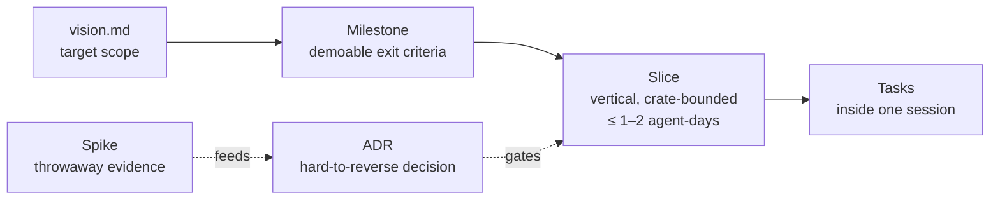
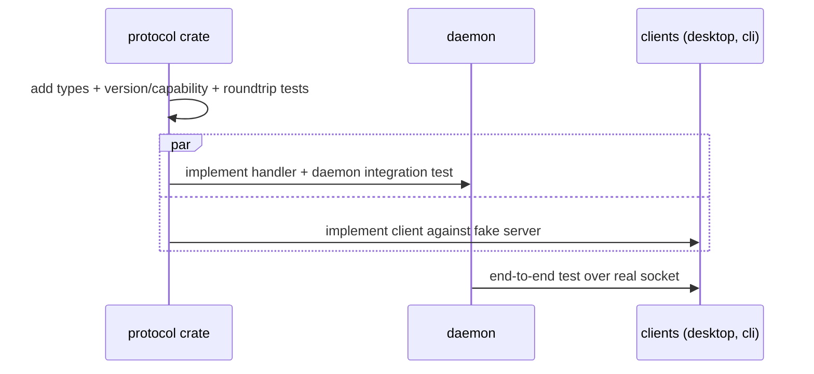

# Development Process

How Hutan is built so that any person or agent can stop at any point and anyone can resume from the repository alone.

## Why this process (analysis)

Project facts that drive the choice:

- Mostly agent-driven development, many short sessions, frequent context loss → **state must live in the repo**, not in chat history or an external tracker.
- Several high-uncertainty dependencies (GPUI sourcing, terminal engine, agent protocols, macOS bundling) → **spike before commit**; record the outcome as an ADR.
- Hard architectural boundary (daemon ↔ protocol ↔ clients) → **contract-first**: protocol changes land first, then daemon and clients proceed in parallel.
- Small team, one platform → no heavyweight ceremony; milestones with demoable exit criteria.

| Option | Pros | Cons | Decision |
|---|---|---|---|
| External tracker (GitHub Issues/Linear) as source of truth | Rich UI, notifications | Agents need network/auth; state splits between tracker and repo | Later, mirrored from `roadmap.md` if a team forms |
| Big upfront design | Fewer reworks on paper | High uncertainty makes it fiction; slows first slice | Rejected |
| **In-repo markdown: roadmap + status + ADRs, vertical slices** | Diff-reviewable, works offline, any agent can resume | Needs discipline to update | **Chosen** |

## Work hierarchy

- **Milestone** (`docs/roadmap.md`): user-visible capability with acceptance checks. Done only when its demo script passes.
- **Slice**: smallest change that delivers working behavior end-to-end through the layers it touches. Has an ID (`M2.3`), owner, status checkbox in the roadmap.
- **ADR** (`docs/adr/NNNN-*.md`): any decision that is expensive to reverse — dependency choice, protocol shape, persistence format, state ownership, security policy. Status `proposed → accepted → superseded by NNNN`.
- **Spike**: time-boxed throwaway experiment outside the workspace (`/tmp/hutan-spikes/<name>`), producing a `REPORT.md`. Evidence is summarized into the ADR; spike code is never merged.

## Session protocol (humans and agents)

### Start
1. Read `AGENTS.md`, then `docs/status.md` (current milestone, active slice, next action, blockers).
2. Read the milestone section in `docs/roadmap.md` and the ADRs it references.
3. Pick the active slice or the next unchecked slice whose dependencies are met. Write `Active slice` + short plan into `docs/status.md`.

### During
- One slice at a time per worktree. Touching another crate's public API → protocol/contract change first (see below).
- New hard-to-reverse decision → stop, write ADR `proposed`, spike if evidence is missing.
- Keep `docs/architecture.md` / `docs/protocol.md` truthful in the same commit as the change.

### End (mandatory, even when interrupted)
1. Run the quality gate for touched crates.
2. Update `docs/status.md`: what changed, verification run, exact **Next action** (a command or file + function, not a vague goal), open questions.
3. Tick slice checkboxes in `docs/roadmap.md`.
4. Commit with a conventional message (`feat(terminal): …`, `docs(adr): …`).

## Contract-first changes

Rules: additive changes bump the minor protocol version and are capability-gated; breaking changes bump major and require an ADR. Protocol changes are serialized (one owner at a time); everything else may run in parallel.

## Parallel agent work

- Split by crate boundary (`terminal`, `agents`, `gateway`, `storage`, `desktop` views) — they share only `core`/`protocol` types.
- Each parallel slice runs in its own git worktree/branch: `../hutan-wt/<slice>` on `slice/<slice>`.
- One integration owner merges, resolves conflicts, runs the full gate.
- Implementers get self-contained briefs (`docs/briefs/<slice>.md`): slice ID, files/crates in scope, contract, acceptance checks. They must not edit `protocol` unless they own the contract change.

## Implementer agents

Roles: the **orchestrator** (main omp session) owns contracts (`core`, `protocol`), writes briefs, reviews, integrates, and updates `status.md`/`roadmap.md`. **Implementers** are omp subagents of the project agent `implementer` (`.omp/agents/implementer.md`, model `anthropic/claude-sonnet-5-5:high`), one per slice, each confined to the checkout its task names.

Two working modes:

| Mode | When | Where |
|---|---|---|
| **Worktree** (default) | Parallel slices, or the orchestrator keeps working in the main checkout meanwhile | `../hutan-wt/<slice>` on `slice/<slice>` |
| **Main checkout** | One slice at a time, nothing else editing the repo (small fixes, debugging, work that needs the user's live environment) | the main checkout on `slice/<slice>` (task says so explicitly); no worktree |

Humans and the orchestrator can always work directly in the main checkout; only concurrent agents need worktrees.

Loop per slice:
1. Commit the brief (`docs/briefs/<slice>.md`, template in `docs/briefs/README.md`) on `master`.
2. Worktree mode: `git worktree add ../hutan-wt/<slice> -b slice/<slice>`; main-checkout mode: `git switch -c slice/<slice>` in the main checkout (working tree clean). Dispatch a `task` with `agent: "implementer"` naming the checkout path, the mode, and the brief. Independent slices go in one batch (worktree mode) so they run concurrently.
3. Review the diff against the brief's contract and `AGENTS.md` invariants; run `just check` in the slice checkout; exercise acceptance steps yourself.
4. Send fixes to the same agent (`write agent://<id>`) or fix directly; then rebase onto `master`, merge fast-forward, remove the worktree (worktree mode) or `git switch master` (main-checkout mode), delete the branch.
5. Record the slice in `status.md` (what landed, verification run, deviations).

Rules: implementers never edit `status.md`/`roadmap.md`; a needed contract change comes back as a report item, not an edit. Dependent slices start after their dependency merges. Changing the implementer model = edit `.omp/agents/implementer.md` (one place).

Resources (dev machine: M1 Pro, 10 cores, 16 GB RAM): builds use 4 jobs (`.cargo/config.toml`), tests 4 threads (`.config/nextest.toml`); debug builds carry line tables only (`Cargo.toml` `[profile.dev]`). At most **one implementer worktree** builds at a time besides the main checkout. Before dispatching, check `df -h ~` and `just sweep`; after merging, `git worktree remove` the slice (its `target/` goes with it). Every test run uses a temporary `HUTAN_HOME`; after a run, `pgrep -x hutand` must find no test daemon.

## Branching and commits

- Trunk-based on `master`; short-lived `slice/<id>` branches; rebase before merge; `master` always passes the gate. Remote: `origin` = <https://github.com/robertt3kuk/hutan> (public). Push `master` after each merge + status update; slice branches stay local.
- Conventional commits; scope = crate name or `docs`, `adr`, `ci`.
- No commits of spike code, secrets, recorded transcripts with tokens.

## Quality gates

| Gate | Command | From |
|---|---|---|
| Format | `cargo fmt --all --check` | M0 |
| Lint | `cargo clippy --workspace --all-targets -- -D warnings` | M0 |
| Tests | `cargo nextest run --workspace` (fallback `cargo test`) | M0 |
| Licenses/advisories | `cargo deny check` | M0 |
| Protocol compat | golden JSON fixtures per protocol version | M1 |
| Terminal conformance | recorded PTY transcript corpus replayed through engine, grid snapshots compared | M1 |
| Perf budgets | `hutan bench` scripts: output flood, RSS, keystroke latency | M2 |
| Milestone demo | `docs/demos/Mx.md` checklist executed and recorded in status | every milestone |

All gates wrap into one entry point (`just check`) created in M0.

## Testing strategy

- **core**: state machines (session lifecycle, approvals, tasks) with exhaustive transition tests.
- **protocol**: serde roundtrip + golden fixtures; old-client/new-daemon compatibility tests.
- **terminal**: replay recorded PTY transcripts (shell, vim, htop, OMP, Codex TUI) → compare grid snapshots; fuzz the input path.
- **daemon**: integration tests over a real Unix socket in a temp dir; fake agents are scripted stdio fixtures speaking Codex app-server / ACP, so tests are deterministic and free.
- **desktop**: GPUI `TestAppContext` for view/state logic; visual checks through the milestone demo, not pixel tests.
- Real model calls only in opt-in smoke scripts, never in the default gate.

## Definition of Ready (slice)
- Milestone and dependencies identified; required ADRs accepted.
- Contract (protocol messages/types) sketched.
- Acceptance check is observable (command, test, or demo step).

## Definition of Done (slice)
- Behavior works end-to-end through the real daemon/socket path it touches.
- Gate green; new behavior covered by a test that would catch a regression.
- Docs (architecture/protocol/ADR) updated; `status.md` and `roadmap.md` updated; committed.

## Milestone cadence
1. **Kickoff**: refresh risk register, list slices with IDs, confirm ADRs.
2. **Execution**: slices; status updated every session.
3. **Exit**: run demo checklist, record results + measurements in `status.md`, short retro (what to change in this process), then open next milestone.

## Document map

| File | Purpose | Update when |
|---|---|---|
| `AGENTS.md` | Entry point, invariants, commands | Conventions change |
| `docs/vision.md` | Target scope, principles, budgets | Scope decision (with ADR) |
| `docs/architecture.md` | Components, crates, data flows | Any structural change |
| `docs/protocol.md` | IPC framing, handshake, message catalog | Any protocol change |
| `docs/roadmap.md` | Milestones, slices, risks | Every session |
| `docs/status.md` | Handoff log, next action | Every session |
| `docs/adr/` | Decisions with evidence | Each hard-to-reverse decision |
| `docs/demos/` | Milestone demo checklists | Milestone kickoff |
