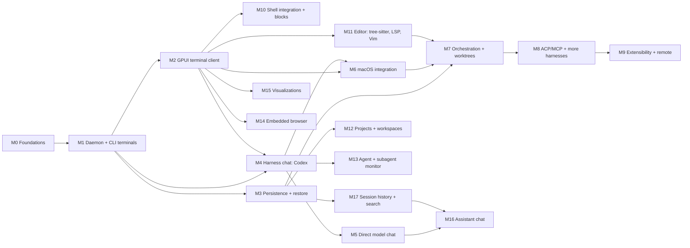

# Roadmap

Milestones M0–M6 form the **first vertical slice** (spec "Initial Implementation Scope"). M7+ expand toward the target scope in `vision.md`. Milestone numbers are IDs, not order; the agreed **execution order** is: M2 (incl. M2.7–M2.9) → M10 shell integration + blocks → M3 persistence → M12 projects & workspaces → M17 session history & search → M4 → M13 agent & subagent monitor → M5 → M16 assistant chat → M6 → M11 editor → M15 visualizations → M14 browser → M7 → M8 → M9. Slice IDs are stable; tick boxes as slices land. Process: `process.md`.

## M0 — Foundations
Exit: workspace builds, gate green, protocol v0 types compile with roundtrip tests, ADR 0003–0005 accepted.
- [x] M0.1 Cargo workspace (`crates/*`, package `hutan-<dir>`), `rust-toolchain.toml` 1.98.0, `clippy.toml`, `deny.toml`, `justfile` (`just check` = fmt + clippy `-D warnings` + nextest + cargo-deny); pinned deps from ADR 0003/0004 in `[workspace.dependencies]`
- [x] M0.2 `core` IDs (ULID newtypes, `TerminalId`, `Seq`), `SessionState` machine; `protocol` frames + codec, control envelope, typed requests/results/events, render DTOs, error codes; golden fixtures `crates/protocol/tests/fixtures/v0/`
- [x] M0.3 Accept ADR 0003 GPUI sourcing, 0004 terminal engine, 0005 agent integration (spike evidence in `docs/spikes/`)
- [x] M0.4 Terminal conformance corpus in `crates/terminal/tests/corpus/`: 21 feature streams (whole, byte-by-byte, 7-byte chunks) + recordings (zsh, `seq`, vim) replayed to `.grid`. Open: htop (not installed), agent TUIs (omp, codex) need logins — record during M2 demo prep.

## M1 — Daemon + CLI terminals
Exit demo: `hutan new -- omp` in one terminal, `hutan attach <id>` from another, detach/reattach, two clients attached at once, `hutan ls --json`; heavy output keeps daemon memory bounded.

Execution (briefs in `docs/briefs/`, implementer agent per `process.md`): **M1-A** (M1.1 + M1.2, `daemon` + `client`) and **M1-B** (M1.3 + M0.4, `terminal`) in parallel → merged; **M1-C** (M1.6 part 1, `cli` + host renderer) after M1-A; **M1-D1** (M1.4 + M1.5, daemon sessions/attach) after M1-B, parallel with M1-C; **M1-D2** (orchestrator): CLI `new/ls/attach/send/stop`, M1.7 bench, demo.

- [x] M1.1 `hutand` lifecycle: single-instance lock, socket perms, peer UID check, graceful shutdown, tracing to `~/Library/Logs/Hutan/`
- [x] M1.2 Connection layer: framing codec, handshake, per-client bounded queues, event ring with epoch/seq, replay
- [x] M1.3 `terminal`: PTY spawn, reader thread → OSC sniffer → engine, writer thread, resize, input, exit/reap, render tracker (merged `dd63216`; 180.7 MB/s, 26.2 MiB @10k lines)
- [x] M1.4 Terminal attach: snapshot queued before the response, credit-1 ack pacing (≤ 1 render / 8 ms), `terminal.history`, resize → snapshot, bounded input path (merged `6039594`)
- [x] M1.5 Session registry in memory: create/list/stop/restart/rename, metadata events (title/bell/notification/cwd), workspace close and shutdown rules (merged `6039594`)
- [x] M1.6 `hutan` CLI: `daemon start|stop|status`, `ws …`, `new`, `ls`, `attach` (raw mode, ctrl+\ d detach, SIGWINCH resize, restart follow), `send`, `stop/restart/rename`, `history`, `api`, `events` (merged `8a4a583`, `98a6c35`)
- [x] M1.7 Bench `cargo run --release -p hutan-daemon --example flood`: ≈193 MiB in 1.4 s (136 MiB/s end-to-end through daemon + acking client), non-acking client 0 renders after snapshot, `daemon.status` p99 0.11 ms, peak RSS 25.2 MiB

**M1 done (2026-10-13).** Demo checklist: `docs/demos/M1.md`.

## M2 — GPUI workbench and terminal client
Exit demo: run OMP and Codex TUI in the GPUI app with correct input/rendering; move panels between docks, split/move/zoom panes, switch presets (default / focus / overview); edit `settings.toml` and see it hot-reload (density, terminal font/theme, panel options); close app → sessions keep running → reopen restores layout and views; daemon restart → app reconnects; budgets in `vision.md` measured. Design: `docs/design.md`, ADR 0010.

Execution: wave 1 in parallel — **M2-A** (M2.2, `client`), **M2-B** (M2.1, `desktop` workbench core), **M2-C** (M2.3, `terminal_view`), **M2-D** (M2.4 engine, `settings`); wave 2 — **M2-E** (M2.5 panels + wiring + settings UI); wave 3 — **M2-F** (M2.6, orchestrator).

- [x] M2.1 Workbench core: native chrome (transparent titlebar, tinted blurred left dock), docks L/R/B hosting panel stacks, center split tree with per-pane tabs, drag & drop (tab → split edge / dock, panel → dock), resize, zoom, focus navigation, action registry + ⌘K palette, `PanelRegistry`/`StatusItemRegistry`, layout persistence, presets with exact overview round-trip (merged `75d9c55`)
- [x] M2.2 `client::Connection`: reconnect with backoff, replay/snapshot reconciliation into a state store, terminal handles that re-attach after reconnect, usable from GPUI's executor (merged `3f94df0`)
- [x] M2.3 `terminal_view`: grid rendering on the cell grid, cursor, selection/copy/paste, scrollback viewing, IME + Russian layout, key (legacy + kitty 1/8) and mouse (SGR/legacy) encoding, resize from font metrics, ack after paint (merged `fa7babc`); theme colors to daemon via protocol 0.2 `terminal.set_colors` (M2-E2)
- [x] M2.4 Settings engine: layered TOML (defaults < user < workspace < runtime), typed namespaces with schemas, hot reload, keymap file, theme + density tokens (merged `ecf304b`); wiring in M2-E1
- [x] M2.5 Panels and wiring: `Connection` in the desktop, shared terminal model per session (one attachment, many views, ack after first paint), terminal items with reconnect/ended states, sessions panel (search, needs-you, grouping, configurable rows), overview board (live previews, attention sort, exact layout stash/restore from every path), inspector (info; approvals/changes M4/M7), status items per preset, session lifecycle actions (⌘T, ⌘D/⌘⇧D start a terminal in the focused cwd, rename/restart/stop), settings namespaces with hot reload, `keymap.toml`, generated settings sheet (⌘,), terminal padding token (merged `1f87334`)
- [x] M2.6 Performance pass: `xtask bench` B1–B6, `docs/perf.md`, crash fix + panic hook (merged `5df8b29`); B4 redefined by ADR 0011
- [x] M2.7 Compact scrollback store (Warp-style flat storage for rows out of cursor reach; ADR 0013 amending ADR 0004) to meet B2; bench reports B4a/B4b per ADR 0011
- [ ] M2.8 M2 demo (`docs/demos/M2.md`) with screenshots
- [x] M2.9 Empty workspaces hidden: the sessions panel already lists only workspaces that have sessions (`panels/sessions.rs` skips empty groups); a setting `show_empty_workspaces` and "always show the active workspace" arrive with the workspace switcher in M12

## M3 — Persistence and restore
Exit demo: kill `hutand`, start it → workspaces/sessions reappear, terminals respawn in cwd, Codex/OMP sessions resume via native resume IDs.
- [x] M3.1 `storage` actor, migrations, schema for workspaces/sessions (layouts stay in the desktop state file per ADR 0010)
- [x] M3.2 Restore pipeline per ADR 0009 step 1
- [x] M3.3 Agent resume references: `agent.report` (protocol 0.4), `hutan agent report`, `hutan integration install codex|claude|omp`

## M4 — Harness chat (Codex)
Exit demo: open a Codex chat session, stream reply, see tool calls and diffs, approve a command from the UI, approval enforced in daemon; same conversation visible from CLI.
- [x] M4.1 `agents::codex` adapter over `codex app-server` stdio JSON-RPC (pin supported Codex range; schema fixtures generated from the installed binary)
- [x] M4.2 Unified `AgentEvent` model in `core` + protocol events (`chat.delta`, `agent.tool_call`, `approval.required`, …)
- [x] M4.3 Approval engine in daemon (policy + pending decisions + audit rows)
- [x] M4.4 Chat view in GPUI: messages, streaming, tool call cards, diff view, approval UI
- [x] M4.5 Conversation persistence

## M5 — Direct model chat
Exit demo: chat with an OpenAI-compatible endpoint and a local Ollama model; switch model mid-conversation; keys in Keychain.
- [x] M5.1 `gateway` provider trait + OpenAI-compatible + Anthropic adapters, streaming
- [x] M5.2 Local endpoints (Ollama/LM Studio) discovery
- [x] M5.3 Keychain credential store + `provider.*` protocol
- [x] M5.4 Direct chat view reuses chat components — Models settings, direct picker, model switching and credential recovery actions (M5-B)

## M6 — macOS integration
Exit demo: with the window closed, an agent finishing triggers a native notification; an approval notification's "Approve" action unblocks the agent; launch-at-login agent mode works.
- [x] M6.1 Spike: notifications from daemon vs helper → ADR 0007 accepted: the daemon posts (`docs/spikes/2026-10-15-notifications.md`)
- [x] M6.2 App bundle build (`just bundle`), ad-hoc signing for dev (M6-A; executable `hutan-desktop`, see `docs/packaging.md`)
- [x] M6.3 Notification intents (M6-A, protocol 0.13) + native notifications posted by `hutand` with action routing (M6-B; no helper)
- [x] M6.4 SMAppService launch agent toggle; menu bar status; Dock badge; global shortcut; single instance (M6-C; demo with the user pending)

**First vertical slice complete after M6** — run the full acceptance list from the spec.

## M7 — Orchestration
- [x] M7-A Worktrees (create/list/remove) and session placement with a same-checkout warning (protocol 0.14, `docs/orchestration.md`)
- [x] M7-B Tasks with dependencies, run in main or a worktree, finish detection, auto-start under `max_parallel` (protocol 0.16, daemon + CLI)
- [x] M7-C Tasks panel in the desktop, diff review and merge
- Task placement: main checkout or worktree (create/list/remove), with a same-checkout conflict warning; multi-repo workspaces, task list with dependencies, parallel agents, attention rollups, diff review and merge, agent state detection for TUI agents (integration hooks first, screen manifests fallback).

## M8 — ACP, MCP, more harnesses
- [x] M8-A ACP harness chats (OMP first-class, Claude Code) and accounts through harnesses (ADR 0015, protocol 0.17)
- [x] M8-B Desktop: harness picker, accounts view, assistant backend per scope + toggle
- [x] M8-C Agent control surface (ADR 0016): UI commands and layout through the daemon, origin + approval policy, `hutan ui …`, `hutan mcp` passed to harness sessions
- ACP client adapter (Claude Code, OpenCode, Gemini, OMP), `session/load` resume, MCP server config pass-through; Hutan as MCP server exposing its own control surface to agents.

## M9 — Extensibility and remote
- Plugin manifests + event hooks; live daemon upgrade handoff (ADR 0009 step 2); remote transport (TLS over Tailscale/SSH) and mobile/web client feasibility.

## M10 — Shell integration + blocks
Exit demo: in zsh, bash, and fish (no user config edits) commands become blocks with exit status and duration; jump between blocks, copy a block's output, collapse it, send it to an agent as context; `terminal.blocks = false` restores the plain terminal; TUIs and `hutan attach` unaffected.
- Shell integration auto-injected per shell (zsh `ZDOTDIR` shim, bash `--rcfile` shim, fish `XDG_DATA_DIRS` vendor_conf.d), emitting OSC 133 A/B/C/D (+ exit code) and OSC 7; opt-out setting; works over nested shells where possible.
- Daemon: block index per terminal (prompt/command/output line ranges in the compact store, exit code, start/end time), protocol events + `terminal.blocks` query.
- Desktop: block overlay on the single grid (gutter, separators, status/duration chips, hover actions), keyboard navigation, block selection/copy, collapse, "send to agent" (wired in M4).
- Design note: blocks are an overlay on one grid (not Warp's grid-per-block), so full-screen programs and CLI attach keep working unchanged.

## M11 — Embedded editor (ADR 0012)
Exit demo: open a file from the sessions panel/⌘P next to a terminal; tree-sitter highlighting with the shared theme; LSP diagnostics, completion, hover, go-to-definition, rename, format (rust-analyzer, typescript-language-server); Vim mode on/off; agent edits reload the buffer.
- License decided (MIT OR Apache-2.0): ADR 0012 option B, own editor on permissive crates.
- Crates per ADR 0012: `buffer`, `syntax`, `lsp_client` (servers supervised by the daemon), `code_view` (GPUI); `ItemRef::File` in the workbench; one theme for chrome/terminal/syntax.

## M12 — Projects and workspaces
Exit demo: open three projects (⌘O → folder / recent list), each with its own sessions and layout; switch between them without losing state; reorder workspaces by drag and switch the sort mode; pin one; the **Home** workspace opens on your notes folder with a scratch chat; workspace-level settings override (`<repo>/.hutan/settings.toml`); a project with several repos; empty workspaces hidden.
- Daemon: workspace roots (one or more repos), recent projects list, per-workspace defaults (shell, env, start cwd), workspace order + pins; persisted via M3.
- **Home workspace**: always present, bound to a configurable folder (`workspaces.home_folder`, e.g. `~/Notes`) for notes, docs, and scratch sessions/chats that belong to no project; cannot be deleted, can be renamed.
- **Sorting and arrangement** (Orca-like): sort modes `manual` (drag to reorder, the default) · `recent activity` · `attention first` · `name`; pin to top; group by project (multi-repo project groups); filters: hide empty, hide sleeping (no live sessions), hide CLI-created; "always show the active workspace"; a sidebar filter box + ⌘J jump palette reaching hidden ones.
- Desktop: ⌘O project picker (recent + folder dialog), workspace switcher in the sidebar header and ⌘K, per-workspace layout state (each workspace remembers its own pane tree), new sessions start in the active workspace root.
- CLI: `hutan ws open <path>`, `hutan ws use <id>`, `hutan ws move <id> --before <id>`, `hutan ws pin <id>`.

## M16 — Assistant chat
Exit demo: ⌥Space (or the assistant panel) opens a quick chat for questions without starting a session; history of past assistant chats is searchable and resumable; inside a workspace the assistant answers with context it is allowed to read — `@omp` (an agent session's transcript), `@shell` (a terminal's recent output or a block), `@file`, `@search` (M17 index) — shown as attached context chips; nothing is read without being attached or allowed in settings.
- Built on the M5 gateway (any provider/local model) and the M4 chat view; conversations persisted (M3 storage) and indexed (M17).
- Two scopes: global (Home) assistant and per-workspace assistant; context providers are read-only, bounded (token budget, truncation shown), and permission-gated per workspace (`assistant.context.*` settings).

## M17 — Session history index and search
Exit demo: enable indexing (opt-in), search "which session ran `cargo test -p daemon`" or a phrase from an old conversation and find Hutan sessions, terminal blocks, assistant chats, and external agent sessions (Claude Code, Codex, OMP, OpenCode, Cursor, Gemini); open a result or **Resume** it (runs the agent's resume command in a new terminal with the same cwd and session id); `hutan search "<query>" --json`.
- Index: local SQLite FTS5 + BM25 with role weighting (user/assistant/tool) and a separate identifier column (paths, commands, symbols) — the approach Orca measured to beat dense vectors/rerankers on ~1M real messages; tool calls and commands indexed as text.
- Sources: Hutan journals (blocks text, agent events, assistant chats) and external transcript stores (`~/.claude/projects`, `~/.codex/sessions` + `state_*.sqlite`, `~/.omp/agent/sessions`, OpenCode, Cursor, Gemini); adapters versioned per format.
- Incremental, cheap scanning: FSEvents + per-file offsets/mtimes, never re-walking the whole tree on a timer (Orca issue #27008 is the counter-example); history range (all / 90 / 30 days), index size + Clear in settings; data never leaves the machine.
- Surfaces: History panel (filters: agent, project, date, role), ⌘K / jump palette integration, assistant `@search`, CLI.

## M13 — Agent and subagent monitor
Exit demo: run OMP with task subagents, Codex (app-server) with subagents, and Claude Code in terminals; the monitor panel shows each agent's state (working / blocked / done / idle) and its subagent tree with activity, model, duration and tokens when the agent exposes them; clicking jumps to the transcript or terminal; attention rollups include subagents.
- Sources, best first: structured protocols (Codex app-server threads/subagents, ACP `subagents` capability, OMP RPC mode / session files), agent integration hooks reporting state (Herdr model: hooks push `working/blocked/done` + resume id), screen-detection manifests as fallback for unknown TUIs.
- Daemon: `AgentObservation` model per session (state, subagents tree, last activity, usage), protocol events; bounded history.
- Desktop: `agents` panel (tree, filters), badges on session rows/tabs/overview cards, notifications hook for M6.
- Spike first: what OMP, Claude Code, Codex, OpenCode expose today (files, RPC, hooks) — evidence into `docs/spikes/`.

## M13-C — Resource manager
- [x] M13-C Process trees and usage per session, stop/kill sessions and processes, interrupt agents and subagents (daemon + CLI); Resources panel (M13-D, merged)

## M14 — Embedded browser
- Browser items/panels in the workbench (WKWebView hosted in a GPUI window region), address bar, back/forward, localhost previews, open-links-from-terminal (⌘-click) setting, agents can open URLs into it; spike on GPUI native view embedding first (ADR).

## M15 — Visualizations and rich content
- Terminal images: kitty graphics protocol and iTerm2 inline images (daemon parses, render DTOs carry image placements; ADR amending 0004).
- Rich items: Markdown preview, Mermaid and SVG rendering, images, simple charts (CSV/JSON) as workbench items; agent artifacts open as items; reused by chat (M4) and the editor (M11).

## M18 — Projects (ADR 0014)
- [x] M18-A Automatic projects (git common dir) alongside user workspaces that contain projects; easier workspace management (daemon + CLI, protocol 0.18)
- [x] M18-B Sidebar workspaces → projects → sessions (or flat projects) with folder and worktree badge; drag a project into a workspace, new workspace from selection

## D — Design
- [x] D-1 Visual system v2: Claude-Desktop-like style, terminal-first layout (`docs/design.md` § Visual system)

## Plan after 2026-10-20 (resume here)

Ordered; each line is one slice with a brief in `docs/briefs/` (written ones marked). Research behind each: the spike named.

**In flight** (worktrees `../hutan-wt/<slice>`, branches `slice/<slice>` pushed to origin):
- [ ] AG-1 Agents page v2: one agent truth, attention-first center page; right Agents and Mawas Today become lenses; drawer and old Overview removed (brief `AG-1.md`; `spikes/2026-10-20-chrome-v3.md` §2–3, option A).
- [ ] TH-2 Icon packs: semantic icon ids, safe SVG pipeline, Phosphor default; Agents ≠ Changes ≠ branch icons (brief `TH-2.md`; ADR 0018; `chrome-v3.md` §5, `theme-packs.md`).

**Next (no user decision needed):**
- [ ] TH-3 Theme/icon pickers with live preview, diagnostics, `hutan theme ls|validate|new|export` (`theme-packs.md` §6).
- [ ] TH-4 Importers: Ghostty, iTerm2, Alacritty, VS Code, Zed, WezTerm, Warp (`theme-packs.md` §5.3) — good candidate for a cheaper model.
- [ ] DB-3 Optional agent activity fields (`turn_started_at_ms`, `last_state_report_at_ms`, `observation_reason`; additive minor + capability `agent.activity-summary`) (`chrome-v3.md` §6).
- [ ] ST-4 Truthful Mawas configuration read API (`assistant.settings` capability), then ST-5 13-page Settings IA with explicit scope/provenance/reset-to-inherit, ST-6 unified search, ST-7 keyboard-shortcut editor, ST-8 validation/preset editor, ST-9 data/storage + preference export/import, ST-10 recently changed (`spikes/2026-10-20-settings-v2.md` §7–8).
- [ ] MW-3 Mawas explicit learning ("remember this", "learn from this session") on top of MW-2 memory (ADR 0017).
- [ ] P-3 benches B3/B5/B7/B9 in a real unlocked window, one at a time; record in `docs/perf.md`.

**Waiting for the user's decisions:**
- Direction D-1…D-6 (`spikes/2026-10-18-direction.md` §11): task workspaces + unassigned sessions (protocol major), `app.on_close=quit` + restore, remote `hutand` (SSH→TLS→relay), Linux headless → desktop → Windows, icons (now decided: Phosphor, ADR 0018), secrets vault mode.
- Traces (MW-7) via Laminar research (`spikes/2026-10-20-laminar.md` §10): recommended TR-1 local trace store + bounded OTLP receiver, TR-2 Traces page, TR-3 optional export to Laminar/OTel, TR-4 harness-native telemetry, TR-5 evals later; 5 decisions in §10.
- Settings v2 decisions (`settings-v2.md` §9), chrome decisions (`chrome-v3.md` §6), theme decisions (`theme-packs.md` §7) — recommendations taken as defaults unless the user objects.
- GF-1 GPUI fork spike (on-demand CVDisplayLink first) — proposed, awaiting "go".
- Model routing: Opus orchestrates; implementers `implementer` (Sonnet 5.5), `implementer-gemini` (Gemini 4 Argon, OpenCode Go, public code only); `implementer-sol` paused by the user (its profile fell back to Opus in the first run — check model resolution before reuse). DeepSeek V4.1 Flash / GLM-5.3-Flash for mechanical slices: pilot not started.

## Backlog (agreed, not yet scheduled)

- **B-1 Session environment like a real terminal emulator.** New sessions get a fresh login environment instead of inheriting `hutand`'s environment (which depends on whoever started the daemon: CLI, desktop, launchd): start from the user's launchd environment (`HOME`, `USER`, `LOGNAME`, `TMPDIR`, `LANG`/`LC_*`, `PATH` via `path_helper`), then the login shell builds the rest (`-l`). Configurable in settings and applied at session start: `terminal.shell` (override the account login shell), `terminal.env` (extra variables), `terminal.env_inherit = "login" | "daemon"`, with workspace overrides (`<repo>/.hutan/settings.toml`). Clients pass the resolved shell/env in `session.create` (`TerminalSpec.command`/`env` already exist); daemon-managed `HUTAN_*` still win. Already done: the default shell is the account's login shell (`getpwuid`), not the daemon's `$SHELL`.
- **B-2** → scheduled as M2.7. **B-3** → resolved by ADR 0011.
- **B-4 History hits carry their origin.** `HistoryHit` gains optional `path` (external transcript file, for "Reveal file") and `block_id` (+ `terminal_id`) for Hutan block hits so "Open block" is exact instead of matching `ts_ms` (gap found in M17-B). Additive protocol change.
- **B-5 OpenCode history adapter** once its v1/v2 schemas settle (deferred in M17-A).
- **B-6 Approval provenance on the wire.** `approval.resolved` / `PermissionResolved` carry `decided_by` (ui/cli/client id) so a chat can show who answered (gap found in M4-B; already in the audit table). Journal streaming deltas or a coalesced partial so a window opened mid-stream sees the full text; "Load earlier" paging in the chat view.

## Risk register

| ID | Risk | Likelihood | Impact | Mitigation | Owner milestone |
|---|---|---|---|---|---|
| R1 | GPUI API churn (git-only, unpublishable on crates.io) | High | Medium | Pin rev; isolate GPUI to `desktop`; scheduled bump slices | M0/M2 |
| R2 | Terminal correctness gaps break TUIs (OMP, Codex) | Medium | High | Mature engine (ADR 0004), recorded-transcript corpus, real-TUI demos | M1/M2 |
| R3 | Agent protocols change (Codex app-server, ACP) | High | Medium | Adapters behind `AgentEvent`; schema generated from installed binary; fixture tests | M4/M8 |
| R4 | macOS bundling/signing blocks notifications/Keychain | Medium | Medium | Early M6.1 spike; dev ad-hoc signing | M6 |
| R5 | Unbounded memory under output floods | Medium | High | Bounded scrollback, per-client queue limits, resync protocol, bench in gate | M1/M2 |
| R6 | Scope creep toward full IDE | Medium | High | Non-goals in `vision.md`; scope changes need ADR | all |
| R7 | Provider ToS issues with subscriptions | Low | High | ADR 0008: subscriptions only through vendor harnesses | M4/M5 |
