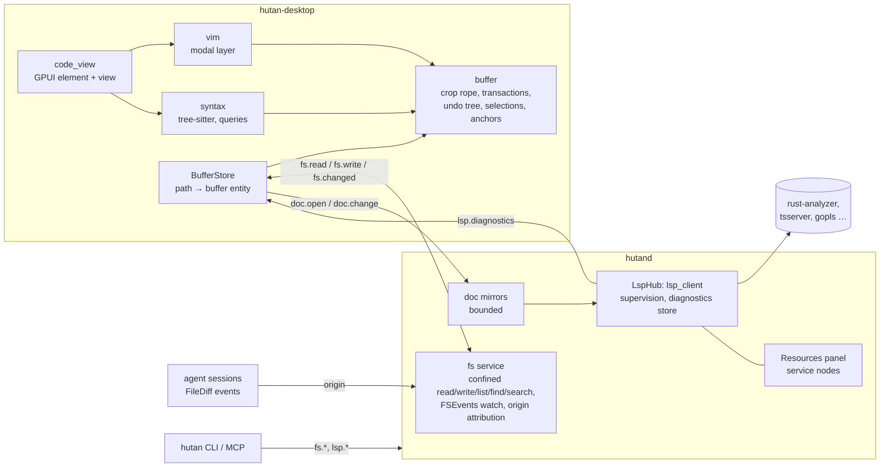
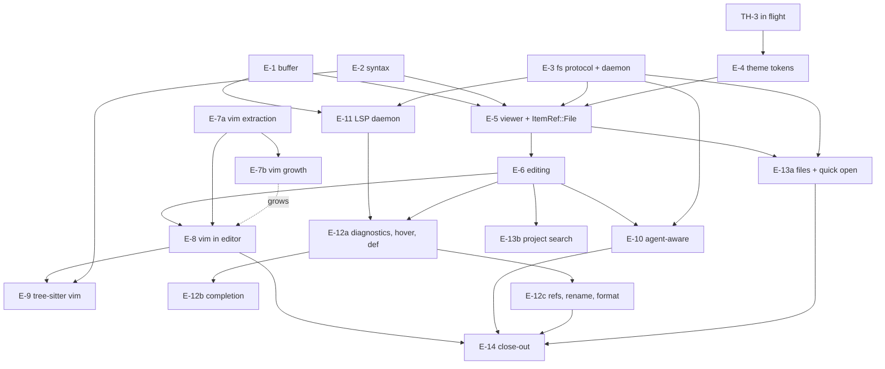

# Embedded editor (M11) — build options, scope, contract and slice plan

Date: 2026-10-21 · Author: `EditorSpike` · Status: **proposal** (research only; nothing in the repo was changed besides this file)

**Evidence boundary.** Hutan facts are from the main checkout at `4f33add` (`docs(briefs): BLD-1 …`), read-only; no `cargo` build, test, bench or paid model call was run, so every performance number below is a **budget or an [INFERENCE]**, never a measurement of Hutan's editor (it does not exist: `crates/` has no `buffer`, `syntax`, `lsp_client` or `code_view`, and `ItemRef` has no file variant — `crates/desktop/src/workbench/model/types.rs:309-329`). External facts were fetched on 2026-10-21 from the linked primary sources (GitHub API, crates.io API, upstream docs); the local clone of GPUI Kit is at `4d63c73` (2026-10-20). "[INFERENCE]" = derived by me from cited facts; "[UNVERIFIED]" = could not be checked without building or running.

---

## 0. Summary

**Recommendation: keep ADR 0012 option B, refined ("B′").** Build the editor as four *GPUI-free, permissively licensed* crates — `buffer` (rope + transactions + undo + selections), `syntax` (tree-sitter), `vim` (modal layer, extracted from `chat/vim.rs`) and `lsp_client` — plus one GPUI crate `code_view`. Do **not** adopt GPUI Kit's `Editor`, vendor Helix (MPL-2.0), or depend on Zed's GPL editor crates. Borrow *ideas* from Zed/Helix/Neovim/Lapce, algorithms (with attribution) only from Apache/MIT sources. Three changes to ADR 0012 are proposed (§4.2): file I/O goes **through the daemon** (`fs.*`, not "read/written by the desktop client"), LSP server config is **split** between `daemon.toml` and desktop settings, and the vim layer becomes its own crate. The ADR header also names the wrong milestone (M12; the roadmap calls the editor M11).

Why not just adopt GPUI Kit's editor (§2.1)? It is genuinely the strongest shortcut — Apache-2.0, ropey + tree-sitter/syntect, multi-cursor, column selection, folding, search/replace, LSP *provider hooks*, IME, released weekly — and the version conflict ADR 0003 recorded is **cheaper to remove than it looked** (GPUI Kit's exact `gpui-pre =0.3.9` is a snapshot of Zed `93d7456`; Hutan's pin `ef376006…` is 16 commits later and **none of them touches `crates/gpui*`**). But it has **no Vim at all**, its selection/edit state lives in a 12 336-line `state.rs` with `pub(super)` fields tied to GPUI contexts (so a first-class Vim layer means forking it), it brings a second theme/global system next to ADR 0018 packs, and its LSP support is client-side hooks, not the daemon-supervised, agent-shared diagnostics that are Hutan's actual differentiator. Vim fidelity, agent-aware editing and daemon LSP are the product; the commodity parts (rope, undo, rendering) are cheaper to own than a fork of someone else's 27k-line engine that ships breaking changes every week.

**First slice: E-1 `buffer`, E-2 `syntax`, E-3 daemon `fs.*` + protocol, and E-7a `vim` extraction — four independent slices that can start now** (the first three are GPUI-free; E-3 is the only contract owner). Then the viewer (E-5), editing (E-6) and Vim wiring (E-8). Five user decisions at the end (§4.11).

---

## 1. What Hutan already has (and what it lacks)

| Need | Present | Gap for the editor |
|---|---|---|
| **Decision and scope** | ADR 0012 accepted, option B (`docs/adr/0012-embedded-editor.md:3,22-27`); roadmap § M11 (`docs/roadmap.md:120-123`); `vision.md` lists the editor in target scope (`docs/vision.md:44-45`); R6 "scope creep toward full IDE" (`docs/roadmap.md:209`) | ADR says `Milestone: M12` (`:5`) but the roadmap says M11 (M12 is projects, `roadmap.md:125`); `status.md:24` still says "M11 remains blocked on the license decision" although `status.md:27` records it as decided (2026-10-17). Both are stale text, not decisions. |
| **Vim modal layer** | `crates/desktop/src/workbench/chat/vim.rs`, 2 364 lines, 40 tests. Pure data, no GPUI (`:1-9`): Insert/Normal/Visual (charwise) (`:14-22`), `Key` (`:42-58`), counts, operators `d c y`, motions `h j k l w b e W B E 0 ^ $ gg G f t F T ; ,`, text objects `iw aw iW aW`, one unnamed register + system clipboard (`:82-85`, `design.md:547`), undo/redo, `.` repeat including typed text. GPUI side: `workbench/vim_ui.rs` (key translation, mode pill, caret), setting `editor.vim_mode` / `editor.vim_use_system_clipboard` (`crates/desktop/src/settings.rs:848-868`). | **Out of scope today, by its own doc** (`docs/design.md:551`): marks, named registers, macros, `/` search, blockwise and linewise Visual. It is also **not scalable**: every command builds a `Vec<char>` + offset table of the *whole text* (`vim.rs:1321-1335`, 10+ call sites such as `:392,670,761`), and undo is whole-text snapshots capped at 200 (`chat/input.rs:8,38-60`) — fine for a chat composer, 200 × 1 MB for a file. It targets `TextInput` (a `String`), not a rope. |
| **Text input / IME** | One text element for every field (`workbench/text_field.rs`): text arrives **only** through GPUI's input handler in UTF-16 ranges (`:1-12`, `docs/design.md:538`); `accepts_text_input()` and `prefers_ime_for_printable_keys()` return false in Vim Normal/Visual so keys reach `on_key_down` (`text_field.rs:463-471`); IME marked-text underline, `bounds_for_range` at the caret (`design.md:538`). `TextInput` (`chat/input.rs`, 1 008 lines) = `String` + cursor + anchor + marked range + snapshot undo. | A rope-based, multi-cursor, virtualized equivalent. The *pattern* (handler + gated `accepts_text_input`) is reusable as is. |
| **Theme tokens** | TH-1 packs (ADR 0018; `docs/themes.md`). **`syntax.*` is reserved for the editor and reported as unsupported** (`docs/themes.md:54`); derived-optional-colors algorithm (`themes.md` § Resolution). Terminal palette already comes from the same pack. | Define the `syntax.*` and `editor.*` token sets (§4.4). TH-3 (in flight, `docs/briefs/TH-3.md`) edits the same registry/validator — sequence after it. |
| **Panel / item model** | ADR 0010; `ItemRef = Terminal \| Chat \| Panel \| Placeholder \| Changes{path}` (`model/types.rs:309-329`); item dispatch (`workbench/render.rs:1943-1963`), icon/title (`view.rs:1086-1115`), `ui.layout` summary kinds (`workbench/remote.rs:467-476`), layout persisted in `desktop-state.json`. A `Changes{path}` center tab already shows per-checkout diffs (`workbench/changes/`). | New `ItemRef::File { path }` touches those four places plus persistence/tests; `ui.layout`'s `PaneItem.kind` gains `"file"` (additive). |
| **Daemon supervision** | Child-process pattern in `crates/agents/src/jsonrpc.rs:120-190`: `Command` with piped stdio, `kill_on_drop`, writer/reader/stderr/reaper tasks, **bounded** outgoing/incoming queues, stderr tail, pid, kill channel. Resource manager (`crates/daemon/src/resources.rs:1-12`) samples process trees *per session* (libproc) and audits kills. Login-environment capture for children (B-1: `docs/status.md:11` and `crates/terminal/src/login_env.rs`). | `runtime/` is in `architecture.md`'s crate list but **does not exist**; ADR 0012's "`runtime` supervision" means this `jsonrpc.rs` pattern. It is newline-JSON, LSP needs `Content-Length` framing. LSP servers are not session processes: the Resources panel needs a `service` node kind. |
| **Daemon file access** | `crates/daemon/src/context_file.rs`: confined read beneath workspace roots with descriptor-relative `openat(O_NOFOLLOW)`, scan/size bounds, a "picked file" variant for user-chosen paths (`:1-60`, `:189-205`). `notify 8.2.0` is a workspace dependency (`Cargo.toml:39`) used by the settings watcher (`crates/settings/src/watch.rs:15,74`) and the history indexer (`crates/index/src/indexer.rs:17,314`). `worktree.diff` / `worktree.file_diff` give git patches per checkout (`docs/protocol.md:115-116`). | No `fs.*` requests, no write path, no watcher events on the wire; `worktree.changed` is only about worktrees being created/removed (`protocol.md:162`). |
| **Agent edits** | `AgentEvent::FileDiff { changes: Vec<FileChange{path, kind, patch, before, after}>, patch }` is in every chat journal (`crates/core/src/agent.rs:164-176,364-369`); chat cards render them (`workbench/chat/cards.rs:551-607`, `hutan_chat_view::diff`). | Cards are read-only; there is no "open this file at this line" target. |
| **Terminal paths** | OSC 8 hyperlinks only, and only `http(s)://` and `mailto:` are opened (`crates/terminal_view/src/view.rs:94,1054-1062`). | No plain-text `path:line:col` detection; jump-from-terminal needs it. |
| **Protocol / policy** | 0.32 (`crates/protocol/src/lib.rs:74-78`); frames max **4 MiB** (ADR 0002 § Frame); additive = minor bump + capability (`AGENTS.md:39`); every request classified read/mutate/user-only in one exhaustive table (`crates/daemon/src/router.rs`, `docs/control.md:60`); "no unbounded channels" (`AGENTS.md:38`); permissions enforced in the daemon (`AGENTS.md:35`). | `fs.*`, `doc.*`, `lsp.*` (§4.4). The 4 MiB frame limit forces chunked file transfer. |
| **Fuzzy / lists** | `palette::fuzzy_score` (`workbench/palette.rs:6`), `gpui::list` virtualization for sidebar and chat (`docs/perf.md:77-102`), `AnyView::cached` panels (`perf.md` § P-3), custom GPUI element painting shaped runs (`terminal_view/src/element.rs`, 7.5k lines in that crate). | A file finder needs a scalable index (bounded, ignore-aware). |
| **GPUI pin** | Git rev `ef376006f32728b15e6a67706a04849cb781c812` for `gpui`, `gpui_platform`, `gpui_apple` (`Cargo.toml:86-89`), committed 2026-10-13T12:01Z ([commit](https://github.com/zed-industries/zed/commit/ef376006f32728b15e6a67706a04849cb781c812)); ADR 0003. At this rev GPUI links AccessKit on macOS (`crates/gpui_macos/Cargo.toml`: `accesskit`, `accesskit_macos`) — Hutan sets no roles yet (`docs/spikes/2026-10-21-developer-tools.md` §3.8). | Editor accessibility depends on AX-1 (§2.5). |
| **Licensing machinery** | Project is MIT OR Apache-2.0; `deny.toml:32` already allows `MPL-2.0` ("used unmodified by GPUI's font stack") | Vendoring *modified* MPL code would change that comment's truth (§2.3). |

---

## 2. Build options, from primary sources

### 2.1 (a) GPUI Kit (`longbridge/gpui-kit`, formerly `gpui-component`)

**Identity and maintenance.** Renamed to [`longbridge/gpui-kit`](https://github.com/longbridge/gpui-kit); crates `gpui-kit`, `gpui-component`, `gpui-base` all **Apache-2.0** (`crates/component/Cargo.toml`, `crates/base/Cargo.toml`; `LICENSE-APACHE` in the repo; GitHub's license detector reports `NOASSERTION`, so the manifests are the evidence). 18 416 stars, 1 116 forks, 104 open issues, last push 2026-10-20 ([API](https://api.github.com/repos/longbridge/gpui-kit)). **9 releases between 2026-09-03 and 2026-10-19** (v0.6.0 … [v0.8.0](https://github.com/longbridge/gpui-kit/releases/tag/v0.8.0)), 312 commits since 2026-09-20 ([commits API](https://api.github.com/repos/longbridge/gpui-kit/commits?per_page=1&since=2026-09-20T00:00:00Z)); the v0.8.0 notes list breaking changes (e.g. `gpui-wry` → `gpui-webview`, `release-notes.md`). Healthy, fast-moving, single-vendor.

**Editor (`gpui_base::input::{EditorState}` + `gpui_component::input::Editor`).** From `website/component/editor.md`, `crates/base/src/input/`, README line 45 ("Stable performance at 200K lines with Tree-sitter highlighting and LSP diagnostics, completion, and hover" — the vendor's claim; **not measured by us**):
- **Buffer:** `ropey =2.0.0-beta.1` (exact beta pin, `Cargo.toml:97`), `sum-tree` snapshot, `DisplayMap` = fold map + wrap map (`editor/display_map/`), undo manager, byte offsets.
- **Highlighting:** `tree-sitter` 0.26.13 with ~35 grammar features, **or** `syntect` (≈200 languages, regex, no tree, no structural folding); "all grammars add tens of megabytes".
- **Editing:** multi-cursor (⌘⌥↑/↓, ⌥-click), **column selection** by mouse ("not a persistent Vim Visual Block mode", `editor.md`), auto-close pairs and indent rules (Monaco-style `LanguageConfig`), folding, line numbers, find/replace panel and an API for a custom one, decorations (text and geometric range decorations that track edits — directly usable for diff/agent-change highlights), scroll bounce.
- **LSP:** *provider traits*, not a client: `CompletionProvider`, `HoverProvider`, `DefinitionProvider`, `CodeActionProvider`, `DocumentColorProvider`, semantic tokens, each returning a GPUI `Task` (`editor/lsp/*.rs`, e.g. `completions.rs:146-161`); the example wires a separate `color-lsp` crate (`examples/editor/Cargo.toml`). `lsp-types 0.97` (`features = ["proposed"]`).
- **Vim: none.** `grep -ril vim` over the repo hits only `website/component/editor.md` (the sentence above) and `docs/gpui-shell.md` (a Neovim analogy).
- **IME / a11y:** implements `EntityInputHandler` (`base/state.rs:4445,4684`), has a `macos_accessibility.rs` hit-test forwarder and release-note a11y fixes; text-role accessibility of the editor itself [UNVERIFIED].
- **Key handling:** fixed `key_context("Input mode=editor")` (`editor/mod.rs:189`) plus `cx.intercept_keystrokes` (`base/state.rs:900-902`); selections are `pub(super)` (`base/state.rs:454`). A modal layer cannot be bolted on from outside; it needs dynamic key contexts and a public transaction/selection API.
- **Size:** `input/base` + `input/editor` (top-level files only) are **26 827 lines**, `base/state.rs` alone **12 336** (`wc -l`); `display_map/` and `lsp/` are on top.

**Compatibility with Hutan's GPUI pin — measured, and better than ADR 0003 feared.** ADR 0003 (`docs/adr/0003-gpui-sourcing.md:11`) rejected `gpui-component` on type identity: it needs crates.io `gpui-pre`, Hutan uses zed git. Facts today:
- `gpui-pre 0.3.9` (Apache-2.0, 5.4 MB, published 2026-10-12) is "a snapshot of **zed@93d7456**" ([crates.io API](https://crates.io/api/v1/crates/gpui-pre/0.3.9); its `Cargo.toml` description). `93d7456` is dated 2026-10-10.
- Hutan's pin `ef376006` is **16 commits ahead** of it, 72 files, and **none is under `crates/gpui*`** — the touched crates are `agent*`, `acp_thread`, `editor`, `project`, `workspace`, `settings*`, docs ([compare API](https://api.github.com/repos/zed-industries/zed/compare/93d7456...ef376006f32728b15e6a67706a04849cb781c812), grouped by top-level crate). [INFERENCE] GPUI's source at both revisions is identical, so Hutan's `gpui`/`gpui_platform`/`gpui_apple` could move to `gpui-pre`/`gpui-pre-platform`/`gpui-pre-apple =0.3.9` as a pure dependency rename (`gpui-pre-apple 0.3.9` exists on crates.io). Snapshots are weekly (0.3.4 on 09-07 … 0.3.9 on 10-12).
- Cost of that move: GPUI bumps become *the vendor's weekly cadence* instead of ours (`gpui-kit` pins `=0.3.9` exactly and says a caret caused breakage, `Cargo.toml` comment on #3156), so a bump is gated by gpui-kit having released against it — ADR 0003 already named this tie. It would also give access to the optional [`gpui-fast`](https://github.com/longbridge/gpui-fast) backend (retained mode; "experimental"), which is relevant to roadmap GF-1 but out of this spike's scope.

**Forking cost if adopted.** To make it first-class for Vim we would need: dynamic key contexts and key-down interception in Normal mode, `accepts_text_input` gating, a public batch-edit API with explicit undo grouping, public multi-selection access, anchors for marks, and display-row vs buffer-row motion hooks — i.e. patches into `base/state.rs` (12k lines, 12 336 in one file) while upstream changes it weekly. Alternatively use only `gpui-base`'s engine and write our own element — but the element is most of the 26k lines.

**Verdict (a):** excellent *reference* and a legitimate fallback (§4.1 trigger), not the foundation. License is a non-issue; the issues are Vim, ownership of the command model, a second theme system (it needs `gpui_kit::init` and its own `Theme`/`ActiveTheme`, against ADR 0018 packs), churn, and headless testability (the engine is entangled with `Context<Self>`; Hutan's V-1 layer is tested without GPUI).

### 2.2 (b) Own editor on permissive crates (ADR 0012 option B)

| Piece | Candidate | License / freshness (crates.io API, 2026-10-21) | Notes |
|---|---|---|---|
| Rope | [`crop`](https://github.com/nomad/crop) 0.4.3 | MIT; repo pushed 2026-08-23; 432k downloads | **Byte** metric (matches tree-sitter), feature `utf16-metric` (matches LSP and GPUI's UTF-16 IME ranges), `O(1)` clone (cheap snapshots for background parse / LSP sync), line metric. Author's benchmark on character-by-character real traces (2018 i7): crop 12.39 ms vs Ropey 44.14 ms (`automerge-paper`) ([README](https://github.com/nomad/crop#readme)). Smaller community than Ropey. |
| Rope (alt.) | [`ropey`](https://github.com/cessen/ropey) 1.6.1 stable / 2.0.0-beta.1 | MIT OR Apache-2.0; 13.5M downloads; Helix and GPUI Kit use it | 1.x indexes by `char`; every tree-sitter/LSP call needs a conversion. 2.0 beta (byte-oriented, pinned exactly by GPUI Kit) is not stable. |
| Parser | [`tree-sitter`](https://tree-sitter.github.io/tree-sitter/) 0.27.1 | MIT; 48M downloads; pushed 2026-10-20 | "Fast enough to parse on every keystroke"; incremental `Tree::edit` + reparse. Grammar crates are MIT, ABI-compatible through `tree-sitter-language` 0.1.9. |
| Highlight | `QueryCursor` over the incremental tree (own, ~500 lines) | — | `tree-sitter-highlight` 0.27.1 (MIT) parses from scratch per call and does not take an existing tree [INFERENCE from its API shape; E-2 confirms], so the editor should run queries on its own tree for the visible range. |
| Injections | own later, or [`tree-house`](https://github.com/helix-editor/tree-house) 0.4.0 | **MPL-2.0**, 117 stars, "may see breaking changes" (its README) | Helix's injection-aware highlighter; optional ropey integration. Usable *unmodified* as a dependency (MPL FAQ Q8, §2.3). Decide at the injections slice. |
| LSP types | [`ls-types`](https://github.com/tower-lsp-community/ls-types) 0.0.6 | MIT; 2026-03-08 | `lsp-types` 0.97.0 (MIT) last released 2024-06-04; `ls-types` is the community fork [INFERENCE: drop-in; verify in E-11]. |
| LSP framework | [`async-lsp`](https://github.com/oxalica/async-lsp) 0.2.4 | MIT OR Apache-2.0; 178 stars; 2026-04-24 | Tower-based client or server. **Uses `mpsc::unbounded()` internally** (`src/lib.rs:503,731,736`), which our invariant forbids (`AGENTS.md:38`); `tower-lsp-server` 0.23 is server-side. Recommendation: own ~600-line client (codec + correlation + lifecycle) on Hutan's bounded transport pattern. |
| Diff | `similar` 3.2.0 | Apache-2.0 | Line/word diff for the diff gutter and for applying external changes as minimal edits. |
| Regex on ropes | `regex-cursor` 0.1.5 | MIT OR Apache-2.0 | Search/replace without flattening. |
| Files | `ignore` 0.4.33, `globset`, `grep-searcher` | Unlicense OR MIT | File tree, finder index and project search honoring `.gitignore`. |
| Fuzzy | existing `palette::fuzzy_score`, or `nucleo-matcher` 0.3.1 | `nucleo` is **MPL-2.0** | Prefer extending ours; `fuzzy-matcher` (MIT) is unmaintained since 2020. |
| Tree/anchors | `sum-tree` (Apache-2.0, already in GPUI's graph as `gpui-pre-sum-tree`) | Apache-2.0 | Upgrade path if anchors/CRDT-like fragments are needed; Zed's `rope`/`text` crates on top of it are **GPL** (below). |

**Zed's crates, per crate** (the ADR states it for the group; verified per directory): `sum_tree` → `LICENSE-APACHE`; `rope`, `text`, `language`, `lsp`, `vim`, `editor` → `LICENSE-GPL` ([`contents` API](https://api.github.com/repos/zed-industries/zed/contents/crates/vim)). Only `sum_tree` and GPUI are usable.

**Verdict (b):** viable, and it is where the project's differentiation (command model, Vim, headless tests, daemon LSP) lives. Unit of risk is not the crates, it is (1) the GPUI rendering/input element (§2.5) and (2) the Vim long tail.

### 2.3 (c) Reuse from Helix, Lapce, Xi and others

| Source | License | What is reusable | Verdict |
|---|---|---|---|
| [Helix](https://github.com/helix-editor/helix) (`helix-core`, `helix-lsp`, `helix-view`, `helix-term`) | **MPL-2.0**; pushed 2026-09-29; 46.6k stars | `Transaction`/`ChangeSet` (composable edits + mapping of positions), multi-range `Selection`, tree-sitter text objects, indent, auto-pairs, LSP client | **Learn, do not vendor.** crates.io `helix-core`/`helix-lsp`/`helix-view` are **0.0.0 placeholders from 2021** (MPL-2.0), so the only route is a git dependency or copied files; Helix does not semver its internals; its model is select-then-act (Kakoune), not Vim's verb-object ([helix-editor.com](https://helix-editor.com/): "Multiple selections", tree-sitter, built-in language server support). |
| `tree-house`, `nucleo` (Helix-adjacent) | MPL-2.0 | Published crates (`tree-house 0.4.0` 2026-05-31) | Acceptable as **unmodified** dependencies (as `deny.toml:32` already tolerates MPL crates used unmodified). |
| [Lapce](https://github.com/lapce/lapce) | Apache-2.0; 38.9k stars; pushed 2026-10-09 | Architecture: a **proxy process hosts LSP/file access** ("built-in remote development", README) = our daemon split; `Modal editing support as first class citizen (Vim-like, and toggleable)` | Closest architectural prior art. Uses [`floem-editor-core`](https://github.com/lapce/floem/tree/main/editor-core) (**MIT**, 0.2.0 on crates.io 2024-11-14; GPUI-free; `lapce-xi-rope`): `Mode`/`VisualMode{Normal,Linewise,Blockwise}`, `Register`, `Selection`, `Cursor`. Its registers are only `unnamed` + `last_yank` (`register.rs`), so it is a reference for **visual modes and cursor/selection structure**, not a Vim-complete source. Borrow with attribution if useful. |
| [Xi](https://github.com/xi-editor/xi-editor) | Apache-2.0; last push 2024-03-19 | "Rope science" posts; `xi-rope` (Lapce keeps `lapce-xi-rope`) | Historical; read, do not depend. |
| Kakoune | Unlicense | selection-first model reference | Ideas only. |

**What MPL-2.0 means for an MIT-OR-Apache project** ([MPL 2.0 FAQ](https://www.mozilla.org/en-US/MPL/2.0/FAQ/)). The copyleft is **per file** (Q1, Q12). New files containing no MPL code need not be MPL, even in a "Larger Work" (Q11), and MPL code may be combined with Apache/BSD code in one executable (Q13). Distributing an executable built from MPL source obliges you to tell recipients where the MPL source is (Q8, Q10) and to keep notices (Q9). Consequences if Hutan vendored modified Helix files: those files stay MPL (so the "MIT OR Apache-2.0 for the whole repository" statement in manifests would no longer be literally true — we would need per-file SPDX headers and a `NOTICE`), every Hutan edit to them must be published under MPL, and `deny.toml`'s "unmodified" justification would have to change. That is manageable for an open-source app, but it buys little: the useful ideas (changeset composition, selection mapping) are ~1–2k lines we want to design around our own anchors/undo tree anyway. Using MPL crates **unmodified** (`tree-house`) costs nothing beyond the existing allowance.

### 2.4 (d) Vim emulation sources

| Source | License | Use |
|---|---|---|
| **Zed `crates/vim`** | **GPL-3.0** ([`LICENSE-GPL`](https://github.com/zed-industries/zed/blob/main/crates/vim/LICENSE-GPL)) | **Ideas from the public docs only** ([zed.dev/docs/vim](https://zed.dev/docs/vim)). Do not read or port its source while implementing. Useful design points from the docs: visual block implemented as **multiple cursors** ("anything you insert after a block selection updates on every line in real time"), macros through the editor's own recording system (can capture autocompletion), motions tuned per language through the syntax tree, `[m ]m`/`af if ac ic aa ia ag ca` tree-sitter motions and text objects driven by `textobjects.scm`, `g l` multi-cursor commands, Helix mode. |
| **Vim / Neovim behaviour** | Vim license (GPL-compatible, charityware) / Neovim Apache-2.0 + Vim-licensed parts (`LICENSE.txt`) | **The specification.** [`:help motion`](https://neovim.io/doc/user/motion.html), [`visual`](https://neovim.io/doc/user/visual.html) (blockwise), [`repeat`](https://neovim.io/doc/user/repeat.html) (`.`, macros), [`change`](https://neovim.io/doc/user/change.html) (registers, operators), [`cmdline`](https://neovim.io/doc/user/cmdline.html), [`pattern`](https://neovim.io/doc/user/pattern.html), [`treesitter`](https://neovim.io/doc/user/treesitter.html). Behaviour is not copyrightable expression; do not paste help text. V-1 already follows this rule (`vim.rs:5-6`). |
| **A real Vim as a test oracle** | — | `/usr/bin/vim` 9.1 runs headless here (`vim -Nu NONE -es -c … -c 'w! out'` executed and wrote the file; checked, but no semantics asserted). Differential fixtures (`{text, cursor, keys} → {text, cursor, registers}`) recorded once from Vim/Neovim and replayed in the gate keep fidelity honest without anyone reading GPL code. Same ethic as "recorded fixtures, no live model calls" (`AGENTS.md:48`). |
| [VSCodeVim](https://github.com/VSCodeVim/Vim), [codemirror-vim](https://github.com/replit/codemirror-vim), [IdeaVim](https://github.com/JetBrains/ideavim) | MIT | TypeScript/Kotlin, but **MIT-licensed readable references** for operator-pending state machines, `.`/macro recording and ex-command parsing. Port ideas, attribute if any non-trivial structure is borrowed. |
| Lapce `floem-editor-core` | MIT | Visual modes and cursor/selection structure in Rust (§2.3). |
| [`nvim-treesitter-textobjects`](https://github.com/nvim-treesitter/nvim-treesitter-textobjects) | **Apache-2.0**, pushed 2026-09-03 | **Query data** for `@function.outer/inner`, `@class.*`, `@parameter.*`, `@comment.*` per language (e.g. `queries/rust/textobjects.scm`). Reusable as data with NOTICE attribution; grammars' own `queries/highlights.scm` are MIT. Writing our own capture set for the first 12 languages is also reasonable. |

### 2.5 GPUI constraints that shape `code_view`

1. **Text input is the platform's, in UTF-16.** `EntityInputHandler` at the pin ([`input.rs`](https://github.com/zed-industries/zed/blob/ef376006f32728b15e6a67706a04849cb781c812/crates/gpui/src/input.rs)): `text_for_range`, `selected_text_range`, `marked_text_range`, `replace_text_in_range`, `replace_and_mark_text_in_range`, `bounds_for_range`, `character_index_for_point`, `accepts_text_input`, `prefers_ime_for_printable_keys`. A UTF-16 metric on the rope (`crop`'s `utf16-metric`) turns every call into `O(log n)`; Hutan's fields do the conversion over a `String` today.
2. **Vim vs IME.** In Normal/Visual `accepts_text_input` must be false so printable keys arrive as `key_down` (what `text_field.rs:463-471` already does); in Insert, Escape while a composition is marked must first end the composition, not leave Insert (precedent: "a Return that commits marked text never sends", `design.md` § Send key). Keys are matched by produced character, so Cyrillic/Dvorak layouts keep working (TI-1 fixed the "ффф" bug for fields, `developer-tools.md` §3.8). macOS Option as dead-key vs Meta needs a setting [UNVERIFIED].
3. **Rendering a big file.** GPUI has no built-in code editor. Precedent in-repo: `terminal_view/src/element.rs` paints shaped runs per row; chat uses `gpui::list` with only visible rows built (`perf.md:77-102`, test `a_long_transcript_builds_only_the_cards_in_view`). The editor element must do the same: shape only visible lines (cache keyed by line revision + width), no whole-buffer layout, optional soft wrap added only after the non-wrapped path meets budgets (wrap also changes Vim's `gj/gk` and `$`).
4. **Frame model.** At the pin GPUI draws only inside display-link ticks (`perf.md:106-113`), so "key → pixel" is always ≥ one frame; the budget is therefore ADR 0011's "frame + 2 ms" (`docs/adr/0011-keystroke-latency-budget.md:16-19`), and the editor's own share must fit B4a (≤ 2 ms).
5. **Accessibility.** AccessKit is compiled into GPUI at the pin, nodes need an `id` **and** a `role` to be reported, and Hutan sets none yet (`developer-tools.md` §3.8; its proposed AX-1 gives `EditableText` roles). A code editor must expose a text-area role with a bounded window of text (visible lines) and selection; do it once with AX-1, never per-keystroke; **how much a screen reader can read out of GPUI's AccessKit tree for a custom text element is [UNVERIFIED]** — E-14 has a VoiceOver acceptance step.
6. **Reduce Motion / Increase Contrast** (`design.md:611`): no animated scroll or caret blink when set; selection and diagnostics must not rely on color alone (`design.md:609`): use underline *style* (wavy/dotted/straight) and gutter glyph shape as well as hue.

### 2.6 Option comparison

| Criterion | A. GPUI Kit `Editor` | **B′. Own (recommended)** | C. B + vendored Helix |
|---|---|---|---|
| License fit (MIT OR Apache-2.0) | ✅ Apache-2.0 | ✅ all MIT/Apache | ⚠️ per-file MPL for vendored files |
| Time to a usable non-Vim editor | **Shortest** (days after GPUI move) | Longest (E-1…E-6) | Medium |
| Vim as first-class | ❌ none; fork 12k-line `state.rs` | ✅ command model is ours | ✅ but a different (selection-first) model |
| Headless tests of editing core | ❌ GPUI-entangled | ✅ `buffer`/`vim` pure crates | ✅ |
| One theme system (ADR 0018) | ❌ second `Theme` global to bridge | ✅ | ✅ |
| Agent-aware features (decorations that track edits, reload-as-minimal-diff, origin) | ⚠️ decorations yes; reload/undo semantics are theirs | ✅ designed in | ⚠️ |
| Churn exposure | ❌ weekly breaking releases, exact `gpui-pre` pin | ✅ stable crates (crop, tree-sitter, ls-types) | ❌ git dep on unversioned internals |
| GPUI pin | needs `gpui-pre` family (cheap, see §2.1) | unchanged | unchanged |
| Effort to the M11 exit demo | S–M + fork upkeep | **L**, spread over E-1…E-14 (18 slices counting a/b/c) | M–L |

---

## 3. Scope: an editor as an ADE advantage, not an IDE

**Principle.** The editor exists because the work is *next to terminals and agents*: open the file an agent just touched, fix a line with Vim motions, see diagnostics the agent can also see, and go back. It does **not** try to be Zed.

### 3.1 In scope (M11)
1. **File as a workbench item** (`ItemRef::File`): split next to terminals/chats, drag between panes, persisted in the layout; one buffer shared by several views.
2. **Agent-follow editing:** `fs.changed` with agent *origin*; clean buffers reload silently as a minimal diff (marks/folds/cursor survive, one undo step); dirty buffers get a non-modal conflict bar (Reload · Keep mine · Show diff); diff gutter vs git HEAD (and "changed by agent since you looked" highlights); a **Follow agent** toggle that scrolls to the agent's latest edit; per-hunk "Reject" that reverts a hunk undoably.
3. **Jumps into the file:** from chat diff cards and tool calls, Changes view rows, terminal `path:line:col` text, `hutan open path:line`, and the control surface (`ui.run workbench::OpenFile`, MCP `open_file`) so an agent can show the user the exact spot (`docs/control.md` model).
4. **Vim first-class:** Normal/Insert/Visual char/line/**block**, counts, operators + motions + text objects **including tree-sitter ones** (`af if ac ic aa ia`, comments), named/numbered/small-delete/clipboard registers, **marks and jumplist**, `.` repeat, **macros** (`q`/`@`), `/ ? n N * #`, `:` command line (`:w :q :wq :e :sp :vs :b :s :g :normal :noh :set :term`), surround-style operators as native commands, wrap-aware `gj/gk`, folds `za zc zo zR`. Fidelity target is Vim/Neovim (oracle fixtures), not Helix.
5. **Tree-sitter:** highlighting with the shared theme, structural expand/shrink selection, folding, indent, bracket matching, outline (document symbols from LSP, tree-sitter fallback).
6. **LSP via the daemon** (§4.4): diagnostics shared with agents and CLI, hover, completion, go-to-definition/references, rename, format, code actions, signature help. Servers are daemon children, on demand, idle-stopped.
7. **Multi-cursor** (⌘D next occurrence, ⌥-click, column selection mapped onto Vim's block visual), **search/replace** (in-file regex incremental, project search `fs.search`), **minimal file tree** (left-dock panel) and **quick open**.
8. UX for dense data: virtualized, keyboard semantics unchanged, empty state with next action (GPUI Kit's own *Designing data-heavy interfaces*, `~/proj/research/longbridge_gpui-component/skills/gpui-kit-design-guides/references/design-guides.md` § "Designing data-heavy interfaces"); Reduce Motion and non-color cues (§2.5).

### 3.2 Explicit non-goals (R6)
Debugger/DAP, git UI beyond the gutter and existing Changes view, extensions/plugin marketplace, collaborative editing, notebooks, remote-SSH editing (M9 owns remote), minimap, breadcrumbs, inlay hints (off by default, later), Zed-style multi-buffer excerpts, snippets engine beyond LSP basic snippets, non-UTF-8 encodings (detected and refused with "open with system"), Helix selection-first mode (Zed ships `helix_mode`, [docs](https://zed.dev/docs/vim); not a goal here), LSP server auto-download.

### 3.3 Expectations from the three references (brief)

| Topic | Neovim | Helix | Zed | Hutan target |
|---|---|---|---|---|
| Model | verb–object, registers, macros, ex commands ([`:help`](https://neovim.io/doc/user/)) | selection → action; "Multiple selections", tree-sitter navigation/selection ([helix-editor.com](https://helix-editor.com/)) | Vim emulation + native multi-cursor; block visual = cursors; macros via editor recording ([zed.dev/docs/vim](https://zed.dev/docs/vim)) | Neovim semantics, block visual as a real mode **mapped onto** multi-cursor |
| LSP | built-in client ([`:help lsp`](https://neovim.io/doc/user/lsp.html)) | built in | built in | daemon-hosted, shared with agents/CLI |
| Tree-sitter | built in ([`:help treesitter`](https://neovim.io/doc/user/treesitter.html)) | built in | built in; `textobjects.scm` per language | built in; query data per language |
| Terminals | `:terminal` ([`:help terminal`](https://neovim.io/doc/user/terminal.html)) | no built-in terminal found in its docs [INFERENCE] | terminal panel (Zed docs, not re-read here) | **first-class peers**; `:term` opens a Hutan session |
| Agents | third-party plugins (not surveyed) | not surveyed | agent panel with *follow the agent*, review multibuffer, keep/reject hunks ([docs](https://zed.dev/docs/ai/agent-panel)) | follow, per-hunk reject, jumps from any harness (OMP/Claude/Codex) and TUIs in terminals; diagnostics for every agent |
| Config | Lua | TOML | JSON | TOML (`settings.toml`, `keymap.toml`, ADR 0010) |

The honest gap: Zed has years of polish in multi-buffer review and semantic features. Hutan's edge is **cross-harness, daemon-held, terminal-adjacent** — not feature count.

---

## 4. Proposal

### 4.1 Recommended option and fallback trigger

**B′: own headless core + own GPUI element**, as in §0. **Fallback trigger** (decided at the end of E-5, with numbers): if the read-only viewer (E-5) cannot meet B11/B13 (§4.8) or E-6's IME/selection work is estimated over L, evaluate adopting `gpui-base`'s engine behind a `code_view` façade after moving GPUI to the `gpui-pre =0.3.9` family. Because `buffer`, `syntax`, `vim` and `lsp_client` are GPUI-free and keep their own models, that fallback would replace only `code_view`'s internals.

### 4.2 Proposed amendment to ADR 0012 (paste as "Amendment 2026-10-21")

> **Amendment 2026-10-21 (proposed).**
> 1. **Milestone** is M11 (header said M12).
> 2. **Crates:** `buffer`, `syntax`, `vim` (new; extracted from `desktop/src/workbench/chat/vim.rs`, generic over a `VimHost`; the chat composer and every Hutan text input keep using it through a `TextInput` adapter), `lsp_client`, `code_view` (GPUI). `buffer` uses `crop` (byte metric, `utf16-metric`); `syntax` uses `tree-sitter` with grammar crates compiled in behind cargo features. "`runtime` supervision" is read as "the `agents/src/jsonrpc.rs` child-process pattern"; no `runtime` crate is created.
> 3. **File I/O goes through the daemon** (`fs.read`, `fs.write` with an if-match precondition, `fs.list`, `fs.find`, `fs.search`, `fs.watch`; protocol additive minor + capabilities `fs`, `fs.watch`). This replaces "Files are read/written by the desktop client": the daemon is the only place permissions are enforced (`AGENTS.md:35`), agents and the CLI need the same access, and remote clients (M9) cannot read local disks. The desktop keeps the editable buffer; the daemon holds only bounded text mirrors of open documents for LSP (`doc.*`, capability `doc.sync`).
> 4. **LSP configuration is split:** `daemon.toml [lsp]` / `[lsp.servers.<id>]` (command, args, env, root markers, languages, initialization options, idle stop, limits; managed through `daemon.settings`, ST-3) versus desktop `settings.toml` `editor.*` and `languages.<lang>.*` (tab size, formatter on save, …). The ADR's single `languages.<lang>.lsp` key is dropped because ADR 0010 makes the desktop the owner of desktop settings and the daemon the owner of its behaviour.
> 5. **LSP servers are found, never fetched:** resolved through the login environment captured for sessions (B-1) and `daemon.toml`; the first start in a folder requires a user trust decision (servers such as rust-analyzer run build scripts and proc-macros from the repository). Missing server → a card with the install command (the `harness_install` pattern), never a silent download.
> 6. **Vim rules:** behaviour specified from Vim/Neovim documentation and verified by differential fixtures recorded from a real Vim; Zed's GPL `vim` crate is not read or ported; MIT/Apache sources (Lapce `floem-editor-core`, VSCodeVim, codemirror-vim, nvim-treesitter-textobjects queries) may be borrowed with attribution.
> 7. **GPUI Kit** (Apache-2.0) was evaluated (`docs/spikes/2026-10-21-editor.md`) and is **not** adopted: no Vim, a 12k-line engine whose selection/edit state is private, its own theme system, weekly breaking releases. Revisit trigger: §4.1.
> 8. **Non-goals** per spike § 3.2; budgets per spike § 4.8 (to be mirrored in `docs/vision.md` § Budgets and measured in `docs/perf.md`).

### 4.3 Architecture

Dependency rule (ADR 0003/0010): `buffer`, `syntax`, `vim`, `lsp_client` link no GPUI and depend on `core` types only; `protocol` DTOs are plain; `code_view` is the only new GPUI crate; the daemon never links `code_view`. `daemon` depends on `buffer` only for UTF-16 position conversion of mirrored documents (or a tiny dedicated converter — decided in E-11).

**Buffer model (E-1).** `Buffer { rope, revision, line_ending, bom, saved_version, base_text: Option<Arc<Rope>> }`; `Transaction { edits: SmallVec<(Range<byte>, Arc<str>)>, selection_before/after, group }` applied atomically; inverse transactions for an **operation-based undo tree** (not snapshots) with Vim-style grouping (one Normal command or one Insert session = one step) and time/branch navigation (`g-`/`g+` later); `Selections` = ordered non-overlapping ranges with primary; `Anchor` (byte + bias) mapped through transactions for marks, diagnostics, decorations, folds, search matches; `apply_external(new_text)` computes a minimal diff with `similar` and applies it as one transaction, so cursor/marks survive an agent edit and undo can step back over it. UTF-8 only; NUL bytes or invalid UTF-8 → refuse (binary). Snapshot = `Rope::clone()` (O(1)) for background parse, LSP sync and save.

**Syntax model (E-2).** `Syntax { language, tree, parse_task }`; edits arrive as `InputEdit`s from transactions; reparse on a background task from a rope snapshot with a version tag and cancellation; the previous tree plus *mapped* highlight spans stay visible until the new tree lands (no flash of unhighlighted text, never blocks a keystroke). Queries per language ship as data: `highlights.scm`, `textobjects.scm`, `folds.scm`, `indents.scm`, later `injections.scm`. Capture names map to `syntax.*` theme tokens through one table.

**`code_view` (E-5/E-6).** Custom `Element` (like `terminal_view/src/element.rs`): shapes only visible lines (cache by `(line_revision, width, font)`), paints gutter (numbers incl. relative/hybrid, diff marks, diagnostics glyphs, fold arrows), text runs, selections, carets (bar/block per mode), decorations (diagnostic underlines with style, search matches, agent-changed fade, bracket match); registers `EntityInputHandler`; popups (completion, hover, signature) are separate overlay elements; scroll is virtualized by line index. Item chrome (tab, title, dirty dot, status items) comes from the existing item/status registries.

**Desktop wiring.** `BufferStore` (entity map by canonical path + container) owns `Buffer`, dirty/saved version, `doc_id`, conflict state, and fans out `fs.changed`/`lsp.diagnostics` to views; two panes on one file share a buffer. Panels/status items per ADR 0010 with settings namespaces: panel `files` (`panels.files.*`), status items `editor.mode`, `editor.position`, `editor.diagnostics`, `editor.language`; palette commands `Editor: …`; actions `editor::…` published through `ui.actions` so agents can drive them (`docs/control.md`).

### 4.4 Protocol and daemon contract (sketch; additive minors per ADR 0002)

Version numbers are "next free minor at merge time" (DB-3 and ST-4 in `roadmap.md:180-181` also want minors). Capabilities gate each group; every request is added to the exhaustive classification table (`router.rs`, `docs/control.md:60`).

**Constraint:** control frames are ≤ **4 MiB** (ADR 0002 § Frame, `MAX_PAYLOAD`), so file transfer is chunked (≤ 1 MiB per message) — a single `fs.read` of a 10 MB file is impossible by design.

| Method / event | Kind | Shape (sketch) | Class |
|---|---|---|---|
| `fs.read` | query | `{path, offset?: u64, max_bytes?: ≤ 1 MiB, picked?: bool}` → `{path /*canonical*/, text, offset, size, eof, version: {mtime_ns, size, ino}, line_ending, bom}`; errors `not_found`, `permission_denied` (outside workspace roots unless `picked`, as `context_file::read_picked_file`), `unsupported` (binary / not UTF-8, `data.reason`), `too_large` (`data.size`; hard cap 64 MiB) | read |
| `fs.write.begin/chunk/commit` | command | `begin {path, expect?: version, create?, size_hint}` → `{upload_id}`; `chunk {upload_id, seq, text}`; `commit {upload_id, total_bytes}` → `{version, write_id}`. Atomic: temp file in the same directory, fsync, rename, mode preserved; `conflict` (+ `data.current`) when `expect` no longer matches; writes under `.git/` refused; confined with `openat(O_NOFOLLOW)` like `context_file.rs:189-205`; ≤ 8 concurrent uploads, 30 s idle expiry | **mutate** (agent-originated → `[control]` approval) |
| `fs.stat`, `fs.list {dir, ignore?: bool, limit ≤ 5000}` | query | entries with kind/size/mtime/`ignored`; honors `.gitignore` via `ignore` | read |
| `fs.find {root, query, limit ≤ 200}` | query | fuzzy file finder over a per-root bounded index (≤ 200k paths, built lazily, invalidated by the watch generation) → `{paths: [{path, score, matched: [range]}]}` | read |
| `fs.search {root, pattern, regex?, case?, globs?, limit ≤ 1000}` | query + `fs.search.progress` events | cancellable, bounded (`grep-searcher`); line-text truncated at 512 chars per hit | read |
| `fs.watch` / `fs.unwatch` | command | `{paths: [{path, recursive: false}]}`; **interest-based**: ≤ 256 paths per connection (open documents + expanded tree folders), one `notify` watcher per root in the daemon | read |
| event `fs.changed` | event | `{changes: [{path, kind: created\|modified\|removed\|renamed, from?, version?, origin?}], overflow?: bool}` coalesced ≥ 50 ms, ≤ 500 changes per event (overflow → client rescans). `origin`: `{kind: "self", write_id}` (suppress echo of this client's own save), `{kind: "agent", session_id, tool_call_id?, confidence: "tool_call"\|"session"}`, `{kind: "external"}`. Attribution is a **heuristic**: a `FileDiff` for that path in a session journal (`core/agent.rs:364`) within a window → `tool_call`; otherwise a session with a reported working agent whose cwd contains the path → `session`; TUI agents in terminals therefore get `session` only | — |
| event `fs.generation` | event | `{root, generation}` ≤ 1/s: invalidates finder/tree caches without per-file events | — |
| `doc.open` | command | `{path, language?, version, text}` → `{doc_id, owner: true, servers: [{server_id, state}]}`; mirror caps: ≤ 128 docs per connection, ≤ 16 MiB per doc (larger → opens without LSP); single **owner** connection per path (a second connection gets `owner:false`, no sync, `data.owner`) | mutate (state of the mirror only) |
| `doc.change` | command | `{doc_id, version, edits: [{start:{line,character}, end:{…}, text}]}` (LSP-shaped, UTF-16), ≤ 256 KiB per message; `doc.sync_full` fallback; daemon coalesces `didChange` to servers at ≤ 50 ms and flushes before any request | — |
| `doc.save` / `doc.close` | command | notify servers (`didSave`/`didClose`); `doc.save` carries the `write_id` | — |
| `lsp.servers {workspace_id?}` | query | `[{server_id, language, root, state: starting\|ready\|failed\|stopped\|untrusted, pid, restarts, rss?, capabilities: {…summary}, last_error?}]`; event `lsp.server_state` | read |
| `lsp.restart` / `lsp.stop` | command | `{server_id}` | mutate |
| `lsp.trust {root, trusted}` | command | records the per-folder decision | **user-only** |
| `lsp.diagnostics {path?, workspace_id?, min_severity?}` | query | `{files: [{path, version?, diagnostics: [{range, severity, code?, source?, message ≤ 4 KiB, related?}]}], truncated}`; ≤ 500 per file, ≤ 5 000 total | read |
| event `lsp.diagnostics` | event | `{path, version?, diagnostics}` **replaces** that file's set (LSP `publishDiagnostics` semantics), ≤ 4/s per file | — |
| `lsp.request` | query | `{doc_id, version, kind: hover\|definition\|type_definition\|references\|completion\|signature_help\|code_action\|prepare_rename\|rename\|format\|format_range\|document_symbols\|workspace_symbols, params}` → typed DTOs (not raw LSP JSON); `lsp.cancel {request_id}`; timeouts 2 s (completion) / 5 s (others); results never write files — edits (`TextEdit[]`, `WorkspaceEdit`) are returned for the *client* to apply through `fs.write` | read (applying is a separate `fs.write`) |

**Daemon side.**
- `fs` service: reuses `context_file.rs` confinement (extended to writes with `openat`/`renameat`), roots = the workspace/project roots the daemon already tracks; one `notify` `RecommendedWatcher` (FSEvents) per root *only while a client holds interest*; `target/`, `node_modules/`, `.git/` internals are dropped before the bus (filter, not a rescan) [INFERENCE: matches how the index watcher is bounded; measure in E-3].
- `LspHub` in `crates/daemon/src/lsp.rs` driven by `lsp_client`: one server per `(root, server id)`; spawn through the same pattern as `jsonrpc.rs` (piped stdio, `kill_on_drop`, bounded queues, stderr tail, pid) with `Content-Length` framing and the session login environment; lifecycle `initialize`/`initialized`, `$/progress` surfaced as state, `workspace/configuration` answered from `[lsp.servers.<id>.initialization_options]`, restart with exponential backoff (max 3 in 5 min, then `failed`), **idle stop** after `idle_stop_secs` (default 300) with no open document, `max_servers` (default 4), RSS watch → `state` note; servers appear in the Resources panel as a new `service` node kind (`resources.rs` samples them like session trees); everything audited under `hutan::audit`.
- Positions: LSP is UTF-16 by default and 3.17 lets client and server negotiate `positionEncoding` (`utf-8` allowed) ([spec](https://microsoft.github.io/language-server-protocol/specifications/lsp/3.17/specification/)); the wire uses LSP positions, the buffer converts via the rope's UTF-16 metric.
- Agents: `hutan diagnostics [path] [--json] [--watch]`, `hutan lsp ls|restart|log`, MCP tools `diagnostics` and `open_file` (the second is a UI action through `ui.run`), so any harness session can read the same diagnostics the user sees; the 36-tool MCP list grows by a few read-only tools (`docs/status.md` M8-C entry).

**Settings.** `daemon.toml [lsp] enabled, idle_stop_secs, max_servers, trust = "ask"|"always"|"never"` and `[lsp.servers.<id>]` with built-in defaults for `rust-analyzer`, `typescript-language-server`, `pyright-langserver`/`basedpyright`, `gopls`, `clangd`, `bash-language-server`, `vscode-json-languageserver`, `taplo`, `marksman` (searched in the login `PATH`, never downloaded); desktop `editor.{vim_mode, vim_use_system_clipboard}` (exist) plus `font_family/font_size/line_height`, `tab_size`, `soft_wrap`, `line_numbers = absolute|relative|hybrid`, `cursor_shape`, `format_on_save`, `autosave`, `large_file_bytes` (default 16 MiB), `inlay_hints`, and `languages.<id>.{tab_size, format_on_save, formatter}`.

**Theme tokens** (E-4, in `docs/themes.md`; all optional and **derived** from existing tokens so a sparse pack keeps working): `syntax.{comment, string, string.escape, number, constant, keyword, operator, function, function.method, type, type.builtin, variable, variable.parameter, property, attribute, tag, punctuation, punctuation.bracket, markup.heading, markup.bold, markup.italic, markup.link, diff.plus, diff.minus}`; `editor.{background, foreground, gutter.foreground, gutter.active, line-highlight, selection, cursor, cursor.block, match, search.match, search.current, diagnostic.error|warning|info|hint, git.added|modified|removed, agent.changed}`; `editor.git.*` default to `diff.*`, `editor.diagnostic.*` to `state.*`, `syntax.*` defaults ship in both built-ins.

### 4.5 Jumps and entry points

- **Chat diff cards / tool calls:** a file row gets "Open" (⌘-click) → `OpenFile {path, line?}`; for a `FileDiff` the target line is the first hunk.
- **Changes view** rows and the review comments (`workbench/changes/`) open the file at the hunk.
- **Terminal text:** E-10 adds `path[:line[:col]]` detection in `terminal_view` hit-testing (⌘-click only, validated by `fs.stat` against the session cwd and workspace roots; no per-frame regex over the viewport — lazily on hover/click so B4 latency is untouched). OSC 8 `file://` links are routed to the editor too (today only `http(s)`/`mailto` open, `view.rs:94`).
- **Quick open:** ⌘P is today the jump palette over workspaces/projects/sessions in the Zed keymap base (`design.md:572`); the proposal (decision 5) is one palette with *Files* and *Sessions* sections, empty query = recent items, `/` or a path-like query = files first.
- **CLI/agents:** `hutan open path[:line[:col]]`, `ui.run workbench::OpenFile`, MCP `open_file`.

### 4.6 Vim plan

1. **E-7a — extract** `chat/vim.rs` into `crates/vim`: `Vim<H: VimHost>` where `VimHost` exposes `len`, `line_of/offset_of`, `slice`, `char_at`, `apply(Transaction)`, selections, undo grouping, registers/clipboard, marks, search, `command(ex)`. The chat composer and the ~16 other fields implement `VimHost` for `TextInput` (an adapter that keeps today's behaviour; the 40 existing tests become the adapter's regression suite). The adapter may still build a `Vec<char>` for the 1-line fields; the *editor* host is rope-native, so the O(n)-per-command copy (`vim.rs:1321-1335`) disappears for files.
2. **E-7b — grow:** linewise/blockwise Visual, registers (`"a`–`"z`, `"0`–`"9`, `"-`, `"_`, `"+`, `".`, `":`, `"/`), marks and jumplist, macros, `/ ? n N * #`, `%`, `{ } ( ) [[ ]]`, sentence/paragraph objects, quote/bracket objects, `gu gU g~ gJ J >> << = `, `:` line (parsed by a small Vim-ex parser; unsupported commands print "Not supported: X" instead of being swallowed — V-1 silently ignores unknown Normal keys), a **supported-commands matrix** in `docs/editor.md`.
3. **E-9 — tree-sitter aware:** `af if ac ic aa ia ag`, `]m [m ]] [[`, expand/shrink selection, `%` through the tree; queries as data.
4. **Block visual as multi-cursor:** Vim's `⌃V` creates a rectangular selection that *is* a set of per-line selections in `Selections`; `I`/`A`/`c` then edit all lines in one transaction (Zed's documented design, [docs](https://zed.dev/docs/vim); ours is derived from the same observable behaviour, no code read).
5. **Differential tests** (E-7a/E-7b): fixtures recorded from `vim -Nu NONE -es` into `crates/vim/tests/fixtures/*.json`; a dev-only `xtask vim-record` regenerates them; the gate only replays.

### 4.7 Slice plan (dependency order)

Sizes are relative: **S** ≤ ~1 agent-day, **M** 1–3, **L** 3–6 (not calibrated). Hutan's own resource rule (`docs/status.md:11`) allows one implementer worktree besides the main checkout, so "parallel" below is *independent*, scheduled as capacity allows; the GPUI-free crates (E-1, E-2, E-7a) are cheap to build and good to overlap with UI work.

| ID | Scope | Crates | Acceptance tests | Size | Depends on |
|---|---|---|---|---|---|
| **E-1** | `buffer`: crop rope wrapper, `Buffer`, `Transaction`, inverse/undo tree with groups, `Selections` + `Anchor` mapping, line endings/BOM, `apply_external` via `similar`, UTF-8/binary detection, search over rope (`regex-cursor`). Micro-bench: open/insert/delete on 1 MB and 10 MB. **First commit decides `crop` vs `ropey 2.0` from the bench** (this doc's choice is `crop`, unmeasured here). | `buffer` | property tests: random edit sequences equal a `String` model; `undo ∘ redo` = identity; anchors stay on the same text; `apply_external` leaves unchanged regions' anchors in place; UTF-16 ↔ byte round-trips incl. emoji/CRLF; bench numbers recorded in `docs/perf.md` | M | — |
| **E-2** | `syntax`: language registry, ~12 grammars compiled in behind features (Rust, TypeScript/TSX, JavaScript, Python, Go, JSON, TOML, YAML, Markdown, Bash, HTML/CSS, C/C++), incremental parse on a background task with cancellation + version tags, `highlights(range)`, capture→token table, `node_at`, expand/shrink, folds, bracket match, indent; bench; binary-size and build-time record | `syntax` | highlight fixtures per language (spans for a golden snippet); incremental edit equals fresh parse on 200 random edits; a stale tree never blocks (`parse` cancelled on a newer version); 1 MB Rust file: parse and range-query timings recorded; binary-size delta in `docs/perf.md` | M | — |
| **E-3** | Protocol 0.N `fs.*` + `fs.watch`/`fs.changed`/`fs.generation`, daemon `fs` service (confinement incl. writes, chunking, atomic write, watcher interest set, ignore-aware list/find/search, agent-origin attribution), router classification, golden fixtures, `hutan fs ls|cat|write`/`hutan open` (print-only without a desktop), `docs/protocol.md` § fs | `core`, `protocol`, `daemon`, `client`, `cli` | confinement: `../` and symlink escapes refused, `picked` allowed; write precondition → `conflict`; 6 MiB file round-trips in chunks; own write is not echoed (`origin: self`); a `FileDiff` in a chat then a file change → `origin: agent, tool_call`; event coalescing and overflow flag; agent-originated `fs.write` goes through `[control]` approval; golden fixtures updated | M | — (contract owner edits `core`/`protocol` alone) |
| **E-4** | Theme tokens `syntax.*`/`editor.*` in the pack schema with derivation rules, built-in values (light/dark), `docs/themes.md`, contrast test for syntax colors against `editor.background` (AA like terminal palettes) | `settings` (themes), docs | unknown-token warning gone for `syntax.*`; sparse pack derives editor colors; AA contrast test for both built-ins; hot reload unchanged | S | TH-3 merged (same files) |
| **E-5** | `code_view` read-only viewer + `ItemRef::File { path }` (model, persistence, `ui.layout` kind `file`, icon/title, status items), `BufferStore`, open from palette/sessions/`hutan open`, line numbers, scrolling, mouse selection/copy, tree-sitter highlights from E-2 with E-4 colors, find-in-file, large-file mode (> `large_file_bytes`: no syntax/LSP, read-only until confirmed), bench scenarios `editor-open`/`editor-scroll` in `HUTAN_BENCH_UI` | `code_view`, `desktop` | GPUI tests: a frame shapes ≤ visible + overscan lines of a 50k-line file; open → first paint recorded (B11); layout round-trips with a file item; same file in two panes shares one buffer; closing the last view frees the buffer; theme change restyles without reparse; **fallback decision (§4.1) recorded** | L | E-1, E-2, E-3 (E-4 for final colors) |
| **E-6** | Editing (no Vim): caret/selections, `EntityInputHandler` (UTF-16, marked text, `bounds_for_range`), insert/delete/indent/outdent, auto-pairs + auto-indent from `syntax`, clipboard, undo/redo (⌘Z), save via `fs.write` with precondition, dirty state, autosave option, multi-cursor (⌘D, ⌥-click, column select), in-file replace, CRLF preservation | `code_view`, `desktop` | IME tests (Japanese marked text, Cyrillic layout, press-and-hold accent) as in TI-1; typing in a 1 MB file stays within B12; save while the file changed on disk → conflict, never silent overwrite; multi-cursor edit is one undo step; CRLF file stays CRLF | L | E-5 |
| **E-7a** | Extract `crates/vim` generic over `VimHost`; adapt composer and all fields; keep behaviour | `vim`, `desktop` | the 40 V-1 tests pass unchanged against the adapter; the GPUI suites that touch Vim (composer, palette, settings) green; no behaviour change in `design.md` § Vim mode | M | — |
| **E-7b** | Vim growth (§4.6.2) + differential fixtures + supported-matrix doc | `vim` | ≥ 300 recorded fixtures replay equal to Vim 9.1 (text, cursor, registers); unsupported commands report instead of swallowing; macro record/replay; block-visual `I`/`A`/`c` | L | E-7a (host trait); E-1 for the rope host |
| **E-8** | Vim in `code_view`: modes, block caret, pending-keys display, `editor.mode` status item, `accepts_text_input` gating, Escape/IME rule, `:` command line (`:w :q :e :sp :vs :b :s :g :normal :noh :set :term`), `editor.vim_mode` live toggle, keymap contexts (`Editor`, `vim_mode == normal`) | `code_view`, `desktop` | Normal-mode key never inserts text under an active IME; `:w` saves; `:sp` splits the pane with the same buffer; `:term` opens a Hutan session in the file's folder; toggling the setting while the cursor is mid-command is safe; B15 | M | E-6, E-7a (E-7b grows it) |
| **E-9** | Tree-sitter Vim: `af if ac ic aa ia ag`, `]m [m ]] [[`, expand/shrink, folds `za zc zo zR`, `%`; query data with attribution | `syntax`, `vim`, `code_view` | per-language fixtures; text object on code with syntax errors degrades to nothing, never panics; folds survive edits (anchors) | M | E-2, E-8 |
| **E-10** | Agent-aware editing: reload clean buffers via `apply_external`, conflict bar, diff gutter (vs HEAD through `worktree.file_diff` or `similar` against `base_text`), agent-changed highlight, **Follow agent**, per-hunk Reject, "Open" from chat cards/Changes/terminal paths (`path:line:col` in `terminal_view`), `ui.run OpenFile` + MCP `open_file` | `desktop`, `terminal_view`, `cli`, `daemon` (MCP), `code_view` | agent `FileDiff` on an open clean buffer updates it in one undo step with cursor kept; dirty buffer shows the bar and never loses text; Follow scrolls to the hunk; Reject restores base and is undoable; ⌘-click `src/lib.rs:42:7` in a terminal opens the file at the line; B4 terminal latency unchanged (no per-frame scan) | L | E-3, E-6 |
| **E-11** | `lsp_client` (codec, correlation, bounded queues, typed request subset, capability negotiation, position-encoding), daemon `LspHub`, `doc.*`, `lsp.*` (protocol 0.N+1), `daemon.toml [lsp]`, trust flow, restart/idle/limits, Resources `service` nodes, `hutan lsp|diagnostics`, MCP `diagnostics`; scripted fake LSP server + recorded rust-analyzer/tsserver transcripts | `lsp_client`, `protocol`, `daemon`, `client`, `cli` | fake server: initialize/diagnostics/hover/definition flows; crash → restart with backoff then `failed`; idle stop; untrusted folder never spawns; a `doc.change` burst coalesces to one `didChange`; diagnostics visible through `hutan diagnostics` while no desktop is attached; no unbounded channel (grep-style test as in other crates) | L | E-1 (UTF-16 conversion), E-3 |
| **E-12a** | Diagnostics UI (underline styles + gutter glyph, inline message, Problems panel, `]d [d`), hover, go-to-definition (⌘-click, `gd`), `editor.diagnostics` status item | `code_view`, `desktop` | diagnostics replace per file and survive edits via anchors; `gd` crosses files and pushes the jumplist; no color-only cue | M | E-6, E-11 |
| **E-12b** | Completion popup (trigger chars, ranking, snippet subset, resolve), signature help | `code_view`, `desktop` | completion ≤ B16 with fake server; Escape/IME rule respected; Vim Insert-mode `⌃N/⌃P` | M | E-12a |
| **E-12c** | References list, rename (prepare + preview), format (on save, `=`, range), code actions menu, document symbols outline | `code_view`, `desktop` | WorkspaceEdit across files applies as per-file transactions with one undo step each and previews first; format-on-save respects `languages.<id>` | M | E-12a |
| **E-13a** | Files panel (left dock, `panels.files.*`), `fs.list` tree with ignore awareness, quick open over `fs.find`, unified ⌘P palette (decision 5), recent files | `desktop` | tree virtualizes 20k entries; finder returns first results ≤ 50 ms on a 100k-path repo (B10-style key→frame); respects `fs.generation` invalidation | M | E-3, E-5 |
| **E-13b** | Project search/replace panel over `fs.search` (cancellable, grouped results, open at line), multi-file replace as per-file transactions | `desktop`, `daemon` | search never blocks input; replace is undoable per file; results bounded | M | E-3, E-6 |
| **E-14** | Closing: AX roles + bounded text exposure (with AX-1), `xtask bench` scenarios B11–B16 wired into the report, `docs/editor.md` (features, supported Vim matrix, settings, troubleshooting), `docs/design.md`/`vision.md`/`perf.md` updates, M11 demo script, pathological inputs (5 MB single line, 100k-line file, binary file, CRLF/mixed endings, 200 MB refuse) | `code_view`, docs, `xtask` | exit demo of `roadmap.md:121` passes end to end; VoiceOver reads the current line [UNVERIFIED until run]; budgets table filled with measurements | M | E-8, E-10, E-12c, E-13a |

**What can run in parallel (independent file sets):** wave 0 = E-1 ∥ E-2 ∥ E-3 ∥ E-7a; after E-3: E-11 ∥ E-5 (different crates); E-7b ∥ E-6 ∥ E-11; E-10 ∥ E-12a ∥ E-8 (after E-6); E-13a/b ∥ E-9/E-12b/c. Single owners: `protocol`/`core` (E-3, E-11 sequentially — one contract owner, `AGENTS.md:51`), `workbench/model` + `render.rs` item dispatch (E-5 only), `terminal_view` (E-10 only). **Exit demo of M11** (`roadmap.md:121`) is reached after E-8, E-10, E-12c, E-13a; E-9, E-13b and E-14 round it out.

### 4.8 Performance budgets

Aligned with `vision.md:80-92`, `perf.md`, ADR 0011. **No row is a measurement; E-1/E-2/E-5 produce the first numbers and may only tighten, or miss with a report — never silently relax** (`vision.md:92`, `perf.md:3-4`). Machine and method as `perf.md` (release build, `HUTAN_BENCH_UI` scenarios timed from dispatch to the first frame that shows the result, p95 unless noted; 60 Hz limit = 16.7 + 2 = 18.7 ms).

| # | Metric | Budget | Basis |
|---|---|---|---|
| B11a | Open a 1 MB (~25 k lines) Rust file in a pane: dispatch → first paint of text (unhighlighted ok) | ≤ 100 ms | B7a (chat 5.6k events ≤ 150 ms, `perf.md:55`); read is chunked over the socket, parse is off-thread |
| B11b | Same, 10 MB | ≤ 500 ms | same; above `large_file_bytes` (16 MiB) → read-only, no syntax/LSP |
| B11c | Highlighted viewport after open (1 MB) | ≤ 400 ms after first paint | background parse never blocks input |
| B11d | Desktop RSS growth, one open 1 MB file | ≤ 40 MB with syntax, ≤ 8 MB without | [INFERENCE] rope ≈ 1× + tree-sitter tree tens of bytes/node; replace with E-2's measurement before enforcing. B1 (≤ 150 MB with 4 terminals) is unchanged |
| B12a | Insert-mode keystroke, 1 MB file, syntax on: key handled → frame with the glyph submitted (Hutan path) | ≤ 2 ms | B4a (`perf.md:23`) — edit, anchor mapping, parse *scheduling*, dirty-line shaping, paint |
| B12b | Same, on screen | ≤ 1 frame + 2 ms | ADR 0011 / B4b |
| B13 | Continuous scroll of 1 MB: frame interval; frames shape ≤ visible + overscan lines | ≤ 18.7 ms (known display floor: B7b misses by ~1 ms on the floor, `perf.md:66-72`) | test `a_frame_shapes_only_the_lines_in_view` |
| B14a | Edit → updated highlights visible | ≤ 50 ms (3 frames) | incremental reparse + mapped spans in between |
| B14b | Full parse 1 MB Rust, background | ≤ 300 ms, cancellable, never on the main thread | [INFERENCE]; E-2 measures |
| B15 | Any non-search Vim Normal command on a 1 MB buffer: key → applied | ≤ 2 ms; `:s/%`, search, `:g` run as cancellable tasks, first match ≤ 50 ms | kills the O(n) per-command copy (`vim.rs:1321`) |
| B16 | Completion popup with a local fake server: keystroke → items visible | ≤ 100 ms, of which protocol + daemon overhead ≤ 5 ms | server compute excluded |
| B16b | Diagnostics event → squiggle on screen | ≤ 1 frame after arrival | — |
| B3 | Idle CPU with an editor open | unchanged ≤ 0.5 % | no timers when idle; caret blink stops ~5 s after last input (terminal precedent, `perf.md:202-208`); watcher events coalesced; LSP idle stop |
| B6 | Cold start to first terminal prompt | unchanged ≤ 500 ms | editor crates, grammars and watchers initialize on first file open |
| Daemon | Idle RSS (10 sessions) ≤ 120 MB with no editor activity; mirrors capped (§4.4); LSP servers are *separate processes* shown in Resources, not counted in `hutand`'s RSS but bounded by `max_servers`/idle stop | unchanged | `vision.md:85-86` |

### 4.9 Test strategy

- Pure crates (`buffer`, `syntax`, `vim`, `lsp_client`): unit + property tests, no GPUI, no network — the same discipline as `hutan-chat-view` and V-1.
- Differential Vim fixtures replayed in the gate; recording is a dev-only `xtask`.
- LSP: scripted fake server (like `xtask fake-codex`) in the gate; recorded real transcripts as fixtures; real servers only in manual demos; **no network or download in the gate**.
- GPUI: `tests/editor_gpui.rs` in the style of `chat_gpui`/`perf_gpui` (render counters, "builds only the rows in view"), IME scenarios from TI-1.
- Perf: `xtask bench` scenarios B11–B16, results in `docs/perf.md`.
- Every slice runs with `HUTAN_HOME=<temp>`; protocol golden fixtures reviewed like code (`AGENTS.md:47`).

### 4.10 Risks

| # | Risk | L / I | Mitigation |
|---|---|---|---|
| 1 | Scope creep toward a full IDE (R6) | M / H | § 3.2 non-goals in the ADR amendment; slice list is closed; new features need an ADR |
| 2 | The GPUI code element is the real work: shaping cost, wide lines, soft wrap, selection geometry, IME | H / H | E-5 is read-only and benchmark-gated first; line cache; no wrap until budgets met; fallback trigger (§4.1) |
| 3 | Vim long tail never "done" | H / M | oracle fixtures, a published supported matrix, unsupported commands *say so*; fidelity grows by fixtures |
| 4 | Tree-sitter grammars: C build time and binary size with the repo's 4-job limit; ABI/query drift per grammar | M / M | feature-gated grammar set (12 first), measure in E-2, pin grammar versions, queries vendored as data with attribution |
| 5 | LSP servers are heavy and **run repository code** (build scripts, proc-macros) | H / H | trust prompt per folder (decision 4), idle stop, `max_servers`, RSS in Resources, kill on daemon exit, never auto-download |
| 6 | Two clients editing one file / agent and user racing | M / H | single doc owner, `fs.write` if-match, never silent overwrite, `apply_external` keeps undo coherent |
| 7 | Watcher noise (`target/`, `node_modules/`) and macOS case-insensitive paths | M / M | interest-based watching, filter before the bus, canonical paths, case-correct rename events |
| 8 | Terminal path detection costs latency or false positives | L / M | hover/click-time only, validated by `fs.stat`, B4 re-run |
| 9 | Accessibility of a custom GPUI text element is unproven | M / M | gate in E-14 with AX-1; if blocked, ship with the limitation documented, not hidden |
| 10 | Protocol churn: two more minors alongside DB-3/ST-4 | M / L | numbering at merge time; golden fixtures; capabilities gate clients |
| 11 | `ItemRef::File` persisted in `desktop-state.json` breaks a downgraded binary | L / L | additive serde variant with an `#[serde(other)]`-style fallback to Placeholder decided in E-5 [INFERENCE: check `persist.rs` migration pattern] |
| 12 | Hutan's own V-1 behaviour regresses during extraction | M / M | E-7a keeps all 40 tests and the GPUI suites green before any feature lands |

### 4.11 Decisions for the user (five)

1. **Option.** Confirm **B′** (own headless core, own `code_view`, GPUI Kit not adopted, fallback trigger at the end of E-5), or choose to adopt GPUI Kit's engine now (requires moving the GPUI pin to the `gpui-pre =0.3.9` family and forking `base/state.rs` for Vim). *Recommended: B′.*
2. **File I/O through the daemon.** Approve amending ADR 0012 so reads/writes/watches go through `fs.*` (extra protocol work first, but agents, the CLI and future remote clients all get the same editor access). *Recommended: yes.*
3. **Vim scope and default.** Is "first-class" = block visual, macros, registers, marks and ex commands **before** the M11 exit demo (E-7b + E-9 on the critical path), and should `editor.vim_mode` stay default-off with a first-run question (the setting is global today and also drives every text field)? *Recommended: yes to the scope; default off with a first-run question.*
4. **LSP trust and discovery.** Servers only from the login `PATH`/`daemon.toml`, never downloaded; first start per folder requires an explicit trust decision (default `ask`). *Recommended: yes.*
5. **⌘P.** Today ⌘P (Zed keymap base) jumps among workspaces, projects and sessions (`design.md:572`). Make it one palette with *Files* and *Sessions* sections (Zed's ⌘P is the file finder), keeping ⌘J in the Hutan base. *Recommended: yes.*

---

## 5. Not verified, and how to close the gap

| Gap | How to close |
|---|---|
| Any editor performance number (rope vs crop on Hutan's edit patterns, tree-sitter parse/memory per MB, shaping cost per visible line) | E-1/E-2/E-5 micro-benches and `xtask bench` scenarios; GPUI Kit's "200 K lines" claim is the vendor's own |
| Whether GPUI at the pin exposes enough AccessKit surface for a text-area role with selection | AX-1 + a VoiceOver pass in E-14; inspect `gpui/src/_accessibility.rs` while implementing |
| `gpui-pre` rename is truly lossless for Hutan (my inference rests on the compare showing no `crates/gpui*` change and on the crate family existing) | A throwaway branch swapping the three dependencies and running `cargo check -p hutan-desktop` — not run here (no builds allowed) |
| `cargo-deny` outcome for the grammar set and for any GPUI Kit dependency tree | `cargo deny check` in E-2 (and in any A-fallback spike) |
| `ls-types` is a drop-in for `lsp-types 0.97` | first commit of E-11 |
| Vim differential harness stability across Vim versions | pin the recording binary version in each fixture header |
| Behaviour of rust-analyzer / tsserver under daemon supervision on a 16 GB M1 Pro | manual demo in E-11/E-14 with Resources panel numbers; idle stop defaults are a guess |
| GPUI Kit editor quality on macOS with Hutan's themes | not tested; would be the first task of an A-fallback spike |

## 6. Sources

- Hutan: `AGENTS.md`; ADR 0001–0003, 0009–0012, 0016, 0018; `docs/{vision,roadmap,status,design,themes,perf,protocol,control,architecture}.md`; `docs/spikes/2026-10-21-developer-tools.md`; code paths cited inline.
- GPUI Kit: [repo](https://github.com/longbridge/gpui-kit), [v0.8.0 notes](https://github.com/longbridge/gpui-kit/releases/tag/v0.8.0), [releases API](https://api.github.com/repos/longbridge/gpui-kit/releases), [`gpui-pre 0.3.9`](https://crates.io/api/v1/crates/gpui-pre/0.3.9), [snapshot compare](https://api.github.com/repos/zed-industries/zed/compare/93d7456...ef376006f32728b15e6a67706a04849cb781c812), [GPUI Fast](https://github.com/longbridge/gpui-fast); local clone `~/proj/research/longbridge_gpui-component` @ `4d63c73`.
- Zed: [GPUI `input.rs` at the pin](https://github.com/zed-industries/zed/blob/ef376006f32728b15e6a67706a04849cb781c812/crates/gpui/src/input.rs), [Vim docs](https://zed.dev/docs/vim), [agent panel docs](https://zed.dev/docs/ai/agent-panel), [`crates/vim` license](https://github.com/zed-industries/zed/blob/main/crates/vim/LICENSE-GPL).
- Crates: [crop](https://github.com/nomad/crop), [ropey](https://github.com/cessen/ropey), [tree-sitter](https://tree-sitter.github.io/tree-sitter/), [tree-house](https://github.com/helix-editor/tree-house), [ls-types](https://github.com/tower-lsp-community/ls-types), [async-lsp](https://github.com/oxalica/async-lsp), [floem-editor-core](https://github.com/lapce/floem/tree/main/editor-core), [nvim-treesitter-textobjects](https://github.com/nvim-treesitter/nvim-treesitter-textobjects).
- Editors and licenses: [Helix](https://helix-editor.com/), [MPL 2.0 FAQ](https://www.mozilla.org/en-US/MPL/2.0/FAQ/), [Lapce](https://github.com/lapce/lapce), [Xi](https://github.com/xi-editor/xi-editor), [Neovim docs](https://neovim.io/doc/user/) (`motion`, `visual`, `repeat`, `change`, `cmdline`, `pattern`, `lsp`, `treesitter`), [LSP 3.17](https://microsoft.github.io/language-server-protocol/specifications/lsp/3.17/specification/), [VSCodeVim](https://github.com/VSCodeVim/Vim), [codemirror-vim](https://github.com/replit/codemirror-vim), [IdeaVim](https://github.com/JetBrains/ideavim).
