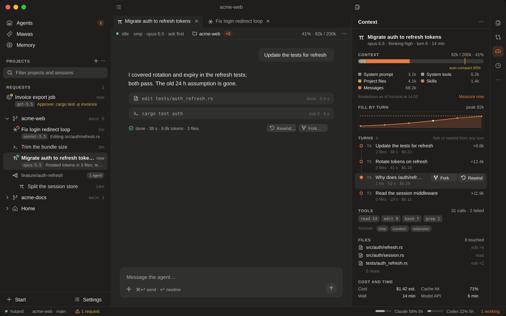
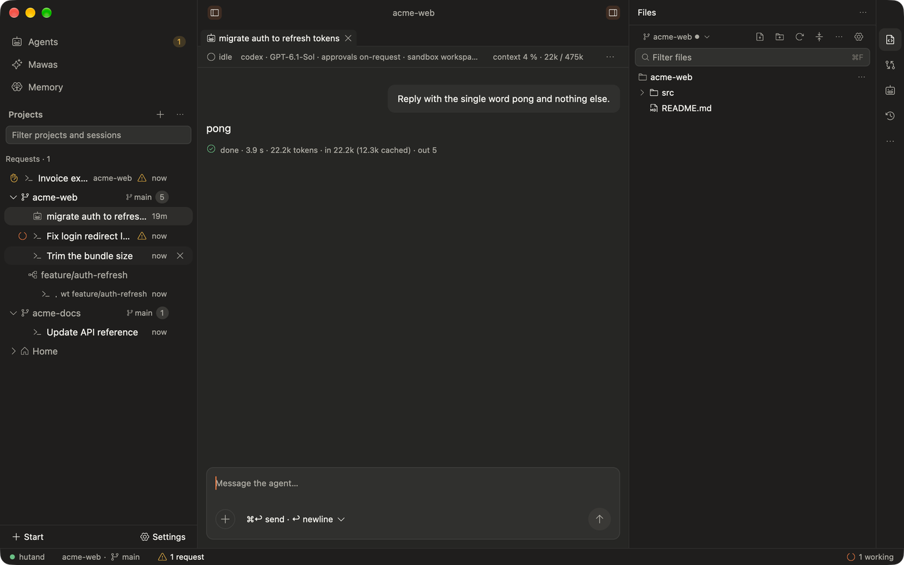
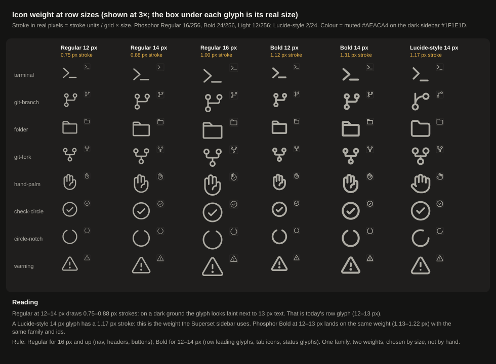
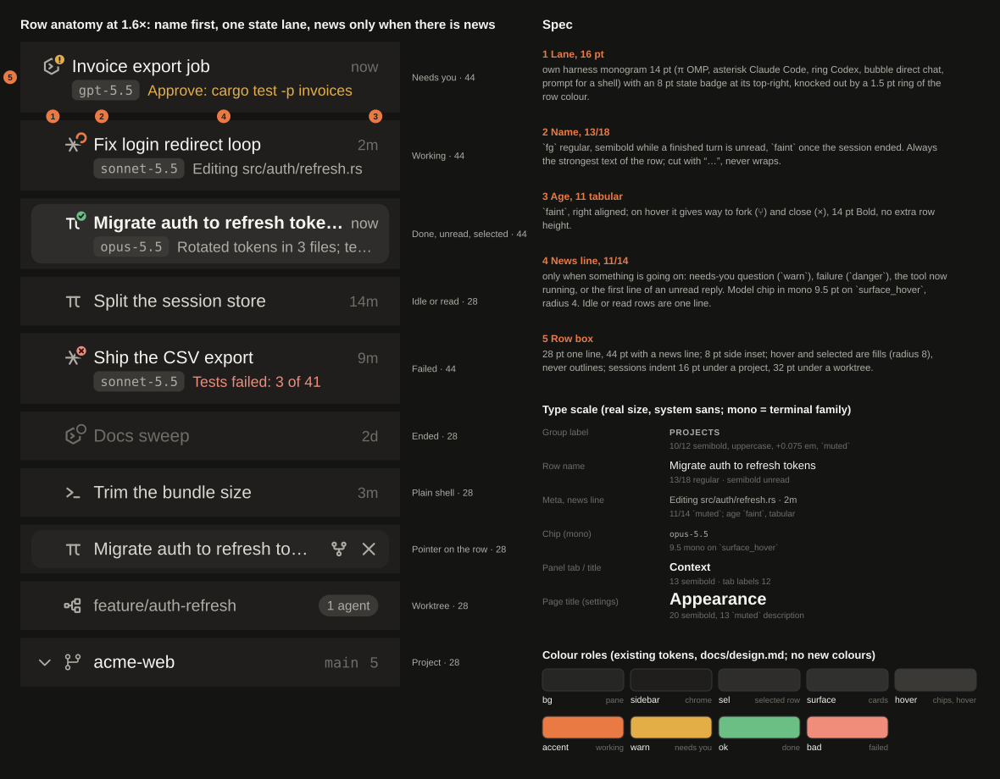
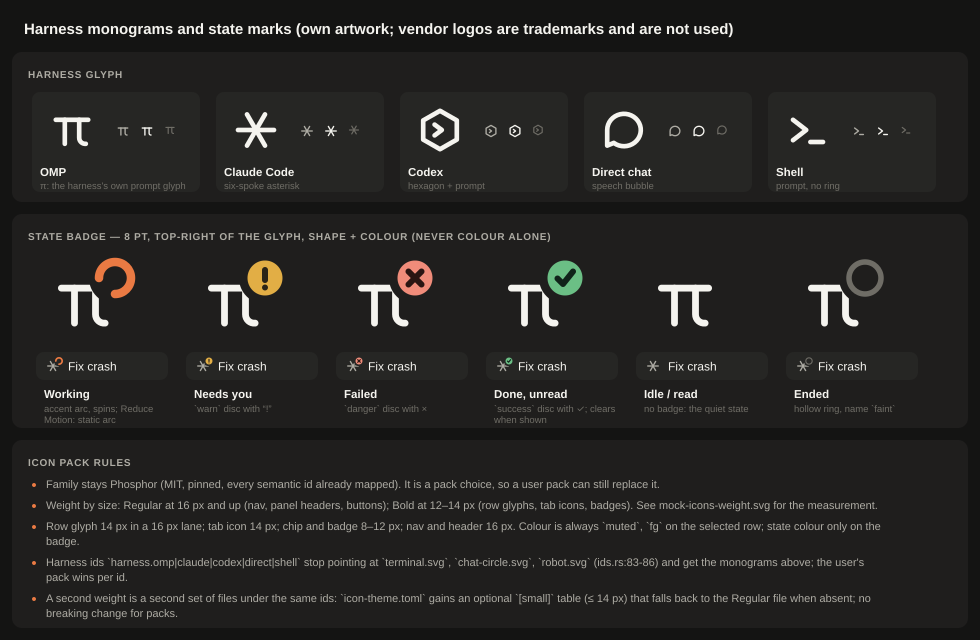
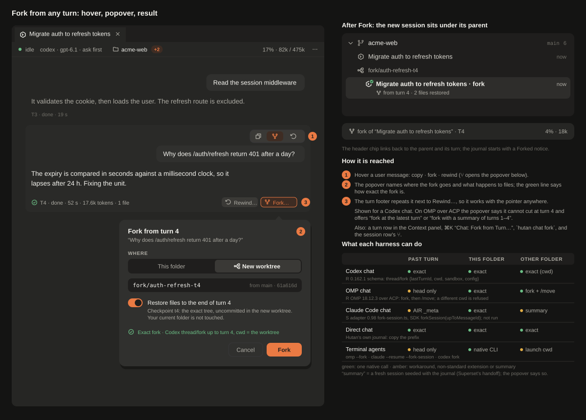
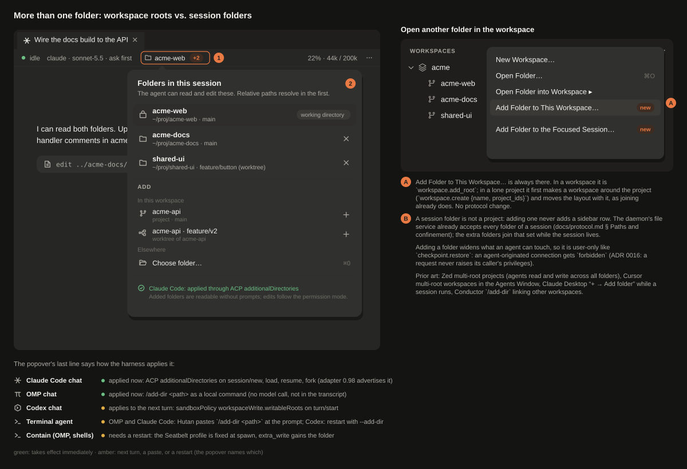
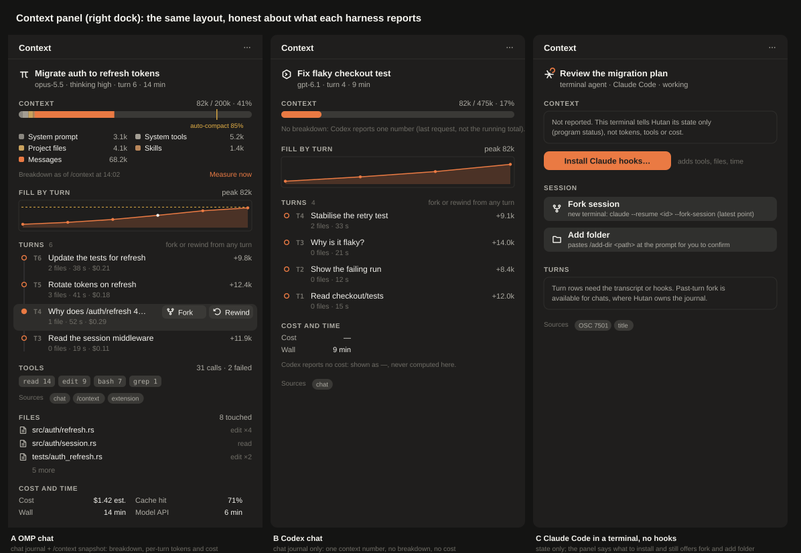

# BEST-OF — a Superset-like look, fork from any turn, folders in a session, a context view (2026-10-28)

Brief: `docs/briefs/BEST-OF.md`. Docs only; no product code changed. Builds on `docs/spikes/2026-10-28-ui-study/README.md` (cards, tabs, settings, plan) and `docs/spikes/2026-10-28-insight.md` (what each harness reports). The user's Superset screenshot stayed in `~/hutan-scratch/private/` and is described in words only (AGENTS.md invariant); every name, path and number in the mocks and in `today/` is invented or comes from a scratch home. Mocks are our own SVGs; glyph artwork is Phosphor (MIT, as in the repo's pack) and our own monograms. No vendor logo is drawn.

Evidence tags: **S** source read · **D** official documentation read · **R** run by us (binary, schema, scratch repo) · **P** the user's product shot (paraphrased, not committed) · **M** measured in a real Hutan window (Cua, scratch `HUTAN_HOME`) · **F** repo code or fixture · **I** inference, not verified.

## 0. Summary

1. **Why Superset feels nicer is not size or density, it is hierarchy.** Its sidebar rows are the same pitch as ours (28 pt; ours 26 + 2 gap) at the same 13 px. What differs: one 16 pt lane that carries a *different* glyph per row kind with a 6 pt state dot, a name that is the only strongly inked text, quiet right-aligned metadata, tiny uppercase group labels, and icons drawn at a heavier stroke. Ours: every session starts with the same `>_`, a shared-checkout warning triangle repeats on the rows, and 12–13 px Phosphor Regular strokes are 0.75–0.88 px thin (§1).
2. **Style spec (§1.5):** name first (13/18, semibold while unread); one lane = own harness monogram + 8 pt state badge; a second *news line* only when something is going on (needs-you, failure, current tool, unread reply), so idle rows stay 28 pt; uppercase 10 px tracked group labels; fills, never outlines; **Phosphor stays, but by weight and size**: Regular at ≥ 16 px, Bold at 12–14 px (measured in `mock-icons-weight.svg`). No new colours; no `+/−` counts by default (setting `panels.sessions.show_diffstat`, off).
3. **Fork from any turn does not exist in Hutan** (grep: no conversation fork code; the only `fork` in the adapters' fixtures is the capability list the agents advertise). Native support, verified: **Codex** `thread/fork {lastTurnId, cwd, sandbox, config}` (0.162.1 schema, R); **OMP** ACP `session/fork` at the head (R, mock-provider run: new id, parent recorded, history and extra folders inherited), a *different* cwd is refused but fork + `/move` works (R); **Claude Code** ACP adapter 0.98 forks at a message through a non-standard `_meta.jetbrains.air.fork` (S, not run); direct chats are Hutan's own journal. Terminal agents: `omp --fork`, `claude --resume --fork-session` / `/branch`, `codex fork` (head only).
4. **It fits ADR 0019 exactly:** a fork is *conversation rewind without mutation*, and the checkpoint of that turn is the files. Fork = new chat at turn N, optionally in a new worktree whose files are the turn's checkpoint. Proven on a scratch repo: `git worktree add -b fork/… <base>` then `git read-tree --reset -u <checkpoint> && git reset --mixed <base>` reproduces the exact tree of turn 1 (modified, deleted and untracked files) and leaves the source repository untouched (R, §2.5).
5. **Folders:** two layers. *Workspace roots* exist (a workspace holds several projects, `workspace.add_root`); *session folders* do not (one `cwd` per session). Harness support is broad and verified: Claude `--add-dir`/`/add-dir`/ACP `additionalDirectories`, Codex `--add-dir` and `writableRoots` per turn (R schema), OMP `--add-dir`, `/add-dir` (a local command: no model call, no transcript message, persisted in the session header) while `session/new.additionalDirectories` is *ignored* by 18.12.3 (R). Adding a folder widens what an agent can touch, so it is **user-only** (like `checkpoint.restore`).
6. **Context view:** the insight panel becomes the **Context** panel of the right dock, in the new style, and doubles as the fork/rewind timeline (turn rows with Fork and Rewind). Same data and protocol as `2026-10-28-insight.md`; what changes is layout, honest per-harness empty states, and the turn rows (§4, `mock-context.svg`).
7. **Plan (§5):** nine slices in commit order, one ADR first. Protocol: two additive bumps (`chat.fork`, `session.dirs`) after the already-planned 0.55–0.58; everything visual is desktop-only. Five decisions for the user (§6).

## 1. Superset's visual language, Hutan today, and a style spec

### 1.1 What was read

- **S**: the public repo (now published as `ParadevAI/Paradev`, "formerly Superset", branch `main`, 2026-10-28), desktop renderer: `globals.css` (tokens), `DashboardSidebar/**` (section header, workspace row, lead indicator, agents chip), `WorkspaceSidebar/**` (right panel tabs, file rows, folder headers), `headerTabStyles.ts`. Files were read through `gh api`; nothing was cloned or built.
- **P**: the user's product shot (a dark window: left list, one terminal tab, right Files/Changes/Review panel, a floating terminal). It looks like a marketing composition; where it differs from the app's code the code wins and the shot is marked **P**.
- **M**: our own capture of master (`today/workbench.png`): debug build from the sibling INSIGHT-FIX worktree, scratch home, made-up project `acme-web` with a worktree, five terminal sessions (three report an agent through `hutan agent report`) and one Codex chat served by the recorded fixture (`hutan-codex-fixture replay plain-turn`). Window 1280 × 800 pt, screenshot 1366 × 854 px. Session names are invented for this spike.

### 1.2 Superset's language (S unless marked)

| Element | Value | Source |
|---|---|---|
| UI font | none loaded: Tailwind's default `font-sans` stack (system UI → SF Pro on macOS); mono only for the terminal, shortcut labels and chips. (Its web/marketing app loads Inter and IBM Plex Mono.) | `globals.css` (only `--superset-terminal-font-family` is set); `apps/web/src/app/layout.tsx` |
| Sidebar row | `h-7` = 28 px, `mx-2` (8 px inset), `rounded-md` = 8 px (`--radius` 10 px − 2), name `text-[13px] leading-tight`, `text-foreground/80` → `foreground` when active; no font-medium on workspace names, `font-medium` on project rows | `DashboardSidebarExpandedWorkspaceRow.tsx`, `DashboardSidebarProjectRow.tsx` |
| Fills | hover `foreground` 7 % (light 4 %), selected 10 % (light 6 %), as `color-mix` washes so they follow any theme; selection is a fill, there is no outline | `globals.css` `--fill-hover`, `--fill-selected` |
| Lead lane | 16 px box (`size-4`, `mr-2`), **one glyph by precedence**: failed › provisioning spinner › working wave spinner › agent status dot › PR glyph (12 px, stroke 2) › idle 6 px dot at 50 % | `DashboardSidebarWorkspaceLeadIndicator.tsx` |
| Status colours | 6 px dot: needs input yellow + ping, failed red + ping, working amber, ready-for-review green; no word, no outline | `StatusIndicator.tsx` |
| Right slot | host glyph; on hover the shortcut label (mono 10 px tabular) and a close/archive button 20 px replace it | `…ExpandedWorkspaceRow.tsx` |
| Agent chip | `h-[18px]`, `bg-muted/60`, 9 px tabular count, one agent avatar 12 px with the status dot at its top-right (`-top-0.5 -right-0.5`), `+N` subagents; hover card 256 px listing every agent | `DashboardSidebarAgentsChip.tsx`, `…AgentAvatar.tsx` |
| Group label | `h-7`, `pl-4`, **10 px semibold uppercase, `tracking-[0.075em]`**, muted; the chevron shows on hover (always when collapsed) | `DashboardSidebarSectionHeader.tsx` |
| Right panel | tab strip `h-10` (40 px) on `muted/35–45 %` with a hairline; tabs 12 px, `px-3`, `gap-1.5`, icon 12 px, active = `foreground` on a lighter fill, inactive `muted/70`; count badge 10 px pill | `SidebarHeader.tsx`, `headerTabStyles.ts` |
| Changed files | 12 px rows, `py-1 px-3`, icon 14 px, directory muted + basename medium, `+/−` 10 px muted; folder header 12 px muted with an 11 px tabular count | `FileRow.tsx`, `FolderHeader.tsx` |
| Icons | `lucide-react` + `react-icons` (Lucide, Heroicons 2, Tabler): rows 14 px (`size-3.5`), chips 10–12 px, **stroke 2 on a 24 grid** | `package.json`; `lead.tsx`, `icon.tsx` |
| Palette | dark "ember": `background #151110`, `sidebar #1a1716`, `card #201e1c`, `border #2a2827`, `muted-foreground #a8a5a3`, accent `#e07850`; the sidebar is a step *lighter* than the canvas | `globals.css` |
| Shot (**P**) | group labels read as small uppercase *monospace* with a muted count at the far right; rows are name-only with a leading glyph (dot, branch or cloud) and tabular counts right-aligned; the selected row has a faint fill and a thin orange bar at its left edge; one terminal tab with the agent's own glyph; the right panel has a Run action and a PR chip above the three text tabs, a summary line with a branch chip, and changed files grouped under uppercase folder labels | the shot |

### 1.3 Hutan today (F and M)

| Element | Today | Source |
|---|---|---|
| Fonts | system sans; compact 12 body / 11 secondary / 11 section label (sentence case, "no all-caps"); rows' title 13 (`CARD_TITLE`); mono Menlo for terminals | `docs/design.md` § Typography, `sessions.rs:70` |
| Sidebar row | compact 26 + 2 gap = **28 pitch** (the same as Superset), 6 px inset (`spacing × 1.5`), radius 10 (`radius.control + 4`), lane 16 (`STATUS_LANE`), indent 12 (`INDENT`), unread dot 8 | `sessions.rs:60–70`, `theme.rs`, `theme.toml` |
| Lane | state glyph **only while something is going on**; the leading kind glyph is `>_` for every terminal agent and a robot for a chat: `harness.omp` → `terminal.svg`, `harness.claude` → `chat-circle.svg`, `harness.codex` → `robot.svg` | `ids.rs` (`HarnessOmp`, `HarnessClaude`, `HarnessCodex`) |
| Noise | the shared-checkout warning triangle repeats on session rows (two of six in `today/workbench.png`), project rows carry a branch pill, a count pill and a play button; the worktree row is a label with a different glyph and its session is titled `wt feature/auth-refresh` (the given title was replaced; AGENT-TERM-1 fixes naming) | M |
| Group labels | `Requests · 1`: sentence case 11 px, muted | M |
| Icons | Phosphor **Regular** (stroke 16/256): 12–13 px in rows, 16 in nav and project rows | `assets/icon-themes/phosphor` (paths use round caps of radius 8), design.md § Icons |
| Chat header | `idle · codex · GPT-6.1-Sol · approvals on-request · sandbox workspa…  context 4 % · 22k / 475k`; turn footer `done · 3.9 s · 22.2k tokens · in 22.2k (12.3k cached) · out 5`; no per-message actions | M, `today/workbench.png` |
| Palette | `bg #262624`, `sidebar #1F1E1D` (the sidebar is *darker* than the canvas), `sidebar_accent #2E2D2B`, accent `#EA7A43`: warm browns like Superset's, so no new colours are needed | `docs/design.md` § Palette |

### 1.4 What actually separates the two (and what does not)

1. **Not density, not size, not palette.** Pitch 28 vs 26 + 2; name 13 px in both; both are warm and dark; hover/selected washes are within a few percent of each other (`#2E2D2B` over `#1F1E1D` is ≈ 7 % of `fg`; theirs 10 %).
2. **Identity lane.** Superset spends 16 pt on *what kind of thing this is and what it is doing*, always, with a distinct glyph per kind. Ours spends it on state only while busy and shows the same `>_` otherwise, so a column of sessions reads as a column of noise. (UI-STUDY G1.)
3. **One strong text.** Theirs: name at 80 → 100 % ink, everything else ≤ 11 px muted. Ours: title, project chips, ⚠ and a branch pill compete.
4. **Quiet metadata, loud only when it matters.** They colour a 6 px dot; we use a triangle and an accent dot at different places. A news line in `warn`/`danger` only when there is news (this spike's addition; Orca always shows a second line, Superset never does).
5. **Group labels.** Tiny uppercase tracked labels with a muted count make a tree scannable without chevron-and-pill clutter. Our design.md forbids all-caps; this is the single rule the new look reverses (decision 1).
6. **Icon weight.** Lucide 2/24 at 14 px = 1.17 px; Phosphor Regular 16/256 at 13 px = 0.81 px. On a dark ground that is the difference between "crisp" and "faint". See the measurement board below.
7. **Hierarchy.** Superset groups by tag and shows rows flat; Orca nests agents under worktree cards. Ours is a tree with chevrons at every level. The UI-STUDY `SIDEBAR-HIERARCHY` slice already covers the worktree card; here only its look is specified.

### 1.5 Style spec for Hutan

**Row anatomy** (`mock-style.svg`, `mock-icons.svg`): lane 16 · name 13/18 · age 11 tabular; an agent row grows a second line only with news.

**Tokens** (compact density; names follow `docs/themes.md`; every value is a pack entry, no literal in views):

| Token | Today | Proposed | Why |
|---|---|---|---|
| `sidebar.row-height` | 26 / 30 | unchanged; pitch stays 28 / 32 | no density change |
| `sidebar.card-height` (new) | — | 42 / 48 (+ 2 gap): row with a news line | two-line agent card |
| `text.row.size` (new, was const `CARD_TITLE`) | 13 | 13 in both densities | promote the constant to a token |
| `text.group.size`, `text.group.tracking` (new) | 11 sentence case | 10, semibold, uppercase, 0.075 em | Superset's label |
| `text.meta.size` | 11 | 11 (news line, age) | unchanged |
| `text.chip.size` (new) | — | 9.5 mono | model chip |
| `sidebar.lane` (new, was const `STATUS_LANE`) | 16 | 16 | promote |
| `sidebar.inset` (new, was `spacing × 1.5`) | 6 | 8 | floats the fill off the edge |
| `radius.row` (new, was `radius.control + 4`) | 10 | 8 | Superset's `rounded-md` |
| `sidebar.indent` (was `INDENT`) | 12 | 16 under a project, 32 under a worktree | clearer nesting |
| `icon.row.size`, `icon.nav.size`, `icon.badge.size` (new) | 12–13 / 16 / — | 14 / 16 / 8 | one scale |
| colours | — | **none new**: `fg`, `muted`, `faint`, `sidebar_accent`, `surface_hover`, `accent`, `warning`, `danger`, `success` | the packs already hold them |

**Rules**

- **Name first.** The title is the strongest text of the row (`fg`, regular; semibold while a finished turn is unread; `faint` once ended). Never wrapped; cut with "…". Age (11 tabular, `faint`) is the only right-hand datum; the pointer swaps it for ⑂ fork and × close. *AGENT-TERM-1 owns getting the real name there.*
- **One lane.** A harness monogram (14 px) plus an 8 pt state badge: working = accent arc, needs you = `warning` disc with `!`, failed = `danger` disc with ×, done-unread = `success` disc with ✓, idle = no badge, ended = hollow ring. Shape and colour both, never colour alone (design.md). The same glyph, badge included, leads the tab (UI-STUDY `mock-tabs.svg`).
- **News line only for news.** Needs-you question or approval (`warning`), failure (`danger`), the tool running now (muted), the first line of an unread reply (muted). The model sits on this line as a mono chip. Idle and read rows stay one line; plain shells always one line.
- **Placement warning once.** The shared-checkout triangle moves from the rows to the project/worktree row as one chip; the tooltip text is kept (UI-STUDY parity rule).
- **Group labels** (10 px uppercase, tracked) for system groups only: `REQUESTS`, `PROJECTS`, right-dock section titles. Project and workspace names keep their own case, 13 px medium.
- **Cards.** Three tiers, all fills: *row* (no fill until hover or selected), *card* (`surface`, radius 10: worktree card, popovers, tool calls, panel blocks), *chip* (`surface_hover`, radius 4 mono or 999 pill). Selected row = `sidebar_accent`. A 2 px accent edge on the selected row (visible in the shot) is **not** adopted: design.md reserves accent edges for drop targets.
- **Right panels.** Keep the activity rail (FX-DOCK-TOGGLES removes duplicate switchers; Superset's text tabs would add one). Adopt its content styling: section titles as group labels with a muted count, changed files grouped under their folder, a summary line (`5 files · against main`) and **no** `+/−` unless `panels.changes.show_diffstat` is on.
- **No counters copied.** Usage stays in our format (STATUS-METERS), diff counts are an option, no per-row meters.

**Icon set: Phosphor stays.** It is MIT, pinned in the repo, covers every semantic id in `IconId`, and a user pack can replace any id. The fix is weight by size, not a new family: Regular ≥ 16 px, **Bold at 12–14 px** (1.12–1.31 px strokes ≈ Lucide 14 px's 1.17). Implementation: the Phosphor pack gains Bold files under the same ids and `icon-theme.toml` an optional `[small]` table (≤ 14 px) that falls back to the Regular file, so third-party packs keep working. Harness ids get our own monograms (π for OMP, an asterisk for Claude Code, a hexagon-prompt for Codex, a bubble for direct chat, a prompt for a shell) because vendor marks are trademarks (UI-STUDY decision 2). The Bold set and the monograms are **I**: drawn in the mocks, not yet rendered by the app.

## 2. Fork from any turn

### 2.1 Hutan today

No conversation fork anywhere (**F**: `grep -rn fork crates --include=*.rs` finds only process-fork comments and macOS `forKey:` calls; the ACP fixtures list `"fork":{}` because the agents advertise it, Hutan never calls it). What exists: `chat.retry`, queueing, and **checkpoints** (ADR 0019, CK-1…CK-5): per turn a hidden ref `refs/hutan/checkpoints/<session>/<turn>` (a tree commit; the end commit's parent is the start commit), preview and path-scoped, undoable *files-only* restore from the turn footer (`chat/cards.rs` `checkpoint_footer`, `chat/rewind.rs`). ADR 0019 § Decision 9 says conversation rewind "is not promised" and left it to a spike (CK-7). This section is that spike's answer: **fork is the non-destructive conversation rewind**.

What the journal already holds: every event carries `provider {thread_id, turn_id, item_id}` (`core/src/agent.rs` `ProviderIds`), so Hutan knows each turn's Codex turn id (`codex/mapper.rs:187`) and the ACP `messageId` of Claude/OMP assistant chunks (`acp/mapper.rs:456`) without new capture.

### 2.2 What each harness supports (verified where marked)

| Harness, path | Fork at the head | Fork at a past turn | Fork into another folder | Evidence |
|---|---|---|---|---|
| **Codex chat** (app-server, Hutan accepts 0.160–0.169) | `thread/fork {threadId}` → new thread, `Thread.forkedFromId` set | **yes**: `lastTurnId` ("copies history through this turn, inclusive; cannot be in progress") | **yes**: the request carries `cwd`, `sandbox`, `config`, `approvalPolicy`, `model` overrides | **R**: `codex app-server generate-json-schema` on 0.162.1 (`ThreadForkParams`, `ThreadForkResponse`); **D** app-server docs; not run (no login) |
| **OMP chat** (ACP, 18.12.3) | **yes**: `sessionCapabilities.fork` advertised; `session/fork` answers a new session id; the header records `parentSession`; history (8 → 14 messages after the next turns) **and** extra folders are inherited | **no** over ACP: the handler takes no message id. The RPC mode's `fork {entryId}` can; ACP does not expose it | **refused**: `session/fork` with a different `cwd` fails with "ACP session fork was cancelled" (the session file records its cwd and ACP passes no `onCwdChange`); **workaround that works**: fork in the same cwd, then the slash command `/move <path>` on the fork | **R**: `omp-acp-fork-dirs/` (mock provider, scratch `HOME`); **S** `acp-agent.ts` `#forkManagedSession`, `agent-session.ts` `switchSession` |
| **Claude Code chat** (ACP adapter 0.98, S) | **yes**: `unstable_forkSession` → SDK `forkSession` | **yes, non-standard**: `_meta.jetbrains.air.fork {version: 1, messageId, messageFingerprint, messageOccurrence}` resolves the message and calls `forkSession(id, {dir, upToMessageId})`. `messageId` is the ACP id of the assistant chunk, which Hutan's journal holds | **no**: the transcript lives under the *source* project dir (`dir: params.cwd` is where it is read), so a worktree needs a summary handoff; Superset reaches the same conclusion in `useForkChat.ts` ("session/fork into another worktree is refused") | **S** `fork-session.ts`, `acp-agent.ts` (`additionalDirectories`, `fork` capabilities); **D** Agent SDK `forkSession` page; not run (no login, adapter not installed) |
| **Direct chat** (gateway) | yes: the conversation is Hutan's own journal | yes: copy the prefix | yes | by construction |
| **Claude Code, terminal** | `/branch [name]` ("copy of the conversation so far"), `claude --resume <id> --fork-session` | the Agent SDK has `resumeSessionAt` and `forkSession({upToMessageId})`; 2.1.312 has a hidden `--resume-session-at <message id>` (**R**, binary strings; not in `--help`); the interactive `/rewind` "restore conversation" is destructive | `/cd <path>` moves the session's primary directory; not a fork | **R** `claude --help` 2.1.312; **D** code.claude.com sessions, checkpointing, permissions, Agent SDK |
| **OMP, terminal** | `/fork` (in place), `/fork pane\|window\|tab` (a child process), `omp --fork <id\|path>` (hidden from `--help`, present in source and binary) | `/rewind` keeps the old path as a branch; `/tree` | launch cwd | **D** `docs/session-operations-export-share-fork-resume.md`; **R** binary strings (`--fork requires session persistence`) |
| **Codex, terminal** | `/fork`, `codex fork [SESSION_ID]`, `codex fork --worktree` | **Esc Esc**: "edit the previous user message and fork the chat from that point" | `--worktree` | **R** `codex fork --help` 0.162.1; **D** CLI slash-commands |

Two caveats worth stating: ACP's `session/fork` is still an RFD whose own text says a message id "may be added in the future" (so Claude's `_meta` path is an adapter extension that can change; feature-detect by the adapter's advertised capability and fall back); and Codex's `thread/revert {beforeTurnId}` rewrites history in place and "does not revert local file changes" (ADR 0019) — fork avoids it.

### 2.3 How other apps expose it

| App | What the user sees | Granularity | Evidence |
|---|---|---|---|
| **Codex app / CLI** | `/fork`; in the desktop app **Fork into local** and **Fork into new worktree** (a bug report shows the worktree case); Esc Esc edits an earlier message and forks | any user message (CLI); head (app) [I for the app's granularity] | **D** slash-commands; GitHub `openai/codex#21432` |
| **Claude Code** | `/branch`, `--fork-session`; the rewind menu on any prompt offers *restore conversation*, *restore code*, both, or *summarize from here* | head (branch) / any prompt (rewind, destructive) | **D** sessions, checkpointing |
| **claude.ai** | edit a message → a branch with `‹ ›` arrows | any message | third-party description; **I** (claude.ai not opened) |
| **Cursor** | "Fork Chat" in the editor chat from any message; in the Agents Window only the latest message (forum answer, 2026-04); checkpoints restore files | any (editor) / head (Agents Window) | **D** forum thread 158692; docs `agent/overview` |
| **Zed** | edit any message and resubmit it; a "Restore Checkpoint" button on a message once the model has edited; side threads are separate. No fork read in the docs | edit-in-place | **D** `zed.dev/docs/ai/agent-panel` |
| **Orca** | native chat: **Rewind to here** (an undo glyph on each message); the history rewinds to that message, for Claude by materializing the transcript cut at the prompt's parent | any message, rewinds the conversation | **S** `NativeChatRewindAction.tsx`, `claude-rewind-fork.ts` |
| **Superset** | a fork glyph in an agent terminal's header: *Continue with another agent* and *Fork session* ("asks the agent for a native clone"); `superset agents create --fork-session S`; a chat forks into a **new worktree** by a handoff prompt built from the journal | head | **D** changelog 2026-08-30; **S** `useForkChat.ts` |
| **Tern** | `omp --fork` of a pane's session into a new pane over its pane socket | head | `2026-10-28-ui-study` §1.3 |

Nobody we read **restores the files of that turn** when forking. Hutan can, because checkpoints are exact trees (ADR 0019).

### 2.4 Design for Hutan

**Semantics.** *Fork from turn N* creates a new chat session whose conversation is the parent's through turn N and whose folder is (a) the same folder or (b) a new worktree whose files are turn N's checkpoint. The parent is never touched. Rewinding the conversation is "fork, then archive the parent" (an option in the popover); rewinding files in the same folder stays the existing *Rewind…* (previewed, undoable).

**Three ways to cut, chosen by the daemon and *named* in the UI** (`ChatInfo.fork.support`):

- *exact*: the harness cuts at the turn natively (Codex `thread/fork lastTurnId`; Claude via the AIR `_meta`; direct: journal copy).
- *head*: the harness forks only at its current end (OMP over ACP). The popover offers **Fork at the latest turn**, or **Fork with a summary** for an earlier turn.
- *summary*: a fresh session seeded with a bounded text of the journal prefix (Superset's handoff). Lossy; labelled "Fork with a summary of turns 1–N"; never offered silently.

**Data.** `ChatSpec.fork {parent: SessionId, turn: TurnId, at_ms, mode: exact|summary}`; the new session's journal starts with a `forked` notice and a copy of the parent's events through turn N (copy, not link, so deleting or pruning the parent never breaks the child; bounded by the journal's own cap); `SessionInfo.forked_from?` for the sidebar and header chip. Provider ids come from `ProviderIds` already in the journal.

**Folder and files** (`mock-fork.svg`):

- *This folder*: no files are touched. If the user also wants the files of turn N they use Rewind (the popover says so; the toggle is off and disabled).
- *New worktree*: `worktree.create` (existing, `hutan wt new`) from the base HEAD the turn started on, then the checkpoint tree is laid on it **as uncommitted changes** with `git read-tree --reset -u <checkpoint> && git reset --mixed <base>` inside the new worktree (§2.5), through the existing private-index machinery of CK-1 and never in the source checkout. Branch default `fork/<title-slug>-t<N>`. A turn that changed nothing has no end ref: the previous end ref (or the base) is used and the popover says "no files changed by turn N".
- Per harness the new chat's `cwd` is the worktree: Codex passes `cwd` (and `sandbox`) on `thread/fork`; OMP forks in the old cwd then `/move`s (two ACP calls, both verified); Claude Code cannot, so a worktree fork is a *summary* fork; direct chats just start there.

**Surfaces** (all gated on capability `chat.fork`): hover action bar on a user message (copy · fork · rewind); *Fork…* beside *Rewind…* in the turn footer; a Fork action on each turn row of the Context panel; ⌘K *Chat: Fork from Turn…*; the session row's ⑂ (head fork, same folder); CLI `hutan chat fork <session> [--turn N] [--worktree BRANCH] [--files] [--archive-parent]` and MCP `chat_fork`. The fork appears **under its parent** in the sidebar with a ⑂ lineage line, and the chat header carries a chip linking back.

**Terminal agents** (`TERM-FORK`, no protocol change): *Fork session* in the session menu starts a new terminal with the harness's own command at the head — `omp --fork <id>`, `claude --resume <id> --fork-session`, `codex fork <id>` — using the session id and resume command the integrations already report (`--agent-session-id`, AGENT-TERM-1). Past-turn fork for terminals is out of scope: Hutan does not own their journal.

**Policy.** Creating a fork is like `chat.create`: it follows `[control]` for agent-originated callers. Fork never writes to the parent's folder. A fork inherits the safety preset and account of the parent (`ChatSpec.safety`, `account`) and, per §3, its session folders. A fork of a chat with a running turn is refused (`invalid_state`; Codex requires the turn not be in progress, OMP refuses "while a prompt is in progress").

**Protocol (additive, capability `chat.fork`).** `chat.fork {session_id, turn_id?, title?, worktree?: {branch?, restore_files?}, allow_summary?, archive_parent?}` → `SessionResult` plus `fork: {mode, support}`; `ChatInfo.fork?: {support: exact|head|summary|none}`; `SessionInfo.forked_from?: {session_id, turn_id}`. Errors: `unsupported` with the reason, `invalid_state`, `not_found`, `conflict` when the worktree branch exists. Golden fixtures per `AGENTS.md`.

### 2.5 What was run

1. **OMP 18.12.3 over ACP** (`omp-acp-fork-dirs/run.py`, `mock.py`, `result.json`): scratch `HOME` and `PI_CODING_AGENT_DIR`, a loopback OpenAI-compatible mock, no model, no credentials. Three turns (one with a `read` tool call) plus `/add-dir` and `/dirs`, then `session/fork`: **with another `cwd` → error `"ACP session fork was cancelled"`**; with the same `cwd` → a new session id whose transcript header has `parentSession` = the source id, whose history grows from 8 to 14 messages with the next prompts and whose workspace folders (`/add-dir`) are inherited; then `/move /tmp/bestof-omp/workC` on the fork answers `Moved to …`, `/dirs` shows the new working directory first, and `read c.txt` resolves in the new folder (`charlie`). The fork's session file records `cwd` = the new folder.
2. **Checkpoint → worktree** (scratch git repo, plain git 2.x): after two simulated turns (each a tree commit made with a private index, as CK-1 does), `git worktree add -b fork/t1 ../fork-wt <base>` then `git -C ../fork-wt read-tree --reset -u refs/hutan/checkpoints/s/t1 && git -C ../fork-wt reset --mixed <base>` gave `M a.txt` (with turn 1's edit only), `D b.txt`, `?? c.txt` and no `d.txt` (turn 2's file), while the source repository kept its own state and gained only the branch. **[I]** Which commit is a start checkpoint's parent (the HEAD at snapshot time, as simulated here) must be confirmed against CK-2 in the first slice.
3. **Codex** `thread/fork` and **Claude** `session/fork` + AIR `_meta`: read, not run (no login). The slice records fixtures from a scratch login first (`docs/agents.md` § Re-recording).

## 3. Folders in a session

### 3.1 Hutan today

- **Workspace roots exist.** A workspace holds several projects (`workspace.create {name, paths?, project_ids?}`, `workspace.add_root` / `.remove_root`, `workspace.assign`), the *＋* menu has *Open Folder…* and *Open Folder into Workspace ▸*, and the Files panel shows every project of a workspace as a root (`panels.files.roots = workspace`, EX-8) (`docs/protocol.md` § Roots, `docs/design.md`, `docs/editor.md`). A lone project cannot take a second root (`invalid_state`).
- **A session has one folder.** `ChatCreate.cwd`, `TerminalSpec.cwd`; the adapters send it as ACP `session/new {cwd, mcpServers}` (`acp/mod.rs:395–427`) and Codex `thread/start {cwd, sandbox, approvalPolicy…}` (`codex/mod.rs:355`). Nothing in `crates` mentions `additionalDirectories`, `--add-dir` or an extra-folder list (**F**, grep).
- **What is already folder-shaped:** the daemon's file service accepts paths below workspace/project folders, linked worktrees and "the git checkouts its sessions work in" (`docs/protocol.md` § Paths and confinement); Contain takes `extra_write: [path]` per session (0.52); the Files panel's root switcher keeps up to 8 trees.

### 3.2 What each harness supports (verified where marked)

| Harness | At start | While running | Persisted / on resume | Evidence |
|---|---|---|---|---|
| **Claude Code, terminal** | `--add-dir <dirs…>`; settings `additionalDirectories` | `/add-dir <path>` | with the session; `/cd` moves the primary folder | **R** `claude --help` 2.1.312; **D** permissions § Working directories |
| **Claude Code chat** (ACP) | `additionalDirectories` on `session/new`, `load`, `resume`, `fork`; the adapter advertises `sessionCapabilities.additionalDirectories` | restart-level only (ACP defines no mid-session change) | ACP: *omitted on load/resume means none*, so the client must resend the list | **S** adapter 0.98 (`acp-agent.ts:3001`); **D** ACP RFD *Additional Workspace Roots* |
| **Codex, terminal** | `--add-dir <DIR>`: "additional directories that should be writable alongside the primary workspace" | — | with the session | **R** `codex --help` 0.162.1 |
| **Codex chat** (app-server) | `thread/start.config` (`sandbox_workspace_write.writable_roots`) | **per turn**: `turn/start.sandboxPolicy {type: workspaceWrite, writableRoots: [abs…]}` ("override for this turn and subsequent turns") | resend on resume | **R** schema 0.162.1 (`TurnStartParams`, `SandboxPolicy`); **D** config reference |
| **OMP, terminal** | `--add-dir <dir>` (repeatable); setting `workspace.additionalDirectories` | `/add-dir`, `/remove-dir`, `/dirs` | the dirs are stored in the session header | **R** `omp --help` 18.12.3; **S** `main.ts`, `context-settings.ts` |
| **OMP chat** (ACP) | `session/new.additionalDirectories` is **accepted and ignored** (`/dirs` lists only the cwd) | **`/add-dir <path>` sent as a prompt**: a *local* command: no model call, not in the transcript; the next system prompt lists the folder; `/dirs` confirms | **persisted in the session header** (`additionalDirectories`), **inherited by a fork** | **R** `omp-acp-fork-dirs/result.json`; the capability is not advertised in 18.12.3 |
| **Direct chat** | n/a (no tools) | n/a | n/a | — |

Claude's sandbox follows suit: folders added with `--add-dir`, `/add-dir` or `permissions.additionalDirectories` are writable inside its Bash sandbox (**D** sandboxing). Codex reads the whole disk already; an extra folder only changes where it may write. ACP deliberately defines no per-root read/write and no mid-session change.

### 3.3 How other apps do it

| App | Behaviour | Evidence |
|---|---|---|
| **Claude Desktop** (Code tab) | "+ next to the prompt box → **Add folder**" while a local or SSH session runs; folders can also be part of a saved environment | **D** `code.claude.com/docs/en/desktop` § Add folders |
| **Zed** | a multi-root *project*; "Agents can read and write across all of those folders in a single thread"; add from the sidebar, the title-bar project picker or the Project panel | **D** `zed.dev/docs/ai/parallel-agents` |
| **Cursor** | multi-root workspaces in the Agents Window (2026-04-24): one agent session targets a reusable workspace of several folders; CLI `--add-dir` repeatable | **D** changelog 04-24-26, CLI changelog |
| **Conductor** | a workspace is one repo; `/add-dir` in one workspace lets you pick *other workspaces* to link | **D** conductor.build *Linking multiple directories* |
| **Orca, Superset** | none in the UI (Orca passes `--add-dir` through agent arguments) | **S** code search: zero hits in Superset; Orca only in launch args |

### 3.4 Design for Hutan

Two layers, deliberately separate (`mock-folders.svg`):

1. **Workspace roots** (already built). *Open another folder in this workspace* is one menu entry, **Add Folder to This Workspace…**, that is always available: inside a workspace it is `workspace.add_root`; inside a lone project it first creates a workspace around the project (`workspace.create {name, project_ids}`) and hands the layout over, as joining a workspace already does. No protocol change, a desktop slice.
2. **Session folders** (new). A session's working directory stays the first folder; extra folders are an ordered list. A session folder is **not** a project: adding one never adds a sidebar row. The file service already accepts "the git checkouts its sessions work in"; it gains the session's extra folders while the session lives.

**UX.** The chat header shows the working folder with a `+N` chip; the chip opens *Folders in this session*: the working directory (locked), each extra folder with ×, then **Add** from *this workspace* (other projects, worktrees), *recent*, and *Choose folder…*. The popover's last line says how the harness applies it (*applied now*, *next turn*, *a paste*, *needs a restart*). The same action is *Add Folder to the Focused Session…* in the ＋ menu and ⌘K. For a terminal agent Hutan pastes `/add-dir <path>` at the prompt (OMP and Claude Code understand it) for the user to confirm; Codex's terminal needs `--add-dir` at launch.

**Data.** `chat.create` and `TerminalSpec` gain `extra_dirs: [path]` (absolute, existing directories, at most 8, deduplicated, none equal to `cwd`); `ChatSpec.dirs` keeps the list across restart and restore; `ChatInfo.dirs: [{path, role: primary|extra, applied: now|next_turn|restart|unsupported}]`. New requests `chat.add_dir {session_id, path}` and `chat.remove_dir`.

**Per harness** (what the adapter does with `dirs`): Claude → `additionalDirectories` on `session/new|load|resume|fork` (resent at every start, as ACP requires); OMP → one `/add-dir` prompt per folder right after `session/new` and on load (verified local, persisted by OMP itself, so only missing ones are sent); Codex → `writableRoots` in the `sandboxPolicy` of every `turn/start` and `config` on `thread/start`; terminal agents → launch arguments for a harness started by Hutan, the paste for a running one. **Contain:** `extra_write` gains the folders; the Seatbelt profile is fixed at spawn, so a contained OMP chat or shell reports `applied: restart` and the desktop offers *Restart with this folder*. A fork inherits the list.

**Safety.** Adding a folder widens what an agent can touch, so `chat.add_dir`/`.remove_dir` are **user-only** (`Access::UserOnly`, like `checkpoint.restore`; ADR 0016: a request never raises its caller's privileges): an agent-originated connection gets `forbidden`. The folder must be an existing directory the user can name; paths under Hutan's own data folder and the `[sandbox] read_deny` set are refused. `hutan chat dirs <session>` lists them; MCP exposes the list read-only.

**Protocol (additive, capability `session.dirs`).** `extra_dirs` on `chat.create` and `TerminalSpec`; `chat.add_dir`, `chat.remove_dir`; `ChatInfo.dirs`; `SessionInfo.extra_dirs?` for terminals.

## 4. Context view (right dock)

The insight spike fixed the data (`AgentInsight`: context with breakdown, per-turn usage, tools, files, time, per-block source) and the wire (0.58). This spike changes **where and how it is drawn**, because the user wants the same panel to show how the context is filled *and* to fork from any point.

- **A registered panel named *Context*** in the right dock's rail (its icon sits with Files, Changes, History; ADR 0010: own settings namespace `panels.context`). It follows the focused session; nothing else switches it.
- **Same grammar as the new sidebar**: section titles are group labels with a muted count; blocks are fills, not boxes; mono only for chips and paths; no `+/−`, no per-row meters.
- **Order**: identity (harness monogram, name, model · thinking · turn · age) → **Context** (meter with categories, auto-compact marker, "as of /context at 14:02" with *Measure now* where a harness offers it) → **Fill by turn** (context after each turn, the compaction line) → **Turns** (the timeline: prompt first line, tokens added, files, time, cost; the row under the pointer shows **Fork** and **Rewind**) → Tools → Files → Cost and time → Sources.
- **Honest per harness** (`mock-context.svg`): *A* an OMP chat has everything the journal and `/context` give; *B* a Codex chat has one context number (the `last` request, INSIGHT-FIX) and no breakdown or cost, and says so instead of drawing zeros; *C* a Claude Code terminal without hooks shows state only, says what to install, and still offers **Fork session** (head) and **Add folder** (paste). A block nobody reported is absent, never zero.
- **The turn rows are the fork/rewind timeline.** They are fed by the same `turns[]` as the token bars, keyed by `TurnId`, so `chat.fork {turn_id}` and `checkpoint.preview` need no new addressing. Rows for turns whose checkpoint is `unsupported` or `late` show Fork only.
- **Dock behaviour**: one toggle per dock (FX-DOCK-TOGGLES); the panel is 350 pt wide in the dock; below 320 the sources chips and the fill chart fold away first.

Protocol is unchanged from 0.58 except that `AgentInsight.turns[]` carries the `TurnId` and the checkpoint state per turn (additive fields in the same bump).

## 5. Ours against the best, decisions taken, and the plan

### 5.1 Scorecard on the remaining weakest areas

● on par or ahead · ◐ partial · ○ missing. Evidence for "best" is in §1–§3 and the UI-STUDY.

| Area | Best of what we read | Ours today | Slice |
|---|---|---|---|
| Session name and identity in lists | Orca (hook title + transcript title sync, harness icon), Superset (name-only rows), Warp (brand icon + badge) | ◐ raw OSC title, one glyph for all | AGENT-TERM-1 (running), STYLE-TOKENS, SIDEBAR-CARDS |
| Row and card look | Superset, Orca | ◐ flat but noisy (§1.4) | STYLE-TOKENS, SIDEBAR-CARDS |
| **Fork from a turn** | Codex (CLI `/fork`, Esc Esc, app *Fork into worktree*), Claude Code (`/branch`), Cursor (any message in the editor) | ○ | ADR-FORK-DIRS, CHAT-FORK-A/B/C, TERM-FORK |
| Conversation + files rewind together | Claude Code (restore code and conversation), Cursor (checkpoints) | ◐ files only (CK-5) | CHAT-FORK-C (fork + checkpoint worktree) |
| **Several folders in one session** | Zed, Cursor, Claude Desktop, Conductor | ○ for sessions, ● for workspaces | SESSION-DIRS-A/B |
| **Context view** | Claude Code `/context`, OMP `/context` (categories) | ◐ a header chip (Codex number wrong until INSIGHT-FIX lands) | AGENT-INSIGHT-A as the Context panel |
| Terminal-agent richness (model, activity, last reply) | Orca (hooks/extension) | ◐ opt-in hooks report none of it | AGENT-CARDS, AGENT-INSIGHT-B |
| Usage meters | Orca | ◐ status item off by default | STATUS-METERS |
| Attention (bell, unread) | Orca, Warp, Zed | ○ | TAB-BELL |
| Settings and dialogs | Orca (cards), macOS sheets | ◐ | UI-RHYTHM (running), FX-QUIT-SHEET, SETTINGS-IA |

Where Hutan is ahead and should stay: exact per-turn file checkpoints with previewed, undoable restore (ADR 0019); a daemon that owns sessions across client restarts; Contain; workspaces with several projects; `[[hooks]]`; remote over SSH.

### 5.2 Decisions already taken (the user, 2026-10-28)

No `+/−` counts in cards or the status bar (an option: `panels.sessions.show_diffstat`, `panels.changes.show_diffstat`, off); usage in our own format, not Orca's meter row (STATUS-METERS); the **session name is the top priority** (AGENT-TERM-1 running); "another format is fine": nothing is copied from Orca's counters; Superset is a style reference, not a pattern to clone.

### 5.3 Slices in commit order

Running now: `FX-DOCK-TOGGLES`, `AGENT-TERM-1` (0.55), `UI-RHYTHM`, `INSIGHT-FIX`. Slices that touch `panels/sessions.rs` or the tab strip wait for AGENT-TERM-1. Sizes are agent-days (`process.md`: ≤ 1–2). Protocol numbers are *the next free at merge*; the order after the UI-STUDY plan (0.55 AGENT-TERM-1, 0.56 optional summary, 0.57 bell, 0.58 insight) is 0.59 `chat.fork`, 0.60 `session.dirs`.

| # | Slice | Content | Depends | Protocol | Size |
|---|---|---|---|---|---|
| 0 | **`ADR-FORK-DIRS`** (orchestrator, docs) | a new ADR (0023 is the next free number today): fork semantics (exact/head/summary, copy-not-link journal, checkpoint worktree), session folders (user-only, per-harness application), amendment note to ADR 0019 § Decision 9 / CK-7 | this spike | — | 0.25 |
| 1 | **`STYLE-TOKENS`** | the §1.5 tokens as pack entries; `ui::group_label`, `ui::chip_mono`, `ui::row_lane`, `ui::state_badge`; Phosphor Bold files and the `[small]` table in `icon-theme.toml`; own harness monograms behind `harness.*`; docs `design.md`/`themes.md` (the all-caps rule, new tokens, icon weights) | UI-RHYTHM (the `ui` kit) | none | 1.5 |
| 2 | **`SIDEBAR-CARDS`** | agent cards (lane + badge, name, news line, age, hover ⑂ ×), shells stay one line, shared-checkout warning once on the project/worktree row, group labels, the `show_diffstat` options; replaces UI-STUDY's `AGENT-CARDS` look (its data part stays) | 1, AGENT-TERM-1 | optional 0.56 `AgentNode.summary` (from UI-STUDY) | 2 |
| 3 | **`CHAT-FORK-A`** | `core` `ChatSpec.fork`, journal prefix copy, `chat.fork` for direct (exact), Codex (`thread/fork lastTurnId`, fixtures from a scratch login), OMP and Claude Code at the head, support detection from the advertised capabilities, summary fallback, `invalid_state` rules, CLI `hutan chat fork`, MCP `chat_fork` | 0 | **0.59** `chat.fork` | 2 |
| 4 | **`CHAT-FORK-B`** | desktop: hover action bar, *Fork…* in the turn footer, popover (this folder only), lineage under the parent and the header chip, ⌘K | 2, 3 | none | 1.5 |
| 5 | **`CHAT-FORK-C`** | new worktree + checkpoint files (`worktree.create`, `read-tree --reset -u`/`reset --mixed` through CK-1's private index), Codex `cwd`, OMP fork + `/move`, Claude summary path, `restore_files`, `archive_parent`; popover *Where* and *Restore files* | 3, 4 | extends 0.59 | 1.5 |
| 6 | **`SESSION-DIRS-A`** | `extra_dirs` in `chat.create`/`TerminalSpec`, `ChatSpec.dirs`, `chat.add_dir/remove_dir` (user-only), per-harness application (Claude ACP, OMP `/add-dir`, Codex `writableRoots`, terminals' launch args), Contain `extra_write`, file-service roots, CLI `hutan chat dirs` | 0 | **0.60** `session.dirs` | 2 |
| 7 | **`SESSION-DIRS-B`** | desktop: folders chip + popover, ＋ menu entries (*Add Folder to This Workspace…*, *…the Focused Session…*), terminal paste flow, restart prompt for Contain | 6 | none (the workspace entry uses 0.19) | 1.5 |
| 8 | **`CONTEXT-PANEL`** = `AGENT-INSIGHT-A` desktop part (insight spike § 6 A) | the right-dock *Context* panel as in `mock-context.svg`; turn rows carry Fork/Rewind; honest empty states | AGENT-INSIGHT-A data (0.58), 4 | none beyond 0.58 | 2 |
| 9 | **`TERM-FORK`** | *Fork session* for terminal agents from the resume command and agent session id | AGENT-TERM-1 | none | 1 |

Protocol impact in one table:

| Version | Slice | Change | Capability |
|---|---|---|---|
| 0.59 | CHAT-FORK-A (extended by -C) | `chat.fork`, `ChatInfo.fork`, `SessionInfo.forked_from`, `ChatSpec.fork` | `chat.fork` |
| 0.60 | SESSION-DIRS-A | `extra_dirs`, `chat.add_dir`, `chat.remove_dir`, `ChatInfo.dirs` | `session.dirs` |
| — | STYLE-TOKENS, SIDEBAR-CARDS (look), CHAT-FORK-B, SESSION-DIRS-B, CONTEXT-PANEL, TERM-FORK | desktop or existing requests | — |

All additive (ADR 0002); old clients ignore the new fields.

### 5.4 Risks

| Risk | Mitigation |
|---|---|
| Claude's fork-at-message is an adapter extension (`_meta.jetbrains.air.fork`) and may change | feature-detect; the popover shows *exact* only when the adapter's version and capability say so; summary fallback; fixtures per adapter version |
| OMP cannot cut at a past turn over ACP | said in the popover (*head* support); upstream ask: expose the RPC `fork {entryId}` in ACP; meanwhile *fork with a summary* |
| Copying a long journal prefix is slow or large | bounded by the journal cap; copy by range in one SQLite transaction; measure in CHAT-FORK-A |
| A checkpoint worktree misses skipped paths (LFS, over-budget) | the popover lists what the checkpoint skipped (ADR 0019 § 5), same wording as Rewind |
| Adding a folder escalates an agent's reach | user-only requests, listed in `ChatInfo.dirs`, shown in the chat header; Contain applies `extra_write` and says `applied: restart` rather than pretending |
| Bold icon weights change the feel of third-party packs | `[small]` is optional and falls back; the Settings preview shows which weight a pack provides |
| All-caps labels clash with accessibility or localisation | uppercase is applied by the renderer to a sentence-case string, so VoiceOver reads the original and translations keep their case rules |

## 6. Decisions for the user (five)

1. **Uppercase group labels** (10 px, tracked) for system groups and panel sections, reversing design.md's "sentence case, no all-caps". Recommended: yes; it is the largest single part of the Superset look and costs nothing else.
2. **News line only when there is news** (idle and read agents stay 28 pt) versus a permanent second line like Orca. Recommended: news only; the sidebar stays short with many agents.
3. **Icon weight by size** (Phosphor Bold at ≤ 14 px, Regular above) with our own harness monograms. Recommended: yes.
4. **Fork defaults.** Where it goes (*This folder* remembered, or *New worktree* by default for a chat that already works in a worktree), and what to do when a harness cannot cut at a past turn: offer *latest turn* or *summary*, never silently. Recommended: remembered choice; always ask on a fallback.
5. **Session folders are user-only** and, for a running terminal agent, Hutan only *pastes* `/add-dir` for the user to confirm. Recommended: yes.

## 7. Evidence, files and limits

Files here: `mock-workbench.svg`, `mock-style.svg`, `mock-icons.svg`, `mock-icons-weight.svg`, `mock-fork.svg`, `mock-folders.svg`, `mock-context.svg`; `today/workbench.png` (own capture, invented data); `omp-acp-fork-dirs/{run.py, mock.py, result.json}` (reproduces §2.5.1 and the OMP rows of §3.2).

Reproduce: `SCRATCH=/tmp/bestof-omp python3 docs/spikes/2026-10-28-best-of/omp-acp-fork-dirs/run.py` (needs `omp` on `PATH`; a scratch `HOME` and `PI_CODING_AGENT_DIR` are created under `$SCRATCH`, a loopback mock stands in for the provider; nothing of `~/.omp` is read). Codex schema: `codex app-server generate-json-schema --out /tmp/schema` (0.162.1 from the npm registry). Claude Code: `claude --help` 2.1.312 from the registry's `@anthropic-ai/claude-code-darwin-arm64`. Superset: `gh api repos/superset-sh/superset/contents/<path>` for the files named in §1.2. Hutan captures: `HUTAN_HOME=<scratch> hutan-desktop`, `hutan new …`, `hutan chat new`/`send` with `[codex] bin = hutan-codex-fixture` in the scratch `daemon.toml`.

Not verified, and where it will be: **Claude Code chat fork and `additionalDirectories`** (read in the adapter source only; no login, adapter not installed) and **Codex `thread/fork`** (schema only): the first slice that needs them records fixtures from a scratch login. **claude.ai branching** (third-party page) and **the Codex app's fork granularity** (docs and an issue report). **Cursor, Zed, Conductor** were read as documentation; none was installed. Hover states cannot be captured through Cua (`docs/process.md`), so hover and the popovers exist only as mocks. **No light-theme mock**; the tokens are the existing pack values. The Bold icon weight, the `[small]` table and the monograms are drawn, not rendered by Hutan. The Orca source clone is blobless; a `git grep` for "fork" timed out, so Orca's rewind was read through the GitHub API instead. The mock sizes are computed with an approximate text-width table, not SF Pro metrics.

Sources: `superset-sh/superset` (now `ParadevAI/Paradev`) `apps/desktop/src/renderer/**`, `packages/ui/src/globals.css`, `apps/marketing/content/changelog/2026-08-30-…`; `agentclientprotocol/claude-agent-acp` 0.98.0 `src/acp-agent.ts`, `src/fork-session.ts`; ACP RFDs *session-fork* and *additional-directories* (agentclientprotocol.com); `can1357/oh-my-pi` `acp-agent.ts`, `agent-session.ts`, `main.ts`, `docs/session-operations-export-share-fork-resume.md`, `docs/rpc.md`; code.claude.com (sessions, checkpointing, permissions, sandboxing, desktop, Agent SDK TypeScript `forkSession`); developers.openai.com Codex (CLI slash-commands, config reference, app-server), `openai/codex#21432`; cursor.com changelog 04-24-26, docs `agent/overview`, forum thread 158692; zed.dev docs (agent panel, parallel agents); conductor.build docs; `stablyai/orca` via the GitHub API (`NativeChatRewindAction.tsx`, `claude-rewind-fork.ts`); Phosphor Icons (MIT) and Lucide (ISC) glyph artwork for the weight comparison.
