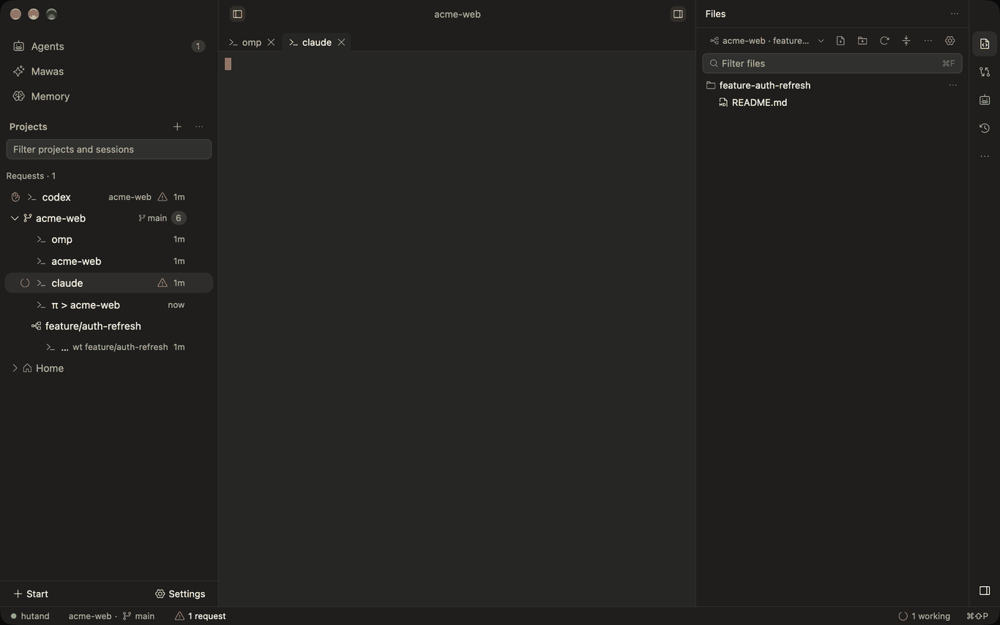
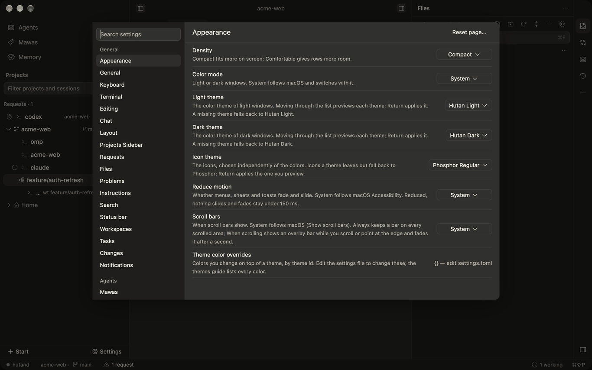
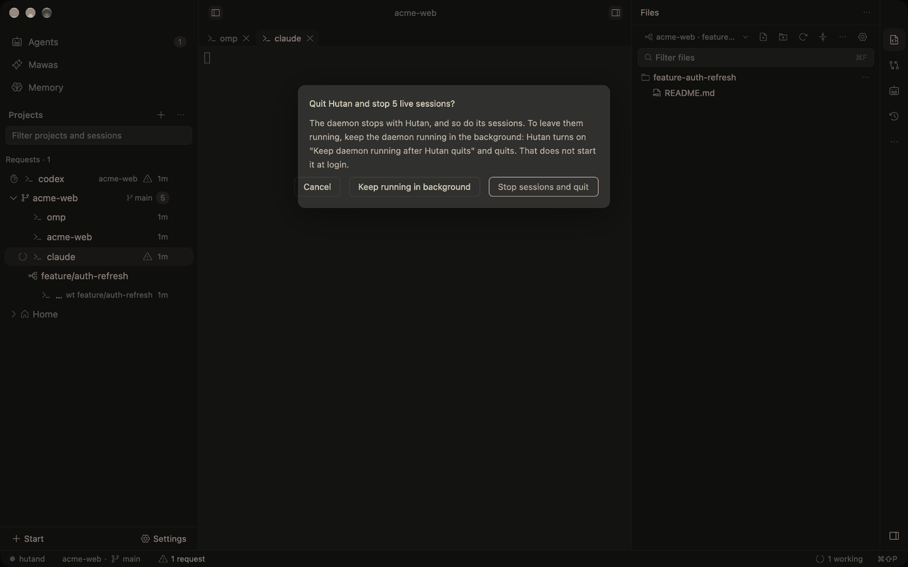
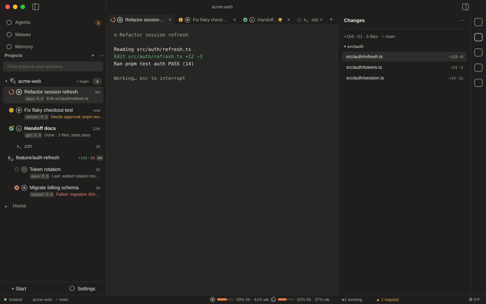
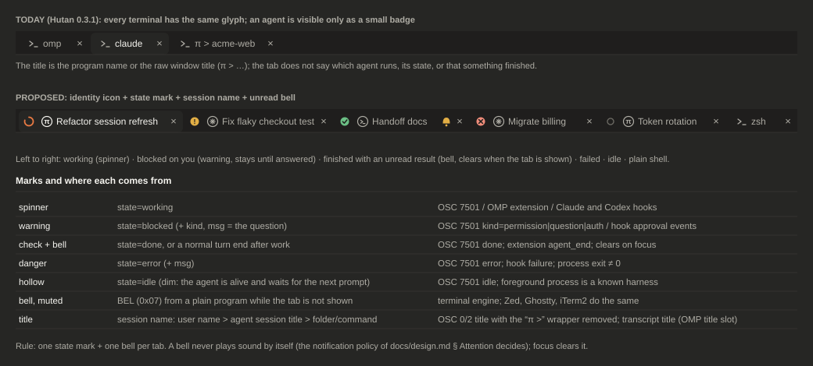
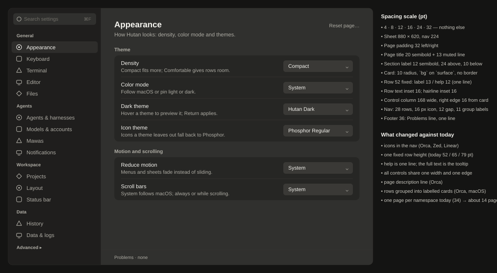
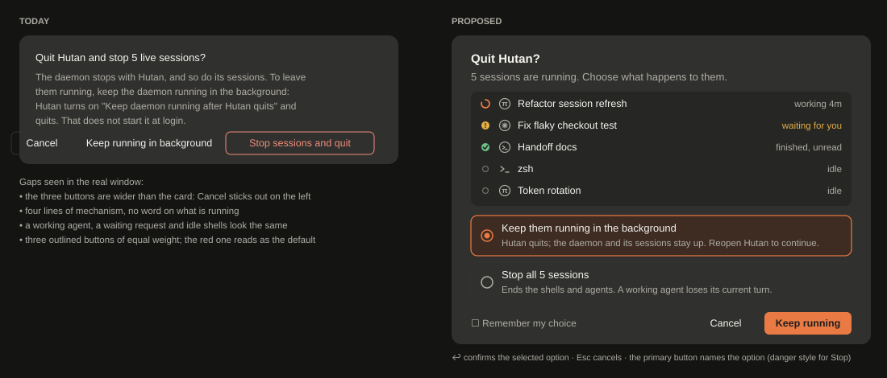
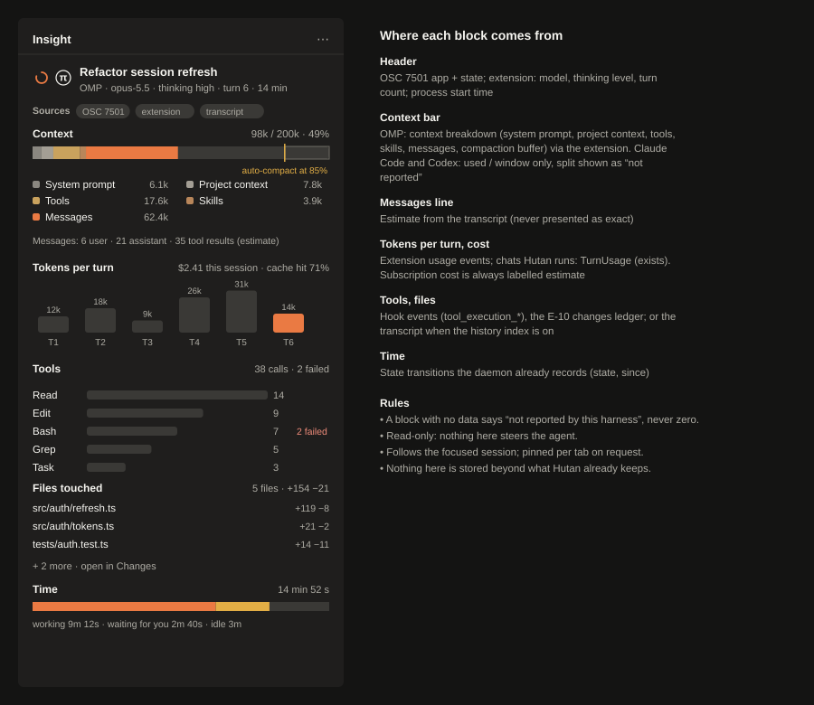

# UI-STUDY — what the best agent UIs do, where Hutan stands, and the plan (2026-10-28)

Brief: `docs/briefs/UI-STUDY.md`. Docs only; nothing in the workspace was built or changed. Mocks are our own SVGs with invented data. The user's screenshots stayed in `~/hutan-scratch/private/` and are described in words only (AGENTS.md invariant). The screenshots under `today/` are **our own** captures of master on a scratch `HUTAN_HOME` with made-up projects.

## 0. Summary

1. **Nobody parses the TUI.** Orca, iTerm2, Zed and Warp read *what the program says about itself* (hooks/extension, OSC 7501 and other OSC, the window title, the BEL byte, the agent's own transcript). Tern goes further and does not draw OMP's text UI at all: OMP speaks a private surface protocol (TSP) and Tern draws cards natively. Hutan already has two of the channels (integration hooks, agent tree) and ignores the best new one: **OSC 7501**, which OMP 18.12 emits by default. Real OMP in a Hutan terminal today shows up as a generic `>_` row and tab named by the raw window title (`π > acme-web`), see §3.
2. **Orca's card = state dot + harness icon + session name + model (mono) + age, and a second line** (blocked question > tool preview > last assistant message). Its tab = state dot + harness icon + title (+ amber bell when a result is unread). All of it comes from hook/extension reports; OSC 7501 is the fallback; session JSONL titles fix the name. Hutan can feed the same card from data it already has (`agent.tree`: model, activity, usage, start time) plus two small additions (§4, AGENT-CARDS).
3. **Hutan's settings, quit sheet, tabs and sidebar are structurally fine and visually uneven:** settings rows are 52/65/79 pt (help wraps), the nav has no icons and ~34 pages, the quit card overflows its own button row (root cause in `modal.rs`: fixed 440 pt card, non-wrapping row of three buttons), tabs and rows carry the same glyph for shell, OMP, Claude and Codex (the harness icon ids are placeholders: `terminal.svg`, `chat-circle.svg`, `robot.svg`).
4. **Plan:** eight new slices in §5 (two more are already running). Protocol impact is small: AGENT-TERM-1 keeps 0.55; one optional additive 0.56 (`summary` on the agent node), one additive 0.57 (`terminal.bell` event), one additive 0.58 (`agent.insight`, after a spike). Everything else is desktop-only.

Decisions for the user are at the end (§6, five items).

## 1. How Orca and Tern understand terminal agents

Orca source: `~/proj/research/stablyai_orca`, HEAD `de2700d` (2026-10-22, blobless clone; sparse paths fetched on demand). Paths below are in that repo. OMP source: `can1357/oh-my-pi` `main` (read through `gh api`), plus the installed OMP 18.12.3.

### 1.1 Orca: a ladder of signals, strongest first

`src/main/agent-hooks/README.md` is Orca's own statement: *two channels* feed one status store.

| Rung | Mechanism | What it carries | Where |
|---|---|---|---|
| 1. **Managed hooks / extension** | a per-agent plugin POSTs to a loopback server using env vars every PTY gets (`ORCA_AGENT_HOOK_*`, `ORCA_PANE_KEY`). For OMP/pi it is a TypeScript **extension** copied into the agent's extension dir and loaded in-process | state, prompt, tool name+input, **last assistant message**, provider session id **and session file path**, **model** (`provider/id`, re-read from the event context on every post), subagent roster | `src/main/pi/agent-status-extension-source.ts`, `agent-status-handler-source.ts`, `agent-status-subagent-roster-source.ts`; registry `src/main/agent-hooks/managed-agent-hook-registry.ts` |
| 2. **OSC 7501** (Program Status Protocol) | the program writes `ESC ] 7501 ; state=… ST` into the PTY; Orca scans the output stream | state, blocked `kind`, one line `msg`, `progress`, `title`, child records (`id=a/b`) | `src/shared/program-status/{protocol,osc-scanner,records,facet,presentation,agent-status-projector}.ts` |
| 3. **Window-title and screen rules** | glyph/keyword matching on OSC 0/2 titles; JSON rule files per agent | idle/working/permission guesses; identity | `src/shared/agent-title-*.ts`, `src/main/runtime/agent-state-rules/*.json` (`omp.json` is one rule: the `π - <session>` rest title counts as idle only once the pane is quiet) |
| 4. **The agent's own session files** | the "AI vault" scanner reads transcripts; for OMP the fixed-width `title` slot and `title_change` entries (`source: user|auto`, user wins) | conversation name, first prompt, history | `src/main/ai-vault/session-scanner-omp-title.ts`; the renderer syncs tab titles from it 1.0 s after a change and after 1.5 s of input quiet (`AiVaultTabTitleSyncGate.tsx`) |
| 5. **Chat UI over RPC/ACP** | Orca's own native chat for Claude/Codex/OMP (`src/main/pi/rpc-*.ts`, `src/main/acp/`) | everything, structured | not a terminal feature |

**Precedence rule (README):** *hooks win; OSC 7501 fills in where hooks do not speak* (hooks off or not installed, an agent run by hand over SSH, programs with no integration, or hooks silent for 2 minutes on a state the program has since left). Beside the winning producer the OSC report **rides along as a facet** (progress, its own line, sign-in blocks) that "never decides state". One resolver, `presentation.ts`, decides what each surface shows. Orca issue evidence for why this layering exists: #22017 (OMP row stuck on "working"), #10633 (a pill with no explanation); `docs/spikes/2026-10-21-competitor-ux/orca.md` §7.

**Where each thing on an Orca OMP card comes from**

| Shown | Source | Code |
|---|---|---|
| harness icon | hook payload `agentType`; for OSC 7501 the `app` value through `APP_TO_AGENT_TYPE` (`claude-code`→`claude`, `grok-build`→`grok`, others pass through); title evidence as a last resort | `agent-status-projector.ts`, `src/shared/agent-title-identity.ts` |
| state dot (working spinner with optional progress ring, waiting/blocked, done, idle, interrupted, failed) | hook state; else OSC 7501 root record (`blocked`+`kind=permission|question` → "waiting", `auth` → "blocked", `error` → done+failure) | `AgentStateDot.tsx`, `agent-status-projector.ts` |
| name | the conversation title (OMP session title) else the first prompt, else the state word | `use-agent-row-conversation-name.ts`, `getCompactAgentPrimary` in `worktree-card-compact-agent-row.tsx` |
| model | extension: `ctx.model` → `model: "<provider>/<id>"`; shown mono 10 px, `max-w-24`, truncated | same file (`model`), `agent-status-extension-source.ts` |
| second line | first match of: program-reported block (`Needs approval: …`, `Sign-in required: …`) > verdict line > "no update for N min" > stopping label > structured tool preview (`Edit: src/app.ts`) > OSC `msg` (live rows only, and only if no tool preview) > **last assistant message** > agent label | `getCompactAgentSecondary` |
| time | `lastEnteredDoneAt` else turn start, short ("42m") 10 px tabular | `getCompactAgentTime` |
| children | `+N` and a disclosure of subagent rows (hooks roster or OSC child ids) | `DashboardAgentChildDisclosure.tsx` |

**Tab.** `src/renderer/src/components/tab-bar/TerminalTabLeadingIcon.tsx`: state glyph (md) **and** the agent's logo (12 px) side by side "because status and identity answer different questions"; an unread finished turn swaps the state glyph for a filled **amber bell** (`FilledBellIcon`, 12 px) beside the logo; a shell tab shows a shell icon. Tab text 12 px, `px-1.5` (`SortableTab.tsx`). In the user's Orca screenshot the title reads as the agent's label, a dash and the OMP session title [P; the code composing it was not read]; the OMP transcript title wins over a stale auto title through the vault sync above.

**Lessons.** (a) Orca needs the extension to get model and last-turn text: OSC 7501 has no field for them (README: "no field for the prompt, tool input, assistant reply, model, or provider session id"). (b) State must never be sticky: facet presentations check "row live **and** facet live" so a stale facet cannot paint a finished row. (c) Answering the `OSC 7501 ; ?` probe changes what some programs print (Claude Code then drops its title glyphs), so Orca answers only when the host really parses it (`terminal.program-status.v1`); OMP sends without asking (README support matrix, checked live on OMP 18.10.3).

### 1.2 OSC 7501 and what OMP 18.12 emits

Spec: <https://www.superlogical.com/rex/docs/build/program-status>, announced in <https://mitchellh.com/writing/program-status-osc7501> (2026-10-06). Implemented by libghostty and Rex; emitted by OMP, Claude Code (≥ 2.1.295), Codex, Grok, pi (Orca README matrix).

- Wire: `ESC ] 7501 ; key=value : key=value … ST` (BEL also ends it). Keys: `state` = `idle|working|done|blocked|error|clear`; `kind` (blocked only) = `permission|question|auth`; `app` (≤ 32 bytes, `[A-Za-z0-9_.+-]`); `msg` and `title` base64 (decoded ≤ 2048 / 192 bytes, no C0/C1 controls or the whole report is discarded); `progress` 0–100 on working/blocked; `id=a/b/c` addresses a child record (≤ 8 deep, 256 records). Whole sequence ≤ 4096 bytes. `ESC ] 7501 ; ?` is the feature probe a terminal may answer.
- Lifetime (Orca's `osc-scanner.ts`, from the spec): a record is dropped on a new shell prompt (`OSC 133 ; A`) or a full reset (`ESC c`); **`done` and `error` outlive the program** so the result stays findable; `working`/`blocked` do not.
- OMP side, `packages/coding-agent/src/utils/run-status.ts`: only the **root** record; `idle` at the prompt (also after an interrupt), `working`, `blocked` with `kind=permission|question` and `msg` (the question or approval text), `done` (a finished turn not yet looked at), `error` with `msg`; `app=<APP_NAME>` (OMP's app name; `omp` per the AGENT-TERM-1 brief's reading of the binary); `state=clear` at teardown or when `terminal.programStatus` is turned off (Settings: "Program Status (OSC 7501)", default on); re-sent after suspend/resume. **`msg` is only sent for blocked and error**, so a done turn has no summary on this channel. Corpus line to record for tests: `\x1b]7501;state=blocked:kind=permission:app=omp:msg=<base64>\x1b\\`.
- OMP window title, `packages/coding-agent/src/utils/title-generator.ts` (`buildTerminalTitleWithState`): `π > <label>` idle, `π ⠋ <label>` working (braille frames, 80 ms), `π ! <label>` needs attention, `π: <label>` when state glyphs are off; label = session title (an auto title from a small model, or `/rename`), else the folder name. We saw exactly `π > acme-web` from the real binary in a scratch session. When a Tern surface renders, the title becomes the bare session name plus ` · #<pr>`.
- OMP session file, `docs/session.md`: JSONL; fixed 256-byte `title` slot first (rewritten in place), then a header with `title` and `titleSource` (`auto|user`; auto never overwrites user), `message` entries whose assistant messages carry `usage {input, output, cacheRead, cacheWrite, cost{…}}`, separate `model_usage` entries, `model_change`, `thinking_level_change`, `compaction`, `title_change`. Hutan's history index already reads this file (title slot, messages, model) when the user enables it (`docs/history-index.md` §Sources).
- OMP **context breakdown**: `packages/tui/src/status-line/context-usage.ts` splits context into `systemPrompt`, `systemContext`, `systemTools`, `skills`, `messages`, plus an auto-compact buffer and free space (the `/context` view and its ACP text, `slash-commands/helpers/context-report.ts`). Whether an *extension* can read it was the first question of the AGENT-INSIGHT spike, **answered by `2026-10-28-insight.md`: no** (`ExtensionContext` has `getContextUsage()` and `getSystemPrompt()` only, checked at runtime on 18.12.3 and in the source on `main`); an extension can still derive a *fixed overhead vs messages* split exactly, because `getContextUsage().tokens` at `session_start` equals the sum of the non-message categories of `/context`.

### 1.3 Tern (Stencil): OMP renders natively, there is nothing to parse

Sources: <https://stencil.so/tern> (closed beta, waitlist), `docs.rs/tern-sdk` (the TSP SDK, by can1357), the OMP `packages/tui/src/native/*` and `packages/coding-agent/src/tools/browser/tern/{wire,kind}.ts`, the community extension <https://github.com/Ghost-9/pi-tern> (README, verified against Tern 0.5.1/0.5.2).

- Tern is a native Rust terminal whose panes ("blocks") live in a **daemon** (window closed, nothing stops; same idea as `hutand`). A pane is a *shell* block or an *agent* block; an agent block runs `agent_command` (default `omp`).
- **Tern Surface Protocol (TSP):** a program in a pane describes its UI as a node tree (`card`, `kv`, `shimmer`, diff, mermaid, …; 44 node kinds in 0.5.x) over APC strings; Tern lays it out and animates it natively; outside Tern the same program prints plain text. OMP's `pi-tui` has a native backend (`native/backend.ts`, `reconcile.ts`, `node.ts`); `isNativeRendering()` switches off OMP's own spinners because "the terminal clocks motion from the described nodes". The handshake is a `hello` + DA1 query on the PTY; it does not work through tmux/screen/zellij (they swallow APC), and a **shell** block shows a blank pane (pi-tern README), only an **agent** block draws surfaces.
- What the user sees (stencil.so demo text): tool cards `Edit src/prompt.rs +12 −3 0.1s ✓ Done`, `Bash cargo test … 0.0s`, a composer `Ask omp anything π · opus · ~/work/stencil`, a `Working 0.0s` shimmer; the **daemon panel** lists each block as *program + what it is doing now* (`π omp  cargo test`, `zsh  tick 41`, `zsh  idle`) and "3 blocks running". Tab title in native mode: session name (+ ` · #PR`).
- Side channel for tools: omp finds the Tern daemon through `TERN_PANE_SOCKET` / `TERN_PANE` and speaks length-prefixed JSON (`wire.ts`): `browser` ops and **`fork`** (`omp --fork` of pane P's session in a new pane to the right/down). pi-tern additionally keeps the tab title live (`π <model> · <context> · <dir>`) and can ring Tern's bell when a turn ends (`PI_TERN_BELL=1`).
- **What it means for Hutan.** Tern's "wrapping" is not a parser, it is a client protocol only OMP (and pi) speak, available in a closed beta. Hutan has the equivalent *for chats*: the ACP/RPC chat view (`docs/agents.md`), which already renders OMP's turns, tools and diffs natively. For **terminal** sessions the transferable ideas are: (1) show *program + current activity* per pane in the session list (Tern's daemon panel; Orca's tool-preview line), (2) a live tab title carrying model and context (pi-tern), (3) a one-click **fork** of an agent's session into a split (OMP `--fork`; Hutan already has `omp --resume=<id>` and splits), (4) keep the raw terminal one click away (Orca issue #17883 shows the cost of removing it). A TSP *host* in `terminal_view` would be a large, closed-spec feature; not recommended before an ADR and a spike on the public SDK.

### 1.4 What Hutan has today, against that ladder

| Rung | Hutan today | Gap |
|---|---|---|
| Hooks/extension | `hutan integration install omp|claude|codex` writes `integrations/omp/hutan-agent-state.ts` (events: `session_start|switch`, `agent_start|end`, `tool_approval_requested|resolved`, `tool_execution_*` for `ask`, `session_shutdown`); reports state, node identity, model, a ≤ 200-char message, resume command | not installed by default (opt-in), reports **no usage, no activity, no last-turn text**; CLI already accepts `--model --activity --usage-json` |
| OSC 7501 | none (grep: nothing in `crates/`); the daemon drops it | AGENT-TERM-1 item 1–2 |
| Title/screen | `session_names.rs` uses `osc_title` only "when it says more than a path"; `π > acme-web` passes as a title | wrapper not understood; AGENT-TERM-1 item 3 |
| Session files | history index (opt-in) reads OMP/Claude/Codex titles, models, messages | not used for live naming or cards |
| Chats | ACP/Codex/direct: full journal, `Usage {total,last,context_window}`, `TurnUsage`, context chip (UX-CONTEXT-METER), agent tree (`model`, `activity`, `usage`) | fine; terminal agents lack the same richness |
| BEL | the terminal engine does not surface it; no tab bell | TAB-BELL slice |

## 2. UI comparison

Evidence level is stated per row: **S** = source read, **D** = official documentation read, **P** = a product reference image the user supplied (not committed; paraphrased), **M** = measured in a real window by us, **K** = prior Hutan study (`docs/spikes/2026-10-21-competitor-ux/`, `2026-10-20-settings-v2.md`, `2026-10-22-ui-polish/`). Not available to us: Cursor, Conductor and Warp **screens** (docs only, no installs), so no measurements are claimed for them.

### 2.1 Session cards in a sidebar

| App | Structure | One row/card says | State indicator | Evidence |
|---|---|---|---|---|
| **Orca** | Projects → project group → **worktree card** → its **agents nested** under a "N agents" disclosure; pinned/primary badges; branch under the name | agent rows: dot, harness icon (13 px), conversation name, model (mono 10 px), age; a **second line** with the last message/tool/question; row h-6 (24 px), 11 px text, `gap-1` | spinner (optional progress ring) / amber waiting / green done / grey idle; unread rows are bold | S (`worktree-card-compact-agent-row.tsx`), P |
| **Superset** | Groups (DESKTOP 5, CLOUD 3, …) with counts → workspaces | name, `+393 −42` diff counts, state dot, a branch/cloud glyph; selected row has an accent bar | small dot/spinner left of name | P, K |
| **Warp** | **Vertical tabs**: every tab/pane is a row; compact (icon + title + optional subtitle) or expanded (title, description, branch, diff stats, PR badge); hover **sidecar** shows un-clipped detail | CLI agents show **brand icon and colour** in the pane icon with a circular **badge** overlay | in progress / done / error / cancelled / blocked; an **accent dot** = unread agent activity | D (docs.warp.dev vertical-tabs) |
| **Zed** | **Threads Sidebar** grouped by project; worktree threads under their project; **Terminal Threads** sit beside agent threads (terminal icon) | title, agent, status; rename via pencil/`shift-r` | gray spinner running, logo when done, a *temporary* blue dot for attention (users ask for a persistent one, zed discussion #54865) | D |
| **Cursor 3 Agents Window** | one sidebar with **all** local and cloud agents across repos; Projects in the left nav | agent title and status; cloud agents show demos/screenshots | not specified in docs | D |
| **Conductor** | repo → **workspace** (one per task: own branch, tree, terminal, diff, review path) | workspace name, branch; Checks tab (git, CI, comments, todos) | not specified in docs | D |
| **iTerm2** | Session Status **tool** / Cockpit: rows sorted waiting → working → idle, a shortcut per row, snooze, notify-on-change bell | name, coloured dot, status text | dot colour + subtitle text on the tab itself (`OSC 21337`) | D |
| **Hutan today** | Projects → project → worktree label → sessions; *Requests* group on top | one line: kind glyph (all `>_`), title, right-hand age, warning glyph; state glyph in a 16 pt lane only while something is going on | spinner / hand / ✗ / eye + amber unread dot | M (§3), `docs/design.md` § Layout |

**Take:** Orca's two-line card (identity + model + age, then *what it is saying/doing*) and Warp's "brand icon with a status badge" are the two best answers to "an agent is not a shell". Superset's `+/−` per workspace and iTerm2's *priority order* (waiting first) are cheap additions. Warp's hover sidecar solves clipped second lines.

### 2.2 Tab titles, icons and the bell

| App | Tab content | Attention mark | Notes |
|---|---|---|---|
| Orca (S) | state dot + agent logo + title; shell icon for plain shells | **amber filled bell** replaces the dot for an unread finished turn; amber used nowhere else | one mark each for status and identity |
| Warp (D) | pane icon (brand glyph for CLI agents) + badge + title | accent **dot** on unread agent activity, clears on focus | title source configurable: command/conversation, cwd, branch |
| Zed (D) | terminal icon + title that follows the running process; custom name by click/pencil | a **bell (BEL) from an unfocused terminal** raises a notification and an indicator; click focuses and clears; agents need `terminal_bell` set in their own config (Claude, Amp, OpenCode, Pi examples in the docs) | Codex `tui.terminal_title` fields feed the sidebar |
| iTerm2 (D) | tab *subtitle* + coloured dot from `OSC 21337 status=…;indicator=#rrggbb`; activity indicator when output arrives in an unselected tab; blue dot = new input; a bell indicator after BEL (from a user answer on Ask Different; the official preferences page only lists the silence/flash options) | Session Status tool, **notify on status change** (⇧⌘X) | a status protocol of its own, parallel to OSC 7501 |
| Ghostty (D) | window title; `bell-features`: `system`, `audio` (macOS from 1.3), `attention` (**default on**: Dock bounce while unfocused), `title` (**default on**: a 🔔 prefix on the alerted surface's title until it is refocused or typed in), `border`; each is switched off with a `no-` prefix | title bell prefix; optional border; Dock attention | BEL (0x07) documented as "raise the attention of the user" |
| Hutan today (M) | `>_` + title (`omp`, or `π > acme-web`), ×; one attention mark per tab (agent badge `▲` when blocked, else a 7 px accent dot "asked for you") | no bell concept; BEL is not surfaced | AGENT-TERM-1 adds icon, state mark, name |

See `mock-tabs.svg` for the proposed marks and the source of each.

### 2.3 Settings layout

| App | Navigation | Page | Rows | Search | Evidence |
|---|---|---|---|---|---|
| **Orca** | full page (not a sheet); left nav **280 px**, section groups with **11 px uppercase labels**, items **icon 16 px + 13 px text**, `px-3 py-1.5`, rounded-lg, selected = fill + 1 px ring | section title **24 px semibold + 14 px muted description**, hairline under the header, `space-y-6` | **each section is a rounded-xl card** (`px-7 py-6`, border/50, bg-card/50); rows `divide-y`, label over a **12 px muted** description, control right (`shrink-0`); content `max-w-3xl` (768) | search field at the top of the nav, filters nav and rows | S (`SettingsSidebar.tsx`, `SettingsSection.tsx`, `SettingsFormControls.tsx`) |
| **Zed** | Settings Editor window, categories left, file remains the truth ("files as the organizing principle") | typed controls, each shows where it is stored | — | search across settings | D (blog "How We Rebuilt Settings in Zed", 2025-12-12), K |
| **VS Code** | tree left, User/Workspace tabs, modified-bar, `@modified` filters | — | one row = title + description + control, left aligned | `@` filters | D, K |
| **Linear / Raycast / macOS System Settings** | icon + label list, one pane per topic, few panes (≈ 8–12) | title, short description | grouped *cards* of rows with hairlines inside; control right-aligned, one width per card | global search | general product pattern [INFERENCE: no source read for the exact measurements; Linear's docs page lists General/Profile/Notifications style panes only] |
| **Hutan today** (M) | sheet 880 × 600, list **200 pt**, text-only items, 11 pt group labels, 26 pt row pitch, **~34 pages** (one per namespace), Advanced collapsed | header 48 pt, title only | rows **52 / 65 / 79 pt** (help wraps to 2–3 lines, although `design.md` § Settings sheet look says "one line"), controls **ragged**: width 108–145 px, left edges differ; hairline per row, no cards | search at the top of the list | M, `settings.png` |

**Take:** icons in the nav, one card per section with a section label, fixed row height with a one-line description (full text in the tooltip), one control column, a page description line. Hutan already has the best part Orca lacks (layer chips, reset arrows, Problems line), so this is a re-spacing, not a rewrite.

### 2.4 Confirmation dialogs (quit with running work)

| App | Pattern | Evidence |
|---|---|---|
| macOS HIG / system sheets | sheet attached to the window, 1 short sentence under a bold title, buttons **right-aligned**, default button rightmost, destructive uses red text not a red outline | general platform convention [INFERENCE: no source fetched] |
| Zed | running threads cannot be archived until they finish: the UI refuses rather than asking | D |
| Orca | quit/close dialogs name the exact work; issue #11242/#21745 show the cost of acting on the user's behalf | K |
| iTerm2 | "Quit iTerm2?" lists *running jobs* with a "Don't ask again" checkbox | [INFERENCE: from memory of the product; not fetched] |
| **Hutan today** (M, `quit-sheet.png`) | fixed 440 pt card (`modal.rs`: `.w(px(440.0))`, padding `4 × spacing` = 16 pt, 8 pt between blocks); body 4 lines about *mechanism*; **three** equal outlined buttons in one non-wrapping row: 460 px of buttons in 408 px of room, so **Cancel pokes out of the card on the left**; the red outlined button looks like the default; no list of what is running | M, `crates/desktop/src/workbench/daemon.rs` (`open_quit_dialog`), `modal.rs` (`render_modal`, card width at line 419) |

### 2.5 Dock toggles (FX-DOCK-TOGGLES owns the fix; evidence for the symmetric rule)

Orca (P): one title-bar toggle per side, both docks hide fully; the activity bar belongs to the right dock. Zed (D): the Threads Sidebar has its own toggle (⌘⌥J); "Panel Layout > Agentic" puts the agent panel and the Threads Sidebar left and the project/git panels right. Warp (D): toolbar buttons for each panel, **configurable and movable to either side**. Hutan today (M): three controls for two docks: the left toggle, a right toggle in the title bar, and a second right toggle at the bottom of the rail, with the right dock collapsing to a rail while the left hides fully. That is the user's complaint exactly; the slice is already running.

### 2.6 Layout organisation and the status bar (the two product shots the user sent)

- **Orca (P):** tabs carry per-agent icons and short task titles; the sidebar nests **project → worktree card → its agents (icon, title, age)**; the right panel is an icon activity bar over a Files tree; the **bottom bar** holds, left to right, one **usage meter per provider** (mini bar + `58% 5h · 41% wk`), memory, terminal and agent counts, and the connection (`SSH Connected`).
- **Superset (P):** groups (DESKTOP/CLOUD/…) with counts; workspace rows with `+/−` and a state dot; the right panel has **Files · Changes · Review** as text tabs and a header line with the diff summary and branch (`+393 −42 · 5 files · main`), files grouped under their folder with per-file `+/−`; **Run** and **PR #** actions in the panel header.
- **Hutan:** has all the data. `usage.summary` exists (USAGE-LIMITS, protocol 0.45) and a `usage` status item that is **off by default** and prints only the tightest limit; Resources has per-session memory; Changes shows a count badge but no header summary; the sidebar tree already is project → worktree → sessions but rows are one-line. So the organisation change is presentation (§5 SIDEBAR-HIERARCHY, STATUS-METERS), not new data.
- Keep: the activity rail as the single switcher for Files/Changes/Agents/History (Superset's text tabs duplicate it; FX-DOCK-TOGGLES is removing duplicate controls, so do not add a second switcher). Take from Superset: the **summary line** and **folder-grouped changed files**.

### 2.7 Measurements side by side

| Element | Orca (S) | Hutan today (M, compact density) | Proposed |
|---|---|---|---|
| agent row | h-6 = 24 px, 11 px text, icon 13, time 10 px tabular, model 10 px mono | one-line row 26 pt + 2 gap (28 pitch), title 13, age 11, glyph 12–13 | two-line card **44 pt** for agents (16 + 2 + 14 line boxes, 6 pad), 26 pt for plain shells |
| tab | `text-xs` (12), `px-1.5`, icons 12 | tab strip 30 pt, text 12–13, glyph 12, title cut at 180 pt | same height; icon 14 + state mark 11 + bell 10 |
| settings nav item | 13 px, `py-1.5 px-3`, icon 16 | 26 pt pitch, text only | 28 pt, icon 16, 12 gap |
| settings row | `divide-y`, label 14 / help 12, card padding 24/28 | 52 / 65 / 79 pt | 52 pt fixed |
| settings title | 24 px semibold + 14 px desc | 15 medium, none | 20 semibold + 13 muted |
| dialog | (not read) | 440 pt wide, 16 pt padding, 8 pt gaps | ≥ 480 wide, 24 padding, 16 gaps, right-aligned footer |
| status bar | meters, counts, memory, connection | 24 pt, branch · request · working · ⌘⇧P | same height, meters on by default |

## 3. Hutan today (master at `b34d0f94`, debug build, scratch `HUTAN_HOME`, Cua)

Setup: debug binaries from the sibling worktree's gate (master + docs), scratch home `~/hutan-scratch/uistudy/home`, project `acme-web` with a worktree `feature/auth-refresh`, six sessions: a real `omp` (idle, no model call), a plain shell, and three `zsh -c` sessions that report an agent through `hutan agent report` (claude working, codex blocked, omp idle). Window 1280 × 800 pt (screenshots are 1366 × 854 px; 1 pt ≈ 1.067 px). Input source was switched to ABC for the run and restored to Russian after.

- `today/sidebar-and-tabs.png`: every session row and tab has the same `>_` glyph; the real OMP is called **`π > acme-web`** (the raw OSC title, wrapper included) because the daemon does not know that `π >` is OMP's state separator (`hutan ls --json` shows the title and no `agent` for it: hooks are not installed in the scratch home, and OSC 7501 is not read). Agent state, when reported, is a small glyph in the lane (orange spinner for claude, a hand under *Requests* for codex) and a warning triangle for the shared-checkout warning; no model, no activity, no last-turn text; the age (`1m`) is the only second datum. Project row: branch pill and a count; the worktree is a label row with its sessions indented.
- `today/settings.png`: sheet 939 × 640 px = 880 × 600 pt; list 212 px ≈ 200 pt; page header 48 pt with the title only; rows 55 / 69 / 84 px = **52 / 65 / 79 pt**; the controls' right edge is aligned, their left edges are not (108–145 px wide); help text wraps to 2–3 lines; the footer line of `design.md` is not visible in this capture. The page list is long: 18 General pages before Agents appears; no icons.
- `today/quit-sheet.png`: 470 × 185 px card = 440 × 173 pt; title 13 medium; 4 lines of mechanism; buttons start 5 px **left of the card edge**; the user's own capture of the same sheet shows the overflow much larger (Cancel hangs half outside the card).
- Docks (first run capture): left hidden, right dock open with the title-bar toggle (top right) and a second toggle at the bottom of the rail. Same as the user's description. Layout numbers match `design.md`: title bar 36, status bar 24, left 280, right body 350, rail 40, nav rows 30 + 2.







### Gap list (what to change, measured)

| # | Gap | Today | Best pattern | Slice |
|---|---|---|---|---|
| G1 | an agent looks like a shell | one glyph; harness icons are placeholders (`harness.omp` → `terminal.svg`, `harness.claude` → `chat-circle.svg`, `harness.codex` → `robot.svg`, `crates/settings/src/themes/icons/ids.rs:83-86`) | harness icon + state mark (Orca, Warp) | AGENT-TERM-1 |
| G2 | name is the program or the raw title | `π > acme-web` | session title with wrapper stripped; OMP title slot; user name wins (Orca vault sync) | AGENT-TERM-1 |
| G3 | no model, no last-turn summary, no activity on a row | age only | Orca card second line | AGENT-CARDS |
| G4 | OSC 7501 ignored; BEL ignored | — | iTerm2/Zed/Ghostty/Orca | AGENT-TERM-1, TAB-BELL |
| G5 | no bell/unread on a finished agent tab | accent dot only when asked | Orca amber bell, Warp dot | TAB-BELL |
| G6 | settings rows uneven, no icons, ~34 pages | 52/65/79 pt | Orca cards + fixed rows | SETTINGS-LOOK, SETTINGS-IA |
| G7 | quit card overflows; says mechanism, not state | 3 buttons in 408 pt | right-aligned footer, list of running work | FX-QUIT-SHEET |
| G8 | status bar has no usage | `usage` item off | Orca meters | STATUS-METERS |
| G9 | no per-worktree diff summary in the sidebar, no "N agents" grouping | label row | Superset `+/−`, Orca nested agents | SIDEBAR-HIERARCHY |
| G10 | no focused-agent analytics | context chip in chats only | — | AGENT-INSIGHT |
| G11 | three dock controls | — | one per dock | FX-DOCK-TOGGLES (running) |

## 4. The data model behind cards, tabs and insight

One small record per terminal agent, assembled by the daemon from the best available channel (the Orca ladder, simplified):

```text
identity   app (omp|claude|codex|…)        OSC 7501 app > hook/extension > foreground process name
state      working|blocked(kind)|done|error|idle (+ since)     OSC 7501 / hooks; hooks win, OSC fills in (2-minute silence rule)
name       user name > agent session title > folder/command   OSC 0/2 minus "π >"/"π ⠋"/"π !" wrapper > OMP title slot (history index) 
model      "provider/id" + thinking level                      extension ctx.model > agent tree node.model
line2      blocked msg > error msg > activity (tool) > summary of last turn      OSC msg > extension --activity/--summary
age        state.since (done: the time it finished)
context    used/window (+ breakdown for OMP)                   extension usage / ACP usage_update
```

Everything except `summary` already exists in the protocol: `SessionInfo.agent {source, agent, state, message, updated_at_ms, blocked_sub}` and the agent tree node `{model, activity (≤ 200), usage {context_tokens, context_window, …}, started_at_ms}` (`AgentReport` in `crates/protocol/src/messages.rs`, `Usage` and `AgentNode` in `crates/core/src/observation.rs`). AGENT-TERM-1 adds `SessionInfo.agent {app, state, kind, message, since}` (0.55) for the OSC path. For the last-turn summary the cheapest correct answer is a new optional `AgentNode.summary` (single line ≤ 200, redacted like other agent text) so `activity` keeps meaning "doing now"; reusing `activity` for it would make the second line lie after a turn ends.

## 5. Plan: slices in commit order

Two slices are running (`FX-DOCK-TOGGLES`; `AGENT-TERM-1`, protocol 0.55). Slices that touch `panels/sessions.rs` (2.1k lines) or the tab strip must be serialised after AGENT-TERM-1; the rest run in parallel. Sizes are in agent-days (≤ 1–2 each, `process.md`).

| # | Slice | Depends | Protocol | Size | Crates / files |
|---|---|---|---|---|---|
| 0a | `FX-DOCK-TOGGLES` (running) | — | none | — | desktop |
| 0b | `AGENT-TERM-1` (running): OSC 7501 sniffer, `SessionInfo.agent`, naming, tab/row icon + state, `hutan ls` | — | **0.55** (delegated) | — | terminal, daemon, desktop, cli |
| 1 | **`FX-QUIT-SHEET`** — the quit card (and every modal with ≥ 3 buttons) never overflows: `modal.rs` row right-aligned, wraps/stacks under 480; wording and session list per `mock-quit.svg`; Keep running is the primary | none | none | 0.5 | desktop (`modal.rs`, `daemon.rs`) |
| 2 | **`UI-RHYTHM`** — spacing scale tokens (4·8·12·16·24·32), `ui::sheet`, `ui::card_section`, `ui::row_fixed`; fixed settings row 52 pt, one-line help with tooltip, one control column, page title 20 + description, nav icons | none (disjoint from 0b) | none | 1.5 | desktop (`settings_*.rs`, `ui.rs`), settings (`IconId` for nav) |
| 3 | **`AGENT-CARDS`** — two-line cards for agent sessions: identity icon, state mark, name, model (mono chip), age, second line (blocked/error msg > activity > summary); plain shells stay one line; hover **sidecar** with the full text (Warp); the OMP/Claude/Codex extensions report `--activity` per tool and `--summary` at turn end; own monochrome harness glyphs in the icon pack | 0b | **optional 0.56**: `AgentNode.summary`, `hutan agent report --summary`, capability `agent.summary` (additive) | 2 | desktop (`panels/sessions.rs`, `sessions/presentation.rs`), `integrations/*`, protocol (summary), daemon (tree reducer) |
| 4 | **`TAB-BELL`** — BEL from the terminal engine → `terminal.bell` event; tab bell (unread) for BEL and for a finished agent; clears when the tab is shown; setting `terminal.bell = off \| tab \| tab+notification` (default `tab`, never a sound); reuses the notification policy | 0b | **0.57** additive: event `terminal.bell {session}` + capability | 1.5 | terminal (`sniffer`), daemon, protocol, desktop (tab strip) |
| 5 | **`SIDEBAR-HIERARCHY`** — project → worktree card (`+/−`, PR chip, "N agents" disclosure) → agent cards; group counts (Superset); sort *attention* puts waiting first (iTerm2); Changes header summary line and folder-grouped files | 3 | none (reads `changes.*`, tree) [to verify: per-checkout diffstat subscription exists in the desktop store] | 2 | desktop (`panels/sessions.rs`, `panels/changes.rs`) |
| 6 | **`STATUS-METERS`** — usage meters per harness in the status bar, **on by default** when a harness has reported a limit (44 pt bar + `58% 5h · 41% wk`, amber ≥ 80 %, red ≥ 95 %); counts (agents working, requests), memory, connection; click → Agents page | none (`usage.summary` exists) | none | 1 | desktop (`panels/status.rs`, `usage.rs`) |
| 7 | **`AGENT-INSIGHT`** — a right-dock panel for the focused agent (see `mock-insight.svg`). **Spike done** (`INSIGHT-SPIKE`, `2026-10-28-insight.md`): OMP extension cannot read the breakdown (derives fixed vs messages); Claude Code `get_context_usage` is real and returns categories, per-tool-call and per-memory-file tokens (verified on 2.1.312) but the ACP adapter does not forward it; Codex has `thread/tokenUsage/updated` (`last` is the context, `total` is cumulative) and no breakdown. Plan as revised by the spike: **0** `INSIGHT-FIX` (the Codex chip reads `total`, should read `last`); **A** chats, daemon aggregator and protocol 0.58 (the desktop only holds a journal page, so client-only would be partial); **B** terminal agents via the OMP extension and Claude/Codex hooks (no protocol change); **C** transcript tail when the history index source is on (no protocol change) | 3, spike | **0.58** additive: `agent.insight` request + `agent.insight_updated` event (to focused connections), `agent.report.insight`, `cache_write`, capability `agent.insight` | 3 + 2.5 + 2.5 | daemon (aggregator), protocol, desktop (panel), integrations |
| 8 | **`SETTINGS-IA`** — 34 pages → about 14 in 5 groups (General · Agents · Workspace · Data · Advanced); every old page id stays a deep-link anchor, ⌘K and `hutan ui set` unchanged (parity rule); `@modified`/`@restart` filters from `2026-10-20-settings-v2.md` | 2 | none | 2 | desktop (`settings_schema.rs`, `settings_sheet.rs`) |

Later, not planned now: **session lens** (a read-only structured view of a terminal agent's transcript beside the terminal, from the history-index parsers; keeps the terminal as ground truth, Orca #17883), **fork into split** (`omp --fork`, Tern), a TSP host (needs ADR + spike).

### Mocks

- `mock-workbench.svg` — slices 3, 4, 5, 6 together: nested cards, tab marks, status-bar meters, Changes header summary.
- `mock-tabs.svg` — slice 0b/4: tab states, the bell, and where each mark comes from.
- `mock-settings.svg` — slices 2, 8: icon nav, cards, fixed rows, spacing scale and what changed.
- `mock-quit.svg` — slice 1: today vs proposed.
- `mock-insight.svg` — slice 7: context by category, per-turn tokens and cost, tools, files, time, with the source of each block.











### Protocol impact in one table

| Version | Owner slice | Change | Capability |
|---|---|---|---|
| 0.55 | AGENT-TERM-1 (delegated) | `SessionInfo.agent {app, state, kind?, message?, since}` | `terminal.agent` |
| 0.56 (optional) | AGENT-CARDS | `AgentNode.summary`, report flag | `agent.summary` |
| 0.57 | TAB-BELL | event `terminal.bell`, session setting | `terminal.bell` |
| 0.58 | AGENT-INSIGHT (after spike) | `agent.insight`, `agent.insight_updated` | `agent.insight` |
| — | all others | desktop only | — |

All additive: old clients ignore the new fields (ADR 0002); fixtures per bump.

### Parity (Definition of Done)

- Settings: no key, page id, deep link, ⌘K entry or `hutan ui set` path is removed; pages merge under new nav groups and keep their ids as anchors. *Reset page…*, layer chips and the Problems line stay.
- Sidebar: plain terminals keep their one-line row; the *Requests/Failed/Ready* groups, ⌘⇧J and Mark as read/unread keep working. The agent's old agent badge `▲/↳N` becomes part of the card; the tooltip text is kept.
- Quit: Cancel/Escape unchanged; the two outcomes (keep running / stop) keep their effects (`app.keep_running` on / sessions stopped); the only moved affordance is the order and wording, plus "Remember my choice" which is new.

## 6. Decisions for the user (at most five)

1. **Quit default.** Keep sessions running (non-destructive, matches how the daemon is meant to work) as the primary button, or keep today's "stop" as primary? Recommended: keep running primary, `Stop` is a radio option in the danger style.
2. **Harness glyphs.** Own monochrome monograms in the icon pack (π for OMP, an asterisk for Claude Code, a prompt-in-ring for Codex; replaceable by a user pack) versus vendor logos. Recommended: our own; vendor marks are trademarks and Orca/Warp use them by agreement or nominative use we cannot assume.
3. **Usage meters in the status bar by default** (hidden until a harness reports a limit). Recommended: yes.
4. **Hooks for richer cards.** Model, activity and last-turn text for *terminal* agents come from the opt-in extension/hooks (Orca does the same). OSC 7501 alone gives icon, state, blocked question and error text. Recommended: keep opt-in, but make the setup step and the first agent card say what the hooks add ("Show model and summary: install hooks").
5. **Cards for every session or only agents.** Recommended: agents get the two-line card, shells stay one line.

## 7. Sources and limits

- Orca: `stablyai/orca` `de2700d` (paths above); the first-party issue digest `docs/spikes/2026-10-21-competitor-ux/orca.md`. Orca's product behaviour in the user's screenshots is from a newer build than this snapshot; where they differ, the screenshot description is marked **P** and the source claim **S**.
- OMP: `can1357/oh-my-pi` (`run-status.ts`, `title-generator.ts`, `docs/session.md`, `tools/browser/tern/*`, `tui/src/native/*`, `tui/src/status-line/context-usage.ts`), installed OMP 18.12.3 (title format observed live).
- Tern: stencil.so/tern, docs.rs/tern-sdk 0.1.0, Ghost-9/pi-tern. Tern is closed beta; **not installed or run**; the user-visible claims come from its own site and the extension README.
- Warp: docs.warp.dev (vertical tabs, agent notifications). Zed: zed.dev/docs/ai (parallel agents, terminal threads) and discussion #54865. Cursor: cursor.com/docs/agent/agents-window, cursor.com/blog/cursor-3. Conductor: conductor.build/docs. iTerm2: iterm2.com/documentation-session-status.html and preferences. Ghostty: ghostty.org/docs/config/reference (`bell-features`). OSC 7501: superlogical.com spec and mitchellh.com post.
- Not done: no Cursor/Conductor/Warp installs (docs only); no light-theme capture; hover states cannot be captured through Cua (`docs/process.md`); Linear/Raycast/macOS-settings measurements are [INFERENCE]; whether OMP extensions can read the context breakdown was open here and is answered in `2026-10-28-insight.md` (no).
- Reproduce §3: `HUTAN_HOME=<scratch> hutan-desktop`, `hutan new` / `hutan new -- omp` / `hutan new -- zsh -c 'hutan agent report --source t --agent claude --state working; sleep 3000'` in a scratch repo, then ⌘, and ⌘Q.
