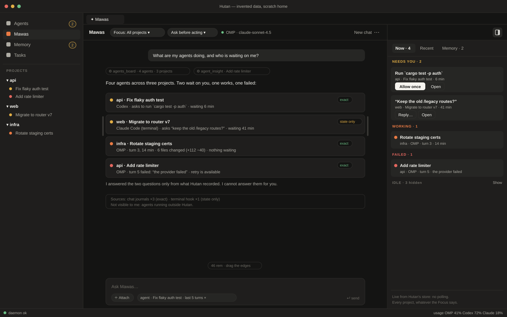
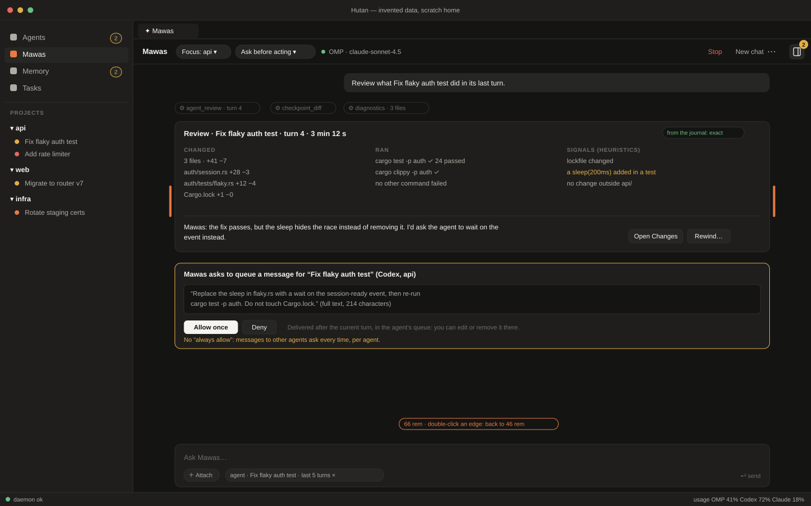
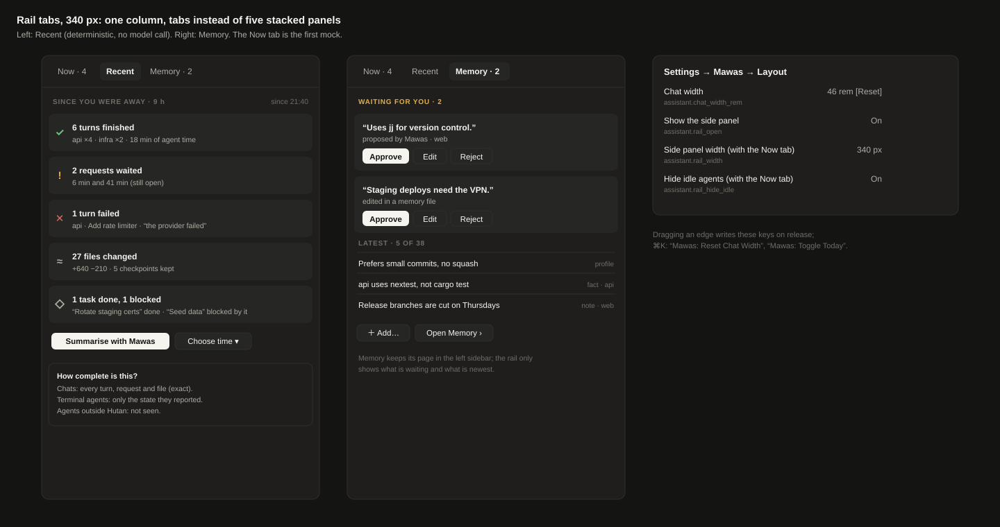

# Mawas as the supervisor of all agents — design spike (MAWAS-SUPERVISOR)

Date 2026-10-30 · Brief `docs/briefs/MAWAS-SUPERVISOR.md` · Status: proposal for the user, docs only. Nothing was built or run; every Hutan fact below was read from the code at `d61925ed` and the documents named in its row, every competitor fact from the page linked in § 2.9 on 2026-10-30. Draft ADR: `docs/adr/0025-mawas-global-supervisor.md`. Mocks (invented data, Hutan's dark tokens; sources are plain SVG): [`2026-10-30-mawas-supervisor-global.svg`](2026-10-30-mawas-supervisor-global.svg), [`…-wide.svg`](2026-10-30-mawas-supervisor-wide.svg), [`…-rail-tabs.svg`](2026-10-30-mawas-supervisor-rail-tabs.svg).

The user, 2026-10-30, after the in-app update to 0.3.4 worked: Mawas "should also be global as an assistant across all projects… it should be global and connect to the agents; an assistant that can check our agents across the workspace, look at what was done last time and analyse our flow — the main thing is an agent over agents"; "its chat width should be adjustable"; "the Memory part of Mawas — be able to hide the right part, or add something useful there".

## Summary

1. **Global first** (§ 1) is a default flip plus one idea, not a migration. Mawas Home opens the *Global* chat; the workspace becomes a **Focus** (a filter, and a context for memory notes and project instructions) picked in a chip instead of being a second assistant. No row in storage moves: workspace chats and workspace memory keep their ids and stay reachable.
2. **Agent over agents** (§ 2) is mostly *giving the model what the daemon already knows, in one bounded and consistent shape*: a board (one reducer, shared with the rail), a catch-up since a time, a turn-review packet, honest flow numbers. Four new read requests, three MCP gaps closed, and one safety fix: today a single *Always allow `chat.send`* grant would let Mawas message any agent in a workspace unasked. Mawas still acts only through the gate and never answers an approval or a question.
3. **Layout** (§ 3): the chat column becomes draggable and remembered; the right rail gets a real toggle (badge for waiting requests, remembered) and, later, tabs **Now / Recent / Memory** so it holds something useful instead of one link row.
4. **Plan** (§ 4): ten slices in commit order with protocol impact; **slice 1, `MAWAS-LAYOUT` (chat width + rail toggle), is desktop-only, needs no protocol change and can start today** (brief ready to copy in § 4.2).

**How I read "the Memory part… the right part".** Memory has been a page of the *left* sidebar since MEM-SIDEBAR; the only thing on Mawas Home's right is the **Today** rail, whose last row is the *Memory ›* link. I took "hide the right part, or add something useful there" to mean that rail. If the user meant the Memory page itself, slice 1 is unchanged and only the Memory tab of § 3.3 changes.

**Decisions asked of the user** (recommendation first):

| # | Decision | Recommendation |
|---|---|---|
| D1 | Home opens Global for everyone; the old behaviour stays behind `assistant.home_scope = "follow_workspace"` | Yes: it is what was asked, it is reversible, it loses no data |
| D2 | A message Mawas sends to another agent asks **every time, per target agent**; no *Always allow in this workspace* for it | Yes (§ 4.3 R3) |
| D3 | Record terminal agents' state changes (`agent_state_log`: state and kind, 14 days) so flow numbers exist for them | Yes, on, with a setting; without it flow analysis covers chats only |
| D4 | Scheduled digests are **Advisor-profile only**, never Ask-before-acting unattended | Yes, after the no-network check of § 2.8 |

## Ground truth: what exists today

| Fact | Evidence |
|---|---|
| Home follows the active workspace: `Choice::Active` shows the workspace's Mawas when a project is active, Global only at Home | `crates/desktop/src/workbench/panels/assistant.rs` `key()` l. 289 |
| One assistant session per scope; the oldest is the default; *New chat* makes another; `assistant.list` lists all | `docs/assistant.md` § Scope and sessions; `crates/daemon/src/assistant.rs` `scope_of` l. 213 |
| Global sees the Home folder only; its `file` attachments are off by default | `docs/assistant.md` § Permissions (`[assistant.global_context]`) |
| A harness assistant is a process (an OMP backend holds about 460 MB) and every scope can have one | `docs/assistant.md` § Idle assistants |
| Mawas's prompts say nothing about scopes, agents or a board: they explain attachments and, in Ask mode, that changes ask | `crates/daemon/src/harness.rs` `HARNESS_ASK_PROMPT` l. 113 |
| Mawas already **reads across workspaces**: the Read tools of `hutan mcp` (`session_list`, `approval_list`, `chat_log`, `worktree_diff`, `checkpoint_*`, `agent_insight`, `usage_summary`, `history_search`, `task_list`, …) take no scope | `docs/control.md` § `hutan mcp`; the `agent_transcript` resolver is handed no scope (`assistant.rs` `resolve` l. 813) |
| `session_list` already carries per chat `turn_active`, `pending_approvals`, `pending_questions`, plus the agent report | `crates/protocol/src/chat.rs` `ChatInfo`, `messages.rs` `SessionInfo` |
| Today's rail is a **view inside the window**: the agent reducer over every session the daemon lists (all workspaces) — GPUI-free, 2 191 lines — lives in `crates/desktop`, so Mawas the model cannot read it and a second implementation would disagree with the rail | `sessions/presentation.rs` (module doc: "GPUI-free and unit tested"), `store.rs` `agent_presentation` l. 2380, `assistant_rail.rs` `today()` l. 147 |
| Layout: conversation `max_w` 736 px (46 rem, fixed), rail 300 px (fixed); the rail's only toggle is *Hide Today* in ⋯, and `rail_open` is not persisted (`true` at every start); below 640 pt the rail leaves the page | `assistant.rs` l. 190–193, 224, 266, 1683, 1700; `assistant_rail.rs` l. 37, 293; `workbench/assistant.rs` l. 311 |
| Not built: skills, schedules, traces, delegation monitoring (MW-3…MW-10 open); Today says "no schedules" until they exist | `docs/roadmap.md` l. 189; `docs/adr/0017` § Slices; `docs/assistant.md` § Desktop |
| Requests that exist but have **no MCP tool**: `question.list` (Read), `history.sessions` (Read: the session catalog), `chat.queue.add` and `chat.queue.list`, `agent.tree` | `crates/cli/src/mcp/table.rs` tool names vs `crates/daemon/src/router.rs` classification |

## 1. Global first

### 1.1 What changes

| | Today | Global first |
|---|---|---|
| Home opens | the workspace's Mawas when a project is active, else Global | Global, always (`assistant.home_scope`: `global` default; `follow_workspace` = today) |
| Header | scope dropdown *Global / Workspace · name* | a **Focus: All projects ▾** chip (mock 1): all projects, one workspace or several. The scope dropdown becomes **Chats ▾**: this conversation's siblings and earlier chats of every scope grouped by workspace (`assistant.list`) |
| What Focus does | — | (a) the Mawas *notes* of the focused workspaces join the memory block; (b) their `AGENTS.md` summary lines join the instructions block (the AGENT-INSTRUCTIONS mechanism); (c) the Focus is named to the model so it filters board and tool calls; (d) the rail's Now tab can filter by it. It changes **no permission** |
| How a Focus change reaches the model | — | as a *delta block* at the next turn boundary — what memory deltas already do (`docs/assistant.md` § Memory › Deltas) — so it neither restarts the agent nor opens a new chat |
| Where Mawas works (cwd; what Files follows) | Global `~/Hutan`, workspace its project | unchanged: **Focus is not a working directory**; MAWAS-FILES keeps following where she works |
| Backend and model | per scope, `assistant.configure` with inherit | unchanged; the Global choice runs Global chats, a workspace's own override still runs that workspace's chats |
| Context permissions | `[assistant.global_context]` vs `[assistant.workspaces.<key>]` | unchanged. To supervise, Global needs `agents` and `search` — on by default; `files` stays off, which is right (supervising reads agents, not project files) |
| Processes | up to one harness process per scope used | usually one (about 460 MB saved per extra scope that would have been woken) |
| Grants | a workspace grant covers "every Mawas chat of that workspace" (`docs/control.md`), so for a Global chat that workspace is Home [INFERENCE: the grant's `workspace_id` is the chat's own] | cross-agent actions become target-bound (§ 4.3 R3), so "workspace" never has to mean "every agent" |

### 1.2 What Global gives up, and how it stays possible

A workspace Mawas runs in the project folder and can edit its files with her own tools (each edit asks in Ask mode). A Global Mawas runs in `~/Hutan`. For project work the supervisor **delegates**: `chat_create`, or `task_add` + `task_start` + `worktree_new`, start an agent in the project (all existing, all Mutate, all gated) and she watches it on the board — ADR 0017's delegation (MW-5) with primitives that exist. A user who wants the old shape keeps it: *Chats ▾ → New chat in <workspace>* (`assistant.open {scope: workspace}`, unchanged) and `home_scope = "follow_workspace"`.

### 1.3 Migration of what exists

No row changes. In order:

1. **Sessions.** Workspace Mawas sessions keep `workspace_id`, journal, title (`Mawas · <name>`), model and backend. They are listed under *Chats ▾ → <workspace>*; opening one shows it in Home as today's workspace-scoped chat (chip reads `Workspace · name`; the Focus chip is hidden because that chat's focus is fixed by its workspace).
2. **Default session.** `assistant.open {scope: global}` returns the oldest Global assistant (created asleep on first use: no process before the first message). The one-default-per-scope rule is untouched.
3. **Memory.** Entries keep `scope` and `workspace_id`. A Global chat gets global entries always, plus the focused workspaces' notes inside the existing 8 KiB snapshot cap (the cut stays explicit). The `.hutan/memory/` mirror and its proposals are unchanged. A *note* proposed from a Global chat while a Focus is set defaults to that workspace's scope, and the proposal card says where it will apply.
4. **Settings.** `[assistant.workspaces.<key>]` keeps governing workspace chats. Nothing is rewritten; `assistant.home_scope` is a new desktop setting.
5. **Grants.** Stored grants keep working for the requests they cover. The cross-agent methods of R3 ignore grants stored before their slice (the way a grant stored for an always-ask request is ignored today, `docs/control.md` § Mawas).
6. **Entry points.** `Mawas: Open` opens Global, `Mawas: New chat` makes a Global one; `hutan ask` already picks `--ws`, else `$HUTAN_WORKSPACE`, else Global (`docs/assistant.md` § CLI) and is unchanged.

ADR 0017 decision 6 (a workspace *kind* for Mawas, shipped with the D-1 protocol major) is neither needed nor blocked: Focus is a property of a chat, not of a workspace kind.

### 1.4 Protocol

One additive minor, capability `assistant.focus`: `assistant.focus {session_id, workspace_ids}` (**UserOnly**: Mawas learns her Focus from her prompt and can never widen it) and `ChatInfo.focus` (additive). Everything else in § 1 is desktop.

## 2. Agent over agents

### 2.1 Which agents can be seen, and how well

Every number Mawas states about an agent must say which row it comes from.

| Kind of agent | Seen as | Exact | Not available |
|---|---|---|---|
| **Hutan chat** (Codex app-server, OMP / Claude Code over ACP, direct provider) | a session with a journal | turns with duration and outcome (`chat_turns`); every event (`chat_items`); approvals and questions with request time, answer time and who decided (`approvals`, `questions`); tokens per turn (`usage_turns`, 35 days); cost *estimate* for ACP harnesses; files and lines per turn (`checkpoints`, 30 days); `InsightTime` wall vs active; tools and failed calls; the queue | cost for Codex and direct chats; context breakdown for Codex/direct |
| **Terminal agent with Hutan's hooks** | `SessionInfo.agent` (a report) | its *current* state (`working` / `blocked` / `idle`), `message`, `updated_at_ms`, the subagent tree (`agent.tree`), resume locator; with history indexing on, its transcript rows | turns, durations, tokens, cost, who answered a prompt, **any history of states** (the daemon keeps the current one) |
| **Terminal agent recognised only** (OSC 7501 or the foreground program) | `SessionInfo.terminal_agent` | name, title, `state` since `since_ms`, the question or error text when blocked | everything else |
| **Agent outside Hutan** | nothing live | with indexing on, transcripts as `history.sessions` rows (title, project, last 3 turns, `updated_ms`) | live state, requests, the process |

Sources: `docs/agents.md` §§ Journal, Checkpoints, Usage, Insight; `docs/history-index.md` § The session catalog; `crates/storage/migrations/0003_chat.sql`, `0009_questions.sql`, `0014_checkpoints.sql`, `0019_usage.sql`; `crates/protocol/src/messages.rs` `AgentReport`, `TerminalAgent`.

### 2.2 Capabilities: what exists, what is missing

| Capability | Exists (evidence) | Missing | Proposed | Gate |
|---|---|---|---|---|
| **Live board** of every agent across workspaces: state, doing what, waiting on whom | The window's reducer over all sessions. For the model only raw lists: `session_list` (state, `turn_active`, pending counts, report) and `approval_list` (titles, `requested_at_ms`). `hutan agents` exists but prints observation trees (`agent.tree`), not a board | No question tool; no activity line, project/branch label or wait age; N+1 calls; the model would re-derive groups, and a second rule set would disagree with the rail | Lift the reducer into a GPUI-free shared crate; daemon `agents.board` (§ 2.3); MCP `agents_board`, `question_list`; `hutan agents --board [--json]` | read, free |
| **Waiting on whom** | Approvals, questions, plans (exact, timed); a terminal agent's `blocked` + `message` + `since_ms`; task dependencies (`task.list` state `blocked`); the recoverable-provider-error footer | — | Board field `waiting[]`, `kind` ∈ approval, question, plan, terminal_prompt, dependency, provider. **"On whom" is only ever you, a task, or the provider**: Hutan cannot know that an agent waits on someone else | read |
| **Since I was away / last time** | Journals, `chat_turns`, resolved `approvals`/`questions`, `checkpoints.created_ms`, tasks' `started/ended`, session creation times, `history.sessions.updated_ms`, `git_log` | One query joining them for a window; a "since when" (the daemon stores no user presence) | `agents.activity` (§ 2.4); the desktop remembers its last-seen time and passes it; a deterministic **Recent** tab; *Summarise with Mawas* only on click | read |
| **Review an agent's turn** (diff, tests run, risks) | `chat_log`, `checkpoint_list`, `checkpoint_diff`, `checkpoint_preview`, `worktree_diff`, `worktree_file_diff`, `diagnostics`, `agent_insight` (tools and failures, files, time) | Tool events are not summarised: "which commands ran, which failed, was a test run" means reading the whole journal; no risk signals | `agents.review` packet (§ 2.5); MCP `agent_review`; attachment kind `turn_review`; *Review this turn* on a Ready-for-review row | read |
| **Nudge, answer, stop** | `chat_send`, `agent_interrupt`, `task_review` (grantable per method today); `session_stop`, `session_kill`, `session_close` (always ask, no grant); `approval.respond`, `question.answer` are UserOnly | No `chat_queue_add` tool (the queue is the gentle nudge: delivered after the turn, visible, editable, removable); grants are per method, so one *Always allow `chat.send`* covers every agent | `chat_queue_add`; target-bound grants; provenance label; `ask.suggest` (§ 2.6) | Mutate → asks; never answers |
| **Flow analysis** | § 2.7 | Per project/day aggregation; terminal agents' history of states | `agents.stats`; `agent_state_log` | read |
| **Scheduled check-ins** | `[[hooks]]` fire commands on turn / approval / attention events (`docs/integrations.md` § User hooks); native notifications | No scheduler (MW-9), no unattended policy (MW-10) | Deterministic digest first, model digest Advisor-only (§ 2.8) | read-only profile |

### 2.3 The board

`agents.board {workspace_id?, include_finished?}` (capability `agents.board`, class Read):

```text
{ generated_at_ms,
  counts:   {requests, working, failed, idle, finished, unconfirmed},
  coverage: {chats, terminal_reported, terminal_recognised},           // the rows of § 2.1
  agents: [{ session_id, title, role: agent|assistant, harness, model?,
             project:{id,name}, workspace:{id,name}, checkout:{branch?, worktree?},
             state, group,                                             // the reducer's own
             waiting: [{kind, title, since_ms, ref_id?}],
             activity?, turn:{n?, started_ms?}, last_event_ms,
             changes?: {files, added, removed, checkpoint_id?}, queue_len,
             subagents:{live, blocked, finished},
             source: journal|hook|recognised, confirmed_at_ms }] }      // ≤ 200 agents, strings ≤ 200 chars, redacted
```

**One reducer.** `sessions/presentation.rs` joins what the *window* knows (unread marks, snoozes, answers not yet confirmed) with what the *daemon* knows. Its input, `Facts`, holds a `hutan_client::StoreState` — a plain struct of protocol types (workspaces, sessions, approvals, questions, observation trees, connection state) — beside those window-only sets. Move the pure core, `Facts → AgentRecord`, into a new crate that depends on `core` and `protocol` only, with `Facts` taking those slices instead of `StoreState`, so the daemon can link it without depending on `client` (the direction of ADR 0003 holds: UI → client → protocol → core; nothing depends on the daemon). The daemon calls it with the unread/seen/snooze inputs empty, so *Ready for review* there is derived from facts (a finished turn that changed files and no later user message) rather than from "the user has not seen it"; the window keeps overlaying its own marks. A parity test feeds the same facts to both. This is a refactor first (the desktop's existing tests are the net, no behaviour change), then the request.

The window does **not** move to `agents.board`: the rail already reads the store with no polling and a hidden Home does no work (`docs/assistant.md` § Desktop). Polling is what Conductor's own cookbook tells a supervising agent to do every ~15 s; Hutan pushes.

### 2.4 "What happened since I was away"

`agents.activity {since_ms, until_ms?, workspace_id?, session_id?, limit ≤ 200}` → `{from_ms, to_ms, coverage_from_ms, truncated, summary, events}`:

- `summary`: turns finished and failed; requests asked and answered with **total and longest wait**; files and lines changed; checkpoints kept; tasks done, failed, blocked; sessions started and ended.
- `events[]`: `{at_ms, kind, session_id, title, project, detail}` for `turn_ended{outcome, duration, files}`, `request{asked, resolved, wait_ms, decided_by, option}` (approvals and questions: the audit tables hold it, but **no request returns resolved rows today** — `approval.list` is pending only), `failure{error}`, `task{state}`, `session{created|ended|closed}`, `checkpoint{files, +/-}`.
- Windows are the tables': `usage_turns` 35 days, checkpoints 30 days (`keep_days`), journals and approval rows until the session is deleted (a closed session keeps its rows). Older than that the reply says so in `coverage_from_ms`.
- Terminal agents contribute only what exists: sessions created and ended and, with `agent_state_log` (§ 2.7), state changes.

The **Recent** tab (mock 3) renders `summary` and the top events with **no model call**; *Summarise with Mawas* attaches the same packet to a message. "Since when" is the window's last-seen time (kept in `desktop-state.json`; the daemon stays stateless) with a *Choose time ▾* menu.

### 2.5 Reviewing a turn

`agents.review {session_id, turn_id?}` (default: the last finished turn) returns one packet (≤ 24 KiB, redacted like an attachment): the prompt's first 400 characters and the final message (bounded); `tools {calls, failed, by_name}`; `commands[]` (≤ 30: text cut at 200 characters, exit code, duration) read from the journal's tool events; `files[] {path, kind, +/-}` and the checkpoint id; `diagnostics` of the changed files (the call behind the `diagnostics` MCP tool, stale flag included); pending requests; time (wall vs active); and **signals**, which are heuristics and labelled as such: lockfile or manifest changed, a deletion, a path outside the session's folder, a secret-looking path (the checkpoint exclude list), a diff over N lines, *no test-like command ran*, a failed command followed by a "done" message. A signal points at evidence; it is never a verdict. Rules for the model (prompt, § 4.3 R10): "tests passed" only if a command with exit code 0 is in `commands[]`; never infer a result from the agent's own prose. Mock 2 shows the card.

### 2.6 Acting on other agents, through the gate

| Action | Tool (request) | Class today and Mawas's gate today | Proposed |
|---|---|---|---|
| Queue a message for an agent | `chat_queue_add` (new tool; `chat.queue.add`) | Mutate; asks; grantable **per method** | the preferred nudge; **target-bound** (R3); full text on the card (R4) |
| Send now | `chat_send` (`chat.send`) | same | target-bound; full text; provenance label |
| Interrupt a turn | `agent_interrupt` | same | target-bound; *Allow once* / *this agent* only |
| Ask a task's agent for changes | `task_review` | same (it sends a message) | target-bound |
| Stop, kill, close | `session_stop`, `session_kill`, `session_close` | **always asks, no grant** | unchanged |
| Type into a terminal agent | `session_send_text` | always asks | unchanged, plus R5 (never into a blocked agent) |
| Start a worker | `chat_create`, `task_add` + `task_start`, `worktree_new` | Mutate; asks; grantable | grantable, counted by the per-turn cap; the card shows harness, folder and the **whole first prompt** |
| Answer an approval or a question | — | UserOnly: refused | unchanged. **`ask.suggest {target, answer, reason}`** attaches an *advisory*, labelled, unsent suggestion to the pending approval or question card; the user's click on *Use* is the user's own `approval.respond` / `question.answer`. Nothing is applied by Mawas (Orca #21745 is the failure this avoids) |
| Settings, grants, memory writes, `assistant.focus` | — | UserOnly | unchanged |

### 2.7 Flow analysis: what can honestly be measured

`agents.stats {since_ms, until_ms?, group_by: project|harness|day|session|task}`. Every group carries its `coverage` (§ 2.1) so the model cannot overclaim.

| Question | Source | Exactness | Limit |
|---|---|---|---|
| Time per turn and per task | `chat_turns.started/ended`, `tasks.started/ended`, `InsightTime.wall_ms` / `active_ms` | exact for chats and tasks | terminal agents have no turns; `active_ms` is `None` where the harness reports none |
| **Waits on the user** | `approvals` and `questions`, `requested_at_ms → resolved_at_ms`, `decided_by` | exact for chats | terminal agents: only the *current* wait (`blocked` since `since_ms`); past spans need `agent_state_log` |
| Retries and provider waits | recoverable `TurnFailed` errors; a repeated prompt after a failure | retries are **heuristic** (the retry is a click, not an event) | labelled inferred |
| Tokens and cost per project | `usage_turns` joined to sessions and their project | tokens exact; cost an *estimate*, absent for Codex and direct | 35-day retention; `usage.summary` aggregates only by harness and provider today (`crates/protocol/src/usage.rs`) |
| Recurring failures | `TurnFailed.error` and failed `tool_end` names, normalised (digits, paths, ids stripped), counted | counts exact, clustering heuristic | the model explains clusters; it is given counts, not a verdict |
| Stuck or idle | `last_event_ms`, `turn_active` | exact for chats | a terminal agent that says `working` for hours is *unconfirmed*, not "stuck" |

**`agent_state_log`** (storage migration, setting, default on): `(session_id, at_ms, source, state, kind, message ≤ 120 chars redacted)`, written when an `agent.report` or a `terminal_agent` state changes, kept 14 days. It is the only way to say anything about how long a *terminal* agent waited. It stores state and kind, never output; the redactor is the history index's (`docs/history-index.md` § Privacy).

### 2.8 Scheduled check-ins

Hutan has no scheduler and no unattended policy (MW-9 and MW-10 are open), so, in order:

1. **Now, no schedule:** the Recent tab on open and a *Catch up* chip in the empty conversation — deterministic, zero tokens.
2. **Deterministic digest notification** (a daemon timer: window unfocused ≥ N hours and something needs you): one native notification with the `summary` line, never one ping per agent (Orca #15148). No model.
3. **Model digest, Advisor profile only:** a schedule starts a turn in a *separate* digest chat with the read-only launch of `docs/control.md` § Mawas (OMP `--tools read,grep,glob`, Claude `plan`, Codex read-only sandbox) and `agents.activity` attached; the answer is a message plus a notification. It never runs in Ask-before-acting: nobody is there to approve, and a stalled turn is worse than none. **Prerequisite spike, not done:** confirm for each harness that its Advisor launch has no outbound network tool, because agent transcripts are in the context and a hostile one is untrusted input. Off by default; the setting shows the token cost.

### 2.9 How others present a supervisor (read 2026-10-30)

| Product | What the "manager" is | Worth taking | Where Hutan differs, or what we avoid |
|---|---|---|---|
| **Claude Code — agent view** ([docs](https://code.claude.com/docs/en/agent-view)) | `claude agents`: one screen of all background sessions grouped *Needs input / Working / Ready for review / Completed*, each with a one-line summary; a peek panel with the question and a reply box; `waiting 3m` in the peek; a recap when you attach; `claude agents --json` (`state`, `status`, `waitingFor`), documented for "another Claude session that supervises background work" | The vocabulary (Hutan's reducer already matches), the **age of a wait**, a recap on return, a machine-readable board for a supervisor (= `agents.board`) | Row text comes from a Haiku-class model at every turn end and every few minutes, billed to the user; Hutan's rows are deterministic and a model writes only when asked. Sessions not backgrounded are invisible there; Hutan also sees terminal agents (with § 2.1's limits). Claude sessions only |
| **Claude Code — Projects** ([docs](https://code.claude.com/docs/en/claude-projects)) | A **coordinator conversation** that starts threads, and an **Overview** pane grouped *Ready for review / Waiting on you / Working / Landing / Idle / Resolved*, plus project memory and scheduled tasks. The coordinator "sees what threads report back, not every step they take"; limits you give it are "instructions Claude keeps to, not enforced settings, so a thread limit you give this way isn't a hard cap"; a thread's approval is answered in the thread: "Telling Claude in the project conversation to go ahead doesn't reach it" | The shape: one coordinator chat + a state-grouped side pane + standing memory; bounded evidence instead of full transcripts | Hutan enforces limits **in the daemon** (the gate, the per-turn cap) and, like Claude, never lets the coordinator answer an agent's approval. Projects is cloud-first and Claude-only; Mawas is local and harness-independent |
| **Claude Code — subagents, agent teams** ([subagents](https://code.claude.com/docs/en/sub-agents), [teams](https://code.claude.com/docs/en/agent-teams)) | Subagents work "within a single session"; teams add a lead, teammates, a shared task list, a mailbox and hooks (`TeammateIdle`, `TaskCompleted`) as quality gates; experimental, higher token cost | A shared task list with dependencies (Hutan's `task.*`) and gates by hooks | They supervise *inside one harness*. Mawas sits outside every harness — the user's "agent over agents" |
| **Superset** (docs now served as Paradev: [agent status](https://docs.superset.sh/agent-status), [orchestration](https://docs.paradev.com/orchestration), [drive it from your agent](https://docs.paradev.com/recipes/agent-driven-superset)) | A per-workspace **activity strip** fed by lifecycle hooks ("status only works for agents launched through" it); dock badge; a `superset:orchestrate` skill makes *the agent you are talking to* the coordinator, driving workers through the CLI (`workspaces create`, `agents create`, `terminals read/send`) with a structured completed/blocked message back; "what did my agents do overnight?" gets a standup digest; automations; an MCP server | Hooks-based status that says what it covers; the workers' **structured completion/blocked report** (Hutan's `agent.report`); the overnight digest as a first-class question | In the three pages read, the coordinator acts through the CLI and no approval step for its actions is described (absence in those pages, not proof of absence). Mawas's actions go through the daemon gate |
| **Conductor** ([parallel agents](https://www.conductor.build/docs/concepts/parallel-agents), [API](https://www.conductor.build/docs/api)) | A workspace per task (branch, working tree, terminal, diff, PR path); no manager agent in the app — the user supervises from the workspace list. The **API/MCP** lets *your own agent* be the manager: its cookbook has "Plan, Implement", a multi-PR fan-out that polls `status` every ~15 s and steers, and a "Daily Report" over read-only SQL on transcripts | Read-only reporting over what happened; "wait for `working` before trusting `idle`" (a queued prompt reads idle until delivered) — Hutan's `turn_active` is set by the daemon, not inferred | Polling; authority by API key with no per-action approval in the cookbook; messages "steered into the running turn" where Hutan queues them visibly |
| **Codex cloud** ([docs](https://developers.openai.com/codex/cloud); user report on [observability](https://community.openai.com/t/codex-cloud-web-has-compounding-reliability-observability-and-workflow-problems-that-make-long-running-tasks-difficult-to-trust/1397259)) | A task list per environment, each task with its own workspace; review changed files, follow up, commit or open a PR; the CLI lists recent cloud chats and their status | Review-first presentation: the result is changed files plus checks | Users report live progress inside a long task is hard to follow — so Mawas says "unconfirmed" rather than guessing, and § 2.1 states what is not seen |
| **Orca** (`docs/spikes/2026-10-21-competitor-ux/orca.md`) | Agent-to-agent orchestration messages | — | Three issues become rules: messages landing in the user's draft and auto-submitting ([#11242](https://github.com/stablyai/orca/issues/11242)), a delayed Enter that answered an `AskUserQuestion` ([#21745](https://github.com/stablyai/orca/issues/21745)), a notification per worker ([#15148](https://github.com/stablyai/orca/issues/15148)) → R4, R5, § 2.8 |

`docs/spikes/2026-10-25-user-needs/multi-agent.md` rows 14 ("an orchestrator reads a worker's output") and 24 ("one needs-you queue across agents") already record that Hutan has both as primitives; this spike gives them to Mawas in one consistent shape.

## 3. Layout

### 3.1 Findings

Measured in code, not on screen (no app was run): the conversation is `w_full().max_w(736 px)` centered in the space left of a **300 px** rail; the conversation width is a constant (`CONVERSATION_WIDTH`), the rail's `rail_open` is a field that starts `true` on every launch, and the only toggle is *Hide Today* inside ⋯ — easy to miss, and forgotten at every start. Below 640 pt (scaled by UI size) the header folds and Today becomes its own page (`FOLD_BELOW`); that behaviour stays.

### 3.2 Chat column: drag, remembered

- **Handles** on both edges of the column: an 8 px hit area, a 4 px bar on hover and while dragging, `col-resize` cursor (mock 2 shows them lit). The column is centered, so dragging an edge by Δ changes its width by **2Δ** (a one-sided handle would leave a lopsided margin once the rail is hidden).
- **Stored in rem, not pixels**: `assistant.chat_width_rem` (float, default **46** = today's 736 px at the default rem, clamp **30–90**), so *Appearance → UI size* scales it. At draw time it is also capped to the page minus a 16 px gutter; the stored value is not rewritten for that.
- **While dragging** only the panel repaints; nothing is written. **On release** the value (rounded to 0.5 rem) is written with `settings.write_user("assistant.chat_width_rem", …)` — the pattern of `workbench/vim_ui.rs:327` and `send_key.rs:20` — so every window follows through the settings watcher. **Esc** cancels and restores the width (the dock drag's `RESIZE_CONTEXT` key-context pattern, `workbench/docks.rs:87`). **Double-click** an edge removes the key (back to 46).
- **Keyboard and palette:** *Mawas: Wider Chat*, *Narrower Chat* (±4 rem), *Reset Chat Width*; they show in `ui.actions` like every palette command.
- **Below 640 pt** the column is the page; the handles are not drawn.
- **Why a setting and not the saved layout.** The layout file (`desktop-state.json`, `STATE_VERSION = 10`) is per window and workspace, and every field added to it needs a version and a one-time migration (`model/persist.rs`). A content width is a preference: it belongs in the `assistant` settings namespace (ADR 0010: every UI feature has its own namespace), is schema-validated, appears in Settings → Mawas → Layout (mock 3, right) and works with `hutan ui set assistant.chat_width_rem 60` for free. For Mawas itself, `ui.set_setting` of the `assistant` namespace already always asks.

### 3.3 The right rail: toggle, tabs, width

- **Toggle.** An icon button at the right end of the header band, drawn at every width above 640 pt (mock 1 top right), with a tooltip *Hide Today* / *Show Today*; ⋯ keeps its entry; palette *Mawas: Toggle Today*. The state is remembered: `assistant.rail_open` (bool, default `true`). While hidden, the button carries a **badge with the number of sessions that need you** (unique sessions, not cards — the counting rule of `docs/spikes/2026-10-20-chrome-v3.md` § 2.1), so hiding it never hides urgency (mock 2: badge 2). A request that arrives while it is hidden **never opens it** (a page must not move under the user's hands); the native notification path is unchanged. A hidden rail does no work, as today.
- **Tabs — what is useful there** (mock 3; the tabs and the Now tab ship with the board, slice 4, and Recent fills in with slice 6; one column, because the earlier design spike warns against "five simultaneously expanded mini-panels", `2026-10-18-meta-harness-assistant.md` l. 170):
  - **Now** — *Needs you* (answered in place as today: only *Allow once* is primary), *Working*, *Failed*, *Idle · N hidden* (collapsed), grouped by project, with the Focus as a filter chip; each row has a source badge (*exact* / *state only*, § 2.1) and, when waiting, its age.
  - **Recent** — § 2.4: the catch-up since you were away, no model call, *Summarise with Mawas* and *Choose time ▾*, plus a "how complete is this" note.
  - **Memory** — *Waiting for you* (the proposal cards of the Memory page with Approve / Edit / Reject; *Edit & approve* still opens the page), the latest entries, *Add…*, and the *Open Memory ›* link. The Memory **page** keeps its place in the left sidebar.
  - Each tab shows only sections with content; counts sit on the tab labels; the selected tab is remembered (`assistant.rail_tab`).
- **Width.** 300 px becomes a **340 px** default, draggable on its left border (280–520), `assistant.rail_width`, same write-on-release rule. It ships with the Now tab, not with slice 1.
- **Below 640 pt** nothing changes: Today is its own page (⋯ → Today); the tabs become that page's tabs.
- **Naming.** Until the tabs exist the rail is still *Today* (slice 1 does not rename); with the tabs it becomes *side panel* in ⋯, the palette and Settings.

### 3.4 Mocks



*Mock 1.* Focus chip in place of the scope dropdown, the answer to "what are my agents doing" built from `agents_board` with its sources stated, and the rail's **Now** tab: the same agents grouped by need, the approval answerable in place.



*Mock 2.* Rail hidden (toggle with a badge for 2), the column dragged to 66 rem, a turn-review card from `agent_review` with heuristic signals labelled, and the card for a message Mawas wants to queue for another agent: the full text, *Allow once* and *Deny* only, no standing grant.



*Mock 3.* **Recent** (catch-up from recorded facts, no model call, with its coverage note), **Memory**, and the settings keys the layout writes.

## 4. Plan

### 4.1 Slices, in commit order

| # | Slice | Scope | Protocol / storage impact | Depends on |
|---|---|---|---|---|
| 1 | **MAWAS-LAYOUT** (quick win; brief in § 4.2) | Chat width drag + remembered; rail toggle with badge + remembered; palette commands; Settings → Mawas → Layout | **none** (desktop settings `assistant.chat_width_rem`, `assistant.rail_open`) | — |
| 2 | **MAWAS-GATE** | Target-bound grants for `chat.send`, `chat.send_now`, `chat.queue.add`, `agent.interrupt`, `task.review`; full-text card; provenance label in the target chat; refusals R5/R6; MCP `chat_queue_add`, `chat_queue_list` | additive: `ControlGrant.target_session_id`, an `origin` on the target chat's user message, cap `control.grants.target`; storage migration (grants column); golden fixtures | — (runs beside 1: daemon vs desktop) |
| 3 | **MAWAS-GLOBAL** | `assistant.home_scope` (default `global`), Focus chip, **Chats ▾** menu, memory-note and instruction deltas for a Focus | `assistant.focus` (UserOnly) + `ChatInfo.focus`, cap `assistant.focus` | 1 (same panel files) |
| 4 | **AGENTS-BOARD** | Lift the reducer into a shared GPUI-free crate (refactor, desktop tests as the net), `agents.board`, MCP `agents_board`, `question_list`, `history_sessions`, `hutan agents --board`; rail tabs with **Now** and **Memory**, rail width | `agents.board` (Read), cap `agents.board` | the refactor can start now beside 1; the rail work after 1 and 3 |
| 5 | **MAWAS-PLAYBOOK** | The supervisor prompt for Global chats (role, R7 data-not-instructions, how to read the board and say its sources, R10), the digest-ready tool descriptions; fixture-agent tests | none | 2, 3, 4 |
| 6 | **AGENTS-ACTIVITY** | `agents.activity`, MCP `agents_activity`, the **Recent** tab with last-seen, *Summarise with Mawas* | `agents.activity` (Read) | 4 |
| 7 | **AGENTS-REVIEW** | `agents.review`, MCP `agent_review`, attachment kind `turn_review`, *Review this turn* | `agents.review` (Read), attachment kind (cap) | 4 |
| 8 | **AGENTS-FLOW** | `agents.stats`, `agent_state_log` (setting, 14 days), MCP `agents_stats` | `agents.stats` (Read); storage migration | 6 |
| 9 | **ASK-SUGGEST** | `ask.suggest` and the labelled *Use* suggestion on approval and question cards | `ask.suggest` (class Mutate, grantable: advisory only), field on the card DTOs | 2 |
| 10 | **MAWAS-DIGEST** | Deterministic digest notification; then, after the no-network spike, the Advisor-only model digest; ADR 0017 amendment for unattended Advisor runs | settings; schedule table only for the model digest | 6, 8 |

Protocol minors are taken at merge time (the next free one after the version then current — 0.60 at this commit); every new request is classified in `router.rs`'s exhaustive table in the same commit, and golden fixtures are appended and reviewed like code (AGENTS.md invariants).

### 4.2 The quick-win slice, ready to copy: `MAWAS-LAYOUT`

Agent: implementer. Branch `slice/MAWAS-LAYOUT`. **Contract ownership:** none; desktop only; **no protocol change**.

**Items (commit each).**
1. `AssistantSettings` (`crates/desktop/src/settings.rs` l. 2075) gains `chat_width_rem: f32` (default 46.0, clamped 30–90 when read) and `rail_open: bool` (default true); both `serde(default)`, so an existing `settings.toml` loads unchanged. Labels in `settings_labels.rs`; Settings → Mawas gets a **Layout** group (*Chat width* with *Reset*, *Show Today*).
2. **Chat width.** Replace the constant `CONVERSATION_WIDTH` (`panels/assistant.rs` l. 193) by `chat_width_rem × rem`. Handles, symmetric drag, live repaint, write on release (rounded 0.5 rem), Esc cancels, double-click resets, none below `FOLD_BELOW`. Palette: *Mawas: Wider Chat*, *Narrower Chat*, *Reset Chat Width* (±4 rem).
3. **Rail toggle.** The `rail_open` field starts from the setting and writes it on toggle; a header icon button above 640 pt (tooltip *Hide Today* / *Show Today*), the ⋯ entry kept, palette *Mawas: Toggle Today*. When hidden the button shows the badge = number of sessions with a request (`Today::requests` grouped by session). A new request never reopens it.
4. **Docs**: `docs/assistant.md` § Desktop (header, Today, width), `docs/design.md` § Mawas (l. 125: "at most 46 rem wide", "300 px"), the settings reference. No `CHANGELOG.md`, `status.md`, `roadmap.md`.

**Acceptance (GPUI tests in `assistant_gpui.rs` / `mawas_gpui.rs`, `common::click_at`, waiting on state).** Dragging the right edge by 40 px widens the column by 80 px and writes `assistant.chat_width_rem` once, on release (not during); Esc during a drag restores and writes nothing; double-click removes the key; clamp at 30 and 90 and at page minus gutter; no handles below 640 pt; a second window follows the written setting; the toggle persists across a new panel and a new window; with the rail hidden the badge equals the number of sessions with a request and the rail stays hidden when one arrives; a hidden Home's `render_count` does not move (the existing rule); the palette commands appear in `ui.actions`. Cua screenshots dark and light (rail shown, rail hidden with badge, wide column) → `~/hutan-scratch/mawaslayout/shots/`; input source ABC, Russian restored. `just check` green.

**Out of scope.** The rail's tabs and width, the Focus chip, any daemon or protocol change, the *Today → side panel* rename.

**Size and conflicts.** Roughly a day. It edits `panels/assistant.rs`, `panels/assistant_rail.rs`, `workbench/assistant.rs`, `settings.rs`, `settings_labels.rs`, the palette actions; TABS-FILES and MD-PREVIEW (file tabs, splits, previews) do not touch these.

### 4.3 Safety rules (all enforced in the daemon, tested in `crates/daemon/tests/it/mawas.rs`)

- **R1. No new write path.** Reads are free. Every write is an existing Mutate request through `ControlService::gate`; the new MCP tools map one to one onto daemon requests (`crates/cli/src/mcp/table.rs` unit tests keep checking `readOnlyHint` against the classification table).
- **R2. UserOnly stays UserOnly.** Answering approvals and questions, grants, settings, memory writes and resolutions, `assistant.focus`, `project.git_init`. The supervisor *suggests* (`ask.suggest`); the user's click is the answer.
- **R3. Cross-agent actions are target-bound.** Grants for `chat.send`, `chat.send_now`, `chat.queue.add`, `agent.interrupt` and `task.review` carry the target session. The card offers *Allow once*, *Allow for this chat and this agent* and *Deny* — never a workspace-wide option. Grants stored for those methods before the slice are ignored. (Today: `control_grants(tool, workspace_id, chat_session_id)`, key = method, so one grant covers every agent — `docs/control.md` § Mawas › Grants.)
- **R4. A message to an agent never touches the user's draft.** It goes through the daemon's queue, not the composer; it is delivered after the turn unless the user picks *Send now*; the card shows the **whole** text (up to 2 KiB; longer is refused); the target chat's journal and the agent's input say it came from Mawas and that the user approved it.
- **R5. Never into a blocked agent.** `session.send_text` from a Mawas origin to a session whose agent (report or recognised) is `blocked` is refused with the reason: it would answer the agent's prompt for the user.
- **R6. No chains.** Mawas cannot message a Mawas session (herself included). A message from an agent toward Mawas stays a Mutate that asks.
- **R7. Data, not instructions.** Board, activity, review and transcript output reaches the model as tool output marked as untrusted content, and the prompt says so. A model can still follow text; the gate (R1–R3) is the defence, as `docs/control.md` says of origin attribution.
- **R8. Bounded.** ≤ 200 agents, ≤ 200 events, ≤ 24 KiB per packet; the per-turn change cap (default 10) counts messages and interrupts; **Stop** on Home denies what is pending and interrupts the turn (existing).
- **R9. Unattended means read-only.** Schedules and digests run the Advisor profile; nothing that needs an approval runs unattended before MW-10 (restricted endpoint + sandbox).
- **R10. Honest output.** Every aggregate carries its coverage; *unconfirmed* is never reported as idle; costs are labelled estimates; "not recorded" instead of a zero; "tests passed" only from an exit code in the record.
- **R11. Privacy.** Nothing leaves the machine except what the chosen backend's model is given (the page says so, `docs/assistant.md` § What is sent to the model); `agent_state_log` stores state and kind, redacted, 14 days; no secrets in any packet (ADR 0008).

### 4.4 Protocol, MCP and storage in one place

| Addition | Kind | Class | Slice |
|---|---|---|---|
| `ControlGrant.target_session_id`, user-message `origin`, cap `control.grants.target`; grants migration | additive field; storage | — | 2 |
| MCP `chat_queue_add` (→ `chat.queue.add`), `chat_queue_list` (→ `chat.queue.list`) | tools over existing requests | Mutate / Read | 2 |
| `assistant.focus`, `ChatInfo.focus` | new request + field | UserOnly | 3 |
| `agents.board`; MCP `agents_board`; `hutan agents --board` | new request | Read | 4 |
| MCP `question_list` (→ `question.list`), `history_sessions` (→ `history.sessions`) | tools over existing requests | Read | 4 |
| `agents.activity`; MCP `agents_activity` | new request | Read | 6 |
| `agents.review`; MCP `agent_review`; attachment kind `turn_review` | new request, attachment kind | Read | 7 |
| `agents.stats`; MCP `agents_stats`; `agent_state_log` | new request; storage migration | Read | 8 |
| `ask.suggest`; field on approval and question DTOs | new request | Mutate (advisory) | 9 |

### 4.5 Risks and open questions

- **The reducer lift (slice 4) is the riskiest change**: 2 191 lines and many desktop tests. It is a pure refactor with a parity test, done before any new request is built on it; if it goes wrong the rail and the Agents page are the first to show it.
- **Global is a bigger prompt.** Focus and memory notes are bounded by the existing 8 KiB snapshot cap; the supervisor playbook adds a fixed prompt; token cost per chat rises a little — measure in slice 5.
- **Prompt injection through transcripts.** A transcript is untrusted input. R3 and R7 limit what an injected instruction can do to "ask the user a question that the card shows in full"; they do not make the model immune.
- **Terminal agents stay second-class** until `agent_state_log` (D3) and the hooks are installed; the board says so per row instead of hiding it.
- **Not verified:** that the Advisor launch of each harness has no network tool (§ 2.8); Claude Code's `claude agents` and Projects are research-preview / beta features and may change; Conductor's pages read cover its cloud workspaces and API, not its desktop UI; Superset's docs are now branded Paradev.
- **Not done on purpose:** no code, no app run, no screenshots of the user's Hutan (nothing from the user's data is in this document or the mocks; every name in them is invented).

## Sources

Hutan: `docs/assistant.md`, `docs/control.md`, `docs/agents.md`, `docs/history-index.md`, `docs/orchestration.md`, `docs/design.md` § Mawas and § Agents page, `docs/adr/0017-mawas-local-meta-harness.md`, `docs/spikes/2026-10-18-meta-harness-assistant.md`, `2026-10-20-chrome-v3.md`, `2026-10-21-competitor-ux/orca.md`, `2026-10-25-user-needs/multi-agent.md`; code: `crates/desktop/src/workbench/panels/{assistant,assistant_rail}.rs`, `crates/desktop/src/sessions/{presentation,store}.rs`, `crates/daemon/src/{assistant,harness,router}.rs`, `crates/cli/src/mcp/table.rs`, `crates/protocol/src/{messages,chat,usage}.rs`, `crates/storage/migrations/`. External (fetched 2026-10-30): the pages linked in § 2.9.
